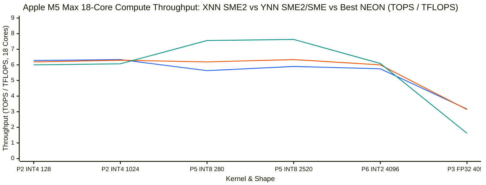
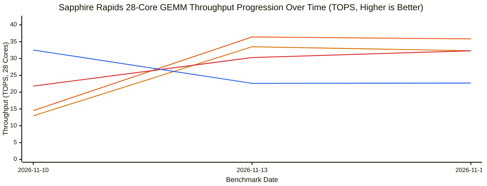
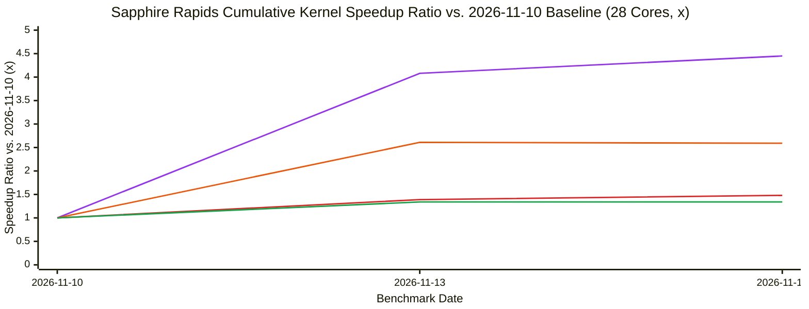

# Level 1 Kernel Benchmark Suite Dashboard — Gemma 4 31B

- **Interactive HTML Dashboard**: [`kernel/dashboards/index.html`](index.html)
- **Raw Time-Series JSON**: [`kernel/dashboards/data.json`](data.json)
- **Last Updated**: `2026-11-25 09:23 UTC`
- **Tracked Hardware Suites**:
  - **Apple M5 Max (18 Cores: 6 Super + 12 Perf, SME2 / NEON I8MM / DotProd)** (`gemma4-31b-apple-m5-max`):
    - **`2026-11-25`** (`google/XNNPACK` @ `e7aaa4db`, threads `[1, 6, 18]`): [2026-11-25-gemma4-31b-apple-m5-max/kernel_report_gemma4_31b_apple_m5_max.md](../reports/2026-11-25-gemma4-31b-apple-m5-max/kernel_report_gemma4_31b_apple_m5_max.md)
  - **Intel Sapphire Rapids (Socket 0, AMX-INT8 / AVX-512 VNNI / GFNI)** (`gemma4-31b-sapphire-rapids`):
    - **`2026-11-10`** (`google/XNNPACK` @ `28d1fc6d`, threads `[1, 28]`): [2026-11-10-gemma4-31b-sapphire-rapids/kernel_report_gemma4_31b_sapphire_rapids.md](../reports/2026-11-10-gemma4-31b-sapphire-rapids/kernel_report_gemma4_31b_sapphire_rapids.md)
    - **`2026-11-13`** (`google/XNNPACK` @ `6e5b0566`, threads `[1, 28, 56]`): [2026-11-13-gemma4-31b-sapphire-rapids/kernel_report_gemma4_31b_sapphire_rapids.md](../reports/2026-11-13-gemma4-31b-sapphire-rapids/kernel_report_gemma4_31b_sapphire_rapids.md)
    - **`2026-11-17`** (`google/XNNPACK` @ `328e0a0e`, threads `[1, 28, 56]`): [2026-11-17-gemma4-31b-sapphire-rapids/kernel_report_gemma4_31b_sapphire_rapids.md](../reports/2026-11-17-gemma4-31b-sapphire-rapids/kernel_report_gemma4_31b_sapphire_rapids.md)

---

## 1. Apple M5 Max (`arm64` SME2 + NEON, `2026-11-25`, `XNNPACK @ e7aaa4db`)

> [!IMPORTANT]
> **Key Apple M5 Max Microarchitectural Findings (`1T` / `6T` / `18T`, `14/14` Numerical Precision PASS)**:
> 1. **3-Cluster SME2 Saturation (`6.47 TOPS`) vs. 18-Core NEON I8MM Crossover (`8.13 TOPS`)**:
>    - On **8-bit Vision/Audio GEMM (`Pair 5`)**, `18T` **YNNPACK `NEON-I8MM` (`10x8x8_neoni8mm`) reaches `7.16–7.63 TOPS` (`88%–94%` of `8.13 TOPS`)**, overtaking both YNNPACK `SME2` (`6.19–6.34 TOPS`, **`+14%–22%`**) and XNNPACK KleidiAI `SME2` (`5.63–5.90 TOPS`, **`+22%–34%`**). XNNPACK's `NEON-I8MM` (`6.27–6.33 TOPS`) also beats XNNPACK `SME2` at `18T`, and on **2-bit Audio (`Pair 6`)**, XNNPACK `NEON-DotProd` (`6.09–6.25 TOPS`) edges out both `SME2` and `SME`.
> 2. **Decode (`M = 1` 4-Bit GEMV, `Pair 1`)**:
>    - YNNPACK `1x32x8_neondot` saturates **99.5%–100.0%** of the `301.1 GB/s` LPDDR5X Unified Memory Read ceiling (`1,196–1,203 GOPS` / `300–301 GB/s` at `18T`) and outperforms XNNPACK KleidiAI SME2 by **`1.89×`** on warm cluster L2 (`2,963` vs. `1,567 GOPS`).
> 3. **Prefill (`Pair 2`, 4-Bit GEMM) & FP32 Attention (`Pair 3`)**:
>    - Both SME2/SME backends saturate **96%–99%** of `6.47 TOPS` on 4-bit Prefill (`6.19–6.38 TOPS`) and **92%–98%** of `3.23 TFLOPS` on FP32 Attention BMM (`2.99–3.17 TFLOPS`, **`1.96×` faster** than `18T` NEON-FP32).
> 4. **Softmax Fusion (`Pair 4`)**:
>    - YNNPACK read-only reductions hit **`1,529 GB/s`** on L2-resident `1024×1024`, whereas on SLC-resident `2520×2520` / `1024×4096` (`34–51 MB > 32 MiB` L2), XNNPACK's row-fused `rmax + raddstoreexpminusmax` (`482–504 GB/s`) beats unfused reductions (`366 GB/s`) by **`1.31×–1.38×`** while computing `exp()`.



### 1.1 Apple M5 Max (`1C` / `6C` / `18C`) Summary Table Across All 7 Kernel Pairs

| Kernel Pair | Shape `(M×N×K)` | Regime | Backend (`ISA`) | `1C` | `6C` | **`18C`** | **`18C` ISA Util** | **`18C` Machine Peak Util** |
| :--- | :--- | :--- | :--- | ---: | ---: | ---: | ---: | ---: |
| `P1: INT4 GEMV (Decode)` | `1×4096×5376` | `L2_Cluster_Warm` | **YNNPACK** (`NEON-DotProd`) | `222.10 GOPS` | `1,223.20 GOPS` | **`2,963.41 GOPS`** | `39.3%` | `39.3%` |
| `P1: INT4 GEMV (Decode)` | `1×4096×5376` | `L2_Cluster_Warm` | **XNNPACK** (`SME2-INT8`) | `516.59 GOPS` | `532.14 GOPS` | **`1,567.11 GOPS`** | `24.2%` | `24.2%` |
| `P1: INT4 GEMV (Decode)` | `1×5376×21504` | `Unified_Memory_Streaming` | **YNNPACK** (`NEON-DotProd`) | `223.11 GOPS` | `689.51 GOPS` | **`1,203.08 GOPS`** | `100.0%` | `100.0%` |
| `P1: INT4 GEMV (Decode)` | `1×5376×21504` | `Unified_Memory_Streaming` | **XNNPACK** (`SME2-INT8`) | `513.27 GOPS` | `522.12 GOPS` | **`1,013.20 GOPS`** | `84.2%` | `84.2%` |
| `P1: INT4 GEMV (Decode)` | `1×8192×5376` | `SLC_L2_Warm` | **YNNPACK** (`NEON-DotProd`) | `219.73 GOPS` | `1,153.88 GOPS` | **`1,950.96 GOPS`** | `52.8%` | `52.8%` |
| `P1: INT4 GEMV (Decode)` | `1×8192×5376` | `SLC_L2_Warm` | **XNNPACK** (`SME2-INT8`) | `529.48 GOPS` | `532.39 GOPS` | **`1,511.99 GOPS`** | `40.9%` | `40.9%` |
| `P1: INT4 GEMV (Decode)` | `1×8192×5376` | `Unified_Memory_Streaming` | **YNNPACK** (`NEON-DotProd`) | `222.65 GOPS` | `689.09 GOPS` | **`1,201.32 GOPS`** | `99.9%` | `99.9%` |
| `P1: INT4 GEMV (Decode)` | `1×8192×5376` | `Unified_Memory_Streaming` | **XNNPACK** (`SME2-INT8`) | `509.44 GOPS` | `522.35 GOPS` | **`1,014.21 GOPS`** | `84.4%` | `84.4%` |
| `P1: INT4 GEMV (Decode)` | `1×21504×5376` | `Unified_Memory_Streaming` | **YNNPACK** (`NEON-DotProd`) | `222.68 GOPS` | `688.17 GOPS` | **`1,195.95 GOPS`** | `99.5%` | `99.5%` |
| `P1: INT4 GEMV (Decode)` | `1×21504×5376` | `Unified_Memory_Streaming` | **XNNPACK** (`SME2-INT8`) | `505.97 GOPS` | `999.20 GOPS` | **`982.37 GOPS`** | `81.7%` | `81.7%` |
| `P2: INT4 GEMM (Prefill)` | `128×5376×21504` | `Unified_Memory_to_L2_Tiled` | **YNNPACK** (`SME-INT8`) | `4,294.54 GOPS` | `4,054.61 GOPS` | **`6,277.15 GOPS`** | `97.0%` | `77.2%` |
| `P2: INT4 GEMM (Prefill)` | `128×5376×21504` | `Unified_Memory_to_L2_Tiled` | **XNNPACK** (`SME2-INT8`) | `4,264.08 GOPS` | `4,187.41 GOPS` | **`6,303.91 GOPS`** | `97.5%` | `77.6%` |
| `P2: INT4 GEMM (Prefill)` | `128×8192×5376` | `SLC_to_L2_Tiled` | **YNNPACK** (`SME-INT8`) | `4,085.30 GOPS` | `4,166.14 GOPS` | **`6,230.74 GOPS`** | `96.3%` | `76.7%` |
| `P2: INT4 GEMM (Prefill)` | `128×8192×5376` | `SLC_to_L2_Tiled` | **XNNPACK** (`SME2-INT8`) | `3,773.00 GOPS` | `4,144.31 GOPS` | **`6,224.42 GOPS`** | `96.2%` | `76.6%` |
| `P2: INT4 GEMM (Prefill)` | `128×21504×5376` | `Unified_Memory_to_L2_Tiled` | **YNNPACK** (`SME-INT8`) | `4,225.71 GOPS` | `3,921.74 GOPS` | **`6,188.94 GOPS`** | `95.7%` | `76.2%` |
| `P2: INT4 GEMM (Prefill)` | `128×21504×5376` | `Unified_Memory_to_L2_Tiled` | **XNNPACK** (`SME2-INT8`) | `3,976.83 GOPS` | `4,173.43 GOPS` | **`6,275.10 GOPS`** | `97.0%` | `77.2%` |
| `P2: INT4 GEMM (Prefill)` | `1024×8192×5376` | `Compute_Bound_Tiled` | **YNNPACK** (`SME-INT8`) | `4,280.78 GOPS` | `4,264.24 GOPS` | **`6,376.66 GOPS`** | `98.6%` | `78.5%` |
| `P2: INT4 GEMM (Prefill)` | `1024×8192×5376` | `Compute_Bound_Tiled` | **XNNPACK** (`SME2-INT8`) | `3,980.65 GOPS` | `4,223.47 GOPS` | **`6,347.11 GOPS`** | `98.1%` | `78.1%` |
| `P2: INT4 GEMM (Prefill)` | `1024×21504×5376` | `Compute_Bound_Tiled` | **YNNPACK** (`SME-INT8`) | `4,249.34 GOPS` | `6,320.86 GOPS` | **`6,303.76 GOPS`** | `97.5%` | `77.6%` |
| `P2: INT4 GEMM (Prefill)` | `1024×21504×5376` | `Compute_Bound_Tiled` | **XNNPACK** (`SME2-INT8`) | `3,956.53 GOPS` | `6,094.48 GOPS` | **`6,343.52 GOPS`** | `98.1%` | `78.1%` |
| `P3: FP32 Attention BMM` | `128×1024×256` | `L2_Cluster_Resident` | **YNNPACK** (`SME2-FP32`) | `2,040.90 GFLOPS` | `2,075.33 GFLOPS` | **`3,076.48 GFLOPS`** | `95.2%` | `95.2%` |
| `P3: FP32 Attention BMM` | `128×1024×256` | `L2_Cluster_Resident` | **XNNPACK** (`SME2-FP32`) | `1,814.98 GFLOPS` | `2,002.56 GFLOPS` | **`2,999.98 GFLOPS`** | `92.8%` | `92.8%` |
| `P3: FP32 Attention BMM` | `1024×1024×256` | `L2_Cluster_Resident` | **YNNPACK** (`SME2-FP32`) | `2,045.79 GFLOPS` | `2,098.29 GFLOPS` | **`3,066.28 GFLOPS`** | `94.9%` | `94.9%` |
| `P3: FP32 Attention BMM` | `1024×1024×256` | `L2_Cluster_Resident` | **XNNPACK** (`SME2-FP32`) | `1,815.00 GFLOPS` | `2,045.99 GFLOPS` | **`3,006.22 GFLOPS`** | `93.0%` | `93.0%` |
| `P3: FP32 Attention BMM` | `1024×4096×512` | `SLC_Resident` | **YNNPACK** (`SME2-FP32`) | `2,133.75 GFLOPS` | `2,078.98 GFLOPS` | **`3,141.25 GFLOPS`** | `97.2%` | `97.2%` |
| `P3: FP32 Attention BMM` | `1024×4096×512` | `SLC_Resident` | **XNNPACK** (`SME2-FP32`) | `1,662.35 GFLOPS` | `2,080.39 GFLOPS` | **`3,171.73 GFLOPS`** | `98.1%` | `98.1%` |
| `P3: FP32 Attention BMM` | `2520×2520×72` | `SLC_Resident` | **YNNPACK** (`SME2-FP32`) | `1,986.54 GFLOPS` | `1,988.95 GFLOPS` | **`2,985.56 GFLOPS`** | `92.4%` | `92.4%` |
| `P3: FP32 Attention BMM` | `2520×2520×72` | `SLC_Resident` | **XNNPACK** (`SME2-FP32`) | `1,046.29 GFLOPS` | `1,975.68 GFLOPS` | **`2,986.92 GFLOPS`** | `92.4%` | `92.4%` |
| `P4: FP32 Softmax` | `1024×1024×1` | `L2_Cluster_Resident` | **YNNPACK** (`NEON-FP32`) | `111.46 GB/s` | `525.54 GB/s` | **`1,529.11 GB/s`** | `80.5%` | `80.5%` |
| `P4: FP32 Softmax` | `1024×1024×1` | `L2_Cluster_Resident` | **XNNPACK** (`NEON-FP32`) | `36.02 GB/s` | `195.06 GB/s` | **`494.44 GB/s`** | `77.9%` | `77.9%` |
| `P4: FP32 Softmax` | `1024×4096×1` | `SLC_Resident` | **YNNPACK** (`NEON-FP32`) | `105.09 GB/s` | `309.15 GB/s` | **`366.04 GB/s`** | `39.6%` | `39.6%` |
| `P4: FP32 Softmax` | `1024×4096×1` | `SLC_Resident` | **XNNPACK** (`NEON-FP32`) | `36.46 GB/s` | `199.93 GB/s` | **`504.01 GB/s`** | `79.4%` | `79.4%` |
| `P4: FP32 Softmax` | `2520×2520×1` | `SLC_Resident` | **YNNPACK** (`NEON-FP32`) | `94.89 GB/s` | `255.93 GB/s` | **`366.25 GB/s`** | `39.6%` | `39.6%` |
| `P4: FP32 Softmax` | `2520×2520×1` | `SLC_Resident` | **XNNPACK** (`NEON-FP32`) | `34.11 GB/s` | `192.84 GB/s` | **`481.53 GB/s`** | `75.8%` | `75.8%` |
| `P5: INT8 GEMM (Multimodal)` | `280×5376×1152` | `L2_Cluster_Resident` | **YNNPACK** (`SME2-INT8`) | `4,226.57 GOPS` | `4,145.09 GOPS` | **`6,186.86 GOPS`** | `95.6%` | `76.1%` |
| `P5: INT8 GEMM (Multimodal)` | `280×5376×1152` | `L2_Cluster_Resident` | **XNNPACK** (`SME2-INT8`) | `2,812.03 GOPS` | `3,659.09 GOPS` | **`5,629.03 GOPS`** | `87.0%` | `69.3%` |
| `P5: INT8 GEMM (Multimodal)` | `280×5376×1152` | `L2_Cluster_Resident` | **XNNPACK_NEON_BASELINE** (`NEON-I8MM`) | `478.92 GOPS` | `2,670.94 GOPS` | **`6,297.15 GOPS`** | `77.5%` | `77.5%` |
| `P5: INT8 GEMM (Multimodal)` | `280×5376×1152` | `L2_Cluster_Resident` | **YNNPACK_NEON_BASELINE** (`NEON-I8MM`) | `560.86 GOPS` | `3,109.58 GOPS` | **`7,559.03 GOPS`** | `93.0%` | `93.0%` |
| `P5: INT8 GEMM (Multimodal)` | `2520×1152×1152` | `SLC_Resident` | **YNNPACK** (`SME2-INT8`) | `4,332.87 GOPS` | `4,242.02 GOPS` | **`6,343.97 GOPS`** | `98.1%` | `78.1%` |
| `P5: INT8 GEMM (Multimodal)` | `2520×1152×1152` | `SLC_Resident` | **XNNPACK** (`SME2-INT8`) | `2,856.97 GOPS` | `3,747.27 GOPS` | **`5,896.12 GOPS`** | `91.2%` | `72.5%` |
| `P5: INT8 GEMM (Multimodal)` | `2520×1152×1152` | `SLC_Resident` | **XNNPACK_NEON_BASELINE** (`NEON-I8MM`) | `478.69 GOPS` | `2,687.06 GOPS` | **`6,326.50 GOPS`** | `77.8%` | `77.8%` |
| `P5: INT8 GEMM (Multimodal)` | `2520×1152×1152` | `SLC_Resident` | **YNNPACK_NEON_BASELINE** (`NEON-I8MM`) | `562.57 GOPS` | `3,092.66 GOPS` | **`7,629.68 GOPS`** | `93.9%` | `93.9%` |
| `P5: INT8 GEMM (Multimodal)` | `2520×4304×1152` | `SLC_Resident` | **YNNPACK** (`SME2-INT8`) | `4,283.88 GOPS` | `4,194.13 GOPS` | **`6,271.25 GOPS`** | `97.0%` | `77.2%` |
| `P5: INT8 GEMM (Multimodal)` | `2520×4304×1152` | `SLC_Resident` | **XNNPACK** (`SME2-INT8`) | `2,829.36 GOPS` | `4,034.04 GOPS` | **`5,849.63 GOPS`** | `90.4%` | `72.0%` |
| `P6: INT2 GEMM (Audio/Embed)` | `204×1024×1024` | `L2_Cluster_Resident` | **YNNPACK** (`SME-INT8`) | `3,947.68 GOPS` | `4,008.40 GOPS` | **`6,003.73 GOPS`** | `92.8%` | `73.9%` |
| `P6: INT2 GEMM (Audio/Embed)` | `204×1024×1024` | `L2_Cluster_Resident` | **XNNPACK** (`SME2-INT8`) | `2,710.60 GOPS` | `3,586.39 GOPS` | **`5,762.64 GOPS`** | `89.1%` | `70.9%` |
| `P6: INT2 GEMM (Audio/Embed)` | `204×1024×4096` | `L2_Cluster_Resident` | **YNNPACK** (`SME-INT8`) | `4,008.68 GOPS` | `4,007.70 GOPS` | **`6,081.65 GOPS`** | `94.0%` | `74.8%` |
| `P6: INT2 GEMM (Audio/Embed)` | `204×1024×4096` | `L2_Cluster_Resident` | **XNNPACK** (`SME2-INT8`) | `3,744.44 GOPS` | `4,071.09 GOPS` | **`6,120.78 GOPS`** | `94.6%` | `75.3%` |
| `P6: INT2 GEMM (Audio/Embed)` | `204×4096×1024` | `L2_Cluster_Resident` | **YNNPACK** (`SME-INT8`) | `3,951.09 GOPS` | `4,005.54 GOPS` | **`5,999.68 GOPS`** | `92.8%` | `73.8%` |
| `P6: INT2 GEMM (Audio/Embed)` | `204×4096×1024` | `L2_Cluster_Resident` | **XNNPACK** (`SME2-INT8`) | `2,703.72 GOPS` | `3,733.49 GOPS` | **`5,747.20 GOPS`** | `88.8%` | `70.7%` |
| `P6: INT2 GEMM (Audio/Embed)` | `204×4096×1024` | `L2_Cluster_Resident` | **XNNPACK_NEON_BASELINE** (`NEON-DotProd`) | `449.43 GOPS` | `2,513.17 GOPS` | **`6,092.12 GOPS`** | `80.8%` | `75.0%` |
| `P6: INT2 GEMM (Audio/Embed)` | `204×4096×1024` | `L2_Cluster_Resident` | **YNNPACK_NEON_BASELINE** (`NEON-DotProd`) | `424.48 GOPS` | `2,378.63 GOPS` | **`5,760.63 GOPS`** | `76.4%` | `70.9%` |
| `P7: 32-Bit Pack/Transpose` | `1×1024×256` | `L2_Cluster_Copy` | **YNNPACK** (`NEON`) | `70.02 GB/s` | `305.53 GB/s` | **`518.59 GB/s`** | `81.7%` | `81.7%` |
| `P7: 32-Bit Pack/Transpose` | `1×1024×256` | `L2_Cluster_Copy` | **XNNPACK** (`NEON`) | `101.12 GB/s` | `483.08 GB/s` | **`781.85 GB/s`** | `123.2%` | `123.2%` |
| `P7: 32-Bit Pack/Transpose` | `1×2520×1152` | `SLC_Copy` | **YNNPACK** (`NEON`) | `54.99 GB/s` | `273.19 GB/s` | **`537.19 GB/s`** | `116.9%` | `116.9%` |
| `P7: 32-Bit Pack/Transpose` | `1×2520×1152` | `SLC_Copy` | **XNNPACK** (`NEON`) | `103.99 GB/s` | `520.48 GB/s` | **`496.28 GB/s`** | `108.0%` | `108.0%` |
| `P7: 32-Bit Pack/Transpose` | `1×4096×512` | `L2_Cluster_Copy` | **YNNPACK** (`NEON`) | `25.23 GB/s` | `157.61 GB/s` | **`402.94 GB/s`** | `63.5%` | `63.5%` |
| `P7: 32-Bit Pack/Transpose` | `1×4096×512` | `L2_Cluster_Copy` | **XNNPACK** (`NEON`) | `106.39 GB/s` | `467.09 GB/s` | **`739.75 GB/s`** | `116.5%` | `116.5%` |

---

## 2. Intel Sapphire Rapids (`x86_64` AMX + AVX-512, `2026-11-10` → `2026-11-13` → `2026-11-17`)

> [!IMPORTANT]
> **Summary of Major Kernel & Harness Advances Across Tracked Snapshots**:
> 1. **YNNPACK 4-Bit Prefill GEMM (`Pair 2`, `AVX-512 VNNI 12x16x8` → `AMX-INT8+GFNI 32x32x64`)**:
>    - **28-Core Throughput**: Jumped from **`13.89–14.51 TOPS`** (`2026-11-10`) to **`35.84–36.41 TOPS`** (`2026-11-13` / `2026-11-17`) — a **`2.47×–2.59×` (`+147%` to `+159%`) speedup**, surpassing XNNPACK's `16x64c4__avx512amx` (`22.39–22.70 TOPS` @ 28C) by **`1.58×–1.60×`**.
>    - **56-Core Full-Socket Throughput**: Reaches **`71.69–73.76 TOPS`** on `128×21504×5376` (**`5.75×–5.93×` faster** than the `12.44–12.46 TOPS` AVX-512 VNNI baseline and **`1.58×–1.63×` faster** than XNNPACK AMX at `45.20–45.27 TOPS`).
>    - **Single-Core (`1T`) Throughput**: Increased **`2.56×` (`+156%`)** on YNNPACK (`491.8 GOPS` → `1,259.7 GOPS`) and **`+8.2%–10.7%`** on XNNPACK (`748.9` → `810.5 GOPS` on `M=128`; `711.7` → `788.1 GOPS` on `M=1024`) from GFNI nibble-unpack optimizations.
> 2. **YNNPACK FP32 Softmax Reductions (`Pair 4`, `max_k1 + sum_k1`)**:
>    - **28-Core Bandwidth**: Improved **`3.36×–4.45×` (`+236%` to `+345%`)** from `437.9–581.7 GB/s` (`2026-11-10`) to **`1,470.0–2,325.5 GB/s`** (`2026-11-17`) at 28C (and **`3,314.5–3,957.8 GB/s` = `74.1%` of L2 Read ceiling** at 56C) after correcting `k = row_len` element counts and 4-row `min_max_accumulator<N=4>` batching.
> 3. **FP32 Attention `BatchMatMul` (`Pair 3`, 2D N-Major Tile Partitioning & Zero-Init Accumulators)**:
>    - **28-Core Throughput**: Improved **`1.34×` (`+34.3%`)** on YNNPACK `5x64_avx512` (`2.34` → `3.14 TFLOPS` on `1024×1024×256`, reaching **`6.40–6.61 TFLOPS` = `90%–93%` of FP32 FMA ceiling** on 56C) and **`1.29×` (`+28.7%`)** on XNNPACK `7x32__avx512f_broadcast` (`2.51` → `3.23 TFLOPS` on 28C, **`6.35–6.42 TFLOPS`** on 56C).
> 4. **8-Bit Vision ViT GEMM (`Pair 5`, `2520×1152×1152` & `2520×4304×1152`)**:
>    - **28-Core Throughput**: Improved **`1.48×` (`+48.1%`)** on YNNPACK `32x32x64_amxint8` (`21.80` → `32.30 TOPS` on `2520×1152×1152`, **`67.05 TOPS`** at 56C) and **`1.18×` (`+17.7%`)** on XNNPACK `16x64c4__avx512amx` (`20.24` → `23.83 TOPS` on 28C, **`81.20 TOPS`** at 56C).





### 2.1 Sapphire Rapids Multi-Core (`28C` & `56C`) Progression Table Across All 7 Kernel Pairs

| Kernel Pair | Shape `(M×N×K)` | Regime | Backend | `2026-11-10` (`28C`) | `2026-11-13` (`28C`) | `2026-11-17` (`28C`) | **28C Speedup (`Nov 10 → Nov 17`)** | `2026-11-13` (`56C`) | `2026-11-17` (`56C`) | **Latest `56C` ISA Util** |
| :--- | :--- | :--- | :--- | ---: | ---: | ---: | :---: | ---: | ---: | ---: |
| `P1: INT4 GEMV (Decode)` | `1×4096×5376` | `L3_LLC_Warm` | **YNNPACK** | `4,499.31 GOPS` | `1,440.54 GOPS` | `1,418.25 GOPS` | **`0.32×` (`-68.5%`)** | `2,385.64 GOPS` | **`2,356.53 GOPS`** | `11.1%` |
| `P1: INT4 GEMV (Decode)` | `1×4096×5376` | `L3_LLC_Warm` | **XNNPACK** | `1,842.31 GOPS` | `1,132.51 GOPS` | `1,123.74 GOPS` | **`0.61×` (`-39.0%`)** | `1,693.10 GOPS` | **`1,650.77 GOPS`** | `7.8%` |
| `P1: INT4 GEMV (Decode)` | `1×5376×21504` | `DDR5_DRAM_Streaming` | **YNNPACK** | `912.63 GOPS` | `835.68 GOPS` | `862.73 GOPS` | `0.95×` (`-5.5%`) | `934.98 GOPS` | **`980.16 GOPS`** | `102.8%` |
| `P1: INT4 GEMV (Decode)` | `1×5376×21504` | `DDR5_DRAM_Streaming` | **XNNPACK** | `927.78 GOPS` | `850.62 GOPS` | `840.42 GOPS` | `0.91×` (`-9.4%`) | `919.63 GOPS` | **`789.86 GOPS`** | `82.9%` |
| `P1: INT4 GEMV (Decode)` | `1×8192×5376` | `DDR5_DRAM_Streaming` | **YNNPACK** | `874.29 GOPS` | `829.06 GOPS` | `827.96 GOPS` | `0.95×` (`-5.3%`) | `966.94 GOPS` | **`988.38 GOPS`** | `103.8%` |
| `P1: INT4 GEMV (Decode)` | `1×8192×5376` | `DDR5_DRAM_Streaming` | **XNNPACK** | `905.21 GOPS` | `797.81 GOPS` | `793.78 GOPS` | `0.88×` (`-12.3%`) | `939.54 GOPS` | **`100.55 GOPS`** | `10.6%` |
| `P1: INT4 GEMV (Decode)` | `1×8192×5376` | `L3_LLC_Warm` | **YNNPACK** | `4,537.57 GOPS` | `1,438.30 GOPS` | `1,407.14 GOPS` | **`0.31×` (`-69.0%`)** | `2,866.97 GOPS` | **`2,745.32 GOPS`** | `12.9%` |
| `P1: INT4 GEMV (Decode)` | `1×8192×5376` | `L3_LLC_Warm` | **XNNPACK** | `2,179.74 GOPS` | `1,333.49 GOPS` | `1,344.74 GOPS` | **`0.62×` (`-38.3%`)** | `2,191.49 GOPS` | **`2,233.35 GOPS`** | `10.5%` |
| `P1: INT4 GEMV (Decode)` | `1×21504×5376` | `DDR5_DRAM_Streaming` | **YNNPACK** | `898.36 GOPS` | `869.53 GOPS` | `855.82 GOPS` | `0.95×` (`-4.7%`) | `1,004.20 GOPS` | **`978.50 GOPS`** | `102.7%` |
| `P1: INT4 GEMV (Decode)` | `1×21504×5376` | `DDR5_DRAM_Streaming` | **XNNPACK** | `907.05 GOPS` | `836.62 GOPS` | `802.79 GOPS` | `0.89×` (`-11.5%`) | `1,016.74 GOPS` | **`984.76 GOPS`** | `103.4%` |
| `P2: INT4 GEMM (Prefill)` | `128×5376×21504` | `DDR5_DRAM_to_L2_Tiled` | **YNNPACK** | `14.01 TOPS` | `35.98 TOPS` | `35.03 TOPS` | **`2.50×` (`+150.1%`)** | `60.76 TOPS` | **`58.13 TOPS`** | `26.4%` |
| `P2: INT4 GEMM (Prefill)` | `128×5376×21504` | `DDR5_DRAM_to_L2_Tiled` | **XNNPACK** | `33.92 TOPS` | `23.54 TOPS` | `23.36 TOPS` | **`0.69×` (`-31.1%`)** | `46.88 TOPS` | **`46.39 TOPS`** | `21.0%` |
| `P2: INT4 GEMM (Prefill)` | `128×8192×5376` | `L3_LLC_to_L2_Tiled` | **YNNPACK** | `13.89 TOPS` | `36.30 TOPS` | `35.92 TOPS` | **`2.59×` (`+158.5%`)** | `70.30 TOPS` | **`69.66 TOPS`** | `31.6%` |
| `P2: INT4 GEMM (Prefill)` | `128×8192×5376` | `L3_LLC_to_L2_Tiled` | **XNNPACK** | `25.60 TOPS` | `22.22 TOPS` | `22.39 TOPS` | `0.87×` (`-12.5%`) | `43.01 TOPS` | **`43.04 TOPS`** | `19.5%` |
| `P2: INT4 GEMM (Prefill)` | `128×21504×5376` | `DDR5_DRAM_to_L2_Tiled` | **YNNPACK** | `14.51 TOPS` | `36.41 TOPS` | `35.84 TOPS` | **`2.47×` (`+146.9%`)** | `73.76 TOPS` | **`71.69 TOPS`** | `32.5%` |
| `P2: INT4 GEMM (Prefill)` | `128×21504×5376` | `DDR5_DRAM_to_L2_Tiled` | **XNNPACK** | `32.53 TOPS` | `22.62 TOPS` | `22.70 TOPS` | **`0.70×` (`-30.2%`)** | `45.20 TOPS` | **`45.27 TOPS`** | `20.5%` |
| `P2: INT4 GEMM (Prefill)` | `1024×8192×5376` | `Compute_Bound_Tiled` | **YNNPACK** | `13.34 TOPS` | `34.34 TOPS` | `33.65 TOPS` | **`2.52×` (`+152.3%`)** | `64.50 TOPS` | **`63.27 TOPS`** | `28.7%` |
| `P2: INT4 GEMM (Prefill)` | `1024×8192×5376` | `Compute_Bound_Tiled` | **XNNPACK** | `27.66 TOPS` | `22.59 TOPS` | `22.58 TOPS` | **`0.82×` (`-18.4%`)** | `44.37 TOPS` | **`44.54 TOPS`** | `20.2%` |
| `P2: INT4 GEMM (Prefill)` | `1024×21504×5376` | `Compute_Bound_Tiled` | **YNNPACK** | `12.96 TOPS` | `33.50 TOPS` | `32.30 TOPS` | **`2.49×` (`+149.3%`)** | `61.59 TOPS` | **`59.60 TOPS`** | `27.0%` |
| `P2: INT4 GEMM (Prefill)` | `1024×21504×5376` | `Compute_Bound_Tiled` | **XNNPACK** | `26.56 TOPS` | `22.22 TOPS` | `22.06 TOPS` | **`0.83×` (`-16.9%`)** | `43.74 TOPS` | **`43.47 TOPS`** | `19.7%` |
| `P3: FP32 Attention BMM` | `128×1024×256` | `L2_Cache_Resident` | **YNNPACK** | `2,469.33 GFLOPS` | `3,276.56 GFLOPS` | `3,300.09 GFLOPS` | **`1.34×` (`+33.6%`)** | `6,219.61 GFLOPS` | **`6,106.18 GFLOPS`** | `86.3%` |
| `P3: FP32 Attention BMM` | `128×1024×256` | `L2_Cache_Resident` | **XNNPACK** | `2,729.31 GFLOPS` | `3,207.92 GFLOPS` | `3,057.12 GFLOPS` | `1.12×` (`+12.0%`) | `6,362.87 GFLOPS` | **`6,248.07 GFLOPS`** | `88.3%` |
| `P3: FP32 Attention BMM` | `1024×1024×256` | `L3_LLC_Resident` | **YNNPACK** | `2,341.05 GFLOPS` | `3,138.08 GFLOPS` | `3,144.36 GFLOPS` | **`1.34×` (`+34.3%`)** | `6,613.14 GFLOPS` | **`6,397.22 GFLOPS`** | `90.5%` |
| `P3: FP32 Attention BMM` | `1024×1024×256` | `L3_LLC_Resident` | **XNNPACK** | `2,511.19 GFLOPS` | `3,201.33 GFLOPS` | `3,231.01 GFLOPS` | **`1.29×` (`+28.7%`)** | `6,420.97 GFLOPS` | **`6,352.04 GFLOPS`** | `89.8%` |
| `P3: FP32 Attention BMM` | `1024×4096×512` | `L3_LLC_Resident` | **YNNPACK** | `3,343.29 GFLOPS` | `3,119.39 GFLOPS` | `3,134.39 GFLOPS` | `0.94×` (`-6.2%`) | `6,204.81 GFLOPS` | **`6,225.24 GFLOPS`** | `88.0%` |
| `P3: FP32 Attention BMM` | `1024×4096×512` | `L3_LLC_Resident` | **XNNPACK** | `3,717.83 GFLOPS` | `2,909.87 GFLOPS` | `2,999.07 GFLOPS` | **`0.81×` (`-19.3%`)** | `5,852.43 GFLOPS` | **`5,881.58 GFLOPS`** | `83.2%` |
| `P3: FP32 Attention BMM` | `2520×2520×72` | `L3_LLC_Resident` | **YNNPACK** | `2,240.25 GFLOPS` | `2,623.30 GFLOPS` | `2,711.73 GFLOPS` | **`1.21×` (`+21.0%`)** | `4,942.49 GFLOPS` | **`4,451.90 GFLOPS`** | `63.0%` |
| `P3: FP32 Attention BMM` | `2520×2520×72` | `L3_LLC_Resident` | **XNNPACK** | `3,774.38 GFLOPS` | `2,784.00 GFLOPS` | `2,818.22 GFLOPS` | **`0.75×` (`-25.3%`)** | `5,739.29 GFLOPS` | **`5,500.29 GFLOPS`** | `77.8%` |
| `P4: FP32 Softmax` | `1024×1024×1` | `L2_L3_Resident` | **YNNPACK** | `581.66 GB/s` | `2,061.27 GB/s` | `2,048.66 GB/s` | **`3.52×` (`+252.2%`)** | `3,534.80 GB/s` | **`3,520.22 GB/s`** | `66.0%` |
| `P4: FP32 Softmax` | `1024×1024×1` | `L2_L3_Resident` | **XNNPACK** | `1,741.66 GB/s` | `1,067.33 GB/s` | `1,041.86 GB/s` | **`0.60×` (`-40.2%`)** | `1,639.62 GB/s` | **`1,965.28 GB/s`** | `71.5%` |
| `P4: FP32 Softmax` | `1024×4096×1` | `L3_LLC_Resident` | **YNNPACK** | `522.28 GB/s` | `2,131.07 GB/s` | `2,325.47 GB/s` | **`4.45×` (`+345.3%`)** | `4,010.57 GB/s` | **`3,957.85 GB/s`** | `74.1%` |
| `P4: FP32 Softmax` | `1024×4096×1` | `L3_LLC_Resident` | **XNNPACK** | `1,450.52 GB/s` | `1,035.77 GB/s` | `1,029.08 GB/s` | **`0.71×` (`-29.1%`)** | `2,010.54 GB/s` | **`1,964.62 GB/s`** | `71.5%` |
| `P4: FP32 Softmax` | `2520×2520×1` | `L3_LLC_Resident` | **YNNPACK** | `437.88 GB/s` | `1,482.38 GB/s` | `1,470.02 GB/s` | **`3.36×` (`+235.7%`)** | `3,332.85 GB/s` | **`3,314.50 GB/s`** | `62.1%` |
| `P4: FP32 Softmax` | `2520×2520×1` | `L3_LLC_Resident` | **XNNPACK** | `1,560.26 GB/s` | `961.16 GB/s` | `987.87 GB/s` | **`0.63×` (`-36.7%`)** | `2,036.39 GB/s` | **`1,995.69 GB/s`** | `72.6%` |
| `P5: INT8 GEMM (Multimodal)` | `280×5376×1152` | `L3_LLC_Resident` | **YNNPACK** | `81.99 TOPS` | `60.01 TOPS` | `46.00 TOPS` | **`0.56×` (`-43.9%`)** | `118.36 TOPS` | **`99.21 TOPS`** | `45.0%` |
| `P5: INT8 GEMM (Multimodal)` | `280×5376×1152` | `L3_LLC_Resident` | **XNNPACK** | `47.50 TOPS` | `42.06 TOPS` | `29.28 TOPS` | **`0.62×` (`-38.4%`)** | `84.25 TOPS` | **`46.20 TOPS`** | `20.9%` |
| `P5: INT8 GEMM (Multimodal)` | `2520×1152×1152` | `L3_LLC_Resident` | **YNNPACK** | `21.80 TOPS` | `30.28 TOPS` | `32.30 TOPS` | **`1.48×` (`+48.1%`)** | `65.03 TOPS` | **`67.05 TOPS`** | `30.4%` |
| `P5: INT8 GEMM (Multimodal)` | `2520×1152×1152` | `L3_LLC_Resident` | **XNNPACK** | `20.24 TOPS` | `23.72 TOPS` | `23.83 TOPS` | **`1.18×` (`+17.7%`)** | `74.12 TOPS` | **`81.20 TOPS`** | `36.8%` |
| `P5: INT8 GEMM (Multimodal)` | `2520×4304×1152` | `L3_LLC_Resident` | **YNNPACK** | `23.63 TOPS` | `32.08 TOPS` | `27.81 TOPS` | **`1.18×` (`+17.7%`)** | `64.08 TOPS` | **`58.98 TOPS`** | `26.7%` |
| `P5: INT8 GEMM (Multimodal)` | `2520×4304×1152` | `L3_LLC_Resident` | **XNNPACK** | `25.17 TOPS` | `26.72 TOPS` | `28.22 TOPS` | `1.12×` (`+12.1%`) | `48.51 TOPS` | **`53.39 TOPS`** | `24.2%` |
| `P6: INT2 GEMM (Audio/Embed)` | `204×1024×1024` | `L2_Cache_Resident` | **YNNPACK** | `7,035.89 GOPS` | `7,189.23 GOPS` | `7,291.94 GOPS` | `1.04×` (`+3.6%`) | `13.84 TOPS` | **`682.63 GOPS`** | `2.5%` |
| `P6: INT2 GEMM (Audio/Embed)` | `204×1024×1024` | `L2_Cache_Resident` | **XNNPACK** | `5,690.16 GOPS` | `5,058.74 GOPS` | `5,011.36 GOPS` | `0.88×` (`-11.9%`) | `10.05 TOPS` | **`9,961.94 GOPS`** | `70.4%` |
| `P6: INT2 GEMM (Audio/Embed)` | `204×1024×4096` | `L2_L3_Resident` | **YNNPACK** | `7,529.66 GOPS` | `7,497.96 GOPS` | `7,362.69 GOPS` | `0.98×` (`-2.2%`) | `14.92 TOPS` | **`14.17 TOPS`** | `50.9%` |
| `P6: INT2 GEMM (Audio/Embed)` | `204×1024×4096` | `L2_L3_Resident` | **XNNPACK** | `8,180.97 GOPS` | `5,305.48 GOPS` | `5,040.39 GOPS` | **`0.62×` (`-38.4%`)** | `10.58 TOPS` | **`10.06 TOPS`** | `71.1%` |
| `P6: INT2 GEMM (Audio/Embed)` | `204×4096×1024` | `L2_L3_Resident` | **YNNPACK** | `9,973.45 GOPS` | `7,394.74 GOPS` | `7,417.25 GOPS` | **`0.74×` (`-25.6%`)** | `13.89 TOPS` | **`11.71 TOPS`** | `42.1%` |
| `P6: INT2 GEMM (Audio/Embed)` | `204×4096×1024` | `L2_L3_Resident` | **XNNPACK** | `8,423.48 GOPS` | `5,076.20 GOPS` | `5,056.94 GOPS` | **`0.60×` (`-40.0%`)** | `10.12 TOPS` | **`10.12 TOPS`** | `71.5%` |
| `P7: 32-Bit Pack/Transpose` | `1×1024×256` | `L2_Cache_Copy` | **YNNPACK** | `746.86 GB/s` | `309.26 GB/s` | `306.15 GB/s` | **`0.41×` (`-59.0%`)** | `383.25 GB/s` | **`381.90 GB/s`** | `13.9%` |
| `P7: 32-Bit Pack/Transpose` | `1×1024×256` | `L2_Cache_Copy` | **XNNPACK** | `912.99 GB/s` | `572.09 GB/s` | `591.50 GB/s` | **`0.65×` (`-35.2%`)** | `1,254.95 GB/s` | **`1,235.96 GB/s`** | `45.0%` |
| `P7: 32-Bit Pack/Transpose` | `1×2520×1152` | `L3_LLC_Copy` | **YNNPACK** | `1,315.26 GB/s` | `795.98 GB/s` | `792.39 GB/s` | **`0.60×` (`-39.8%`)** | `1,172.29 GB/s` | **`917.53 GB/s`** | `33.4%` |
| `P7: 32-Bit Pack/Transpose` | `1×2520×1152` | `L3_LLC_Copy` | **XNNPACK** | `1,585.56 GB/s` | `1,007.20 GB/s` | `1,003.32 GB/s` | **`0.63×` (`-36.7%`)** | `1,505.54 GB/s` | **`1,505.79 GB/s`** | `54.8%` |
| `P7: 32-Bit Pack/Transpose` | `1×4096×512` | `L3_LLC_Copy` | **YNNPACK** | `650.70 GB/s` | `289.74 GB/s` | `299.15 GB/s` | **`0.46×` (`-54.0%`)** | `475.06 GB/s` | **`493.12 GB/s`** | `17.9%` |
| `P7: 32-Bit Pack/Transpose` | `1×4096×512` | `L3_LLC_Copy` | **XNNPACK** | `1,163.57 GB/s` | `674.23 GB/s` | `679.39 GB/s` | **`0.58×` (`-41.6%`)** | `1,122.28 GB/s` | **`1,108.66 GB/s`** | `40.4%` |

---

## 3. Updating This Dashboard

Whenever a new dated report directory (`kernel/reports/YYYY-MM-DD-<suite>/`) is added or updated, regenerate both the interactive HTML dashboard and this Markdown summary via:

```bash
python3 kernel/scripts/update_dashboard.py
# or via Make:
make -C kernel dashboard
```
