# Microkernel Performance, Roofline & Numerical Precision Report — Gemma 4 31B on Apple M5 Max

- **Benchmark Date**: `2026-11-25`
- **Model**: Gemma 4 31B (`gemma-4-31b-it`, 4-bit Decoder / 8-bit Vision ViT / 2-bit & 8-bit Audio Conformer)
- **Target Microarchitecture**: Apple M5 Max (`arm64` / macOS, `18` physical cores = `6` Super + `12` Performance cores across `3` clusters; `128 KiB`/`64 KiB` L1D, `16 MiB` Super L2 + `2 × 8 MiB` Perf L2 = `32 MiB` aggregate L2, shared SLC, `36 GB` LPDDR5X Unified Memory; `SME` / `SME2` / `SME2p1` with `SVL = 64 B`, `NEON I8MM`, `DotProd`, `BF16`, `FP16`; no non-streaming `FEAT_SVE`)
- **Upstream Microkernel Revisions**:
  - `google/XNNPACK` `master` @ [`e7aaa4db`](https://github.com/google/XNNPACK/commit/e7aaa4dbeeed023e690a3a52c025e5a7d4fc7534) (XNNPACK + YNNPACK SME2/SME/NEON microkernels)
  - `ARM-software/kleidiai` `main` @ [`0ec849c4`](https://github.com/ARM-software/kleidiai/commit/0ec849c4ee7eecc8e79e6808d20bcdd10e8d137f) (KleidiAI SME2 `qp8`/`pf32` microkernels & packers linked by XNNPACK)
- **Execution Configurations**:
  - **Single-Core (`1T`)**: Single `QOS_CLASS_USER_INTERACTIVE` thread scheduled on a Super core (full access to the Super cluster's `4.38 TOPS` SME2 unit)
  - **Super Cluster (`6T`)**: `6` `QOS_CLASS_USER_INTERACTIVE` threads saturating the 6-core Super cluster (exposing cluster-shared SME2 contention vs. linear per-core NEON scaling)
  - **Full Chip (`18T`)**: All `18` physical cores across all 3 clusters (`6` Super + `12` Performance) with lock-free adaptive dynamic tile dispatch (~48 chunks/thread) for heterogeneous load balancing without cross-cluster atomic contention
- **Repeatability & Verification Methodology**:
  - **Performance & Roofline**: `CLOCK_MONOTONIC_RAW` with atomic spin-wait barriers (`sb_wait`), `caffeinate -i`, explicit warmup pass, 19 built-in pre-timing numerical smoke checks, and **7 independent timed trials** per probe and microkernel shape (`median`, `mean`, `min`, `max`, `stdev`, `cv_pct`)
  - **Numerical Precision & Quantization Fidelity**: Full two-level verification ([verify_litert_microkernels_arm64.c](../../scripts/verify_litert_microkernels_arm64.c)) across **4 deterministic input distributions** (`normal`, `saturation`, `outliers`, `tails`) testing all **14 load-bearing XNNPACK and YNNPACK microkernels** against (A) an **Exact Packed-Layout Scalar Reference (`INT64` / `FP64`)** and (B) an **Unquantized `FP64` Golden Operator Reference** (**`14 / 14 PASSED`**)

---

## 1. Executive Summary & Key Roofline Findings

> [!IMPORTANT]
> **Performance Roofline & Architectural Crossover Summary on Apple M5 Max (`1T` / `6T` / `18T`)**:
> 1. **Cluster-Shared SME2 (`3` Units, `6.47 TOPS`) vs. Per-Core NEON I8MM (`18` Cores, `8.13 TOPS`) — A Fundamental Hardware Crossover**:
>    - Empirical hardware ceiling probes measure **$C_{\text{prac}}(\text{SME2-INT8}) = \mathbf{4.38 / 6.54 / 6.47\text{ TOPS}}$** (`1T / 6T / 18T`): Apple M5 Max provisions **3 cluster-shared SME2 matrix engines** (1 Super SME2 ≈ `4.38 TOPS` + 2 Performance SME2 ≈ `1.08 TOPS` each), so SME2 saturates at **`6.47–6.54 TOPS`** once all 3 clusters are active.
>    - In contrast, per-core **`NEON I8MM` (`smmla`)** scales across all 18 cores from **`588.2 GOPS` (`1T`)** → **`3.25 TOPS` (`6T`)** → **`8.13 TOPS` (`18T`)** — **`1.26×` higher than 18-core SME2-INT8** (and **`NEON DotProd`** reaches **`7.54 TOPS`**, also exceeding 18T SME2!). On `FP32`, SME2 (`3.23 TFLOPS`) retains a **`1.80×` hardware advantage** over 18-core NEON FP32 (`1.80 TFLOPS`).
> 2. **8-Bit Vision ViT & Audio GEMM (`pair5_int8_gemm`) — Actionable Upstream Dispatch Finding (`18T NEON-I8MM` Beats `SME2` by `+14%–34%`)**:
>    - At **`1T`**, YNNPACK `dot_int8_int8_int32_sme2` achieves **`4.23–4.33 TOPS` (`96.6%–99.0%` of 1T SME2 peak)**, outperforming XNNPACK KleidiAI `16x64c4__neonsme2` (`2.81–2.86 TOPS`) by **`1.50×–1.52×`** and `1T` NEON-I8MM by **`7.7×`**.
>    - At **`18T`**, however, **controlled `NEON-I8MM` baselines overtake SME2 on both backends**: YNNPACK `10x8x8_neoni8mm` reaches **`7.16–7.63 TOPS` (`88.1%–93.9%` of `8.13 TOPS` NEON-I8MM ceiling)** — beating YNNPACK's own SME2 (`6.19–6.34 TOPS`) by **`1.14×–1.22×` (`+14%–22%`)** and XNNPACK KleidiAI SME2 (`5.63–5.90 TOPS`) by **`1.22×–1.34×` (`+22%–34%`)**! Even XNNPACK's own `4x16c8__neoni8mm` (`6.30–6.33 TOPS`) beats XNNPACK SME2 on all three shapes (`+7.3%` to `+11.9%`).
> 3. **Decode (`M = 1` 4-Bit GEMV, `pair1_int4_gemv`) — Per-Core NEON Saturates `301.1 GB/s` Unified Memory and Beats SME2 by `1.89×` on Warm L2**:
>    - On cold Unified Memory streaming (`1×21504×5376`, `1×5376×21504`, `1×8192×5376`, $AI = 3.99\text{ OPs/B}$), **YNNPACK `1x32x8_neondot` achieves `1,196.0–1,203.1 GOPS` (`299.5–301.0 GB/s`, `99.5%–100.0%` of `301.07 GB/s` Unified Memory Read)** — saturating the LPDDR5X bus completely, while XNNPACK's `1x16c8__neoni8mm` baseline (`298.9 GB/s`, `99.3%`) also beats XNNPACK's KleidiAI SME2 `1x64c4__neonsme2` (`246.0–253.5 GB/s`).
>    - On warm cluster L2 (`1×4096×5376`), YNNPACK `1x32x8_neondot` scales across all 18 NEON pipes to **`2,963.4 GOPS` (`742.3 GB/s`)**, outperforming XNNPACK SME2 (`1,567.1 GOPS`) by **`1.89×`** and YNNPACK's outer-product `dot_int8_int4_int32_sme` baseline (`392.8 GOPS`) by **`7.54×`**.
> 4. **Prefill (`M = 128..1024` 4-Bit GEMM, `pair2_int4_gemm`) — Both SME2/SME Backends Hit `96%–99%` of `6.47 TOPS` Peak**:
>    - Unlike 8-bit GEMM, 4-bit nibble unpacking shares NEON vector ports with `smmla`, capping 18T YNNPACK `NEON-I8MM` at **`6.00–6.09 TOPS`** (XNNPACK `NEON-I8MM` at **`5.67–5.71 TOPS`**). Meanwhile, dedicated SME2/SME units execute `smopa` in parallel with streaming unpack, letting **XNNPACK `16x64c4__neonsme2` (`6.28–6.35 TOPS`, `96.2%–98.1%`)** and **YNNPACK `dot_int8_int4_int32_sme` (`6.19–6.38 TOPS`, `95.7%–98.6%`)** retain the lead at every thread count (and an `~10×` advantage at `1T`!).
> 5. **FP32 Attention `BatchMatMul` & `Softmax` (`pair3` & `pair4`)**:
>    - In `pair3_fp32_attn_bmm`, SME2 delivers an unqualified **`1.96×` speedup** over 18T NEON-FP32 (`3.17` / `3.14 TFLOPS` = **`97%–98%` of `3.23 TFLOPS` SME2-FP32 peak** vs. `1.62` / `1.53 TFLOPS` NEON). At `1T`, YNNPACK `dot_fp32_sme2` beats XNNPACK `32x32__neonsme2` across all 4 shapes (up to **`1.90×`** on short-`K` `2520×2520×72`).
>    - In `pair4_fp32_softmax`, YNNPACK's read-only reductions hit **`1,529.1 GB/s` (`80.5%` of L2 Read)** on L2-resident `1024×1024`, whereas on larger `2520×2520` and `1024×4096` tensors (`33.6–50.8 MB > 32 MiB` L2), **XNNPACK's row-fused `rmax + raddstoreexpminusmax` (`481.5–504.0 GB/s`, `75.8%–79.4%` of L2 Copy) beats YNNPACK's unfused reductions (`366.0–366.2 GB/s`) by `1.31×–1.38×`** while computing `exp()` in-flight!
> 6. **2-Bit Audio GEMM (`pair6`) & 32-Bit Pack/Transpose (`pair7`)**:
>    - In `pair6_int2_gemm`, YNNPACK `dot_int8_int2_int32_sme` leads XNNPACK SME2 at `1T` (`3.95–4.01` vs. `2.70–3.74 TOPS`) and `6T`, while at `18T` both reach `5.75–6.12 TOPS` (`89%–95%` of SME2) — and **XNNPACK's `8x8c4__neondot` baseline hits `6.09–6.25 TOPS`, edging out both SME2 and SME at `18T`!**
>    - In `pair7_pack_transpose`, XNNPACK `packw_gemm_goi_x8__neon_ld4lane_u4_prfm` leads on power-of-2 shapes (`781.9` / `739.8 GB/s` vs. `518.6` / `402.9 GB/s`, where `K=512` `2048 B` stride triggers L1D set conflicts in YNNPACK transpose), while YNNPACK `transpose_x32_neon` leads on non-power-of-2 `2520×1152` (`537.2` vs. `496.3 GB/s`).
> 7. **14 / 14 Numerical Precision Gate PASSED**: All 14 microkernels pass Level A (`0 ULP / 200.0 dB` for YNNPACK quantized dots & both Pair 7 kernels; `3–5 ULP / 143.9–148.3 dB` for XNNPACK fused-epilogue KleidiAI SME2) and Level B (`19.4–21.3 dB` INT4, `41.9 dB` INT8, `7.0 dB` INT2, `134.6–144.2 dB` FP32; `0 NaN / 0 Inf`).

---

## 2. Visual Summary: Throughput, Roofline Utilization, SME2 vs. NEON Crossover & Precision

> **Series Legend (2-Bar Charts)**: **Left Bar (Blue `#2b6cd9`)** = **XNNPACK** | **Right Bar (Orange `#e67e22`)** = **YNNPACK**

```mermaid
%%{init: {"xyChart": {"width": 1250, "height": 480, "xAxis": {"labelRotation": 0, "labelFontSize": 11, "showTick": false}}, "themeVariables": {"xyChart": {"plotColorPalette": "#2b6cd9, #e67e22"}}}}%%
xychart-beta
    title "18-Core Primary Compute Throughput: XNNPACK KleidiAI SME2 (Blue) vs YNNPACK SME2/SME (Orange) [TOPS / TFLOPS]"
    x-axis "Kernel & Shape" ["⠀⠀⠀P2: INT4 128x21504", "​​‌", "​​‍", "​​⁠", "⠀⠀⠀P2: INT4 128x5376", "​‌​", "​‌‌", "​‌‍", "⠀⠀⠀P2: INT4 1024x21504", "​‌⁠", "​‍​", "​‍‌", "⠀⠀⠀P5: INT8 280x5376", "​‍‍", "​‍⁠", "​⁠​", "⠀⠀⠀P5: INT8 2520x1152", "​⁠‌", "​⁠‍", "​⁠⁠", "⠀⠀⠀P6: INT2 204x4096", "‌​​", "‌​‌", "‌​‍", "⠀⠀⠀P3: FP32 1024x4096", "‌​⁠"]
    y-axis "TOPS / TFLOPS (18 Cores)" 0 --> 8
    bar "XNNPACK" [6.28, -8, -8, -8, 6.3, -8, -8, -8, 6.34, -8, -8, -8, 5.63, -8, -8, -8, 5.9, -8, -8, -8, 5.75, -8, -8, -8, 3.17, -8]
    bar "YNNPACK" [-8, 6.19, -8, -8, -8, 6.28, -8, -8, -8, 6.3, -8, -8, -8, 6.19, -8, -8, -8, 6.34, -8, -8, -8, 6.0, -8, -8, -8, 3.14]
```

```mermaid
%%{init: {"xyChart": {"width": 1250, "height": 480, "xAxis": {"labelRotation": 0, "labelFontSize": 11, "showTick": false}}, "themeVariables": {"xyChart": {"plotColorPalette": "#2b6cd9, #e67e22"}}}}%%
xychart-beta
    title "18-Core Practical ISA Roofline Utilization (%): XNNPACK (Blue) vs YNNPACK (Orange)"
    x-axis "Kernel & Shape" ["⠀⠀⠀P1: INT4 (Cold)", "​​‌", "​​‍", "​​⁠", "⠀⠀⠀P1: INT4 (L2 Warm)", "​‌​", "​‌‌", "​‌‍", "⠀⠀⠀P2: INT4 (M=128)", "​‌⁠", "​‍​", "​‍‌", "⠀⠀⠀P3: FP32 BMM", "​‍‍", "​‍⁠", "​⁠​", "⠀⠀⠀P4: Softmax (L2)", "​⁠‌", "​⁠‍", "​⁠⁠", "⠀⠀⠀P5: INT8 (M=280)", "‌​​", "‌​‌", "‌​‍", "⠀⠀⠀P6: INT2 (Audio)", "‌​⁠", "‌‌​", "‌‌‌", "⠀⠀⠀P7: Pack/Transp", "‌‌‍"]
    y-axis "Roofline Utilization (%)" 0 --> 140
    bar "XNNPACK" [84.2, -140, -140, -140, 24.23, -140, -140, -140, 97.01, -140, -140, -140, 98.14, -140, -140, -140, 77.88, -140, -140, -140, 87.02, -140, -140, -140, 88.84, -140, -140, -140, 107.96, -140]
    bar "YNNPACK" [-140, 99.98, -140, -140, -140, 39.28, -140, -140, -140, 95.67, -140, -140, -140, 97.2, -140, -140, -140, 80.45, -140, -140, -140, 95.64, -140, -140, -140, 92.75, -140, -140, -140, 116.86]
```





> **18-Core SME2/SME vs. NEON Crossover Legend**: **Left (Blue `#2b6cd9`)** = XNNPACK KleidiAI SME2 | **Middle (Orange `#e67e22`)** = YNNPACK SME2/SME | **Right (Teal `#16a085`)** = Best 18-Core NEON (`I8MM` / `DotProd` / `FP32 FMA`)

```mermaid
%%{init: {"xyChart": {"width": 1250, "height": 480, "xAxis": {"labelRotation": 0, "labelFontSize": 11, "showTick": false}}, "themeVariables": {"xyChart": {"plotColorPalette": "#2b6cd9, #e67e22, #16a085"}}}}%%
xychart-beta
    title "18-Core SME2/SME vs. Per-Core NEON Throughput Crossover on Apple M5 Max [TOPS / TFLOPS]"
    x-axis "Kernel Pair & Shape" ["​​‌", "P1: INT4 L2 Warm", "​​‍", "​​⁠", "​‌​", "​‌‌", "P2: INT4 M=128", "​‌‍", "​‌⁠", "​‍​", "​‍‌", "P5: INT8 280x5376", "​‍‍", "​‍⁠", "​⁠​", "​⁠‌", "P5: INT8 2520x1152", "​⁠‍", "​⁠⁠", "‌​​", "‌​‌", "P6: INT2 204x4096", "‌​‍", "‌​⁠", "‌‌​", "‌‌‌", "P3: FP32 1024x4096", "‌‌‍"]
    y-axis "TOPS / TFLOPS (18 Cores)" 0 --> 9
    bar "XNNPACK SME2" [1.57, -9, -9, -9, -9, 6.28, -9, -9, -9, -9, 5.63, -9, -9, -9, -9, 5.9, -9, -9, -9, -9, 5.75, -9, -9, -9, -9, 3.17, -9, -9]
    bar "YNNPACK SME2/SME" [-9, 0.39, -9, -9, -9, -9, 6.19, -9, -9, -9, -9, 6.19, -9, -9, -9, -9, 6.34, -9, -9, -9, -9, 6.0, -9, -9, -9, -9, 3.14, -9]
    bar "Best 18T NEON" [-9, -9, 2.96, -9, -9, -9, -9, 6.0, -9, -9, -9, -9, 7.56, -9, -9, -9, -9, 7.63, -9, -9, -9, -9, 6.09, -9, -9, -9, -9, 1.62]
```

```mermaid
%%{init: {"xyChart": {"width": 1250, "height": 480, "xAxis": {"labelRotation": 0, "labelFontSize": 11, "showTick": false}}, "themeVariables": {"xyChart": {"plotColorPalette": "#2b6cd9, #e67e22"}}}}%%
xychart-beta
    title "End-to-End Numerical Fidelity vs. FP64 Golden Reference (Level B SQNR in dB, 200 dB = Bit-Exact)"
    x-axis "Kernel & Shape" ["⠀⠀⠀P1: INT4 GEMV", "​​‌", "​​‍", "​​⁠", "⠀⠀⠀P2: INT4 GEMM", "​‌​", "​‌‌", "​‌‍", "⠀⠀⠀P3: FP32 BMM", "​‌⁠", "​‍​", "​‍‌", "⠀⠀⠀P4: FP32 Softmax", "​‍‍", "​‍⁠", "​⁠​", "⠀⠀⠀P5: INT8 GEMM", "​⁠‌", "​⁠‍", "​⁠⁠", "⠀⠀⠀P6: INT2 GEMM", "‌​​", "‌​‌", "‌​‍", "⠀⠀⠀P7: Pack/Transpose", "‌​⁠"]
    y-axis "SQNR vs FP64 Golden (dB)" 0 --> 200
    bar "XNNPACK" [21.31, -200, -200, -200, 19.41, -200, -200, -200, 134.62, -200, -200, -200, 136.55, -200, -200, -200, 41.85, -200, -200, -200, 7.02, -200, -200, -200, 200.0, -200]
    bar "YNNPACK" [-200, 20.57, -200, -200, -200, 19.41, -200, -200, -200, 135.05, -200, -200, -200, 144.23, -200, -200, -200, 41.85, -200, -200, -200, 7.02, -200, -200, -200, 200.0]
```





---

## 3. Empirical Hardware Ceilings on Apple M5 Max (`cpu_ceilings_arm64.c`)

All ceilings below were measured directly on Apple M5 Max using [cpu_ceilings_arm64.c](../../probes/cpu_ceilings_arm64.c) across **7 independent barrier-synchronized trials** (`pthreads`, `QOS_CLASS_USER_INTERACTIVE`, `caffeinate -i`) using time-windowed heterogeneous work accounting (`0.25 s` per trial) so Super and Performance cores execute simultaneously without tail stalls.

### 3.1 Practical Compute Ceilings: $C_{\text{prac}}(\text{op}, \text{dtype})$

| Instruction Set / Compute Unit | Instruction | Precision | Ops / Inst | 1-Core Super (`cv%`) | 6-Core Super Cluster (`cv%`) | 18-Core Full Chip (`cv%`) | Rel. to SME2-INT8 (18C) | Load-Bearing Kernels Governed |
| :--- | :--- | :--- | ---: | ---: | ---: | ---: | ---: | :--- |
| **SME2-INT8 (`ZA` Outer Product)** | `smopa za0..3.s` (`SVL=64B`) | `s8×s8→s32` | `2,048` | **4,377.03 GOPS (4.38 TOPS)** (`0.06%`) | **6,540.08 GOPS (6.54 TOPS)** (`0.02%`) | **6,468.82 GOPS (6.47 TOPS)** (`0.24%`) | `1.000×` (`100.0%`) | `xnn_qp8_f32_qc{4,8,2}w_*__neonsme2`, `ynn::dot_int8_int{4,8,2}_int32_sme[2]` |
| **SME2-BF16 (`ZA` Outer Product)** | `bfmopa za0..3.s` (`SVL=64B`) | `BF16→FP32` | `1,024` | **2,188.39 GFLOPS (2.19 TFLOPS)** (`0.04%`) | **3,270.30 GFLOPS (3.27 TFLOPS)** (`0.02%`) | **3,227.70 GFLOPS (3.23 TFLOPS)** (`0.30%`) | `0.499×` (`49.9%`) | Reference BF16 SME2 matrix-unit ceiling |
| **SME2-FP16 (`ZA` Outer Product)** | `fmopa za0..3.s` (`SVL=64B`) | `FP16→FP32` | `1,024` | **2,188.44 GFLOPS (2.19 TFLOPS)** (`0.04%`) | **3,270.26 GFLOPS (3.27 TFLOPS)** (`0.02%`) | **3,226.45 GFLOPS (3.23 TFLOPS)** (`0.23%`) | `0.499×` (`49.9%`) | Reference FP16 SME2 matrix-unit ceiling |
| **SME2-FP32 (`ZA` Outer Product)** | `fmopa za0..3.s` (`SVL=64B`) | `FP32` | `1,024` | **2,188.33 GFLOPS (2.19 TFLOPS)** (`0.05%`) | **3,270.91 GFLOPS (3.27 TFLOPS)** (`0.02%`) | **3,231.88 GFLOPS (3.23 TFLOPS)** (`0.51%`) | `0.500×` (`50.0%`) | `xnn_pf32_gemm_minmax_ukernel_32x32__neonsme2`, `ynn::dot_fp32_sme2` |
| **NEON I8MM (`2×8×2` MatMul)** | `smmla v0..11.4s` | `s8×s8→s32` | `64` | **588.20 GOPS** (`0.16%`) | **3,250.79 GOPS (3.25 TOPS)** (`0.03%`) | **8,126.42 GOPS (8.13 TOPS)** (`0.58%`) | `1.256×` (`125.6%`) | `xnn_qd8_f32_qc{4,8}w_*__neoni8mm`, `ynn::dot_int8_int{4,8}_int32_10x8x8_neoni8mm` |
| **NEON DotProd (128-bit)** | `sdot v0..11.4s` | `s8×s8→s32` | `32` | **479.77 GOPS** (`0.11%`) | **2,648.37 GOPS (2.65 TOPS)** (`0.01%`) | **7,543.62 GOPS (7.54 TOPS)** (`0.55%`) | `1.166×` (`116.6%`) | `ynn::dot_int8_int4_int32_1x32x8_neondot`, `xnn_qs8_qc2w_8x8c4__neondot`, `ynn::dot_int8_int2_8x8x16_neondot` |
| **NEON FP32 FMA (128-bit)** | `fmla v0..11.4s` | `FP32` | `8` | **103.91 GFLOPS** (`0.20%`) | **574.07 GFLOPS** (`0.01%`) | **1,799.27 GFLOPS (1.80 TFLOPS)** (`0.99%`) | `0.278×` (`27.8%`) | `xnn_f32_gemm_6x8__neonfma`, `ynn::dot_fp32_6x8x4_neon`, Softmax & elementwise |

### 3.2 Practical Memory-Hierarchy Bandwidth Ceilings: $BW_{\text{prac}}(\text{WorkingSet})$

| Memory Hierarchy Level | Working Set | Access Pattern | 1-Core Super (`cv%`) | 6-Core Super Cluster (`cv%`) | 18-Core Full Chip (`cv%`) | Primary Kernel Regimes Governed |
| :--- | :--- | :--- | ---: | ---: | ---: | :--- |
| **L1D Cache** (`128 KiB` Super / `64 KiB` Perf) | `32 KB` / core | Streaming Read (`8× ld1 + vorr`) | **213.71 GB/s** (`0.17%`) | **1,136.29 GB/s** (`0.12%`) | **2,744.97 GB/s** (`0.39%`) | Microkernel register-tile A/B loads |
| **L1D Cache** (`128 KiB` Super / `64 KiB` Perf) | `16 KB × 2` / core | Read + Write Copy | **264.69 GB/s** (`1.49%`) | **901.73 GB/s** (`5.42%`) | **1,173.31 GB/s** (`6.72%`) | In-core row-fused Softmax & panel packing scratchpads |
| **L2 Cluster Cache** (`16 MiB` Super + `2×8 MiB` Perf = `32 MiB`) | `1 MB` / thread | Streaming Read (`8× ld1 + vorr`) | **145.69 GB/s** (`0.30%`) | **776.29 GB/s** (`0.17%`) | **1,900.78 GB/s** (`0.76%`) | L2-tiled GEMM panels, warm `1×4096×5376` GEMV, `1024×1024` Softmax |
| **L2 Cluster Cache** (`32 MiB` aggregate across 3 clusters) | `512 KB × 2` / thread | Read + Write Copy | **138.31 GB/s** (`0.17%`) | **747.70 GB/s** (`6.25%`) | **634.90 GB/s** (`0.43%`) | Fused Softmax rows (`Pair 4`) and 32-bit pack/transpose (`Pair 7`) |
| **System Level Cache (SLC)** (shared chip-wide) | `32 MB` shared (`8 MB`/T window) | Streaming Read (`8× ld1 + vorr`) | **116.71 GB/s** (`0.32%`) | **471.83 GB/s** (`1.06%`) | **925.09 GB/s** (`2.64%`) | Warm `22 MB` weights (`1×8192×5376`) & `34–51 MB` Softmax buffers |
| **System Level Cache (SLC)** (shared chip-wide) | `32 MB × 2` shared (`8 MB`/T) | Read + Write Copy | **131.75 GB/s** (`0.19%`) | **477.92 GB/s** (`1.07%`) | **459.70 GB/s** (`1.16%`) | Large SLC-resident tensor transposes (`2520×1152`) & dequantize passes |
| **Unified Memory (LPDDR5X)** (`36 GB`) | `512 MB` (1C) / `1,152 MB` (18C) | Streaming Read (`8× ld1 + vorr`) | **91.93 GB/s** (`0.32%`) | **302.41 GB/s** (`0.25%`) | **301.07 GB/s** (`0.40%`) | **Full-model `M=1` Decode 4-bit weight streaming (`18+ GB`)** |
| **Unified Memory (LPDDR5X)** (`36 GB`) | `512 MB` (1C) / `1,152 MB` (18C) | Read + Write Copy | **129.70 GB/s** (`0.20%`) | **344.28 GB/s** (`0.32%`) | **343.53 GB/s** (`0.40%`) | Cold Unified Memory buffer copies |
| **Unified Memory (LPDDR5X)** (`36 GB`) | `768 MB` (1C) / `1,728 MB` (18C) | STREAM Triad (`2R + 1W`) | **133.19 GB/s** (`0.26%`) | **333.80 GB/s** (`0.35%`) | **323.73 GB/s** (`0.28%`) | Cold Unified Memory residual / elementwise fusion |

- **Unified Memory Saturation (`1T` → `6T` → `18T`)**: LPDDR5X Unified Memory bandwidth saturates completely by `6` Super cores (**`302.41 GB/s`** Read / **`344.28 GB/s`** Copy at `6T` vs. **`301.07 GB/s`** Read / **`343.53 GB/s`** Copy at `18T`).
- **3-Cluster SME2 Topology**: `1T` (Super cluster) achieves `4.38 TOPS`; engaging all 3 clusters (`6T`/`18T` when spread across clusters) adds only `~2.16 TOPS` from the two Performance clusters (`~1.08 TOPS` each) for a chip-wide SME2 ceiling of **`6.54` / `6.47 TOPS`**. Meanwhile, per-core `NEON I8MM` scales across all 18 cores (`588.2` → `3,250.8` → **`8,126.4 GOPS` = `8.13 TOPS`**), surpassing SME2 at high thread counts.

---

## 4. Per-Kernel Roofline Comparison: XNNPACK (KleidiAI SME2) vs. YNNPACK (SME2/SME/NEON)

### 4.1 Pair 1: 4-Bit Quantized Linear GEMV (`M = 1`, Decode Bottleneck — XNNPACK KleidiAI SME2 vs. YNNPACK NEON-DotProd)

| Shape `(M×N×K)` | Regime | Backend | Microkernel (`ISA`) | AI (`OP/B`) | 1C Perf (`ISA Util`) | 6C Perf (`cv%`, `ISA Util`) | 18C Lat (`ms`) | **18C Perf** | 18C `cv%` | 18C ISA Ceiling | **18C ISA Roofline Util** | **18C Machine Peak Util** |
| :--- | :--- | :--- | :--- | ---: | ---: | ---: | ---: | ---: | ---: | ---: | ---: | ---: |
| `1×21504×5376` | `Unified_Memory_Streaming` | **XNNPACK** | `xnn_qp8_f32_qc4w_gemm_minmax_ukernel_1x64c4__neonsme2` (`SME2-INT8`) | `3.99` | `505.97 GOPS` (`137.8%`) | `999.20 GOPS` (`18.61%`, `82.7%`) | `0.235` | **`982.37 GOPS`** (`246.0 GB/s`) | `6.15%` | `1,202.47 GOPS` | **`81.7%`** | **`81.7%`** |
| `1×21504×5376` | `Unified_Memory_Streaming` | **YNNPACK** | `ynn::dot_int8_int4_int32_1x32x8_1x4x8_neondot` (`NEON-DotProd`) | `3.99` | `222.68 GOPS` (`60.6%`) | `688.17 GOPS` (`2.63%`, `57.0%`) | `0.193` | **`1,195.95 GOPS`** (`299.5 GB/s`) | `0.14%` | `1,202.47 GOPS` | **`99.5%`** | **`99.5%`** |
| `1×5376×21504` | `Unified_Memory_Streaming` | **XNNPACK** | `xnn_qp8_f32_qc4w_gemm_minmax_ukernel_1x64c4__neonsme2` (`SME2-INT8`) | `4.00` | `513.27 GOPS` (`139.7%`) | `522.12 GOPS` (`0.29%`, `43.2%`) | `0.228` | **`1,013.20 GOPS`** (`253.5 GB/s`) | `0.55%` | `1,203.38 GOPS` | **`84.2%`** | **`84.2%`** |
| `1×5376×21504` | `Unified_Memory_Streaming` | **YNNPACK** | `ynn::dot_int8_int4_int32_1x32x8_1x4x8_neondot` (`NEON-DotProd`) | `4.00` | `223.11 GOPS` (`60.7%`) | `689.51 GOPS` (`2.77%`, `57.0%`) | `0.192` | **`1,203.08 GOPS`** (`301.0 GB/s`) | `5.32%` | `1,203.38 GOPS` | **`100.0%`** | **`100.0%`** |
| `1×8192×5376` | `Unified_Memory_Streaming` | **XNNPACK** | `xnn_qp8_f32_qc4w_gemm_minmax_ukernel_1x64c4__neonsme2` (`SME2-INT8`) | `3.99` | `509.44 GOPS` (`138.8%`) | `522.35 GOPS` (`0.26%`, `43.3%`) | `0.087` | **`1,014.21 GOPS`** (`254.0 GB/s`) | `0.12%` | `1,202.17 GOPS` | **`84.4%`** | **`84.4%`** |
| `1×8192×5376` | `Unified_Memory_Streaming` | **YNNPACK** | `ynn::dot_int8_int4_int32_1x32x8_1x4x8_neondot` (`NEON-DotProd`) | `3.99` | `222.65 GOPS` (`60.6%`) | `689.09 GOPS` (`2.95%`, `57.1%`) | `0.073` | **`1,201.32 GOPS`** (`300.9 GB/s`) | `0.24%` | `1,202.17 GOPS` | **`99.9%`** | **`99.9%`** |
| `1×8192×5376` | `SLC_L2_Warm` | **XNNPACK** | `xnn_qp8_f32_qc4w_gemm_minmax_ukernel_1x64c4__neonsme2` (`SME2-INT8`) | `3.99` | `529.48 GOPS` (`113.6%`) | `532.39 GOPS` (`0.09%`, `28.3%`) | `0.058` | **`1,511.99 GOPS`** (`378.6 GB/s`) | `12.98%` | `3,693.88 GOPS` | **`40.9%`** | **`40.9%`** |
| `1×8192×5376` | `SLC_L2_Warm` | **YNNPACK** | `ynn::dot_int8_int4_int32_1x32x8_1x4x8_neondot` (`NEON-DotProd`) | `3.99` | `219.73 GOPS` (`47.1%`) | `1,153.88 GOPS` (`1.12%`, `61.2%`) | `0.045` | **`1,950.96 GOPS`** (`488.6 GB/s`) | `7.57%` | `3,693.88 GOPS` | **`52.8%`** | **`52.8%`** |
| `1×4096×5376` | `L2_Cluster_Warm` | **XNNPACK** | `xnn_qp8_f32_qc4w_gemm_minmax_ukernel_1x64c4__neonsme2` (`SME2-INT8`) | `3.99` | `516.59 GOPS` (`88.8%`) | `532.14 GOPS` (`0.08%`, `17.2%`) | `0.028` | **`1,567.11 GOPS`** (`392.6 GB/s`) | `1.41%` | `6,468.82 GOPS` | **`24.2%`** | **`24.2%`** |
| `1×4096×5376` | `L2_Cluster_Warm` | **YNNPACK** | `ynn::dot_int8_int4_int32_1x32x8_1x4x8_neondot` (`NEON-DotProd`) | `3.99` | `222.10 GOPS` (`46.3%`) | `1,223.20 GOPS` (`0.01%`, `46.2%`) | `0.015` | **`2,963.41 GOPS`** (`742.3 GB/s`) | `0.70%` | `7,543.62 GOPS` | **`39.3%`** | **`39.3%`** |

### 4.2 Pair 2: 4-Bit Quantized Linear Batched GEMM (`M ∈ {128, 1024}`, Prefill Bottleneck — XNNPACK KleidiAI SME2 vs. YNNPACK SME)

| Shape `(M×N×K)` | Regime | Backend | Microkernel (`ISA`) | AI (`OP/B`) | 1C Perf (`ISA Util`) | 6C Perf (`cv%`, `ISA Util`) | 18C Lat (`ms`) | **18C Perf** | 18C `cv%` | 18C ISA Ceiling | **18C ISA Roofline Util** | **18C Machine Peak Util** |
| :--- | :--- | :--- | :--- | ---: | ---: | ---: | ---: | ---: | ---: | ---: | ---: | ---: |
| `128×21504×5376` | `Unified_Memory_to_L2_Tiled` | **XNNPACK** | `xnn_qp8_f32_qc4w_gemm_minmax_ukernel_16x64c4__neonsme2` (`SME2-INT8`) | `425.82` | `3,976.83 GOPS` (`90.9%`) | `4,173.43 GOPS` (`1.41%`, `63.8%`) | `4.716` | **`6,275.10 GOPS`** (`14.7 GB/s`) | `0.72%` | `6,468.82 GOPS` | **`97.0%`** | **`77.2%`** |
| `128×21504×5376` | `Unified_Memory_to_L2_Tiled` | **YNNPACK** | `ynn::dot_int8_int4_int32_sme` (`SME-INT8`) | `425.82` | `4,225.71 GOPS` (`96.5%`) | `3,921.74 GOPS` (`1.84%`, `60.0%`) | `4.782` | **`6,188.94 GOPS`** (`14.5 GB/s`) | `0.40%` | `6,468.82 GOPS` | **`95.7%`** | **`76.2%`** |
| `128×5376×21504` | `Unified_Memory_to_L2_Tiled` | **XNNPACK** | `xnn_qp8_f32_qc4w_gemm_minmax_ukernel_16x64c4__neonsme2` (`SME2-INT8`) | `467.48` | `4,264.08 GOPS` (`97.4%`) | `4,187.41 GOPS` (`0.22%`, `64.0%`) | `4.695` | **`6,303.91 GOPS`** (`13.5 GB/s`) | `0.39%` | `6,468.82 GOPS` | **`97.5%`** | **`77.6%`** |
| `128×5376×21504` | `Unified_Memory_to_L2_Tiled` | **YNNPACK** | `ynn::dot_int8_int4_int32_sme` (`SME-INT8`) | `467.48` | `4,294.54 GOPS` (`98.1%`) | `4,054.61 GOPS` (`2.70%`, `62.0%`) | `4.715` | **`6,277.15 GOPS`** (`13.4 GB/s`) | `0.25%` | `6,468.82 GOPS` | **`97.0%`** | **`77.2%`** |
| `128×8192×5376` | `SLC_to_L2_Tiled` | **XNNPACK** | `xnn_qp8_f32_qc4w_gemm_minmax_ukernel_16x64c4__neonsme2` (`SME2-INT8`) | `419.08` | `3,773.00 GOPS` (`86.2%`) | `4,144.31 GOPS` (`0.77%`, `63.4%`) | `1.811` | **`6,224.42 GOPS`** (`14.8 GB/s`) | `0.43%` | `6,468.82 GOPS` | **`96.2%`** | **`76.6%`** |
| `128×8192×5376` | `SLC_to_L2_Tiled` | **YNNPACK** | `ynn::dot_int8_int4_int32_sme` (`SME-INT8`) | `419.08` | `4,085.30 GOPS` (`93.3%`) | `4,166.14 GOPS` (`0.26%`, `63.7%`) | `1.810` | **`6,230.74 GOPS`** (`14.9 GB/s`) | `0.24%` | `6,468.82 GOPS` | **`96.3%`** | **`76.7%`** |
| `1024×21504×5376` | `Compute_Bound_Tiled` | **XNNPACK** | `xnn_qp8_f32_qc4w_gemm_minmax_ukernel_16x64c4__neonsme2` (`SME2-INT8`) | `1563.93` | `3,956.53 GOPS` (`90.4%`) | `6,094.48 GOPS` (`0.98%`, `93.2%`) | `37.323` | **`6,343.52 GOPS`** (`4.1 GB/s`) | `0.42%` | `6,468.82 GOPS` | **`98.1%`** | **`78.1%`** |
| `1024×21504×5376` | `Compute_Bound_Tiled` | **YNNPACK** | `ynn::dot_int8_int4_int32_sme` (`SME-INT8`) | `1563.93` | `4,249.34 GOPS` (`97.1%`) | `6,320.86 GOPS` (`2.34%`, `96.7%`) | `37.559` | **`6,303.76 GOPS`** (`4.0 GB/s`) | `0.57%` | `6,468.82 GOPS` | **`97.5%`** | **`77.6%`** |
| `1024×8192×5376` | `Compute_Bound_Tiled` | **XNNPACK** | `xnn_qp8_f32_qc4w_gemm_minmax_ukernel_16x64c4__neonsme2` (`SME2-INT8`) | `1476.67` | `3,980.65 GOPS` (`90.9%`) | `4,223.47 GOPS` (`18.92%`, `64.6%`) | `14.210` | **`6,347.11 GOPS`** (`4.3 GB/s`) | `0.34%` | `6,468.82 GOPS` | **`98.1%`** | **`78.1%`** |
| `1024×8192×5376` | `Compute_Bound_Tiled` | **YNNPACK** | `ynn::dot_int8_int4_int32_sme` (`SME-INT8`) | `1476.67` | `4,280.78 GOPS` (`97.8%`) | `4,264.24 GOPS` (`20.81%`, `65.2%`) | `14.144` | **`6,376.66 GOPS`** (`4.3 GB/s`) | `0.30%` | `6,468.82 GOPS` | **`98.6%`** | **`78.5%`** |

### 4.3 Pair 3: FP32 Attention `BatchMatMul` (`Q·K^T` and `Scores·V` — XNNPACK KleidiAI SME2 vs. YNNPACK SME2)

| Shape `(M×N×K)` | Regime | Backend | Microkernel (`ISA`) | AI (`OP/B`) | 1C Perf (`ISA Util`) | 6C Perf (`cv%`, `ISA Util`) | 18C Lat (`ms`) | **18C Perf** | 18C `cv%` | 18C ISA Ceiling | **18C ISA Roofline Util** | **18C Machine Peak Util** |
| :--- | :--- | :--- | :--- | ---: | ---: | ---: | ---: | ---: | ---: | ---: | ---: | ---: |
| `128×1024×256` | `L2_Cluster_Resident` | **XNNPACK** | `xnn_pf32_gemm_minmax_ukernel_32x32__neonsme2` (`SME2-FP32`) | `39.38` | `1,814.98 GFLOPS` (`82.9%`) | `2,002.56 GFLOPS` (`1.04%`, `61.2%`) | `0.022` | **`2,999.98 GFLOPS`** (`76.2 GB/s`) | `1.57%` | `3,231.88 GFLOPS` | **`92.8%`** | **`92.8%`** |
| `128×1024×256` | `L2_Cluster_Resident` | **YNNPACK** | `ynn::dot_fp32_sme2` (`SME2-FP32`) | `39.38` | `2,040.90 GFLOPS` (`93.3%`) | `2,075.33 GFLOPS` (`0.53%`, `63.5%`) | `0.022` | **`3,076.48 GFLOPS`** (`78.1 GB/s`) | `0.68%` | `3,231.88 GFLOPS` | **`95.2%`** | **`95.2%`** |
| `1024×1024×256` | `L2_Cluster_Resident` | **XNNPACK** | `xnn_pf32_gemm_minmax_ukernel_32x32__neonsme2` (`SME2-FP32`) | `85.33` | `1,815.00 GFLOPS` (`82.9%`) | `2,045.99 GFLOPS` (`1.88%`, `62.5%`) | `0.179` | **`3,006.22 GFLOPS`** (`35.2 GB/s`) | `1.23%` | `3,231.88 GFLOPS` | **`93.0%`** | **`93.0%`** |
| `1024×1024×256` | `L2_Cluster_Resident` | **YNNPACK** | `ynn::dot_fp32_sme2` (`SME2-FP32`) | `85.33` | `2,045.79 GFLOPS` (`93.5%`) | `2,098.29 GFLOPS` (`0.48%`, `64.2%`) | `0.175` | **`3,066.28 GFLOPS`** (`35.9 GB/s`) | `1.72%` | `3,231.88 GFLOPS` | **`94.9%`** | **`94.9%`** |
| `1024×4096×512` | `SLC_Resident` | **XNNPACK** | `xnn_pf32_gemm_minmax_ukernel_32x32__neonsme2` (`SME2-FP32`) | `157.54` | `1,662.35 GFLOPS` (`76.0%`) | `2,080.39 GFLOPS` (`1.27%`, `63.6%`) | `1.354` | **`3,171.73 GFLOPS`** (`20.1 GB/s`) | `0.36%` | `3,231.88 GFLOPS` | **`98.1%`** | **`98.1%`** |
| `1024×4096×512` | `SLC_Resident` | **YNNPACK** | `ynn::dot_fp32_sme2` (`SME2-FP32`) | `157.54` | `2,133.75 GFLOPS` (`97.5%`) | `2,078.98 GFLOPS` (`1.07%`, `63.6%`) | `1.367` | **`3,141.25 GFLOPS`** (`19.9 GB/s`) | `1.59%` | `3,231.88 GFLOPS` | **`97.2%`** | **`97.2%`** |
| `2520×2520×72` | `SLC_Resident` | **XNNPACK** | `xnn_pf32_gemm_minmax_ukernel_32x32__neonsme2` (`SME2-FP32`) | `34.05` | `1,046.29 GFLOPS` (`47.8%`) | `1,975.68 GFLOPS` (`0.12%`, `60.4%`) | `0.306` | **`2,986.92 GFLOPS`** (`87.7 GB/s`) | `0.73%` | `3,231.88 GFLOPS` | **`92.4%`** | **`92.4%`** |
| `2520×2520×72` | `SLC_Resident` | **YNNPACK** | `ynn::dot_fp32_sme2` (`SME2-FP32`) | `34.05` | `1,986.54 GFLOPS` (`90.8%`) | `1,988.95 GFLOPS` (`0.39%`, `60.8%`) | `0.306` | **`2,985.56 GFLOPS`** (`87.7 GB/s`) | `0.35%` | `3,231.88 GFLOPS` | **`92.4%`** | **`92.4%`** |

### 4.4 Pair 4: FP32 Attention `Softmax` (`rmax + raddstoreexpminusmax` vs. `max_k1 + sum_k1` NEON Reductions)

| Shape `(M×N×K)` | Regime | Backend | Microkernel (`ISA`) | AI (`OP/B`) | 1C Perf (`ISA Util`) | 6C Perf (`cv%`, `ISA Util`) | 18C Lat (`ms`) | **18C Perf** | 18C `cv%` | 18C ISA Ceiling | **18C ISA Roofline Util** | **18C Machine Peak Util** |
| :--- | :--- | :--- | :--- | ---: | ---: | ---: | ---: | ---: | ---: | ---: | ---: | ---: |
| `1024×1024×1` | `L2_Cluster_Resident` | **XNNPACK** | `xnn_f32_rmax + xnn_f32_raddstoreexpminusmax__neonfma_rr1_lut64_p2` (`NEON-FP32`) | `1.00` | `36.02 GB/s` (`26.0%`) | `195.06 GB/s` (`0.08%`, `26.1%`) | `0.025` | **`494.44 GB/s`** | `0.07%` | `634.90 GB/s` | **`77.9%`** | **`77.9%`** |
| `1024×1024×1` | `L2_Cluster_Resident` | **YNNPACK** | `ynn::max_k1_fp32_neon + ynn::sum_k1_fp32_neon` (`NEON-FP32`) | `0.25` | `111.46 GB/s` (`76.5%`) | `525.54 GB/s` (`1.19%`, `67.7%`) | `0.005` | **`1,529.11 GB/s`** | `4.08%` | `1,900.78 GB/s` | **`80.5%`** | **`80.5%`** |
| `2520×2520×1` | `SLC_Resident` | **XNNPACK** | `xnn_f32_rmax + xnn_f32_raddstoreexpminusmax__neonfma_rr1_lut64_p2` (`NEON-FP32`) | `1.00` | `34.11 GB/s` (`24.7%`) | `192.84 GB/s` (`0.42%`, `25.8%`) | `0.158` | **`481.53 GB/s`** | `0.50%` | `634.90 GB/s` | **`75.8%`** | **`75.8%`** |
| `2520×2520×1` | `SLC_Resident` | **YNNPACK** | `ynn::max_k1_fp32_neon + ynn::sum_k1_fp32_neon` (`NEON-FP32`) | `0.25` | `94.89 GB/s` (`81.3%`) | `255.93 GB/s` (`6.33%`, `54.2%`) | `0.139` | **`366.25 GB/s`** | `1.53%` | `925.09 GB/s` | **`39.6%`** | **`39.6%`** |
| `1024×4096×1` | `SLC_Resident` | **XNNPACK** | `xnn_f32_rmax + xnn_f32_raddstoreexpminusmax__neonfma_rr1_lut64_p2` (`NEON-FP32`) | `1.00` | `36.46 GB/s` (`26.4%`) | `199.93 GB/s` (`0.36%`, `26.7%`) | `0.100` | **`504.01 GB/s`** | `0.24%` | `634.90 GB/s` | **`79.4%`** | **`79.4%`** |
| `1024×4096×1` | `SLC_Resident` | **YNNPACK** | `ynn::max_k1_fp32_neon + ynn::sum_k1_fp32_neon` (`NEON-FP32`) | `0.25` | `105.09 GB/s` (`90.0%`) | `309.15 GB/s` (`0.24%`, `65.5%`) | `0.092` | **`366.04 GB/s`** | `1.27%` | `925.09 GB/s` | **`39.6%`** | **`39.6%`** |

### 4.5 Pair 5: 8-Bit Dynamic-Quantized Linear GEMM (Vision ViT & Audio Conformer — SME2 vs. Controlled 18T NEON-I8MM Crossover)

| Shape `(M×N×K)` | Regime | Backend | Microkernel (`ISA`) | AI (`OP/B`) | 1C Perf (`ISA Util`) | 6C Perf (`cv%`, `ISA Util`) | 18C Lat (`ms`) | **18C Perf** | 18C `cv%` | 18C ISA Ceiling | **18C ISA Roofline Util** | **18C Machine Peak Util** |
| :--- | :--- | :--- | :--- | ---: | ---: | ---: | ---: | ---: | ---: | ---: | ---: | ---: |
| `280×5376×1152` | `L2_Cluster_Resident` | **XNNPACK** | `xnn_qp8_f32_qc8w_gemm_minmax_ukernel_16x64c4__neonsme2` (`SME2-INT8`) | `276.64` | `2,812.03 GOPS` (`64.2%`) | `3,659.09 GOPS` (`1.02%`, `56.0%`) | `0.616` | **`5,629.03 GOPS`** (`20.4 GB/s`) | `2.03%` | `6,468.82 GOPS` | **`87.0%`** | **`69.3%`** |
| `280×5376×1152` | `L2_Cluster_Resident` | **YNNPACK** | `ynn::dot_int8_int8_int32_sme2` (`SME2-INT8`) | `276.64` | `4,226.57 GOPS` (`96.6%`) | `4,145.09 GOPS` (`0.14%`, `63.4%`) | `0.561` | **`6,186.86 GOPS`** (`22.4 GB/s`) | `0.29%` | `6,468.82 GOPS` | **`95.6%`** | **`76.1%`** |
| `2520×1152×1152` | `SLC_Resident` | **XNNPACK** | `xnn_qp8_f32_qc8w_gemm_minmax_ukernel_16x64c4__neonsme2` (`SME2-INT8`) | `422.20` | `2,856.97 GOPS` (`65.3%`) | `3,747.27 GOPS` (`1.30%`, `57.3%`) | `1.134` | **`5,896.12 GOPS`** (`14.0 GB/s`) | `1.12%` | `6,468.82 GOPS` | **`91.2%`** | **`72.5%`** |
| `2520×1152×1152` | `SLC_Resident` | **YNNPACK** | `ynn::dot_int8_int8_int32_sme2` (`SME2-INT8`) | `422.20` | `4,332.87 GOPS` (`99.0%`) | `4,242.02 GOPS` (`0.25%`, `64.9%`) | `1.054` | **`6,343.97 GOPS`** (`15.0 GB/s`) | `0.41%` | `6,468.82 GOPS` | **`98.1%`** | **`78.1%`** |
| `2520×4304×1152` | `SLC_Resident` | **XNNPACK** | `xnn_qp8_f32_qc8w_gemm_minmax_ukernel_16x64c4__neonsme2` (`SME2-INT8`) | `487.64` | `2,829.36 GOPS` (`64.6%`) | `4,034.04 GOPS` (`17.95%`, `61.7%`) | `4.272` | **`5,849.63 GOPS`** (`12.0 GB/s`) | `1.16%` | `6,468.82 GOPS` | **`90.4%`** | **`72.0%`** |
| `2520×4304×1152` | `SLC_Resident` | **YNNPACK** | `ynn::dot_int8_int8_int32_sme2` (`SME2-INT8`) | `487.64` | `4,283.88 GOPS` (`97.9%`) | `4,194.13 GOPS` (`16.76%`, `64.1%`) | `3.985` | **`6,271.25 GOPS`** (`12.9 GB/s`) | `0.34%` | `6,468.82 GOPS` | **`97.0%`** | **`77.2%`** |

### 4.6 Pair 6: 2-Bit Weight-Only Linear GEMM (Audio Conformer Encoder — SME2/SME vs. Controlled NEON-DotProd)

| Shape `(M×N×K)` | Regime | Backend | Microkernel (`ISA`) | AI (`OP/B`) | 1C Perf (`ISA Util`) | 6C Perf (`cv%`, `ISA Util`) | 18C Lat (`ms`) | **18C Perf** | 18C `cv%` | 18C ISA Ceiling | **18C ISA Roofline Util** | **18C Machine Peak Util** |
| :--- | :--- | :--- | :--- | ---: | ---: | ---: | ---: | ---: | ---: | ---: | ---: | ---: |
| `204×1024×1024` | `L2_Cluster_Resident` | **XNNPACK** | `xnn_qp8_f32_qc2w_gemm_minmax_ukernel_16x64c4__neonsme2` (`SME2-INT8`) | `327.42` | `2,710.60 GOPS` (`61.9%`) | `3,586.39 GOPS` (`2.57%`, `54.8%`) | `0.074` | **`5,762.64 GOPS`** (`17.6 GB/s`) | `0.97%` | `6,468.82 GOPS` | **`89.1%`** | **`70.9%`** |
| `204×1024×1024` | `L2_Cluster_Resident` | **YNNPACK** | `ynn::dot_int8_int2_int32_sme` (`SME-INT8`) | `327.42` | `3,947.68 GOPS` (`90.2%`) | `4,008.40 GOPS` (`0.22%`, `61.3%`) | `0.071` | **`6,003.73 GOPS`** (`18.3 GB/s`) | `0.49%` | `6,468.82 GOPS` | **`92.8%`** | **`73.9%`** |
| `204×4096×1024` | `L2_Cluster_Resident` | **XNNPACK** | `xnn_qp8_f32_qc2w_gemm_minmax_ukernel_16x64c4__neonsme2` (`SME2-INT8`) | `372.03` | `2,703.72 GOPS` (`61.8%`) | `3,733.49 GOPS` (`3.54%`, `57.1%`) | `0.298` | **`5,747.20 GOPS`** (`15.4 GB/s`) | `6.09%` | `6,468.82 GOPS` | **`88.8%`** | **`70.7%`** |
| `204×4096×1024` | `L2_Cluster_Resident` | **YNNPACK** | `ynn::dot_int8_int2_int32_sme` (`SME-INT8`) | `372.03` | `3,951.09 GOPS` (`90.3%`) | `4,005.54 GOPS` (`0.18%`, `61.2%`) | `0.285` | **`5,999.68 GOPS`** (`16.1 GB/s`) | `1.66%` | `6,468.82 GOPS` | **`92.8%`** | **`73.8%`** |
| `204×1024×4096` | `L2_Cluster_Resident` | **XNNPACK** | `xnn_qp8_f32_qc2w_gemm_minmax_ukernel_16x64c4__neonsme2` (`SME2-INT8`) | `629.21` | `3,744.44 GOPS` (`85.5%`) | `4,071.09 GOPS` (`0.67%`, `62.2%`) | `0.280` | **`6,120.78 GOPS`** (`9.7 GB/s`) | `0.83%` | `6,468.82 GOPS` | **`94.6%`** | **`75.3%`** |
| `204×1024×4096` | `L2_Cluster_Resident` | **YNNPACK** | `ynn::dot_int8_int2_int32_sme` (`SME-INT8`) | `629.21` | `4,008.68 GOPS` (`91.6%`) | `4,007.70 GOPS` (`0.38%`, `61.3%`) | `0.281` | **`6,081.65 GOPS`** (`9.7 GB/s`) | `0.80%` | `6,468.82 GOPS` | **`94.0%`** | **`74.8%`** |

### 4.7 Pair 7: Matrix Packing / 32-Bit Transpose (`packw_gemm_goi_x8__neon_ld4lane_u4_prfm` vs. `transpose_x32_neon`)

| Shape `(M×N×K)` | Regime | Backend | Microkernel (`ISA`) | AI (`OP/B`) | 1C Perf (`ISA Util`) | 6C Perf (`cv%`, `ISA Util`) | 18C Lat (`ms`) | **18C Perf** | 18C `cv%` | 18C ISA Ceiling | **18C ISA Roofline Util** | **18C Machine Peak Util** |
| :--- | :--- | :--- | :--- | ---: | ---: | ---: | ---: | ---: | ---: | ---: | ---: | ---: |
| `1×1024×256` | `L2_Cluster_Copy` | **XNNPACK** | `xnn_x32_packw_gemm_goi_ukernel_x8__neon_ld4lane_u4_prfm` (`NEON`) | `0.00` | `101.12 GB/s` (`73.1%`) | `483.08 GB/s` (`0.42%`, `64.6%`) | `0.003` | **`781.85 GB/s`** | `6.50%` | `634.90 GB/s` | **`123.2%`** | **`123.2%`** |
| `1×1024×256` | `L2_Cluster_Copy` | **YNNPACK** | `ynn::transpose_x32_neon` (`NEON`) | `0.00` | `70.02 GB/s` (`50.6%`) | `305.53 GB/s` (`4.49%`, `40.9%`) | `0.004` | **`518.59 GB/s`** | `45.80%` | `634.90 GB/s` | **`81.7%`** | **`81.7%`** |
| `1×4096×512` | `L2_Cluster_Copy` | **XNNPACK** | `xnn_x32_packw_gemm_goi_ukernel_x8__neon_ld4lane_u4_prfm` (`NEON`) | `0.00` | `106.39 GB/s` (`76.9%`) | `467.09 GB/s` (`4.69%`, `62.5%`) | `0.023` | **`739.75 GB/s`** | `1.17%` | `634.90 GB/s` | **`116.5%`** | **`116.5%`** |
| `1×4096×512` | `L2_Cluster_Copy` | **YNNPACK** | `ynn::transpose_x32_neon` (`NEON`) | `0.00` | `25.23 GB/s` (`18.2%`) | `157.61 GB/s` (`0.30%`, `21.1%`) | `0.042` | **`402.94 GB/s`** | `0.70%` | `634.90 GB/s` | **`63.5%`** | **`63.5%`** |
| `1×2520×1152` | `SLC_Copy` | **XNNPACK** | `xnn_x32_packw_gemm_goi_ukernel_x8__neon_ld4lane_u4_prfm` (`NEON`) | `0.00` | `103.99 GB/s` (`78.9%`) | `520.48 GB/s` (`8.91%`, `108.9%`) | `0.047` | **`496.28 GB/s`** | `1.01%` | `459.70 GB/s` | **`108.0%`** | **`108.0%`** |
| `1×2520×1152` | `SLC_Copy` | **YNNPACK** | `ynn::transpose_x32_neon` (`NEON`) | `0.00` | `54.99 GB/s` (`41.7%`) | `273.19 GB/s` (`0.72%`, `57.2%`) | `0.043` | **`537.19 GB/s`** | `1.52%` | `459.70 GB/s` | **`116.9%`** | **`116.9%`** |

### 4.8 Controlled ISA Comparison: SME2/SME vs. Per-Core NEON (`I8MM` / `DotProd` / `FP32 FMA`) Across `1T` / `6T` / `18T`

To isolate cluster-shared SME2 saturation from per-core NEON scaling on the exact same Gemma 4 31B shapes, the table below pairs every primary SME2/SME kernel against its controlled NEON (or SME) baseline from `baseline_comparisons`:

| Pair & Shape `(M×N×K)` | Regime | Baseline Role & Microkernel (`ISA`) | 1C Baseline (`ISA Util`) | 6C Baseline (`ISA Util`) | **18C Baseline** (`cv%`, `ISA Util`) | 18C Primary XNN / YNN | **Baseline / Primary SME (18C)** |
| :--- | :--- | :--- | ---: | ---: | ---: | ---: | ---: |
| `P1: 1×21504×5376` | `Unified_Memory_Streaming` | **YNNPACK_SME_BASELINE**: `ynn::dot_int8_int4_int32_sme` (`SME-INT8`) | `260.38 GOPS` (`70.9%`) | `262.12 GOPS` (`21.7%`) | **`381.42 GOPS`** (`4.00%`, `31.7%`) | `982.37 GOPS` / `1,195.95 GOPS` | `0.32×` (vs YNN NEON) |
| `P1: 1×21504×5376` | `Unified_Memory_Streaming` | **XNNPACK_NEON_BASELINE**: `xnn_qd8_f32_qc4w_gemm_minmax_ukernel_1x16c8__neoni8mm` (`NEON-I8MM`) | `173.48 GOPS` (`47.2%`) | `678.01 GOPS` (`56.1%`) | **`1,183.71 GOPS`** (`0.24%`, `98.4%`) | `982.37 GOPS` / `1,195.95 GOPS` | **`1.20×`** (vs XNN SME2) |
| `P1: 1×5376×21504` | `Unified_Memory_Streaming` | **YNNPACK_SME_BASELINE**: `ynn::dot_int8_int4_int32_sme` (`SME-INT8`) | `271.08 GOPS` (`73.8%`) | `262.72 GOPS` (`21.7%`) | **`347.26 GOPS`** (`1.32%`, `28.9%`) | `1,013.20 GOPS` / `1,203.08 GOPS` | `0.29×` (vs YNN NEON) |
| `P1: 1×5376×21504` | `Unified_Memory_Streaming` | **XNNPACK_NEON_BASELINE**: `xnn_qd8_f32_qc4w_gemm_minmax_ukernel_1x16c8__neoni8mm` (`NEON-I8MM`) | `180.95 GOPS` (`49.2%`) | `679.65 GOPS` (`56.2%`) | **`1,194.52 GOPS`** (`0.20%`, `99.3%`) | `1,013.20 GOPS` / `1,203.08 GOPS` | **`1.18×`** (vs XNN SME2) |
| `P1: 1×8192×5376` | `Unified_Memory_Streaming` | **YNNPACK_SME_BASELINE**: `ynn::dot_int8_int4_int32_sme` (`SME-INT8`) | `271.28 GOPS` (`73.9%`) | `263.28 GOPS` (`21.8%`) | **`359.88 GOPS`** (`11.22%`, `29.9%`) | `1,014.21 GOPS` / `1,201.32 GOPS` | `0.30×` (vs YNN NEON) |
| `P1: 1×8192×5376` | `Unified_Memory_Streaming` | **XNNPACK_NEON_BASELINE**: `xnn_qd8_f32_qc4w_gemm_minmax_ukernel_1x16c8__neoni8mm` (`NEON-I8MM`) | `180.33 GOPS` (`49.1%`) | `670.26 GOPS` (`55.5%`) | **`1,193.10 GOPS`** (`0.31%`, `99.2%`) | `1,014.21 GOPS` / `1,201.32 GOPS` | **`1.18×`** (vs XNN SME2) |
| `P1: 1×8192×5376` | `SLC_L2_Warm` | **YNNPACK_SME_BASELINE**: `ynn::dot_int8_int4_int32_sme` (`SME-INT8`) | `263.29 GOPS` (`56.5%`) | `259.18 GOPS` (`13.8%`) | **`389.77 GOPS`** (`2.67%`, `10.6%`) | `1,511.99 GOPS` / `1,950.96 GOPS` | `0.20×` (vs YNN NEON) |
| `P1: 1×8192×5376` | `SLC_L2_Warm` | **XNNPACK_NEON_BASELINE**: `xnn_qd8_f32_qc4w_gemm_minmax_ukernel_1x16c8__neoni8mm` (`NEON-I8MM`) | `179.27 GOPS` (`38.5%`) | `974.82 GOPS` (`51.7%`) | **`1,730.31 GOPS`** (`4.69%`, `46.8%`) | `1,511.99 GOPS` / `1,950.96 GOPS` | **`1.14×`** (vs XNN SME2) |
| `P1: 1×4096×5376` | `L2_Cluster_Warm` | **YNNPACK_SME_BASELINE**: `ynn::dot_int8_int4_int32_sme` (`SME-INT8`) | `263.52 GOPS` (`45.3%`) | `265.31 GOPS` (`8.6%`) | **`392.79 GOPS`** (`0.47%`, `6.1%`) | `1,567.11 GOPS` / `2,963.41 GOPS` | `0.13×` (vs YNN NEON) |
| `P1: 1×4096×5376` | `L2_Cluster_Warm` | **XNNPACK_NEON_BASELINE**: `xnn_qd8_f32_qc4w_gemm_minmax_ukernel_1x16c8__neoni8mm` (`NEON-I8MM`) | `180.94 GOPS` (`31.1%`) | `984.38 GOPS` (`31.8%`) | **`2,512.42 GOPS`** (`0.24%`, `33.1%`) | `1,567.11 GOPS` / `2,963.41 GOPS` | **`1.60×`** (vs XNN SME2) |
| `P2: 128×21504×5376` | `Unified_Memory_to_L2_Tiled` | **XNNPACK_NEON_BASELINE**: `xnn_qd8_f32_qc4w_gemm_minmax_ukernel_4x16c8__neoni8mm` (`NEON-I8MM`) | `412.62 GOPS` (`70.2%`) | `2,285.91 GOPS` (`70.3%`) | **`5,667.81 GOPS`** (`0.07%`, `69.8%`) | `6,275.10 GOPS` / `6,188.94 GOPS` | `0.90×` (vs XNN SME2) |
| `P2: 128×21504×5376` | `Unified_Memory_to_L2_Tiled` | **YNNPACK_NEON_BASELINE**: `ynn::dot_int8_int4_int32_10x8x8_2x4x8_neoni8mm` (`NEON-I8MM`) | `435.46 GOPS` (`74.0%`) | `2,405.74 GOPS` (`74.0%`) | **`6,001.39 GOPS`** (`0.33%`, `73.8%`) | `6,275.10 GOPS` / `6,188.94 GOPS` | `0.97×` (vs YNN SME) |
| `P2: 128×5376×21504` | `Unified_Memory_to_L2_Tiled` | **XNNPACK_NEON_BASELINE**: `xnn_qd8_f32_qc4w_gemm_minmax_ukernel_4x16c8__neoni8mm` (`NEON-I8MM`) | `415.49 GOPS` (`70.6%`) | `2,293.72 GOPS` (`70.6%`) | **`5,714.41 GOPS`** (`0.20%`, `70.3%`) | `6,303.91 GOPS` / `6,277.15 GOPS` | `0.91×` (vs XNN SME2) |
| `P2: 128×5376×21504` | `Unified_Memory_to_L2_Tiled` | **YNNPACK_NEON_BASELINE**: `ynn::dot_int8_int4_int32_10x8x8_2x4x8_neoni8mm` (`NEON-I8MM`) | `436.24 GOPS` (`74.2%`) | `2,395.52 GOPS` (`73.7%`) | **`6,089.25 GOPS`** (`0.18%`, `74.9%`) | `6,303.91 GOPS` / `6,277.15 GOPS` | `0.97×` (vs YNN SME) |
| `P2: 128×8192×5376` | `SLC_to_L2_Tiled` | **XNNPACK_NEON_BASELINE**: `xnn_qd8_f32_qc4w_gemm_minmax_ukernel_4x16c8__neoni8mm` (`NEON-I8MM`) | `411.54 GOPS` (`70.0%`) | `2,272.01 GOPS` (`69.9%`) | **`5,685.40 GOPS`** (`0.22%`, `70.0%`) | `6,224.42 GOPS` / `6,230.74 GOPS` | `0.91×` (vs XNN SME2) |
| `P2: 128×8192×5376` | `SLC_to_L2_Tiled` | **YNNPACK_NEON_BASELINE**: `ynn::dot_int8_int4_int32_10x8x8_2x4x8_neoni8mm` (`NEON-I8MM`) | `435.94 GOPS` (`74.1%`) | `2,405.08 GOPS` (`74.0%`) | **`5,951.61 GOPS`** (`0.42%`, `73.2%`) | `6,224.42 GOPS` / `6,230.74 GOPS` | `0.96×` (vs YNN SME) |
| `P2: 1024×21504×5376` | `Compute_Bound_Tiled` | **XNNPACK_NEON_BASELINE**: `xnn_qd8_f32_qc4w_gemm_minmax_ukernel_4x16c8__neoni8mm` (`NEON-I8MM`) | `412.13 GOPS` (`70.1%`) | `2,279.44 GOPS` (`70.1%`) | **`5,651.33 GOPS`** (`0.19%`, `69.5%`) | `6,343.52 GOPS` / `6,303.76 GOPS` | `0.89×` (vs XNN SME2) |
| `P2: 1024×21504×5376` | `Compute_Bound_Tiled` | **YNNPACK_NEON_BASELINE**: `ynn::dot_int8_int4_int32_10x8x8_2x4x8_neoni8mm` (`NEON-I8MM`) | `439.56 GOPS` (`74.7%`) | `2,429.80 GOPS` (`74.7%`) | **`6,068.77 GOPS`** (`0.23%`, `74.7%`) | `6,343.52 GOPS` / `6,303.76 GOPS` | `0.96×` (vs YNN SME) |
| `P2: 1024×8192×5376` | `Compute_Bound_Tiled` | **XNNPACK_NEON_BASELINE**: `xnn_qd8_f32_qc4w_gemm_minmax_ukernel_4x16c8__neoni8mm` (`NEON-I8MM`) | `411.91 GOPS` (`70.0%`) | `2,277.00 GOPS` (`70.0%`) | **`5,632.85 GOPS`** (`0.14%`, `69.3%`) | `6,347.11 GOPS` / `6,376.66 GOPS` | `0.89×` (vs XNN SME2) |
| `P2: 1024×8192×5376` | `Compute_Bound_Tiled` | **YNNPACK_NEON_BASELINE**: `ynn::dot_int8_int4_int32_10x8x8_2x4x8_neoni8mm` (`NEON-I8MM`) | `439.61 GOPS` (`74.7%`) | `2,414.32 GOPS` (`74.3%`) | **`6,051.69 GOPS`** (`0.20%`, `74.5%`) | `6,347.11 GOPS` / `6,376.66 GOPS` | `0.95×` (vs YNN SME) |
| `P3: 128×1024×256` | `L2_Cluster_Resident` | **XNNPACK_NEON_BASELINE**: `xnn_f32_gemm_minmax_ukernel_6x8__asm_aarch64_neonfma_ld128` (`NEON-FP32`) | `98.34 GFLOPS` (`94.6%`) | `543.41 GFLOPS` (`94.7%`) | **`1,556.26 GFLOPS`** (`0.10%`, `86.5%`) | `2,999.98 GFLOPS` / `3,076.48 GFLOPS` | `0.52×` (vs XNN SME2) |
| `P3: 128×1024×256` | `L2_Cluster_Resident` | **YNNPACK_NEON_BASELINE**: `ynn::dot_fp32_6x8x4_1x4x1_neon` (`NEON-FP32`) | `102.29 GFLOPS` (`98.4%`) | `569.05 GFLOPS` (`99.1%`) | **`1,499.19 GFLOPS`** (`0.23%`, `83.3%`) | `2,999.98 GFLOPS` / `3,076.48 GFLOPS` | `0.49×` (vs YNN SME) |
| `P3: 1024×1024×256` | `L2_Cluster_Resident` | **XNNPACK_NEON_BASELINE**: `xnn_f32_gemm_minmax_ukernel_6x8__asm_aarch64_neonfma_ld128` (`NEON-FP32`) | `101.98 GFLOPS` (`98.1%`) | `561.40 GFLOPS` (`97.8%`) | **`1,608.25 GFLOPS`** (`0.05%`, `89.4%`) | `3,006.22 GFLOPS` / `3,066.28 GFLOPS` | `0.53×` (vs XNN SME2) |
| `P3: 1024×1024×256` | `L2_Cluster_Resident` | **YNNPACK_NEON_BASELINE**: `ynn::dot_fp32_6x8x4_1x4x1_neon` (`NEON-FP32`) | `105.06 GFLOPS` (`101.1%`) | `582.42 GFLOPS` (`101.5%`) | **`1,489.61 GFLOPS`** (`0.77%`, `82.8%`) | `3,006.22 GFLOPS` / `3,066.28 GFLOPS` | `0.49×` (vs YNN SME) |
| `P3: 1024×4096×512` | `SLC_Resident` | **XNNPACK_NEON_BASELINE**: `xnn_f32_gemm_minmax_ukernel_6x8__asm_aarch64_neonfma_ld128` (`NEON-FP32`) | `99.92 GFLOPS` (`96.2%`) | `553.52 GFLOPS` (`96.4%`) | **`1,618.52 GFLOPS`** (`0.25%`, `90.0%`) | `3,171.73 GFLOPS` / `3,141.25 GFLOPS` | `0.51×` (vs XNN SME2) |
| `P3: 1024×4096×512` | `SLC_Resident` | **YNNPACK_NEON_BASELINE**: `ynn::dot_fp32_6x8x4_1x4x1_neon` (`NEON-FP32`) | `104.80 GFLOPS` (`100.9%`) | `578.84 GFLOPS` (`100.8%`) | **`1,527.37 GFLOPS`** (`0.45%`, `84.9%`) | `3,171.73 GFLOPS` / `3,141.25 GFLOPS` | `0.49×` (vs YNN SME) |
| `P3: 2520×2520×72` | `SLC_Resident` | **XNNPACK_NEON_BASELINE**: `xnn_f32_gemm_minmax_ukernel_6x8__asm_aarch64_neonfma_ld128` (`NEON-FP32`) | `106.27 GFLOPS` (`102.3%`) | `586.80 GFLOPS` (`102.2%`) | **`1,589.98 GFLOPS`** (`0.31%`, `88.4%`) | `2,986.92 GFLOPS` / `2,985.56 GFLOPS` | `0.53×` (vs XNN SME2) |
| `P3: 2520×2520×72` | `SLC_Resident` | **YNNPACK_NEON_BASELINE**: `ynn::dot_fp32_6x8x4_1x4x1_neon` (`NEON-FP32`) | `106.04 GFLOPS` (`102.0%`) | `591.68 GFLOPS` (`103.1%`) | **`1,361.12 GFLOPS`** (`0.83%`, `75.7%`) | `2,986.92 GFLOPS` / `2,985.56 GFLOPS` | `0.46×` (vs YNN SME) |
| `P5: 280×5376×1152` | `L2_Cluster_Resident` | **XNNPACK_NEON_BASELINE**: `xnn_qd8_f32_qc8w_gemm_minmax_ukernel_4x16c8__neoni8mm` (`NEON-I8MM`) | `478.92 GOPS` (`81.4%`) | `2,670.94 GOPS` (`82.2%`) | **`6,297.15 GOPS`** (`0.13%`, `77.5%`) | `5,629.03 GOPS` / `6,186.86 GOPS` | **`1.12×`** (vs XNN SME2) |
| `P5: 280×5376×1152` | `L2_Cluster_Resident` | **YNNPACK_NEON_BASELINE**: `ynn::dot_int8_int8_int32_10x8x8_2x4x8_neoni8mm` (`NEON-I8MM`) | `560.86 GOPS` (`95.3%`) | `3,109.58 GOPS` (`95.7%`) | **`7,559.03 GOPS`** (`0.51%`, `93.0%`) | `5,629.03 GOPS` / `6,186.86 GOPS` | **`1.22×`** (vs YNN SME) |
| `P5: 2520×1152×1152` | `SLC_Resident` | **XNNPACK_NEON_BASELINE**: `xnn_qd8_f32_qc8w_gemm_minmax_ukernel_4x16c8__neoni8mm` (`NEON-I8MM`) | `478.69 GOPS` (`81.4%`) | `2,687.06 GOPS` (`82.7%`) | **`6,326.50 GOPS`** (`2.29%`, `77.8%`) | `5,896.12 GOPS` / `6,343.97 GOPS` | **`1.07×`** (vs XNN SME2) |
| `P5: 2520×1152×1152` | `SLC_Resident` | **YNNPACK_NEON_BASELINE**: `ynn::dot_int8_int8_int32_10x8x8_2x4x8_neoni8mm` (`NEON-I8MM`) | `562.57 GOPS` (`95.6%`) | `3,092.66 GOPS` (`95.1%`) | **`7,629.68 GOPS`** (`0.15%`, `93.9%`) | `5,896.12 GOPS` / `6,343.97 GOPS` | **`1.20×`** (vs YNN SME) |
| `P5: 2520×4304×1152` | `SLC_Resident` | **XNNPACK_NEON_BASELINE**: `xnn_qd8_f32_qc8w_gemm_minmax_ukernel_4x16c8__neoni8mm` (`NEON-I8MM`) | `481.04 GOPS` (`81.8%`) | `2,690.27 GOPS` (`82.8%`) | **`6,266.38 GOPS`** (`0.21%`, `77.1%`) | `5,849.63 GOPS` / `6,271.25 GOPS` | **`1.07×`** (vs XNN SME2) |
| `P5: 2520×4304×1152` | `SLC_Resident` | **YNNPACK_NEON_BASELINE**: `ynn::dot_int8_int8_int32_10x8x8_2x4x8_neoni8mm` (`NEON-I8MM`) | `560.80 GOPS` (`95.3%`) | `3,069.59 GOPS` (`94.4%`) | **`7,160.41 GOPS`** (`0.19%`, `88.1%`) | `5,849.63 GOPS` / `6,271.25 GOPS` | **`1.14×`** (vs YNN SME) |
| `P6: 204×1024×1024` | `L2_Cluster_Resident` | **XNNPACK_NEON_BASELINE**: `xnn_qs8_qc2w_gemm_minmax_fp32_ukernel_8x8c4__neondot` (`NEON-DotProd`) | `444.98 GOPS` (`92.8%`) | `2,514.13 GOPS` (`94.9%`) | **`6,131.77 GOPS`** (`0.49%`, `81.3%`) | `5,762.64 GOPS` / `6,003.73 GOPS` | **`1.06×`** (vs XNN SME2) |
| `P6: 204×1024×1024` | `L2_Cluster_Resident` | **YNNPACK_NEON_BASELINE**: `ynn::dot_int8_int2_int32_8x8x16_1x4x16_neondot` (`NEON-DotProd`) | `415.87 GOPS` (`86.7%`) | `2,383.58 GOPS` (`90.0%`) | **`5,745.39 GOPS`** (`0.14%`, `76.2%`) | `5,762.64 GOPS` / `6,003.73 GOPS` | `0.96×` (vs YNN SME) |
| `P6: 204×4096×1024` | `L2_Cluster_Resident` | **XNNPACK_NEON_BASELINE**: `xnn_qs8_qc2w_gemm_minmax_fp32_ukernel_8x8c4__neondot` (`NEON-DotProd`) | `449.43 GOPS` (`93.7%`) | `2,513.17 GOPS` (`94.9%`) | **`6,092.12 GOPS`** (`0.23%`, `80.8%`) | `5,747.20 GOPS` / `5,999.68 GOPS` | **`1.06×`** (vs XNN SME2) |
| `P6: 204×4096×1024` | `L2_Cluster_Resident` | **YNNPACK_NEON_BASELINE**: `ynn::dot_int8_int2_int32_8x8x16_1x4x16_neondot` (`NEON-DotProd`) | `424.48 GOPS` (`88.5%`) | `2,378.63 GOPS` (`89.8%`) | **`5,760.63 GOPS`** (`0.20%`, `76.4%`) | `5,747.20 GOPS` / `5,999.68 GOPS` | `0.96×` (vs YNN SME) |
| `P6: 204×1024×4096` | `L2_Cluster_Resident` | **XNNPACK_NEON_BASELINE**: `xnn_qs8_qc2w_gemm_minmax_fp32_ukernel_8x8c4__neondot` (`NEON-DotProd`) | `449.99 GOPS` (`93.8%`) | `2,537.29 GOPS` (`95.8%`) | **`6,252.51 GOPS`** (`0.20%`, `82.9%`) | `6,120.78 GOPS` / `6,081.65 GOPS` | `1.02×` (vs XNN SME2) |
| `P6: 204×1024×4096` | `L2_Cluster_Resident` | **YNNPACK_NEON_BASELINE**: `ynn::dot_int8_int2_int32_8x8x16_1x4x16_neondot` (`NEON-DotProd`) | `424.68 GOPS` (`88.5%`) | `2,370.98 GOPS` (`89.5%`) | **`5,842.53 GOPS`** (`0.33%`, `77.5%`) | `6,120.78 GOPS` / `6,081.65 GOPS` | `0.96×` (vs YNN SME) |

---

## 5. Numerical Precision & Quantization Fidelity Verification (`verify_litert_microkernels_arm64.c`)

To verify that ARM64 SME2/SME/NEON optimizations and KleidiAI/YNNPACK low-bit packing schemes introduce zero silent numerical regressions, [verify_litert_microkernels_arm64.c](../../scripts/verify_litert_microkernels_arm64.c) verifies all **14 load-bearing microkernels** directly on Apple M5 Max across **two reference levels** and **four deterministic input distributions** ([ukernel_precision_apple_m5_max.json](ukernel_precision_apple_m5_max.json)): **`14 / 14 PASSED`**.

### 5.1 Two-Level Reference Verification Methodology & Input Distributions

1. **Level A — Exact Packed-Layout Microkernel Reference**:
   - Feeds identical quantized activation and packed weight buffers into both the target SME2/SME/NEON microkernel and an exact scalar reference (`INT64` accumulator + `FP64` post-scaling for quantized GEMMs, sequential `FP64` dot for `FP32` GEMMs, exact `FP64` $\exp(x - x_{\max})$ for Softmax, and scalar 32-bit pack/transpose).
2. **Level B — Unquantized `FP64` Golden Operator Reference**:
   - Generates `FP64` tensors $A_{\text{fp64}}$, $B_{\text{fp64}}$, $\text{bias}_{\text{fp64}}$, quantizes and packs them via each backend's exact scheme (`QP8`/`INT8` × `QC4W`/`QC8W`/`QC2W`), executes the microkernel, and compares against $C_{\text{fp64}} = A_{\text{fp64}} B_{\text{fp64}}^T + \text{bias}_{\text{fp64}}$.
3. **Four Deterministic Input Distributions**: `normal` ($\mathcal{N}(0, 1)$ act × $\mathcal{N}(0, 0.25)$ wt), `saturation` ($\pm 10.0$ act × $\pm 1.0$ wt), `outliers` ($\mathcal{N}(0, 15.0)$ outlier channels), and `tails` (asymmetric non-zero-mean activations and unaligned `N = 53` tail panels).

### 5.2 Level A Verification Summary: SME2 / SME / NEON Microkernel vs. Exact Packed-Layout Reference

| Kernel Pair | Backend | Microkernel Symbol | Max Abs Error | Max Rel Error | RMSE | Max ULP | Mean ULP | Level A SQNR | Exact Match (`%`) | `NaN`/`Inf` | Status |
| :--- | :--- | :--- | ---: | ---: | ---: | ---: | ---: | ---: | ---: | ---: | :---: |
| Pair 1: 4-Bit Decode GEMV (`M=1`) | **XNNPACK** | `xnn_qp8_f32_qc4w_gemm_minmax_ukernel_1x64c4__neonsme2` | `9.78e-06` | `3.15e-07` | `2.84e-06` | `3` | `0.2539` | **`148.26 dB`** | `99.61%` | `0` | **`PASS`** |
| Pair 1: 4-Bit Decode GEMV (`M=1`) | **YNNPACK** | `ynn::dot_int8_int4_int32_1x32x8_1x4x8_neondot` | `0.00e+00` | `0.00e+00` | `0.00e+00` | `0` | `0.0000` | **`200.00 dB`** | `100.00%` | `0` | **`PASS`** |
| Pair 2: 4-Bit Prefill GEMM (`M=16`) | **XNNPACK** | `xnn_qp8_f32_qc4w_gemm_minmax_ukernel_16x64c4__neonsme2` | `9.78e-06` | `9.88e-07` | `2.81e-06` | `4` | `0.2581` | **`146.65 dB`** | `99.85%` | `0` | **`PASS`** |
| Pair 2: 4-Bit Prefill GEMM (`M=16`) | **YNNPACK** | `ynn::dot_int8_int4_int32_sme` | `0.00e+00` | `0.00e+00` | `0.00e+00` | `0` | `0.0000` | **`200.00 dB`** | `100.00%` | `0` | **`PASS`** |
| Pair 3: FP32 Attention `BatchMatMul` | **XNNPACK** | `xnn_pf32_gemm_minmax_ukernel_32x32__neonsme2` | `2.38e-05` | `1.84e-04` | `1.33e-06` | `397` | `2.8230` | **`134.62 dB`** | `97.61%` | `0` | **`PASS`** |
| Pair 3: FP32 Attention `BatchMatMul` | **YNNPACK** | `ynn::dot_fp32_sme2` | `2.96e-05` | `1.26e-04` | `1.39e-06` | `809` | `2.8015` | **`135.05 dB`** | `97.75%` | `0` | **`PASS`** |
| Pair 4: FP32 Attention `Softmax` | **XNNPACK** | `xnn_f32_rmax + xnn_f32_raddstoreexpminusmax__neonfma_rr1_lut64_p2` | `5.17e-08` | `6.10e-07` | `1.03e-09` | `5` | `0.0960` | **`148.95 dB`** | `99.99%` | `0` | **`PASS`** |
| Pair 4: FP32 Attention `Softmax` | **YNNPACK** | `ynn::max_k1_fp32_neon + ynn::sum_k1_fp32_neon` | `2.93e-08` | `5.32e-07` | `6.79e-10` | `4` | `0.0617` | **`152.27 dB`** | `100.00%` | `0` | **`PASS`** |
| Pair 5: 8-Bit Multimodal GEMM | **XNNPACK** | `xnn_qp8_f32_qc8w_gemm_minmax_ukernel_16x64c4__neonsme2` | `4.08e-05` | `1.09e-05` | `1.05e-05` | `4` | `0.5283` | **`143.92 dB`** | `99.93%` | `0` | **`PASS`** |
| Pair 5: 8-Bit Multimodal GEMM | **YNNPACK** | `ynn::dot_int8_int8_int32_sme2` | `0.00e+00` | `0.00e+00` | `0.00e+00` | `0` | `0.0000` | **`200.00 dB`** | `100.00%` | `0` | **`PASS`** |
| Pair 6: 2-Bit Weight-Only GEMM | **XNNPACK** | `xnn_qp8_f32_qc2w_gemm_minmax_ukernel_16x64c4__neonsme2` | `2.26e-05` | `9.25e-07` | `6.01e-06` | `5` | `0.2654` | **`146.80 dB`** | `99.90%` | `0` | **`PASS`** |
| Pair 6: 2-Bit Weight-Only GEMM | **YNNPACK** | `ynn::dot_int8_int2_int32_sme` | `0.00e+00` | `0.00e+00` | `0.00e+00` | `0` | `0.0000` | **`200.00 dB`** | `100.00%` | `0` | **`PASS`** |
| Pair 7: 32-Bit Pack / Transpose | **XNNPACK** | `xnn_x32_packw_gemm_goi_ukernel_x8__neon_ld4lane_u4_prfm` | `0.00e+00` | `0.00e+00` | `0.00e+00` | `0` | `0.0000` | **`200.00 dB`** | `100.00%` | `0` | **`PASS`** |
| Pair 7: 32-Bit Pack / Transpose | **YNNPACK** | `ynn::transpose_x32_neon` | `0.00e+00` | `0.00e+00` | `0.00e+00` | `0` | `0.0000` | **`200.00 dB`** | `100.00%` | `0` | **`PASS`** |

### 5.3 Level B Verification Summary: End-to-End Operator & Quantization Fidelity vs. `FP64` Golden Reference

| Kernel Pair | Backend | Quantization / Arithmetic Scheme | SQNR (`normal`) | SQNR (`saturation`) | SQNR (`outliers`) | SQNR (`tails`) | **Worst-Case SQNR** | **Worst-Case Cosine Sim** | Aggregate RMSE | Max Abs Error | Status |
| :--- | :--- | :--- | ---: | ---: | ---: | ---: | ---: | ---: | ---: | ---: | :---: |
| Pair 1: 4-Bit Decode GEMV (`M=1`) | **XNNPACK** | Per-row `QP8`/`INT8` act × Per-channel `QC4W` (`INT4`) | `21.31 dB` | `140.41 dB` | `25.58 dB` | `22.55 dB` | **`21.31 dB`** | **`0.996326`** | `5.71e-01` | `5.63e+00` | **`PASS`** |
| Pair 1: 4-Bit Decode GEMV (`M=1`) | **YNNPACK** | Per-row `QP8`/`INT8` act × Per-channel `QC4W` (`INT4`) | `20.57 dB` | `200.00 dB` | `25.44 dB` | `21.46 dB` | **`20.57 dB`** | **`0.995609`** | `4.42e-01` | `4.01e+00` | **`PASS`** |
| Pair 2: 4-Bit Prefill GEMM (`M=16`) | **XNNPACK** | Per-row `QP8`/`INT8` act × Per-channel `QC4W` (`INT4`) | `19.41 dB` | `140.41 dB` | `25.66 dB` | `22.41 dB` | **`19.41 dB`** | **`0.994275`** | `4.49e-01` | `8.85e+00` | **`PASS`** |
| Pair 2: 4-Bit Prefill GEMM (`M=16`) | **YNNPACK** | Per-row `QP8`/`INT8` act × Per-channel `QC4W` (`INT4`) | `19.41 dB` | `200.00 dB` | `25.66 dB` | `22.41 dB` | **`19.41 dB`** | **`0.994275`** | `4.49e-01` | `8.85e+00` | **`PASS`** |
| Pair 3: FP32 Attention `BatchMatMul` | **XNNPACK** | IEEE-754 `FP32` SME2 `fmopa` (`K=64`) | `137.07 dB` | `200.00 dB` | `135.53 dB` | `134.62 dB` | **`134.62 dB`** | **`1.000000`** | `1.33e-06` | `2.38e-05` | **`PASS`** |
| Pair 3: FP32 Attention `BatchMatMul` | **YNNPACK** | IEEE-754 `FP32` SME2 `fmopa` (`K=64`) | `136.60 dB` | `200.00 dB` | `135.05 dB` | `135.33 dB` | **`135.05 dB`** | **`1.000000`** | `1.39e-06` | `2.96e-05` | **`PASS`** |
| Pair 4: FP32 Attention `Softmax` | **XNNPACK** | IEEE-754 `FP32` (`lut64_p2` poly vs `expf`, `K=1024`) | `136.55 dB` | `200.00 dB` | `200.00 dB` | `139.84 dB` | **`136.55 dB`** | **`1.000000`** | `2.90e-10` | `3.00e-08` | **`PASS`** |
| Pair 4: FP32 Attention `Softmax` | **YNNPACK** | IEEE-754 `FP32` (`lut64_p2` poly vs `expf`, `K=1024`) | `144.23 dB` | `200.00 dB` | `200.00 dB` | `146.46 dB` | **`144.23 dB`** | **`1.000000`** | `1.27e-10` | `1.21e-08` | **`PASS`** |
| Pair 5: 8-Bit Multimodal GEMM | **XNNPACK** | Per-row `QP8`/`INT8` act × Per-channel `QC8W` (`INT8`) | `41.85 dB` | `140.41 dB` | `47.08 dB` | `46.26 dB` | **`41.85 dB`** | **`0.999968`** | `3.71e-02` | `4.76e-01` | **`PASS`** |
| Pair 5: 8-Bit Multimodal GEMM | **YNNPACK** | Per-row `QP8`/`INT8` act × Per-channel `QC8W` (`INT8`) | `41.85 dB` | `200.00 dB` | `47.08 dB` | `46.26 dB` | **`41.85 dB`** | **`0.999968`** | `3.71e-02` | `4.76e-01` | **`PASS`** |
| Pair 6: 2-Bit Weight-Only GEMM | **XNNPACK** | Per-row `QP8`/`INT8` act × Per-channel `QC2W` (`INT2`) | `7.78 dB` | `200.00 dB` | `10.75 dB` | `7.02 dB` | **`7.02 dB`** | **`0.915798`** | `2.41e+00` | `4.83e+01` | **`PASS`** |
| Pair 6: 2-Bit Weight-Only GEMM | **YNNPACK** | Per-row `QP8`/`INT8` act × Per-channel `QC2W` (`INT2`) | `7.78 dB` | `200.00 dB` | `10.75 dB` | `7.02 dB` | **`7.02 dB`** | **`0.915798`** | `2.41e+00` | `4.83e+01` | **`PASS`** |
| Pair 7: 32-Bit Pack / Transpose | **XNNPACK** | Lossless 32-bit `uint32_t` panel pack / transpose | `200.00 dB` | `200.00 dB` | `200.00 dB` | `200.00 dB` | **`200.00 dB`** | **`1.000000`** | `0.00e+00` | `0.00e+00` | **`PASS`** |
| Pair 7: 32-Bit Pack / Transpose | **YNNPACK** | Lossless 32-bit `uint32_t` panel pack / transpose | `200.00 dB` | `200.00 dB` | `200.00 dB` | `200.00 dB` | **`200.00 dB`** | **`1.000000`** | `0.00e+00` | `0.00e+00` | **`PASS`** |

### 5.4 Operator-Specific Invariant Verification (`Softmax` & `32-Bit Pack/Transpose`)

| Kernel Pair | Backend | Microkernel Symbol | Invariant 1 | Measured Value | Invariant 2 | Measured Value | Guard / Canary Check | Status |
| :--- | :--- | :--- | :--- | ---: | :--- | ---: | ---: | :---: |
| **Pair 4: FP32 Softmax** | **XNNPACK** | `xnn_f32_rmax + xnn_f32_raddstoreexpminusmax (neonfma_rr1_lut64_p2)` | Max Simplex Sum Error $\max \lvert\sum_i P_i - 1\rvert$ | `3.01e-07` | Shift-Invariance Error $\lVert\text{Softmax}(x+1000) - \text{Softmax}(x)\rVert_\infty$ | `2.41e-06` | `0 NaN / 0 Inf` | **`PASS`** |
| **Pair 4: FP32 Softmax** | **YNNPACK** | `ynn::max_k1_fp32_neon + ynn::sum_k1_fp32_neon` | Max Simplex Sum Error $\max \lvert\sum_i P_i - 1\rvert$ | `1.30e-07` | Shift-Invariance Error $\lVert\text{Softmax}(x+1000) - \text{Softmax}(x)\rVert_\infty$ | `2.41e-06` | `0 NaN / 0 Inf` | **`PASS`** |
| **Pair 7: 32-Bit Pack/Transpose** | **XNNPACK** | `xnn_x32_packw_gemm_goi_ukernel_x8__neon_ld4lane_u4_prfm` | Aligned `64×64` Bit-Exact Match | `100.00%` | Unaligned Tail `53×64` Bit-Exact Match (all valid lanes) | `100.00%` | `0 corrupted bytes` | **`PASS`** |
| **Pair 7: 32-Bit Pack/Transpose** | **YNNPACK** | `ynn::transpose_x32_neon` | Aligned `64×64` Bit-Exact Match | `100.00%` | Unaligned Tail `53×64` Bit-Exact Match | `100.00%` | `0 corrupted bytes` | **`PASS`** |

### 5.5 Key Numerical Precision & Quantization Insights

1. **Identical End-to-End Fidelity (`Level B`) Between KleidiAI SME2 and YNNPACK SME2/SME**:
   - In **Level A**, YNNPACK's quantized microkernels (`dot_int8_int4`, `dot_int8_int8`, `dot_int8_int2`) emit raw `INT32` accumulators with **`0 ULP` (`100.0%` bit-exact, `200.0 dB` SQNR)** against the `INT64` reference, while XNNPACK's KleidiAI SME2 kernels fuse `INT32 → FP32` scaling and clamping in-kernel (`3–5 Max ULP`, `143.9–148.3 dB` SQNR).
   - In **Level B**, both backends achieve identical worst-case quantization SQNR on every GEMM bit-width (**`19.41 dB`** on `INT4` prefill, **`41.85 dB`** on `INT8`, **`7.02 dB`** on `INT2`, **`134.6–135.1 dB`** on `FP32` SME2), matching the `~6 dB/bit` quantization scaling law observed on x86_64.
2. **ARM64 Softmax LUT+Poly (`neonfma_rr1_lut64_p2`)**:
   - XNNPACK's 64-entry LUT + degree-2 minimax polynomial achieves **`Max ULP = 5` (`148.95 dB`)** in Level A and **`136.55 dB` SQNR** with **`2.41e-06`** shift-invariance error in Level B.
3. **Remainder-Panel Behavior in `packw_x8__neon_ld4lane_u4_prfm`**:
   - On unaligned `N = 53` (`53 % 8 = 5` remainder columns), `xnn_x32_packw_gemm_goi_ukernel_x8__neon_ld4lane_u4_prfm` clamps trailing pad rows `5..7` to the last valid row (`w4`) rather than zero-filling; all `53 × 64` valid output elements are `100.00%` bit-exact with `0` guard-canary corruptions.

---

## 6. Architectural Diagnosis: Apple M5 Max Microarchitecture vs. Microkernel Dispatch

### 6.1 The 3-Cluster SME2 Saturation Wall vs. 18-Core NEON Scaling Crossover (`Pair 5` & `Pair 6`)
- **Microarchitectural Topology**: Unlike Intel Sapphire Rapids (where every core has a private AMX `TMUL` unit scaling linearly to 56 cores), Apple M5 Max equips **1 shared SME2 matrix coprocessor per CPU cluster** (3 total: 1 large Super-cluster SME2 ≈ `4.38 TOPS` + 2 smaller Performance-cluster SME2 ≈ `1.08 TOPS` each = `6.47–6.54 TOPS` aggregate), while **NEON `I8MM`/`DotProd`/`FMA` pipelines remain private per core** across all 18 cores (`8.13 TOPS` `I8MM`, `7.54 TOPS` `DotProd`).
- **6-Thread Super-Cluster Serialization & Scheduler Variance**: When running `6T` (`QOS_CLASS_USER_INTERACTIVE`), macOS preferentially places all 6 threads onto the 6 Super cores, which share **1** SME2 unit (`~4.0–4.2 TOPS` on `Pair 2`/`Pair 5`, `~0.52 TOPS` on `Pair 1` SME2 — virtually flat vs. `1T`!). On long-running shapes (`1024×21504×5376` or intermittent trials of `1024×8192×5376` and `2520×4304×1152`, producing `16%–21%` CV at `6T`), macOS spills threads across Performance clusters, activating all 3 SME2 units (`~6.2 TOPS`). At `18T`, all 3 clusters are deterministically saturated (`CV = 0.0%–1.2%`).
- **SME2 vs. NEON High-Concurrency Crossover (`INT8` & `INT2` GEMM)**:
  - On **`Pair 5` (`INT8`)**, YNNPACK `10x8x8_neoni8mm` hits **`7.16–7.63 TOPS`** (`88%–94%` of `8.13 TOPS` NEON-I8MM peak) at `18T`, outperforming YNNPACK SME2 (`6.19–6.34 TOPS`) by **`+14%–22%`** and XNNPACK SME2 (`5.63–5.90 TOPS`) by **`+22%–34%`**. Similarly, XNNPACK `4x16c8__neoni8mm` (`6.27–6.33 TOPS`) beats XNNPACK SME2 on all three shapes at `18T`, and on **`Pair 6` (`INT2`)**, XNNPACK `8x8c4__neondot` (`6.09–6.25 TOPS`) beats both SME2 and SME at `18T`.
  - **Architectural Takeaway**: At low-to-medium concurrency (`1–8` threads) — and across all thread counts for `FP32` and 4-bit Prefill GEMMs — SME2 holds a large (`1.4×–7.7×`) advantage. At full-chip concurrency (`18T`) on M-series Max/Ultra chips, however, per-core `NEON-I8MM` (`INT8`) and `NEON-DotProd` (`INT2`) exceed the 3-cluster SME2 ceiling; runtimes that control concurrency can exploit this crossover, whereas thread-count-agnostic runtimes must weigh 1T–6T latency against 18T peak throughput.

### 6.2 Decode (`M = 1`, `Pair 1`) vs. Prefill (`M = 128..1024`, `Pair 2`) on 4-Bit Weights
- **Cold Decode (`M = 1`)**: With $AI = 3.997\text{ OPs/B}$, the `18T` Unified Memory Read ceiling (`301.07 GB/s`) caps decode at **`1,203.4 GOPS`**. Per-core NEON saturates this bus completely (**YNNPACK `1x32x8_neondot`: `299–301 GB/s` = `99.4%–100.0%`**; **XNNPACK `1x16c8__neoni8mm`: `296–299 GB/s` = `98.4%–99.3%`**), whereas KleidiAI SME2 `1x64c4__neonsme2` reaches `246–254 GB/s` (`82%–84%`) due to SME2 cluster serialization and streaming-mode setup overhead.
- **Warm-Cache Decode (`M = 1`)**: When weights fit in SLC/L2 (`1×4096×5376`), 18 independent NEON pipelines (`2,963 GOPS` YNNPACK `neondot`, `2,512 GOPS` XNNPACK `neoni8mm`) outpace KleidiAI SME2 (`1,567 GOPS`) by **`1.89×`** and YNNPACK's `16×16` outer-product `dot_int8_int4_int32_sme` (`393 GOPS`) by **`7.54×`**.
- **Prefill (`M = 128, 1024`)**: Unlike `INT8`, 4-bit nibble unpacking competes for NEON vector ALU ports alongside `smmla`, capping 18T NEON-I8MM at `5.63–6.09 TOPS` (`69%–75%` of `8.13 TOPS`). Both KleidiAI SME2 (`6.22–6.35 TOPS`, `96.2%–98.1%`) and YNNPACK SME (`6.19–6.38 TOPS`, `95.7%–98.6%`) hide 4-bit unpacking behind the dedicated SME2 matrix array and remain optimal across all thread counts.

### 6.3 Why YNNPACK Leads XNNPACK SME2 at `1T` on `Pair 3`, `Pair 5`, and `Pair 6`
- At `1T` (single Super SME2 unit), YNNPACK reaches **`96.6%–99.0%`** of `4.38 TOPS` on `INT8` (`Pair 5`), **`90.2%–91.6%`** on `INT2` (`Pair 6`), and **`90.8%–97.5%`** of `2.19 TFLOPS` on `FP32` (`Pair 3`), whereas XNNPACK KleidiAI SME2 reaches `64%–65%` on `Pair 5`, `62%–86%` on `Pair 6`, and `48%–83%` on `Pair 3` (`2520×2520×72`, short `K=72`).
- Two factors explain the `1T` gap: (1) XNNPACK KleidiAI quantized kernels fuse `INT32 → FP32` scale/bias/clamp dequantization inside the streaming SME2 epilogue (whereas YNNPACK's standalone `dot` writes raw `INT32` via `svst1_u8_x4` and defers dequantization to a separate pass), and (2) YNNPACK's streamlined `1×4` (`16×64`, `svld1_x4` + `store_za32_rows`) loop incurs lower per-tile setup and epilogue overhead than KleidiAI's `qp8` dequantization and `32×32` `pf32` tile loops — most visible on short-`K` `2520×2520×72` (`Pair 3`).

### 6.4 Cache-Residency Fusion Tradeoff in `Pair 4` (Softmax) & Stride Alignment in `Pair 7` (Transpose)
- **Softmax Fusion (`Pair 4`)**: On `1024×1024` (`8 MB` total < `32 MiB` L2), YNNPACK's read-only reductions (`max_k1 + sum_k1`) hit **`1,529.1 GB/s`** (`80.4%` of L2 Read). On `2520×2520` (`50.8 MB`) and `1024×4096` (`33.6 MB`), however, two-buffer unfused reductions spill past the `32 MiB` aggregate L2 into SLC/Unified Memory (`366 GB/s`), whereas XNNPACK's row-fused `rmax + raddstoreexpminusmax` keeps each `10–16 KB` row inside L1D/L2 and sustains **`481.5–504.0 GB/s`** — **`1.31×–1.38×` faster** despite computing `exp()` in-flight.
- **Transpose Power-of-2 Stride Conflicts & Harness Methodology (`Pair 7` & Adaptive Chunking)**:
  - On `4096×512` (`512 × 4B = 2048 B` row stride), YNNPACK's `transpose_x32_neon` drops to `402.9 GB/s` (vs. XNNPACK's `739.8 GB/s`) due to L1D set-associativity conflict misses; on non-power-of-2 `2520×1152`, YNNPACK overtakes XNNPACK (`537.2` vs. `496.3 GB/s`). Notice also that XNNPACK `1024×256` (`2 MB`) and `4096×512` (`16 MB`) achieve `116%–123%` of the multi-thread L2 Copy ceiling (`634.9 GB/s`) because per-thread working sets (`111–889 KB`) fit inside private L1D (`1,173.3 GB/s` Copy) and cluster L2 without overflowing into SLC.
  - **Compiler & Dispatch Hygiene**: Apple Silicon supports `SME` / `SME2` without non-streaming `FEAT_SVE`; compiling regular C/C++ with `-march=armv9-a+sme2` emits non-streaming SVE (`SIGILL`). Using `-march=armv8.2-a+sme+sme2+fp16+bf16+i8mm+dotprod` for general/YNNPACK units and `-fno-tree-vectorize -fno-tree-slp-vectorize -march=armv8.2-a+sve+sve2+sme+sme2` for KleidiAI streaming-SVE units (plus adaptive `~48 chunks/thread` dynamic dispatch in `bench_litert_microkernels_arm64.c`) eliminated both `SIGILL` faults and cross-cluster atomic contention on small NEON tiles.

---

## 7. Reproducing the Probes, Benchmarks, Precision Checks, and Reports

All source code and automation scripts are checked into the repository and wired into [kernel/Makefile](../../Makefile):

```bash
# 1. Compile and run the 7-trial Apple M5 Max hardware ceiling probe (1T, 6T, 18T)
clang -O3 -march=armv8.2-a+sme+sme2+fp16+bf16+i8mm+dotprod -pthread \
    kernel/probes/cpu_ceilings_arm64.c -o /tmp/cpu_ceilings_arm64 -lm
caffeinate -i /tmp/cpu_ceilings_arm64 \
    --threads 6,18 --trials 7 \
    --output kernel/reports/2026-11-25-gemma4-31b-apple-m5-max/ceilings_apple_m5_max.json

# 2. Build upstream XNNPACK (e7aaa4db) + KleidiAI (0ec849c4) + YNNPACK static library
#    (`libaeb_ukernels_arm64.a`) and link bench/verify harnesses:
clang -O2 -march=armv8.2-a+sme+sme2+fp16+bf16+i8mm+dotprod -pthread \
    kernel/scripts/bench_litert_microkernels_arm64.c /tmp/libaeb_ukernels_arm64.a \
    -o /tmp/bench_ukernels_arm64 -lm -lc++
caffeinate -i /tmp/bench_ukernels_arm64 \
    --threads 6,18 --trials 7 \
    --xnnpack-commit e7aaa4dbeeed023e690a3a52c025e5a7d4fc7534 \
    --kleidiai-commit 0ec849c4ee7eecc8e79e6808d20bcdd10e8d137f \
    --output kernel/reports/2026-11-25-gemma4-31b-apple-m5-max/ukernel_benchmarks_apple_m5_max.json

# 3. Compile and run the 14-kernel Level A & Level B numerical precision verifier:
clang -O2 -march=armv8.2-a+sme+sme2+fp16+bf16+i8mm+dotprod -pthread \
    kernel/scripts/verify_litert_microkernels_arm64.c /tmp/libaeb_ukernels_arm64.a \
    -o /tmp/verify_ukernels_arm64 -lm -lc++
caffeinate -i /tmp/verify_ukernels_arm64 \
    --output kernel/reports/2026-11-25-gemma4-31b-apple-m5-max/ukernel_precision_apple_m5_max.json

# 4. Generate the unified JSON & Markdown kernel report and update the dashboard:
python3 kernel/scripts/generate_kernel_report.py --report-dir kernel/reports/2026-11-25-gemma4-31b-apple-m5-max
python3 kernel/scripts/update_dashboard.py
```
