# Gemma 4 31B (`gemma-4-31B-it`) Multimodal CPU Kernel Profile on Intel Sapphire Rapids

- **Model**: `google/gemma-4-31B-it` (`gemma-4-31B-it.litertlm (Text 60L) + gemma-4-31B-it-vision-{70,140,280,560,1120}.litertlm (Vision 27L ViT + Adapter) + gemma-4-E2B-it.litertlm (Audio Conformer Reference)`, `dynamic_wi4_afp32` Text + 8-bit `QC8W` Vision)
- **Multimodal Coverage**:
  - **Text (`gemma-4-31B-it`)**: 60-layer hybrid decoder (50 sliding-window local attention layers with `W=1024`, `H=32`, `KV=16`, `D=256` + 10 global attention layers with `H=32`, `KV=4`, `D=512`) + text embedder across 8 shapes (`p1_d1` to `p16384_d128`).
  - **Vision (`gemma-4-31B-it`)**: 27-layer ViT Vision Encoder (`hidden_size=1152`, `intermediate_size=4304`, `16` heads, `head_dim=72`, `patch_size=16`, `pooling_kernel_size=3`) + Multimodal Vision Adapter (`1152 -> 5376`) across all 5 official soft-token budgets (`vis_70`, `vis_140`, `vis_280`, `vis_560`, `vis_1120`, corresponding to `630` to `10,080` `16x16` patches).
  - **Audio (`audio_config: null` in 31B; `gemma-4-E2B-it` Conformer reference `audio_204`)**: The official `google/gemma-4-31B-it` checkpoint does not include an audio tower (`"audio_config": null`; only `Gemma 4 E2B` and `Gemma 4 E4B` ship `model.audio_tower`). We profile the Gemma 4 Conformer Audio Encoder + Adapter (`[1, 816, 128] -> [1, 204, 1536]`, `204` audio soft tokens) on Sapphire Rapids as a reference for Gemma 4 audio kernel behavior.
- **Hardware**: `Intel(R) Xeon(R) Sapphire Rapids (AVX-512 + AMX)` (NUMA Node 0 pinned, `threads=28`)
- **Runtime**: LiteRT-LM `v0.19.0 (83ce6067f2e2a3fb697556928f93936693ded971)` (`litert_lm_advanced_main`, XNNPACK `--enable_ynnpack=false` vs. YNNPACK `--enable_ynnpack=true`)

## 1. Input Shapes & User-Journey Rationale (Text, Vision & Audio)

| Shape ID | Modality | Prompt / Soft Tokens ($P$) | Decode ($D$) | Patches / Context (`max_num_tokens`) | Tensor / Signature Path | User Journey & Boundary Rationale |
| :--- | :--- | ---: | ---: | ---: | :--- | :--- |
| `p1_d1` | **TEXT** | 1 | 1 | 1024 | `1x decode (M=1 GEMV; 0x prefill_* calls)` (`n/a (Text token IDs only)`) | **Minimum supported text shape (single-token boundary probe)** — Minimum valid text input/output shape in LiteRT-LM: 1 prompt token + 1 decode token at the minimum KV cache capacity (max_num_tokens=1024, required by prefill_1024 DYNAMIC_UPDATE_SLICE validation). Isolates pure single-row GEMV (M=1) without any prefill_128 or prefill_1024 GEMM invocation. |
| `p16_d128` | **TEXT** | 16 | 128 | 1024 | `1x prefill_128 (M=128) + 128x decode (M=1)` (`n/a (Text token IDs only)`) | **Autocomplete / short command generation (decode-dominated)** — Short 16-token user command followed by a 128-token response. Exercises the small prefill_128 bucket once, with >95% of wall time governed by 128 memory-bandwidth-bound decode steps (M=1 AVX-512 VNNI dot products). |
| `p64_d64` | **TEXT** | 64 | 64 | 1024 | `1x prefill_128 (M=128) + 64x decode (M=1)` (`n/a (Text token IDs only)`) | **Interactive chat / voice assistant turn** — Typical single-turn conversational exchange (~50 words in, ~50 words out). Fits within a single prefill_128 bucket and stays well inside the 1024-token local sliding-window attention horizon. |
| `p128_d128` | **TEXT** | 128 | 128 | 1024 | `1x prefill_128 (M=128) + 128x decode (M=1)` (`n/a (Text token IDs only)`) | **Full prefill_128 bucket boundary / IDE code completion** — Saturates the 128-token prefill signature bucket (127 tokens in prefill_128 + 1st decode token) before transitioning to prefill_1024, balancing M=128 AMX/AVX-512 prefill GEMM against 128 M=1 decode steps. |
| `p256_d128` | **TEXT** | 256 | 128 | 2048 | `1x prefill_1024 (M=1024) + 128x decode (M=1)` (`n/a (Text token IDs only)`) | **RAG snippet Q&A / multi-turn chat (or 280-token image soft-token prefill)** — Crosses the 128-token threshold, triggering LiteRT-LM's prefill_1024 signature (M=1024 GEMM with 255 active tokens) followed by 128 decode steps. |
| `p1024_d128` | **TEXT** | 1024 | 128 | 4096 | `1x prefill_1024 (M=1024) + 128x decode (M=1)` (`n/a (Text token IDs only)`) | **Document summarization / headline CPU benchmark workload** — Headline ai-edge-bench CPU workload: saturates a full 1024-token prefill_1024 invocation and reaches the exact boundary of Gemma 4 31B's 50 local sliding-window attention layers (sliding_window=1024) while decoding into a 4096-token KV cache. |
| `p4096_d128` | **TEXT** | 4096 | 128 | 8192 | `4x prefill_1024 (M=1024) + 128x decode (M=1)` (`n/a (Text token IDs only)`) | **Long-context document & repository analysis** — 4x the sliding window (4096 > 1024): local attention layers remain capped at W=1024 while the 10 global attention layers scale quadratically in prefill and linearly in decode across 4096 KV cache entries, shifting time share toward BatchMatMul, Softmax, RoPE, and KV cache slice updates. |
| `p16384_d128` | **TEXT** | 16384 | 128 | 32768 | `16x prefill_1024 (M=1024) + 128x decode (M=1) at max_num_tokens=32768` (`n/a (Text token IDs only)`) | **Maximum supported KV cache capacity (32K context window)** — Tests the model at LiteRT-LM's maximum exported KV cache capacity (max_num_tokens=32768, magic number 32771). Above 32K (at 65536), the global attention score tensor [1, 32, 1024, 65536] reaches 2^31 elements (8.59 GB FP32), exceeding signed 32-bit tensor indexing (INT32_MAX) in TFLite flatbuffers. |
| `vis_70` | **VISION** | 70 | 0 | 630 | `vision_encoder (M=630, 27-layer ViT) + vision_adapter (M=70, 1152->5376)` (`pixels=[1, 630, 768], pos_xy=[1, 630, 2] -> soft_tokens=[1, 70, 5376]`) | **Minimum vision soft-token budget (70 soft tokens / 630 16x16 patches)** — Minimum supported image soft-token budget in Gemma4ImageProcessor (_SUPPORTED_SOFT_TOKENS = (70, 140, 280, 560, 1120)): 630 16x16 patches (e.g., 280x560 thumbnail / icon inspection) pooled 3x3 (9:1) into 70 soft tokens. At N_patches=630, 8-bit QC8W linear projections (AMX-INT8) and 2D ONE_HOT position embeddings outweigh quadratic O(N_patches^2) vision self-attention. |
| `vis_140` | **VISION** | 140 | 0 | 1260 | `vision_encoder (M=1260, 27-layer ViT) + vision_adapter (M=140, 1152->5376)` (`pixels=[1, 1260, 768], pos_xy=[1, 1260, 2] -> soft_tokens=[1, 140, 5376]`) | **Low-resolution mobile camera / product photo VQA (140 soft tokens / 1,260 patches)** — Second supported Gemma 4 vision budget: 1,260 16x16 patches (e.g., 560x576 image) pooled 9:1 into 140 soft tokens. Represents fast mobile VQA where QC8W AMX-INT8 projections and FP32 BatchMatMul attention reach parity. |
| `vis_280` | **VISION** | 280 | 0 | 2520 | `vision_encoder (M=2520, 27-layer ViT) + vision_adapter (M=280, 1152->5376)` (`pixels=[1, 2520, 768], pos_xy=[1, 2520, 2] -> soft_tokens=[1, 280, 5376]`) | **Standard single-image multimodal chat (280 soft tokens / 2,520 patches)** — Default LiteRT-LM vision export budget (vision_max_num_tokens=280): 2,520 16x16 patches (e.g., 672x960 photo) pooled 9:1 into 280 soft tokens. Bidirectional FP32 self-attention [1, 16, 2520, 2520] becomes the primary bottleneck (~45% of ViT time), followed by 190 QC8W AMX-INT8 linear projections. |
| `vis_560` | **VISION** | 560 | 0 | 5040 | `vision_encoder (M=5040, 27-layer ViT) + vision_adapter (M=560, 1152->5376)` (`pixels=[1, 5040, 768], pos_xy=[1, 5040, 2] -> soft_tokens=[1, 560, 5376]`) | **High-resolution OCR, receipt & chart reading (560 soft tokens / 5,040 patches)** — High-resolution OCR budget: 5,040 16x16 patches (e.g., 960x1344 document/chart) pooled 9:1 into 560 soft tokens. Quadratic unmasked 2D self-attention [1, 16, 5040, 5040] and Softmax exceed 65% of total vision encoding time. |
| `vis_1120` | **VISION** | 1120 | 0 | 10080 | `vision_encoder (M=10080, 27-layer ViT) + vision_adapter (M=1120, 1152->5376)` (`pixels=[1, 10080, 768], pos_xy=[1, 10080, 2] -> soft_tokens=[1, 1120, 5376]`) | **Maximum vision soft-token budget / dense full-page PDF (1,120 soft tokens / 10,080 patches)** — Maximum supported image soft-token budget in Gemma4ImageProcessor (max_soft_tokens=1120, max_patches=10080, e.g., 1344x1920 dense screenshot/PDF). Each of the 27 ViT layers computes a [1, 16, 10080, 10080] attention matrix (6.5 GB FP32 per layer across 16 heads), making FP32 BatchMatMul + Softmax >80% of total vision execution time. |
| `audio_204` | **AUDIO** | 204 | 0 | 816 | `audio_encoder_hw (M=816->204 Conformer) + audio_adapter (M=204, 1536->1536)` (`mel_features=[1, 816, 128], mask=[1, 816] -> audio_soft_tokens=[1, 204, 1536]`) | **Speech clip transcription / audio Q&A (~8.16s audio, 816 mel frames -> 204 soft tokens)** — Note: Official google/gemma-4-31B-it has audio_config=null (Vision+Text only); only Gemma 4 E2B and E4B include model.audio_tower. Included as the Gemma 4 family audio reference (profiled from gemma-4-E2B-it.litertlm on Sapphire Rapids): 816 128-bin log-mel frames (~8.16s speech) subsampled 4x by the Conformer encoder into 204 audio soft tokens, exercising INT2/INT4 Conformer linear projections, DepthwiseConv2D, and relative-position attention. |

## 2. Throughput & Latency Summary Across All Shapes (Text, Vision & Audio)

| Shape ID | Modality | Backend | Soft / Prompt Tokens ($P$) | Decode ($D$) | Latency / TTFT (ms) | Prefill / Encode (tok/s) | Decode (tok/s) | TFLite Graph Total (ms) | Delegate Internal Total (ms) |
| :--- | :--- | :--- | ---: | ---: | ---: | ---: | ---: | ---: | ---: |
| `p1_d1` | text | **XNNPACK** | 1 | 1 | 570.0 | 1931.24 | 1.76 | 552.8 | 546.9 |
| `p16_d128` | text | **XNNPACK** | 16 | 128 | 1240.0 | 14.67 | 6.80 | 14633.7 | 13995.0 |
| `p64_d64` | text | **XNNPACK** | 64 | 64 | 1150.0 | 63.33 | 7.44 | 8748.3 | 8356.1 |
| `p128_d128` | text | **XNNPACK** | 128 | 128 | 1120.0 | 131.15 | 6.85 | 14302.6 | 13663.3 |
| `p256_d128` | text | **XNNPACK** | 256 | 128 | 5110.0 | 51.77 | 6.12 | 19960.1 | 19014.6 |
| `p1024_d128` | text | **XNNPACK** | 1024 | 128 | 7130.0 | 147.94 | 4.78 | 25872.8 | 24823.9 |
| `p4096_d128` | text | **XNNPACK** | 4096 | 128 | 41600.0 | 99.33 | 2.74 | 73694.4 | 71485.0 |
| `p16384_d128` | text | **XNNPACK** | 16384 | 128 | n/a | n/a (M=1 only) | n/a | 0.0 | 0.0 |
| `vis_70` | vision | **XNNPACK** | 70 | 0 | 135.1 | 518.07 | n/a (encoder) | 131.6 | 114.3 |
| `vis_140` | vision | **XNNPACK** | 140 | 0 | 246.8 | 567.30 | n/a (encoder) | 243.2 | 210.0 |
| `vis_280` | vision | **XNNPACK** | 280 | 0 | 654.9 | 427.51 | n/a (encoder) | 651.3 | 581.2 |
| `vis_560` | vision | **XNNPACK** | 560 | 0 | 2277.8 | 245.85 | n/a (encoder) | 2273.9 | 2103.6 |
| `vis_1120` | vision | **XNNPACK** | 1120 | 0 | 7590.9 | 147.55 | n/a (encoder) | 7586.7 | 7296.3 |
| `audio_204` | audio | **XNNPACK** | 204 | 0 | 38.3 | 5320.12 | n/a (encoder) | 36.7 | 36.3 |
| `p1_d1` | text | **YNNPACK** | 1 | 1 | 160.0 | 1558.24 | 6.37 | 142.2 | 136.2 |
| `p16_d128` | text | **YNNPACK** | 16 | 128 | 1320.0 | 13.61 | 6.93 | 18399.3 | 17673.1 |
| `p64_d64` | text | **YNNPACK** | 64 | 64 | 1320.0 | 54.35 | 6.92 | 9810.7 | 9422.9 |
| `p128_d128` | text | **YNNPACK** | 128 | 128 | 1310.0 | 110.22 | 6.89 | 18502.1 | 17780.2 |
| `p256_d128` | text | **YNNPACK** | 256 | 128 | 8290.0 | 31.54 | 5.84 | 28792.7 | 27757.9 |
| `p1024_d128` | text | **YNNPACK** | 1024 | 128 | 10300.0 | 101.76 | 4.18 | 39438.2 | 38339.4 |
| `p4096_d128` | text | **YNNPACK** | 4096 | 128 | 60240.0 | 68.42 | 2.65 | 106890.7 | 104704.8 |
| `vis_70` | vision | **YNNPACK** | 70 | 0 | 138.2 | 506.43 | n/a (encoder) | 134.4 | 117.0 |
| `vis_140` | vision | **YNNPACK** | 140 | 0 | 245.7 | 569.84 | n/a (encoder) | 242.0 | 209.4 |
| `vis_280` | vision | **YNNPACK** | 280 | 0 | 694.7 | 403.05 | n/a (encoder) | 691.1 | 611.4 |
| `vis_560` | vision | **YNNPACK** | 560 | 0 | 2169.5 | 258.13 | n/a (encoder) | 2165.7 | 2028.0 |
| `vis_1120` | vision | **YNNPACK** | 1120 | 0 | 7566.0 | 148.03 | n/a (encoder) | 7562.1 | 7249.8 |
| `audio_204` | audio | **YNNPACK** | 204 | 0 | 60.5 | 3374.02 | n/a (encoder) | 60.0 | 59.5 |

### 2.1 Prefill / Encode Throughput per Shape (`tok/s`) — XNNPACK vs. YNNPACK

> **Series Legend**: **Left Bar (Blue `#2b6cd9`)** = **XNNPACK** (`--enable_ynnpack=false`) | **Right Bar (Orange `#e67e22`)** = **YNNPACK** (`--enable_ynnpack=true`)
> *(Note: For `p1_d1`, LiteRT-LM's `Prefill Turn 1` runs only the 3-op token embedder in `<0.65 ms` and defers the 60-layer transformer pass to `Decode Turn 1`; `p16_d128`–`p4096_d128` execute the full 60-layer prefill subgraph; `vis_70`–`vis_1120` and `audio_204` report multimodal encoder + adapter soft-token throughput.)*

```mermaid
%%{init: {"xyChart": {"width": 1250, "height": 500, "xAxis": {"labelRotation": -35, "labelFontSize": 11, "showTick": false}}, "themeVariables": {"xyChart": {"plotColorPalette": "#2b6cd9, #e67e22"}}}}%%
xychart-beta
    title "Prefill / Encode Throughput per Shape (XNNPACK vs. YNNPACK)"
    x-axis "Shape" ["p1_d1", "​​‌", "​​‍", "​​⁠", "p16_d128", "​‌​", "​‌‌", "​‌‍", "p64_d64", "​‌⁠", "​‍​", "​‍‌", "p128_d128", "​‍‍", "​‍⁠", "​⁠​", "p256_d128", "​⁠‌", "​⁠‍", "​⁠⁠", "p1024_d128", "‌​​", "‌​‌", "‌​‍", "p4096_d128", "‌​⁠", "‌‌​", "‌‌‌", "vis_70", "‌‌‍", "‌‌⁠", "‌‍​", "vis_140", "‌‍‌", "‌‍‍", "‌‍⁠", "vis_280", "‌⁠​", "‌⁠‌", "‌⁠‍", "vis_560", "‌⁠⁠", "‍​​", "‍​‌", "vis_1120", "‍​‍", "‍​⁠", "‍‌​", "audio_204", "‍‌‌"]
    y-axis "tok/s" 0 --> 5500
    bar "XNNPACK" [1931.24, -5500, -5500, -5500, 14.67, -5500, -5500, -5500, 63.33, -5500, -5500, -5500, 131.15, -5500, -5500, -5500, 51.77, -5500, -5500, -5500, 147.94, -5500, -5500, -5500, 99.33, -5500, -5500, -5500, 518.07, -5500, -5500, -5500, 567.30, -5500, -5500, -5500, 427.51, -5500, -5500, -5500, 245.85, -5500, -5500, -5500, 147.55, -5500, -5500, -5500, 5320.12, -5500]
    bar "YNNPACK" [-5500, 1558.24, -5500, -5500, -5500, 13.61, -5500, -5500, -5500, 54.35, -5500, -5500, -5500, 110.22, -5500, -5500, -5500, 31.54, -5500, -5500, -5500, 101.76, -5500, -5500, -5500, 68.42, -5500, -5500, -5500, 506.43, -5500, -5500, -5500, 569.84, -5500, -5500, -5500, 403.05, -5500, -5500, -5500, 258.13, -5500, -5500, -5500, 148.03, -5500, -5500, -5500, 3374.02]
```

### 2.2 Decode Throughput per Shape (`tok/s`) — XNNPACK vs. YNNPACK

> **Series Legend**: **Left Bar (Blue `#2b6cd9`)** = **XNNPACK** (`--enable_ynnpack=false`) | **Right Bar (Orange `#e67e22`)** = **YNNPACK** (`--enable_ynnpack=true`)
> *(Note: Encoder-only multimodal shapes `vis_70`–`vis_1120` and `audio_204` have `Decode (D) = 0` and are plotted in the Prefill / Encode chart above.)*

```mermaid
%%{init: {"xyChart": {"width": 1100, "height": 460, "xAxis": {"labelRotation": 0, "labelFontSize": 12, "showTick": false}}, "themeVariables": {"xyChart": {"plotColorPalette": "#2b6cd9, #e67e22"}}}}%%
xychart-beta
    title "Decode Throughput per Shape (XNNPACK vs. YNNPACK)"
    x-axis "Shape" ["p1_d1", "​​‌", "​​‍", "​​⁠", "p16_d128", "​‌​", "​‌‌", "​‌‍", "p64_d64", "​‌⁠", "​‍​", "​‍‌", "p128_d128", "​‍‍", "​‍⁠", "​⁠​", "p256_d128", "​⁠‌", "​⁠‍", "​⁠⁠", "p1024_d128", "‌​​", "‌​‌", "‌​‍", "p4096_d128", "‌​⁠"]
    y-axis "tok/s" 0 --> 8
    bar "XNNPACK" [1.76, -8, -8, -8, 6.80, -8, -8, -8, 7.44, -8, -8, -8, 6.85, -8, -8, -8, 6.12, -8, -8, -8, 4.78, -8, -8, -8, 2.74, -8]
    bar "YNNPACK" [-8, 6.37, -8, -8, -8, 6.93, -8, -8, -8, 6.92, -8, -8, -8, 6.89, -8, -8, -8, 5.84, -8, -8, -8, 4.18, -8, -8, -8, 2.65]
```

## 3. High-Level Summary of Dominant Kernels (>50% Execution Time) & Matched XNNPACK ↔ YNNPACK Benchmark Pairs

Across all 14 multimodal shapes (`8` Text, `5` Vision, `1` Audio), **over 50% (and up to 93.4%) of total execution time is concentrated in just 6 functional kernel pairs**. Depending on the modality and sequence/patch length, execution falls into **5 distinct compute regimes**, each dominated (`>50%` cumulative time) by 1–2 matched XNNPACK and YNNPACK kernels:

### 3.1 Dominant Kernels (`>50%` Cumulative Share) by Workload Regime & Why They Dominate

| Workload Regime & Shapes | TFLite / Delegate Dominant Ops (`>50%`) | XNNPACK Dominant Microkernels (`>50%` Cycles) | YNNPACK Dominant Microkernels (`>50%` Cycles) | Why These Kernels Consume `>50%` of Execution Time |
| :--- | :--- | :--- | :--- | :--- |
| **1. Short-to-Medium Text Generation** (`p1_d1`, `p16_d128`, `p64_d64`, `p128_d128`, `p256_d128`) | `Delegate/Fully Connected (NC, QD8, F32, QC4W) GEMM` (**60.6%–93.4%** of TFLite time) | `xnn_qd8_f32_qc4w_gemm_minmax_ukernel_1x64c4__avx512amx` (**50.8%–78.7%** alone; **63.7%–78.7%** with `16x64c4__avx512amx` prefill) | `ynn::dot_uint8_int4_int32_1x32x8_1x16x8_avx512vnni` (**46.0%–72.3%**) + `ynn::dot_uint8_int4_int32_12x16x8_1x16x8_avx512vnni` (**6.8%–20.8%**; **64.1%–79.1%** combined) | **Memory-Bandwidth-Bound 4-Bit Weight Streaming ($M=1$ Decode) + 420 Projections/Step**: Each of the 60 layers executes 7 large 4-bit linear projections (`420` `FULLY_CONNECTED` ops/step across $21504\times 5376$, $5376\times 21504$, $8192\times 5376$, $16384\times 5376$, $4096\times 5376$, $2048\times 5376$). Every `M=1` decode token must stream **~15.3 GB of 4-bit weights** from DDR5 RAM with zero reuse across tokens, whereas short-context attention ($S_{\text{kv}} \le 1024$) touches only megabytes. |
| **2. Long-Context Text Prefill** (`p1024_d128`, `p4096_d128`, `p16384_d128`) | `Delegate/Batch Matrix Multiply (NC, F32) GEMM` (**37.4%–58.1%+**) + `Delegate/Fully Connected (NC, QD8, F32, QC4W) GEMM` (**24.8%–47.9%**; **82.9%–85.3%** combined) | `xnn_f32_gemm_minmax_ukernel_7x32__avx512f_broadcast` (**15.9%–78.5%**) + `xnn_x32_packw_gemm_goi_ukernel_x32__avx512f_u4_prfm` (**11.1%–19.8%**) + `xnn_qd8_f32_qc4w_gemm_minmax_ukernel_{1x64c4,16x64c4}__avx512amx` (**75.2%–89.6%** combined) | `ynn::dot_fp32_5x64x1_1x16x1_avx512` (**7.9%–22.2%**) + `ynn::transpose_x32_avx512` (**25.6%–29.7%**) + `ynn::dot_uint8_int4_int32_{12x16x8,1x32x8}_1x16x8_avx512vnni` (**76.8%–80.0%** combined) | **$O(P \cdot S_{\text{kv}})$ Quadratic Global Attention + Dynamic KV/Weight Packing**: Batched `M=1024` prefill amortizes 4-bit weight reads across 1,024 tokens (`16x64` AMX / `12x16` VNNI), but the 10 global full-attention layers (`H=32, KV=4, D=512`) compute FP32 $Q\cdot K^T$ and $\text{scores}\cdot V$ against the entire KV cache ($S_{\text{kv}} \in \{4096, 8192, 32768\}$) on every chunk, while `packw_gemm_goi` (XNNPACK) and `transpose_x32_avx512` (YNNPACK) repack updated KV/weight tiles on every call. |
| **3. Low-to-Medium Resolution Vision** (`vis_70`, `vis_140`: `630`–`1,260` patches) | `Delegate/Fully Connected (NC, QD8, F32, QC8W) GEMM` (**24.9%–33.0%**) + `Delegate/Batch Matrix Multiply (NC, F32) GEMM` (**19.4%–32.6%**; **52.3%–57.5%** combined) | `xnn_qd8_f32_qc8w_gemm_minmax_ukernel_16x64c4__avx512amx` (**25.3%–31.6%**) + `xnn_f32_gemm_minmax_ukernel_7x32__avx512f_broadcast` (**19.9%–35.0%**; **51.5%–60.3%** combined) | **Vision Adapter (`INT8`)**: `ynn::dot_int8_int8_int32_32x32x64_16x16x4_amxint8` (**30.4%–30.0%**) + `ynn::dequantize_dot_f32_avx512` (**15.8%–20.3%**; **50.3%** combined; ViT encoder falls back to XNNPACK) | **Balanced 8-Bit ViT Linear Projections ($O(N_{\text{patches}} D^2)$) & Self-Attention ($O(N_{\text{patches}}^2 D)$)**: The 27-layer ViT encoder executes `190` 8-bit (`QC8W`) `FULLY_CONNECTED` ops (`108x` $1152\times 1152$ Q/K/V/O, `54x` $4304\times 1152$ MLP gate/up, `27x` $1152\times 4304$ MLP down). At $N_{\text{patches}} \in \{630, 1260\}$ ( close to hidden dim $D=1152$), linear projection FLOPs and attention FLOPs are comparable. |
| **4. Standard-to-High Resolution Vision** (`vis_280`, `vis_560`, `vis_1120`: `2,520`–`10,080` patches) | `Delegate/Batch Matrix Multiply (NC, F32) GEMM` (**45.3%–60.0%**) + `Delegate/Softmax (NC, F32)` (**15.0%–24.9%**; **60.3%–84.9%** combined) | `xnn_f32_gemm_minmax_ukernel_7x32__avx512f_broadcast` (**49.8%–60.4%**) + `xnn_f32_{rmax,raddstoreexpminusmax}_ukernel__avx512f*` (**19.2%–28.5%**; **69.0%–88.9%** combined) | **Vision Adapter (`INT8`)**: `ynn::dot_int8_int8_int32_32x32x64_16x16x4_amxint8` (**44.1%–56.8%**) + `ynn::dequantize_dot_f32_avx512` (**21.2%–25.8%**; **69.9%–78.0%** combined) | **Unmasked 2D Bidirectional $O(N_{\text{patches}}^2)$ Full Self-Attention Explosion**: Unlike causal text attention with a 1,024-token sliding window, all 27 ViT layers compute full unmasked $[1, 16, N_{\text{patches}}, N_{\text{patches}}]$ attention in FP32. As $N_{\text{patches}}$ grows $16\times$ from `630` to `10,080`, attention work grows $256\times$ (reaching $27 \times 16 \times 10080^2 = 43.9\text{ billion}$ attention pairs at `vis_1120`), while 8-bit linear layers run on AMX-INT8 (`4x` higher peak ops/cycle than FP32 AVX-512). |
| **5. Audio Conformer Encoding** (`audio_204`: `816` frames $\to$ `204` tokens) | `Delegate/Fully Connected (NC, QS8, QC2W) GEMM` (**41.2%**) + `Delegate/Multiply (ND)` (**11.7%**; **52.9%** combined) | `xnn_qs8_qc2w_gemm_minmax_fp32_ukernel_5x8c8__avxvnni` (**40.2%**) + `thread_main` (**33.8%**) + `xnn_f32_gemm_minmax_ukernel_7x32__avx512f_broadcast` (**3.4%**; **77.4%** combined) | `ynn::dot_uint8_int2_int32_4x64x16_1x16x16_avx512vnni` (**39.2%**) + `slinky::thread_pool_impl::wait_for` (**15.4%**) + `ynn::transpose_x32_avx512` (**10.6%**; **65.2%** combined) | **108 Sub-Byte 2-Bit (`INT2`) Linear Projections Without AMX Support**: 108 of the 122 `FULLY_CONNECTED` layers in the 12-layer Conformer (`60x` $1024\times 1024$ attn, `24x` $4096\times 1024$ FFN up, `24x` $1024\times 4096$ FFN down) use 2-bit weights (`i2`). Neither XNNPACK nor YNNPACK has an AMX-INT8 kernel for 2-bit weights, forcing both onto narrower VNNI kernels (`5x8c8` AVX-VNNI vs. `4x64x16` AVX-512 VNNI) with bit-unpacking overhead. |

---

### 3.2 Head-to-Head Matched XNNPACK ↔ YNNPACK Dominant Kernel Pairs for Standalone Benchmarking

To directly benchmark and compare XNNPACK against YNNPACK at the microkernel level (`kernel/` tier), the table below pairs each dominant (`>50%`) XNNPACK kernel with its exact YNNPACK counterpart, alongside the exact runtime parameter values and tensor dimensions captured on Sapphire Rapids:

| # | Functional Kernel Category & Modality | XNNPACK Microkernel (`ISA`, Tile & Runtime Params) | YNNPACK Matched Microkernel (`ISA`, Tile & Runtime Params) | Canonical Benchmark Dimensions (`M, N, K` & Dtypes) | Why It Dominates & Head-to-Head Comparison on Sapphire Rapids |
| :-: | :--- | :--- | :--- | :--- | :--- |
| **1** | **4-Bit Weight-Only GEMV (Autoregressive Decode, $M=1$)** *Text (`p1_d1`–`p256_d128`)* **50.8%–78.7%** of cycles | `xnn_qd8_f32_qc4w_gemm_minmax_ukernel_1x64c4__avx512amx` - **ISA**: `AMX-INT8` (`TDPBSSD`) - **Tile**: `mr=1, nr=64, kr=4` - **Runtime Params**: `mr=1, nc=N, kc=K` (full $K$ in 1 call) | `ynn::dot_uint8_int4_int32_1x32x8_1x16x8_avx512vnni` - **ISA**: `AVX-512 VNNI` (`VPDPBUSD`) - **Tile**: `M=1, N=32, K_tile=8` - **Runtime Params**: `M=1, N=32, K1=min(K, 4096), A_stride_m=0` ($K$ split $\le 4096$) | `input`: `qd8/u8[1, K]` `weights`: `qc4w/i4[N, K]` `output`: `f32/i32[1, N]` - MLP Gate/Up (`120x`): `M=1, N=21504, K=5376` - MLP Down (`60x`): `M=1, N=5376, K=21504` - Attn Q/K/V/O (`230x`): `M=1, N∈{4096,8192,16384,2048,5376}, K∈{5376,8192,16384}` | **Why #1 in Decode**: Streams 15.3 GB of 4-bit weights per token across 420 linear ops. **Comparison**: XNNPACK uses `AMX-INT8` (`1x64c4`) with full-$K$ accumulation (`7.44 tok/s`), beating YNNPACK's `AVX-512 VNNI` (`1x32x8`) with $K_1 \le 4096$ splitting (`6.93 tok/s`) by **+7.4%** on decode. |
| **2** | **4-Bit Weight-Only Batched GEMM (Prefill, $M \in \{128, 1024\}$)** *Text (`p64_d64`–`p4096_d128`)* **14.4%–34.4%** of cycles (up to **93%** in prefill-only phase) | `xnn_qd8_f32_qc4w_gemm_minmax_ukernel_16x64c4__avx512amx` - **ISA**: `AMX-INT8` (`TDPBSSD`) - **Tile**: `mr=16, nr=64, kr=4` - **Runtime Params**: `mr=16, nc∈{704,448,384,192,128}, kc=K, a_stride=K` | `ynn::dot_uint8_int4_int32_12x16x8_1x16x8_avx512vnni` - **ISA**: `AVX-512 VNNI` (`VPDPBUSD`) - **Tile**: `M=12, N=16 (nc=32), K_tile=8` - **Runtime Params**: `M=12, N=32, K1∈{4096,1280,1024}, A_stride_m=K` | `input`: `qd8/u8[M, K]` ($M \in \{128, 1024\}$) `weights`: `qc4w/i4[N, K]` `output`: `f32/i32[M, N]` - MLP Gate/Up: `N=21504, K=5376` - MLP Down: `N=5376, K=21504` - Attn Q/K/V/O: `N∈{4096,8192,16384,2048,5376}, K∈{5376,8192,16384}` | **Why #1 in Prefill**: Compute-bound matrix multiplication (`39.6 TFLOPs` per 1,024-token chunk). **Comparison**: XNNPACK dispatches 2D hardware `AMX-INT8` tiles (`16x64c4`, `147.9 tok/s` prefill at `p1024`), whereas YNNPACK lacks an AMX 4-bit kernel and falls back to `AVX-512 VNNI` (`12x16x8`, `110.2 tok/s`), giving XNNPACK a **+34.2% prefill speedup**. |
| **3** | **FP32 Attention `BatchMatMul` ($Q \cdot K^T$ & $\text{scores} \cdot V$) + KV/Weight Packing** *Long-Context Text (`p1024`–`p16384`) & Vision (`vis_70`–`vis_1120`)* **49.8%–89.6%** of cycles | `xnn_f32_gemm_minmax_ukernel_7x32__avx512f_broadcast` + `xnn_x32_packw_gemm_goi_ukernel_x32__avx512f_u4_prfm` - **ISA**: `AVX-512F` - **Tile**: `mr=7, nr=32` - **Runtime Params**:   - Text Local: `mr=7, nc=1024, kc=1024B` ($Q K^T$) & `nc=256, kc=4096B` ($S V$)   - Vision: `mr=7, nc=N_patches, kc=288B` ($Q K^T$) & `nc=72, kc=4*N_patches` ($S V$) | `ynn::dot_fp32_5x64x1_1x16x1_avx512` (batched) & `ynn::dot_fp32_2x64x1_1x16x1_avx512` (decode) + `ynn::transpose_x32_avx512` - **ISA**: `AVX-512F` - **Tile**: `M=5 (or 2), N=64 (or 128), K_tile=1` - **Runtime Params**: `M=5, N=128, K1=256, A_stride_m=1024` (Local $Q K^T$) & `M=5, N=64, K1=512, A_stride_m=4096` (Global $Q K^T$ / $S V$) | `x, y, out`: `f32` - **Text Local (`100x`)**: `B=[1,16], M=2*M_seq, N=1024, K=256` & `M=2*M_seq, N=256, K=1024` - **Text Global (`20x`)**: `B=[1,4], M=8*M_seq, N=S_kv, K=512` ($S_{\text{kv}} \le 32768$) - **Vision (`54x`)**: `B=[16], M=N_patches, N=N_patches, K=72` ($N_{\text{patches}} \le 10080$) | **Why #1 at Large $P$ / High-Res Vision**: Scales quadratically $O(P \cdot S_{\text{kv}})$ in global text attention and $O(N_{\text{patches}}^2)$ in unmasked 2D ViT self-attention (`43.9B` pairs at `vis_1120`), while running in FP32 (`AVX-512F`) rather than AMX. **Comparison**: XNNPACK `7x32` (7 AVX-512 accumulators $\times 2$ ZMMs) achieves higher register reuse than YNNPACK `5x64` (`5` rows $\times 4$ ZMMs) and avoids YNNPACK's `25.6%–29.7%` `transpose_x32_avx512` overhead. |
| **4** | **FP32 Attention Softmax (`Max` + `Exp-Subtract-Sum` Reductions)** *Vision (`vis_280`–`vis_1120`) & Long-Context Text* **15.0%–28.5%** of cycles | `xnn_f32_rmax_ukernel__avx512f_u64_acc4` + `xnn_f32_raddstoreexpminusmax_ukernel__avx512f_rr2_p5_u64_acc2` - **ISA**: `AVX-512F` - **Tile**: `64` floats/iter (`4` ZMM accumulators) - **Runtime Params**: `elements_bytes = 4 * N_patches` (`10080B` at `vis_280`, `40320B` at `vis_1120`, `4096B` in Text Local) | `ynn::max_k1_fp32_avx512` + `ynn::sum_k1_fp32_avx512` + `ynn::unary_LUT_op` (`exp`) / `ynn::multiply_fp32_avx512` - **ISA**: `AVX-512F` + scalar LUT - **Runtime Params**: 3-pass row reduction + LUT exp + multiply over `axis_dim = N_patches` or `S_kv` | `input / output`: `f32[1, 16, N_patches, N_patches]` (`27` ViT layers, $N_{\text{patches}} \in \{630..10080\}$) or `f32[1, 4, 8*M_seq, S_kv]` (`10` Global Text layers) | **Why #2 in Vision**: At `vis_1120`, Softmax must normalize $27 \times 16 \times 10080 = 4,354,560$ rows of length `10,080` (`175.6 GB` of FP32 logits read/written). **Comparison**: XNNPACK fuses `exp(x - max)` and the denominator `sum` into a single SIMD rational-polynomial pass (`raddstoreexpminusmax`), whereas YNNPACK decomposes Softmax into separate max, subtract, LUT-exp, sum, and reciprocal-multiply passes. |
| **5** | **8-Bit Per-Channel (`QC8W` / `INT8 × INT8`) Linear GEMM** *Vision ViT (`vis_70`–`vis_1120`) & Vision Adapter* **25.3%–31.6%** in `vis_70`/`vis_140`; **69.9%–78.0%** in `vision_adapter` | `xnn_qd8_f32_qc8w_gemm_minmax_ukernel_16x64c4__avx512amx` - **ISA**: `AMX-INT8` (`TDPBSSD`) - **Tile**: `mr=16, nr=64, kr=4` - **Runtime Params**: `mr=16, nc∈{1152,1472,1360,384,1344}, kc∈{1152,4304,768}` | `ynn::dot_int8_int8_int32_32x32x64_16x16x4_amxint8` (and `16x64x64_16x16x4_amxint8`) + `ynn::dequantize_dot_f32_avx512` - **ISA**: `AMX-INT8` (`TDPBSSD`) + `AVX-512F` - **Tile**: `M=32 (or 16), N=32 (or 64), K_tile=64` - **Runtime Params**: `M=32 (main) / 24 (tail), N=64, K1=1152, A_stride_m=1152` | `input`: `qd8/i8[M, K]` ($M = N_{\text{patches}}$ or $N_{\text{soft}}$) `weights`: `qc8w/i8[N, K]` `output`: `f32[M, N]` - ViT Q/K/V/O (`108x`): `N=1152, K=1152` - ViT Gate/Up (`54x`): `N=4304, K=1152` - ViT Down (`27x`): `N=1152, K=4304` - Vision Adapter (`1x`): `M=N_soft, N=5376, K=1152` | **Why Dominant in Low-Res Vision & Adapter**: All 190 ViT linear layers and the Vision Adapter (`1152 -> 5376`) use 8-bit weights. **Comparison**: **Both XNNPACK and YNNPACK dispatch hardware `AMX-INT8` (`TDPBSSD`) for 8-bit weights!** XNNPACK fuses INT32-to-FP32 dequantization inside `16x64c4__avx512amx`, whereas YNNPACK runs `32x32x64_amxint8` into an INT32 buffer followed by a separate `ynn::dequantize_dot_f32_avx512` pass (`21–26%` of cycles). |
| **6** | **2-Bit Weight-Only (`QC2W` / `INT2`) Linear GEMM** *Audio Conformer (`audio_204`)* **39.2%–41.2%** of time/cycles | `xnn_qs8_qc2w_gemm_minmax_fp32_ukernel_5x8c8__avxvnni` - **ISA**: `AVX-VNNI` (`VPDPBUSD`, 256-bit) - **Tile**: `mr=5, nr=8, kr=8` - **Runtime Params**: `mr=5, nc∈{1024,4096}, kc∈{1024,4096}` | `ynn::dot_uint8_int2_int32_4x64x16_1x16x16_avx512vnni` - **ISA**: `AVX-512 VNNI` (`VPDPBUSD`, 512-bit) - **Tile**: `M=4, N=64, K_tile=16` - **Runtime Params**: `M=4, N=64, K1∈{1024,2048}, A_stride_m∈{1024,4096}` | `input`: `i8/u8[204, K]` `weights`: `qc2w/i2[N, K]` `output`: `i8/i32[204, N]` - Conformer Attn (`60x`): `M=204, N=1024, K=1024` - Macaron FFN Up (`24x`): `M=204, N=4096, K=1024` - Macaron FFN Down (`24x`): `M=204, N=1024, K=4096` | **Why #1 in Audio**: 108 of 122 Conformer linear projections are quantized to 2-bit (`QC2W`). **Comparison**: YNNPACK uses a wider 512-bit `AVX-512 VNNI` (`4x64x16`) kernel vs. XNNPACK's 256-bit `AVX-VNNI` (`5x8c8`) kernel, but YNNPACK's per-run weight transpose (`transpose_x32_avx512`, `10.6%`) and Slinky barrier overhead (`15.4%`) make end-to-end Audio faster on XNNPACK (`38.3 ms` vs. `60.5 ms`). |

---

### 3.3 Modality-Specific Architectural Notes

1. **Text Decoder (`gemma-4-31B-it`, 60 layers, 4-bit `QC4W` + FP32 Attention)**:
   - **XNNPACK (`--enable_ynnpack=false`)**: Dispatches Intel **AMX-INT8** (`xnn_qd8_f32_qc4w_gemm_minmax_ukernel_16x64c4__avx512amx` for batched prefill `M=128` / `M=1024`, achieving **14.7–147.9 tok/s** prefill, and `xnn_qd8_f32_qc4w_gemm_minmax_ukernel_1x64c4__avx512amx` for `M=1` autoregressive decoding, achieving **2.74–7.44 tok/s** decode) alongside AVX-512 FP32 attention (`xnn_f32_gemm_minmax_ukernel_7x32__avx512f_broadcast` + `xnn_x32_packw_gemm_goi_ukernel_x32__avx512f_u4_prfm`, which grows to **89.64%** of cycles at `p16384_d128`).
   - **YNNPACK (`--enable_ynnpack=true`)**: Dispatches **AVX-512 VNNI** (`ynn::dot_uint8_int4_int32_12x16x8_1x16x8_avx512vnni` for prefill and `ynn::dot_uint8_int4_int32_1x32x8_1x16x8_avx512vnni` for decode) rather than AMX for 4-bit weights, yielding **2.65–6.93 tok/s** decode and **13.6–110.2 tok/s** prefill, while also spending **16–29%** of cycles in `ynn::transpose_x32_avx512` to repack weights per invocation.
2. **Vision Encoder & Adapter (`gemma-4-31B-it`, 27-layer ViT + Adapter, `vis_70` to `vis_1120`)**:
   - Unlike the 4-bit text decoder, the 27-layer ViT Vision Encoder and Vision Adapter use **8-bit per-channel quantized weights (`QC8W` / `INT8 × INT8 -> INT32`)** and **unmasked 2D bidirectional FP32 self-attention (`[1, 16, N_patches, N_patches]`)**.
   - **Under XNNPACK**, as image resolution scales $16\times$ from `vis_70` (`630` patches, `135.1 ms`) to `vis_1120` (`10,080` patches, `7,590.9 ms`), the dominant kernel shifts dramatically from **AMX-INT8 `QC8W` GEMM** (`xnn_qd8_f32_qc8w_gemm_minmax_ukernel_16x64c4__avx512amx`, **32.95%** of TFLite time / **31.62%** of kernel cycles at `vis_70` down to **5.12%** of TFLite time / **3.90%** of kernel cycles at `vis_1120`) to **FP32 Bidirectional Self-Attention `BatchMatMul` + `Softmax`** (`xnn_f32_gemm_minmax_ukernel_7x32__avx512f_broadcast` + `xnn_f32_raddstoreexpminusmax_ukernel__avx512f_rr2_p5_u64_acc2`, rising from **21.42%** of TFLite time at `vis_70` to **60.34%** at `vis_280` and **84.91%** of TFLite time / **88.90%** of kernel cycles at `vis_1120`).
   - **Under YNNPACK**, `vision_adapter` (`[1, N_soft, 1152] -> [1, N_soft, 5376]`, 8-bit `INT8 × INT8`) delegates 100% of its nodes (8/8) to `YNNPackDelegate` and **DOES dispatch Intel AMX-INT8** (`ynn::dot_int8_int8_int32_32x32x64_16x16x4_amxint8` at **39.2–56.8%** of cycles + `ynn::dequantize_dot_f32_avx512` at **20.3–25.8%** of cycles). For `vision_encoder`, `YNNPackDelegate` in LiteRT-LM `v0.19.0` clusters 3,048/3,075 nodes during graph partitioning—including two `int32` `REDUCE_MAX` ops in the 2D patch coordinate header—and aborts during `ynn_create_runtime` (`Unsupported reduction reduce_max for int32 to int32` at `external/XNNPACK/ynnpack/subgraph/reduce.cc:440`), automatically falling back to `TfLiteXNNPackDelegate`.
3. **Audio Conformer Encoder & Adapter (`gemma-4-E2B-it` Reference, `audio_204`)**:
   - Exercises **2-bit (`QC2W` / `INT2`) and 4-bit (`QC4W` / `INT4`) Conformer linear projections**, **1D/2D Depthwise Convolution**, and **relative-position self-attention** (`[1, 816, 128] -> [1, 204, 1536]`).
   - **XNNPACK (`38.3 ms`)**: Dominated by 2-bit `Delegate/Fully Connected (NC, QS8, QC2W) GEMM` (**41.20%** of TFLite time across 108 calls; `xnn_qs8_qc2w_gemm_minmax_fp32_ukernel_5x8c8__avxvnni` at **40.23%** of kernel cycles).
   - **YNNPACK (`60.5 ms`)**: Dominated by 2-bit `ynn::dot_uint8_int2_int32_4x64x16_1x16x16_avx512vnni` (**39.18%** of kernel cycles / **32.41%** of total cycles), `slinky::thread_pool_impl::wait_for` (**15.40%**), `ynn::transpose_x32_avx512` (**10.65%** of kernel cycles), `ynn::dot_fp32_4x16x2_1x8x2_avx512` (**8.07%**), and 4-bit `ynn::dot_uint8_int4_int32_12x16x8_1x16x8_avx512vnni` (**4.21%**).

## 4. XNNPACK Kernel Breakdown & Time Proportions by Input Shape

### `p1_d1` (`modality=text`, `tokens=1`, `decode=1`, `ctx/patches=1024`) — Minimum supported text shape (single-token boundary probe)

#### TFLite Delegate Operator Kernel Time Proportions (`--enable_profiling=true`)

| Operator / Delegate Kernel | Distinct Nodes | Invocations (`times_called`) | Total Time (ms) | Avg Time (ms) | Proportion of Time (%) | Cumulative (%) |
| :--- | ---: | ---: | ---: | ---: | ---: | ---: |
| `Delegate/Fully Connected (NC, QD8, F32, QC4W) GEMM` | 21 | 411 | 516.55 | 1.257 | **93.44%** | 93.44% |
| `Delegate/Batch Matrix Multiply (NC, F32) GEMM` | 4 | 120 | 18.17 | 0.151 | **3.29%** | 96.73% |
| `Delegate/Multiply (ND)` | 58 | 1326 | 5.06 | 0.004 | **0.92%** | 98.67% |
| `Delegate/Slice (ND, X32)` | 14 | 240 | 2.13 | 0.009 | **0.39%** | 99.06% |
| `Delegate/Mean Squared (ND) Reduce2` | 24 | 421 | 1.54 | 0.004 | **0.28%** | 99.34% |
| `Delegate/Add (ND)` | 37 | 722 | 0.99 | 0.001 | **0.18%** | 99.52% |
| `Delegate/Static Reshape (NC)` | 30 | 590 | 0.79 | 0.001 | **0.14%** | 99.66% |
| `Delegate/Softmax (NC, F32)` | 3 | 60 | 0.76 | 0.013 | **0.14%** | 99.80% |
| `Delegate/ApproxGELU (NC)` | 3 | 60 | 0.47 | 0.008 | **0.08%** | 99.88% |
| `Delegate/Copy (NC, X32)` | 11 | 123 | 0.36 | 0.003 | **0.07%** | 99.95% |
| `Delegate/TanH (NC)` | 1 | 1 | 0.04 | 0.041 | **0.01%** | 99.99% |
| `Delegate/Cosine (NC)` | 2 | 2 | 0.01 | 0.003 | **0.00%** | 100.00% |
| `Delegate/Reciprocal Square Root (NC)` | 24 | 421 | 0.00 | 0.000 | **0.00%** | 100.00% |
| `Delegate/Sine (NC)` | 2 | 2 | 0.00 | 0.001 | **0.00%** | 100.00% |

#### TFLite Full Graph & Non-Delegated Operator Time Proportions (`Summary by node type`)

| Graph Node Type | Distinct Nodes | Invocations (`times_called`) | Total Time (ms) | Avg Time (ms) | Proportion of Time (%) | Cumulative (%) |
| :--- | ---: | ---: | ---: | ---: | ---: | ---: |
| `Delegate/Fully Connected (NC, QD8, F32, QC4W) GEMM` | 21 | 411 | 516.55 | 1.257 | **93.44%** | 93.44% |
| `Delegate/Batch Matrix Multiply (NC, F32) GEMM` | 4 | 120 | 18.17 | 0.151 | **3.29%** | 96.73% |
| `DYNAMIC_UPDATE_SLICE` | 120 | 120 | 5.72 | 0.048 | **1.03%** | 97.76% |
| `Delegate/Multiply (ND)` | 58 | 1326 | 5.06 | 0.004 | **0.92%** | 98.67% |
| `Delegate/Slice (ND, X32)` | 14 | 240 | 2.13 | 0.009 | **0.39%** | 99.06% |
| `Delegate/Mean Squared (ND) Reduce2` | 24 | 421 | 1.54 | 0.004 | **0.28%** | 99.34% |
| `Delegate/Add (ND)` | 37 | 722 | 0.99 | 0.001 | **0.18%** | 99.52% |
| `Delegate/Static Reshape (NC)` | 30 | 590 | 0.79 | 0.001 | **0.14%** | 99.66% |
| `Delegate/Softmax (NC, F32)` | 3 | 60 | 0.76 | 0.013 | **0.14%** | 99.80% |
| `Delegate/ApproxGELU (NC)` | 3 | 60 | 0.47 | 0.008 | **0.08%** | 99.88% |
| `Delegate/Copy (NC, X32)` | 11 | 123 | 0.36 | 0.003 | **0.07%** | 99.95% |
| `ADD` | 1 | 1 | 0.18 | 0.179 | **0.03%** | 99.98% |
| `Delegate/TanH (NC)` | 1 | 1 | 0.04 | 0.041 | **0.01%** | 99.99% |
| `CONCATENATION` | 1 | 1 | 0.01 | 0.009 | **0.00%** | 99.99% |
| `RESHAPE` | 2 | 2 | 0.01 | 0.004 | **0.00%** | 99.99% |
| `GREATER` | 1 | 1 | 0.01 | 0.008 | **0.00%** | 99.99% |
| `CAST` | 1 | 1 | 0.01 | 0.007 | **0.00%** | 100.00% |
| `PACK` | 2 | 2 | 0.01 | 0.004 | **0.00%** | 100.00% |
| `SELECT_V2` | 1 | 1 | 0.01 | 0.007 | **0.00%** | 100.00% |
| `Delegate/Cosine (NC)` | 2 | 2 | 0.01 | 0.003 | **0.00%** | 100.00% |
| `Delegate/Reciprocal Square Root (NC)` | 24 | 421 | 0.00 | 0.000 | **0.00%** | 100.00% |
| `SUB` | 1 | 1 | 0.01 | 0.003 | **0.00%** | 100.00% |
| `LOGICAL_AND` | 1 | 1 | 0.00 | 0.002 | **0.00%** | 100.00% |
| `Delegate/Sine (NC)` | 2 | 2 | 0.00 | 0.001 | **0.00%** | 100.00% |
| `LESS` | 1 | 1 | 0.00 | 0.001 | **0.00%** | 100.00% |

#### Hardware ISA Microkernel Time Proportions (`perf record -e cycles:u`)

| Microkernel Symbol (`xnn_*` / `ynn::*`) | ISA Extension | Functional Category | Proportion of Kernel Cycles (%) | Raw Cycle Share (%) |
| :--- | :--- | :--- | ---: | ---: |
| `xnn_qd8_f32_qc4w_gemm_minmax_ukernel_1x64c4__avx512amx` | `AMX-INT8` | INT4 Weight-Only Linear GEMM/GEMV | **78.69%** | 49.90% |
| `thread_main` | `Host C++ / Runtime` | Threadpool & Scheduler Orchestration | **10.63%** | 6.74% |
| `xnn_x32_packw_gemm_goi_ukernel_x32__avx512f_u4_prfm` | `AVX-512F` | Attention BatchMatMul / FP32-BF16 GEMM & Conv | **6.26%** | 3.97% |
| `xnn_f32_gemm_minmax_ukernel_7x32__avx512f_broadcast` | `AVX-512F` | Attention BatchMatMul / FP32-BF16 GEMM & Conv | **2.48%** | 1.57% |
| `pthreadpool_thread_parallelize_1d_fastpath` | `Host C++ / Runtime` | Threadpool & Scheduler Orchestration | **0.57%** | 0.36% |
| `pthreadpool_parallelize` | `Host C++ / Runtime` | Threadpool & Scheduler Orchestration | **0.43%** | 0.27% |
| `thread_parallelize_2d_tile_2d_dynamic` | `Host C++ / Runtime` | Threadpool & Scheduler Orchestration | **0.27%** | 0.17% |
| `tflite::ops::builtin::dynamic_update_slice::update_slice(int, int, int const*, int const*, int const*, char const*, int const*, unsigned long, char*)` | `Host C++ / Runtime` | KV Cache Update / Transpose / Positional Encoding / Data Movement | **0.11%** | 0.07% |
| `xnn_f32_vmul_ukernel__avx512f_u32` | `AVX-512F` | RMSNorm / RoPE / GeGLU / Conformer Elementwise & Reductions | **0.09%** | 0.06% |
| `thread_parallelize_2d_tile_1d_dynamic` | `Host C++ / Runtime` | Threadpool & Scheduler Orchestration | **0.06%** | 0.04% |
| `thread_parallelize_3d_tile_1d_dynamic` | `Host C++ / Runtime` | Threadpool & Scheduler Orchestration | **0.06%** | 0.04% |
| `thread_parallelize_3d_tile_2d_dynamic` | `Host C++ / Runtime` | Threadpool & Scheduler Orchestration | **0.06%** | 0.04% |
| `xnn_f32_rsum2_ukernel__avx512f_u64_acc4` | `AVX-512F` | RMSNorm / RoPE / GeGLU / Conformer Elementwise & Reductions | **0.05%** | 0.03% |
| `thread_parallelize_1d_tile_1d_dynamic` | `Host C++ / Runtime` | Threadpool & Scheduler Orchestration | **0.05%** | 0.03% |
| `xnn_f32_vadd_ukernel__avx512f_u32` | `AVX-512F` | RMSNorm / RoPE / GeGLU / Conformer Elementwise & Reductions | **0.03%** | 0.02% |
| `xnn_f32_vmulc_ukernel__avx512f_u32` | `AVX-512F` | RMSNorm / RoPE / GeGLU / Conformer Elementwise & Reductions | **0.03%** | 0.02% |
| `xnn_f32_rmax_ukernel__avx512f_u64_acc4` | `AVX-512F` | Attention Softmax | **0.03%** | 0.02% |
| `xnn_f32_vapproxgelu_ukernel__avx512f_rational_12_10_div_u32` | `AVX-512F` | RMSNorm / RoPE / GeGLU / Conformer Elementwise & Reductions | **0.02%** | 0.01% |
| `xnn_f32_rminmax_ukernel__avx512f_u64_acc4` | `AVX-512F` | Dynamic Activation Quantization & Tile Packing | **0.02%** | 0.01% |
| `xnn_compute_batched_packw_gemm_goi` | `Host C++ / Runtime` | Attention BatchMatMul / FP32-BF16 GEMM & Conv | **0.02%** | 0.01% |
| `xnn_get_runtime_profiling_info` | `Host C++ / Runtime` | Framework / Interpreter Overhead | **0.02%** | 0.01% |
| `xnn_f32_raddstoreexpminusmax_ukernel__avx512f_rr2_p5_u64_acc2` | `AVX-512F` | Attention Softmax | **0.02%** | 0.01% |
| `xnn_run_operator_with_index` | `Host C++ / Runtime` | Framework / Interpreter Overhead | **0.02%** | 0.01% |
| `xnn_compute_qp8gemm` | `Host C++ / Runtime` | Framework / Interpreter Overhead | **0.00%** | 0.00% |
| `xnn_f32_vtanh_ukernel__avx512f_rational_9_8_div_u32` | `AVX-512F` | RMSNorm / RoPE / GeGLU / Conformer Elementwise & Reductions | **0.00%** | 0.00% |

### `p16_d128` (`modality=text`, `tokens=16`, `decode=128`, `ctx/patches=1024`) — Autocomplete / short command generation (decode-dominated)

#### TFLite Delegate Operator Kernel Time Proportions (`--enable_profiling=true`)

| Operator / Delegate Kernel | Distinct Nodes | Invocations (`times_called`) | Total Time (ms) | Avg Time (ms) | Proportion of Time (%) | Cumulative (%) |
| :--- | ---: | ---: | ---: | ---: | ---: | ---: |
| `Delegate/Fully Connected (NC, QD8, F32, QC4W) GEMM` | 42 | 46449 | 10453.56 | 0.225 | **71.43%** | 71.43% |
| `Delegate/Batch Matrix Multiply (NC, F32) GEMM` | 8 | 13562 | 2077.64 | 0.153 | **14.20%** | 85.63% |
| `Delegate/Multiply (ND)` | 117 | 149863 | 554.77 | 0.004 | **3.79%** | 93.76% |
| `Delegate/Slice (ND, X32)` | 29 | 27126 | 257.16 | 0.009 | **1.76%** | 95.52% |
| `Delegate/Mean Squared (ND) Reduce2` | 48 | 47581 | 183.23 | 0.004 | **1.25%** | 96.77% |
| `Delegate/Add (ND)` | 76 | 81600 | 157.81 | 0.002 | **1.08%** | 97.85% |
| `Delegate/Static Reshape (NC)` | 71 | 66866 | 106.22 | 0.002 | **0.73%** | 98.58% |
| `Delegate/Softmax (NC, F32)` | 6 | 6781 | 92.89 | 0.014 | **0.64%** | 99.21% |
| `Delegate/ApproxGELU (NC)` | 6 | 6780 | 52.03 | 0.008 | **0.36%** | 99.57% |
| `Delegate/Copy (NC, X32)` | 23 | 13905 | 42.58 | 0.003 | **0.29%** | 99.86% |
| `Delegate/Transpose (ND, X32) Transpose` | 16 | 238 | 14.69 | 0.062 | **0.10%** | 99.96% |
| `Delegate/TanH (NC)` | 1 | 112 | 1.70 | 0.015 | **0.01%** | 99.97% |
| `Delegate/Cosine (NC)` | 4 | 228 | 0.36 | 0.002 | **0.00%** | 99.99% |
| `Delegate/Sine (NC)` | 4 | 228 | 0.23 | 0.001 | **0.00%** | 100.00% |
| `Delegate/Reciprocal Square Root (NC)` | 48 | 47581 | 0.10 | 0.000 | **0.00%** | 100.00% |

#### TFLite Full Graph & Non-Delegated Operator Time Proportions (`Summary by node type`)

| Graph Node Type | Distinct Nodes | Invocations (`times_called`) | Total Time (ms) | Avg Time (ms) | Proportion of Time (%) | Cumulative (%) |
| :--- | ---: | ---: | ---: | ---: | ---: | ---: |
| `Delegate/Fully Connected (NC, QD8, F32, QC4W) GEMM` | 42 | 46449 | 10453.56 | 0.225 | **71.43%** | 71.43% |
| `Delegate/Batch Matrix Multiply (NC, F32) GEMM` | 8 | 13562 | 2077.64 | 0.153 | **14.20%** | 85.63% |
| `DYNAMIC_UPDATE_SLICE` | 240 | 13564 | 635.26 | 0.047 | **4.34%** | 89.97% |
| `Delegate/Multiply (ND)` | 117 | 149863 | 554.77 | 0.004 | **3.79%** | 93.76% |
| `Delegate/Slice (ND, X32)` | 29 | 27126 | 257.16 | 0.009 | **1.76%** | 95.52% |
| `Delegate/Mean Squared (ND) Reduce2` | 48 | 47581 | 183.23 | 0.004 | **1.25%** | 96.77% |
| `Delegate/Add (ND)` | 76 | 81600 | 157.81 | 0.002 | **1.08%** | 97.85% |
| `Delegate/Static Reshape (NC)` | 71 | 66866 | 106.22 | 0.002 | **0.73%** | 98.58% |
| `Delegate/Softmax (NC, F32)` | 6 | 6781 | 92.89 | 0.014 | **0.64%** | 99.21% |
| `Delegate/ApproxGELU (NC)` | 6 | 6780 | 52.03 | 0.008 | **0.36%** | 99.57% |
| `Delegate/Copy (NC, X32)` | 23 | 13905 | 42.58 | 0.003 | **0.29%** | 99.86% |
| `Delegate/Transpose (ND, X32) Transpose` | 16 | 238 | 14.69 | 0.062 | **0.10%** | 99.96% |
| `Delegate/TanH (NC)` | 1 | 112 | 1.70 | 0.015 | **0.01%** | 99.97% |
| `CONCATENATION` | 2 | 113 | 0.73 | 0.007 | **0.01%** | 99.97% |
| `LOGICAL_AND` | 2 | 114 | 0.44 | 0.004 | **0.00%** | 99.98% |
| `CAST` | 2 | 114 | 0.44 | 0.004 | **0.00%** | 99.98% |
| `GREATER` | 2 | 114 | 0.44 | 0.004 | **0.00%** | 99.98% |
| `SELECT_V2` | 2 | 114 | 0.44 | 0.003 | **0.00%** | 99.99% |
| `Delegate/Cosine (NC)` | 4 | 228 | 0.36 | 0.002 | **0.00%** | 99.99% |
| `PACK` | 4 | 228 | 0.29 | 0.001 | **0.00%** | 99.99% |
| `ADD` | 2 | 114 | 0.29 | 0.002 | **0.00%** | 99.99% |
| `Delegate/Sine (NC)` | 4 | 228 | 0.23 | 0.001 | **0.00%** | 100.00% |
| `SUB` | 2 | 114 | 0.15 | 0.002 | **0.00%** | 100.00% |
| `RESHAPE` | 4 | 228 | 0.15 | 0.001 | **0.00%** | 100.00% |
| `LESS` | 2 | 114 | 0.15 | 0.001 | **0.00%** | 100.00% |
| `Delegate/Reciprocal Square Root (NC)` | 48 | 47581 | 0.10 | 0.000 | **0.00%** | 100.00% |
| `SLICE` | 1 | 1 | 0.00 | 0.012 | **0.00%** | 100.00% |

#### Hardware ISA Microkernel Time Proportions (`perf record -e cycles:u`)

| Microkernel Symbol (`xnn_*` / `ynn::*`) | ISA Extension | Functional Category | Proportion of Kernel Cycles (%) | Raw Cycle Share (%) |
| :--- | :--- | :--- | ---: | ---: |
| `xnn_qd8_f32_qc4w_gemm_minmax_ukernel_1x64c4__avx512amx` | `AMX-INT8` | INT4 Weight-Only Linear GEMM/GEMV | **66.92%** | 64.08% |
| `thread_main` | `Host C++ / Runtime` | Threadpool & Scheduler Orchestration | **17.37%** | 16.63% |
| `xnn_x32_packw_gemm_goi_ukernel_x32__avx512f_u4_prfm` | `AVX-512F` | Attention BatchMatMul / FP32-BF16 GEMM & Conv | **7.52%** | 7.20% |
| `xnn_f32_gemm_minmax_ukernel_7x32__avx512f_broadcast` | `AVX-512F` | Attention BatchMatMul / FP32-BF16 GEMM & Conv | **3.16%** | 3.03% |
| `xnn_qd8_f32_qc4w_gemm_minmax_ukernel_16x64c4__avx512amx` | `AMX-INT8` | INT4 Weight-Only Linear GEMM/GEMV | **2.33%** | 2.23% |
| `pthreadpool_thread_parallelize_1d_fastpath` | `Host C++ / Runtime` | Threadpool & Scheduler Orchestration | **0.83%** | 0.79% |
| `pthreadpool_parallelize` | `Host C++ / Runtime` | Threadpool & Scheduler Orchestration | **0.45%** | 0.43% |
| `thread_parallelize_2d_tile_2d_dynamic` | `Host C++ / Runtime` | Threadpool & Scheduler Orchestration | **0.20%** | 0.19% |
| `tflite::ops::builtin::dynamic_update_slice::update_slice(int, int, int const*, int const*, int const*, char const*, int const*, unsigned long, char*)` | `Host C++ / Runtime` | KV Cache Update / Transpose / Positional Encoding / Data Movement | **0.17%** | 0.16% |
| `xnn_f32_vmul_ukernel__avx512f_u32` | `AVX-512F` | RMSNorm / RoPE / GeGLU / Conformer Elementwise & Reductions | **0.14%** | 0.13% |
| `thread_parallelize_3d_tile_2d_dynamic` | `Host C++ / Runtime` | Threadpool & Scheduler Orchestration | **0.14%** | 0.13% |
| `thread_parallelize_3d_tile_1d_dynamic` | `Host C++ / Runtime` | Threadpool & Scheduler Orchestration | **0.11%** | 0.11% |
| `thread_parallelize_2d_tile_1d_dynamic` | `Host C++ / Runtime` | Threadpool & Scheduler Orchestration | **0.10%** | 0.10% |
| `xnn_f32_vadd_ukernel__avx512f_u32` | `AVX-512F` | RMSNorm / RoPE / GeGLU / Conformer Elementwise & Reductions | **0.08%** | 0.08% |
| `xnn_f32_vmulc_ukernel__avx512f_u32` | `AVX-512F` | RMSNorm / RoPE / GeGLU / Conformer Elementwise & Reductions | **0.08%** | 0.08% |
| `xnn_f32_rsum2_ukernel__avx512f_u64_acc4` | `AVX-512F` | RMSNorm / RoPE / GeGLU / Conformer Elementwise & Reductions | **0.07%** | 0.07% |
| `thread_parallelize_1d_tile_1d_dynamic` | `Host C++ / Runtime` | Threadpool & Scheduler Orchestration | **0.07%** | 0.07% |
| `xnn_f32_rmax_ukernel__avx512f_u64_acc4` | `AVX-512F` | Attention Softmax | **0.06%** | 0.06% |
| `xnn_f32_rminmax_ukernel__avx512f_u64_acc4` | `AVX-512F` | Dynamic Activation Quantization & Tile Packing | **0.04%** | 0.04% |
| `xnn_f32_vapproxgelu_ukernel__avx512f_rational_12_10_div_u32` | `AVX-512F` | RMSNorm / RoPE / GeGLU / Conformer Elementwise & Reductions | **0.04%** | 0.04% |
| `xnn_compute_batched_packw_gemm_goi` | `Host C++ / Runtime` | Attention BatchMatMul / FP32-BF16 GEMM & Conv | **0.03%** | 0.03% |
| `xnn_f32_raddstoreexpminusmax_ukernel__avx512f_rr2_p5_u64_acc2` | `AVX-512F` | Attention Softmax | **0.02%** | 0.02% |
| `xnn_run_operator_with_index` | `Host C++ / Runtime` | Framework / Interpreter Overhead | **0.01%** | 0.01% |
| `xnn_compute_hmp_grouped_gemm` | `Host C++ / Runtime` | Framework / Interpreter Overhead | **0.01%** | 0.01% |
| `xnn_f32_qs8_vcvt_ukernel__avx512skx_u128` | `AVX-512F` | Dynamic Activation Quantization & Tile Packing | **0.01%** | 0.01% |

### `p64_d64` (`modality=text`, `tokens=64`, `decode=64`, `ctx/patches=1024`) — Interactive chat / voice assistant turn

#### TFLite Delegate Operator Kernel Time Proportions (`--enable_profiling=true`)

| Operator / Delegate Kernel | Distinct Nodes | Invocations (`times_called`) | Total Time (ms) | Avg Time (ms) | Proportion of Time (%) | Cumulative (%) |
| :--- | ---: | ---: | ---: | ---: | ---: | ---: |
| `Delegate/Fully Connected (NC, QD8, F32, QC4W) GEMM` | 42 | 26709 | 6204.91 | 0.232 | **70.93%** | 70.93% |
| `Delegate/Batch Matrix Multiply (NC, F32) GEMM` | 8 | 7798 | 1256.29 | 0.161 | **14.36%** | 85.29% |
| `Delegate/Multiply (ND)` | 117 | 86173 | 343.44 | 0.004 | **3.93%** | 93.67% |
| `Delegate/Slice (ND, X32)` | 29 | 15598 | 146.97 | 0.009 | **1.68%** | 95.35% |
| `Delegate/Mean Squared (ND) Reduce2` | 48 | 27360 | 108.24 | 0.004 | **1.24%** | 96.58% |
| `Delegate/Add (ND)` | 76 | 46921 | 99.48 | 0.002 | **1.14%** | 97.72% |
| `Delegate/Static Reshape (NC)` | 71 | 38526 | 68.38 | 0.002 | **0.78%** | 98.50% |
| `Delegate/Softmax (NC, F32)` | 6 | 3899 | 55.58 | 0.014 | **0.64%** | 99.14% |
| `Delegate/ApproxGELU (NC)` | 6 | 3899 | 30.70 | 0.008 | **0.35%** | 99.49% |
| `Delegate/Copy (NC, X32)` | 23 | 7994 | 26.19 | 0.003 | **0.30%** | 99.79% |
| `Delegate/Transpose (ND, X32) Transpose` | 16 | 238 | 14.24 | 0.060 | **0.16%** | 99.95% |
| `Delegate/TanH (NC)` | 1 | 64 | 1.03 | 0.016 | **0.01%** | 99.96% |
| `Delegate/Cosine (NC)` | 4 | 130 | 0.34 | 0.003 | **0.00%** | 99.98% |
| `Delegate/Sine (NC)` | 4 | 130 | 0.26 | 0.002 | **0.00%** | 99.99% |
| `Delegate/Reciprocal Square Root (NC)` | 48 | 27360 | 0.09 | 0.000 | **0.00%** | 100.00% |

#### TFLite Full Graph & Non-Delegated Operator Time Proportions (`Summary by node type`)

| Graph Node Type | Distinct Nodes | Invocations (`times_called`) | Total Time (ms) | Avg Time (ms) | Proportion of Time (%) | Cumulative (%) |
| :--- | ---: | ---: | ---: | ---: | ---: | ---: |
| `Delegate/Fully Connected (NC, QD8, F32, QC4W) GEMM` | 42 | 26709 | 6204.91 | 0.232 | **70.93%** | 70.93% |
| `Delegate/Batch Matrix Multiply (NC, F32) GEMM` | 8 | 7798 | 1256.29 | 0.161 | **14.36%** | 85.29% |
| `DYNAMIC_UPDATE_SLICE` | 240 | 7800 | 389.74 | 0.050 | **4.46%** | 89.74% |
| `Delegate/Multiply (ND)` | 117 | 86173 | 343.44 | 0.004 | **3.93%** | 93.67% |
| `Delegate/Slice (ND, X32)` | 29 | 15598 | 146.97 | 0.009 | **1.68%** | 95.35% |
| `Delegate/Mean Squared (ND) Reduce2` | 48 | 27360 | 108.24 | 0.004 | **1.24%** | 96.58% |
| `Delegate/Add (ND)` | 76 | 46921 | 99.48 | 0.002 | **1.14%** | 97.72% |
| `Delegate/Static Reshape (NC)` | 71 | 38526 | 68.38 | 0.002 | **0.78%** | 98.50% |
| `Delegate/Softmax (NC, F32)` | 6 | 3899 | 55.58 | 0.014 | **0.64%** | 99.14% |
| `Delegate/ApproxGELU (NC)` | 6 | 3899 | 30.70 | 0.008 | **0.35%** | 99.49% |
| `Delegate/Copy (NC, X32)` | 23 | 7994 | 26.19 | 0.003 | **0.30%** | 99.79% |
| `Delegate/Transpose (ND, X32) Transpose` | 16 | 238 | 14.24 | 0.060 | **0.16%** | 99.95% |
| `Delegate/TanH (NC)` | 1 | 64 | 1.03 | 0.016 | **0.01%** | 99.96% |
| `CONCATENATION` | 2 | 65 | 0.53 | 0.009 | **0.01%** | 99.97% |
| `LOGICAL_AND` | 2 | 65 | 0.35 | 0.006 | **0.00%** | 99.97% |
| `Delegate/Cosine (NC)` | 4 | 130 | 0.34 | 0.003 | **0.00%** | 99.98% |
| `CAST` | 2 | 65 | 0.35 | 0.005 | **0.00%** | 99.98% |
| `SELECT_V2` | 2 | 65 | 0.26 | 0.004 | **0.00%** | 99.98% |
| `Delegate/Sine (NC)` | 4 | 130 | 0.26 | 0.002 | **0.00%** | 99.99% |
| `GREATER` | 2 | 65 | 0.26 | 0.004 | **0.00%** | 99.99% |
| `PACK` | 4 | 130 | 0.17 | 0.002 | **0.00%** | 99.99% |
| `ADD` | 2 | 65 | 0.17 | 0.003 | **0.00%** | 100.00% |
| `RESHAPE` | 4 | 130 | 0.17 | 0.001 | **0.00%** | 100.00% |
| `SUB` | 2 | 65 | 0.09 | 0.002 | **0.00%** | 100.00% |
| `LESS` | 2 | 65 | 0.09 | 0.001 | **0.00%** | 100.00% |
| `Delegate/Reciprocal Square Root (NC)` | 48 | 27360 | 0.09 | 0.000 | **0.00%** | 100.00% |
| `SLICE` | 1 | 1 | 0.00 | 0.011 | **0.00%** | 100.00% |

#### Hardware ISA Microkernel Time Proportions (`perf record -e cycles:u`)

| Microkernel Symbol (`xnn_*` / `ynn::*`) | ISA Extension | Functional Category | Proportion of Kernel Cycles (%) | Raw Cycle Share (%) |
| :--- | :--- | :--- | ---: | ---: |
| `xnn_qd8_f32_qc4w_gemm_minmax_ukernel_1x64c4__avx512amx` | `AMX-INT8` | INT4 Weight-Only Linear GEMM/GEMV | **63.94%** | 61.11% |
| `thread_main` | `Host C++ / Runtime` | Threadpool & Scheduler Orchestration | **17.31%** | 16.54% |
| `xnn_x32_packw_gemm_goi_ukernel_x32__avx512f_u4_prfm` | `AVX-512F` | Attention BatchMatMul / FP32-BF16 GEMM & Conv | **7.30%** | 6.98% |
| `xnn_qd8_f32_qc4w_gemm_minmax_ukernel_16x64c4__avx512amx` | `AMX-INT8` | INT4 Weight-Only Linear GEMM/GEMV | **4.71%** | 4.50% |
| `xnn_f32_gemm_minmax_ukernel_7x32__avx512f_broadcast` | `AVX-512F` | Attention BatchMatMul / FP32-BF16 GEMM & Conv | **3.74%** | 3.57% |
| `pthreadpool_thread_parallelize_1d_fastpath` | `Host C++ / Runtime` | Threadpool & Scheduler Orchestration | **0.85%** | 0.81% |
| `pthreadpool_parallelize` | `Host C++ / Runtime` | Threadpool & Scheduler Orchestration | **0.43%** | 0.41% |
| `thread_parallelize_2d_tile_2d_dynamic` | `Host C++ / Runtime` | Threadpool & Scheduler Orchestration | **0.23%** | 0.22% |
| `tflite::ops::builtin::dynamic_update_slice::update_slice(int, int, int const*, int const*, int const*, char const*, int const*, unsigned long, char*)` | `Host C++ / Runtime` | KV Cache Update / Transpose / Positional Encoding / Data Movement | **0.18%** | 0.17% |
| `xnn_f32_vmul_ukernel__avx512f_u32` | `AVX-512F` | RMSNorm / RoPE / GeGLU / Conformer Elementwise & Reductions | **0.17%** | 0.16% |
| `thread_parallelize_1d_tile_1d_dynamic` | `Host C++ / Runtime` | Threadpool & Scheduler Orchestration | **0.13%** | 0.12% |
| `xnn_f32_vadd_ukernel__avx512f_u32` | `AVX-512F` | RMSNorm / RoPE / GeGLU / Conformer Elementwise & Reductions | **0.13%** | 0.12% |
| `thread_parallelize_3d_tile_1d_dynamic` | `Host C++ / Runtime` | Threadpool & Scheduler Orchestration | **0.13%** | 0.12% |
| `xnn_f32_vmulc_ukernel__avx512f_u32` | `AVX-512F` | RMSNorm / RoPE / GeGLU / Conformer Elementwise & Reductions | **0.12%** | 0.11% |
| `thread_parallelize_3d_tile_2d_dynamic` | `Host C++ / Runtime` | Threadpool & Scheduler Orchestration | **0.12%** | 0.11% |
| `thread_parallelize_2d_tile_1d_dynamic` | `Host C++ / Runtime` | Threadpool & Scheduler Orchestration | **0.12%** | 0.11% |
| `xnn_f32_rsum2_ukernel__avx512f_u64_acc4` | `AVX-512F` | RMSNorm / RoPE / GeGLU / Conformer Elementwise & Reductions | **0.09%** | 0.09% |
| `xnn_f32_rmax_ukernel__avx512f_u64_acc4` | `AVX-512F` | Attention Softmax | **0.07%** | 0.07% |
| `xnn_f32_rminmax_ukernel__avx512f_u64_acc4` | `AVX-512F` | Dynamic Activation Quantization & Tile Packing | **0.07%** | 0.07% |
| `xnn_f32_vapproxgelu_ukernel__avx512f_rational_12_10_div_u32` | `AVX-512F` | RMSNorm / RoPE / GeGLU / Conformer Elementwise & Reductions | **0.05%** | 0.05% |
| `xnn_f32_raddstoreexpminusmax_ukernel__avx512f_rr2_p5_u64_acc2` | `AVX-512F` | Attention Softmax | **0.04%** | 0.04% |
| `xnn_compute_batched_packw_gemm_goi` | `Host C++ / Runtime` | Attention BatchMatMul / FP32-BF16 GEMM & Conv | **0.02%** | 0.02% |
| `xnn_f32_qs8_vcvt_ukernel__avx512skx_u128` | `AVX-512F` | Dynamic Activation Quantization & Tile Packing | **0.02%** | 0.02% |
| `xnn_run_operator_with_index` | `Host C++ / Runtime` | Framework / Interpreter Overhead | **0.01%** | 0.01% |
| `xnn_x32_transposec_ukernel__8x8_reuse_multi_avx` | `Host C++ / Runtime` | KV Cache Update / Transpose / Positional Encoding / Data Movement | **0.01%** | 0.01% |

### `p128_d128` (`modality=text`, `tokens=128`, `decode=128`, `ctx/patches=1024`) — Full prefill_128 bucket boundary / IDE code completion

#### TFLite Delegate Operator Kernel Time Proportions (`--enable_profiling=true`)

| Operator / Delegate Kernel | Distinct Nodes | Invocations (`times_called`) | Total Time (ms) | Avg Time (ms) | Proportion of Time (%) | Cumulative (%) |
| :--- | ---: | ---: | ---: | ---: | ---: | ---: |
| `Delegate/Fully Connected (NC, QD8, F32, QC4W) GEMM` | 42 | 46449 | 10220.66 | 0.220 | **71.46%** | 71.46% |
| `Delegate/Batch Matrix Multiply (NC, F32) GEMM` | 8 | 13562 | 2018.23 | 0.149 | **14.11%** | 85.57% |
| `Delegate/Multiply (ND)` | 117 | 149863 | 543.66 | 0.004 | **3.80%** | 93.82% |
| `Delegate/Slice (ND, X32)` | 29 | 27126 | 247.80 | 0.009 | **1.73%** | 95.55% |
| `Delegate/Mean Squared (ND) Reduce2` | 48 | 47581 | 175.10 | 0.004 | **1.22%** | 96.77% |
| `Delegate/Add (ND)` | 76 | 81600 | 154.38 | 0.002 | **1.08%** | 97.85% |
| `Delegate/Static Reshape (NC)` | 71 | 66866 | 105.83 | 0.002 | **0.74%** | 98.59% |
| `Delegate/Softmax (NC, F32)` | 6 | 6781 | 88.97 | 0.013 | **0.62%** | 99.21% |
| `Delegate/ApproxGELU (NC)` | 6 | 6780 | 49.52 | 0.007 | **0.35%** | 99.56% |
| `Delegate/Copy (NC, X32)` | 23 | 13905 | 42.63 | 0.003 | **0.30%** | 99.86% |
| `Delegate/Transpose (ND, X32) Transpose` | 16 | 238 | 14.13 | 0.059 | **0.10%** | 99.96% |
| `Delegate/TanH (NC)` | 1 | 112 | 1.69 | 0.015 | **0.01%** | 99.97% |
| `Delegate/Cosine (NC)` | 4 | 228 | 0.34 | 0.002 | **0.00%** | 99.99% |
| `Delegate/Sine (NC)` | 4 | 228 | 0.26 | 0.001 | **0.00%** | 99.99% |
| `Delegate/Reciprocal Square Root (NC)` | 48 | 47581 | 0.07 | 0.000 | **0.00%** | 100.00% |

#### TFLite Full Graph & Non-Delegated Operator Time Proportions (`Summary by node type`)

| Graph Node Type | Distinct Nodes | Invocations (`times_called`) | Total Time (ms) | Avg Time (ms) | Proportion of Time (%) | Cumulative (%) |
| :--- | ---: | ---: | ---: | ---: | ---: | ---: |
| `Delegate/Fully Connected (NC, QD8, F32, QC4W) GEMM` | 42 | 46449 | 10220.66 | 0.220 | **71.46%** | 71.46% |
| `Delegate/Batch Matrix Multiply (NC, F32) GEMM` | 8 | 13562 | 2018.23 | 0.149 | **14.11%** | 85.57% |
| `DYNAMIC_UPDATE_SLICE` | 240 | 13564 | 635.61 | 0.047 | **4.44%** | 90.02% |
| `Delegate/Multiply (ND)` | 117 | 149863 | 543.66 | 0.004 | **3.80%** | 93.82% |
| `Delegate/Slice (ND, X32)` | 29 | 27126 | 247.80 | 0.009 | **1.73%** | 95.55% |
| `Delegate/Mean Squared (ND) Reduce2` | 48 | 47581 | 175.10 | 0.004 | **1.22%** | 96.77% |
| `Delegate/Add (ND)` | 76 | 81600 | 154.38 | 0.002 | **1.08%** | 97.85% |
| `Delegate/Static Reshape (NC)` | 71 | 66866 | 105.83 | 0.002 | **0.74%** | 98.59% |
| `Delegate/Softmax (NC, F32)` | 6 | 6781 | 88.97 | 0.013 | **0.62%** | 99.21% |
| `Delegate/ApproxGELU (NC)` | 6 | 6780 | 49.52 | 0.007 | **0.35%** | 99.56% |
| `Delegate/Copy (NC, X32)` | 23 | 13905 | 42.63 | 0.003 | **0.30%** | 99.86% |
| `Delegate/Transpose (ND, X32) Transpose` | 16 | 238 | 14.13 | 0.059 | **0.10%** | 99.96% |
| `Delegate/TanH (NC)` | 1 | 112 | 1.69 | 0.015 | **0.01%** | 99.97% |
| `CONCATENATION` | 2 | 113 | 0.86 | 0.007 | **0.01%** | 99.97% |
| `CAST` | 2 | 114 | 0.43 | 0.004 | **0.00%** | 99.98% |
| `LOGICAL_AND` | 2 | 114 | 0.43 | 0.004 | **0.00%** | 99.98% |
| `GREATER` | 2 | 114 | 0.43 | 0.004 | **0.00%** | 99.98% |
| `SELECT_V2` | 2 | 114 | 0.43 | 0.004 | **0.00%** | 99.99% |
| `PACK` | 4 | 228 | 0.29 | 0.002 | **0.00%** | 99.99% |
| `Delegate/Cosine (NC)` | 4 | 228 | 0.34 | 0.002 | **0.00%** | 99.99% |
| `Delegate/Sine (NC)` | 4 | 228 | 0.26 | 0.001 | **0.00%** | 99.99% |
| `ADD` | 2 | 114 | 0.29 | 0.002 | **0.00%** | 100.00% |
| `RESHAPE` | 4 | 228 | 0.29 | 0.001 | **0.00%** | 100.00% |
| `SUB` | 2 | 114 | 0.14 | 0.002 | **0.00%** | 100.00% |
| `LESS` | 2 | 114 | 0.14 | 0.001 | **0.00%** | 100.00% |
| `Delegate/Reciprocal Square Root (NC)` | 48 | 47581 | 0.07 | 0.000 | **0.00%** | 100.00% |
| `SLICE` | 1 | 1 | 0.00 | 0.012 | **0.00%** | 100.00% |

#### Hardware ISA Microkernel Time Proportions (`perf record -e cycles:u`)

| Microkernel Symbol (`xnn_*` / `ynn::*`) | ISA Extension | Functional Category | Proportion of Kernel Cycles (%) | Raw Cycle Share (%) |
| :--- | :--- | :--- | ---: | ---: |
| `xnn_qd8_f32_qc4w_gemm_minmax_ukernel_1x64c4__avx512amx` | `AMX-INT8` | INT4 Weight-Only Linear GEMM/GEMV | **67.46%** | 64.65% |
| `thread_main` | `Host C++ / Runtime` | Threadpool & Scheduler Orchestration | **16.98%** | 16.27% |
| `xnn_x32_packw_gemm_goi_ukernel_x32__avx512f_u4_prfm` | `AVX-512F` | Attention BatchMatMul / FP32-BF16 GEMM & Conv | **7.41%** | 7.10% |
| `xnn_f32_gemm_minmax_ukernel_7x32__avx512f_broadcast` | `AVX-512F` | Attention BatchMatMul / FP32-BF16 GEMM & Conv | **3.12%** | 2.99% |
| `xnn_qd8_f32_qc4w_gemm_minmax_ukernel_16x64c4__avx512amx` | `AMX-INT8` | INT4 Weight-Only Linear GEMM/GEMV | **2.33%** | 2.23% |
| `pthreadpool_thread_parallelize_1d_fastpath` | `Host C++ / Runtime` | Threadpool & Scheduler Orchestration | **0.83%** | 0.80% |
| `pthreadpool_parallelize` | `Host C++ / Runtime` | Threadpool & Scheduler Orchestration | **0.44%** | 0.42% |
| `thread_parallelize_2d_tile_2d_dynamic` | `Host C++ / Runtime` | Threadpool & Scheduler Orchestration | **0.21%** | 0.20% |
| `tflite::ops::builtin::dynamic_update_slice::update_slice(int, int, int const*, int const*, int const*, char const*, int const*, unsigned long, char*)` | `Host C++ / Runtime` | KV Cache Update / Transpose / Positional Encoding / Data Movement | **0.17%** | 0.16% |
| `xnn_f32_vmul_ukernel__avx512f_u32` | `AVX-512F` | RMSNorm / RoPE / GeGLU / Conformer Elementwise & Reductions | **0.13%** | 0.12% |
| `thread_parallelize_3d_tile_1d_dynamic` | `Host C++ / Runtime` | Threadpool & Scheduler Orchestration | **0.13%** | 0.12% |
| `thread_parallelize_3d_tile_2d_dynamic` | `Host C++ / Runtime` | Threadpool & Scheduler Orchestration | **0.11%** | 0.11% |
| `thread_parallelize_2d_tile_1d_dynamic` | `Host C++ / Runtime` | Threadpool & Scheduler Orchestration | **0.10%** | 0.10% |
| `xnn_f32_vadd_ukernel__avx512f_u32` | `AVX-512F` | RMSNorm / RoPE / GeGLU / Conformer Elementwise & Reductions | **0.08%** | 0.08% |
| `xnn_f32_vmulc_ukernel__avx512f_u32` | `AVX-512F` | RMSNorm / RoPE / GeGLU / Conformer Elementwise & Reductions | **0.08%** | 0.08% |
| `xnn_f32_rsum2_ukernel__avx512f_u64_acc4` | `AVX-512F` | RMSNorm / RoPE / GeGLU / Conformer Elementwise & Reductions | **0.07%** | 0.07% |
| `thread_parallelize_1d_tile_1d_dynamic` | `Host C++ / Runtime` | Threadpool & Scheduler Orchestration | **0.07%** | 0.07% |
| `xnn_f32_rmax_ukernel__avx512f_u64_acc4` | `AVX-512F` | Attention Softmax | **0.06%** | 0.06% |
| `xnn_f32_rminmax_ukernel__avx512f_u64_acc4` | `AVX-512F` | Dynamic Activation Quantization & Tile Packing | **0.05%** | 0.05% |
| `xnn_f32_vapproxgelu_ukernel__avx512f_rational_12_10_div_u32` | `AVX-512F` | RMSNorm / RoPE / GeGLU / Conformer Elementwise & Reductions | **0.03%** | 0.03% |
| `xnn_compute_batched_packw_gemm_goi` | `Host C++ / Runtime` | Attention BatchMatMul / FP32-BF16 GEMM & Conv | **0.03%** | 0.03% |
| `xnn_f32_raddstoreexpminusmax_ukernel__avx512f_rr2_p5_u64_acc2` | `AVX-512F` | Attention Softmax | **0.03%** | 0.03% |
| `xnn_f32_qs8_vcvt_ukernel__avx512skx_u128` | `AVX-512F` | Dynamic Activation Quantization & Tile Packing | **0.01%** | 0.01% |
| `xnn_run_operator_with_index` | `Host C++ / Runtime` | Framework / Interpreter Overhead | **0.01%** | 0.01% |
| `xnn_compute_qp8gemm` | `Host C++ / Runtime` | Framework / Interpreter Overhead | **0.01%** | 0.01% |

### `p256_d128` (`modality=text`, `tokens=256`, `decode=128`, `ctx/patches=2048`) — RAG snippet Q&A / multi-turn chat (or 280-token image soft-token prefill)

#### TFLite Delegate Operator Kernel Time Proportions (`--enable_profiling=true`)

| Operator / Delegate Kernel | Distinct Nodes | Invocations (`times_called`) | Total Time (ms) | Avg Time (ms) | Proportion of Time (%) | Cumulative (%) |
| :--- | ---: | ---: | ---: | ---: | ---: | ---: |
| `Delegate/Fully Connected (NC, QD8, F32, QC4W) GEMM` | 42 | 46449 | 12090.94 | 0.260 | **60.58%** | 60.58% |
| `Delegate/Batch Matrix Multiply (NC, F32) GEMM` | 8 | 13562 | 4736.56 | 0.349 | **23.73%** | 84.31% |
| `Delegate/Multiply (ND)` | 117 | 149863 | 708.93 | 0.005 | **3.55%** | 92.52% |
| `Delegate/Add (ND)` | 76 | 81600 | 414.79 | 0.005 | **2.08%** | 94.60% |
| `Delegate/Slice (ND, X32)` | 29 | 27126 | 269.54 | 0.010 | **1.35%** | 95.95% |
| `Delegate/Softmax (NC, F32)` | 6 | 6781 | 229.62 | 0.034 | **1.15%** | 97.10% |
| `Delegate/Mean Squared (ND) Reduce2` | 48 | 47581 | 196.96 | 0.004 | **0.99%** | 98.08% |
| `Delegate/Static Reshape (NC)` | 71 | 66866 | 157.05 | 0.002 | **0.79%** | 98.87% |
| `Delegate/Transpose (ND, X32) Transpose` | 16 | 238 | 83.97 | 0.353 | **0.42%** | 99.29% |
| `Delegate/ApproxGELU (NC)` | 6 | 6780 | 71.00 | 0.010 | **0.36%** | 99.65% |
| `Delegate/Copy (NC, X32)` | 23 | 13905 | 51.39 | 0.004 | **0.26%** | 99.91% |
| `Delegate/TanH (NC)` | 1 | 112 | 1.78 | 0.016 | **0.01%** | 99.97% |
| `Delegate/Reciprocal Square Root (NC)` | 48 | 47581 | 1.16 | 0.000 | **0.01%** | 99.98% |
| `Delegate/Cosine (NC)` | 4 | 228 | 0.59 | 0.003 | **0.00%** | 99.99% |
| `Delegate/Sine (NC)` | 4 | 228 | 0.29 | 0.001 | **0.00%** | 100.00% |

#### TFLite Full Graph & Non-Delegated Operator Time Proportions (`Summary by node type`)

| Graph Node Type | Distinct Nodes | Invocations (`times_called`) | Total Time (ms) | Avg Time (ms) | Proportion of Time (%) | Cumulative (%) |
| :--- | ---: | ---: | ---: | ---: | ---: | ---: |
| `Delegate/Fully Connected (NC, QD8, F32, QC4W) GEMM` | 42 | 46449 | 12090.94 | 0.260 | **60.58%** | 60.58% |
| `Delegate/Batch Matrix Multiply (NC, F32) GEMM` | 8 | 13562 | 4736.56 | 0.349 | **23.73%** | 84.31% |
| `DYNAMIC_UPDATE_SLICE` | 240 | 13564 | 930.33 | 0.069 | **4.66%** | 88.97% |
| `Delegate/Multiply (ND)` | 117 | 149863 | 708.93 | 0.005 | **3.55%** | 92.52% |
| `Delegate/Add (ND)` | 76 | 81600 | 414.79 | 0.005 | **2.08%** | 94.60% |
| `Delegate/Slice (ND, X32)` | 29 | 27126 | 269.54 | 0.010 | **1.35%** | 95.95% |
| `Delegate/Softmax (NC, F32)` | 6 | 6781 | 229.62 | 0.034 | **1.15%** | 97.10% |
| `Delegate/Mean Squared (ND) Reduce2` | 48 | 47581 | 196.96 | 0.004 | **0.99%** | 98.08% |
| `Delegate/Static Reshape (NC)` | 71 | 66866 | 157.05 | 0.002 | **0.79%** | 98.87% |
| `Delegate/Transpose (ND, X32) Transpose` | 16 | 238 | 83.97 | 0.353 | **0.42%** | 99.29% |
| `Delegate/ApproxGELU (NC)` | 6 | 6780 | 71.00 | 0.010 | **0.36%** | 99.65% |
| `Delegate/Copy (NC, X32)` | 23 | 13905 | 51.39 | 0.004 | **0.26%** | 99.91% |
| `CONCATENATION` | 2 | 113 | 7.98 | 0.070 | **0.04%** | 99.94% |
| `LOGICAL_AND` | 2 | 114 | 3.39 | 0.029 | **0.02%** | 99.96% |
| `Delegate/TanH (NC)` | 1 | 112 | 1.78 | 0.016 | **0.01%** | 99.97% |
| `Delegate/Reciprocal Square Root (NC)` | 48 | 47581 | 1.16 | 0.000 | **0.01%** | 99.98% |
| `SELECT_V2` | 2 | 114 | 1.00 | 0.008 | **0.01%** | 99.98% |
| `GREATER` | 2 | 114 | 0.60 | 0.005 | **0.00%** | 99.98% |
| `Delegate/Cosine (NC)` | 4 | 228 | 0.59 | 0.003 | **0.00%** | 99.99% |
| `ADD` | 2 | 114 | 0.40 | 0.004 | **0.00%** | 99.99% |
| `RESHAPE` | 4 | 228 | 0.40 | 0.002 | **0.00%** | 99.99% |
| `SUB` | 2 | 114 | 0.40 | 0.004 | **0.00%** | 99.99% |
| `CAST` | 2 | 114 | 0.40 | 0.003 | **0.00%** | 100.00% |
| `PACK` | 4 | 228 | 0.40 | 0.002 | **0.00%** | 100.00% |
| `Delegate/Sine (NC)` | 4 | 228 | 0.29 | 0.001 | **0.00%** | 100.00% |
| `LESS` | 2 | 114 | 0.20 | 0.002 | **0.00%** | 100.00% |
| `SLICE` | 1 | 1 | 0.00 | 0.012 | **0.00%** | 100.00% |

#### Hardware ISA Microkernel Time Proportions (`perf record -e cycles:u`)

| Microkernel Symbol (`xnn_*` / `ynn::*`) | ISA Extension | Functional Category | Proportion of Kernel Cycles (%) | Raw Cycle Share (%) |
| :--- | :--- | :--- | ---: | ---: |
| `xnn_qd8_f32_qc4w_gemm_minmax_ukernel_1x64c4__avx512amx` | `AMX-INT8` | INT4 Weight-Only Linear GEMM/GEMV | **50.84%** | 48.06% |
| `thread_main` | `Host C++ / Runtime` | Threadpool & Scheduler Orchestration | **12.96%** | 12.25% |
| `xnn_x32_packw_gemm_goi_ukernel_x32__avx512f_u4_prfm` | `AVX-512F` | Attention BatchMatMul / FP32-BF16 GEMM & Conv | **11.22%** | 10.61% |
| `xnn_qd8_f32_qc4w_gemm_minmax_ukernel_16x64c4__avx512amx` | `AMX-INT8` | INT4 Weight-Only Linear GEMM/GEMV | **10.28%** | 9.72% |
| `xnn_f32_gemm_minmax_ukernel_7x32__avx512f_broadcast` | `AVX-512F` | Attention BatchMatMul / FP32-BF16 GEMM & Conv | **9.63%** | 9.10% |
| `xnn_f32_vadd_ukernel__avx512f_u32` | `AVX-512F` | RMSNorm / RoPE / GeGLU / Conformer Elementwise & Reductions | **0.76%** | 0.72% |
| `pthreadpool_thread_parallelize_1d_fastpath` | `Host C++ / Runtime` | Threadpool & Scheduler Orchestration | **0.75%** | 0.71% |
| `xnn_f32_vmul_ukernel__avx512f_u32` | `AVX-512F` | RMSNorm / RoPE / GeGLU / Conformer Elementwise & Reductions | **0.69%** | 0.65% |
| `xnn_f32_rmax_ukernel__avx512f_u64_acc4` | `AVX-512F` | Attention Softmax | **0.58%** | 0.55% |
| `xnn_f32_rminmax_ukernel__avx512f_u64_acc4` | `AVX-512F` | Dynamic Activation Quantization & Tile Packing | **0.36%** | 0.34% |
| `pthreadpool_parallelize` | `Host C++ / Runtime` | Threadpool & Scheduler Orchestration | **0.35%** | 0.33% |
| `xnn_f32_vmulc_ukernel__avx512f_u32` | `AVX-512F` | RMSNorm / RoPE / GeGLU / Conformer Elementwise & Reductions | **0.32%** | 0.30% |
| `thread_parallelize_2d_tile_2d_dynamic` | `Host C++ / Runtime` | Threadpool & Scheduler Orchestration | **0.16%** | 0.15% |
| `tflite::ops::builtin::dynamic_update_slice::update_slice(int, int, int const*, int const*, int const*, char const*, int const*, unsigned long, char*)` | `Host C++ / Runtime` | KV Cache Update / Transpose / Positional Encoding / Data Movement | **0.15%** | 0.14% |
| `xnn_f32_raddstoreexpminusmax_ukernel__avx512f_rr2_p5_u64_acc2` | `AVX-512F` | Attention Softmax | **0.14%** | 0.13% |
| `xnn_f32_rsum2_ukernel__avx512f_u64_acc4` | `AVX-512F` | RMSNorm / RoPE / GeGLU / Conformer Elementwise & Reductions | **0.13%** | 0.12% |
| `xnn_f32_vapproxgelu_ukernel__avx512f_rational_12_10_div_u32` | `AVX-512F` | RMSNorm / RoPE / GeGLU / Conformer Elementwise & Reductions | **0.12%** | 0.11% |
| `thread_parallelize_3d_tile_1d_dynamic` | `Host C++ / Runtime` | Threadpool & Scheduler Orchestration | **0.10%** | 0.09% |
| `thread_parallelize_2d_tile_1d_dynamic` | `Host C++ / Runtime` | Threadpool & Scheduler Orchestration | **0.10%** | 0.09% |
| `thread_parallelize_1d_tile_1d_dynamic` | `Host C++ / Runtime` | Threadpool & Scheduler Orchestration | **0.08%** | 0.08% |
| `xnn_x32_transposec_ukernel__8x8_reuse_multi_avx` | `Host C++ / Runtime` | KV Cache Update / Transpose / Positional Encoding / Data Movement | **0.08%** | 0.08% |
| `thread_parallelize_3d_tile_2d_dynamic` | `Host C++ / Runtime` | Threadpool & Scheduler Orchestration | **0.07%** | 0.07% |
| `xnn_f32_qs8_vcvt_ukernel__avx512skx_u128` | `AVX-512F` | Dynamic Activation Quantization & Tile Packing | **0.07%** | 0.07% |
| `xnn_compute_batched_packw_gemm_goi` | `Host C++ / Runtime` | Attention BatchMatMul / FP32-BF16 GEMM & Conv | **0.02%** | 0.02% |
| `xnn_run_operator_with_index` | `Host C++ / Runtime` | Framework / Interpreter Overhead | **0.01%** | 0.01% |

### `p1024_d128` (`modality=text`, `tokens=1024`, `decode=128`, `ctx/patches=4096`) — Document summarization / headline CPU benchmark workload

#### TFLite Delegate Operator Kernel Time Proportions (`--enable_profiling=true`)

| Operator / Delegate Kernel | Distinct Nodes | Invocations (`times_called`) | Total Time (ms) | Avg Time (ms) | Proportion of Time (%) | Cumulative (%) |
| :--- | ---: | ---: | ---: | ---: | ---: | ---: |
| `Delegate/Fully Connected (NC, QD8, F32, QC4W) GEMM` | 42 | 46449 | 12383.10 | 0.267 | **47.86%** | 47.86% |
| `Delegate/Batch Matrix Multiply (NC, F32) GEMM` | 8 | 13562 | 9686.10 | 0.714 | **37.44%** | 85.30% |
| `Delegate/Add (ND)` | 76 | 81600 | 730.93 | 0.009 | **2.83%** | 92.07% |
| `Delegate/Multiply (ND)` | 117 | 149863 | 729.43 | 0.005 | **2.82%** | 94.89% |
| `Delegate/Softmax (NC, F32)` | 6 | 6781 | 424.61 | 0.063 | **1.64%** | 96.53% |
| `Delegate/Slice (ND, X32)` | 29 | 27126 | 272.32 | 0.010 | **1.05%** | 97.58% |
| `Delegate/Mean Squared (ND) Reduce2` | 48 | 47581 | 205.12 | 0.004 | **0.79%** | 98.37% |
| `Delegate/Static Reshape (NC)` | 71 | 66866 | 167.25 | 0.003 | **0.65%** | 99.02% |
| `Delegate/Transpose (ND, X32) Transpose` | 16 | 238 | 92.00 | 0.387 | **0.36%** | 99.37% |
| `Delegate/ApproxGELU (NC)` | 6 | 6780 | 76.33 | 0.011 | **0.29%** | 99.67% |
| `Delegate/Copy (NC, X32)` | 23 | 13905 | 52.29 | 0.004 | **0.20%** | 99.87% |
| `Delegate/TanH (NC)` | 1 | 112 | 1.86 | 0.017 | **0.01%** | 99.97% |
| `Delegate/Reciprocal Square Root (NC)` | 48 | 47581 | 1.33 | 0.000 | **0.01%** | 99.98% |
| `Delegate/Cosine (NC)` | 4 | 228 | 0.89 | 0.004 | **0.00%** | 99.99% |
| `Delegate/Sine (NC)` | 4 | 228 | 0.31 | 0.001 | **0.00%** | 100.00% |

#### TFLite Full Graph & Non-Delegated Operator Time Proportions (`Summary by node type`)

| Graph Node Type | Distinct Nodes | Invocations (`times_called`) | Total Time (ms) | Avg Time (ms) | Proportion of Time (%) | Cumulative (%) |
| :--- | ---: | ---: | ---: | ---: | ---: | ---: |
| `Delegate/Fully Connected (NC, QD8, F32, QC4W) GEMM` | 42 | 46449 | 12383.10 | 0.267 | **47.86%** | 47.86% |
| `Delegate/Batch Matrix Multiply (NC, F32) GEMM` | 8 | 13562 | 9686.10 | 0.714 | **37.44%** | 85.30% |
| `DYNAMIC_UPDATE_SLICE` | 240 | 13564 | 1020.16 | 0.075 | **3.94%** | 89.24% |
| `Delegate/Add (ND)` | 76 | 81600 | 730.93 | 0.009 | **2.83%** | 92.07% |
| `Delegate/Multiply (ND)` | 117 | 149863 | 729.43 | 0.005 | **2.82%** | 94.89% |
| `Delegate/Softmax (NC, F32)` | 6 | 6781 | 424.61 | 0.063 | **1.64%** | 96.53% |
| `Delegate/Slice (ND, X32)` | 29 | 27126 | 272.32 | 0.010 | **1.05%** | 97.58% |
| `Delegate/Mean Squared (ND) Reduce2` | 48 | 47581 | 205.12 | 0.004 | **0.79%** | 98.37% |
| `Delegate/Static Reshape (NC)` | 71 | 66866 | 167.25 | 0.003 | **0.65%** | 99.02% |
| `Delegate/Transpose (ND, X32) Transpose` | 16 | 238 | 92.00 | 0.387 | **0.36%** | 99.37% |
| `Delegate/ApproxGELU (NC)` | 6 | 6780 | 76.33 | 0.011 | **0.29%** | 99.67% |
| `Delegate/Copy (NC, X32)` | 23 | 13905 | 52.29 | 0.004 | **0.20%** | 99.87% |
| `CONCATENATION` | 2 | 113 | 16.56 | 0.148 | **0.06%** | 99.94% |
| `LOGICAL_AND` | 2 | 114 | 5.95 | 0.053 | **0.02%** | 99.96% |
| `SELECT_V2` | 2 | 114 | 2.33 | 0.019 | **0.01%** | 99.97% |
| `Delegate/TanH (NC)` | 1 | 112 | 1.86 | 0.017 | **0.01%** | 99.97% |
| `Delegate/Reciprocal Square Root (NC)` | 48 | 47581 | 1.33 | 0.000 | **0.01%** | 99.98% |
| `GREATER` | 2 | 114 | 1.29 | 0.011 | **0.01%** | 99.98% |
| `Delegate/Cosine (NC)` | 4 | 228 | 0.89 | 0.004 | **0.00%** | 99.99% |
| `LESS` | 2 | 114 | 0.52 | 0.005 | **0.00%** | 99.99% |
| `ADD` | 2 | 114 | 0.52 | 0.004 | **0.00%** | 99.99% |
| `RESHAPE` | 4 | 228 | 0.52 | 0.002 | **0.00%** | 99.99% |
| `SUB` | 2 | 114 | 0.52 | 0.004 | **0.00%** | 100.00% |
| `CAST` | 2 | 114 | 0.26 | 0.003 | **0.00%** | 100.00% |
| `PACK` | 4 | 228 | 0.26 | 0.002 | **0.00%** | 100.00% |
| `Delegate/Sine (NC)` | 4 | 228 | 0.31 | 0.001 | **0.00%** | 100.00% |
| `SLICE` | 1 | 1 | 0.00 | 0.013 | **0.00%** | 100.00% |

#### Hardware ISA Microkernel Time Proportions (`perf record -e cycles:u`)

| Microkernel Symbol (`xnn_*` / `ynn::*`) | ISA Extension | Functional Category | Proportion of Kernel Cycles (%) | Raw Cycle Share (%) |
| :--- | :--- | :--- | ---: | ---: |
| `xnn_qd8_f32_qc4w_gemm_minmax_ukernel_1x64c4__avx512amx` | `AMX-INT8` | INT4 Weight-Only Linear GEMM/GEMV | **40.69%** | 37.52% |
| `xnn_x32_packw_gemm_goi_ukernel_x32__avx512f_u4_prfm` | `AVX-512F` | Attention BatchMatMul / FP32-BF16 GEMM & Conv | **18.62%** | 17.17% |
| `xnn_f32_gemm_minmax_ukernel_7x32__avx512f_broadcast` | `AVX-512F` | Attention BatchMatMul / FP32-BF16 GEMM & Conv | **15.93%** | 14.69% |
| `thread_main` | `Host C++ / Runtime` | Threadpool & Scheduler Orchestration | **10.89%** | 10.04% |
| `xnn_qd8_f32_qc4w_gemm_minmax_ukernel_16x64c4__avx512amx` | `AMX-INT8` | INT4 Weight-Only Linear GEMM/GEMV | **8.41%** | 7.76% |
| `xnn_f32_vadd_ukernel__avx512f_u32` | `AVX-512F` | RMSNorm / RoPE / GeGLU / Conformer Elementwise & Reductions | **1.20%** | 1.11% |
| `xnn_f32_rmax_ukernel__avx512f_u64_acc4` | `AVX-512F` | Attention Softmax | **1.15%** | 1.06% |
| `pthreadpool_thread_parallelize_1d_fastpath` | `Host C++ / Runtime` | Threadpool & Scheduler Orchestration | **0.54%** | 0.50% |
| `xnn_f32_vmul_ukernel__avx512f_u32` | `AVX-512F` | RMSNorm / RoPE / GeGLU / Conformer Elementwise & Reductions | **0.53%** | 0.49% |
| `pthreadpool_parallelize` | `Host C++ / Runtime` | Threadpool & Scheduler Orchestration | **0.30%** | 0.28% |
| `xnn_f32_rminmax_ukernel__avx512f_u64_acc4` | `AVX-512F` | Dynamic Activation Quantization & Tile Packing | **0.28%** | 0.26% |
| `xnn_f32_vmulc_ukernel__avx512f_u32` | `AVX-512F` | RMSNorm / RoPE / GeGLU / Conformer Elementwise & Reductions | **0.27%** | 0.25% |
| `xnn_f32_raddstoreexpminusmax_ukernel__avx512f_rr2_p5_u64_acc2` | `AVX-512F` | Attention Softmax | **0.25%** | 0.23% |
| `thread_parallelize_2d_tile_2d_dynamic` | `Host C++ / Runtime` | Threadpool & Scheduler Orchestration | **0.14%** | 0.13% |
| `tflite::ops::builtin::dynamic_update_slice::update_slice(int, int, int const*, int const*, int const*, char const*, int const*, unsigned long, char*)` | `Host C++ / Runtime` | KV Cache Update / Transpose / Positional Encoding / Data Movement | **0.12%** | 0.11% |
| `xnn_f32_rsum2_ukernel__avx512f_u64_acc4` | `AVX-512F` | RMSNorm / RoPE / GeGLU / Conformer Elementwise & Reductions | **0.10%** | 0.09% |
| `xnn_f32_vapproxgelu_ukernel__avx512f_rational_12_10_div_u32` | `AVX-512F` | RMSNorm / RoPE / GeGLU / Conformer Elementwise & Reductions | **0.10%** | 0.09% |
| `thread_parallelize_2d_tile_1d_dynamic` | `Host C++ / Runtime` | Threadpool & Scheduler Orchestration | **0.09%** | 0.08% |
| `thread_parallelize_3d_tile_1d_dynamic` | `Host C++ / Runtime` | Threadpool & Scheduler Orchestration | **0.08%** | 0.07% |
| `thread_parallelize_3d_tile_2d_dynamic` | `Host C++ / Runtime` | Threadpool & Scheduler Orchestration | **0.07%** | 0.06% |
| `xnn_x32_transposec_ukernel__8x8_reuse_multi_avx` | `Host C++ / Runtime` | KV Cache Update / Transpose / Positional Encoding / Data Movement | **0.07%** | 0.06% |
| `thread_parallelize_1d_tile_1d_dynamic` | `Host C++ / Runtime` | Threadpool & Scheduler Orchestration | **0.05%** | 0.05% |
| `xnn_f32_qs8_vcvt_ukernel__avx512skx_u128` | `AVX-512F` | Dynamic Activation Quantization & Tile Packing | **0.05%** | 0.05% |
| `xnn_compute_batched_packw_gemm_goi` | `Host C++ / Runtime` | Attention BatchMatMul / FP32-BF16 GEMM & Conv | **0.02%** | 0.02% |
| `xnn_compute_qp8gemm` | `Host C++ / Runtime` | Framework / Interpreter Overhead | **0.01%** | 0.01% |

### `p4096_d128` (`modality=text`, `tokens=4096`, `decode=128`, `ctx/patches=8192`) — Long-context document & repository analysis

#### TFLite Delegate Operator Kernel Time Proportions (`--enable_profiling=true`)

| Operator / Delegate Kernel | Distinct Nodes | Invocations (`times_called`) | Total Time (ms) | Avg Time (ms) | Proportion of Time (%) | Cumulative (%) |
| :--- | ---: | ---: | ---: | ---: | ---: | ---: |
| `Delegate/Batch Matrix Multiply (NC, F32) GEMM` | 8 | 13528 | 42838.40 | 3.167 | **58.13%** | 58.13% |
| `Delegate/Fully Connected (NC, QD8, F32, QC4W) GEMM` | 42 | 46336 | 18248.57 | 0.394 | **24.76%** | 82.89% |
| `Delegate/Add (ND)` | 76 | 81406 | 4791.91 | 0.059 | **6.50%** | 89.39% |
| `Delegate/Softmax (NC, F32)` | 6 | 6764 | 2783.99 | 0.412 | **3.78%** | 93.17% |
| `Delegate/Multiply (ND)` | 117 | 149502 | 1288.05 | 0.009 | **1.75%** | 97.65% |
| `Delegate/Transpose (ND, X32) Transpose` | 16 | 952 | 357.41 | 0.375 | **0.48%** | 98.13% |
| `Delegate/Static Reshape (NC)` | 71 | 67256 | 341.02 | 0.005 | **0.46%** | 98.60% |
| `Delegate/Slice (ND, X32)` | 29 | 27064 | 325.57 | 0.012 | **0.44%** | 99.04% |
| `Delegate/Mean Squared (ND) Reduce2` | 48 | 47469 | 262.59 | 0.006 | **0.36%** | 99.39% |
| `Delegate/ApproxGELU (NC)` | 6 | 6764 | 149.88 | 0.022 | **0.20%** | 99.60% |
| `Delegate/Copy (NC, X32)` | 23 | 13871 | 89.81 | 0.006 | **0.12%** | 99.90% |
| `Delegate/Reciprocal Square Root (NC)` | 48 | 47468 | 4.96 | 0.000 | **0.01%** | 99.98% |
| `Delegate/TanH (NC)` | 1 | 108 | 1.83 | 0.017 | **0.00%** | 100.00% |
| `Delegate/Cosine (NC)` | 4 | 226 | 0.84 | 0.004 | **0.00%** | 100.00% |
| `Delegate/Sine (NC)` | 4 | 226 | 0.18 | 0.001 | **0.00%** | 100.00% |

#### TFLite Full Graph & Non-Delegated Operator Time Proportions (`Summary by node type`)

| Graph Node Type | Distinct Nodes | Invocations (`times_called`) | Total Time (ms) | Avg Time (ms) | Proportion of Time (%) | Cumulative (%) |
| :--- | ---: | ---: | ---: | ---: | ---: | ---: |
| `Delegate/Batch Matrix Multiply (NC, F32) GEMM` | 8 | 13528 | 42838.40 | 3.167 | **58.13%** | 58.13% |
| `Delegate/Fully Connected (NC, QD8, F32, QC4W) GEMM` | 42 | 46336 | 18248.57 | 0.394 | **24.76%** | 82.89% |
| `Delegate/Add (ND)` | 76 | 81406 | 4791.91 | 0.059 | **6.50%** | 89.39% |
| `Delegate/Softmax (NC, F32)` | 6 | 6764 | 2783.99 | 0.412 | **3.78%** | 93.17% |
| `DYNAMIC_UPDATE_SLICE` | 240 | 13536 | 2010.38 | 0.149 | **2.73%** | 95.90% |
| `Delegate/Multiply (ND)` | 117 | 149502 | 1288.05 | 0.009 | **1.75%** | 97.65% |
| `Delegate/Transpose (ND, X32) Transpose` | 16 | 952 | 357.41 | 0.375 | **0.48%** | 98.13% |
| `Delegate/Static Reshape (NC)` | 71 | 67256 | 341.02 | 0.005 | **0.46%** | 98.60% |
| `Delegate/Slice (ND, X32)` | 29 | 27064 | 325.57 | 0.012 | **0.44%** | 99.04% |
| `Delegate/Mean Squared (ND) Reduce2` | 48 | 47469 | 262.59 | 0.006 | **0.36%** | 99.39% |
| `Delegate/ApproxGELU (NC)` | 6 | 6764 | 149.88 | 0.022 | **0.20%** | 99.60% |
| `CONCATENATION` | 2 | 113 | 132.65 | 1.176 | **0.18%** | 99.78% |
| `Delegate/Copy (NC, X32)` | 23 | 13871 | 89.81 | 0.006 | **0.12%** | 99.90% |
| `LOGICAL_AND` | 2 | 113 | 41.27 | 0.368 | **0.06%** | 99.96% |
| `SELECT_V2` | 2 | 113 | 14.00 | 0.124 | **0.02%** | 99.98% |
| `Delegate/Reciprocal Square Root (NC)` | 48 | 47468 | 4.96 | 0.000 | **0.01%** | 99.98% |
| `GREATER` | 2 | 113 | 4.42 | 0.037 | **0.01%** | 99.99% |
| `LESS` | 2 | 113 | 3.69 | 0.031 | **0.01%** | 99.99% |
| `Delegate/TanH (NC)` | 1 | 108 | 1.83 | 0.017 | **0.00%** | 100.00% |
| `Delegate/Cosine (NC)` | 4 | 226 | 0.84 | 0.004 | **0.00%** | 100.00% |
| `ADD` | 2 | 113 | 0.74 | 0.004 | **0.00%** | 100.00% |
| `RESHAPE` | 4 | 226 | 0.74 | 0.002 | **0.00%** | 100.00% |
| `SUB` | 2 | 113 | 0.74 | 0.004 | **0.00%** | 100.00% |
| `CAST` | 2 | 113 | 0.74 | 0.003 | **0.00%** | 100.00% |
| `PACK` | 4 | 226 | 0.00 | 0.002 | **0.00%** | 100.00% |
| `Delegate/Sine (NC)` | 4 | 226 | 0.18 | 0.001 | **0.00%** | 100.00% |
| `SLICE` | 1 | 4 | 0.00 | 0.009 | **0.00%** | 100.00% |

#### Hardware ISA Microkernel Time Proportions (`perf record -e cycles:u`)

| Microkernel Symbol (`xnn_*` / `ynn::*`) | ISA Extension | Functional Category | Proportion of Kernel Cycles (%) | Raw Cycle Share (%) |
| :--- | :--- | :--- | ---: | ---: |
| `xnn_f32_gemm_minmax_ukernel_7x32__avx512f_broadcast` | `AVX-512F` | Attention BatchMatMul / FP32-BF16 GEMM & Conv | **37.57%** | 33.67% |
| `xnn_x32_packw_gemm_goi_ukernel_x32__avx512f_u4_prfm` | `AVX-512F` | Attention BatchMatMul / FP32-BF16 GEMM & Conv | **19.83%** | 17.77% |
| `xnn_qd8_f32_qc4w_gemm_minmax_ukernel_1x64c4__avx512amx` | `AMX-INT8` | INT4 Weight-Only Linear GEMM/GEMV | **16.04%** | 14.37% |
| `xnn_qd8_f32_qc4w_gemm_minmax_ukernel_16x64c4__avx512amx` | `AMX-INT8` | INT4 Weight-Only Linear GEMM/GEMV | **11.92%** | 10.68% |
| `thread_main` | `Host C++ / Runtime` | Threadpool & Scheduler Orchestration | **4.12%** | 3.69% |
| `xnn_f32_rmax_ukernel__avx512f_u64_acc4` | `AVX-512F` | Attention Softmax | **3.54%** | 3.17% |
| `xnn_f32_vadd_ukernel__avx512f_u32` | `AVX-512F` | RMSNorm / RoPE / GeGLU / Conformer Elementwise & Reductions | **3.52%** | 3.15% |
| `xnn_f32_vmul_ukernel__avx512f_u32` | `AVX-512F` | RMSNorm / RoPE / GeGLU / Conformer Elementwise & Reductions | **0.76%** | 0.68% |
| `xnn_f32_raddstoreexpminusmax_ukernel__avx512f_rr2_p5_u64_acc2` | `AVX-512F` | Attention Softmax | **0.67%** | 0.60% |
| `xnn_f32_vmulc_ukernel__avx512f_u32` | `AVX-512F` | RMSNorm / RoPE / GeGLU / Conformer Elementwise & Reductions | **0.41%** | 0.37% |
| `xnn_f32_rminmax_ukernel__avx512f_u64_acc4` | `AVX-512F` | Dynamic Activation Quantization & Tile Packing | **0.40%** | 0.36% |
| `pthreadpool_thread_parallelize_1d_fastpath` | `Host C++ / Runtime` | Threadpool & Scheduler Orchestration | **0.32%** | 0.29% |
| `xnn_f32_vapproxgelu_ukernel__avx512f_rational_12_10_div_u32` | `AVX-512F` | RMSNorm / RoPE / GeGLU / Conformer Elementwise & Reductions | **0.13%** | 0.12% |
| `pthreadpool_parallelize` | `Host C++ / Runtime` | Threadpool & Scheduler Orchestration | **0.12%** | 0.11% |
| `xnn_f32_rsum2_ukernel__avx512f_u64_acc4` | `AVX-512F` | RMSNorm / RoPE / GeGLU / Conformer Elementwise & Reductions | **0.11%** | 0.10% |
| `xnn_x32_transposec_ukernel__8x8_reuse_multi_avx` | `Host C++ / Runtime` | KV Cache Update / Transpose / Positional Encoding / Data Movement | **0.10%** | 0.09% |
| `thread_parallelize_1d_tile_1d_dynamic` | `Host C++ / Runtime` | Threadpool & Scheduler Orchestration | **0.07%** | 0.06% |
| `thread_parallelize_2d_tile_2d_dynamic` | `Host C++ / Runtime` | Threadpool & Scheduler Orchestration | **0.07%** | 0.06% |
| `xnn_f32_qs8_vcvt_ukernel__avx512skx_u128` | `AVX-512F` | Dynamic Activation Quantization & Tile Packing | **0.07%** | 0.06% |
| `tflite::ops::builtin::dynamic_update_slice::update_slice(int, int, int const*, int const*, int const*, char const*, int const*, unsigned long, char*)` | `Host C++ / Runtime` | KV Cache Update / Transpose / Positional Encoding / Data Movement | **0.06%** | 0.05% |
| `thread_parallelize_2d_tile_1d_dynamic` | `Host C++ / Runtime` | Threadpool & Scheduler Orchestration | **0.06%** | 0.05% |
| `thread_parallelize_3d_tile_1d_dynamic` | `Host C++ / Runtime` | Threadpool & Scheduler Orchestration | **0.03%** | 0.03% |
| `thread_parallelize_3d_tile_2d_dynamic` | `Host C++ / Runtime` | Threadpool & Scheduler Orchestration | **0.02%** | 0.02% |
| `xnn_compute_batched_packw_gemm_goi` | `Host C++ / Runtime` | Attention BatchMatMul / FP32-BF16 GEMM & Conv | **0.02%** | 0.02% |
| `xnn_compute_hmp_grouped_gemm` | `Host C++ / Runtime` | Framework / Interpreter Overhead | **0.01%** | 0.01% |

### `p16384_d128` (`modality=text`, `tokens=16384`, `decode=128`, `ctx/patches=32768`) — Maximum supported KV cache capacity (32K context window)

#### Hardware ISA Microkernel Time Proportions (`perf record -e cycles:u`)

| Microkernel Symbol (`xnn_*` / `ynn::*`) | ISA Extension | Functional Category | Proportion of Kernel Cycles (%) | Raw Cycle Share (%) |
| :--- | :--- | :--- | ---: | ---: |
| `xnn_f32_gemm_minmax_ukernel_7x32__avx512f_broadcast` | `AVX-512F` | Attention BatchMatMul / FP32-BF16 GEMM & Conv | **78.46%** | 74.40% |
| `xnn_x32_packw_gemm_goi_ukernel_x32__avx512f_u4_prfm` | `AVX-512F` | Attention BatchMatMul / FP32-BF16 GEMM & Conv | **11.18%** | 10.60% |
| `xnn_f32_vadd_ukernel__avx512f_u32` | `AVX-512F` | RMSNorm / RoPE / GeGLU / Conformer Elementwise & Reductions | **2.81%** | 2.66% |
| `xnn_f32_rmax_ukernel__avx512f_u64_acc4` | `AVX-512F` | Attention Softmax | **2.67%** | 2.53% |
| `xnn_qd8_f32_qc4w_gemm_minmax_ukernel_16x64c4__avx512amx` | `AMX-INT8` | INT4 Weight-Only Linear GEMM/GEMV | **2.60%** | 2.47% |
| `xnn_qd8_f32_qc4w_gemm_minmax_ukernel_1x64c4__avx512amx` | `AMX-INT8` | INT4 Weight-Only Linear GEMM/GEMV | **0.81%** | 0.77% |
| `xnn_f32_raddstoreexpminusmax_ukernel__avx512f_rr2_p5_u64_acc2` | `AVX-512F` | Attention Softmax | **0.43%** | 0.41% |
| `xnn_f32_vmulc_ukernel__avx512f_u32` | `AVX-512F` | RMSNorm / RoPE / GeGLU / Conformer Elementwise & Reductions | **0.33%** | 0.31% |
| `thread_main` | `Host C++ / Runtime` | Threadpool & Scheduler Orchestration | **0.27%** | 0.26% |
| `xnn_f32_vmul_ukernel__avx512f_u32` | `AVX-512F` | RMSNorm / RoPE / GeGLU / Conformer Elementwise & Reductions | **0.16%** | 0.15% |
| `xnn_f32_rminmax_ukernel__avx512f_u64_acc4` | `AVX-512F` | Dynamic Activation Quantization & Tile Packing | **0.09%** | 0.09% |
| `pthreadpool_thread_parallelize_1d_fastpath` | `Host C++ / Runtime` | Threadpool & Scheduler Orchestration | **0.04%** | 0.04% |
| `xnn_f32_vapproxgelu_ukernel__avx512f_rational_12_10_div_u32` | `AVX-512F` | RMSNorm / RoPE / GeGLU / Conformer Elementwise & Reductions | **0.03%** | 0.03% |
| `xnn_f32_rsum2_ukernel__avx512f_u64_acc4` | `AVX-512F` | RMSNorm / RoPE / GeGLU / Conformer Elementwise & Reductions | **0.02%** | 0.02% |
| `xnn_x32_transposec_ukernel__8x8_reuse_multi_avx` | `Host C++ / Runtime` | KV Cache Update / Transpose / Positional Encoding / Data Movement | **0.02%** | 0.02% |
| `xnn_f32_qs8_vcvt_ukernel__avx512skx_u128` | `AVX-512F` | Dynamic Activation Quantization & Tile Packing | **0.01%** | 0.01% |
| `thread_parallelize_1d_tile_1d_dynamic` | `Host C++ / Runtime` | Threadpool & Scheduler Orchestration | **0.01%** | 0.01% |
| `thread_parallelize_2d_tile_1d_dynamic` | `Host C++ / Runtime` | Threadpool & Scheduler Orchestration | **0.01%** | 0.01% |
| `pthreadpool_parallelize` | `Host C++ / Runtime` | Threadpool & Scheduler Orchestration | **0.01%** | 0.01% |
| `xnn_compute_hmp_grouped_gemm` | `Host C++ / Runtime` | Framework / Interpreter Overhead | **0.01%** | 0.01% |
| `thread_parallelize_2d_tile_2d_dynamic` | `Host C++ / Runtime` | Threadpool & Scheduler Orchestration | **0.01%** | 0.01% |
| `xnn_compute_batched_packw_gemm_goi` | `Host C++ / Runtime` | Attention BatchMatMul / FP32-BF16 GEMM & Conv | **0.00%** | 0.00% |
| `tflite::ops::builtin::dynamic_update_slice::update_slice(int, int, int const*, int const*, int const*, char const*, int const*, unsigned long, char*)` | `Host C++ / Runtime` | KV Cache Update / Transpose / Positional Encoding / Data Movement | **0.00%** | 0.00% |
| `thread_parallelize_3d_tile_1d_dynamic` | `Host C++ / Runtime` | Threadpool & Scheduler Orchestration | **0.00%** | 0.00% |
| `thread_parallelize_3d_tile_2d_dynamic` | `Host C++ / Runtime` | Threadpool & Scheduler Orchestration | **0.00%** | 0.00% |

### `vis_70` (`modality=vision`, `tokens=70`, `decode=0`, `ctx/patches=630`) — Minimum vision soft-token budget (70 soft tokens / 630 16x16 patches)

#### TFLite Delegate Operator Kernel Time Proportions (`--enable_profiling=true`)

| Operator / Delegate Kernel | Distinct Nodes | Invocations (`times_called`) | Total Time (ms) | Avg Time (ms) | Proportion of Time (%) | Cumulative (%) |
| :--- | ---: | ---: | ---: | ---: | ---: | ---: |
| `Delegate/Fully Connected (NC, QD8, F32, QC8W) GEMM` | 191 | 191 | 43.37 | 0.227 | **32.95%** | 32.95% |
| `Delegate/Batch Matrix Multiply (NC, F32) GEMM` | 56 | 57 | 25.48 | 0.447 | **19.36%** | 52.32% |
| `Delegate/Multiply (ND)` | 734 | 735 | 13.04 | 0.018 | **9.91%** | 74.64% |
| `Delegate/Slice (ND, X32)` | 330 | 332 | 8.13 | 0.024 | **6.18%** | 80.81% |
| `Delegate/Copy (NC, X32)` | 164 | 164 | 5.26 | 0.032 | **4.00%** | 84.81% |
| `Delegate/Transpose (ND, X32) Transpose` | 109 | 109 | 4.33 | 0.040 | **3.29%** | 88.11% |
| `Delegate/Mean Squared (ND) Reduce2` | 190 | 190 | 4.06 | 0.021 | **3.08%** | 91.19% |
| `Delegate/Add (ND)` | 354 | 354 | 3.40 | 0.010 | **2.58%** | 93.77% |
| `Delegate/Softmax (NC, F32)` | 27 | 27 | 2.72 | 0.101 | **2.06%** | 95.83% |
| `Delegate/Static Reshape (NC)` | 468 | 469 | 2.37 | 0.005 | **1.80%** | 97.63% |
| `Delegate/ApproxGELU (NC)` | 27 | 27 | 1.69 | 0.063 | **1.28%** | 98.92% |
| `Delegate/Reciprocal Square Root (NC)` | 190 | 190 | 0.41 | 0.002 | **0.32%** | 99.81% |
| `Delegate/Cosine (NC)` | 1 | 1 | 0.01 | 0.010 | **0.01%** | 99.96% |
| `Delegate/Subtract (ND)` | 1 | 1 | 0.01 | 0.009 | **0.01%** | 99.96% |
| `Delegate/Sine (NC)` | 1 | 1 | 0.01 | 0.008 | **0.01%** | 99.97% |

#### TFLite Full Graph & Non-Delegated Operator Time Proportions (`Summary by node type`)

| Graph Node Type | Distinct Nodes | Invocations (`times_called`) | Total Time (ms) | Avg Time (ms) | Proportion of Time (%) | Cumulative (%) |
| :--- | ---: | ---: | ---: | ---: | ---: | ---: |
| `Delegate/Fully Connected (NC, QD8, F32, QC8W) GEMM` | 191 | 191 | 43.37 | 0.227 | **32.95%** | 32.95% |
| `Delegate/Batch Matrix Multiply (NC, F32) GEMM` | 56 | 57 | 25.48 | 0.447 | **19.36%** | 52.32% |
| `ONE_HOT` | 3 | 3 | 16.34 | 5.445 | **12.41%** | 64.73% |
| `Delegate/Multiply (ND)` | 734 | 735 | 13.04 | 0.018 | **9.91%** | 74.64% |
| `Delegate/Slice (ND, X32)` | 330 | 332 | 8.13 | 0.024 | **6.18%** | 80.81% |
| `Delegate/Copy (NC, X32)` | 164 | 164 | 5.26 | 0.032 | **4.00%** | 84.81% |
| `Delegate/Transpose (ND, X32) Transpose` | 109 | 109 | 4.33 | 0.040 | **3.29%** | 88.11% |
| `Delegate/Mean Squared (ND) Reduce2` | 190 | 190 | 4.06 | 0.021 | **3.08%** | 91.19% |
| `Delegate/Add (ND)` | 354 | 354 | 3.40 | 0.010 | **2.58%** | 93.77% |
| `Delegate/Softmax (NC, F32)` | 27 | 27 | 2.72 | 0.101 | **2.06%** | 95.83% |
| `Delegate/Static Reshape (NC)` | 468 | 469 | 2.37 | 0.005 | **1.80%** | 97.63% |
| `Delegate/ApproxGELU (NC)` | 27 | 27 | 1.69 | 0.063 | **1.28%** | 98.92% |
| `SELECT_V2` | 2 | 2 | 0.76 | 0.382 | **0.58%** | 99.50% |
| `Delegate/Reciprocal Square Root (NC)` | 190 | 190 | 0.41 | 0.002 | **0.32%** | 99.81% |
| `LOGICAL_NOT` | 5 | 5 | 0.12 | 0.024 | **0.09%** | 99.90% |
| `REDUCE_ANY` | 2 | 2 | 0.02 | 0.012 | **0.02%** | 99.92% |
| `EQUAL` | 2 | 2 | 0.02 | 0.011 | **0.02%** | 99.94% |
| `SLICE` | 4 | 4 | 0.01 | 0.004 | **0.01%** | 99.95% |
| `Delegate/Cosine (NC)` | 1 | 1 | 0.01 | 0.010 | **0.01%** | 99.96% |
| `Delegate/Subtract (ND)` | 1 | 1 | 0.01 | 0.009 | **0.01%** | 99.96% |
| `Delegate/Sine (NC)` | 1 | 1 | 0.01 | 0.008 | **0.01%** | 99.97% |
| `DIV` | 2 | 2 | 0.01 | 0.004 | **0.01%** | 99.97% |
| `MAXIMUM` | 1 | 1 | 0.01 | 0.005 | **0.00%** | 99.98% |
| `FLOOR_MOD` | 2 | 2 | 0.00 | 0.002 | **0.00%** | 99.98% |
| `NOT_EQUAL` | 4 | 4 | 0.00 | 0.001 | **0.00%** | 99.98% |
| `MUL` | 1 | 1 | 0.00 | 0.003 | **0.00%** | 99.99% |
| `REDUCE_MAX` | 1 | 1 | 0.00 | 0.003 | **0.00%** | 99.99% |
| `ADD` | 2 | 2 | 0.00 | 0.002 | **0.00%** | 99.99% |
| `LOGICAL_AND` | 2 | 2 | 0.00 | 0.002 | **0.00%** | 99.99% |
| `RESHAPE` | 6 | 6 | 0.00 | 0.001 | **0.00%** | 100.00% |
| `SUB` | 2 | 2 | 0.00 | 0.002 | **0.00%** | 100.00% |
| `CAST` | 1 | 1 | 0.00 | 0.001 | **0.00%** | 100.00% |
| `SELECT` | 2 | 2 | 0.00 | 0.001 | **0.00%** | 100.00% |
| `SIGN` | 2 | 2 | 0.00 | 0.001 | **0.00%** | 100.00% |

#### Hardware ISA Microkernel Time Proportions (`perf record -e cycles:u`)

| Microkernel Symbol (`xnn_*` / `ynn::*`) | ISA Extension | Functional Category | Proportion of Kernel Cycles (%) | Raw Cycle Share (%) |
| :--- | :--- | :--- | ---: | ---: |
| `xnn_qd8_f32_qc8w_gemm_minmax_ukernel_16x64c4__avx512amx` | `AMX-INT8` | INT8 Quantized Linear / Conv / Embedding GEMM/GEMV | **31.62%** | 29.22% |
| `thread_main` | `Host C++ / Runtime` | Threadpool & Scheduler Orchestration | **20.75%** | 19.18% |
| `xnn_f32_gemm_minmax_ukernel_7x32__avx512f_broadcast` | `AVX-512F` | Attention BatchMatMul / FP32-BF16 GEMM & Conv | **19.86%** | 18.35% |
| `pthreadpool_thread_parallelize_1d_fastpath` | `Host C++ / Runtime` | Threadpool & Scheduler Orchestration | **5.46%** | 5.05% |
| `xnn_f32_vmul_ukernel__avx512f_u32` | `AVX-512F` | RMSNorm / RoPE / GeGLU / Conformer Elementwise & Reductions | **3.18%** | 2.94% |
| `thread_parallelize_1d_tile_1d_dynamic` | `Host C++ / Runtime` | Threadpool & Scheduler Orchestration | **2.12%** | 1.96% |
| `xnn_f32_rminmax_ukernel__avx512f_u64_acc4` | `AVX-512F` | Dynamic Activation Quantization & Tile Packing | **2.11%** | 1.95% |
| `xnn_f32_vmulc_ukernel__avx512f_u32` | `AVX-512F` | RMSNorm / RoPE / GeGLU / Conformer Elementwise & Reductions | **1.93%** | 1.78% |
| `xnn_x32_packw_gemm_gio_ukernel_x32__scalar` | `Scalar` | Framework / Interpreter Overhead | **1.51%** | 1.40% |
| `xnn_f32_rsum2_ukernel__avx512f_u64_acc4` | `AVX-512F` | RMSNorm / RoPE / GeGLU / Conformer Elementwise & Reductions | **1.43%** | 1.32% |
| `xnn_qs8_packw_gemm_goi_ukernel_x64c4__avx256vnni_prfm` | `AVX-VNNI` | Framework / Interpreter Overhead | **1.28%** | 1.18% |
| `xnn_f32_vapproxgelu_ukernel__avx512f_rational_12_10_div_u32` | `AVX-512F` | RMSNorm / RoPE / GeGLU / Conformer Elementwise & Reductions | **1.16%** | 1.07% |
| `xnn_f32_vadd_ukernel__avx512f_u32` | `AVX-512F` | RMSNorm / RoPE / GeGLU / Conformer Elementwise & Reductions | **1.10%** | 1.02% |
| `xnn_f32_raddstoreexpminusmax_ukernel__avx512f_rr2_p5_u64_acc2` | `AVX-512F` | Attention Softmax | **1.04%** | 0.96% |
| `xnn_x32_transposec_ukernel__8x8_reuse_multi_avx` | `Host C++ / Runtime` | KV Cache Update / Transpose / Positional Encoding / Data Movement | **0.87%** | 0.80% |
| `thread_parallelize_2d_tile_1d_dynamic` | `Host C++ / Runtime` | Threadpool & Scheduler Orchestration | **0.68%** | 0.63% |
| `thread_parallelize_3d_tile_1d_dynamic` | `Host C++ / Runtime` | Threadpool & Scheduler Orchestration | **0.68%** | 0.63% |
| `tflite::ops::builtin::one_hot::Eval(TfLiteContext*, TfLiteNode*)` | `Host C++ / Runtime` | KV Cache Update / Transpose / Positional Encoding / Data Movement | **0.66%** | 0.61% |
| `pthreadpool_parallelize` | `Host C++ / Runtime` | Threadpool & Scheduler Orchestration | **0.57%** | 0.53% |
| `thread_parallelize_2d_tile_2d_dynamic` | `Host C++ / Runtime` | Threadpool & Scheduler Orchestration | **0.44%** | 0.41% |
| `xnn_f32_rmax_ukernel__avx512f_u64_acc4` | `AVX-512F` | Attention Softmax | **0.42%** | 0.39% |
| `xnn_f32_qs8_vcvt_ukernel__avx512skx_u128` | `AVX-512F` | Dynamic Activation Quantization & Tile Packing | **0.39%** | 0.36% |
| `thread_parallelize_1d_tile_1d_dynamic_with_thread` | `Host C++ / Runtime` | Threadpool & Scheduler Orchestration | **0.19%** | 0.18% |
| `xnn_compute_univector_strided` | `Host C++ / Runtime` | Framework / Interpreter Overhead | **0.13%** | 0.12% |
| `xnn_xx_copy_ukernel__scalar_memcpy` | `Scalar` | KV Cache Update / Transpose / Positional Encoding / Data Movement | **0.12%** | 0.11% |

### `vis_140` (`modality=vision`, `tokens=140`, `decode=0`, `ctx/patches=1260`) — Low-resolution mobile camera / product photo VQA (140 soft tokens / 1,260 patches)

#### TFLite Delegate Operator Kernel Time Proportions (`--enable_profiling=true`)

| Operator / Delegate Kernel | Distinct Nodes | Invocations (`times_called`) | Total Time (ms) | Avg Time (ms) | Proportion of Time (%) | Cumulative (%) |
| :--- | ---: | ---: | ---: | ---: | ---: | ---: |
| `Delegate/Batch Matrix Multiply (NC, F32) GEMM` | 56 | 57 | 79.18 | 1.389 | **32.56%** | 32.56% |
| `Delegate/Fully Connected (NC, QD8, F32, QC8W) GEMM` | 191 | 191 | 60.63 | 0.317 | **24.93%** | 57.50% |
| `Delegate/Multiply (ND)` | 734 | 735 | 17.38 | 0.024 | **7.15%** | 77.36% |
| `Delegate/Softmax (NC, F32)` | 27 | 27 | 11.80 | 0.437 | **4.86%** | 82.21% |
| `Delegate/Slice (ND, X32)` | 330 | 332 | 10.62 | 0.032 | **4.37%** | 86.58% |
| `Delegate/Transpose (ND, X32) Transpose` | 109 | 109 | 7.67 | 0.070 | **3.15%** | 89.73% |
| `Delegate/Copy (NC, X32)` | 164 | 164 | 7.09 | 0.043 | **2.92%** | 92.65% |
| `Delegate/Add (ND)` | 354 | 354 | 5.22 | 0.015 | **2.15%** | 94.80% |
| `Delegate/Mean Squared (ND) Reduce2` | 190 | 190 | 4.88 | 0.026 | **2.01%** | 96.80% |
| `Delegate/Static Reshape (NC)` | 468 | 469 | 2.85 | 0.006 | **1.17%** | 97.98% |
| `Delegate/ApproxGELU (NC)` | 27 | 27 | 2.17 | 0.080 | **0.89%** | 98.87% |
| `Delegate/Reciprocal Square Root (NC)` | 190 | 190 | 0.47 | 0.002 | **0.20%** | 99.73% |
| `Delegate/Subtract (ND)` | 1 | 1 | 0.01 | 0.014 | **0.01%** | 99.97% |
| `Delegate/Cosine (NC)` | 1 | 1 | 0.01 | 0.011 | **0.01%** | 99.97% |
| `Delegate/Sine (NC)` | 1 | 1 | 0.01 | 0.009 | **0.00%** | 99.98% |

#### TFLite Full Graph & Non-Delegated Operator Time Proportions (`Summary by node type`)

| Graph Node Type | Distinct Nodes | Invocations (`times_called`) | Total Time (ms) | Avg Time (ms) | Proportion of Time (%) | Cumulative (%) |
| :--- | ---: | ---: | ---: | ---: | ---: | ---: |
| `Delegate/Batch Matrix Multiply (NC, F32) GEMM` | 56 | 57 | 79.18 | 1.389 | **32.56%** | 32.56% |
| `Delegate/Fully Connected (NC, QD8, F32, QC8W) GEMM` | 191 | 191 | 60.63 | 0.317 | **24.93%** | 57.50% |
| `ONE_HOT` | 3 | 3 | 30.91 | 10.305 | **12.71%** | 70.21% |
| `Delegate/Multiply (ND)` | 734 | 735 | 17.38 | 0.024 | **7.15%** | 77.36% |
| `Delegate/Softmax (NC, F32)` | 27 | 27 | 11.80 | 0.437 | **4.86%** | 82.21% |
| `Delegate/Slice (ND, X32)` | 330 | 332 | 10.62 | 0.032 | **4.37%** | 86.58% |
| `Delegate/Transpose (ND, X32) Transpose` | 109 | 109 | 7.67 | 0.070 | **3.15%** | 89.73% |
| `Delegate/Copy (NC, X32)` | 164 | 164 | 7.09 | 0.043 | **2.92%** | 92.65% |
| `Delegate/Add (ND)` | 354 | 354 | 5.22 | 0.015 | **2.15%** | 94.80% |
| `Delegate/Mean Squared (ND) Reduce2` | 190 | 190 | 4.88 | 0.026 | **2.01%** | 96.80% |
| `Delegate/Static Reshape (NC)` | 468 | 469 | 2.85 | 0.006 | **1.17%** | 97.98% |
| `Delegate/ApproxGELU (NC)` | 27 | 27 | 2.17 | 0.080 | **0.89%** | 98.87% |
| `SELECT_V2` | 2 | 2 | 1.61 | 0.806 | **0.66%** | 99.53% |
| `Delegate/Reciprocal Square Root (NC)` | 190 | 190 | 0.47 | 0.002 | **0.20%** | 99.73% |
| `LOGICAL_NOT` | 5 | 5 | 0.46 | 0.091 | **0.19%** | 99.92% |
| `EQUAL` | 2 | 2 | 0.07 | 0.034 | **0.03%** | 99.94% |
| `SLICE` | 4 | 4 | 0.03 | 0.007 | **0.01%** | 99.95% |
| `REDUCE_ANY` | 2 | 2 | 0.02 | 0.011 | **0.01%** | 99.97% |
| `Delegate/Subtract (ND)` | 1 | 1 | 0.01 | 0.014 | **0.01%** | 99.97% |
| `Delegate/Cosine (NC)` | 1 | 1 | 0.01 | 0.011 | **0.01%** | 99.97% |
| `Delegate/Sine (NC)` | 1 | 1 | 0.01 | 0.009 | **0.00%** | 99.98% |
| `MAXIMUM` | 1 | 1 | 0.01 | 0.007 | **0.00%** | 99.98% |
| `DIV` | 2 | 2 | 0.01 | 0.004 | **0.00%** | 99.98% |
| `FLOOR_MOD` | 2 | 2 | 0.01 | 0.003 | **0.00%** | 99.99% |
| `REDUCE_MAX` | 1 | 1 | 0.01 | 0.005 | **0.00%** | 99.99% |
| `LOGICAL_AND` | 2 | 2 | 0.01 | 0.003 | **0.00%** | 99.99% |
| `MUL` | 1 | 1 | 0.01 | 0.005 | **0.00%** | 99.99% |
| `NOT_EQUAL` | 4 | 4 | 0.01 | 0.001 | **0.00%** | 100.00% |
| `ADD` | 2 | 2 | 0.00 | 0.001 | **0.00%** | 100.00% |
| `CAST` | 1 | 1 | 0.00 | 0.002 | **0.00%** | 100.00% |
| `RESHAPE` | 6 | 6 | 0.00 | 0.000 | **0.00%** | 100.00% |
| `SELECT` | 2 | 2 | 0.00 | 0.001 | **0.00%** | 100.00% |
| `SIGN` | 2 | 2 | 0.00 | 0.001 | **0.00%** | 100.00% |
| `SUB` | 2 | 2 | 0.00 | 0.001 | **0.00%** | 100.00% |

#### Hardware ISA Microkernel Time Proportions (`perf record -e cycles:u`)

| Microkernel Symbol (`xnn_*` / `ynn::*`) | ISA Extension | Functional Category | Proportion of Kernel Cycles (%) | Raw Cycle Share (%) |
| :--- | :--- | :--- | ---: | ---: |
| `xnn_f32_gemm_minmax_ukernel_7x32__avx512f_broadcast` | `AVX-512F` | Attention BatchMatMul / FP32-BF16 GEMM & Conv | **35.00%** | 32.63% |
| `xnn_qd8_f32_qc8w_gemm_minmax_ukernel_16x64c4__avx512amx` | `AMX-INT8` | INT8 Quantized Linear / Conv / Embedding GEMM/GEMV | **25.26%** | 23.55% |
| `thread_main` | `Host C++ / Runtime` | Threadpool & Scheduler Orchestration | **12.31%** | 11.48% |
| `pthreadpool_thread_parallelize_1d_fastpath` | `Host C++ / Runtime` | Threadpool & Scheduler Orchestration | **4.44%** | 4.14% |
| `xnn_f32_vmul_ukernel__avx512f_u32` | `AVX-512F` | RMSNorm / RoPE / GeGLU / Conformer Elementwise & Reductions | **2.69%** | 2.51% |
| `xnn_f32_vmulc_ukernel__avx512f_u32` | `AVX-512F` | RMSNorm / RoPE / GeGLU / Conformer Elementwise & Reductions | **2.58%** | 2.41% |
| `xnn_f32_raddstoreexpminusmax_ukernel__avx512f_rr2_p5_u64_acc2` | `AVX-512F` | Attention Softmax | **2.41%** | 2.25% |
| `xnn_f32_rmax_ukernel__avx512f_u64_acc4` | `AVX-512F` | Attention Softmax | **2.21%** | 2.06% |
| `xnn_f32_rminmax_ukernel__avx512f_u64_acc4` | `AVX-512F` | Dynamic Activation Quantization & Tile Packing | **1.51%** | 1.41% |
| `xnn_x32_packw_gemm_gio_ukernel_x32__scalar` | `Scalar` | Framework / Interpreter Overhead | **1.44%** | 1.34% |
| `xnn_x32_transposec_ukernel__8x8_reuse_multi_avx` | `Host C++ / Runtime` | KV Cache Update / Transpose / Positional Encoding / Data Movement | **1.39%** | 1.30% |
| `xnn_f32_vadd_ukernel__avx512f_u32` | `AVX-512F` | RMSNorm / RoPE / GeGLU / Conformer Elementwise & Reductions | **1.39%** | 1.30% |
| `thread_parallelize_1d_tile_1d_dynamic` | `Host C++ / Runtime` | Threadpool & Scheduler Orchestration | **1.32%** | 1.23% |
| `xnn_f32_rsum2_ukernel__avx512f_u64_acc4` | `AVX-512F` | RMSNorm / RoPE / GeGLU / Conformer Elementwise & Reductions | **1.14%** | 1.06% |
| `xnn_f32_vapproxgelu_ukernel__avx512f_rational_12_10_div_u32` | `AVX-512F` | RMSNorm / RoPE / GeGLU / Conformer Elementwise & Reductions | **0.93%** | 0.87% |
| `tflite::ops::builtin::one_hot::Eval(TfLiteContext*, TfLiteNode*)` | `Host C++ / Runtime` | KV Cache Update / Transpose / Positional Encoding / Data Movement | **0.74%** | 0.69% |
| `xnn_qs8_packw_gemm_goi_ukernel_x64c4__avx256vnni_prfm` | `AVX-VNNI` | Framework / Interpreter Overhead | **0.74%** | 0.69% |
| `xnn_f32_qs8_vcvt_ukernel__avx512skx_u128` | `AVX-512F` | Dynamic Activation Quantization & Tile Packing | **0.42%** | 0.39% |
| `pthreadpool_parallelize` | `Host C++ / Runtime` | Threadpool & Scheduler Orchestration | **0.40%** | 0.37% |
| `thread_parallelize_2d_tile_1d_dynamic` | `Host C++ / Runtime` | Threadpool & Scheduler Orchestration | **0.36%** | 0.34% |
| `thread_parallelize_3d_tile_1d_dynamic` | `Host C++ / Runtime` | Threadpool & Scheduler Orchestration | **0.32%** | 0.30% |
| `thread_parallelize_2d_tile_2d_dynamic` | `Host C++ / Runtime` | Threadpool & Scheduler Orchestration | **0.29%** | 0.27% |
| `xnn_xx_copy_ukernel__scalar_memcpy` | `Scalar` | KV Cache Update / Transpose / Positional Encoding / Data Movement | **0.16%** | 0.15% |
| `xnn_compute_univector_strided` | `Host C++ / Runtime` | Framework / Interpreter Overhead | **0.13%** | 0.12% |
| `xnn_compute_elementwise_binary_1d` | `Host C++ / Runtime` | Framework / Interpreter Overhead | **0.10%** | 0.09% |

### `vis_280` (`modality=vision`, `tokens=280`, `decode=0`, `ctx/patches=2520`) — Standard single-image multimodal chat (280 soft tokens / 2,520 patches)

#### TFLite Delegate Operator Kernel Time Proportions (`--enable_profiling=true`)

| Operator / Delegate Kernel | Distinct Nodes | Invocations (`times_called`) | Total Time (ms) | Avg Time (ms) | Proportion of Time (%) | Cumulative (%) |
| :--- | ---: | ---: | ---: | ---: | ---: | ---: |
| `Delegate/Batch Matrix Multiply (NC, F32) GEMM` | 56 | 57 | 295.11 | 5.177 | **45.31%** | 45.31% |
| `Delegate/Softmax (NC, F32)` | 27 | 27 | 97.87 | 3.625 | **15.03%** | 60.34% |
| `Delegate/Fully Connected (NC, QD8, F32, QC8W) GEMM` | 191 | 191 | 97.03 | 0.508 | **14.90%** | 75.23% |
| `Delegate/Multiply (ND)` | 734 | 735 | 27.54 | 0.037 | **4.23%** | 89.40% |
| `Delegate/Slice (ND, X32)` | 330 | 332 | 14.31 | 0.043 | **2.20%** | 91.59% |
| `Delegate/Transpose (ND, X32) Transpose` | 109 | 109 | 13.76 | 0.126 | **2.11%** | 93.71% |
| `Delegate/Copy (NC, X32)` | 164 | 164 | 10.29 | 0.063 | **1.58%** | 95.29% |
| `Delegate/Add (ND)` | 354 | 354 | 9.37 | 0.026 | **1.44%** | 96.72% |
| `Delegate/Mean Squared (ND) Reduce2` | 190 | 190 | 5.90 | 0.031 | **0.91%** | 97.63% |
| `Delegate/Static Reshape (NC)` | 468 | 469 | 5.01 | 0.011 | **0.77%** | 98.40% |
| `Delegate/ApproxGELU (NC)` | 27 | 27 | 4.26 | 0.158 | **0.66%** | 99.05% |
| `Delegate/Reciprocal Square Root (NC)` | 190 | 190 | 0.68 | 0.004 | **0.10%** | 99.93% |
| `Delegate/Cosine (NC)` | 1 | 1 | 0.03 | 0.029 | **0.00%** | 99.98% |
| `Delegate/Subtract (ND)` | 1 | 1 | 0.02 | 0.021 | **0.00%** | 99.99% |
| `Delegate/Sine (NC)` | 1 | 1 | 0.01 | 0.013 | **0.00%** | 99.99% |

#### TFLite Full Graph & Non-Delegated Operator Time Proportions (`Summary by node type`)

| Graph Node Type | Distinct Nodes | Invocations (`times_called`) | Total Time (ms) | Avg Time (ms) | Proportion of Time (%) | Cumulative (%) |
| :--- | ---: | ---: | ---: | ---: | ---: | ---: |
| `Delegate/Batch Matrix Multiply (NC, F32) GEMM` | 56 | 57 | 295.11 | 5.177 | **45.31%** | 45.31% |
| `Delegate/Softmax (NC, F32)` | 27 | 27 | 97.87 | 3.625 | **15.03%** | 60.34% |
| `Delegate/Fully Connected (NC, QD8, F32, QC8W) GEMM` | 191 | 191 | 97.03 | 0.508 | **14.90%** | 75.23% |
| `ONE_HOT` | 3 | 3 | 64.72 | 21.573 | **9.94%** | 85.17% |
| `Delegate/Multiply (ND)` | 734 | 735 | 27.54 | 0.037 | **4.23%** | 89.40% |
| `Delegate/Slice (ND, X32)` | 330 | 332 | 14.31 | 0.043 | **2.20%** | 91.59% |
| `Delegate/Transpose (ND, X32) Transpose` | 109 | 109 | 13.76 | 0.126 | **2.11%** | 93.71% |
| `Delegate/Copy (NC, X32)` | 164 | 164 | 10.29 | 0.063 | **1.58%** | 95.29% |
| `Delegate/Add (ND)` | 354 | 354 | 9.37 | 0.026 | **1.44%** | 96.72% |
| `Delegate/Mean Squared (ND) Reduce2` | 190 | 190 | 5.90 | 0.031 | **0.91%** | 97.63% |
| `Delegate/Static Reshape (NC)` | 468 | 469 | 5.01 | 0.011 | **0.77%** | 98.40% |
| `Delegate/ApproxGELU (NC)` | 27 | 27 | 4.26 | 0.158 | **0.66%** | 99.05% |
| `SELECT_V2` | 2 | 2 | 3.25 | 1.627 | **0.50%** | 99.55% |
| `LOGICAL_NOT` | 5 | 5 | 1.79 | 0.358 | **0.28%** | 99.83% |
| `Delegate/Reciprocal Square Root (NC)` | 190 | 190 | 0.68 | 0.004 | **0.10%** | 99.93% |
| `EQUAL` | 2 | 2 | 0.21 | 0.104 | **0.03%** | 99.96% |
| `REDUCE_ANY` | 2 | 2 | 0.05 | 0.026 | **0.01%** | 99.97% |
| `SLICE` | 4 | 4 | 0.04 | 0.010 | **0.01%** | 99.98% |
| `Delegate/Cosine (NC)` | 1 | 1 | 0.03 | 0.029 | **0.00%** | 99.98% |
| `Delegate/Subtract (ND)` | 1 | 1 | 0.02 | 0.021 | **0.00%** | 99.99% |
| `DIV` | 2 | 2 | 0.01 | 0.006 | **0.00%** | 99.99% |
| `FLOOR_MOD` | 2 | 2 | 0.01 | 0.006 | **0.00%** | 99.99% |
| `MAXIMUM` | 1 | 1 | 0.01 | 0.013 | **0.00%** | 99.99% |
| `Delegate/Sine (NC)` | 1 | 1 | 0.01 | 0.013 | **0.00%** | 99.99% |
| `LOGICAL_AND` | 2 | 2 | 0.01 | 0.004 | **0.00%** | 100.00% |
| `CAST` | 1 | 1 | 0.01 | 0.007 | **0.00%** | 100.00% |
| `MUL` | 1 | 1 | 0.01 | 0.007 | **0.00%** | 100.00% |
| `REDUCE_MAX` | 1 | 1 | 0.01 | 0.007 | **0.00%** | 100.00% |
| `RESHAPE` | 6 | 6 | 0.01 | 0.001 | **0.00%** | 100.00% |
| `SELECT` | 2 | 2 | 0.01 | 0.004 | **0.00%** | 100.00% |
| `ADD` | 2 | 2 | 0.00 | 0.000 | **0.00%** | 100.00% |
| `NOT_EQUAL` | 4 | 4 | 0.00 | 0.000 | **0.00%** | 100.00% |
| `SUB` | 2 | 2 | 0.00 | 0.000 | **0.00%** | 100.00% |
| `SIGN` | 2 | 2 | 0.00 | 0.000 | **0.00%** | 100.00% |

#### Hardware ISA Microkernel Time Proportions (`perf record -e cycles:u`)

| Microkernel Symbol (`xnn_*` / `ynn::*`) | ISA Extension | Functional Category | Proportion of Kernel Cycles (%) | Raw Cycle Share (%) |
| :--- | :--- | :--- | ---: | ---: |
| `xnn_f32_gemm_minmax_ukernel_7x32__avx512f_broadcast` | `AVX-512F` | Attention BatchMatMul / FP32-BF16 GEMM & Conv | **49.84%** | 47.49% |
| `xnn_qd8_f32_qc8w_gemm_minmax_ukernel_16x64c4__avx512amx` | `AMX-INT8` | INT8 Quantized Linear / Conv / Embedding GEMM/GEMV | **14.87%** | 14.17% |
| `xnn_f32_rmax_ukernel__avx512f_u64_acc4` | `AVX-512F` | Attention Softmax | **13.34%** | 12.71% |
| `thread_main` | `Host C++ / Runtime` | Threadpool & Scheduler Orchestration | **4.36%** | 4.15% |
| `xnn_f32_raddstoreexpminusmax_ukernel__avx512f_rr2_p5_u64_acc2` | `AVX-512F` | Attention Softmax | **3.01%** | 2.87% |
| `pthreadpool_thread_parallelize_1d_fastpath` | `Host C++ / Runtime` | Threadpool & Scheduler Orchestration | **2.26%** | 2.15% |
| `xnn_f32_vmul_ukernel__avx512f_u32` | `AVX-512F` | RMSNorm / RoPE / GeGLU / Conformer Elementwise & Reductions | **2.11%** | 2.01% |
| `xnn_f32_vmulc_ukernel__avx512f_u32` | `AVX-512F` | RMSNorm / RoPE / GeGLU / Conformer Elementwise & Reductions | **1.85%** | 1.76% |
| `xnn_x32_packw_gemm_gio_ukernel_x32__scalar` | `Scalar` | Framework / Interpreter Overhead | **1.41%** | 1.34% |
| `xnn_f32_vadd_ukernel__avx512f_u32` | `AVX-512F` | RMSNorm / RoPE / GeGLU / Conformer Elementwise & Reductions | **1.19%** | 1.13% |
| `xnn_f32_rminmax_ukernel__avx512f_u64_acc4` | `AVX-512F` | Dynamic Activation Quantization & Tile Packing | **0.94%** | 0.90% |
| `xnn_x32_transposec_ukernel__8x8_reuse_multi_avx` | `Host C++ / Runtime` | KV Cache Update / Transpose / Positional Encoding / Data Movement | **0.92%** | 0.88% |
| `xnn_f32_rsum2_ukernel__avx512f_u64_acc4` | `AVX-512F` | RMSNorm / RoPE / GeGLU / Conformer Elementwise & Reductions | **0.61%** | 0.58% |
| `xnn_f32_vapproxgelu_ukernel__avx512f_rational_12_10_div_u32` | `AVX-512F` | RMSNorm / RoPE / GeGLU / Conformer Elementwise & Reductions | **0.60%** | 0.57% |
| `tflite::ops::builtin::one_hot::Eval(TfLiteContext*, TfLiteNode*)` | `Host C++ / Runtime` | KV Cache Update / Transpose / Positional Encoding / Data Movement | **0.56%** | 0.53% |
| `thread_parallelize_1d_tile_1d_dynamic` | `Host C++ / Runtime` | Threadpool & Scheduler Orchestration | **0.55%** | 0.52% |
| `xnn_qs8_packw_gemm_goi_ukernel_x64c4__avx256vnni_prfm` | `AVX-VNNI` | Framework / Interpreter Overhead | **0.38%** | 0.36% |
| `xnn_f32_qs8_vcvt_ukernel__avx512skx_u128` | `AVX-512F` | Dynamic Activation Quantization & Tile Packing | **0.28%** | 0.27% |
| `pthreadpool_parallelize` | `Host C++ / Runtime` | Threadpool & Scheduler Orchestration | **0.14%** | 0.13% |
| `thread_parallelize_2d_tile_1d_dynamic` | `Host C++ / Runtime` | Threadpool & Scheduler Orchestration | **0.14%** | 0.13% |
| `thread_parallelize_2d_tile_2d_dynamic` | `Host C++ / Runtime` | Threadpool & Scheduler Orchestration | **0.13%** | 0.12% |
| `thread_parallelize_3d_tile_1d_dynamic` | `Host C++ / Runtime` | Threadpool & Scheduler Orchestration | **0.13%** | 0.12% |
| `xnn_xx_copy_ukernel__scalar_memcpy` | `Scalar` | KV Cache Update / Transpose / Positional Encoding / Data Movement | **0.12%** | 0.11% |
| `xnn_compute_univector_strided` | `Host C++ / Runtime` | Framework / Interpreter Overhead | **0.09%** | 0.09% |
| `xnn_compute_elementwise_binary_1d` | `Host C++ / Runtime` | Framework / Interpreter Overhead | **0.08%** | 0.08% |

### `vis_560` (`modality=vision`, `tokens=560`, `decode=0`, `ctx/patches=5040`) — High-resolution OCR, receipt & chart reading (560 soft tokens / 5,040 patches)

#### TFLite Delegate Operator Kernel Time Proportions (`--enable_profiling=true`)

| Operator / Delegate Kernel | Distinct Nodes | Invocations (`times_called`) | Total Time (ms) | Avg Time (ms) | Proportion of Time (%) | Cumulative (%) |
| :--- | ---: | ---: | ---: | ---: | ---: | ---: |
| `Delegate/Batch Matrix Multiply (NC, F32) GEMM` | 56 | 57 | 1258.53 | 22.079 | **55.35%** | 55.35% |
| `Delegate/Softmax (NC, F32)` | 27 | 27 | 460.18 | 17.044 | **20.24%** | 75.58% |
| `Delegate/Fully Connected (NC, QD8, F32, QC8W) GEMM` | 191 | 191 | 196.70 | 1.030 | **8.65%** | 84.23% |
| `Delegate/Multiply (ND)` | 734 | 735 | 62.75 | 0.085 | **2.76%** | 93.80% |
| `Delegate/Transpose (ND, X32) Transpose` | 109 | 109 | 34.45 | 0.316 | **1.51%** | 95.32% |
| `Delegate/Slice (ND, X32)` | 330 | 332 | 23.15 | 0.070 | **1.02%** | 96.33% |
| `Delegate/Add (ND)` | 354 | 354 | 20.11 | 0.057 | **0.88%** | 97.22% |
| `Delegate/Copy (NC, X32)` | 164 | 164 | 16.83 | 0.103 | **0.74%** | 97.96% |
| `Delegate/Mean Squared (ND) Reduce2` | 190 | 190 | 10.61 | 0.056 | **0.47%** | 98.42% |
| `Delegate/ApproxGELU (NC)` | 27 | 27 | 10.09 | 0.374 | **0.44%** | 98.87% |
| `Delegate/Static Reshape (NC)` | 468 | 469 | 8.52 | 0.018 | **0.38%** | 99.24% |
| `Delegate/Reciprocal Square Root (NC)` | 190 | 190 | 1.57 | 0.008 | **0.07%** | 99.95% |
| `Delegate/Cosine (NC)` | 1 | 1 | 0.03 | 0.028 | **0.00%** | 99.99% |
| `Delegate/Subtract (ND)` | 1 | 1 | 0.02 | 0.024 | **0.00%** | 100.00% |
| `Delegate/Sine (NC)` | 1 | 1 | 0.02 | 0.021 | **0.00%** | 100.00% |

#### TFLite Full Graph & Non-Delegated Operator Time Proportions (`Summary by node type`)

| Graph Node Type | Distinct Nodes | Invocations (`times_called`) | Total Time (ms) | Avg Time (ms) | Proportion of Time (%) | Cumulative (%) |
| :--- | ---: | ---: | ---: | ---: | ---: | ---: |
| `Delegate/Batch Matrix Multiply (NC, F32) GEMM` | 56 | 57 | 1258.53 | 22.079 | **55.35%** | 55.35% |
| `Delegate/Softmax (NC, F32)` | 27 | 27 | 460.18 | 17.044 | **20.24%** | 75.58% |
| `Delegate/Fully Connected (NC, QD8, F32, QC8W) GEMM` | 191 | 191 | 196.70 | 1.030 | **8.65%** | 84.23% |
| `ONE_HOT` | 3 | 3 | 154.82 | 51.607 | **6.81%** | 91.04% |
| `Delegate/Multiply (ND)` | 734 | 735 | 62.75 | 0.085 | **2.76%** | 93.80% |
| `Delegate/Transpose (ND, X32) Transpose` | 109 | 109 | 34.45 | 0.316 | **1.51%** | 95.32% |
| `Delegate/Slice (ND, X32)` | 330 | 332 | 23.15 | 0.070 | **1.02%** | 96.33% |
| `Delegate/Add (ND)` | 354 | 354 | 20.11 | 0.057 | **0.88%** | 97.22% |
| `Delegate/Copy (NC, X32)` | 164 | 164 | 16.83 | 0.103 | **0.74%** | 97.96% |
| `Delegate/Mean Squared (ND) Reduce2` | 190 | 190 | 10.61 | 0.056 | **0.47%** | 98.42% |
| `Delegate/ApproxGELU (NC)` | 27 | 27 | 10.09 | 0.374 | **0.44%** | 98.87% |
| `Delegate/Static Reshape (NC)` | 468 | 469 | 8.52 | 0.018 | **0.38%** | 99.24% |
| `LOGICAL_NOT` | 5 | 5 | 7.78 | 1.555 | **0.34%** | 99.59% |
| `SELECT_V2` | 2 | 2 | 6.64 | 3.319 | **0.29%** | 99.88% |
| `Delegate/Reciprocal Square Root (NC)` | 190 | 190 | 1.57 | 0.008 | **0.07%** | 99.95% |
| `EQUAL` | 2 | 2 | 0.77 | 0.387 | **0.03%** | 99.98% |
| `REDUCE_ANY` | 2 | 2 | 0.18 | 0.091 | **0.01%** | 99.99% |
| `SLICE` | 4 | 4 | 0.09 | 0.023 | **0.00%** | 99.99% |
| `Delegate/Cosine (NC)` | 1 | 1 | 0.03 | 0.028 | **0.00%** | 99.99% |
| `Delegate/Subtract (ND)` | 1 | 1 | 0.02 | 0.024 | **0.00%** | 100.00% |
| `MAXIMUM` | 1 | 1 | 0.02 | 0.023 | **0.00%** | 100.00% |
| `DIV` | 2 | 2 | 0.02 | 0.011 | **0.00%** | 100.00% |
| `FLOOR_MOD` | 2 | 2 | 0.02 | 0.011 | **0.00%** | 100.00% |
| `LOGICAL_AND` | 2 | 2 | 0.02 | 0.011 | **0.00%** | 100.00% |
| `Delegate/Sine (NC)` | 1 | 1 | 0.02 | 0.021 | **0.00%** | 100.00% |
| `NOT_EQUAL` | 4 | 4 | 0.00 | 0.000 | **0.00%** | 100.00% |
| `CAST` | 1 | 1 | 0.00 | 0.000 | **0.00%** | 100.00% |
| `MUL` | 1 | 1 | 0.00 | 0.000 | **0.00%** | 100.00% |
| `REDUCE_MAX` | 1 | 1 | 0.00 | 0.000 | **0.00%** | 100.00% |
| `RESHAPE` | 6 | 6 | 0.00 | 0.000 | **0.00%** | 100.00% |
| `SELECT` | 2 | 2 | 0.00 | 0.000 | **0.00%** | 100.00% |
| `SUB` | 2 | 2 | 0.00 | 0.000 | **0.00%** | 100.00% |
| `ADD` | 2 | 2 | 0.00 | 0.000 | **0.00%** | 100.00% |
| `SIGN` | 2 | 2 | 0.00 | 0.000 | **0.00%** | 100.00% |

#### Hardware ISA Microkernel Time Proportions (`perf record -e cycles:u`)

| Microkernel Symbol (`xnn_*` / `ynn::*`) | ISA Extension | Functional Category | Proportion of Kernel Cycles (%) | Raw Cycle Share (%) |
| :--- | :--- | :--- | ---: | ---: |
| `xnn_f32_gemm_minmax_ukernel_7x32__avx512f_broadcast` | `AVX-512F` | Attention BatchMatMul / FP32-BF16 GEMM & Conv | **58.53%** | 56.72% |
| `xnn_f32_rmax_ukernel__avx512f_u64_acc4` | `AVX-512F` | Attention Softmax | **20.20%** | 19.57% |
| `xnn_qd8_f32_qc8w_gemm_minmax_ukernel_16x64c4__avx512amx` | `AMX-INT8` | INT8 Quantized Linear / Conv / Embedding GEMM/GEMV | **7.33%** | 7.10% |
| `xnn_f32_raddstoreexpminusmax_ukernel__avx512f_rr2_p5_u64_acc2` | `AVX-512F` | Attention Softmax | **3.63%** | 3.52% |
| `xnn_f32_vmul_ukernel__avx512f_u32` | `AVX-512F` | RMSNorm / RoPE / GeGLU / Conformer Elementwise & Reductions | **1.74%** | 1.69% |
| `thread_main` | `Host C++ / Runtime` | Threadpool & Scheduler Orchestration | **1.57%** | 1.52% |
| `xnn_f32_vmulc_ukernel__avx512f_u32` | `AVX-512F` | RMSNorm / RoPE / GeGLU / Conformer Elementwise & Reductions | **1.28%** | 1.24% |
| `pthreadpool_thread_parallelize_1d_fastpath` | `Host C++ / Runtime` | Threadpool & Scheduler Orchestration | **1.02%** | 0.99% |
| `xnn_x32_packw_gemm_gio_ukernel_x32__scalar` | `Scalar` | Framework / Interpreter Overhead | **0.84%** | 0.81% |
| `xnn_f32_rminmax_ukernel__avx512f_u64_acc4` | `AVX-512F` | Dynamic Activation Quantization & Tile Packing | **0.79%** | 0.77% |
| `xnn_f32_vadd_ukernel__avx512f_u32` | `AVX-512F` | RMSNorm / RoPE / GeGLU / Conformer Elementwise & Reductions | **0.76%** | 0.74% |
| `xnn_x32_transposec_ukernel__8x8_reuse_multi_avx` | `Host C++ / Runtime` | KV Cache Update / Transpose / Positional Encoding / Data Movement | **0.58%** | 0.56% |
| `xnn_f32_vapproxgelu_ukernel__avx512f_rational_12_10_div_u32` | `AVX-512F` | RMSNorm / RoPE / GeGLU / Conformer Elementwise & Reductions | **0.40%** | 0.39% |
| `xnn_f32_rsum2_ukernel__avx512f_u64_acc4` | `AVX-512F` | RMSNorm / RoPE / GeGLU / Conformer Elementwise & Reductions | **0.33%** | 0.32% |
| `tflite::ops::builtin::one_hot::Eval(TfLiteContext*, TfLiteNode*)` | `Host C++ / Runtime` | KV Cache Update / Transpose / Positional Encoding / Data Movement | **0.31%** | 0.30% |
| `thread_parallelize_1d_tile_1d_dynamic` | `Host C++ / Runtime` | Threadpool & Scheduler Orchestration | **0.20%** | 0.19% |
| `xnn_f32_qs8_vcvt_ukernel__avx512skx_u128` | `AVX-512F` | Dynamic Activation Quantization & Tile Packing | **0.17%** | 0.16% |
| `xnn_qs8_packw_gemm_goi_ukernel_x64c4__avx256vnni_prfm` | `AVX-VNNI` | Framework / Interpreter Overhead | **0.14%** | 0.14% |
| `xnn_compute_elementwise_binary_1d` | `Host C++ / Runtime` | Framework / Interpreter Overhead | **0.06%** | 0.06% |
| `xnn_xx_copy_ukernel__scalar_memcpy` | `Scalar` | KV Cache Update / Transpose / Positional Encoding / Data Movement | **0.06%** | 0.06% |
| `pthreadpool_parallelize` | `Host C++ / Runtime` | Threadpool & Scheduler Orchestration | **0.05%** | 0.05% |

### `vis_1120` (`modality=vision`, `tokens=1120`, `decode=0`, `ctx/patches=10080`) — Maximum vision soft-token budget / dense full-page PDF (1,120 soft tokens / 10,080 patches)

#### TFLite Delegate Operator Kernel Time Proportions (`--enable_profiling=true`)

| Operator / Delegate Kernel | Distinct Nodes | Invocations (`times_called`) | Total Time (ms) | Avg Time (ms) | Proportion of Time (%) | Cumulative (%) |
| :--- | ---: | ---: | ---: | ---: | ---: | ---: |
| `Delegate/Batch Matrix Multiply (NC, F32) GEMM` | 56 | 57 | 4554.91 | 79.911 | **60.04%** | 60.04% |
| `Delegate/Softmax (NC, F32)` | 27 | 27 | 1886.78 | 69.881 | **24.87%** | 84.91% |
| `Delegate/Fully Connected (NC, QD8, F32, QC8W) GEMM` | 191 | 191 | 388.61 | 2.035 | **5.12%** | 90.03% |
| `Delegate/Multiply (ND)` | 734 | 735 | 182.90 | 0.249 | **2.41%** | 95.72% |
| `Delegate/Transpose (ND, X32) Transpose` | 109 | 109 | 86.77 | 0.796 | **1.14%** | 96.86% |
| `Delegate/Add (ND)` | 354 | 354 | 50.51 | 0.143 | **0.67%** | 97.52% |
| `Delegate/Slice (ND, X32)` | 330 | 332 | 40.94 | 0.123 | **0.54%** | 98.06% |
| `Delegate/ApproxGELU (NC)` | 27 | 27 | 29.91 | 1.108 | **0.39%** | 98.46% |
| `Delegate/Copy (NC, X32)` | 164 | 164 | 26.67 | 0.163 | **0.35%** | 98.81% |
| `Delegate/Mean Squared (ND) Reduce2` | 190 | 190 | 26.37 | 0.139 | **0.35%** | 99.16% |
| `Delegate/Static Reshape (NC)` | 468 | 469 | 20.20 | 0.043 | **0.27%** | 99.74% |
| `Delegate/Reciprocal Square Root (NC)` | 190 | 190 | 1.66 | 0.009 | **0.02%** | 99.99% |
| `Delegate/Cosine (NC)` | 1 | 1 | 0.03 | 0.030 | **0.00%** | 100.00% |
| `Delegate/Subtract (ND)` | 1 | 1 | 0.02 | 0.023 | **0.00%** | 100.00% |
| `Delegate/Sine (NC)` | 1 | 1 | 0.02 | 0.020 | **0.00%** | 100.00% |

#### TFLite Full Graph & Non-Delegated Operator Time Proportions (`Summary by node type`)

| Graph Node Type | Distinct Nodes | Invocations (`times_called`) | Total Time (ms) | Avg Time (ms) | Proportion of Time (%) | Cumulative (%) |
| :--- | ---: | ---: | ---: | ---: | ---: | ---: |
| `Delegate/Batch Matrix Multiply (NC, F32) GEMM` | 56 | 57 | 4554.91 | 79.911 | **60.04%** | 60.04% |
| `Delegate/Softmax (NC, F32)` | 27 | 27 | 1886.78 | 69.881 | **24.87%** | 84.91% |
| `Delegate/Fully Connected (NC, QD8, F32, QC8W) GEMM` | 191 | 191 | 388.61 | 2.035 | **5.12%** | 90.03% |
| `ONE_HOT` | 3 | 3 | 248.37 | 82.790 | **3.27%** | 93.30% |
| `Delegate/Multiply (ND)` | 734 | 735 | 182.90 | 0.249 | **2.41%** | 95.72% |
| `Delegate/Transpose (ND, X32) Transpose` | 109 | 109 | 86.77 | 0.796 | **1.14%** | 96.86% |
| `Delegate/Add (ND)` | 354 | 354 | 50.51 | 0.143 | **0.67%** | 97.52% |
| `Delegate/Slice (ND, X32)` | 330 | 332 | 40.94 | 0.123 | **0.54%** | 98.06% |
| `Delegate/ApproxGELU (NC)` | 27 | 27 | 29.91 | 1.108 | **0.39%** | 98.46% |
| `Delegate/Copy (NC, X32)` | 164 | 164 | 26.67 | 0.163 | **0.35%** | 98.81% |
| `Delegate/Mean Squared (ND) Reduce2` | 190 | 190 | 26.37 | 0.139 | **0.35%** | 99.16% |
| `LOGICAL_NOT` | 5 | 5 | 24.12 | 4.825 | **0.32%** | 99.47% |
| `Delegate/Static Reshape (NC)` | 468 | 469 | 20.20 | 0.043 | **0.27%** | 99.74% |
| `SELECT_V2` | 2 | 2 | 13.65 | 6.827 | **0.18%** | 99.92% |
| `EQUAL` | 2 | 2 | 3.41 | 1.707 | **0.04%** | 99.97% |
| `Delegate/Reciprocal Square Root (NC)` | 190 | 190 | 1.66 | 0.009 | **0.02%** | 99.99% |
| `REDUCE_ANY` | 2 | 2 | 0.68 | 0.342 | **0.01%** | 100.00% |
| `SLICE` | 4 | 4 | 0.15 | 0.038 | **0.00%** | 100.00% |
| `Delegate/Cosine (NC)` | 1 | 1 | 0.03 | 0.030 | **0.00%** | 100.00% |
| `Delegate/Subtract (ND)` | 1 | 1 | 0.02 | 0.023 | **0.00%** | 100.00% |
| `Delegate/Sine (NC)` | 1 | 1 | 0.02 | 0.020 | **0.00%** | 100.00% |
| `FLOOR_MOD` | 2 | 2 | 0.00 | 0.000 | **0.00%** | 100.00% |
| `MAXIMUM` | 1 | 1 | 0.00 | 0.000 | **0.00%** | 100.00% |
| `DIV` | 2 | 2 | 0.00 | 0.000 | **0.00%** | 100.00% |
| `LOGICAL_AND` | 2 | 2 | 0.00 | 0.000 | **0.00%** | 100.00% |
| `CAST` | 1 | 1 | 0.00 | 0.000 | **0.00%** | 100.00% |
| `MUL` | 1 | 1 | 0.00 | 0.000 | **0.00%** | 100.00% |
| `NOT_EQUAL` | 4 | 4 | 0.00 | 0.000 | **0.00%** | 100.00% |
| `RESHAPE` | 6 | 6 | 0.00 | 0.000 | **0.00%** | 100.00% |
| `SELECT` | 2 | 2 | 0.00 | 0.000 | **0.00%** | 100.00% |
| `REDUCE_MAX` | 1 | 1 | 0.00 | 0.000 | **0.00%** | 100.00% |
| `SIGN` | 2 | 2 | 0.00 | 0.000 | **0.00%** | 100.00% |
| `ADD` | 2 | 2 | 0.00 | 0.000 | **0.00%** | 100.00% |
| `SUB` | 2 | 2 | 0.00 | 0.000 | **0.00%** | 100.00% |

#### Hardware ISA Microkernel Time Proportions (`perf record -e cycles:u`)

| Microkernel Symbol (`xnn_*` / `ynn::*`) | ISA Extension | Functional Category | Proportion of Kernel Cycles (%) | Raw Cycle Share (%) |
| :--- | :--- | :--- | ---: | ---: |
| `xnn_f32_gemm_minmax_ukernel_7x32__avx512f_broadcast` | `AVX-512F` | Attention BatchMatMul / FP32-BF16 GEMM & Conv | **60.40%** | 59.18% |
| `xnn_f32_rmax_ukernel__avx512f_u64_acc4` | `AVX-512F` | Attention Softmax | **24.11%** | 23.62% |
| `xnn_f32_raddstoreexpminusmax_ukernel__avx512f_rr2_p5_u64_acc2` | `AVX-512F` | Attention Softmax | **4.39%** | 4.30% |
| `xnn_qd8_f32_qc8w_gemm_minmax_ukernel_16x64c4__avx512amx` | `AMX-INT8` | INT8 Quantized Linear / Conv / Embedding GEMM/GEMV | **3.90%** | 3.82% |
| `xnn_f32_vmul_ukernel__avx512f_u32` | `AVX-512F` | RMSNorm / RoPE / GeGLU / Conformer Elementwise & Reductions | **1.51%** | 1.48% |
| `xnn_f32_vmulc_ukernel__avx512f_u32` | `AVX-512F` | RMSNorm / RoPE / GeGLU / Conformer Elementwise & Reductions | **1.28%** | 1.25% |
| `xnn_f32_rminmax_ukernel__avx512f_u64_acc4` | `AVX-512F` | Dynamic Activation Quantization & Tile Packing | **0.79%** | 0.77% |
| `xnn_f32_vadd_ukernel__avx512f_u32` | `AVX-512F` | RMSNorm / RoPE / GeGLU / Conformer Elementwise & Reductions | **0.57%** | 0.56% |
| `pthreadpool_thread_parallelize_1d_fastpath` | `Host C++ / Runtime` | Threadpool & Scheduler Orchestration | **0.55%** | 0.54% |
| `xnn_x32_packw_gemm_gio_ukernel_x32__scalar` | `Scalar` | Framework / Interpreter Overhead | **0.53%** | 0.52% |
| `xnn_x32_transposec_ukernel__8x8_reuse_multi_avx` | `Host C++ / Runtime` | KV Cache Update / Transpose / Positional Encoding / Data Movement | **0.47%** | 0.46% |
| `thread_main` | `Host C++ / Runtime` | Threadpool & Scheduler Orchestration | **0.43%** | 0.42% |
| `xnn_f32_vapproxgelu_ukernel__avx512f_rational_12_10_div_u32` | `AVX-512F` | RMSNorm / RoPE / GeGLU / Conformer Elementwise & Reductions | **0.39%** | 0.38% |
| `xnn_f32_rsum2_ukernel__avx512f_u64_acc4` | `AVX-512F` | RMSNorm / RoPE / GeGLU / Conformer Elementwise & Reductions | **0.29%** | 0.28% |
| `tflite::ops::builtin::one_hot::Eval(TfLiteContext*, TfLiteNode*)` | `Host C++ / Runtime` | KV Cache Update / Transpose / Positional Encoding / Data Movement | **0.17%** | 0.17% |
| `xnn_f32_qs8_vcvt_ukernel__avx512skx_u128` | `AVX-512F` | Dynamic Activation Quantization & Tile Packing | **0.09%** | 0.09% |
| `xnn_compute_elementwise_binary_1d` | `Host C++ / Runtime` | Framework / Interpreter Overhead | **0.07%** | 0.07% |
| `thread_parallelize_1d_tile_1d_dynamic` | `Host C++ / Runtime` | Threadpool & Scheduler Orchestration | **0.07%** | 0.07% |

### `audio_204` (`modality=audio`, `tokens=204`, `decode=0`, `ctx/patches=816`) — Speech clip transcription / audio Q&A (~8.16s audio, 816 mel frames -> 204 soft tokens)

#### TFLite Delegate Operator Kernel Time Proportions (`--enable_profiling=true`)

| Operator / Delegate Kernel | Distinct Nodes | Invocations (`times_called`) | Total Time (ms) | Avg Time (ms) | Proportion of Time (%) | Cumulative (%) |
| :--- | ---: | ---: | ---: | ---: | ---: | ---: |
| `Delegate/Fully Connected (NC, QS8, QC2W) GEMM` | 14 | 108 | 15.11 | 0.140 | **41.20%** | 41.20% |
| `Delegate/Multiply (ND)` | 59 | 472 | 4.28 | 0.009 | **11.68%** | 52.88% |
| `Delegate/Convert (NC)` | 27 | 228 | 3.19 | 0.014 | **8.71%** | 61.59% |
| `Delegate/Slice (ND, X8)` | 10 | 72 | 1.51 | 0.021 | **4.12%** | 65.71% |
| `Delegate/Transpose (ND, X32) Transpose` | 12 | 84 | 1.24 | 0.015 | **3.38%** | 69.08% |
| `Delegate/Fully Connected (NC, F32) GEMM` | 3 | 3 | 1.18 | 0.394 | **3.22%** | 72.31% |
| `Delegate/Fully Connected (NC, QS8, QC4W) GEMM` | 1 | 12 | 1.17 | 0.097 | **3.19%** | 75.49% |
| `Delegate/Static Reshape (NC)` | 64 | 417 | 1.06 | 0.003 | **2.88%** | 78.37% |
| `Delegate/Batch Matrix Multiply (NC, F32) GEMM` | 5 | 36 | 1.05 | 0.029 | **2.86%** | 81.23% |
| `Delegate/Normalize (ND) Reduce2` | 11 | 75 | 1.00 | 0.013 | **2.73%** | 83.96% |
| `Delegate/Sigmoid (NC)` | 5 | 48 | 0.77 | 0.016 | **2.09%** | 86.05% |
| `Delegate/Add (ND)` | 22 | 171 | 0.70 | 0.004 | **1.90%** | 87.95% |
| `Delegate/Sum (ND) Reduce2` | 6 | 38 | 0.54 | 0.014 | **1.47%** | 89.42% |
| `Delegate/Copy (NC, X8)` | 4 | 24 | 0.52 | 0.022 | **1.41%** | 90.82% |
| `Delegate/Square (NC)` | 4 | 36 | 0.49 | 0.014 | **1.34%** | 92.17% |
| `Delegate/Transpose (ND, X8) Transpose` | 4 | 24 | 0.40 | 0.017 | **1.10%** | 93.27% |
| `Delegate/Convolution (NHWC, F32) IGEMM` | 2 | 2 | 0.37 | 0.186 | **1.02%** | 94.28% |
| `Delegate/Softmax (NC, F32)` | 1 | 12 | 0.33 | 0.028 | **0.90%** | 96.11% |
| `Delegate/Constant Pad (ND, X8)` | 4 | 24 | 0.32 | 0.013 | **0.88%** | 97.00% |
| `Delegate/Convolution (NHWC, F32) DWConv` | 4 | 16 | 0.26 | 0.016 | **0.72%** | 97.71% |
| `Delegate/Constant Pad (ND, X32)` | 4 | 15 | 0.22 | 0.015 | **0.61%** | 98.32% |
| `Delegate/Slice (ND, X32)` | 2 | 12 | 0.16 | 0.013 | **0.42%** | 98.75% |
| `Delegate/Copy (NC, X32)` | 1 | 12 | 0.13 | 0.011 | **0.35%** | 99.09% |
| `Delegate/Subtract (ND)` | 2 | 2 | 0.12 | 0.062 | **0.34%** | 99.43% |
| `Delegate/TanH (NC)` | 2 | 12 | 0.09 | 0.007 | **0.23%** | 99.67% |
| `Delegate/Clamp (NC)` | 2 | 2 | 0.04 | 0.022 | **0.12%** | 99.79% |
| `Delegate/Reciprocal Square Root (NC)` | 15 | 111 | 0.01 | 0.000 | **0.04%** | 99.86% |

#### TFLite Full Graph & Non-Delegated Operator Time Proportions (`Summary by node type`)

| Graph Node Type | Distinct Nodes | Invocations (`times_called`) | Total Time (ms) | Avg Time (ms) | Proportion of Time (%) | Cumulative (%) |
| :--- | ---: | ---: | ---: | ---: | ---: | ---: |
| `Delegate/Fully Connected (NC, QS8, QC2W) GEMM` | 14 | 108 | 15.11 | 0.140 | **41.20%** | 41.20% |
| `Delegate/Multiply (ND)` | 59 | 472 | 4.28 | 0.009 | **11.68%** | 52.88% |
| `Delegate/Convert (NC)` | 27 | 228 | 3.19 | 0.014 | **8.71%** | 61.59% |
| `Delegate/Slice (ND, X8)` | 10 | 72 | 1.51 | 0.021 | **4.12%** | 65.71% |
| `Delegate/Transpose (ND, X32) Transpose` | 12 | 84 | 1.24 | 0.015 | **3.38%** | 69.08% |
| `Delegate/Fully Connected (NC, F32) GEMM` | 3 | 3 | 1.18 | 0.394 | **3.22%** | 72.31% |
| `Delegate/Fully Connected (NC, QS8, QC4W) GEMM` | 1 | 12 | 1.17 | 0.097 | **3.19%** | 75.49% |
| `Delegate/Static Reshape (NC)` | 64 | 417 | 1.06 | 0.003 | **2.88%** | 78.37% |
| `Delegate/Batch Matrix Multiply (NC, F32) GEMM` | 5 | 36 | 1.05 | 0.029 | **2.86%** | 81.23% |
| `Delegate/Normalize (ND) Reduce2` | 11 | 75 | 1.00 | 0.013 | **2.73%** | 83.96% |
| `Delegate/Sigmoid (NC)` | 5 | 48 | 0.77 | 0.016 | **2.09%** | 86.05% |
| `Delegate/Add (ND)` | 22 | 171 | 0.70 | 0.004 | **1.90%** | 87.95% |
| `Delegate/Sum (ND) Reduce2` | 6 | 38 | 0.54 | 0.014 | **1.47%** | 89.42% |
| `Delegate/Copy (NC, X8)` | 4 | 24 | 0.52 | 0.022 | **1.41%** | 90.82% |
| `Delegate/Square (NC)` | 4 | 36 | 0.49 | 0.014 | **1.34%** | 92.17% |
| `Delegate/Transpose (ND, X8) Transpose` | 4 | 24 | 0.40 | 0.017 | **1.10%** | 93.27% |
| `Delegate/Convolution (NHWC, F32) IGEMM` | 2 | 2 | 0.37 | 0.186 | **1.02%** | 94.28% |
| `SELECT_V2` | 13 | 13 | 0.34 | 0.026 | **0.93%** | 95.21% |
| `Delegate/Softmax (NC, F32)` | 1 | 12 | 0.33 | 0.028 | **0.90%** | 96.11% |
| `Delegate/Constant Pad (ND, X8)` | 4 | 24 | 0.32 | 0.013 | **0.88%** | 97.00% |
| `Delegate/Convolution (NHWC, F32) DWConv` | 4 | 16 | 0.26 | 0.016 | **0.72%** | 97.71% |
| `Delegate/Constant Pad (ND, X32)` | 4 | 15 | 0.22 | 0.015 | **0.61%** | 98.32% |
| `Delegate/Slice (ND, X32)` | 2 | 12 | 0.16 | 0.013 | **0.42%** | 98.75% |
| `Delegate/Copy (NC, X32)` | 1 | 12 | 0.13 | 0.011 | **0.35%** | 99.09% |
| `Delegate/Subtract (ND)` | 2 | 2 | 0.12 | 0.062 | **0.34%** | 99.43% |
| `Delegate/TanH (NC)` | 2 | 12 | 0.09 | 0.007 | **0.23%** | 99.67% |
| `Delegate/Clamp (NC)` | 2 | 2 | 0.04 | 0.022 | **0.12%** | 99.79% |
| `LOGICAL_NOT` | 1 | 1 | 0.01 | 0.014 | **0.04%** | 99.83% |
| `Delegate/Reciprocal Square Root (NC)` | 15 | 111 | 0.01 | 0.000 | **0.04%** | 99.86% |
| `RESHAPE` | 24 | 24 | 0.01 | 0.000 | **0.03%** | 99.89% |
| `CAST` | 15 | 15 | 0.01 | 0.001 | **0.03%** | 99.92% |
| `LOGICAL_AND` | 1 | 1 | 0.01 | 0.008 | **0.02%** | 99.94% |
| `NOT_EQUAL` | 4 | 4 | 0.01 | 0.002 | **0.02%** | 99.96% |
| `SLICE` | 2 | 2 | 0.01 | 0.004 | **0.02%** | 99.98% |
| `TILE` | 1 | 1 | 0.01 | 0.006 | **0.02%** | 99.99% |
| `CONCATENATION` | 1 | 1 | 0.00 | 0.002 | **0.01%** | 100.00% |

#### Hardware ISA Microkernel Time Proportions (`perf record -e cycles:u`)

| Microkernel Symbol (`xnn_*` / `ynn::*`) | ISA Extension | Functional Category | Proportion of Kernel Cycles (%) | Raw Cycle Share (%) |
| :--- | :--- | :--- | ---: | ---: |
| `xnn_qs8_qc2w_gemm_minmax_fp32_ukernel_5x8c8__avxvnni` | `AVX-VNNI` | INT2 Weight-Only Linear GEMM/GEMV | **40.17%** | 38.21% |
| `thread_main` | `Host C++ / Runtime` | Threadpool & Scheduler Orchestration | **33.76%** | 32.12% |
| `xnn_f32_gemm_minmax_ukernel_7x32__avx512f_broadcast` | `AVX-512F` | Attention BatchMatMul / FP32-BF16 GEMM & Conv | **3.43%** | 3.26% |
| `xnn_qs8_qc4w_gemm_minmax_fp32_ukernel_7x16c8__avx512vnnigfni_prfm` | `AVX-512 VNNI` | INT4 Weight-Only Linear GEMM/GEMV | **3.26%** | 3.10% |
| `thread_parallelize_1d_tile_1d_dynamic` | `Host C++ / Runtime` | Threadpool & Scheduler Orchestration | **2.85%** | 2.71% |
| `xnn_qs8_f32_vcvt_ukernel__avx512skx_u32` | `AVX-512F` | Dynamic Activation Quantization & Tile Packing | **1.90%** | 1.81% |
| `xnn_f32_vmulc_ukernel__avx512f_u32` | `AVX-512F` | RMSNorm / RoPE / GeGLU / Conformer Elementwise & Reductions | **1.45%** | 1.38% |
| `xnn_f32_vmul_ukernel__avx512f_u32` | `AVX-512F` | RMSNorm / RoPE / GeGLU / Conformer Elementwise & Reductions | **1.36%** | 1.29% |
| `pthreadpool_thread_parallelize_1d_fastpath` | `Host C++ / Runtime` | Threadpool & Scheduler Orchestration | **1.11%** | 1.06% |
| `thread_parallelize_3d_tile_1d_dynamic` | `Host C++ / Runtime` | Threadpool & Scheduler Orchestration | **1.00%** | 0.95% |
| `xnn_f32_vsigmoid_ukernel__avx512f_rr2_lut32_p2_perm2_scalef_div_u64` | `AVX-512F` | RMSNorm / RoPE / GeGLU / Conformer Elementwise & Reductions | **0.97%** | 0.92% |
| `pthreadpool_parallelize` | `Host C++ / Runtime` | Threadpool & Scheduler Orchestration | **0.91%** | 0.87% |
| `pthreadpool_thread_parallelize_5d_fastpath` | `Host C++ / Runtime` | Threadpool & Scheduler Orchestration | **0.88%** | 0.84% |
| `thread_parallelize_3d_tile_2d_dynamic` | `Host C++ / Runtime` | Threadpool & Scheduler Orchestration | **0.81%** | 0.77% |
| `xnn_x32_transposec_ukernel__8x8_reuse_multi_avx` | `Host C++ / Runtime` | KV Cache Update / Transpose / Positional Encoding / Data Movement | **0.77%** | 0.73% |
| `xnn_f32_qs8_vcvt_ukernel__avx512skx_u128` | `AVX-512F` | Dynamic Activation Quantization & Tile Packing | **0.77%** | 0.73% |
| `xnn_f32_rsum2_ukernel__avx512f_u64_acc4` | `AVX-512F` | RMSNorm / RoPE / GeGLU / Conformer Elementwise & Reductions | **0.67%** | 0.64% |
| `xnn_f32_igemm_minmax_ukernel_7x32__avx512f_broadcast` | `AVX-512F` | Attention BatchMatMul / FP32-BF16 GEMM & Conv | **0.53%** | 0.50% |
| `xnn_f32_vadd_ukernel__avx512f_u32` | `AVX-512F` | RMSNorm / RoPE / GeGLU / Conformer Elementwise & Reductions | **0.50%** | 0.48% |
| `xnn_f32_vsqr_ukernel__avx512f_u16` | `AVX-512F` | Framework / Interpreter Overhead | **0.47%** | 0.45% |
| `xnn_f32_rsum_ukernel__avx512f_u32_acc2` | `AVX-512F` | Dynamic Activation Quantization & Tile Packing | **0.39%** | 0.37% |
| `thread_parallelize_2d_tile_2d_dynamic` | `Host C++ / Runtime` | Threadpool & Scheduler Orchestration | **0.39%** | 0.37% |
| `xnn_x8_transposec_ukernel__32x32_reuse_switch_avx2` | `AVX2 / FMA3` | KV Cache Update / Transpose / Positional Encoding / Data Movement | **0.37%** | 0.35% |
| `xnn_f32_dwconv_minmax_ukernel_9p16c__avx512f` | `AVX-512F` | Attention BatchMatMul / FP32-BF16 GEMM & Conv | **0.33%** | 0.31% |
| `xnn_x32_packw_gemm_gio_ukernel_x32__scalar` | `Scalar` | Framework / Interpreter Overhead | **0.32%** | 0.30% |

## 4. YNNPACK Kernel Breakdown & Time Proportions by Input Shape

### `p1_d1` (`modality=text`, `tokens=1`, `decode=1`, `ctx/patches=1024`) — Minimum supported text shape (single-token boundary probe)

#### TFLite Delegate Operator Kernel Time Proportions (`--enable_profiling=true`)

| Operator / Delegate Kernel | Distinct Nodes | Invocations (`times_called`) | Total Time (ms) | Avg Time (ms) | Proportion of Time (%) | Cumulative (%) |
| :--- | ---: | ---: | ---: | ---: | ---: | ---: |
| `YNNPackDelegate` | 63 | 63 | 136.21 | 2.162 | **95.77%** | 95.77% |

#### TFLite Full Graph & Non-Delegated Operator Time Proportions (`Summary by node type`)

| Graph Node Type | Distinct Nodes | Invocations (`times_called`) | Total Time (ms) | Avg Time (ms) | Proportion of Time (%) | Cumulative (%) |
| :--- | ---: | ---: | ---: | ---: | ---: | ---: |
| `YNNPackDelegate` | 63 | 63 | 136.21 | 2.162 | **95.77%** | 95.77% |
| `DYNAMIC_UPDATE_SLICE` | 120 | 120 | 5.23 | 0.044 | **3.68%** | 99.44% |
| `PACK` | 2 | 2 | 0.42 | 0.210 | **0.30%** | 99.74% |
| `GREATER` | 1 | 1 | 0.19 | 0.192 | **0.14%** | 99.88% |
| `SELECT_V2` | 1 | 1 | 0.17 | 0.173 | **0.12%** | 100.00% |
| `LOGICAL_AND` | 1 | 1 | 0.00 | 0.003 | **0.00%** | 100.00% |
| `LESS` | 1 | 1 | 0.00 | 0.000 | **0.00%** | 100.00% |

#### Hardware ISA Microkernel Time Proportions (`perf record -e cycles:u`)

| Microkernel Symbol (`xnn_*` / `ynn::*`) | ISA Extension | Functional Category | Proportion of Kernel Cycles (%) | Raw Cycle Share (%) |
| :--- | :--- | :--- | ---: | ---: |
| `ynn::dot_uint8_int4_int32_1x32x8_1x16x8_avx512vnni(unsigned long, unsigned long, unsigned long, unsigned long, unsigned long, unsigned long, unsigned long, unsigned long, void const*, unsigned long, unsigned long, unsigned long, void const*, unsigned long, void const*, unsigned long, void*, ynn::dot_kernel_state*)` | `AVX-512 VNNI` | INT4 Weight-Only Linear GEMM/GEMV | **64.13%** | 5.06% |
| `slinky::thread_pool_impl::wait_for(slinky::function_ref<bool ()>, std::condition_variable&, bool)` | `Host C++ / Runtime` | Threadpool & Scheduler Orchestration | **15.72%** | 1.24% |
| `ynn::transpose_x32_avx512(unsigned long, unsigned long, unsigned long, unsigned long, void const*, unsigned long, void*)` | `AVX-512F` | KV Cache Update / Transpose / Positional Encoding / Data Movement | **10.65%** | 0.84% |
| `slinky::thread_pool_impl::wait_for(slinky::thread_pool::task*)` | `Host C++ / Runtime` | Threadpool & Scheduler Orchestration | **3.68%** | 0.29% |
| `slinky::thread_pool_impl::task_impl::work(unsigned long)` | `Host C++ / Runtime` | Threadpool & Scheduler Orchestration | **1.90%** | 0.15% |
| `ynn::dot_fp32_2x64x1_1x16x1_avx512(unsigned long, unsigned long, unsigned long, unsigned long, unsigned long, unsigned long, unsigned long, unsigned long, void const*, unsigned long, unsigned long, unsigned long, void const*, unsigned long, void const*, unsigned long, void*, ynn::dot_kernel_state*)` | `AVX-512F` | Attention BatchMatMul / FP32-BF16 GEMM & Conv | **1.90%** | 0.15% |
| `ynn::sum_kn_int32_avx512(unsigned long, unsigned long, unsigned long, void const*, void*, void*)` | `AVX-512F` | Dynamic Activation Quantization & Tile Packing | **0.63%** | 0.05% |
| `slinky::thread_pool_impl::dequeue(int&)` | `Host C++ / Runtime` | Threadpool & Scheduler Orchestration | **0.63%** | 0.05% |
| `slinky::thread_pool_impl::enqueue(unsigned long, std::function<void (unsigned long)>, int)` | `Host C++ / Runtime` | Threadpool & Scheduler Orchestration | **0.25%** | 0.02% |
| `ynn::dequantize_dot_f32_avx512(unsigned long, unsigned long, unsigned long, void const*, unsigned long, void const*, unsigned long, void const*, unsigned long, void const*, unsigned long, void const*, unsigned long, void const*, unsigned long, void*, ynn::dequantize_dot_params const*)` | `AVX-512F` | Dynamic Activation Quantization & Tile Packing | **0.25%** | 0.02% |
| `tflite::ops::builtin::dynamic_update_slice::update_slice(int, int, int const*, int const*, int const*, char const*, int const*, unsigned long, char*)` | `Host C++ / Runtime` | KV Cache Update / Transpose / Positional Encoding / Data Movement | **0.13%** | 0.01% |
| `ynn::dot_fp32_4x64x1_1x16x1_avx512(unsigned long, unsigned long, unsigned long, unsigned long, unsigned long, unsigned long, unsigned long, unsigned long, void const*, unsigned long, unsigned long, unsigned long, void const*, unsigned long, void const*, unsigned long, void*, ynn::dot_kernel_state*)` | `AVX-512F` | Attention BatchMatMul / FP32-BF16 GEMM & Conv | **0.13%** | 0.01% |
| `ynn::add_fp32_avx512(unsigned long, unsigned long, unsigned long, unsigned long, void const*, unsigned long, unsigned long, void const*, unsigned long, void*, ynn::binary_params const*)` | `AVX-512F` | RMSNorm / RoPE / GeGLU / Conformer Elementwise & Reductions | **0.00%** | 0.00% |
| `ynn::require_contiguous(slinky::buffer_expr&, unsigned long)` | `Host C++ / Runtime` | Threadpool & Scheduler Orchestration | **0.00%** | 0.00% |
| `ynn::exp_subtract_fp32_avx512(unsigned long, unsigned long, unsigned long, unsigned long, void const*, unsigned long, unsigned long, void const*, unsigned long, void*, ynn::binary_params const*)` | `AVX-512F` | Attention Softmax | **0.00%** | 0.00% |
| `ynn::sum_squared_k1_fp32_avx512(unsigned long, unsigned long, unsigned long, void const*, void*, void*)` | `AVX-512F` | RMSNorm / RoPE / GeGLU / Conformer Elementwise & Reductions | **0.00%** | 0.00% |
| `ynn::multiply_add_fp32_fp32_fp32_avx512(unsigned long, unsigned long, unsigned long, unsigned long, void const*, unsigned long, unsigned long, void const*, unsigned long, unsigned long, void const*, unsigned long, void*, ynn::ternary_params const*)` | `AVX-512F` | RMSNorm / RoPE / GeGLU / Conformer Elementwise & Reductions | **0.00%** | 0.00% |
| `ynn::multiply_fp32_fp32_fp32_avx512(unsigned long, unsigned long, unsigned long, unsigned long, void const*, unsigned long, unsigned long, void const*, unsigned long, unsigned long, void const*, unsigned long, void*, ynn::ternary_params const*)` | `AVX-512F` | RMSNorm / RoPE / GeGLU / Conformer Elementwise & Reductions | **0.00%** | 0.00% |
| `ynn::approx_tanh_fp32_avx512(unsigned long, unsigned long, unsigned long, void const*, unsigned long, void*, ynn::unary_params const*)` | `AVX-512F` | RMSNorm / RoPE / GeGLU / Conformer Elementwise & Reductions | **0.00%** | 0.00% |
| `ynn::max_k1_fp32_avx512(unsigned long, unsigned long, unsigned long, void const*, void*, void*)` | `AVX-512F` | Attention Softmax | **0.00%** | 0.00% |
| `slinky::thread_pool_impl::thread_count() const` | `Host C++ / Runtime` | Threadpool & Scheduler Orchestration | **0.00%** | 0.00% |
| `slinky::thread_pool::parallel_for(unsigned long, std::function<void (unsigned long)>, int)` | `Host C++ / Runtime` | Threadpool & Scheduler Orchestration | **0.00%** | 0.00% |

### `p16_d128` (`modality=text`, `tokens=16`, `decode=128`, `ctx/patches=1024`) — Autocomplete / short command generation (decode-dominated)

#### TFLite Delegate Operator Kernel Time Proportions (`--enable_profiling=true`)

| Operator / Delegate Kernel | Distinct Nodes | Invocations (`times_called`) | Total Time (ms) | Avg Time (ms) | Proportion of Time (%) | Cumulative (%) |
| :--- | ---: | ---: | ---: | ---: | ---: | ---: |
| `YNNPackDelegate` | 125 | 8126 | 17673.07 | 2.175 | **96.05%** | 96.05% |

#### TFLite Full Graph & Non-Delegated Operator Time Proportions (`Summary by node type`)

| Graph Node Type | Distinct Nodes | Invocations (`times_called`) | Total Time (ms) | Avg Time (ms) | Proportion of Time (%) | Cumulative (%) |
| :--- | ---: | ---: | ---: | ---: | ---: | ---: |
| `YNNPackDelegate` | 125 | 8126 | 17673.07 | 2.175 | **96.05%** | 96.05% |
| `DYNAMIC_UPDATE_SLICE` | 240 | 15480 | 723.82 | 0.047 | **3.93%** | 99.99% |
| `SELECT_V2` | 2 | 129 | 0.55 | 0.005 | **0.00%** | 99.99% |
| `PACK` | 4 | 258 | 0.55 | 0.002 | **0.00%** | 99.99% |
| `LOGICAL_AND` | 2 | 129 | 0.55 | 0.004 | **0.00%** | 100.00% |
| `GREATER` | 2 | 129 | 0.55 | 0.004 | **0.00%** | 100.00% |
| `LESS` | 2 | 129 | 0.18 | 0.001 | **0.00%** | 100.00% |

#### Hardware ISA Microkernel Time Proportions (`perf record -e cycles:u`)

| Microkernel Symbol (`xnn_*` / `ynn::*`) | ISA Extension | Functional Category | Proportion of Kernel Cycles (%) | Raw Cycle Share (%) |
| :--- | :--- | :--- | ---: | ---: |
| `ynn::dot_uint8_int4_int32_1x32x8_1x16x8_avx512vnni(unsigned long, unsigned long, unsigned long, unsigned long, unsigned long, unsigned long, unsigned long, unsigned long, void const*, unsigned long, unsigned long, unsigned long, void const*, unsigned long, void const*, unsigned long, void*, ynn::dot_kernel_state*)` | `AVX-512 VNNI` | INT4 Weight-Only Linear GEMM/GEMV | **72.35%** | 63.71% |
| `ynn::transpose_x32_avx512(unsigned long, unsigned long, unsigned long, unsigned long, void const*, unsigned long, void*)` | `AVX-512F` | KV Cache Update / Transpose / Positional Encoding / Data Movement | **11.16%** | 9.83% |
| `slinky::thread_pool_impl::wait_for(slinky::function_ref<bool ()>, std::condition_variable&, bool)` | `Host C++ / Runtime` | Threadpool & Scheduler Orchestration | **6.28%** | 5.53% |
| `ynn::dot_uint8_int4_int32_12x16x8_1x16x8_avx512vnni(unsigned long, unsigned long, unsigned long, unsigned long, unsigned long, unsigned long, unsigned long, unsigned long, void const*, unsigned long, unsigned long, unsigned long, void const*, unsigned long, void const*, unsigned long, void*, ynn::dot_kernel_state*)` | `AVX-512 VNNI` | INT4 Weight-Only Linear GEMM/GEMV | **4.46%** | 3.93% |
| `ynn::dot_fp32_2x64x1_1x16x1_avx512(unsigned long, unsigned long, unsigned long, unsigned long, unsigned long, unsigned long, unsigned long, unsigned long, void const*, unsigned long, unsigned long, unsigned long, void const*, unsigned long, void const*, unsigned long, void*, ynn::dot_kernel_state*)` | `AVX-512F` | Attention BatchMatMul / FP32-BF16 GEMM & Conv | **2.04%** | 1.80% |
| `slinky::thread_pool_impl::wait_for(slinky::thread_pool::task*)` | `Host C++ / Runtime` | Threadpool & Scheduler Orchestration | **1.15%** | 1.01% |
| `ynn::dot_fp32_5x64x1_1x16x1_avx512(unsigned long, unsigned long, unsigned long, unsigned long, unsigned long, unsigned long, unsigned long, unsigned long, void const*, unsigned long, unsigned long, unsigned long, void const*, unsigned long, void const*, unsigned long, void*, ynn::dot_kernel_state*)` | `AVX-512F` | Attention BatchMatMul / FP32-BF16 GEMM & Conv | **0.58%** | 0.51% |
| `slinky::thread_pool_impl::task_impl::work(unsigned long)` | `Host C++ / Runtime` | Threadpool & Scheduler Orchestration | **0.50%** | 0.44% |
| `ynn::dequantize_dot_f32_avx512(unsigned long, unsigned long, unsigned long, void const*, unsigned long, void const*, unsigned long, void const*, unsigned long, void const*, unsigned long, void const*, unsigned long, void const*, unsigned long, void*, ynn::dequantize_dot_params const*)` | `AVX-512F` | Dynamic Activation Quantization & Tile Packing | **0.33%** | 0.29% |
| `ynn::dot_fp32_4x64x1_1x16x1_avx512(unsigned long, unsigned long, unsigned long, unsigned long, unsigned long, unsigned long, unsigned long, unsigned long, void const*, unsigned long, unsigned long, unsigned long, void const*, unsigned long, void const*, unsigned long, void*, ynn::dot_kernel_state*)` | `AVX-512F` | Attention BatchMatMul / FP32-BF16 GEMM & Conv | **0.25%** | 0.22% |
| `tflite::ops::builtin::dynamic_update_slice::update_slice(int, int, int const*, int const*, int const*, char const*, int const*, unsigned long, char*)` | `Host C++ / Runtime` | KV Cache Update / Transpose / Positional Encoding / Data Movement | **0.17%** | 0.15% |
| `slinky::thread_pool_impl::dequeue(int&)` | `Host C++ / Runtime` | Threadpool & Scheduler Orchestration | **0.12%** | 0.11% |
| `ynn::multiply_fp32_fp32_fp32_avx512(unsigned long, unsigned long, unsigned long, unsigned long, void const*, unsigned long, unsigned long, void const*, unsigned long, unsigned long, void const*, unsigned long, void*, ynn::ternary_params const*)` | `AVX-512F` | RMSNorm / RoPE / GeGLU / Conformer Elementwise & Reductions | **0.09%** | 0.08% |
| `ynn::multiply_fp32_avx512(unsigned long, unsigned long, unsigned long, unsigned long, void const*, unsigned long, unsigned long, void const*, unsigned long, void*, ynn::binary_params const*)` | `AVX-512F` | RMSNorm / RoPE / GeGLU / Conformer Elementwise & Reductions | **0.08%** | 0.07% |
| `ynn::add_fp32_avx512(unsigned long, unsigned long, unsigned long, unsigned long, void const*, unsigned long, unsigned long, void const*, unsigned long, void*, ynn::binary_params const*)` | `AVX-512F` | RMSNorm / RoPE / GeGLU / Conformer Elementwise & Reductions | **0.08%** | 0.07% |
| `ynn::exp_subtract_fp32_avx512(unsigned long, unsigned long, unsigned long, unsigned long, void const*, unsigned long, unsigned long, void const*, unsigned long, void*, ynn::binary_params const*)` | `AVX-512F` | Attention Softmax | **0.06%** | 0.05% |
| `ynn::divide_fp32_avx512(unsigned long, unsigned long, unsigned long, unsigned long, void const*, unsigned long, unsigned long, void const*, unsigned long, void*, ynn::binary_params const*)` | `AVX-512F` | RMSNorm / RoPE / GeGLU / Conformer Elementwise & Reductions | **0.05%** | 0.04% |
| `ynn::min_max_k1_fp32_avx512(unsigned long, unsigned long, unsigned long, void const*, void*, void*)` | `AVX-512F` | Dynamic Activation Quantization & Tile Packing | **0.05%** | 0.04% |
| `ynn::sum_squared_k1_fp32_avx512(unsigned long, unsigned long, unsigned long, void const*, void*, void*)` | `AVX-512F` | RMSNorm / RoPE / GeGLU / Conformer Elementwise & Reductions | **0.03%** | 0.03% |
| `slinky::thread_pool_impl::enqueue(unsigned long, std::function<void (unsigned long)>, int)` | `Host C++ / Runtime` | Threadpool & Scheduler Orchestration | **0.03%** | 0.03% |
| `ynn::multiply_add_fp32_fp32_fp32_avx512(unsigned long, unsigned long, unsigned long, unsigned long, void const*, unsigned long, unsigned long, void const*, unsigned long, unsigned long, void const*, unsigned long, void*, ynn::ternary_params const*)` | `AVX-512F` | RMSNorm / RoPE / GeGLU / Conformer Elementwise & Reductions | **0.03%** | 0.03% |
| `ynn::quantize_fp32_to_uint8_avx512(unsigned long, unsigned long, unsigned long, unsigned long, void const*, unsigned long, unsigned long, void const*, unsigned long, unsigned long, void const*, unsigned long, void*, ynn::ternary_params const*)` | `AVX-512F` | Dynamic Activation Quantization & Tile Packing | **0.03%** | 0.03% |
| `ynn::approx_tanh_fp32_avx512(unsigned long, unsigned long, unsigned long, void const*, unsigned long, void*, ynn::unary_params const*)` | `AVX-512F` | RMSNorm / RoPE / GeGLU / Conformer Elementwise & Reductions | **0.02%** | 0.02% |
| `ynn::max_k1_fp32_avx512(unsigned long, unsigned long, unsigned long, void const*, void*, void*)` | `AVX-512F` | Attention Softmax | **0.02%** | 0.02% |
| `slinky::thread_pool::parallel_for(unsigned long, std::function<void (unsigned long)>, int)` | `Host C++ / Runtime` | Threadpool & Scheduler Orchestration | **0.01%** | 0.01% |

### `p64_d64` (`modality=text`, `tokens=64`, `decode=64`, `ctx/patches=1024`) — Interactive chat / voice assistant turn

#### TFLite Delegate Operator Kernel Time Proportions (`--enable_profiling=true`)

| Operator / Delegate Kernel | Distinct Nodes | Invocations (`times_called`) | Total Time (ms) | Avg Time (ms) | Proportion of Time (%) | Cumulative (%) |
| :--- | ---: | ---: | ---: | ---: | ---: | ---: |
| `YNNPackDelegate` | 125 | 4094 | 9422.87 | 2.302 | **96.05%** | 96.05% |

#### TFLite Full Graph & Non-Delegated Operator Time Proportions (`Summary by node type`)

| Graph Node Type | Distinct Nodes | Invocations (`times_called`) | Total Time (ms) | Avg Time (ms) | Proportion of Time (%) | Cumulative (%) |
| :--- | ---: | ---: | ---: | ---: | ---: | ---: |
| `YNNPackDelegate` | 125 | 4094 | 9422.87 | 2.302 | **96.05%** | 96.05% |
| `DYNAMIC_UPDATE_SLICE` | 240 | 7800 | 386.24 | 0.050 | **3.94%** | 99.98% |
| `SELECT_V2` | 2 | 65 | 0.39 | 0.006 | **0.00%** | 99.99% |
| `PACK` | 4 | 130 | 0.39 | 0.003 | **0.00%** | 99.99% |
| `LOGICAL_AND` | 2 | 65 | 0.39 | 0.005 | **0.00%** | 100.00% |
| `GREATER` | 2 | 65 | 0.29 | 0.004 | **0.00%** | 100.00% |
| `LESS` | 2 | 65 | 0.10 | 0.001 | **0.00%** | 100.00% |

#### Hardware ISA Microkernel Time Proportions (`perf record -e cycles:u`)

| Microkernel Symbol (`xnn_*` / `ynn::*`) | ISA Extension | Functional Category | Proportion of Kernel Cycles (%) | Raw Cycle Share (%) |
| :--- | :--- | :--- | ---: | ---: |
| `ynn::dot_uint8_int4_int32_1x32x8_1x16x8_avx512vnni(unsigned long, unsigned long, unsigned long, unsigned long, unsigned long, unsigned long, unsigned long, unsigned long, void const*, unsigned long, unsigned long, unsigned long, void const*, unsigned long, void const*, unsigned long, void*, ynn::dot_kernel_state*)` | `AVX-512 VNNI` | INT4 Weight-Only Linear GEMM/GEMV | **68.23%** | 55.13% |
| `ynn::transpose_x32_avx512(unsigned long, unsigned long, unsigned long, unsigned long, void const*, unsigned long, void*)` | `AVX-512F` | KV Cache Update / Transpose / Positional Encoding / Data Movement | **10.61%** | 8.57% |
| `ynn::dot_uint8_int4_int32_12x16x8_1x16x8_avx512vnni(unsigned long, unsigned long, unsigned long, unsigned long, unsigned long, unsigned long, unsigned long, unsigned long, void const*, unsigned long, unsigned long, unsigned long, void const*, unsigned long, void const*, unsigned long, void*, ynn::dot_kernel_state*)` | `AVX-512 VNNI` | INT4 Weight-Only Linear GEMM/GEMV | **8.49%** | 6.86% |
| `slinky::thread_pool_impl::wait_for(slinky::function_ref<bool ()>, std::condition_variable&, bool)` | `Host C++ / Runtime` | Threadpool & Scheduler Orchestration | **6.13%** | 4.95% |
| `ynn::dot_fp32_2x64x1_1x16x1_avx512(unsigned long, unsigned long, unsigned long, unsigned long, unsigned long, unsigned long, unsigned long, unsigned long, void const*, unsigned long, unsigned long, unsigned long, void const*, unsigned long, void const*, unsigned long, void*, ynn::dot_kernel_state*)` | `AVX-512F` | Attention BatchMatMul / FP32-BF16 GEMM & Conv | **1.99%** | 1.61% |
| `slinky::thread_pool_impl::wait_for(slinky::thread_pool::task*)` | `Host C++ / Runtime` | Threadpool & Scheduler Orchestration | **1.15%** | 0.93% |
| `ynn::dot_fp32_5x64x1_1x16x1_avx512(unsigned long, unsigned long, unsigned long, unsigned long, unsigned long, unsigned long, unsigned long, unsigned long, void const*, unsigned long, unsigned long, unsigned long, void const*, unsigned long, void const*, unsigned long, void*, ynn::dot_kernel_state*)` | `AVX-512F` | Attention BatchMatMul / FP32-BF16 GEMM & Conv | **1.10%** | 0.89% |
| `slinky::thread_pool_impl::task_impl::work(unsigned long)` | `Host C++ / Runtime` | Threadpool & Scheduler Orchestration | **0.50%** | 0.40% |
| `ynn::dequantize_dot_f32_avx512(unsigned long, unsigned long, unsigned long, void const*, unsigned long, void const*, unsigned long, void const*, unsigned long, void const*, unsigned long, void const*, unsigned long, void const*, unsigned long, void*, ynn::dequantize_dot_params const*)` | `AVX-512F` | Dynamic Activation Quantization & Tile Packing | **0.40%** | 0.32% |
| `ynn::dot_fp32_4x64x1_1x16x1_avx512(unsigned long, unsigned long, unsigned long, unsigned long, unsigned long, unsigned long, unsigned long, unsigned long, void const*, unsigned long, unsigned long, unsigned long, void const*, unsigned long, void const*, unsigned long, void*, ynn::dot_kernel_state*)` | `AVX-512F` | Attention BatchMatMul / FP32-BF16 GEMM & Conv | **0.24%** | 0.19% |
| `tflite::ops::builtin::dynamic_update_slice::update_slice(int, int, int const*, int const*, int const*, char const*, int const*, unsigned long, char*)` | `Host C++ / Runtime` | KV Cache Update / Transpose / Positional Encoding / Data Movement | **0.19%** | 0.15% |
| `ynn::multiply_fp32_fp32_fp32_avx512(unsigned long, unsigned long, unsigned long, unsigned long, void const*, unsigned long, unsigned long, void const*, unsigned long, unsigned long, void const*, unsigned long, void*, ynn::ternary_params const*)` | `AVX-512F` | RMSNorm / RoPE / GeGLU / Conformer Elementwise & Reductions | **0.15%** | 0.12% |
| `ynn::add_fp32_avx512(unsigned long, unsigned long, unsigned long, unsigned long, void const*, unsigned long, unsigned long, void const*, unsigned long, void*, ynn::binary_params const*)` | `AVX-512F` | RMSNorm / RoPE / GeGLU / Conformer Elementwise & Reductions | **0.14%** | 0.11% |
| `slinky::thread_pool_impl::dequeue(int&)` | `Host C++ / Runtime` | Threadpool & Scheduler Orchestration | **0.12%** | 0.10% |
| `ynn::multiply_fp32_avx512(unsigned long, unsigned long, unsigned long, unsigned long, void const*, unsigned long, unsigned long, void const*, unsigned long, void*, ynn::binary_params const*)` | `AVX-512F` | RMSNorm / RoPE / GeGLU / Conformer Elementwise & Reductions | **0.10%** | 0.08% |
| `ynn::exp_subtract_fp32_avx512(unsigned long, unsigned long, unsigned long, unsigned long, void const*, unsigned long, unsigned long, void const*, unsigned long, void*, ynn::binary_params const*)` | `AVX-512F` | Attention Softmax | **0.07%** | 0.06% |
| `ynn::divide_fp32_avx512(unsigned long, unsigned long, unsigned long, unsigned long, void const*, unsigned long, unsigned long, void const*, unsigned long, void*, ynn::binary_params const*)` | `AVX-512F` | RMSNorm / RoPE / GeGLU / Conformer Elementwise & Reductions | **0.07%** | 0.06% |
| `ynn::quantize_fp32_to_uint8_avx512(unsigned long, unsigned long, unsigned long, unsigned long, void const*, unsigned long, unsigned long, void const*, unsigned long, unsigned long, void const*, unsigned long, void*, ynn::ternary_params const*)` | `AVX-512F` | Dynamic Activation Quantization & Tile Packing | **0.06%** | 0.05% |
| `ynn::multiply_add_fp32_fp32_fp32_avx512(unsigned long, unsigned long, unsigned long, unsigned long, void const*, unsigned long, unsigned long, void const*, unsigned long, unsigned long, void const*, unsigned long, void*, ynn::ternary_params const*)` | `AVX-512F` | RMSNorm / RoPE / GeGLU / Conformer Elementwise & Reductions | **0.06%** | 0.05% |
| `ynn::sum_squared_k1_fp32_avx512(unsigned long, unsigned long, unsigned long, void const*, void*, void*)` | `AVX-512F` | RMSNorm / RoPE / GeGLU / Conformer Elementwise & Reductions | **0.05%** | 0.04% |
| `ynn::min_max_k1_fp32_avx512(unsigned long, unsigned long, unsigned long, void const*, void*, void*)` | `AVX-512F` | Dynamic Activation Quantization & Tile Packing | **0.05%** | 0.04% |
| `ynn::approx_tanh_fp32_avx512(unsigned long, unsigned long, unsigned long, void const*, unsigned long, void*, ynn::unary_params const*)` | `AVX-512F` | RMSNorm / RoPE / GeGLU / Conformer Elementwise & Reductions | **0.04%** | 0.03% |
| `slinky::thread_pool_impl::enqueue(unsigned long, std::function<void (unsigned long)>, int)` | `Host C++ / Runtime` | Threadpool & Scheduler Orchestration | **0.02%** | 0.02% |
| `ynn::max_k1_fp32_avx512(unsigned long, unsigned long, unsigned long, void const*, void*, void*)` | `AVX-512F` | Attention Softmax | **0.02%** | 0.02% |
| `ynn::sum_kn_int32_avx512(unsigned long, unsigned long, unsigned long, void const*, void*, void*)` | `AVX-512F` | Dynamic Activation Quantization & Tile Packing | **0.01%** | 0.01% |

### `p128_d128` (`modality=text`, `tokens=128`, `decode=128`, `ctx/patches=1024`) — Full prefill_128 bucket boundary / IDE code completion

#### TFLite Delegate Operator Kernel Time Proportions (`--enable_profiling=true`)

| Operator / Delegate Kernel | Distinct Nodes | Invocations (`times_called`) | Total Time (ms) | Avg Time (ms) | Proportion of Time (%) | Cumulative (%) |
| :--- | ---: | ---: | ---: | ---: | ---: | ---: |
| `YNNPackDelegate` | 125 | 8126 | 17780.19 | 2.188 | **96.10%** | 96.10% |

#### TFLite Full Graph & Non-Delegated Operator Time Proportions (`Summary by node type`)

| Graph Node Type | Distinct Nodes | Invocations (`times_called`) | Total Time (ms) | Avg Time (ms) | Proportion of Time (%) | Cumulative (%) |
| :--- | ---: | ---: | ---: | ---: | ---: | ---: |
| `YNNPackDelegate` | 125 | 8126 | 17780.19 | 2.188 | **96.10%** | 96.10% |
| `DYNAMIC_UPDATE_SLICE` | 240 | 15480 | 719.17 | 0.046 | **3.89%** | 99.99% |
| `SELECT_V2` | 2 | 129 | 0.74 | 0.006 | **0.00%** | 99.99% |
| `PACK` | 4 | 258 | 0.74 | 0.003 | **0.00%** | 99.99% |
| `LOGICAL_AND` | 2 | 129 | 0.56 | 0.004 | **0.00%** | 100.00% |
| `GREATER` | 2 | 129 | 0.56 | 0.004 | **0.00%** | 100.00% |
| `LESS` | 2 | 129 | 0.18 | 0.001 | **0.00%** | 100.00% |

#### Hardware ISA Microkernel Time Proportions (`perf record -e cycles:u`)

| Microkernel Symbol (`xnn_*` / `ynn::*`) | ISA Extension | Functional Category | Proportion of Kernel Cycles (%) | Raw Cycle Share (%) |
| :--- | :--- | :--- | ---: | ---: |
| `ynn::dot_uint8_int4_int32_1x32x8_1x16x8_avx512vnni(unsigned long, unsigned long, unsigned long, unsigned long, unsigned long, unsigned long, unsigned long, unsigned long, void const*, unsigned long, unsigned long, unsigned long, void const*, unsigned long, void const*, unsigned long, void*, ynn::dot_kernel_state*)` | `AVX-512 VNNI` | INT4 Weight-Only Linear GEMM/GEMV | **72.17%** | 63.49% |
| `ynn::transpose_x32_avx512(unsigned long, unsigned long, unsigned long, unsigned long, void const*, unsigned long, void*)` | `AVX-512F` | KV Cache Update / Transpose / Positional Encoding / Data Movement | **11.27%** | 9.91% |
| `slinky::thread_pool_impl::wait_for(slinky::function_ref<bool ()>, std::condition_variable&, bool)` | `Host C++ / Runtime` | Threadpool & Scheduler Orchestration | **6.50%** | 5.72% |
| `ynn::dot_uint8_int4_int32_12x16x8_1x16x8_avx512vnni(unsigned long, unsigned long, unsigned long, unsigned long, unsigned long, unsigned long, unsigned long, unsigned long, void const*, unsigned long, unsigned long, unsigned long, void const*, unsigned long, void const*, unsigned long, void*, ynn::dot_kernel_state*)` | `AVX-512 VNNI` | INT4 Weight-Only Linear GEMM/GEMV | **4.41%** | 3.88% |
| `ynn::dot_fp32_2x64x1_1x16x1_avx512(unsigned long, unsigned long, unsigned long, unsigned long, unsigned long, unsigned long, unsigned long, unsigned long, void const*, unsigned long, unsigned long, unsigned long, void const*, unsigned long, void const*, unsigned long, void*, ynn::dot_kernel_state*)` | `AVX-512F` | Attention BatchMatMul / FP32-BF16 GEMM & Conv | **2.00%** | 1.76% |
| `slinky::thread_pool_impl::wait_for(slinky::thread_pool::task*)` | `Host C++ / Runtime` | Threadpool & Scheduler Orchestration | **1.16%** | 1.02% |
| `ynn::dot_fp32_5x64x1_1x16x1_avx512(unsigned long, unsigned long, unsigned long, unsigned long, unsigned long, unsigned long, unsigned long, unsigned long, void const*, unsigned long, unsigned long, unsigned long, void const*, unsigned long, void const*, unsigned long, void*, ynn::dot_kernel_state*)` | `AVX-512F` | Attention BatchMatMul / FP32-BF16 GEMM & Conv | **0.58%** | 0.51% |
| `slinky::thread_pool_impl::task_impl::work(unsigned long)` | `Host C++ / Runtime` | Threadpool & Scheduler Orchestration | **0.49%** | 0.43% |
| `ynn::dequantize_dot_f32_avx512(unsigned long, unsigned long, unsigned long, void const*, unsigned long, void const*, unsigned long, void const*, unsigned long, void const*, unsigned long, void const*, unsigned long, void const*, unsigned long, void*, ynn::dequantize_dot_params const*)` | `AVX-512F` | Dynamic Activation Quantization & Tile Packing | **0.32%** | 0.28% |
| `ynn::dot_fp32_4x64x1_1x16x1_avx512(unsigned long, unsigned long, unsigned long, unsigned long, unsigned long, unsigned long, unsigned long, unsigned long, void const*, unsigned long, unsigned long, unsigned long, void const*, unsigned long, void const*, unsigned long, void*, ynn::dot_kernel_state*)` | `AVX-512F` | Attention BatchMatMul / FP32-BF16 GEMM & Conv | **0.24%** | 0.21% |
| `tflite::ops::builtin::dynamic_update_slice::update_slice(int, int, int const*, int const*, int const*, char const*, int const*, unsigned long, char*)` | `Host C++ / Runtime` | KV Cache Update / Transpose / Positional Encoding / Data Movement | **0.18%** | 0.16% |
| `slinky::thread_pool_impl::dequeue(int&)` | `Host C++ / Runtime` | Threadpool & Scheduler Orchestration | **0.13%** | 0.11% |
| `ynn::multiply_fp32_fp32_fp32_avx512(unsigned long, unsigned long, unsigned long, unsigned long, void const*, unsigned long, unsigned long, void const*, unsigned long, unsigned long, void const*, unsigned long, void*, ynn::ternary_params const*)` | `AVX-512F` | RMSNorm / RoPE / GeGLU / Conformer Elementwise & Reductions | **0.10%** | 0.09% |
| `ynn::add_fp32_avx512(unsigned long, unsigned long, unsigned long, unsigned long, void const*, unsigned long, unsigned long, void const*, unsigned long, void*, ynn::binary_params const*)` | `AVX-512F` | RMSNorm / RoPE / GeGLU / Conformer Elementwise & Reductions | **0.08%** | 0.07% |
| `ynn::multiply_fp32_avx512(unsigned long, unsigned long, unsigned long, unsigned long, void const*, unsigned long, unsigned long, void const*, unsigned long, void*, ynn::binary_params const*)` | `AVX-512F` | RMSNorm / RoPE / GeGLU / Conformer Elementwise & Reductions | **0.07%** | 0.06% |
| `ynn::exp_subtract_fp32_avx512(unsigned long, unsigned long, unsigned long, unsigned long, void const*, unsigned long, unsigned long, void const*, unsigned long, void*, ynn::binary_params const*)` | `AVX-512F` | Attention Softmax | **0.05%** | 0.04% |
| `ynn::divide_fp32_avx512(unsigned long, unsigned long, unsigned long, unsigned long, void const*, unsigned long, unsigned long, void const*, unsigned long, void*, ynn::binary_params const*)` | `AVX-512F` | RMSNorm / RoPE / GeGLU / Conformer Elementwise & Reductions | **0.05%** | 0.04% |
| `ynn::min_max_k1_fp32_avx512(unsigned long, unsigned long, unsigned long, void const*, void*, void*)` | `AVX-512F` | Dynamic Activation Quantization & Tile Packing | **0.03%** | 0.03% |
| `ynn::sum_squared_k1_fp32_avx512(unsigned long, unsigned long, unsigned long, void const*, void*, void*)` | `AVX-512F` | RMSNorm / RoPE / GeGLU / Conformer Elementwise & Reductions | **0.03%** | 0.03% |
| `ynn::quantize_fp32_to_uint8_avx512(unsigned long, unsigned long, unsigned long, unsigned long, void const*, unsigned long, unsigned long, void const*, unsigned long, unsigned long, void const*, unsigned long, void*, ynn::ternary_params const*)` | `AVX-512F` | Dynamic Activation Quantization & Tile Packing | **0.03%** | 0.03% |
| `ynn::approx_tanh_fp32_avx512(unsigned long, unsigned long, unsigned long, void const*, unsigned long, void*, ynn::unary_params const*)` | `AVX-512F` | RMSNorm / RoPE / GeGLU / Conformer Elementwise & Reductions | **0.03%** | 0.03% |
| `slinky::thread_pool_impl::enqueue(unsigned long, std::function<void (unsigned long)>, int)` | `Host C++ / Runtime` | Threadpool & Scheduler Orchestration | **0.02%** | 0.02% |
| `ynn::multiply_add_fp32_fp32_fp32_avx512(unsigned long, unsigned long, unsigned long, unsigned long, void const*, unsigned long, unsigned long, void const*, unsigned long, unsigned long, void const*, unsigned long, void*, ynn::ternary_params const*)` | `AVX-512F` | RMSNorm / RoPE / GeGLU / Conformer Elementwise & Reductions | **0.02%** | 0.02% |
| `ynn::max_k1_fp32_avx512(unsigned long, unsigned long, unsigned long, void const*, void*, void*)` | `AVX-512F` | Attention Softmax | **0.02%** | 0.02% |
| `slinky::thread_pool::parallel_for(unsigned long, std::function<void (unsigned long)>, int)` | `Host C++ / Runtime` | Threadpool & Scheduler Orchestration | **0.01%** | 0.01% |

### `p256_d128` (`modality=text`, `tokens=256`, `decode=128`, `ctx/patches=2048`) — RAG snippet Q&A / multi-turn chat (or 280-token image soft-token prefill)

#### TFLite Delegate Operator Kernel Time Proportions (`--enable_profiling=true`)

| Operator / Delegate Kernel | Distinct Nodes | Invocations (`times_called`) | Total Time (ms) | Avg Time (ms) | Proportion of Time (%) | Cumulative (%) |
| :--- | ---: | ---: | ---: | ---: | ---: | ---: |
| `YNNPackDelegate` | 125 | 8126 | 27757.85 | 3.416 | **96.41%** | 96.41% |

#### TFLite Full Graph & Non-Delegated Operator Time Proportions (`Summary by node type`)

| Graph Node Type | Distinct Nodes | Invocations (`times_called`) | Total Time (ms) | Avg Time (ms) | Proportion of Time (%) | Cumulative (%) |
| :--- | ---: | ---: | ---: | ---: | ---: | ---: |
| `YNNPackDelegate` | 125 | 8126 | 27757.85 | 3.416 | **96.41%** | 96.41% |
| `DYNAMIC_UPDATE_SLICE` | 240 | 15480 | 1027.91 | 0.066 | **3.57%** | 99.97% |
| `LOGICAL_AND` | 2 | 129 | 2.88 | 0.023 | **0.01%** | 99.99% |
| `SELECT_V2` | 2 | 129 | 2.02 | 0.015 | **0.01%** | 99.99% |
| `GREATER` | 2 | 129 | 1.15 | 0.009 | **0.00%** | 100.00% |
| `PACK` | 4 | 258 | 0.58 | 0.003 | **0.00%** | 100.00% |
| `LESS` | 2 | 129 | 0.29 | 0.003 | **0.00%** | 100.00% |

#### Hardware ISA Microkernel Time Proportions (`perf record -e cycles:u`)

| Microkernel Symbol (`xnn_*` / `ynn::*`) | ISA Extension | Functional Category | Proportion of Kernel Cycles (%) | Raw Cycle Share (%) |
| :--- | :--- | :--- | ---: | ---: |
| `ynn::dot_uint8_int4_int32_1x32x8_1x16x8_avx512vnni(unsigned long, unsigned long, unsigned long, unsigned long, unsigned long, unsigned long, unsigned long, unsigned long, void const*, unsigned long, unsigned long, unsigned long, void const*, unsigned long, void const*, unsigned long, void*, ynn::dot_kernel_state*)` | `AVX-512 VNNI` | INT4 Weight-Only Linear GEMM/GEMV | **45.99%** | 42.06% |
| `ynn::dot_uint8_int4_int32_12x16x8_1x16x8_avx512vnni(unsigned long, unsigned long, unsigned long, unsigned long, unsigned long, unsigned long, unsigned long, unsigned long, void const*, unsigned long, unsigned long, unsigned long, void const*, unsigned long, void const*, unsigned long, void*, ynn::dot_kernel_state*)` | `AVX-512 VNNI` | INT4 Weight-Only Linear GEMM/GEMV | **20.82%** | 19.04% |
| `ynn::transpose_x32_avx512(unsigned long, unsigned long, unsigned long, unsigned long, void const*, unsigned long, void*)` | `AVX-512F` | KV Cache Update / Transpose / Positional Encoding / Data Movement | **16.29%** | 14.90% |
| `ynn::dot_fp32_5x64x1_1x16x1_avx512(unsigned long, unsigned long, unsigned long, unsigned long, unsigned long, unsigned long, unsigned long, unsigned long, void const*, unsigned long, unsigned long, unsigned long, void const*, unsigned long, void const*, unsigned long, void*, ynn::dot_kernel_state*)` | `AVX-512F` | Attention BatchMatMul / FP32-BF16 GEMM & Conv | **5.55%** | 5.08% |
| `slinky::thread_pool_impl::wait_for(slinky::function_ref<bool ()>, std::condition_variable&, bool)` | `Host C++ / Runtime` | Threadpool & Scheduler Orchestration | **4.06%** | 3.71% |
| `ynn::dot_fp32_2x64x1_1x16x1_avx512(unsigned long, unsigned long, unsigned long, unsigned long, unsigned long, unsigned long, unsigned long, unsigned long, void const*, unsigned long, unsigned long, unsigned long, void const*, unsigned long, void const*, unsigned long, void*, ynn::dot_kernel_state*)` | `AVX-512F` | Attention BatchMatMul / FP32-BF16 GEMM & Conv | **2.67%** | 2.44% |
| `ynn::dequantize_dot_f32_avx512(unsigned long, unsigned long, unsigned long, void const*, unsigned long, void const*, unsigned long, void const*, unsigned long, void const*, unsigned long, void const*, unsigned long, void const*, unsigned long, void*, ynn::dequantize_dot_params const*)` | `AVX-512F` | Dynamic Activation Quantization & Tile Packing | **0.71%** | 0.65% |
| `slinky::thread_pool_impl::wait_for(slinky::thread_pool::task*)` | `Host C++ / Runtime` | Threadpool & Scheduler Orchestration | **0.68%** | 0.62% |
| `slinky::thread_pool_impl::task_impl::work(unsigned long)` | `Host C++ / Runtime` | Threadpool & Scheduler Orchestration | **0.58%** | 0.53% |
| `ynn::add_fp32_avx512(unsigned long, unsigned long, unsigned long, unsigned long, void const*, unsigned long, unsigned long, void const*, unsigned long, void*, ynn::binary_params const*)` | `AVX-512F` | RMSNorm / RoPE / GeGLU / Conformer Elementwise & Reductions | **0.47%** | 0.43% |
| `ynn::divide_fp32_avx512(unsigned long, unsigned long, unsigned long, unsigned long, void const*, unsigned long, unsigned long, void const*, unsigned long, void*, ynn::binary_params const*)` | `AVX-512F` | RMSNorm / RoPE / GeGLU / Conformer Elementwise & Reductions | **0.32%** | 0.29% |
| `ynn::dot_fp32_4x64x1_1x16x1_avx512(unsigned long, unsigned long, unsigned long, unsigned long, unsigned long, unsigned long, unsigned long, unsigned long, void const*, unsigned long, unsigned long, unsigned long, void const*, unsigned long, void const*, unsigned long, void*, ynn::dot_kernel_state*)` | `AVX-512F` | Attention BatchMatMul / FP32-BF16 GEMM & Conv | **0.27%** | 0.25% |
| `ynn::exp_subtract_fp32_avx512(unsigned long, unsigned long, unsigned long, unsigned long, void const*, unsigned long, unsigned long, void const*, unsigned long, void*, ynn::binary_params const*)` | `AVX-512F` | Attention Softmax | **0.24%** | 0.22% |
| `ynn::multiply_fp32_avx512(unsigned long, unsigned long, unsigned long, unsigned long, void const*, unsigned long, unsigned long, void const*, unsigned long, void*, ynn::binary_params const*)` | `AVX-512F` | RMSNorm / RoPE / GeGLU / Conformer Elementwise & Reductions | **0.19%** | 0.17% |
| `ynn::multiply_fp32_fp32_fp32_avx512(unsigned long, unsigned long, unsigned long, unsigned long, void const*, unsigned long, unsigned long, void const*, unsigned long, unsigned long, void const*, unsigned long, void*, ynn::ternary_params const*)` | `AVX-512F` | RMSNorm / RoPE / GeGLU / Conformer Elementwise & Reductions | **0.16%** | 0.15% |
| `ynn::quantize_fp32_to_uint8_avx512(unsigned long, unsigned long, unsigned long, unsigned long, void const*, unsigned long, unsigned long, void const*, unsigned long, unsigned long, void const*, unsigned long, void*, ynn::ternary_params const*)` | `AVX-512F` | Dynamic Activation Quantization & Tile Packing | **0.14%** | 0.13% |
| `ynn::min_max_k1_fp32_avx512(unsigned long, unsigned long, unsigned long, void const*, void*, void*)` | `AVX-512F` | Dynamic Activation Quantization & Tile Packing | **0.13%** | 0.12% |
| `ynn::sum_squared_k1_fp32_avx512(unsigned long, unsigned long, unsigned long, void const*, void*, void*)` | `AVX-512F` | RMSNorm / RoPE / GeGLU / Conformer Elementwise & Reductions | **0.13%** | 0.12% |
| `tflite::ops::builtin::dynamic_update_slice::update_slice(int, int, int const*, int const*, int const*, char const*, int const*, unsigned long, char*)` | `Host C++ / Runtime` | KV Cache Update / Transpose / Positional Encoding / Data Movement | **0.12%** | 0.11% |
| `ynn::multiply_add_fp32_fp32_fp32_avx512(unsigned long, unsigned long, unsigned long, unsigned long, void const*, unsigned long, unsigned long, void const*, unsigned long, unsigned long, void const*, unsigned long, void*, ynn::ternary_params const*)` | `AVX-512F` | RMSNorm / RoPE / GeGLU / Conformer Elementwise & Reductions | **0.11%** | 0.10% |
| `slinky::thread_pool_impl::dequeue(int&)` | `Host C++ / Runtime` | Threadpool & Scheduler Orchestration | **0.10%** | 0.09% |
| `ynn::max_k1_fp32_avx512(unsigned long, unsigned long, unsigned long, void const*, void*, void*)` | `AVX-512F` | Attention Softmax | **0.08%** | 0.07% |
| `ynn::approx_tanh_fp32_avx512(unsigned long, unsigned long, unsigned long, void const*, unsigned long, void*, ynn::unary_params const*)` | `AVX-512F` | RMSNorm / RoPE / GeGLU / Conformer Elementwise & Reductions | **0.08%** | 0.07% |
| `ynn::sum_k1_fp32_avx512(unsigned long, unsigned long, unsigned long, void const*, void*, void*)` | `AVX-512F` | RMSNorm / RoPE / GeGLU / Conformer Elementwise & Reductions | **0.04%** | 0.04% |
| `slinky::thread_pool_impl::enqueue(unsigned long, std::function<void (unsigned long)>, int)` | `Host C++ / Runtime` | Threadpool & Scheduler Orchestration | **0.02%** | 0.02% |

### `p1024_d128` (`modality=text`, `tokens=1024`, `decode=128`, `ctx/patches=4096`) — Document summarization / headline CPU benchmark workload

#### TFLite Delegate Operator Kernel Time Proportions (`--enable_profiling=true`)

| Operator / Delegate Kernel | Distinct Nodes | Invocations (`times_called`) | Total Time (ms) | Avg Time (ms) | Proportion of Time (%) | Cumulative (%) |
| :--- | ---: | ---: | ---: | ---: | ---: | ---: |
| `YNNPackDelegate` | 125 | 8126 | 38339.43 | 4.718 | **97.22%** | 97.22% |

#### TFLite Full Graph & Non-Delegated Operator Time Proportions (`Summary by node type`)

| Graph Node Type | Distinct Nodes | Invocations (`times_called`) | Total Time (ms) | Avg Time (ms) | Proportion of Time (%) | Cumulative (%) |
| :--- | ---: | ---: | ---: | ---: | ---: | ---: |
| `YNNPackDelegate` | 125 | 8126 | 38339.43 | 4.718 | **97.22%** | 97.22% |
| `DYNAMIC_UPDATE_SLICE` | 240 | 15480 | 1086.51 | 0.070 | **2.75%** | 99.97% |
| `LOGICAL_AND` | 2 | 129 | 5.92 | 0.046 | **0.01%** | 99.98% |
| `SELECT_V2` | 2 | 129 | 3.15 | 0.025 | **0.01%** | 99.99% |
| `GREATER` | 2 | 129 | 1.58 | 0.012 | **0.00%** | 100.00% |
| `PACK` | 4 | 258 | 0.79 | 0.003 | **0.00%** | 100.00% |
| `LESS` | 2 | 129 | 0.79 | 0.005 | **0.00%** | 100.00% |

#### Hardware ISA Microkernel Time Proportions (`perf record -e cycles:u`)

| Microkernel Symbol (`xnn_*` / `ynn::*`) | ISA Extension | Functional Category | Proportion of Kernel Cycles (%) | Raw Cycle Share (%) |
| :--- | :--- | :--- | ---: | ---: |
| `ynn::dot_uint8_int4_int32_1x32x8_1x16x8_avx512vnni(unsigned long, unsigned long, unsigned long, unsigned long, unsigned long, unsigned long, unsigned long, unsigned long, void const*, unsigned long, unsigned long, unsigned long, void const*, unsigned long, void const*, unsigned long, void*, ynn::dot_kernel_state*)` | `AVX-512 VNNI` | INT4 Weight-Only Linear GEMM/GEMV | **32.72%** | 30.66% |
| `ynn::transpose_x32_avx512(unsigned long, unsigned long, unsigned long, unsigned long, void const*, unsigned long, void*)` | `AVX-512F` | KV Cache Update / Transpose / Positional Encoding / Data Movement | **29.73%** | 27.85% |
| `ynn::dot_uint8_int4_int32_12x16x8_1x16x8_avx512vnni(unsigned long, unsigned long, unsigned long, unsigned long, unsigned long, unsigned long, unsigned long, unsigned long, void const*, unsigned long, unsigned long, unsigned long, void const*, unsigned long, void const*, unsigned long, void*, ynn::dot_kernel_state*)` | `AVX-512 VNNI` | INT4 Weight-Only Linear GEMM/GEMV | **14.42%** | 13.51% |
| `ynn::dot_fp32_5x64x1_1x16x1_avx512(unsigned long, unsigned long, unsigned long, unsigned long, unsigned long, unsigned long, unsigned long, unsigned long, void const*, unsigned long, unsigned long, unsigned long, void const*, unsigned long, void const*, unsigned long, void*, ynn::dot_kernel_state*)` | `AVX-512F` | Attention BatchMatMul / FP32-BF16 GEMM & Conv | **7.94%** | 7.44% |
| `ynn::dot_fp32_2x64x1_1x16x1_avx512(unsigned long, unsigned long, unsigned long, unsigned long, unsigned long, unsigned long, unsigned long, unsigned long, void const*, unsigned long, unsigned long, unsigned long, void const*, unsigned long, void const*, unsigned long, void*, ynn::dot_kernel_state*)` | `AVX-512F` | Attention BatchMatMul / FP32-BF16 GEMM & Conv | **6.92%** | 6.48% |
| `slinky::thread_pool_impl::wait_for(slinky::function_ref<bool ()>, std::condition_variable&, bool)` | `Host C++ / Runtime` | Threadpool & Scheduler Orchestration | **2.79%** | 2.61% |
| `ynn::add_fp32_avx512(unsigned long, unsigned long, unsigned long, unsigned long, void const*, unsigned long, unsigned long, void const*, unsigned long, void*, ynn::binary_params const*)` | `AVX-512F` | RMSNorm / RoPE / GeGLU / Conformer Elementwise & Reductions | **0.98%** | 0.92% |
| `slinky::thread_pool_impl::task_impl::work(unsigned long)` | `Host C++ / Runtime` | Threadpool & Scheduler Orchestration | **0.75%** | 0.70% |
| `slinky::thread_pool_impl::wait_for(slinky::thread_pool::task*)` | `Host C++ / Runtime` | Threadpool & Scheduler Orchestration | **0.54%** | 0.51% |
| `ynn::exp_subtract_fp32_avx512(unsigned long, unsigned long, unsigned long, unsigned long, void const*, unsigned long, unsigned long, void const*, unsigned long, void*, ynn::binary_params const*)` | `AVX-512F` | Attention Softmax | **0.53%** | 0.50% |
| `ynn::divide_fp32_avx512(unsigned long, unsigned long, unsigned long, unsigned long, void const*, unsigned long, unsigned long, void const*, unsigned long, void*, ynn::binary_params const*)` | `AVX-512F` | RMSNorm / RoPE / GeGLU / Conformer Elementwise & Reductions | **0.52%** | 0.49% |
| `ynn::dequantize_dot_f32_avx512(unsigned long, unsigned long, unsigned long, void const*, unsigned long, void const*, unsigned long, void const*, unsigned long, void const*, unsigned long, void const*, unsigned long, void const*, unsigned long, void*, ynn::dequantize_dot_params const*)` | `AVX-512F` | Dynamic Activation Quantization & Tile Packing | **0.51%** | 0.48% |
| `ynn::dot_fp32_4x64x1_1x16x1_avx512(unsigned long, unsigned long, unsigned long, unsigned long, unsigned long, unsigned long, unsigned long, unsigned long, void const*, unsigned long, unsigned long, unsigned long, void const*, unsigned long, void const*, unsigned long, void*, ynn::dot_kernel_state*)` | `AVX-512F` | Attention BatchMatMul / FP32-BF16 GEMM & Conv | **0.41%** | 0.38% |
| `ynn::max_k1_fp32_avx512(unsigned long, unsigned long, unsigned long, void const*, void*, void*)` | `AVX-512F` | Attention Softmax | **0.17%** | 0.16% |
| `ynn::sum_k1_fp32_avx512(unsigned long, unsigned long, unsigned long, void const*, void*, void*)` | `AVX-512F` | RMSNorm / RoPE / GeGLU / Conformer Elementwise & Reductions | **0.16%** | 0.15% |
| `ynn::multiply_fp32_avx512(unsigned long, unsigned long, unsigned long, unsigned long, void const*, unsigned long, unsigned long, void const*, unsigned long, void*, ynn::binary_params const*)` | `AVX-512F` | RMSNorm / RoPE / GeGLU / Conformer Elementwise & Reductions | **0.13%** | 0.12% |
| `ynn::multiply_fp32_fp32_fp32_avx512(unsigned long, unsigned long, unsigned long, unsigned long, void const*, unsigned long, unsigned long, void const*, unsigned long, unsigned long, void const*, unsigned long, void*, ynn::ternary_params const*)` | `AVX-512F` | RMSNorm / RoPE / GeGLU / Conformer Elementwise & Reductions | **0.12%** | 0.11% |
| `ynn::quantize_fp32_to_uint8_avx512(unsigned long, unsigned long, unsigned long, unsigned long, void const*, unsigned long, unsigned long, void const*, unsigned long, unsigned long, void const*, unsigned long, void*, ynn::ternary_params const*)` | `AVX-512F` | Dynamic Activation Quantization & Tile Packing | **0.11%** | 0.10% |
| `ynn::min_max_k1_fp32_avx512(unsigned long, unsigned long, unsigned long, void const*, void*, void*)` | `AVX-512F` | Dynamic Activation Quantization & Tile Packing | **0.11%** | 0.10% |
| `ynn::sum_squared_k1_fp32_avx512(unsigned long, unsigned long, unsigned long, void const*, void*, void*)` | `AVX-512F` | RMSNorm / RoPE / GeGLU / Conformer Elementwise & Reductions | **0.10%** | 0.09% |
| `tflite::ops::builtin::dynamic_update_slice::update_slice(int, int, int const*, int const*, int const*, char const*, int const*, unsigned long, char*)` | `Host C++ / Runtime` | KV Cache Update / Transpose / Positional Encoding / Data Movement | **0.09%** | 0.08% |
| `ynn::multiply_add_fp32_fp32_fp32_avx512(unsigned long, unsigned long, unsigned long, unsigned long, void const*, unsigned long, unsigned long, void const*, unsigned long, unsigned long, void const*, unsigned long, void*, ynn::ternary_params const*)` | `AVX-512F` | RMSNorm / RoPE / GeGLU / Conformer Elementwise & Reductions | **0.09%** | 0.08% |
| `slinky::thread_pool_impl::dequeue(int&)` | `Host C++ / Runtime` | Threadpool & Scheduler Orchestration | **0.07%** | 0.07% |
| `ynn::approx_tanh_fp32_avx512(unsigned long, unsigned long, unsigned long, void const*, unsigned long, void*, ynn::unary_params const*)` | `AVX-512F` | RMSNorm / RoPE / GeGLU / Conformer Elementwise & Reductions | **0.05%** | 0.05% |
| `slinky::thread_pool_impl::enqueue(unsigned long, std::function<void (unsigned long)>, int)` | `Host C++ / Runtime` | Threadpool & Scheduler Orchestration | **0.02%** | 0.02% |

### `p4096_d128` (`modality=text`, `tokens=4096`, `decode=128`, `ctx/patches=8192`) — Long-context document & repository analysis

#### TFLite Delegate Operator Kernel Time Proportions (`--enable_profiling=true`)

| Operator / Delegate Kernel | Distinct Nodes | Invocations (`times_called`) | Total Time (ms) | Avg Time (ms) | Proportion of Time (%) | Cumulative (%) |
| :--- | ---: | ---: | ---: | ---: | ---: | ---: |
| `YNNPackDelegate` | 125 | 8312 | 104704.82 | 12.597 | **97.96%** | 97.96% |

#### TFLite Full Graph & Non-Delegated Operator Time Proportions (`Summary by node type`)

| Graph Node Type | Distinct Nodes | Invocations (`times_called`) | Total Time (ms) | Avg Time (ms) | Proportion of Time (%) | Cumulative (%) |
| :--- | ---: | ---: | ---: | ---: | ---: | ---: |
| `YNNPackDelegate` | 125 | 8312 | 104704.82 | 12.597 | **97.96%** | 97.96% |
| `DYNAMIC_UPDATE_SLICE` | 240 | 15840 | 2116.41 | 0.134 | **1.98%** | 99.94% |
| `LOGICAL_AND` | 2 | 132 | 44.89 | 0.339 | **0.04%** | 99.98% |
| `SELECT_V2` | 2 | 132 | 13.90 | 0.103 | **0.01%** | 99.99% |
| `GREATER` | 2 | 132 | 5.34 | 0.040 | **0.01%** | 100.00% |
| `LESS` | 2 | 132 | 4.28 | 0.032 | **0.00%** | 100.00% |
| `PACK` | 4 | 264 | 1.07 | 0.003 | **0.00%** | 100.00% |

#### Hardware ISA Microkernel Time Proportions (`perf record -e cycles:u`)

| Microkernel Symbol (`xnn_*` / `ynn::*`) | ISA Extension | Functional Category | Proportion of Kernel Cycles (%) | Raw Cycle Share (%) |
| :--- | :--- | :--- | ---: | ---: |
| `ynn::transpose_x32_avx512(unsigned long, unsigned long, unsigned long, unsigned long, void const*, unsigned long, void*)` | `AVX-512F` | KV Cache Update / Transpose / Positional Encoding / Data Movement | **25.60%** | 24.80% |
| `ynn::dot_fp32_5x64x1_1x16x1_avx512(unsigned long, unsigned long, unsigned long, unsigned long, unsigned long, unsigned long, unsigned long, unsigned long, void const*, unsigned long, unsigned long, unsigned long, void const*, unsigned long, void const*, unsigned long, void*, ynn::dot_kernel_state*)` | `AVX-512F` | Attention BatchMatMul / FP32-BF16 GEMM & Conv | **22.23%** | 21.53% |
| `ynn::dot_uint8_int4_int32_12x16x8_1x16x8_avx512vnni(unsigned long, unsigned long, unsigned long, unsigned long, unsigned long, unsigned long, unsigned long, unsigned long, void const*, unsigned long, unsigned long, unsigned long, void const*, unsigned long, void const*, unsigned long, void*, ynn::dot_kernel_state*)` | `AVX-512 VNNI` | INT4 Weight-Only Linear GEMM/GEMV | **20.36%** | 19.72% |
| `ynn::dot_uint8_int4_int32_1x32x8_1x16x8_avx512vnni(unsigned long, unsigned long, unsigned long, unsigned long, unsigned long, unsigned long, unsigned long, unsigned long, void const*, unsigned long, unsigned long, unsigned long, void const*, unsigned long, void const*, unsigned long, void*, ynn::dot_kernel_state*)` | `AVX-512 VNNI` | INT4 Weight-Only Linear GEMM/GEMV | **11.80%** | 11.43% |
| `ynn::dot_fp32_2x64x1_1x16x1_avx512(unsigned long, unsigned long, unsigned long, unsigned long, unsigned long, unsigned long, unsigned long, unsigned long, void const*, unsigned long, unsigned long, unsigned long, void const*, unsigned long, void const*, unsigned long, void*, ynn::dot_kernel_state*)` | `AVX-512F` | Attention BatchMatMul / FP32-BF16 GEMM & Conv | **6.54%** | 6.34% |
| `ynn::add_fp32_avx512(unsigned long, unsigned long, unsigned long, unsigned long, void const*, unsigned long, unsigned long, void const*, unsigned long, void*, ynn::binary_params const*)` | `AVX-512F` | RMSNorm / RoPE / GeGLU / Conformer Elementwise & Reductions | **3.05%** | 2.95% |
| `ynn::divide_fp32_avx512(unsigned long, unsigned long, unsigned long, unsigned long, void const*, unsigned long, unsigned long, void const*, unsigned long, void*, ynn::binary_params const*)` | `AVX-512F` | RMSNorm / RoPE / GeGLU / Conformer Elementwise & Reductions | **2.61%** | 2.53% |
| `ynn::exp_subtract_fp32_avx512(unsigned long, unsigned long, unsigned long, unsigned long, void const*, unsigned long, unsigned long, void const*, unsigned long, void*, ynn::binary_params const*)` | `AVX-512F` | Attention Softmax | **1.62%** | 1.57% |
| `slinky::thread_pool_impl::wait_for(slinky::function_ref<bool ()>, std::condition_variable&, bool)` | `Host C++ / Runtime` | Threadpool & Scheduler Orchestration | **1.32%** | 1.28% |
| `ynn::sum_k1_fp32_avx512(unsigned long, unsigned long, unsigned long, void const*, void*, void*)` | `AVX-512F` | RMSNorm / RoPE / GeGLU / Conformer Elementwise & Reductions | **1.22%** | 1.18% |
| `slinky::thread_pool_impl::task_impl::work(unsigned long)` | `Host C++ / Runtime` | Threadpool & Scheduler Orchestration | **0.83%** | 0.80% |
| `ynn::max_k1_fp32_avx512(unsigned long, unsigned long, unsigned long, void const*, void*, void*)` | `AVX-512F` | Attention Softmax | **0.65%** | 0.63% |
| `ynn::dequantize_dot_f32_avx512(unsigned long, unsigned long, unsigned long, void const*, unsigned long, void const*, unsigned long, void const*, unsigned long, void const*, unsigned long, void const*, unsigned long, void const*, unsigned long, void*, ynn::dequantize_dot_params const*)` | `AVX-512F` | Dynamic Activation Quantization & Tile Packing | **0.61%** | 0.59% |
| `slinky::thread_pool_impl::wait_for(slinky::thread_pool::task*)` | `Host C++ / Runtime` | Threadpool & Scheduler Orchestration | **0.28%** | 0.27% |
| `ynn::dot_fp32_4x64x1_1x16x1_avx512(unsigned long, unsigned long, unsigned long, unsigned long, unsigned long, unsigned long, unsigned long, unsigned long, void const*, unsigned long, unsigned long, unsigned long, void const*, unsigned long, void const*, unsigned long, void*, ynn::dot_kernel_state*)` | `AVX-512F` | Attention BatchMatMul / FP32-BF16 GEMM & Conv | **0.28%** | 0.27% |
| `ynn::multiply_fp32_avx512(unsigned long, unsigned long, unsigned long, unsigned long, void const*, unsigned long, unsigned long, void const*, unsigned long, void*, ynn::binary_params const*)` | `AVX-512F` | RMSNorm / RoPE / GeGLU / Conformer Elementwise & Reductions | **0.18%** | 0.17% |
| `ynn::multiply_fp32_fp32_fp32_avx512(unsigned long, unsigned long, unsigned long, unsigned long, void const*, unsigned long, unsigned long, void const*, unsigned long, unsigned long, void const*, unsigned long, void*, ynn::ternary_params const*)` | `AVX-512F` | RMSNorm / RoPE / GeGLU / Conformer Elementwise & Reductions | **0.14%** | 0.14% |
| `ynn::quantize_fp32_to_uint8_avx512(unsigned long, unsigned long, unsigned long, unsigned long, void const*, unsigned long, unsigned long, void const*, unsigned long, unsigned long, void const*, unsigned long, void*, ynn::ternary_params const*)` | `AVX-512F` | Dynamic Activation Quantization & Tile Packing | **0.14%** | 0.14% |
| `ynn::min_max_k1_fp32_avx512(unsigned long, unsigned long, unsigned long, void const*, void*, void*)` | `AVX-512F` | Dynamic Activation Quantization & Tile Packing | **0.12%** | 0.12% |
| `ynn::sum_squared_k1_fp32_avx512(unsigned long, unsigned long, unsigned long, void const*, void*, void*)` | `AVX-512F` | RMSNorm / RoPE / GeGLU / Conformer Elementwise & Reductions | **0.12%** | 0.12% |
| `ynn::multiply_add_fp32_fp32_fp32_avx512(unsigned long, unsigned long, unsigned long, unsigned long, void const*, unsigned long, unsigned long, void const*, unsigned long, unsigned long, void const*, unsigned long, void*, ynn::ternary_params const*)` | `AVX-512F` | RMSNorm / RoPE / GeGLU / Conformer Elementwise & Reductions | **0.11%** | 0.11% |
| `ynn::approx_tanh_fp32_avx512(unsigned long, unsigned long, unsigned long, void const*, unsigned long, void*, ynn::unary_params const*)` | `AVX-512F` | RMSNorm / RoPE / GeGLU / Conformer Elementwise & Reductions | **0.07%** | 0.07% |
| `tflite::ops::builtin::dynamic_update_slice::update_slice(int, int, int const*, int const*, int const*, char const*, int const*, unsigned long, char*)` | `Host C++ / Runtime` | KV Cache Update / Transpose / Positional Encoding / Data Movement | **0.04%** | 0.04% |
| `slinky::thread_pool_impl::dequeue(int&)` | `Host C++ / Runtime` | Threadpool & Scheduler Orchestration | **0.04%** | 0.04% |
| `ynn::rsqrt_fp32_avx512(unsigned long, unsigned long, unsigned long, void const*, unsigned long, void*, ynn::unary_params const*)` | `AVX-512F` | Framework / Interpreter Overhead | **0.01%** | 0.01% |

### `vis_70` (`modality=vision`, `tokens=70`, `decode=0`, `ctx/patches=630`) — Minimum vision soft-token budget (70 soft tokens / 630 16x16 patches)

#### TFLite Delegate Operator Kernel Time Proportions (`--enable_profiling=true`)

| Operator / Delegate Kernel | Distinct Nodes | Invocations (`times_called`) | Total Time (ms) | Avg Time (ms) | Proportion of Time (%) | Cumulative (%) |
| :--- | ---: | ---: | ---: | ---: | ---: | ---: |
| `Delegate/Fully Connected (NC, QD8, F32, QC8W) GEMM` | 190 | 190 | 43.47 | 0.229 | **32.33%** | 32.33% |
| `Delegate/Batch Matrix Multiply (NC, F32) GEMM` | 56 | 57 | 26.60 | 0.467 | **19.79%** | 52.12% |
| `Delegate/Multiply (ND)` | 732 | 733 | 13.16 | 0.018 | **9.79%** | 74.13% |
| `Delegate/Slice (ND, X32)` | 330 | 332 | 8.33 | 0.025 | **6.20%** | 80.32% |
| `Delegate/Copy (NC, X32)` | 164 | 164 | 5.31 | 0.032 | **3.95%** | 84.27% |
| `Delegate/Transpose (ND, X32) Transpose` | 109 | 109 | 4.38 | 0.040 | **3.26%** | 87.53% |
| `Delegate/Mean Squared (ND) Reduce2` | 189 | 189 | 4.06 | 0.021 | **3.02%** | 90.55% |
| `Delegate/Add (ND)` | 353 | 353 | 3.43 | 0.010 | **2.55%** | 93.10% |
| `Delegate/Softmax (NC, F32)` | 27 | 27 | 2.71 | 0.100 | **2.01%** | 95.12% |
| `Delegate/Static Reshape (NC)` | 467 | 468 | 2.43 | 0.005 | **1.80%** | 96.92% |
| `Delegate/ApproxGELU (NC)` | 27 | 27 | 1.74 | 0.065 | **1.30%** | 98.22% |
| `YNNPackDelegate` | 1 | 1 | 0.91 | 0.910 | **0.68%** | 98.90% |
| `Delegate/Reciprocal Square Root (NC)` | 189 | 189 | 0.43 | 0.002 | **0.32%** | 99.81% |
| `Delegate/Sine (NC)` | 1 | 1 | 0.01 | 0.010 | **0.01%** | 99.95% |
| `Delegate/Subtract (ND)` | 1 | 1 | 0.01 | 0.010 | **0.01%** | 99.96% |
| `Delegate/Cosine (NC)` | 1 | 1 | 0.01 | 0.008 | **0.01%** | 99.97% |

#### TFLite Full Graph & Non-Delegated Operator Time Proportions (`Summary by node type`)

| Graph Node Type | Distinct Nodes | Invocations (`times_called`) | Total Time (ms) | Avg Time (ms) | Proportion of Time (%) | Cumulative (%) |
| :--- | ---: | ---: | ---: | ---: | ---: | ---: |
| `Delegate/Fully Connected (NC, QD8, F32, QC8W) GEMM` | 190 | 190 | 43.47 | 0.229 | **32.33%** | 32.33% |
| `Delegate/Batch Matrix Multiply (NC, F32) GEMM` | 56 | 57 | 26.60 | 0.467 | **19.79%** | 52.12% |
| `ONE_HOT` | 3 | 3 | 16.43 | 5.475 | **12.22%** | 64.34% |
| `Delegate/Multiply (ND)` | 732 | 733 | 13.16 | 0.018 | **9.79%** | 74.13% |
| `Delegate/Slice (ND, X32)` | 330 | 332 | 8.33 | 0.025 | **6.20%** | 80.32% |
| `Delegate/Copy (NC, X32)` | 164 | 164 | 5.31 | 0.032 | **3.95%** | 84.27% |
| `Delegate/Transpose (ND, X32) Transpose` | 109 | 109 | 4.38 | 0.040 | **3.26%** | 87.53% |
| `Delegate/Mean Squared (ND) Reduce2` | 189 | 189 | 4.06 | 0.021 | **3.02%** | 90.55% |
| `Delegate/Add (ND)` | 353 | 353 | 3.43 | 0.010 | **2.55%** | 93.10% |
| `Delegate/Softmax (NC, F32)` | 27 | 27 | 2.71 | 0.100 | **2.01%** | 95.12% |
| `Delegate/Static Reshape (NC)` | 467 | 468 | 2.43 | 0.005 | **1.80%** | 96.92% |
| `Delegate/ApproxGELU (NC)` | 27 | 27 | 1.74 | 0.065 | **1.30%** | 98.22% |
| `YNNPackDelegate` | 1 | 1 | 0.91 | 0.910 | **0.68%** | 98.90% |
| `SELECT_V2` | 2 | 2 | 0.79 | 0.397 | **0.59%** | 99.49% |
| `Delegate/Reciprocal Square Root (NC)` | 189 | 189 | 0.43 | 0.002 | **0.32%** | 99.81% |
| `LOGICAL_NOT` | 5 | 5 | 0.12 | 0.024 | **0.09%** | 99.90% |
| `REDUCE_ANY` | 2 | 2 | 0.02 | 0.012 | **0.02%** | 99.92% |
| `EQUAL` | 2 | 2 | 0.02 | 0.011 | **0.02%** | 99.94% |
| `SLICE` | 4 | 4 | 0.02 | 0.004 | **0.01%** | 99.95% |
| `Delegate/Sine (NC)` | 1 | 1 | 0.01 | 0.010 | **0.01%** | 99.95% |
| `Delegate/Subtract (ND)` | 1 | 1 | 0.01 | 0.010 | **0.01%** | 99.96% |
| `Delegate/Cosine (NC)` | 1 | 1 | 0.01 | 0.008 | **0.01%** | 99.97% |
| `DIV` | 2 | 2 | 0.01 | 0.003 | **0.00%** | 99.97% |
| `MAXIMUM` | 1 | 1 | 0.01 | 0.005 | **0.00%** | 99.97% |
| `ADD` | 2 | 2 | 0.00 | 0.002 | **0.00%** | 99.98% |
| `FLOOR_MOD` | 2 | 2 | 0.00 | 0.002 | **0.00%** | 99.98% |
| `NOT_EQUAL` | 4 | 4 | 0.00 | 0.001 | **0.00%** | 99.98% |
| `RESHAPE` | 6 | 6 | 0.00 | 0.001 | **0.00%** | 99.99% |
| `SUB` | 2 | 2 | 0.00 | 0.002 | **0.00%** | 99.99% |
| `LOGICAL_AND` | 2 | 2 | 0.00 | 0.002 | **0.00%** | 99.99% |
| `MUL` | 1 | 1 | 0.00 | 0.003 | **0.00%** | 99.99% |
| `REDUCE_MAX` | 1 | 1 | 0.00 | 0.003 | **0.00%** | 100.00% |
| `CAST` | 1 | 1 | 0.00 | 0.001 | **0.00%** | 100.00% |
| `SELECT` | 2 | 2 | 0.00 | 0.001 | **0.00%** | 100.00% |
| `SIGN` | 2 | 2 | 0.00 | 0.001 | **0.00%** | 100.00% |

#### Hardware ISA Microkernel Time Proportions (`perf record -e cycles:u`)

| Microkernel Symbol (`xnn_*` / `ynn::*`) | ISA Extension | Functional Category | Proportion of Kernel Cycles (%) | Raw Cycle Share (%) |
| :--- | :--- | :--- | ---: | ---: |
| `slinky::thread_pool_impl::wait_for(slinky::function_ref<bool ()>, std::condition_variable&, bool)` | `Host C++ / Runtime` | Threadpool & Scheduler Orchestration | **38.61%** | 26.88% |
| `ynn::dot_int8_int8_int32_32x32x64_16x16x4_amxint8(unsigned long, unsigned long, unsigned long, unsigned long, unsigned long, unsigned long, unsigned long, unsigned long, void const*, unsigned long, unsigned long, unsigned long, void const*, unsigned long, void const*, unsigned long, void*, ynn::dot_kernel_state*)` | `AMX-INT8` | INT8 Quantized Linear / Conv / Embedding GEMM/GEMV | **18.76%** | 13.06% |
| `ynn::dequantize_dot_f32_avx512(unsigned long, unsigned long, unsigned long, void const*, unsigned long, void const*, unsigned long, void const*, unsigned long, void const*, unsigned long, void const*, unsigned long, void const*, unsigned long, void*, ynn::dequantize_dot_params const*)` | `AVX-512F` | Dynamic Activation Quantization & Tile Packing | **15.80%** | 11.00% |
| `ynn::dot_int8_int8_int32_16x64x64_16x16x4_amxint8(unsigned long, unsigned long, unsigned long, unsigned long, unsigned long, unsigned long, unsigned long, unsigned long, void const*, unsigned long, unsigned long, unsigned long, void const*, unsigned long, void const*, unsigned long, void*, ynn::dot_kernel_state*)` | `AMX-INT8` | INT8 Quantized Linear / Conv / Embedding GEMM/GEMV | **11.63%** | 8.10% |
| `slinky::thread_pool_impl::task_impl::work(unsigned long)` | `Host C++ / Runtime` | Threadpool & Scheduler Orchestration | **10.43%** | 7.26% |
| `slinky::thread_pool_impl::dequeue(int&)` | `Host C++ / Runtime` | Threadpool & Scheduler Orchestration | **1.18%** | 0.82% |
| `ynn::multiply_fp32_fp32_fp32_avx512(unsigned long, unsigned long, unsigned long, unsigned long, void const*, unsigned long, unsigned long, void const*, unsigned long, unsigned long, void const*, unsigned long, void*, ynn::ternary_params const*)` | `AVX-512F` | RMSNorm / RoPE / GeGLU / Conformer Elementwise & Reductions | **0.95%** | 0.66% |
| `slinky::thread_pool_impl::wait_for(slinky::thread_pool::task*)` | `Host C++ / Runtime` | Threadpool & Scheduler Orchestration | **0.68%** | 0.47% |
| `ynn::quantize_fp32_to_int8_avx512(unsigned long, unsigned long, unsigned long, unsigned long, void const*, unsigned long, unsigned long, void const*, unsigned long, unsigned long, void const*, unsigned long, void*, ynn::ternary_params const*)` | `AVX-512F` | Dynamic Activation Quantization & Tile Packing | **0.59%** | 0.41% |
| `ynn::sum_k1_int8_int32_avx512(unsigned long, unsigned long, unsigned long, void const*, void*, void*)` | `AVX-512F` | RMSNorm / RoPE / GeGLU / Conformer Elementwise & Reductions | **0.55%** | 0.38% |
| `ynn::transpose_x32_avx512(unsigned long, unsigned long, unsigned long, unsigned long, void const*, unsigned long, void*)` | `AVX-512F` | KV Cache Update / Transpose / Positional Encoding / Data Movement | **0.42%** | 0.29% |
| `ynn::sum_squared_k1_fp32_avx512(unsigned long, unsigned long, unsigned long, void const*, void*, void*)` | `AVX-512F` | RMSNorm / RoPE / GeGLU / Conformer Elementwise & Reductions | **0.27%** | 0.19% |
| `ynn::rsqrt_fp32_avx512(unsigned long, unsigned long, unsigned long, void const*, unsigned long, void*, ynn::unary_params const*)` | `AVX-512F` | Framework / Interpreter Overhead | **0.07%** | 0.05% |
| `ynn::min_max_k1_fp32_avx512(unsigned long, unsigned long, unsigned long, void const*, void*, void*)` | `AVX-512F` | Dynamic Activation Quantization & Tile Packing | **0.07%** | 0.05% |

### `vis_140` (`modality=vision`, `tokens=140`, `decode=0`, `ctx/patches=1260`) — Low-resolution mobile camera / product photo VQA (140 soft tokens / 1,260 patches)

#### TFLite Delegate Operator Kernel Time Proportions (`--enable_profiling=true`)

| Operator / Delegate Kernel | Distinct Nodes | Invocations (`times_called`) | Total Time (ms) | Avg Time (ms) | Proportion of Time (%) | Cumulative (%) |
| :--- | ---: | ---: | ---: | ---: | ---: | ---: |
| `Delegate/Batch Matrix Multiply (NC, F32) GEMM` | 56 | 57 | 78.44 | 1.376 | **32.41%** | 32.41% |
| `Delegate/Fully Connected (NC, QD8, F32, QC8W) GEMM` | 190 | 190 | 60.61 | 0.319 | **25.04%** | 57.45% |
| `Delegate/Multiply (ND)` | 732 | 733 | 17.25 | 0.024 | **7.13%** | 77.18% |
| `Delegate/Softmax (NC, F32)` | 27 | 27 | 11.89 | 0.440 | **4.91%** | 82.09% |
| `Delegate/Slice (ND, X32)` | 330 | 332 | 10.35 | 0.031 | **4.28%** | 86.37% |
| `Delegate/Transpose (ND, X32) Transpose` | 109 | 109 | 7.56 | 0.069 | **3.12%** | 89.49% |
| `Delegate/Copy (NC, X32)` | 164 | 164 | 7.00 | 0.043 | **2.89%** | 92.38% |
| `Delegate/Add (ND)` | 353 | 353 | 5.24 | 0.015 | **2.16%** | 94.54% |
| `Delegate/Mean Squared (ND) Reduce2` | 189 | 189 | 4.76 | 0.025 | **1.97%** | 96.51% |
| `Delegate/Static Reshape (NC)` | 467 | 468 | 2.89 | 0.006 | **1.19%** | 97.70% |
| `Delegate/ApproxGELU (NC)` | 27 | 27 | 2.20 | 0.082 | **0.91%** | 98.61% |
| `YNNPackDelegate` | 1 | 1 | 0.65 | 0.652 | **0.27%** | 99.55% |
| `Delegate/Reciprocal Square Root (NC)` | 189 | 189 | 0.49 | 0.003 | **0.20%** | 99.75% |
| `Delegate/Subtract (ND)` | 1 | 1 | 0.01 | 0.012 | **0.01%** | 99.97% |
| `Delegate/Cosine (NC)` | 1 | 1 | 0.01 | 0.010 | **0.00%** | 99.97% |
| `Delegate/Sine (NC)` | 1 | 1 | 0.01 | 0.009 | **0.00%** | 99.98% |

#### TFLite Full Graph & Non-Delegated Operator Time Proportions (`Summary by node type`)

| Graph Node Type | Distinct Nodes | Invocations (`times_called`) | Total Time (ms) | Avg Time (ms) | Proportion of Time (%) | Cumulative (%) |
| :--- | ---: | ---: | ---: | ---: | ---: | ---: |
| `Delegate/Batch Matrix Multiply (NC, F32) GEMM` | 56 | 57 | 78.44 | 1.376 | **32.41%** | 32.41% |
| `Delegate/Fully Connected (NC, QD8, F32, QC8W) GEMM` | 190 | 190 | 60.61 | 0.319 | **25.04%** | 57.45% |
| `ONE_HOT` | 3 | 3 | 30.50 | 10.166 | **12.60%** | 70.05% |
| `Delegate/Multiply (ND)` | 732 | 733 | 17.25 | 0.024 | **7.13%** | 77.18% |
| `Delegate/Softmax (NC, F32)` | 27 | 27 | 11.89 | 0.440 | **4.91%** | 82.09% |
| `Delegate/Slice (ND, X32)` | 330 | 332 | 10.35 | 0.031 | **4.28%** | 86.37% |
| `Delegate/Transpose (ND, X32) Transpose` | 109 | 109 | 7.56 | 0.069 | **3.12%** | 89.49% |
| `Delegate/Copy (NC, X32)` | 164 | 164 | 7.00 | 0.043 | **2.89%** | 92.38% |
| `Delegate/Add (ND)` | 353 | 353 | 5.24 | 0.015 | **2.16%** | 94.54% |
| `Delegate/Mean Squared (ND) Reduce2` | 189 | 189 | 4.76 | 0.025 | **1.97%** | 96.51% |
| `Delegate/Static Reshape (NC)` | 467 | 468 | 2.89 | 0.006 | **1.19%** | 97.70% |
| `Delegate/ApproxGELU (NC)` | 27 | 27 | 2.20 | 0.082 | **0.91%** | 98.61% |
| `SELECT_V2` | 2 | 2 | 1.60 | 0.801 | **0.66%** | 99.28% |
| `YNNPackDelegate` | 1 | 1 | 0.65 | 0.652 | **0.27%** | 99.55% |
| `Delegate/Reciprocal Square Root (NC)` | 189 | 189 | 0.49 | 0.003 | **0.20%** | 99.75% |
| `LOGICAL_NOT` | 5 | 5 | 0.40 | 0.081 | **0.17%** | 99.92% |
| `EQUAL` | 2 | 2 | 0.07 | 0.035 | **0.03%** | 99.94% |
| `SLICE` | 4 | 4 | 0.02 | 0.006 | **0.01%** | 99.95% |
| `REDUCE_ANY` | 2 | 2 | 0.02 | 0.012 | **0.01%** | 99.97% |
| `Delegate/Subtract (ND)` | 1 | 1 | 0.01 | 0.012 | **0.01%** | 99.97% |
| `Delegate/Cosine (NC)` | 1 | 1 | 0.01 | 0.010 | **0.00%** | 99.97% |
| `Delegate/Sine (NC)` | 1 | 1 | 0.01 | 0.009 | **0.00%** | 99.98% |
| `DIV` | 2 | 2 | 0.01 | 0.004 | **0.00%** | 99.98% |
| `FLOOR_MOD` | 2 | 2 | 0.01 | 0.004 | **0.00%** | 99.98% |
| `MAXIMUM` | 1 | 1 | 0.01 | 0.007 | **0.00%** | 99.99% |
| `LOGICAL_AND` | 2 | 2 | 0.01 | 0.003 | **0.00%** | 99.99% |
| `ADD` | 2 | 2 | 0.01 | 0.003 | **0.00%** | 99.99% |
| `RESHAPE` | 6 | 6 | 0.01 | 0.001 | **0.00%** | 99.99% |
| `MUL` | 1 | 1 | 0.00 | 0.002 | **0.00%** | 99.99% |
| `NOT_EQUAL` | 4 | 4 | 0.00 | 0.001 | **0.00%** | 100.00% |
| `REDUCE_MAX` | 1 | 1 | 0.00 | 0.002 | **0.00%** | 100.00% |
| `CAST` | 1 | 1 | 0.00 | 0.002 | **0.00%** | 100.00% |
| `SELECT` | 2 | 2 | 0.00 | 0.001 | **0.00%** | 100.00% |
| `SIGN` | 2 | 2 | 0.00 | 0.001 | **0.00%** | 100.00% |
| `SUB` | 2 | 2 | 0.00 | 0.001 | **0.00%** | 100.00% |

#### Hardware ISA Microkernel Time Proportions (`perf record -e cycles:u`)

| Microkernel Symbol (`xnn_*` / `ynn::*`) | ISA Extension | Functional Category | Proportion of Kernel Cycles (%) | Raw Cycle Share (%) |
| :--- | :--- | :--- | ---: | ---: |
| `ynn::dot_int8_int8_int32_32x32x64_16x16x4_amxint8(unsigned long, unsigned long, unsigned long, unsigned long, unsigned long, unsigned long, unsigned long, unsigned long, void const*, unsigned long, unsigned long, unsigned long, void const*, unsigned long, void const*, unsigned long, void*, ynn::dot_kernel_state*)` | `AMX-INT8` | INT8 Quantized Linear / Conv / Embedding GEMM/GEMV | **30.00%** | 22.59% |
| `slinky::thread_pool_impl::wait_for(slinky::function_ref<bool ()>, std::condition_variable&, bool)` | `Host C++ / Runtime` | Threadpool & Scheduler Orchestration | **27.05%** | 20.37% |
| `ynn::dequantize_dot_f32_avx512(unsigned long, unsigned long, unsigned long, void const*, unsigned long, void const*, unsigned long, void const*, unsigned long, void const*, unsigned long, void const*, unsigned long, void const*, unsigned long, void*, ynn::dequantize_dot_params const*)` | `AVX-512F` | Dynamic Activation Quantization & Tile Packing | **20.33%** | 15.31% |
| `slinky::thread_pool_impl::task_impl::work(unsigned long)` | `Host C++ / Runtime` | Threadpool & Scheduler Orchestration | **10.95%** | 8.25% |
| `ynn::dot_int8_int8_int32_16x64x64_16x16x4_amxint8(unsigned long, unsigned long, unsigned long, unsigned long, unsigned long, unsigned long, unsigned long, unsigned long, void const*, unsigned long, unsigned long, unsigned long, void const*, unsigned long, void const*, unsigned long, void*, ynn::dot_kernel_state*)` | `AMX-INT8` | INT8 Quantized Linear / Conv / Embedding GEMM/GEMV | **7.26%** | 5.47% |
| `ynn::multiply_fp32_fp32_fp32_avx512(unsigned long, unsigned long, unsigned long, unsigned long, void const*, unsigned long, unsigned long, void const*, unsigned long, unsigned long, void const*, unsigned long, void*, ynn::ternary_params const*)` | `AVX-512F` | RMSNorm / RoPE / GeGLU / Conformer Elementwise & Reductions | **1.09%** | 0.82% |
| `slinky::thread_pool_impl::wait_for(slinky::thread_pool::task*)` | `Host C++ / Runtime` | Threadpool & Scheduler Orchestration | **0.93%** | 0.70% |
| `slinky::thread_pool_impl::dequeue(int&)` | `Host C++ / Runtime` | Threadpool & Scheduler Orchestration | **0.60%** | 0.45% |
| `ynn::sum_k1_int8_int32_avx512(unsigned long, unsigned long, unsigned long, void const*, void*, void*)` | `AVX-512F` | RMSNorm / RoPE / GeGLU / Conformer Elementwise & Reductions | **0.41%** | 0.31% |
| `ynn::quantize_fp32_to_int8_avx512(unsigned long, unsigned long, unsigned long, unsigned long, void const*, unsigned long, unsigned long, void const*, unsigned long, unsigned long, void const*, unsigned long, void*, ynn::ternary_params const*)` | `AVX-512F` | Dynamic Activation Quantization & Tile Packing | **0.33%** | 0.25% |
| `ynn::sum_squared_k1_fp32_avx512(unsigned long, unsigned long, unsigned long, void const*, void*, void*)` | `AVX-512F` | RMSNorm / RoPE / GeGLU / Conformer Elementwise & Reductions | **0.33%** | 0.25% |
| `ynn::min_max_k1_fp32_avx512(unsigned long, unsigned long, unsigned long, void const*, void*, void*)` | `AVX-512F` | Dynamic Activation Quantization & Tile Packing | **0.32%** | 0.24% |
| `ynn::transpose_x32_avx512(unsigned long, unsigned long, unsigned long, unsigned long, void const*, unsigned long, void*)` | `AVX-512F` | KV Cache Update / Transpose / Positional Encoding / Data Movement | **0.21%** | 0.16% |
| `ynn::rsqrt_fp32_avx512(unsigned long, unsigned long, unsigned long, void const*, unsigned long, void*, ynn::unary_params const*)` | `AVX-512F` | Framework / Interpreter Overhead | **0.19%** | 0.14% |

### `vis_280` (`modality=vision`, `tokens=280`, `decode=0`, `ctx/patches=2520`) — Standard single-image multimodal chat (280 soft tokens / 2,520 patches)

#### TFLite Delegate Operator Kernel Time Proportions (`--enable_profiling=true`)

| Operator / Delegate Kernel | Distinct Nodes | Invocations (`times_called`) | Total Time (ms) | Avg Time (ms) | Proportion of Time (%) | Cumulative (%) |
| :--- | ---: | ---: | ---: | ---: | ---: | ---: |
| `Delegate/Batch Matrix Multiply (NC, F32) GEMM` | 56 | 57 | 313.49 | 5.500 | **45.36%** | 45.36% |
| `Delegate/Fully Connected (NC, QD8, F32, QC8W) GEMM` | 190 | 190 | 101.16 | 0.532 | **14.64%** | 60.00% |
| `Delegate/Softmax (NC, F32)` | 27 | 27 | 99.51 | 3.686 | **14.40%** | 74.40% |
| `Delegate/Multiply (ND)` | 732 | 733 | 28.95 | 0.039 | **4.19%** | 89.29% |
| `Delegate/Slice (ND, X32)` | 330 | 332 | 15.47 | 0.047 | **2.24%** | 91.53% |
| `Delegate/Transpose (ND, X32) Transpose` | 109 | 109 | 14.06 | 0.129 | **2.04%** | 93.56% |
| `Delegate/Copy (NC, X32)` | 164 | 164 | 10.93 | 0.067 | **1.58%** | 95.14% |
| `Delegate/Add (ND)` | 353 | 353 | 9.82 | 0.028 | **1.42%** | 96.56% |
| `Delegate/Mean Squared (ND) Reduce2` | 189 | 189 | 6.28 | 0.033 | **0.91%** | 97.47% |
| `Delegate/Static Reshape (NC)` | 467 | 468 | 5.19 | 0.011 | **0.75%** | 98.22% |
| `Delegate/ApproxGELU (NC)` | 27 | 27 | 4.96 | 0.184 | **0.72%** | 98.94% |
| `YNNPackDelegate` | 1 | 1 | 0.82 | 0.824 | **0.12%** | 99.83% |
| `Delegate/Reciprocal Square Root (NC)` | 189 | 189 | 0.72 | 0.004 | **0.10%** | 99.93% |
| `Delegate/Cosine (NC)` | 1 | 1 | 0.02 | 0.024 | **0.00%** | 99.98% |
| `Delegate/Sine (NC)` | 1 | 1 | 0.01 | 0.015 | **0.00%** | 99.99% |
| `Delegate/Subtract (ND)` | 1 | 1 | 0.01 | 0.015 | **0.00%** | 99.99% |

#### TFLite Full Graph & Non-Delegated Operator Time Proportions (`Summary by node type`)

| Graph Node Type | Distinct Nodes | Invocations (`times_called`) | Total Time (ms) | Avg Time (ms) | Proportion of Time (%) | Cumulative (%) |
| :--- | ---: | ---: | ---: | ---: | ---: | ---: |
| `Delegate/Batch Matrix Multiply (NC, F32) GEMM` | 56 | 57 | 313.49 | 5.500 | **45.36%** | 45.36% |
| `Delegate/Fully Connected (NC, QD8, F32, QC8W) GEMM` | 190 | 190 | 101.16 | 0.532 | **14.64%** | 60.00% |
| `Delegate/Softmax (NC, F32)` | 27 | 27 | 99.51 | 3.686 | **14.40%** | 74.40% |
| `ONE_HOT` | 3 | 3 | 73.92 | 24.639 | **10.70%** | 85.10% |
| `Delegate/Multiply (ND)` | 732 | 733 | 28.95 | 0.039 | **4.19%** | 89.29% |
| `Delegate/Slice (ND, X32)` | 330 | 332 | 15.47 | 0.047 | **2.24%** | 91.53% |
| `Delegate/Transpose (ND, X32) Transpose` | 109 | 109 | 14.06 | 0.129 | **2.04%** | 93.56% |
| `Delegate/Copy (NC, X32)` | 164 | 164 | 10.93 | 0.067 | **1.58%** | 95.14% |
| `Delegate/Add (ND)` | 353 | 353 | 9.82 | 0.028 | **1.42%** | 96.56% |
| `Delegate/Mean Squared (ND) Reduce2` | 189 | 189 | 6.28 | 0.033 | **0.91%** | 97.47% |
| `Delegate/Static Reshape (NC)` | 467 | 468 | 5.19 | 0.011 | **0.75%** | 98.22% |
| `Delegate/ApproxGELU (NC)` | 27 | 27 | 4.96 | 0.184 | **0.72%** | 98.94% |
| `SELECT_V2` | 2 | 2 | 3.30 | 1.649 | **0.48%** | 99.42% |
| `LOGICAL_NOT` | 5 | 5 | 2.02 | 0.404 | **0.29%** | 99.71% |
| `YNNPackDelegate` | 1 | 1 | 0.82 | 0.824 | **0.12%** | 99.83% |
| `Delegate/Reciprocal Square Root (NC)` | 189 | 189 | 0.72 | 0.004 | **0.10%** | 99.93% |
| `EQUAL` | 2 | 2 | 0.23 | 0.114 | **0.03%** | 99.97% |
| `REDUCE_ANY` | 2 | 2 | 0.06 | 0.031 | **0.01%** | 99.97% |
| `SLICE` | 4 | 4 | 0.04 | 0.010 | **0.01%** | 99.98% |
| `Delegate/Cosine (NC)` | 1 | 1 | 0.02 | 0.024 | **0.00%** | 99.98% |
| `Delegate/Sine (NC)` | 1 | 1 | 0.01 | 0.015 | **0.00%** | 99.99% |
| `Delegate/Subtract (ND)` | 1 | 1 | 0.01 | 0.015 | **0.00%** | 99.99% |
| `DIV` | 2 | 2 | 0.01 | 0.007 | **0.00%** | 99.99% |
| `MAXIMUM` | 1 | 1 | 0.01 | 0.014 | **0.00%** | 99.99% |
| `FLOOR_MOD` | 2 | 2 | 0.01 | 0.004 | **0.00%** | 99.99% |
| `LOGICAL_AND` | 2 | 2 | 0.01 | 0.004 | **0.00%** | 99.99% |
| `NOT_EQUAL` | 4 | 4 | 0.01 | 0.002 | **0.00%** | 100.00% |
| `CAST` | 1 | 1 | 0.01 | 0.007 | **0.00%** | 100.00% |
| `MUL` | 1 | 1 | 0.01 | 0.007 | **0.00%** | 100.00% |
| `REDUCE_MAX` | 1 | 1 | 0.01 | 0.007 | **0.00%** | 100.00% |
| `RESHAPE` | 6 | 6 | 0.01 | 0.001 | **0.00%** | 100.00% |
| `SELECT` | 2 | 2 | 0.01 | 0.004 | **0.00%** | 100.00% |
| `ADD` | 2 | 2 | 0.00 | 0.000 | **0.00%** | 100.00% |
| `SUB` | 2 | 2 | 0.00 | 0.000 | **0.00%** | 100.00% |
| `SIGN` | 2 | 2 | 0.00 | 0.000 | **0.00%** | 100.00% |

#### Hardware ISA Microkernel Time Proportions (`perf record -e cycles:u`)

| Microkernel Symbol (`xnn_*` / `ynn::*`) | ISA Extension | Functional Category | Proportion of Kernel Cycles (%) | Raw Cycle Share (%) |
| :--- | :--- | :--- | ---: | ---: |
| `ynn::dot_int8_int8_int32_32x32x64_16x16x4_amxint8(unsigned long, unsigned long, unsigned long, unsigned long, unsigned long, unsigned long, unsigned long, unsigned long, void const*, unsigned long, unsigned long, unsigned long, void const*, unsigned long, void const*, unsigned long, void*, ynn::dot_kernel_state*)` | `AMX-INT8` | INT8 Quantized Linear / Conv / Embedding GEMM/GEMV | **44.15%** | 35.30% |
| `ynn::dequantize_dot_f32_avx512(unsigned long, unsigned long, unsigned long, void const*, unsigned long, void const*, unsigned long, void const*, unsigned long, void const*, unsigned long, void const*, unsigned long, void const*, unsigned long, void*, ynn::dequantize_dot_params const*)` | `AVX-512F` | Dynamic Activation Quantization & Tile Packing | **25.84%** | 20.66% |
| `slinky::thread_pool_impl::wait_for(slinky::function_ref<bool ()>, std::condition_variable&, bool)` | `Host C++ / Runtime` | Threadpool & Scheduler Orchestration | **13.28%** | 10.62% |
| `slinky::thread_pool_impl::task_impl::work(unsigned long)` | `Host C++ / Runtime` | Threadpool & Scheduler Orchestration | **10.77%** | 8.61% |
| `ynn::multiply_fp32_fp32_fp32_avx512(unsigned long, unsigned long, unsigned long, unsigned long, void const*, unsigned long, unsigned long, void const*, unsigned long, unsigned long, void const*, unsigned long, void*, ynn::ternary_params const*)` | `AVX-512F` | RMSNorm / RoPE / GeGLU / Conformer Elementwise & Reductions | **1.70%** | 1.36% |
| `slinky::thread_pool_impl::wait_for(slinky::thread_pool::task*)` | `Host C++ / Runtime` | Threadpool & Scheduler Orchestration | **1.05%** | 0.84% |
| `slinky::thread_pool_impl::dequeue(int&)` | `Host C++ / Runtime` | Threadpool & Scheduler Orchestration | **0.94%** | 0.75% |
| `ynn::quantize_fp32_to_int8_avx512(unsigned long, unsigned long, unsigned long, unsigned long, void const*, unsigned long, unsigned long, void const*, unsigned long, unsigned long, void const*, unsigned long, void*, ynn::ternary_params const*)` | `AVX-512F` | Dynamic Activation Quantization & Tile Packing | **0.59%** | 0.47% |
| `ynn::rsqrt_fp32_avx512(unsigned long, unsigned long, unsigned long, void const*, unsigned long, void*, ynn::unary_params const*)` | `AVX-512F` | Framework / Interpreter Overhead | **0.34%** | 0.27% |
| `ynn::transpose_x32_avx512(unsigned long, unsigned long, unsigned long, unsigned long, void const*, unsigned long, void*)` | `AVX-512F` | KV Cache Update / Transpose / Positional Encoding / Data Movement | **0.33%** | 0.26% |
| `ynn::sum_squared_k1_fp32_avx512(unsigned long, unsigned long, unsigned long, void const*, void*, void*)` | `AVX-512F` | RMSNorm / RoPE / GeGLU / Conformer Elementwise & Reductions | **0.33%** | 0.26% |
| `ynn::min_max_k1_fp32_avx512(unsigned long, unsigned long, unsigned long, void const*, void*, void*)` | `AVX-512F` | Dynamic Activation Quantization & Tile Packing | **0.30%** | 0.24% |
| `ynn::sum_k1_int8_int32_avx512(unsigned long, unsigned long, unsigned long, void const*, void*, void*)` | `AVX-512F` | RMSNorm / RoPE / GeGLU / Conformer Elementwise & Reductions | **0.28%** | 0.22% |
| `slinky::thread_pool_impl::enqueue(unsigned long, std::function<void (unsigned long)>, int)` | `Host C++ / Runtime` | Threadpool & Scheduler Orchestration | **0.11%** | 0.09% |

### `vis_560` (`modality=vision`, `tokens=560`, `decode=0`, `ctx/patches=5040`) — High-resolution OCR, receipt & chart reading (560 soft tokens / 5,040 patches)

#### TFLite Delegate Operator Kernel Time Proportions (`--enable_profiling=true`)

| Operator / Delegate Kernel | Distinct Nodes | Invocations (`times_called`) | Total Time (ms) | Avg Time (ms) | Proportion of Time (%) | Cumulative (%) |
| :--- | ---: | ---: | ---: | ---: | ---: | ---: |
| `Delegate/Batch Matrix Multiply (NC, F32) GEMM` | 56 | 57 | 1201.24 | 21.074 | **55.47%** | 55.47% |
| `Delegate/Softmax (NC, F32)` | 27 | 27 | 458.82 | 16.993 | **21.19%** | 76.65% |
| `Delegate/Fully Connected (NC, QD8, F32, QC8W) GEMM` | 190 | 190 | 185.11 | 0.974 | **8.55%** | 85.20% |
| `Delegate/Multiply (ND)` | 732 | 733 | 59.72 | 0.081 | **2.76%** | 93.64% |
| `Delegate/Transpose (ND, X32) Transpose` | 109 | 109 | 35.58 | 0.326 | **1.64%** | 95.29% |
| `Delegate/Slice (ND, X32)` | 330 | 332 | 21.30 | 0.064 | **0.98%** | 96.27% |
| `Delegate/Add (ND)` | 353 | 353 | 19.73 | 0.056 | **0.91%** | 97.18% |
| `Delegate/Copy (NC, X32)` | 164 | 164 | 15.76 | 0.096 | **0.73%** | 97.91% |
| `Delegate/Mean Squared (ND) Reduce2` | 189 | 189 | 9.94 | 0.053 | **0.46%** | 98.37% |
| `Delegate/ApproxGELU (NC)` | 27 | 27 | 9.89 | 0.366 | **0.46%** | 98.82% |
| `Delegate/Static Reshape (NC)` | 467 | 468 | 8.00 | 0.017 | **0.37%** | 99.19% |
| `Delegate/Reciprocal Square Root (NC)` | 189 | 189 | 1.50 | 0.008 | **0.07%** | 99.89% |
| `YNNPackDelegate` | 1 | 1 | 1.32 | 1.321 | **0.06%** | 99.95% |
| `Delegate/Cosine (NC)` | 1 | 1 | 0.03 | 0.029 | **0.00%** | 99.99% |
| `Delegate/Subtract (ND)` | 1 | 1 | 0.03 | 0.027 | **0.00%** | 100.00% |
| `Delegate/Sine (NC)` | 1 | 1 | 0.02 | 0.021 | **0.00%** | 100.00% |

#### TFLite Full Graph & Non-Delegated Operator Time Proportions (`Summary by node type`)

| Graph Node Type | Distinct Nodes | Invocations (`times_called`) | Total Time (ms) | Avg Time (ms) | Proportion of Time (%) | Cumulative (%) |
| :--- | ---: | ---: | ---: | ---: | ---: | ---: |
| `Delegate/Batch Matrix Multiply (NC, F32) GEMM` | 56 | 57 | 1201.24 | 21.074 | **55.47%** | 55.47% |
| `Delegate/Softmax (NC, F32)` | 27 | 27 | 458.82 | 16.993 | **21.19%** | 76.65% |
| `Delegate/Fully Connected (NC, QD8, F32, QC8W) GEMM` | 190 | 190 | 185.11 | 0.974 | **8.55%** | 85.20% |
| `ONE_HOT` | 3 | 3 | 123.13 | 41.043 | **5.69%** | 90.89% |
| `Delegate/Multiply (ND)` | 732 | 733 | 59.72 | 0.081 | **2.76%** | 93.64% |
| `Delegate/Transpose (ND, X32) Transpose` | 109 | 109 | 35.58 | 0.326 | **1.64%** | 95.29% |
| `Delegate/Slice (ND, X32)` | 330 | 332 | 21.30 | 0.064 | **0.98%** | 96.27% |
| `Delegate/Add (ND)` | 353 | 353 | 19.73 | 0.056 | **0.91%** | 97.18% |
| `Delegate/Copy (NC, X32)` | 164 | 164 | 15.76 | 0.096 | **0.73%** | 97.91% |
| `Delegate/Mean Squared (ND) Reduce2` | 189 | 189 | 9.94 | 0.053 | **0.46%** | 98.37% |
| `Delegate/ApproxGELU (NC)` | 27 | 27 | 9.89 | 0.366 | **0.46%** | 98.82% |
| `Delegate/Static Reshape (NC)` | 467 | 468 | 8.00 | 0.017 | **0.37%** | 99.19% |
| `SELECT_V2` | 2 | 2 | 6.84 | 3.420 | **0.32%** | 99.51% |
| `LOGICAL_NOT` | 5 | 5 | 6.64 | 1.329 | **0.31%** | 99.82% |
| `Delegate/Reciprocal Square Root (NC)` | 189 | 189 | 1.50 | 0.008 | **0.07%** | 99.89% |
| `YNNPackDelegate` | 1 | 1 | 1.32 | 1.321 | **0.06%** | 99.95% |
| `EQUAL` | 2 | 2 | 0.76 | 0.379 | **0.04%** | 99.98% |
| `REDUCE_ANY` | 2 | 2 | 0.15 | 0.076 | **0.01%** | 99.99% |
| `SLICE` | 4 | 4 | 0.09 | 0.022 | **0.00%** | 99.99% |
| `Delegate/Cosine (NC)` | 1 | 1 | 0.03 | 0.029 | **0.00%** | 99.99% |
| `Delegate/Subtract (ND)` | 1 | 1 | 0.03 | 0.027 | **0.00%** | 100.00% |
| `DIV` | 2 | 2 | 0.02 | 0.011 | **0.00%** | 100.00% |
| `MAXIMUM` | 1 | 1 | 0.02 | 0.022 | **0.00%** | 100.00% |
| `FLOOR_MOD` | 2 | 2 | 0.02 | 0.011 | **0.00%** | 100.00% |
| `LOGICAL_AND` | 2 | 2 | 0.02 | 0.011 | **0.00%** | 100.00% |
| `Delegate/Sine (NC)` | 1 | 1 | 0.02 | 0.021 | **0.00%** | 100.00% |
| `RESHAPE` | 6 | 6 | 0.00 | 0.000 | **0.00%** | 100.00% |
| `CAST` | 1 | 1 | 0.00 | 0.000 | **0.00%** | 100.00% |
| `MUL` | 1 | 1 | 0.00 | 0.000 | **0.00%** | 100.00% |
| `NOT_EQUAL` | 4 | 4 | 0.00 | 0.000 | **0.00%** | 100.00% |
| `REDUCE_MAX` | 1 | 1 | 0.00 | 0.000 | **0.00%** | 100.00% |
| `SELECT` | 2 | 2 | 0.00 | 0.000 | **0.00%** | 100.00% |
| `ADD` | 2 | 2 | 0.00 | 0.000 | **0.00%** | 100.00% |
| `SIGN` | 2 | 2 | 0.00 | 0.000 | **0.00%** | 100.00% |
| `SUB` | 2 | 2 | 0.00 | 0.000 | **0.00%** | 100.00% |

#### Hardware ISA Microkernel Time Proportions (`perf record -e cycles:u`)

| Microkernel Symbol (`xnn_*` / `ynn::*`) | ISA Extension | Functional Category | Proportion of Kernel Cycles (%) | Raw Cycle Share (%) |
| :--- | :--- | :--- | ---: | ---: |
| `ynn::dot_int8_int8_int32_32x32x64_16x16x4_amxint8(unsigned long, unsigned long, unsigned long, unsigned long, unsigned long, unsigned long, unsigned long, unsigned long, void const*, unsigned long, unsigned long, unsigned long, void const*, unsigned long, void const*, unsigned long, void*, ynn::dot_kernel_state*)` | `AMX-INT8` | INT8 Quantized Linear / Conv / Embedding GEMM/GEMV | **50.35%** | 42.34% |
| `ynn::dequantize_dot_f32_avx512(unsigned long, unsigned long, unsigned long, void const*, unsigned long, void const*, unsigned long, void const*, unsigned long, void const*, unsigned long, void const*, unsigned long, void const*, unsigned long, void*, ynn::dequantize_dot_params const*)` | `AVX-512F` | Dynamic Activation Quantization & Tile Packing | **21.55%** | 18.12% |
| `slinky::thread_pool_impl::wait_for(slinky::function_ref<bool ()>, std::condition_variable&, bool)` | `Host C++ / Runtime` | Threadpool & Scheduler Orchestration | **10.96%** | 9.22% |
| `slinky::thread_pool_impl::task_impl::work(unsigned long)` | `Host C++ / Runtime` | Threadpool & Scheduler Orchestration | **9.87%** | 8.30% |
| `ynn::multiply_fp32_fp32_fp32_avx512(unsigned long, unsigned long, unsigned long, unsigned long, void const*, unsigned long, unsigned long, void const*, unsigned long, unsigned long, void const*, unsigned long, void*, ynn::ternary_params const*)` | `AVX-512F` | RMSNorm / RoPE / GeGLU / Conformer Elementwise & Reductions | **2.31%** | 1.94% |
| `ynn::quantize_fp32_to_int8_avx512(unsigned long, unsigned long, unsigned long, unsigned long, void const*, unsigned long, unsigned long, void const*, unsigned long, unsigned long, void const*, unsigned long, void*, ynn::ternary_params const*)` | `AVX-512F` | Dynamic Activation Quantization & Tile Packing | **1.94%** | 1.63% |
| `slinky::thread_pool_impl::wait_for(slinky::thread_pool::task*)` | `Host C++ / Runtime` | Threadpool & Scheduler Orchestration | **0.95%** | 0.80% |
| `slinky::thread_pool_impl::dequeue(int&)` | `Host C++ / Runtime` | Threadpool & Scheduler Orchestration | **0.63%** | 0.53% |
| `ynn::sum_squared_k1_fp32_avx512(unsigned long, unsigned long, unsigned long, void const*, void*, void*)` | `AVX-512F` | RMSNorm / RoPE / GeGLU / Conformer Elementwise & Reductions | **0.58%** | 0.49% |
| `ynn::min_max_k1_fp32_avx512(unsigned long, unsigned long, unsigned long, void const*, void*, void*)` | `AVX-512F` | Dynamic Activation Quantization & Tile Packing | **0.25%** | 0.21% |
| `ynn::rsqrt_fp32_avx512(unsigned long, unsigned long, unsigned long, void const*, unsigned long, void*, ynn::unary_params const*)` | `AVX-512F` | Framework / Interpreter Overhead | **0.18%** | 0.15% |
| `ynn::sum_k1_int8_int32_avx512(unsigned long, unsigned long, unsigned long, void const*, void*, void*)` | `AVX-512F` | RMSNorm / RoPE / GeGLU / Conformer Elementwise & Reductions | **0.17%** | 0.14% |
| `ynn::transpose_x32_avx512(unsigned long, unsigned long, unsigned long, unsigned long, void const*, unsigned long, void*)` | `AVX-512F` | KV Cache Update / Transpose / Positional Encoding / Data Movement | **0.13%** | 0.11% |
| `slinky::thread_pool_impl::enqueue(unsigned long, std::function<void (unsigned long)>, int)` | `Host C++ / Runtime` | Threadpool & Scheduler Orchestration | **0.13%** | 0.11% |

### `vis_1120` (`modality=vision`, `tokens=1120`, `decode=0`, `ctx/patches=10080`) — Maximum vision soft-token budget / dense full-page PDF (1,120 soft tokens / 10,080 patches)

#### TFLite Delegate Operator Kernel Time Proportions (`--enable_profiling=true`)

| Operator / Delegate Kernel | Distinct Nodes | Invocations (`times_called`) | Total Time (ms) | Avg Time (ms) | Proportion of Time (%) | Cumulative (%) |
| :--- | ---: | ---: | ---: | ---: | ---: | ---: |
| `Delegate/Batch Matrix Multiply (NC, F32) GEMM` | 56 | 57 | 4538.62 | 79.625 | **60.02%** | 60.02% |
| `Delegate/Softmax (NC, F32)` | 27 | 27 | 1884.09 | 69.781 | **24.91%** | 84.93% |
| `Delegate/Fully Connected (NC, QD8, F32, QC8W) GEMM` | 190 | 190 | 370.63 | 1.951 | **4.90%** | 89.83% |
| `Delegate/Multiply (ND)` | 732 | 733 | 179.79 | 0.245 | **2.38%** | 95.79% |
| `Delegate/Transpose (ND, X32) Transpose` | 109 | 109 | 86.76 | 0.796 | **1.15%** | 96.93% |
| `Delegate/Add (ND)` | 353 | 353 | 50.19 | 0.142 | **0.66%** | 97.60% |
| `Delegate/Slice (ND, X32)` | 330 | 332 | 36.35 | 0.109 | **0.48%** | 98.08% |
| `Delegate/ApproxGELU (NC)` | 27 | 27 | 28.40 | 1.052 | **0.38%** | 98.45% |
| `Delegate/Copy (NC, X32)` | 164 | 164 | 26.01 | 0.159 | **0.34%** | 98.80% |
| `Delegate/Mean Squared (ND) Reduce2` | 189 | 189 | 25.77 | 0.136 | **0.34%** | 99.14% |
| `Delegate/Static Reshape (NC)` | 467 | 468 | 20.16 | 0.043 | **0.27%** | 99.72% |
| `Delegate/Reciprocal Square Root (NC)` | 189 | 189 | 1.68 | 0.009 | **0.02%** | 99.97% |
| `YNNPackDelegate` | 1 | 1 | 1.26 | 1.260 | **0.02%** | 99.99% |
| `Delegate/Cosine (NC)` | 1 | 1 | 0.03 | 0.025 | **0.00%** | 100.00% |
| `Delegate/Sine (NC)` | 1 | 1 | 0.02 | 0.021 | **0.00%** | 100.00% |
| `Delegate/Subtract (ND)` | 1 | 1 | 0.02 | 0.018 | **0.00%** | 100.00% |

#### TFLite Full Graph & Non-Delegated Operator Time Proportions (`Summary by node type`)

| Graph Node Type | Distinct Nodes | Invocations (`times_called`) | Total Time (ms) | Avg Time (ms) | Proportion of Time (%) | Cumulative (%) |
| :--- | ---: | ---: | ---: | ---: | ---: | ---: |
| `Delegate/Batch Matrix Multiply (NC, F32) GEMM` | 56 | 57 | 4538.62 | 79.625 | **60.02%** | 60.02% |
| `Delegate/Softmax (NC, F32)` | 27 | 27 | 1884.09 | 69.781 | **24.91%** | 84.93% |
| `Delegate/Fully Connected (NC, QD8, F32, QC8W) GEMM` | 190 | 190 | 370.63 | 1.951 | **4.90%** | 89.83% |
| `ONE_HOT` | 3 | 3 | 270.38 | 90.127 | **3.58%** | 93.41% |
| `Delegate/Multiply (ND)` | 732 | 733 | 179.79 | 0.245 | **2.38%** | 95.79% |
| `Delegate/Transpose (ND, X32) Transpose` | 109 | 109 | 86.76 | 0.796 | **1.15%** | 96.93% |
| `Delegate/Add (ND)` | 353 | 353 | 50.19 | 0.142 | **0.66%** | 97.60% |
| `Delegate/Slice (ND, X32)` | 330 | 332 | 36.35 | 0.109 | **0.48%** | 98.08% |
| `Delegate/ApproxGELU (NC)` | 27 | 27 | 28.40 | 1.052 | **0.38%** | 98.45% |
| `Delegate/Copy (NC, X32)` | 164 | 164 | 26.01 | 0.159 | **0.34%** | 98.80% |
| `Delegate/Mean Squared (ND) Reduce2` | 189 | 189 | 25.77 | 0.136 | **0.34%** | 99.14% |
| `LOGICAL_NOT` | 5 | 5 | 23.97 | 4.794 | **0.32%** | 99.46% |
| `Delegate/Static Reshape (NC)` | 467 | 468 | 20.16 | 0.043 | **0.27%** | 99.72% |
| `SELECT_V2` | 2 | 2 | 13.84 | 6.918 | **0.18%** | 99.91% |
| `EQUAL` | 2 | 2 | 3.40 | 1.701 | **0.04%** | 99.95% |
| `Delegate/Reciprocal Square Root (NC)` | 189 | 189 | 1.68 | 0.009 | **0.02%** | 99.97% |
| `YNNPackDelegate` | 1 | 1 | 1.26 | 1.260 | **0.02%** | 99.99% |
| `REDUCE_ANY` | 2 | 2 | 0.60 | 0.302 | **0.01%** | 100.00% |
| `SLICE` | 4 | 4 | 0.15 | 0.038 | **0.00%** | 100.00% |
| `Delegate/Cosine (NC)` | 1 | 1 | 0.03 | 0.025 | **0.00%** | 100.00% |
| `Delegate/Sine (NC)` | 1 | 1 | 0.02 | 0.021 | **0.00%** | 100.00% |
| `Delegate/Subtract (ND)` | 1 | 1 | 0.02 | 0.018 | **0.00%** | 100.00% |
| `DIV` | 2 | 2 | 0.00 | 0.000 | **0.00%** | 100.00% |
| `MAXIMUM` | 1 | 1 | 0.00 | 0.000 | **0.00%** | 100.00% |
| `FLOOR_MOD` | 2 | 2 | 0.00 | 0.000 | **0.00%** | 100.00% |
| `LOGICAL_AND` | 2 | 2 | 0.00 | 0.000 | **0.00%** | 100.00% |
| `CAST` | 1 | 1 | 0.00 | 0.000 | **0.00%** | 100.00% |
| `RESHAPE` | 6 | 6 | 0.00 | 0.000 | **0.00%** | 100.00% |
| `MUL` | 1 | 1 | 0.00 | 0.000 | **0.00%** | 100.00% |
| `SELECT` | 2 | 2 | 0.00 | 0.000 | **0.00%** | 100.00% |
| `SIGN` | 2 | 2 | 0.00 | 0.000 | **0.00%** | 100.00% |
| `NOT_EQUAL` | 4 | 4 | 0.00 | 0.000 | **0.00%** | 100.00% |
| `ADD` | 2 | 2 | 0.00 | 0.000 | **0.00%** | 100.00% |
| `REDUCE_MAX` | 1 | 1 | 0.00 | 0.000 | **0.00%** | 100.00% |
| `SUB` | 2 | 2 | 0.00 | 0.000 | **0.00%** | 100.00% |

#### Hardware ISA Microkernel Time Proportions (`perf record -e cycles:u`)

| Microkernel Symbol (`xnn_*` / `ynn::*`) | ISA Extension | Functional Category | Proportion of Kernel Cycles (%) | Raw Cycle Share (%) |
| :--- | :--- | :--- | ---: | ---: |
| `ynn::dot_int8_int8_int32_32x32x64_16x16x4_amxint8(unsigned long, unsigned long, unsigned long, unsigned long, unsigned long, unsigned long, unsigned long, unsigned long, void const*, unsigned long, unsigned long, unsigned long, void const*, unsigned long, void const*, unsigned long, void*, ynn::dot_kernel_state*)` | `AMX-INT8` | INT8 Quantized Linear / Conv / Embedding GEMM/GEMV | **56.82%** | 49.50% |
| `ynn::dequantize_dot_f32_avx512(unsigned long, unsigned long, unsigned long, void const*, unsigned long, void const*, unsigned long, void const*, unsigned long, void const*, unsigned long, void const*, unsigned long, void const*, unsigned long, void*, ynn::dequantize_dot_params const*)` | `AVX-512F` | Dynamic Activation Quantization & Tile Packing | **21.20%** | 18.47% |
| `slinky::thread_pool_impl::task_impl::work(unsigned long)` | `Host C++ / Runtime` | Threadpool & Scheduler Orchestration | **6.22%** | 5.42% |
| `slinky::thread_pool_impl::wait_for(slinky::function_ref<bool ()>, std::condition_variable&, bool)` | `Host C++ / Runtime` | Threadpool & Scheduler Orchestration | **5.63%** | 4.90% |
| `ynn::quantize_fp32_to_int8_avx512(unsigned long, unsigned long, unsigned long, unsigned long, void const*, unsigned long, unsigned long, void const*, unsigned long, unsigned long, void const*, unsigned long, void*, ynn::ternary_params const*)` | `AVX-512F` | Dynamic Activation Quantization & Tile Packing | **4.03%** | 3.51% |
| `ynn::multiply_fp32_fp32_fp32_avx512(unsigned long, unsigned long, unsigned long, unsigned long, void const*, unsigned long, unsigned long, void const*, unsigned long, unsigned long, void const*, unsigned long, void*, ynn::ternary_params const*)` | `AVX-512F` | RMSNorm / RoPE / GeGLU / Conformer Elementwise & Reductions | **2.24%** | 1.95% |
| `ynn::sum_squared_k1_fp32_avx512(unsigned long, unsigned long, unsigned long, void const*, void*, void*)` | `AVX-512F` | RMSNorm / RoPE / GeGLU / Conformer Elementwise & Reductions | **1.30%** | 1.13% |
| `slinky::thread_pool_impl::wait_for(slinky::thread_pool::task*)` | `Host C++ / Runtime` | Threadpool & Scheduler Orchestration | **0.96%** | 0.84% |
| `slinky::thread_pool_impl::dequeue(int&)` | `Host C++ / Runtime` | Threadpool & Scheduler Orchestration | **0.47%** | 0.41% |
| `ynn::min_max_k1_fp32_avx512(unsigned long, unsigned long, unsigned long, void const*, void*, void*)` | `AVX-512F` | Dynamic Activation Quantization & Tile Packing | **0.44%** | 0.38% |
| `ynn::rsqrt_fp32_avx512(unsigned long, unsigned long, unsigned long, void const*, unsigned long, void*, ynn::unary_params const*)` | `AVX-512F` | Framework / Interpreter Overhead | **0.20%** | 0.17% |
| `slinky::thread_pool::parallel_for(unsigned long, std::function<void (unsigned long)>, int)` | `Host C++ / Runtime` | Threadpool & Scheduler Orchestration | **0.16%** | 0.14% |
| `slinky::thread_pool_impl::enqueue(unsigned long, std::function<void (unsigned long)>, int)` | `Host C++ / Runtime` | Threadpool & Scheduler Orchestration | **0.13%** | 0.11% |
| `ynn::transpose_x32_avx512(unsigned long, unsigned long, unsigned long, unsigned long, void const*, unsigned long, void*)` | `AVX-512F` | KV Cache Update / Transpose / Positional Encoding / Data Movement | **0.11%** | 0.10% |
| `ynn::sum_k1_int8_int32_avx512(unsigned long, unsigned long, unsigned long, void const*, void*, void*)` | `AVX-512F` | RMSNorm / RoPE / GeGLU / Conformer Elementwise & Reductions | **0.09%** | 0.08% |

### `audio_204` (`modality=audio`, `tokens=204`, `decode=0`, `ctx/patches=816`) — Speech clip transcription / audio Q&A (~8.16s audio, 816 mel frames -> 204 soft tokens)

#### TFLite Delegate Operator Kernel Time Proportions (`--enable_profiling=true`)

| Operator / Delegate Kernel | Distinct Nodes | Invocations (`times_called`) | Total Time (ms) | Avg Time (ms) | Proportion of Time (%) | Cumulative (%) |
| :--- | ---: | ---: | ---: | ---: | ---: | ---: |
| `YNNPackDelegate` | 19 | 19 | 59.50 | 3.132 | **99.21%** | 99.21% |

#### TFLite Full Graph & Non-Delegated Operator Time Proportions (`Summary by node type`)

| Graph Node Type | Distinct Nodes | Invocations (`times_called`) | Total Time (ms) | Avg Time (ms) | Proportion of Time (%) | Cumulative (%) |
| :--- | ---: | ---: | ---: | ---: | ---: | ---: |
| `YNNPackDelegate` | 19 | 19 | 59.50 | 3.132 | **99.21%** | 99.21% |
| `SELECT_V2` | 13 | 13 | 0.40 | 0.031 | **0.67%** | 99.89% |
| `LOGICAL_NOT` | 1 | 1 | 0.01 | 0.015 | **0.03%** | 99.91% |
| `CAST` | 15 | 15 | 0.01 | 0.001 | **0.03%** | 99.94% |
| `LOGICAL_AND` | 1 | 1 | 0.01 | 0.009 | **0.01%** | 99.95% |
| `RESHAPE` | 24 | 24 | 0.01 | 0.000 | **0.01%** | 99.97% |
| `NOT_EQUAL` | 4 | 4 | 0.01 | 0.002 | **0.01%** | 99.98% |
| `SLICE` | 2 | 2 | 0.01 | 0.003 | **0.01%** | 99.99% |
| `TILE` | 1 | 1 | 0.01 | 0.005 | **0.01%** | 100.00% |
| `CONCATENATION` | 1 | 1 | 0.00 | 0.003 | **0.01%** | 100.00% |

#### Hardware ISA Microkernel Time Proportions (`perf record -e cycles:u`)

| Microkernel Symbol (`xnn_*` / `ynn::*`) | ISA Extension | Functional Category | Proportion of Kernel Cycles (%) | Raw Cycle Share (%) |
| :--- | :--- | :--- | ---: | ---: |
| `ynn::dot_uint8_int2_int32_4x64x16_1x16x16_avx512vnni(unsigned long, unsigned long, unsigned long, unsigned long, unsigned long, unsigned long, unsigned long, unsigned long, void const*, unsigned long, unsigned long, unsigned long, void const*, unsigned long, void const*, unsigned long, void*, ynn::dot_kernel_state*)` | `AVX-512 VNNI` | INT2 Weight-Only Linear GEMM/GEMV | **39.23%** | 31.77% |
| `slinky::thread_pool_impl::wait_for(slinky::function_ref<bool ()>, std::condition_variable&, bool)` | `Host C++ / Runtime` | Threadpool & Scheduler Orchestration | **15.45%** | 12.51% |
| `ynn::transpose_x32_avx512(unsigned long, unsigned long, unsigned long, unsigned long, void const*, unsigned long, void*)` | `AVX-512F` | KV Cache Update / Transpose / Positional Encoding / Data Movement | **10.64%** | 8.62% |
| `ynn::dot_fp32_4x16x2_1x8x2_avx512(unsigned long, unsigned long, unsigned long, unsigned long, unsigned long, unsigned long, unsigned long, unsigned long, void const*, unsigned long, unsigned long, unsigned long, void const*, unsigned long, void const*, unsigned long, void*, ynn::dot_kernel_state*)` | `AVX-512F` | Attention BatchMatMul / FP32-BF16 GEMM & Conv | **8.06%** | 6.53% |
| `ynn::dot_uint8_int4_int32_12x16x8_1x16x8_avx512vnni(unsigned long, unsigned long, unsigned long, unsigned long, unsigned long, unsigned long, unsigned long, unsigned long, void const*, unsigned long, unsigned long, unsigned long, void const*, unsigned long, void const*, unsigned long, void*, ynn::dot_kernel_state*)` | `AVX-512 VNNI` | INT4 Weight-Only Linear GEMM/GEMV | **4.19%** | 3.39% |
| `ynn::dot_fp32_1x16x1_1x8x1_fma3(unsigned long, unsigned long, unsigned long, unsigned long, unsigned long, unsigned long, unsigned long, unsigned long, void const*, unsigned long, unsigned long, unsigned long, void const*, unsigned long, void const*, unsigned long, void*, ynn::dot_kernel_state*)` | `AVX2 / FMA3` | Attention BatchMatMul / FP32-BF16 GEMM & Conv | **3.69%** | 2.99% |
| `ynn::dot_fp32_5x64x1_1x16x1_avx512(unsigned long, unsigned long, unsigned long, unsigned long, unsigned long, unsigned long, unsigned long, unsigned long, void const*, unsigned long, unsigned long, unsigned long, void const*, unsigned long, void const*, unsigned long, void*, ynn::dot_kernel_state*)` | `AVX-512F` | Attention BatchMatMul / FP32-BF16 GEMM & Conv | **3.11%** | 2.52% |
| `slinky::thread_pool_impl::task_impl::work(unsigned long)` | `Host C++ / Runtime` | Threadpool & Scheduler Orchestration | **2.00%** | 1.62% |
| `slinky::thread_pool_impl::wait_for(slinky::thread_pool::task*)` | `Host C++ / Runtime` | Threadpool & Scheduler Orchestration | **1.83%** | 1.48% |
| `ynn::sigmoid_fp32_avx512(unsigned long, unsigned long, unsigned long, void const*, unsigned long, void*, ynn::unary_params const*)` | `AVX-512F` | RMSNorm / RoPE / GeGLU / Conformer Elementwise & Reductions | **1.78%** | 1.44% |
| `ynn::dequantize_int8_to_fp32_avx512(unsigned long, unsigned long, unsigned long, unsigned long, void const*, unsigned long, unsigned long, void const*, unsigned long, unsigned long, void const*, unsigned long, void*, ynn::ternary_params const*)` | `AVX-512F` | Dynamic Activation Quantization & Tile Packing | **1.59%** | 1.29% |
| `ynn::quantize_fp32_to_uint8_avx512(unsigned long, unsigned long, unsigned long, unsigned long, void const*, unsigned long, unsigned long, void const*, unsigned long, unsigned long, void const*, unsigned long, void*, ynn::ternary_params const*)` | `AVX-512F` | Dynamic Activation Quantization & Tile Packing | **1.16%** | 0.94% |
| `ynn::quantize_fp32_to_int8_avx512(unsigned long, unsigned long, unsigned long, unsigned long, void const*, unsigned long, unsigned long, void const*, unsigned long, unsigned long, void const*, unsigned long, void*, ynn::ternary_params const*)` | `AVX-512F` | Dynamic Activation Quantization & Tile Packing | **1.11%** | 0.90% |
| `ynn::multiply_fp32_avx512(unsigned long, unsigned long, unsigned long, unsigned long, void const*, unsigned long, unsigned long, void const*, unsigned long, void*, ynn::binary_params const*)` | `AVX-512F` | RMSNorm / RoPE / GeGLU / Conformer Elementwise & Reductions | **1.04%** | 0.84% |
| `ynn::multiply_fp32_fp32_fp32_avx512(unsigned long, unsigned long, unsigned long, unsigned long, void const*, unsigned long, unsigned long, void const*, unsigned long, unsigned long, void const*, unsigned long, void*, ynn::ternary_params const*)` | `AVX-512F` | RMSNorm / RoPE / GeGLU / Conformer Elementwise & Reductions | **0.83%** | 0.67% |
| `ynn::dot_fp32_5x32x2_1x8x2_avx512(unsigned long, unsigned long, unsigned long, unsigned long, unsigned long, unsigned long, unsigned long, unsigned long, void const*, unsigned long, unsigned long, unsigned long, void const*, unsigned long, void const*, unsigned long, void*, ynn::dot_kernel_state*)` | `AVX-512F` | Attention BatchMatMul / FP32-BF16 GEMM & Conv | **0.78%** | 0.63% |
| `ynn::sum_squared_k1_fp32_avx512(unsigned long, unsigned long, unsigned long, void const*, void*, void*)` | `AVX-512F` | RMSNorm / RoPE / GeGLU / Conformer Elementwise & Reductions | **0.65%** | 0.53% |
| `ynn::multiply_int32_fp32_fp32_avx512(unsigned long, unsigned long, unsigned long, unsigned long, void const*, unsigned long, unsigned long, void const*, unsigned long, unsigned long, void const*, unsigned long, void*, ynn::ternary_params const*)` | `AVX-512F` | RMSNorm / RoPE / GeGLU / Conformer Elementwise & Reductions | **0.59%** | 0.48% |
| `ynn::dot_fp32_4x64x1_1x16x1_avx512(unsigned long, unsigned long, unsigned long, unsigned long, unsigned long, unsigned long, unsigned long, unsigned long, void const*, unsigned long, unsigned long, unsigned long, void const*, unsigned long, void const*, unsigned long, void*, ynn::dot_kernel_state*)` | `AVX-512F` | Attention BatchMatMul / FP32-BF16 GEMM & Conv | **0.41%** | 0.33% |
| `ynn::dot_fp32_4x32x1_1x16x1_avx512(unsigned long, unsigned long, unsigned long, unsigned long, unsigned long, unsigned long, unsigned long, unsigned long, void const*, unsigned long, unsigned long, unsigned long, void const*, unsigned long, void const*, unsigned long, void*, ynn::dot_kernel_state*)` | `AVX-512F` | Attention BatchMatMul / FP32-BF16 GEMM & Conv | **0.37%** | 0.30% |
| `slinky::thread_pool_impl::dequeue(int&)` | `Host C++ / Runtime` | Threadpool & Scheduler Orchestration | **0.33%** | 0.27% |
| `ynn::add_fp32_avx512(unsigned long, unsigned long, unsigned long, unsigned long, void const*, unsigned long, unsigned long, void const*, unsigned long, void*, ynn::binary_params const*)` | `AVX-512F` | RMSNorm / RoPE / GeGLU / Conformer Elementwise & Reductions | **0.33%** | 0.27% |
| `ynn::rsqrt_fp32_avx512(unsigned long, unsigned long, unsigned long, void const*, unsigned long, void*, ynn::unary_params const*)` | `AVX-512F` | Framework / Interpreter Overhead | **0.19%** | 0.15% |
| `ynn::transpose_x8_avx512(unsigned long, unsigned long, unsigned long, unsigned long, void const*, unsigned long, void*)` | `AVX-512F` | KV Cache Update / Transpose / Positional Encoding / Data Movement | **0.15%** | 0.12% |
| `ynn::dot_fp32_5x16x4_1x4x4_avx512(unsigned long, unsigned long, unsigned long, unsigned long, unsigned long, unsigned long, unsigned long, unsigned long, void const*, unsigned long, unsigned long, unsigned long, void const*, unsigned long, void const*, unsigned long, void*, ynn::dot_kernel_state*)` | `AVX-512F` | Attention BatchMatMul / FP32-BF16 GEMM & Conv | **0.14%** | 0.11% |

## 5. Delegate & Subgraph Operator Call Parameter Catalog (Text, Vision & Audio)

Every TFLite / LiteRT subgraph in `.litertlm` (after recursive inlining of `STABLEHLO_COMPOSITE` decomposition subgraphs via `kernel/scripts/extract_tflite_params.py`) exposes the exact input tensor shapes/dtypes, weight tensor shapes/quantization parameters, output tensor shapes/dtypes, and operator-specific attributes (`M, N, K`, `adj_x, adj_y`, `keep_num_dims`, `asymmetric_quantize_input`, `fused_act`, `beta`, `axes`, `keep_dims`, `perm`, `new_shape`, `stride`, `padding`, `depth_multiplier`, `filter`). The complete machine-readable catalog across all 17 subgraphs is stored in `raw/subgraph_operator_params.json`.

### 5.1 Text Decoder & Embedder (`gemma-4-31B-it.litertlm`: `decode` 5,052 ops, `prefill_128` 5,412 ops, `prefill_1024` 5,412 ops, `embedder` 3 ops)

| Operator | Nodes / Subgraph | Layer / Architectural Role | Exact Input / Weight / Output Tensor Shapes & Operator Attributes (`M_seq ∈ {1, 128, 1024}`, `S_kv ∈ {1024, 4096, 8192, 32768}`) |
| :--- | ---: | :--- | :--- |
| `FULLY_CONNECTED` | `120` | MLP `gate_proj` & `up_proj` (60 layers × 2) | `M=M_seq, N=21504, K=5376`, `input=f32[1, M_seq, 5376]`, `weights=i4[21504, 5376] per_channel(axis=0, n=21504)`, `bias=none`, `output=f32[1, M_seq, 21504]`, `keep_num_dims=true, asymmetric_quantize_input=false, fused_act=NONE` |
| `FULLY_CONNECTED` | `60` | MLP `down_proj` (60 layers × 1) | `M=M_seq, N=5376, K=21504`, `input=f32[1, M_seq, 21504]`, `weights=i4[5376, 21504] per_channel(axis=0, n=5376)`, `bias=none`, `output=f32[1, M_seq, 5376]`, `keep_num_dims=true, asymmetric_quantize_input=false, fused_act=NONE` |
| `FULLY_CONNECTED` | `100` | Local Sliding Attention `k_proj` & `v_proj` (50 layers × 2) | `M=M_seq, N=4096, K=5376`, `input=f32[1, M_seq, 5376]`, `weights=i4[4096, 5376] per_channel(axis=0, n=4096)`, `bias=none`, `output=f32[1, M_seq, 4096]`, `keep_num_dims=true, asymmetric_quantize_input=false, fused_act=NONE` |
| `FULLY_CONNECTED` | `50` | Local Sliding Attention `q_proj` (50 layers × 1) | `M=M_seq, N=8192, K=5376`, `input=f32[1, M_seq, 5376]`, `weights=i4[8192, 5376] per_channel(axis=0, n=8192)`, `bias=none`, `output=f32[1, M_seq, 8192]`, `keep_num_dims=true, asymmetric_quantize_input=false, fused_act=NONE` |
| `FULLY_CONNECTED` | `50` | Local Sliding Attention `o_proj` (50 layers × 1) | `M=M_seq, N=5376, K=8192`, `input=f32[1, M_seq, 8192]`, `weights=i4[5376, 8192] per_channel(axis=0, n=5376)`, `bias=none`, `output=f32[1, M_seq, 5376]`, `keep_num_dims=true, asymmetric_quantize_input=false, fused_act=NONE` |
| `FULLY_CONNECTED` | `10` | Global Attention `q_proj` (10 layers × 1) | `M=M_seq, N=16384, K=5376`, `input=f32[1, M_seq, 5376]`, `weights=i4[16384, 5376] per_channel(axis=0, n=16384)`, `bias=none`, `output=f32[1, M_seq, 16384]`, `keep_num_dims=true, asymmetric_quantize_input=false, fused_act=NONE` |
| `FULLY_CONNECTED` | `10` | Global Attention unified `k=v proj` (10 layers × 1) | `M=M_seq, N=2048, K=5376`, `input=f32[1, M_seq, 5376]`, `weights=i4[2048, 5376] per_channel(axis=0, n=2048)`, `bias=none`, `output=f32[1, M_seq, 2048]`, `keep_num_dims=true, asymmetric_quantize_input=false, fused_act=NONE` |
| `FULLY_CONNECTED` | `10` | Global Attention `o_proj` (10 layers × 1) | `M=M_seq, N=5376, K=16384`, `input=f32[1, M_seq, 16384]`, `weights=i4[5376, 16384] per_channel(axis=0, n=5376)`, `bias=none`, `output=f32[1, M_seq, 5376]`, `keep_num_dims=true, asymmetric_quantize_input=false, fused_act=NONE` |
| `BATCH_MATMUL` | `50` | Local Sliding Attention `Q · K^T` (`W=1024`) | `batch=[1, 16], M=2*M_seq, N=1024, K=256`, `adj_x=false, adj_y=true`, `x=f32[1, 16, 2*M_seq, 256]`, `y=f32[1, 16, 1024, 256]`, `output=f32[1, 16, 2*M_seq, 1024]` |
| `BATCH_MATMUL` | `50` | Local Sliding Attention `scores · V` (`W=1024`) | `batch=[1, 16], M=2*M_seq, N=256, K=1024`, `adj_x=false, adj_y=true`, `x=f32[1, 16, 2*M_seq, 1024]`, `y=f32[1, 16, 256, 1024]`, `output=f32[1, 16, 2*M_seq, 256]` |
| `BATCH_MATMUL` | `10` | Global Attention `Q · K^T` (`S_kv=max_num_tokens`) | `batch=[1, 4], M=8*M_seq, N=S_kv, K=512`, `adj_x=false, adj_y=true`, `x=f32[1, 4, 8*M_seq, 512]`, `y=f32[1, 4, S_kv, 512]`, `output=f32[1, 4, 8*M_seq, S_kv]` |
| `BATCH_MATMUL` | `10` | Global Attention `scores · V` (`S_kv=max_num_tokens`) | `batch=[1, 4], M=8*M_seq, N=512, K=S_kv`, `adj_x=false, adj_y=true`, `x=f32[1, 4, 8*M_seq, S_kv]`, `y=f32[1, 4, 512, S_kv]`, `output=f32[1, 4, 8*M_seq, 512]` |
| `SOFTMAX` | `50` | Local Sliding Attention Softmax | `input=f32[1, 16, 2*M_seq, 1024]`, `output=f32[1, 16, 2*M_seq, 1024]`, `axis_dim=1024, beta=1.0` |
| `SOFTMAX` | `10` | Global Attention Softmax | `input=f32[1, 4, 8*M_seq, S_kv]`, `output=f32[1, 4, 8*M_seq, S_kv]`, `axis_dim=S_kv, beta=1.0` |
| `MEAN` + `RSQRT` | `401 + 401` | RMSNorm (Pre/Post-Attn, Pre/Post-FFN, Q-Norm, K-Norm, V-Norm) | `241x` hidden RMSNorm (`input=f32[1, M_seq, 5376], axes=[2], keep_dims=true`), `100x` Local Q/K Norm (`f32[1, M_seq, 16/32, 256], axes=[3]`), `20x` Global Q/K Norm (`f32[1, M_seq, 4/32, 512], axes=[3]`), `50x` Local V-Norm, `10x` Global V-Norm |
| `GELU` | `60` | GeGLU MLP Gate Activation (60 layers) | `input=f32[1, M_seq, 21504]`, `output=f32[1, M_seq, 21504]` |
| `COS` + `SIN` | `51 + 51` | RoPE Rotary Position Embeddings (Local `D=256`, Global `D=512`) | `50x` Local RoPE (`f32[1, M_seq, 1, 128]`), `1x` shared Global Partial RoPE (`f32[1, M_seq, 1, 64]`, `partial_rotary_factor=0.25`) |
| `DYNAMIC_UPDATE_SLICE` | `110` | KV Cache In-Place Write (`50x` Local K+V, `10x` Global K=V) | Local K: `f32[1, 16, 1024, 256]`, Local V: `f32[1, 16, 256, 1024]`, Global K: `f32[1, 4, S_kv, 512]`, Global V: `f32[1, 4, 512, S_kv]` |
| `GATHER` (`embedder`) | `1` | Token Embedding Table Lookup (`vocab_size=262,144`) | `params=i8[262144, 5376] per_channel(axis=0, n=262144)`, `indices=i32[1, 1]`, `output=f32[1, 1, 5376]` (+ `MUL` by `sqrt(5376)=73.3212`) |

### 5.2 Vision Encoder & Multimodal Adapter (`vision_encoder` 3,075 ops, `vision_adapter` 8 ops)

| Operator | Nodes / Subgraph | Layer / Architectural Role | Exact Input / Weight / Output Tensor Shapes & Operator Attributes (`N_patches ∈ {630, 1260, 2520, 5040, 10080}`, `N_soft = N_patches / 9 ∈ {70, 140, 280, 560, 1120}`) |
| :--- | ---: | :--- | :--- |
| `FULLY_CONNECTED` | `1` | ViT Patch Linear Projection (`16×16×3 = 768 -> 1152`) | `M=N_patches, N=1152, K=768`, `input=f32[1, N_patches, 768]`, `weights=i8[1152, 768] per_channel(axis=0, n=1152)`, `bias=f32[1152]`, `output=f32[1, N_patches, 1152]` |
| `ONE_HOT` + `BATCH_MATMUL` | `2 + 2` | 2D Factorized $(x, y)$ Positional Embedding Lookup | `ONE_HOT(indices=i32[1, N_patches], depth=10240) -> f32[1, N_patches, 10240]`, `BATCH_MATMUL(M=N_patches, N=1152, K=10240, x=f32[1, N_patches, 10240], y=f32[10240, 1152])` |
| `FULLY_CONNECTED` | `108` | ViT Self-Attention `q_proj, k_proj, v_proj, o_proj` (27 layers × 4) | `M=N_patches, N=1152, K=1152`, `input=f32[1, N_patches, 1152]`, `weights=i8[1152, 1152] per_channel(axis=0, n=1152)`, `bias=none`, `output=f32[1, N_patches, 1152]` |
| `FULLY_CONNECTED` | `54` | ViT GeGLU MLP `gate_proj` & `up_proj` (27 layers × 2) | `M=N_patches, N=4304, K=1152`, `input=f32[1, N_patches, 1152]`, `weights=i8[4304, 1152] per_channel(axis=0, n=4304)`, `bias=none`, `output=f32[1, N_patches, 4304]` |
| `FULLY_CONNECTED` | `27` | ViT GeGLU MLP `down_proj` (27 layers × 1) | `M=N_patches, N=1152, K=4304`, `input=f32[1, N_patches, 4304]`, `weights=i8[1152, 4304] per_channel(axis=0, n=1152)`, `bias=none`, `output=f32[1, N_patches, 1152]` |
| `BATCH_MATMUL` | `27` | ViT 2D Bidirectional Self-Attention `Q · K^T` (`16` heads, `D=72`) | `batch=[16], M=N_patches, N=N_patches, K=72`, `adj_x=false, adj_y=false`, `x=f32[16, N_patches, 72]`, `y=f32[16, 72, N_patches]`, `output=f32[16, N_patches, N_patches]` |
| `SOFTMAX` | `27` | ViT 2D Bidirectional Self-Attention Softmax | `input=f32[1, 16, N_patches, N_patches]`, `output=f32[1, 16, N_patches, N_patches]`, `axis_dim=N_patches, beta=1.0` |
| `BATCH_MATMUL` | `27` | ViT 2D Bidirectional Self-Attention `scores · V` | `batch=[16], M=N_patches, N=72, K=N_patches`, `adj_x=false, adj_y=false`, `x=f32[16, N_patches, N_patches]`, `y=f32[16, N_patches, 72]`, `output=f32[16, N_patches, 72]` |
| `ONE_HOT` + `BATCH_MATMUL` | `1 + 1` | $3 \times 3$ Spatial Average Pooling (`N_patches -> N_soft = N_patches / 9`) | `ONE_HOT(indices=i32[1, N_patches], depth=N_soft) -> f32[1, N_patches, N_soft]`, `BATCH_MATMUL(M=N_soft, N=1152, K=N_patches, adj_x=true, x=f32[1, N_patches, N_soft], y=f32[1, N_patches, 1152]) -> f32[1, N_soft, 1152]` |
| `FULLY_CONNECTED` (`vision_adapter`) | `1` | Multimodal Vision-to-Text Linear Projection (`1152 -> 5376`) | `M=N_soft, N=5376, K=1152`, `input=f32[1, N_soft, 1152]`, `weights=i8[5376, 1152] per_channel(axis=0, n=5376)`, `bias=none`, `output=f32[1, N_soft, 5376]` (+ RMSNorm over `axis=2`) |

### 5.3 Audio Conformer Encoder & Adapter (`audio_encoder` 2,182 ops, `audio_adapter` 11 ops, `audio_204`)

| Operator | Nodes / Subgraph | Layer / Architectural Role | Exact Input / Weight / Output Tensor Shapes & Operator Attributes (`816` mel frames `@ 128` bins -> `204` soft tokens `@ 1536`) |
| :--- | ---: | :--- | :--- |
| `DEPTHWISE_CONV_2D` | `1` | 2D Subsampling Stage 1 (`stride=2`, `1 -> 128` channels) | `input=f32[1, 819, 130, 1]`, `filter=f32[1, 3, 3, 128]`, `output=f32[1, 409, 64, 128]`, `stride=[2, 2], padding=VALID, depth_multiplier=128` |
| `CONV_2D` | `1` | 2D Subsampling Stage 2 (`stride=2`, `128 -> 32` channels) | `input=f32[1, 409, 66, 128]`, `filter=f32[32, 3, 3, 128]`, `output=f32[1, 204, 32, 32]`, `stride=[2, 2], padding=VALID` |
| `FULLY_CONNECTED` | `1` | Subsampling Flatten Linear Projection (`32×32 = 1024 -> 1024`) | `M=204, N=1024, K=1024`, `input=f32[1, 204, 1024]`, `weights=f32[1024, 1024]`, `output=f32[1, 204, 1024]` |
| `FULLY_CONNECTED` | `60` | Conformer 2-bit Attention `q/k/v/o/pos_proj` (12 layers × 5) | `M=204, N=1024, K=1024`, `input=i8[1, 204, 1024]` (or `i8[204, 1024]`), `weights=i2[1024, 1024] per_channel(axis=0, n=1024)`, `output=i8[1, 204, 1024]` |
| `FULLY_CONNECTED` | `24` | Conformer 2-bit Macaron FFN1 & FFN2 `up_proj` (12 layers × 2) | `M=204, N=4096, K=1024`, `input=i8[1, 204, 1024]`, `weights=i2[4096, 1024] per_channel(axis=0, n=4096)`, `output=i8[1, 204, 4096]` |
| `FULLY_CONNECTED` | `24` | Conformer 2-bit Macaron FFN1 & FFN2 `down_proj` (12 layers × 2) | `M=204, N=1024, K=4096`, `input=i8[1, 204, 4096]`, `weights=i2[1024, 4096] per_channel(axis=0, n=1024)`, `output=i8[1, 204, 1024]` |
| `FULLY_CONNECTED` | `12` | Conformer 4-bit LConv GLU Pointwise In (12 layers × 1) | `M=204, N=2048, K=1024`, `input=i8[1, 204, 1024]`, `weights=i4[2048, 1024] per_channel(axis=0, n=2048)`, `output=i8[1, 204, 2048]` |
| `DEPTHWISE_CONV_2D` | `12` | Conformer 1D Depthwise Convolution (`kernel_size=5`, 12 layers) | `input=f32[1, 208, 1, 1024]`, `filter=f32[1, 5, 1, 1024]`, `output=f32[1, 204, 1, 1024]`, `stride=[1, 1], padding=VALID, depth_multiplier=1` |
| `BATCH_MATMUL` | `12` | Conformer Local Chunked Content Attention `Q · K^T` (`17` chunks of `12` queries × `24` keys) | `batch=[8, 17], M=12, N=24, K=128`, `adj_x=false, adj_y=false`, `x=f32[8, 17, 12, 128]`, `y=f32[8, 17, 128, 24]`, `output=f32[8, 17, 12, 24]` |
| `BATCH_MATMUL` | `12` | Conformer Relative Position Attention `Q · R^T` (`window=13`) | `batch=[8], M=204, N=13, K=128`, `adj_x=true, adj_y=true`, `x=f32[8, 128, 204]`, `y=f32[8, 13, 128]`, `output=f32[8, 204, 13]` |
| `SOFTMAX` | `12` | Conformer Local Chunked Attention Softmax (`axis_dim=24`) | `input=f32[8, 17, 12, 24]`, `output=f32[8, 17, 12, 24]`, `axis_dim=24, beta=1.0` |
| `BATCH_MATMUL` | `12` | Conformer Local Chunked Attention `scores · V` | `batch=[17, 8], M=128, N=12, K=24`, `adj_x=false, adj_y=false`, `x=f32[17, 8, 128, 24]`, `y=f32[17, 8, 24, 12]`, `output=f32[17, 8, 128, 12]` |
| `FULLY_CONNECTED` | `1 + 1` | Audio Encoder Output Proj (`1024 -> 1536`) + Audio Adapter (`1536 -> 1536`) | Encoder out: `M=204, N=1536, K=1024, weights=f32[1536, 1024], bias=f32[1536]`; Adapter: `M=204, N=1536, K=1536, weights=f32[1536, 1536], bias=none` |

## 6. Low-Level Hardware Microkernel Call Parameter Values (`perf probe` Uprobe Trace on Sapphire Rapids)

Using Linux `perf probe` (user-space dynamic uprobes on `/opt/litert-lm/bin/litert_lm_advanced_main`), we intercepted the exact x86-64 System V ABI register and stack arguments passed at runtime to each XNNPACK and YNNPACK C++/assembly microkernel (`raw/uprobe_microkernel_params.json`):

- **XNNPACK GEMM ABI**: `void xnn_*_gemm_minmax_ukernel_*(size_t mr [%di], size_t nc [%si], size_t kc [%dx], const void* a [%cx], size_t a_stride [%r8], const void* w [%r9], void* c [+8(%sp)], size_t cm_stride [+16(%sp)], ...)`
- **XNNPACK Softmax/Reduction ABI**: `void xnn_f32_{rmax,raddstoreexpminusmax}_ukernel_*(size_t elements_bytes [%di], const float* input [%si], ...)`
- **YNNPACK Dot ABI**: `void ynn::dot_*(size_t M [%di], size_t N [%si], size_t K3 [%dx], size_t K2 [%cx], size_t K1 [%r8], size_t A_stride_m [%r9], ...)`

### Key Structural Difference Revealed by Microkernel Parameter Values
- **XNNPACK** passes the **entire reduction dimension `kc = K` in a single microkernel call** (`kc ∈ {5376, 8192, 16384, 21504}` in Text; `kc ∈ {768, 1152, 4304}` in Vision; `kc ∈ {1024, 4096}` in Audio) and tiles across `M` (`mr=16` for batched AMX, `mr=1` for decode AMX, `mr=7` for AVX-512 FP32, `mr=5` for AVX-VNNI INT2) and `N` (`nc ∈ {704, 448, 384, 192, 128}` in Text prefill; full `nc=N` in `M=1` decode).
- **YNNPACK** tiles both `M × N` (`M=12, N=32` for prefill INT4; `M=1, N=32` for decode INT4; `M=32/24, N=64` for Vision Adapter AMX INT8; `M=4, N=64` for Audio INT2; `M=5, N=64/128` for FP32 BMM) **and splits the reduction dimension `K` into L2-cache-friendly `K1 ≤ 4096` blocks** (`K=5376 -> 4096 + 1280`; `K=21504 -> 5×4096 + 1024`; `K=8192 -> 2×4096`; `K=16384 -> 4×4096`; Audio `K=4096 -> 2×2048`), while using `K3=3, K2=3, K1=1` for $3\times 3$ 2D convolutions.

### `text_31b_xnnpack_prefill128_decode1`

| Microkernel Symbol | Invocations | Runtime Register / Stack Parameter Values | Layer / Architectural Role |
| :--- | ---: | :--- | :--- |
| `xnn_qd8_f32_qc4w_gemm_minmax_ukernel_1x64c4__avx512amx` | 120 | `mr=1, nc=21504, kc=5376, a_stride=5376, cm_stride=86016` | Decode (M=1) MLP gate_proj & up_proj (60 layers x 2, [1, 5376] x [21504, 5376]) |
| `xnn_qd8_f32_qc4w_gemm_minmax_ukernel_1x64c4__avx512amx` | 100 | `mr=1, nc=4096, kc=5376, a_stride=5376, cm_stride=16384` | Decode (M=1) Local Sliding Attention k_proj & v_proj (50 layers x 2, [1, 5376] x [4096, 5376]) |
| `xnn_qd8_f32_qc4w_gemm_minmax_ukernel_1x64c4__avx512amx` | 60 | `mr=1, nc=5376, kc=21504, a_stride=21504, cm_stride=21504` | Decode (M=1) MLP down_proj (60 layers x 1, [1, 21504] x [5376, 21504]) |
| `xnn_qd8_f32_qc4w_gemm_minmax_ukernel_1x64c4__avx512amx` | 50 | `mr=1, nc=8192, kc=5376, a_stride=5376, cm_stride=32768` | Decode (M=1) Local Sliding Attention q_proj (50 layers x 1, [1, 5376] x [8192, 5376]) |
| `xnn_qd8_f32_qc4w_gemm_minmax_ukernel_1x64c4__avx512amx` | 50 | `mr=1, nc=5376, kc=8192, a_stride=8192, cm_stride=21504` | Decode (M=1) Local Sliding Attention o_proj (50 layers x 1, [1, 8192] x [5376, 8192]) |
| `xnn_qd8_f32_qc4w_gemm_minmax_ukernel_1x64c4__avx512amx` | 10 | `mr=1, nc=16384, kc=5376, a_stride=5376, cm_stride=65536` | Decode (M=1) Global Attention q_proj (10 layers x 1, [1, 5376] x [16384, 5376]) |
| `xnn_qd8_f32_qc4w_gemm_minmax_ukernel_1x64c4__avx512amx` | 10 | `mr=1, nc=2048, kc=5376, a_stride=5376, cm_stride=8192` | Decode (M=1) Global Attention unified k=v proj (10 layers x 1, [1, 5376] x [2048, 5376]) |
| `xnn_qd8_f32_qc4w_gemm_minmax_ukernel_1x64c4__avx512amx` | 10 | `mr=1, nc=5376, kc=16384, a_stride=16384, cm_stride=21504` | Decode (M=1) Global Attention o_proj (10 layers x 1, [1, 16384] x [5376, 16384]) |
| `xnn_qd8_f32_qc4w_gemm_minmax_ukernel_16x64c4__avx512amx` | 28,320 | `mr=16, nc=704, kc=5376, a_stride=5376, cm_stride=86016` | Prefill_128 (M=128=8x16) MLP gate_proj & up_proj main N-tiles (30x704 + 384 = 21504) |
| `xnn_qd8_f32_qc4w_gemm_minmax_ukernel_16x64c4__avx512amx` | 944 | `mr=16, nc=384, kc=5376, a_stride=5376, cm_stride=86016` | Prefill_128 (M=128=8x16) MLP gate_proj & up_proj tail N-tile (nc=384) |
| `xnn_qd8_f32_qc4w_gemm_minmax_ukernel_16x64c4__avx512amx` | 19,824 | `mr=16, nc=128, kc=21504, a_stride=21504, cm_stride=21504` | Prefill_128 (M=128=8x16) MLP down_proj N-tiles (42x128 = 5376, kc=21504) |
| `xnn_qd8_f32_qc4w_gemm_minmax_ukernel_16x64c4__avx512amx` | 4,800 | `mr=16, nc=448, kc=8192, a_stride=8192, cm_stride=21504` | Prefill_128 (M=128=8x16) Local Attention o_proj N-tiles (12x448 = 5376, kc=8192) |
| `xnn_qd8_f32_qc4w_gemm_minmax_ukernel_16x64c4__avx512amx` | 4,400 | `mr=16, nc=704, kc=5376, a_stride=5376, cm_stride=32768` | Prefill_128 (M=128=8x16) Local Attention q_proj main N-tiles (11x704 + 448 = 8192) |
| `xnn_qd8_f32_qc4w_gemm_minmax_ukernel_16x64c4__avx512amx` | 4,000 | `mr=16, nc=704, kc=5376, a_stride=5376, cm_stride=16384` | Prefill_128 (M=128=8x16) Local Attention k_proj & v_proj main N-tiles (5x704 + 576 = 4096) |
| `xnn_qd8_f32_qc4w_gemm_minmax_ukernel_16x64c4__avx512amx` | 2,016 | `mr=16, nc=192, kc=16384, a_stride=16384, cm_stride=21504` | Prefill_128 (M=128=8x16) Global Attention o_proj N-tiles (28x192 = 5376, kc=16384) |
| `xnn_qd8_f32_qc4w_gemm_minmax_ukernel_16x64c4__avx512amx` | 1,656 | `mr=16, nc=704, kc=5376, a_stride=5376, cm_stride=65536` | Prefill_128 (M=128=8x16) Global Attention q_proj main N-tiles (23x704 + 192 = 16384) |
| `xnn_f32_gemm_minmax_ukernel_7x32__avx512f_broadcast` | 28,800 | `mr=7, nc=1024, kc=1024, a_stride=1024, cm_stride=4096` | Local Sliding Attention Q*K^T BatchMatMul (head_dim=256 -> kc=1024B, S_kv=1024 -> nc=1024) |
| `xnn_f32_gemm_minmax_ukernel_7x32__avx512f_broadcast` | 28,800 | `mr=7, nc=256, kc=4096, a_stride=4096, cm_stride=1024` | Local Sliding Attention scores*V BatchMatMul (S_kv=1024 -> kc=4096B, head_dim=256 -> nc=256) |
| `xnn_f32_gemm_minmax_ukernel_7x32__avx512f_broadcast` | 10,592 | `mr=7, nc=512, kc=2048, a_stride=2048, cm_stride=4096` | Global Attention Q*K^T & scores*V BatchMatMul (global_head_dim=512 -> kc=2048B) |
| `xnn_f32_rmax_ukernel__avx512f_u64_acc4` | 243,584 | `elements_bytes=4096` | Attention Softmax row max reduction (1024 FP32 logits = 4096 bytes) |
| `xnn_f32_raddstoreexpminusmax_ukernel__avx512f_rr2_p5_u64_acc2` | 243,584 | `elements_bytes=4096` | Attention Softmax exp(x - max) & sum reduction (1024 FP32 logits = 4096 bytes) |

### `text_31b_ynnpack_prefill128_decode1`

| Microkernel Symbol | Invocations | Runtime Register / Stack Parameter Values | Layer / Architectural Role |
| :--- | ---: | :--- | :--- |
| `ynn::dot_uint8_int4_int32_12x16x8_1x16x8_avx512vnni` | 1,101,440 | `M=12, N=32, K3=1, K2=1, K1=4096, A_stride_m=5376` | Prefill_128 (M=128=10x12+8) Linear projections with K=5376, first K-block (K1=4096) |
| `ynn::dot_uint8_int4_int32_12x16x8_1x16x8_avx512vnni` | 1,101,440 | `M=12, N=32, K3=1, K2=1, K1=1280, A_stride_m=5376` | Prefill_128 (M=128=10x12+8) Linear projections with K=5376, tail K-block (K1=1280; 4096+1280=5376) |
| `ynn::dot_uint8_int4_int32_12x16x8_1x16x8_avx512vnni` | 495,600 | `M=12, N=32, K3=1, K2=1, K1=4096, A_stride_m=21504` | Prefill_128 MLP down_proj (K=21504), 5 main K-blocks of K1=4096 |
| `ynn::dot_uint8_int4_int32_12x16x8_1x16x8_avx512vnni` | 99,120 | `M=12, N=32, K3=1, K2=1, K1=1024, A_stride_m=21504` | Prefill_128 MLP down_proj (K=21504), tail K-block of K1=1024 (5x4096+1024=21504) |
| `ynn::dot_uint8_int4_int32_12x16x8_1x16x8_avx512vnni` | 168,000 | `M=12, N=32, K3=1, K2=1, K1=4096, A_stride_m=8192` | Prefill_128 Local Attention o_proj (K=8192 = 2x4096) |
| `ynn::dot_uint8_int4_int32_12x16x8_1x16x8_avx512vnni` | 60,480 | `M=12, N=32, K3=1, K2=1, K1=4096, A_stride_m=16384` | Prefill_128 Global Attention o_proj (K=16384 = 4x4096) |
| `ynn::dot_uint8_int4_int32_1x32x8_1x16x8_avx512vnni` | 194,112 | `M=1, N=32, K3=1, K2=1, K1=4096, A_stride_m=0` | Decode (M=1) All 4-bit Linear projections, main K-blocks of K1=4096 |
| `ynn::dot_uint8_int4_int32_1x32x8_1x16x8_avx512vnni` | 120,192 | `M=1, N=32, K3=1, K2=1, K1=1280, A_stride_m=0` | Decode (M=1) Linear projections with K=5376, tail K-block of K1=1280 |
| `ynn::dot_uint8_int4_int32_1x32x8_1x16x8_avx512vnni` | 10,080 | `M=1, N=32, K3=1, K2=1, K1=1024, A_stride_m=0` | Decode (M=1) MLP down_proj (K=21504), tail K-block of K1=1024 |
| `ynn::dot_fp32_5x64x1_1x16x1_avx512` | 443,904 | `M=5, N=64, K3=1, K2=1, K1=512, A_stride_m=4096` | Attention scores*V & Global Q*K^T FP32 BatchMatMul (5x64 tile, K1=512) |
| `ynn::dot_fp32_5x64x1_1x16x1_avx512` | 320,000 | `M=5, N=128, K3=1, K2=1, K1=256, A_stride_m=1024` | Local Sliding Attention Q*K^T FP32 BatchMatMul (5x128 tile, K1=256=head_dim) |
| `ynn::dot_fp32_2x64x1_1x16x1_avx512` | 6,400 | `M=2, N=128, K3=1, K2=1, K1=256, A_stride_m=1024` | Decode (M=2 GQA group) Local Sliding Attention Q*K^T FP32 BatchMatMul |

### `vis_280_xnnpack`

| Microkernel Symbol | Invocations | Runtime Register / Stack Parameter Values | Layer / Architectural Role |
| :--- | ---: | :--- | :--- |
| `xnn_f32_rmax_ukernel__avx512f_u64_acc4` | 1,088,640 | `elements_bytes=10080` | ViT 2D Self-Attention Softmax max (27 layers x 16 heads x 2520 queries, 2520 floats = 10080B) |
| `xnn_f32_raddstoreexpminusmax_ukernel__avx512f_rr2_p5_u64_acc2` | 1,088,640 | `elements_bytes=10080` | ViT 2D Self-Attention Softmax exp & sum (2520 floats = 10080B) |
| `xnn_f32_gemm_minmax_ukernel_7x32__avx512f_broadcast` | 155,520 | `mr=7, nc=2520, kc=288, a_stride=288, cm_stride=10080` | ViT 2D Self-Attention Q*K^T ([1, 16, 2520, 72] x [1, 16, 72, 2520], head_dim=72 -> kc=288B) |
| `xnn_f32_gemm_minmax_ukernel_7x32__avx512f_broadcast` | 155,520 | `mr=7, nc=72, kc=10080, a_stride=10080, cm_stride=288` | ViT 2D Self-Attention scores*V ([1, 16, 2520, 2520] x [1, 16, 2520, 72], N_patches=2520 -> kc=10080B) |
| `xnn_f32_gemm_minmax_ukernel_7x32__avx512f_broadcast` | 25,920 | `mr=7, nc=32, kc=40960, a_stride=40960, cm_stride=4608` | ViT 2D Positional Embedding Lookup ([1, 2520, 10240] x [10240, 1152], K=10240 -> kc=40960B) |
| `xnn_qd8_f32_qc8w_gemm_minmax_ukernel_16x64c4__avx512amx` | 16,956 | `mr=16, nc=1152, kc=1152, a_stride=1152, cm_stride=4608` | ViT q_proj, k_proj, v_proj, o_proj main M-tiles (27 layers x 4 x 157 tiles, [2520, 1152] x [1152, 1152]) |
| `xnn_qd8_f32_qc8w_gemm_minmax_ukernel_16x64c4__avx512amx` | 16,956 | `mr=16, nc=1472, kc=1152, a_stride=1152, cm_stride=17216` | ViT MLP gate_proj & up_proj N-tiles 1&2 (2x1472 + 1360 = 4304, K=1152) |
| `xnn_qd8_f32_qc8w_gemm_minmax_ukernel_16x64c4__avx512amx` | 8,478 | `mr=16, nc=1360, kc=1152, a_stride=1152, cm_stride=17216` | ViT MLP gate_proj & up_proj tail N-tile (nc=1360, K=1152) |
| `xnn_qd8_f32_qc8w_gemm_minmax_ukernel_16x64c4__avx512amx` | 12,717 | `mr=16, nc=384, kc=4304, a_stride=4304, cm_stride=4608` | ViT MLP down_proj N-tiles (3x384 = 1152, K=4304) |
| `xnn_qd8_f32_qc8w_gemm_minmax_ukernel_16x64c4__avx512amx` | 157 | `mr=16, nc=1152, kc=768, a_stride=768, cm_stride=4608` | ViT Patch Embedding Linear ([2520, 768] x [1152, 768]) |
| `xnn_qd8_f32_qc8w_gemm_minmax_ukernel_16x64c4__avx512amx` | 68 | `mr=16, nc=1344, kc=1152, a_stride=1152, cm_stride=21504` | Vision Adapter mm_projection ([280, 1152] x [5376, 1152], 4x1344 = 5376) |

### `vis_280_ynnpack`

| Microkernel Symbol | Invocations | Runtime Register / Stack Parameter Values | Layer / Architectural Role |
| :--- | ---: | :--- | :--- |
| `ynn::dot_int8_int8_int32_32x32x64_16x16x4_amxint8` | 672 | `M=32, N=64, K3=1, K2=1, K1=1152, A_stride_m=1152` | Vision Adapter mm_projection main M-tiles (8x32 = 256 of 280 soft tokens, 84x64 = 5376 output channels) |
| `ynn::dot_int8_int8_int32_32x32x64_16x16x4_amxint8` | 84 | `M=24, N=64, K3=1, K2=1, K1=1152, A_stride_m=1152` | Vision Adapter mm_projection tail M-tile (M=24; 256+24 = 280 soft tokens, 84x64 = 5376 output channels) |

### `audio_204_xnnpack`

| Microkernel Symbol | Invocations | Runtime Register / Stack Parameter Values | Layer / Architectural Role |
| :--- | ---: | :--- | :--- |
| `xnn_qs8_qc2w_gemm_minmax_fp32_ukernel_5x8c8__avxvnni` | 2,400 | `mr=5, nc=1024, kc=1024, a_stride=1024, cm_stride=1024` | Conformer 2-bit Attention q/k/v/o/pos_proj (12 layers x 5 x 40 tiles, [204, 1024] x i2[1024, 1024]) |
| `xnn_qs8_qc2w_gemm_minmax_fp32_ukernel_5x8c8__avxvnni` | 960 | `mr=5, nc=4096, kc=1024, a_stride=1024, cm_stride=4096` | Conformer 2-bit Macaron FFN1/FFN2 up-proj (12 layers x 2 x 40 tiles, [204, 1024] x i2[4096, 1024]) |
| `xnn_qs8_qc2w_gemm_minmax_fp32_ukernel_5x8c8__avxvnni` | 960 | `mr=5, nc=1024, kc=4096, a_stride=4096, cm_stride=1024` | Conformer 2-bit Macaron FFN1/FFN2 down-proj (12 layers x 2 x 40 tiles, [204, 4096] x i2[1024, 4096]) |
| `xnn_qs8_qc4w_gemm_minmax_fp32_ukernel_7x16c8__avx512vnnigfni_prfm` | 348 | `mr=7, nc=2048, kc=1024, a_stride=1024, cm_stride=2048` | Conformer 4-bit GLU Conv Pointwise In (12 layers x 29 tiles, [204, 1024] x i4[2048, 1024]) |
| `xnn_f32_gemm_minmax_ukernel_7x32__avx512f_broadcast` | 29,376 | `mr=7, nc=12, kc=96, a_stride=96, cm_stride=48` | Conformer Local Chunked Attention scores*V ([17, 8, 128, 24] x [17, 8, 24, 12], K=24 -> kc=96B) |
| `xnn_f32_gemm_minmax_ukernel_7x32__avx512f_broadcast` | 2,784 | `mr=7, nc=13, kc=512, a_stride=512, cm_stride=52` | Conformer Relative Position Attention Q*R^T ([8, 204, 128] x [8, 128, 13], K=128 -> kc=512B) |
| `xnn_f32_rmax_ukernel__avx512f_u64_acc4` | 19,584 | `elements_bytes=96` | Conformer Local Attention Softmax max (24 key frames = 96 bytes) |
| `xnn_f32_raddstoreexpminusmax_ukernel__avx512f_rr2_p5_u64_acc2` | 19,584 | `elements_bytes=96` | Conformer Local Attention Softmax exp & sum (24 key frames = 96 bytes) |

### `audio_204_ynnpack`

| Microkernel Symbol | Invocations | Runtime Register / Stack Parameter Values | Layer / Architectural Role |
| :--- | ---: | :--- | :--- |
| `ynn::dot_uint8_int2_int32_4x64x16_1x16x16_avx512vnni` | 127,296 | `M=4, N=64, K3=1, K2=1, K1=1024, A_stride_m=1024` | Conformer 2-bit Attention & FFN up-proj ([204, 1024] x i2[1024|4096, 1024], 4x64 tile, K1=1024) |
| `ynn::dot_uint8_int2_int32_4x64x16_1x16x16_avx512vnni` | 39,168 | `M=4, N=64, K3=1, K2=1, K1=2048, A_stride_m=4096` | Conformer 2-bit FFN down-proj ([204, 4096] x i2[1024, 4096], K=4096 split into 2x K1=2048) |
| `ynn::dot_fp32_4x16x2_1x8x2_avx512` | 52,224 | `M=4, N=12, K3=1, K2=1, K1=24, A_stride_m=96` | Conformer Local Chunked Attention scores*V ([17, 8, 128, 24] x [17, 8, 24, 12], K1=24) |
| `ynn::dot_uint8_int4_int32_12x16x8_1x16x8_avx512vnni` | 12,288 | `M=12, N=32, K3=1, K2=1, K1=1024, A_stride_m=1024` | Conformer 4-bit GLU Conv Pointwise In ([204, 1024] x i4[2048, 1024], 12x32 tile, K1=1024) |
| `ynn::dot_fp32_5x64x1_1x16x1_avx512` | 4,908 | `M=5, N=128, K3=3, K2=3, K1=1, A_stride_m=8` | Conformer 2D Subsampling Convolution (3x3 filter -> K3=3, K2=3, K1=1, N=128 channels) |
| `ynn::dot_fp32_5x64x1_1x16x1_avx512` | 2,880 | `M=5, N=64, K3=1, K2=1, K1=512, A_stride_m=4096` | Audio Adapter FP32 Linear ([204, 1024] -> [204, 1536], K=1024 split into 2x K1=512) |

