# Level 2 Layer Benchmark Suite Dashboard — Gemma 4 31B

- **Interactive HTML Dashboard**: [`layer/dashboards/index.html`](index.html)
- **Raw Time-Series JSON**: [`layer/dashboards/data.json`](data.json)
- **Last Updated**: `2026-11-26 11:56 UTC`
- **Tracked Hardware Suites**:
  - **google/gemma-4-31B-it — Apple M5 Max** (`gemma4-31b-apple-m5-max`):
    - **`2026-11-26`** (`LiteRT @ 74d7f217`, `XNNPACK @ edecd8af`, `llama.cpp @ e0a9118f`): [2026-11-26-gemma4-31b-apple-m5-max](../reports/2026-11-26-gemma4-31b-apple-m5-max/layer_report_gemma4_31b_apple_m5_max.md)

## google/gemma-4-31B-it — Apple M5 Max (`2026-11-26`)

> **Series Legend**: **Blue (`#2563eb`)** = Prefill `T=1024` Roofline Util (%) | **Orange (`#ea580c`)** = Cold Decode `T=1, S_kv=1024` Roofline Util (%)

```mermaid
%%{init: {"xyChart": {"width": 1100, "height": 400}, "themeVariables": {"xyChart": {"plotColorPalette": "#2563eb, #ea580c"}}}}%%
xychart-beta
    title "Full Local Block (50/60 Layers) Whole-Subgraph Roofline Utilization at 18T (%)"
    x-axis ["XNN QB4W", "YNN QC4W", "Direct QC4W", "YNN Hybrid", "YNN Pure", "Direct QB4W", "ggml NEON", "ggml SME2"]
    y-axis "Whole-Subgraph Roofline Util (%)" 0 --> 100
    bar "Prefill 1024" [39.4, 86.2, 87.9, 47.5, 26.2, 26.3, 50.4, 59.8]
    bar "Decode KV=1024" [17.7, 23.7, 47.2, 25.5, 13.3, 18.0, 49.3, 49.7]
```

| Backend | Quant / KV | Full Local Prefill `1024` (`18T`) | Full Local Decode `S=1024` (`18T`) | Full Global Prefill `1024` (`18T`) | Full Global Decode `S=4096` (`18T`) | Full Global Decode `S=16384` (`18T`) |
| :--- | :--- | ---: | ---: | ---: | ---: | ---: |
| `litert_xnn_qc4w` | `qc4w` / `fp32` | **`239.63 ms`** (`65.6%`) | **`5.594 ms`** (`16.2%`) | **`305.38 ms`** (`58.9%`) | **`5.765 ms`** (`19.3%`) | **`9.827 ms`** (`18.1%`) |
| `litert_xnn_qb4w32` | `qb4w32` / `fp32` | **`320.28 ms`** (`39.4%`) | **`5.692 ms`** (`17.7%`) | **`389.76 ms`** (`37.3%`) | **`5.930 ms`** (`20.6%`) | **`10.01 ms`** (`18.9%`) |
| `litert_ynn_qc4w_decomposed` | `qc4w` / `fp32` | **`246.03 ms`** (`63.9%`) | **`5.206 ms`** (`17.4%`) | **`304.73 ms`** (`59.0%`) | **`4.885 ms`** (`22.8%`) | **`8.522 ms`** (`20.9%`) |
| `litert_ynn_qc4w_sdpa` | `qc4w` / `fp32` | **`182.23 ms`** (`86.2%`) | **`3.839 ms`** (`23.7%`) | **`215.42 ms`** (`83.5%`) | **`4.698 ms`** (`23.6%`) | **`11.52 ms`** (`15.5%`) |
| `litert_ynn_qb4w32_hybrid_sdpa` | `qb4w32` / `fp32` | **`265.73 ms`** (`47.5%`) | **`3.943 ms`** (`25.5%`) | **`304.69 ms`** (`47.7%`) | **`4.770 ms`** (`25.6%`) | **`11.57 ms`** (`16.3%`) |
| `litert_ynn_qb4w32_pure_sdpa` | `qb4w32` / `fp32` | **`599.18 ms`** (`26.2%`) | **`7.551 ms`** (`13.3%`) | **`782.63 ms`** (`23.0%`) | **`8.204 ms`** (`14.9%`) | **`15.00 ms`** (`12.6%`) |
| `direct_ynn_capi_qc4w` | `qc4w` / `fp32` | **`178.81 ms`** (`87.9%`) | **`1.926 ms`** (`47.2%`) | **`210.19 ms`** (`85.6%`) | **`2.443 ms`** (`45.5%`) | **`5.850 ms`** (`30.4%`) |
| `direct_ynn_capi_qb4w32` | `qb4w32` / `fp32` | **`597.05 ms`** (`26.3%`) | **`5.596 ms`** (`18.0%`) | **`785.62 ms`** (`22.9%`) | **`5.927 ms`** (`20.6%`) | **`9.310 ms`** (`20.3%`) |
| `ggml_cpu_neon_fa` | `q4_0` / `fp16` | **`259.17 ms`** (`50.4%`) | **`1.930 ms`** (`49.3%`) | **`313.82 ms`** (`49.1%`) | **`2.336 ms`** (`47.5%`) | **`5.263 ms`** (`27.4%`) |
| `ggml_cpu_sme_fa` | `q4_0` / `fp16` | **`262.57 ms`** (`59.8%`) | **`1.912 ms`** (`49.7%`) | **`311.71 ms`** (`57.7%`) | **`2.629 ms`** (`42.2%`) | **`5.311 ms`** (`27.2%`) |

### 60-Layer Level 2 Projection vs. Level 3 Measured (`1024 → 128`)

| Backend (`Threads`) | Level 3 Counterpart | L2 Proj Prefill `1024` | L3 Measured Prefill (L3/L2) | L2 Proj Decode `S=1024` | L3 Measured Decode |
| :--- | :--- | ---: | ---: | ---: | ---: |
| `ggml_cpu_neon_fa` (`18T`) | llama.cpp/fastest | **`63.6 tok/s`** | **`61.7 tok/s`** (`97.0%`) | **`8.49 tok/s`** | **`10.45 tok/s`** |
| `ggml_cpu_neon_fa` (`12T`) | llama.cpp/matched | **`45.4 tok/s`** | **`44.9 tok/s`** (`98.9%`) | **`10.21 tok/s`** | **`9.29 tok/s`** |
| `ggml_cpu_sme_fa` (`18T`) | llama.cpp (SME2 layer-only) | **`63.0 tok/s`** | — | **`8.55 tok/s`** | — |
| `litert_ynn_qb4w32_hybrid_sdpa` (`18T`) | litert-lm/ynnpack-sdpa | **`62.7 tok/s`** | **`60.5 tok/s`** (`96.5%`) | **`4.43 tok/s`** | **`7.60 tok/s`** |
| `litert_ynn_qb4w32_pure_sdpa` (`18T`) | LiteRT YNN Pure QB4W (bw=true) | **`27.1 tok/s`** | — | **`2.27 tok/s`** | — |
| `direct_ynn_capi_qb4w32` (`18T`) | Direct YNNPACK C API (QB4W-32) | **`27.2 tok/s`** | — | **`3.01 tok/s`** | — |
| `direct_ynn_capi_qc4w` (`18T`) | Direct YNNPACK C API (QC4W) | **`92.7 tok/s`** | — | **`8.75 tok/s`** | — |
| `litert_ynn_qc4w_sdpa` (`18T`) | LiteRT YNN SDPA (QC4W) | **`90.9 tok/s`** | — | **`4.56 tok/s`** | — |
| `litert_ynn_qc4w_decomposed` (`18T`) | litert-lm/ynnpack-fastest (QC4W equiv) | **`66.7 tok/s`** | **`48.1 tok/s`** (`72.1%`) | **`3.42 tok/s`** | **`5.28 tok/s`** |
| `litert_xnn_qb4w32` (`18T`) | litert-lm/fastest (XNNPACK QB4W) | **`51.4 tok/s`** | **`49.6 tok/s`** (`96.4%`) | **`3.10 tok/s`** | **`4.58 tok/s`** |

