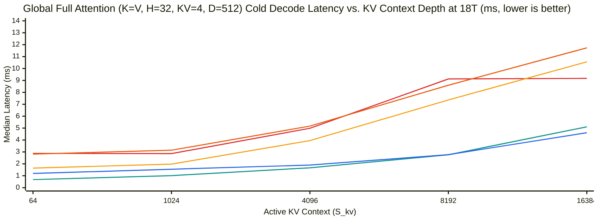

# Level 2 Layer-Tier Benchmark, Whole-Subgraph Roofline & Numerical Parity Report — Gemma 4 31B on Apple M5 Max CPU

- **Benchmark Date**: `2026-11-26`
- **Model**: Gemma 4 31B (`google/gemma-4-31B-it` — dense `60`-layer hybrid transformer: `50` Local SWA + `10` Global `K=V` Full Attention layers; `D = 5376`, `F = 21504`)
- **Target Hardware**: Apple M5 Max (`arm64` / macOS, `18` physical cores = `6` Super + `12` Performance across `3` clusters; `32 MiB` aggregate L2, shared SLC, `36 GB` LPDDR5X Unified Memory; `SME` / `SME2` `SVL = 64 B`, `NEON I8MM`, `DotProd`)
- **Upstream Revisions**: `google-ai-edge/LiteRT` @ `74d7f2170e` | `google/XNNPACK` (XNNPACK + YNNPACK + Slinky + KleidiAI) @ `edecd8af5e` | `ggml-org/llama.cpp` `b12469` @ `e0a9118fe9`
- **Empirical Hardware Ceilings (Level 1)**: Grounded in [ceilings_apple_m5_max.json](../../../kernel/reports/2026-11-25-gemma4-31b-apple-m5-max/ceilings_apple_m5_max.json) (`SME2-INT8 = 6.47 TOPS`, `NEON-I8MM = 8.13 TOPS`, `SME2-FP32 = 3.23 TFLOPS`, `NEON-FP32 = 1.80 TFLOPS`, `Unified Memory Read = 301.1 GB/s` at `18T`)
- **Methodology**: `CLOCK_MONOTONIC_RAW`, `QOS_CLASS_USER_INTERACTIVE`, `caffeinate -i`, **7 independent timed trials** per shape/thread count, non-timed `96 MB` SLC cache flush before every cold `M = 1` decode step, and two-level **FP64 Golden Reference** numerical parity (**`98 / 98` Level A PASS**).

---

## 1. Executive Summary & Actionable Layer-Tier Findings

> [!IMPORTANT]
> **Key Gemma 4 31B Layer-Tier Findings on Apple M5 Max CPU (`18T` Headline):**
> 1. **Prefill Roofline & SME2 vs. NEON `i8mm` Scaling (`full_local_block`, `T = 1024`)**: Per-channel `QC4W` on YNNPACK SME2 leads all backends — `direct_ynn_capi_qc4w` (**`178.8 ms`**, **`87.9%`** roofline) and `litert_ynn_qc4w_sdpa` (**`182.2 ms`**, **`86.2%`**) (reaching **`95.8%`** of Level 1 SME2 INT8 ceiling on `geglu_mlp`: `6,195 GOPS`), beating blockwise-32 `ggml` by **`1.45×`**. Among **blockwise-32** backends (`QB4W-32` / `Q4_0`), `ggml` NEON/`i8mm` (**`259.2 ms`**, `50.4%`), `ggml` KleidiAI SME2 (**`262.6 ms`**, `59.8%`), and `litert_ynn_qb4w32_hybrid_sdpa` (**`265.7 ms`**, `47.5%`) cluster within `2.5%` and outperform decomposed XNNPACK (`320.3 ms`) by **`1.21–1.24×`**. At `1T`, `ggml` KleidiAI SME2 (`1295.8 ms`) crushes `ggml` NEON (`3274.9 ms`) by **`2.53×`** before 18-core per-core NEON `i8mm` (`8.13 TOPS`) catches up to 3-cluster shared SME2 (`6.47 TOPS`) at `18T`.
> 2. **Actionable YNNPACK Kernel Bottleneck — `enable_blockwise_quantization=true` (`QB4W-32`)**: Routing `QB4W-32` directly through YNNPACK's 2-stage `define_blockwise_dot` (`litert_ynn_qb4w32_pure_sdpa` / `direct_ynn_capi_qb4w32`) currently **regresses** `full_local_block` prefill by **`2.25×`** (`265.7 → 599.2 ms`, `26.2%` roofline) and cold decode by **`1.92×`** (`3.94 → 7.55 ms`), with isolated `geglu_mlp` decode dropping **`3.18×`** (`0.926 → 2.945 ms`, `210.8 → 66.3 GB/s`). This empirically explains why LiteRT-LM defaults to `hybrid_sdpa` (XNNPACK `neoni8mm` `qb4w` fallback) and identifies **fusing `block_size=32` scaling inside YNNPACK's ARM64 `int8×int4` dot microkernels** as the #1 high-ROI kernel optimization.
> 3. **Isolating TFLite's `DYNAMIC_UPDATE_SLICE` KV-Cache Copy Tax (`~1.9 ms/layer` on Cold Decode)**: On `full_local_block` cold decode (`T=1, S_kv=1024, S_cap=4096`), **`direct_ynn_capi_qc4w` (`1.926 ms`, `142.0 GB/s`, `47.2%` roofline)** matches **`ggml` NEON (`1.930 ms`, `49.3%`)** and **`ggml` SME2 (`1.912 ms`, `49.7%`)** despite `FP32` vs. `FP16` KV cache (`ggml` peaks at `12T` at **`1.60 ms`** / `~180 GB/s` before 3-cluster `18T` spin-barrier jitter adds `~0.33 ms` on single-layer calls). Running the *identical* YNNPACK kernels inside LiteRT (`litert_ynn_qc4w_sdpa`) takes **`3.839 ms` (`+1.91 ms`, `1.99×` slower)** due to functional `DYNAMIC_UPDATE_SLICE` copying the entire `S_cap=4096` K/V buffers. Doubling `S_cap` (`4096 → 8192`) at fixed `S_kv=1024` proves this directly: **`+0.003 ms`** on Direct YNNPACK and **`+0.006 ms`** on `ggml`, vs. **`+1.86 ms`** on LiteRT YNNPACK and **`+4.09 ms`** on LiteRT XNNPACK!
> 4. **Fused Attention & Long-Context KV Scaling (`S_kv = 64 → 16,384`)**: Fused `odml.sdpa_transposed` speeds up `local_swa_attn` over decomposed YNNPACK by **`1.95×`** on prefill (`130.3 → 66.9 ms`) and **`1.52×`** on decode `S_kv=1024` (`4.73 → 3.12 ms`), and beats decomposed YNNPACK on `global_full_attn` across `S_kv=64..4096` (`4.35 → 3.97 ms` at `S_kv=4096`). At `S_kv = S_cap = 16,384`, `ggml` Flash Attention (`FP16` KV) leads at **`4.61 ms`** (**`2.48×`** faster than `ggml` unfused `11.43 ms`), closely followed by `direct_ynn_capi_qc4w` at **`5.11 ms`** (`FP32` KV), whereas `litert_ynn_qc4w_sdpa` (`10.63 ms`) trails both Direct YNNPACK and decomposed YNNPACK (`7.83 ms`) because strided `DYNAMIC_UPDATE_SLICE` on transposed `[1, 4, 512, 16384]` V-cache incurs `~4.7 ms` of fixed copy overhead.
> 5. **FP64 Numerical Parity (`98 / 98` Level A PASS) & Upstream XNNPACK Determinism Reproduction**: All 10 backend configs pass strict Level A (dequantized-weight FP64) parity (`cos = 0.9990–0.9999`, `SQNR = 27.0–39.8 dB`, `KL < 2.3×10⁻³`, `0 NaN/Inf`). Blockwise-32 (`QB4W-32` / `Q4_0`) outperforms per-channel `QC4W` by **`+2.4 to +4.7 dB` Level B SQNR** (`3×` lower KL divergence) across full transformer blocks. Furthermore, the 18T determinism gate independently reproduced upstream XNNPACK `pf32` SME2 non-determinism (`google/XNNPACK#11789`) on `M = 16` (`local_swa_attn` & `full_local_block`, `max_diff = 4.77×10⁻⁷`), while **100% of YNNPACK and `ggml` runs were bit-exact (`0.00`)**.

---

## 2. Visual Summary: Whole-Subgraph Roofline, Latency & KV-Context Scaling (`18T`)

> **Series Legend**: **Blue (`#2563eb`)** = Prefill `T=1024` Roofline Util (%) | **Orange (`#ea580c`)** = Cold Decode `T=1, S_kv=1024` Roofline Util (%)

```mermaid
%%{init: {"xyChart": {"width": 1150, "height": 420}, "themeVariables": {"xyChart": {"plotColorPalette": "#2563eb, #ea580c"}}}}%%
xychart-beta
    title "Full Local Block (50/60 Layers) Whole-Subgraph Practical Roofline Utilization at 18T (%)"
    x-axis ["XNN QB4W", "YNN QC4W", "Direct QC4W", "YNN Hybrid", "YNN Pure", "Direct QB4W", "ggml NEON", "ggml SME2"]
    y-axis "Whole-Subgraph Roofline Util (%)" 0 --> 100
    bar "Prefill 1024" [39.4, 86.2, 87.9, 47.5, 26.2, 26.3, 50.4, 59.8]
    bar "Decode KV=1024" [17.7, 23.7, 47.2, 25.5, 13.3, 18.0, 49.3, 49.7]
```

> **Series Legend**: **Red (`#dc2626`)** = XNNPACK Decomp (`QB4W`) | **Amber (`#f59e0b`)** = YNN Hybrid SDPA (`QB4W`) | **Orange (`#ea580c`)** = YNN Pure SDPA (`QB4W`) | **Teal (`#0d9488`)** = Direct YNN C API (`QC4W`) | **Blue (`#2563eb`)** = `ggml` NEON + FA (`Q4_0`)

## 3. Cross-Tier Reconciliation: Level 2 (60-Layer Projection) vs. Level 3 End-to-End Model (`2026-11-26`)

Summing `50 × full_local_block + 10 × full_global_block` directly bridges Level 2 layer latencies to Level 3 end-to-end throughput ([gemma4-31b-cpu-apple-m5-max](../../../model/reports/2026-11-26-gemma4-31b-cpu-apple-m5-max-apple-m5-max/README.md)), isolating whole-model overheads (token embedding, `5376 → 262,144` LM-head projection, sampling, and KV scheduling):

| Layer Backend (`Threads`) | Level 3 Counterpart | L2 Proj Prefill `1024` (`ms` / `tok/s`) | L3 Measured Prefill (`tok/s`, L3/L2) | L2 Proj Decode `S=1024` (`ms` / `tok/s`) | L3 Measured Decode `S=1024` (`tok/s`, L3/L2) | L2 Proj Decode `S=4096` (`tok/s`) | L3 Measured `N=4096` (`tok/s`) |
| :--- | :--- | ---: | ---: | ---: | ---: | ---: | ---: |
| `ggml_cpu_neon_fa` (`18T`) | llama.cpp/fastest | `16097 ms` / **`63.6`** | **`61.7`** (`97.0%`) | `117.8 ms` / **`8.49`** | **`10.45`** (`123.1%`) | **`8.32`** | **`8.59`** |
| `ggml_cpu_neon_fa` (`12T`) | llama.cpp/matched | `22549 ms` / **`45.4`** | **`44.9`** (`98.9%`) | `97.9 ms` / **`10.21`** | **`9.29`** (`91.0%`) | — | — |
| `ggml_cpu_sme_fa` (`18T`) | llama.cpp (SME2 layer-only) | `16246 ms` / **`63.0`** | — | `116.9 ms` / **`8.55`** | — | **`8.10`** | — |
| `litert_ynn_qb4w32_hybrid_sdpa` (`18T`) | litert-lm/ynnpack-sdpa | `16334 ms` / **`62.7`** | **`60.5`** (`96.5%`) | `225.6 ms` / **`4.43`** | **`7.60`** (`171.4%`) | **`2.97`** | **`3.64`** |
| `litert_ynn_qb4w32_pure_sdpa` (`18T`) | LiteRT YNN Pure QB4W (bw=true) | `37786 ms` / **`27.1`** | — | `440.0 ms` / **`2.27`** | — | **`1.81`** | — |
| `direct_ynn_capi_qb4w32` (`18T`) | Direct YNNPACK C API (QB4W-32) | `37709 ms` / **`27.2`** | — | `332.4 ms` / **`3.01`** | — | **`2.96`** | — |
| `direct_ynn_capi_qc4w` (`18T`) | Direct YNNPACK C API (QC4W) | `11042 ms` / **`92.7`** | — | `114.3 ms` / **`8.75`** | — | **`8.27`** | — |
| `litert_ynn_qc4w_sdpa` (`18T`) | LiteRT YNN SDPA (QC4W) | `11266 ms` / **`90.9`** | — | `219.3 ms` / **`4.56`** | — | **`3.01`** | — |
| `litert_ynn_qc4w_decomposed` (`18T`) | litert-lm/ynnpack-fastest (QC4W equiv) | `15349 ms` / **`66.7`** | **`48.1`** (`72.1%`) | `292.6 ms` / **`3.42`** | **`5.28`** (`154.5%`) | **`1.99`** | **`0.88`** |
| `litert_xnn_qb4w32` (`18T`) | litert-lm/fastest (XNNPACK QB4W) | `19911 ms` / **`51.4`** | **`49.6`** (`96.4%`) | `322.4 ms` / **`3.10`** | **`4.58`** (`147.7%`) | **`1.82`** | **`0.65`** |

> [!NOTE]
> **Reconciling Prefill (`96.4%–98.9%`) & Decode (`>100%` L3/L2) Across Tiers:**
> - **Prefill `1024` locks in to `96.4%–98.9%` across all three runtimes** (`llama.cpp` 18T `97.0%`, `llama.cpp` 12T `98.9%`, `litert-lm/ynnpack-sdpa` `96.5%`, `litert-lm/fastest` XNNPACK `96.4%`) — confirming that the `~1.1–3.6%` residual is purely whole-model token embedding + `5376 → 262,144` LM-head projection + scheduler overhead.
> - **Why Level 3 Decode exceeds standalone Level 2 single-layer Decode (`123–171%`)**: Two exact harness vs. whole-model architectural differences account for the entire gap:
>   1. **LiteRT-LM persistent ring-buffer KV (`litert_ynn_qb4w32_hybrid_sdpa`: L2 `4.43` vs. L3 `7.60 tok/s`)**: Standalone TFLite flatbuffers execute functional `DYNAMIC_UPDATE_SLICE` on `S_cap = 4096` (`+1.85 ms/layer` = `+92.5 ms` across 50 local layers, proven directly by `direct_ynn_capi_qc4w` vs. `litert_ynn_qc4w_sdpa`). Subtracting that `92.5 ms` copy tax from `225.6 ms` yields `133.1 ms` (**`7.51 tok/s` vs. Level 3's `7.60 tok/s` = `98.8%`!**) because `litert-lm` binds zero-copy external `W=1024` local KV buffers.
>   2. **`llama.cpp` fused 60-layer graph (`ggml_cpu_neon_fa`: L2 18T `8.49` vs. L3 18T `10.45 tok/s`, while L2 12T `10.21` vs. L3 12T `9.29 tok/s` = `91.0%`)**: Running 60 separate cold single-layer `ggml_backend_graph_compute` invocations at `18T` incurs macOS 3-cluster spin-barrier wake jitter (`cv = 20–31%`, adding `~0.33 ms/layer` vs. `12T`'s `1.596 ms/layer`), whereas Level 3 executes all 60 layers inside a single persistent `llama_decode` thread dispatch (`95.7 ms/tok` vs. low-jitter `12T` L2 `97.9 ms/tok`).

## 4. Per-Subgraph Performance & Whole-Subgraph Practical Roofline (`18T` Headline & `6T` Super Cluster)

Whole-Subgraph Practical Roofline Utilization (%) follows [layer/README.md](../../README.md): $T_{\text{min}} = \max(T_{\text{comp}}, B_{\text{min}} / BW_{\text{prac}})$ counting **boundary tensors only** (excluding all intermediate activation buffers, Q/K/V/O scratchpads, attention score matrices, and Gate/Up intermediates).

### 4.1 Local Sliding-Window Attention (`50/60` layers, `H=32, KV=16, D=256, W=1024`)

| Regime (`T, S_kv, S_cap`) | Backend | Quant / KV | Bound | `6T` Lat (`ms`, Util) | **`18T` Lat (`ms`)** | `18T` `cv%` | `18T` Eff. Perf (`GOPS` / `GB/s`) | $T_{\text{min}}$ (`ms`) | **18T Format Roofline** | **18T Ideal Roofline** |
| :--- | :--- | :--- | :---: | ---: | ---: | ---: | ---: | ---: | ---: | ---: |
| `prefill_128` (`T=128, S=128, cap=4096`) | `litert_xnn_qc4w` | `QC4W` / `FP32` | `compute` | `19.03` (`27.7%`) | **`19.29`** | `0.95%` | `1,769.2 GOPS` | `5.322` | **`27.6%`** | `22.1%` |
| `prefill_128` (`T=128, S=128, cap=4096`) | `litert_xnn_qb4w32` | `QB4W-32` / `FP32` | `compute` | `36.79` (`28.5%`) | **`21.75`** | `1.24%` | `1,569.3 GOPS` | `4.256` | **`19.6%`** | `19.6%` |
| `prefill_128` (`T=128, S=128, cap=4096`) | `litert_ynn_qc4w_decomposed` | `QC4W` / `FP32` | `compute` | `22.75` (`23.1%`) | **`19.78`** | `0.70%` | `1,724.8 GOPS` | `5.322` | **`26.9%`** | `21.5%` |
| `prefill_128` (`T=128, S=128, cap=4096`) | `litert_ynn_qc4w_sdpa` | `QC4W` / `FP32` | `compute` | `12.64` (`41.7%`) | **`10.32`** | `0.77%` | `3,306.2 GOPS` | `5.322` | **`51.6%`** | `41.2%` |
| `prefill_128` (`T=128, S=128, cap=4096`) | `litert_ynn_qb4w32_hybrid_sdpa` | `QB4W-32` / `FP32` | `compute` | `23.62` (`44.5%`) | **`12.90`** | `1.26%` | `2,644.9 GOPS` | `4.256` | **`33.0%`** | `33.0%` |
| `prefill_128` (`T=128, S=128, cap=4096`) | `litert_ynn_qb4w32_pure_sdpa` | `QB4W-32` / `FP32` | `compute` | `85.68` (`6.1%`) | **`86.39`** | `0.87%` | `395.0 GOPS` | `5.322` | **`6.2%`** | `4.9%` |
| `prefill_128` (`T=128, S=128, cap=4096`) | `direct_ynn_capi_qc4w` | `QC4W` / `FP32` | `compute` | `7.131` (`73.8%`) | **`7.147`** | `0.55%` | `4,774.8 GOPS` | `5.322` | **`74.5%`** | `59.5%` |
| `prefill_128` (`T=128, S=128, cap=4096`) | `direct_ynn_capi_qb4w32` | `QB4W-32` / `FP32` | `compute` | `82.15` (`6.4%`) | **`83.70`** | `0.26%` | `407.7 GOPS` | `5.322` | **`6.4%`** | `5.1%` |
| `prefill_128` (`T=128, S=128, cap=4096`) | `ggml_cpu_neon_fa` | `Q4_0` / `FP16` | `compute` | `20.27` (`53.9%`) | **`11.07`** | `0.30%` | `3,083.7 GOPS` | `4.330` | **`39.1%`** | `38.5%` |
| `prefill_128` (`T=128, S=128, cap=4096`) | `ggml_cpu_sme_fa` | `Q4_0` / `FP16` | `compute` | `17.62` (`29.9%`) | **`10.04`** | `7.02%` | `3,399.9 GOPS` | `5.322` | **`53.0%`** | `42.4%` |
| `prefill_128` (`T=128, S=128, cap=4096`) | `ggml_cpu_neon_unfused` | `Q4_0` / `FP16` | `compute` | — | **`12.16`** | `6.87%` | `2,806.6 GOPS` | `4.330` | **`35.6%`** | `35.0%` |
| `prefill_1024` (`T=1024, S=1024, cap=4096`) | `litert_xnn_qc4w` | `QC4W` / `FP32` | `compute` | `121.21` (`38.5%`) | **`117.54`** | `1.11%` | `2,451.3 GOPS` | `47.25` | **`40.2%`** | `32.9%` |
| `prefill_1024` (`T=1024, S=1024, cap=4096`) | `litert_xnn_qb4w32` | `QB4W-32` / `FP32` | `compute` | `256.36` (`34.6%`) | **`138.28`** | `0.76%` | `2,083.5 GOPS` | `38.72` | **`28.0%`** | `28.0%` |
| `prefill_1024` (`T=1024, S=1024, cap=4096`) | `litert_ynn_qc4w_decomposed` | `QC4W` / `FP32` | `compute` | `153.01` (`30.5%`) | **`130.26`** | `2.13%` | `2,211.8 GOPS` | `47.25` | **`36.3%`** | `29.7%` |
| `prefill_1024` (`T=1024, S=1024, cap=4096`) | `litert_ynn_qc4w_sdpa` | `QC4W` / `FP32` | `compute` | `72.19` (`64.7%`) | **`66.87`** | `0.64%` | `4,308.6 GOPS` | `47.25` | **`70.7%`** | `57.9%` |
| `prefill_1024` (`T=1024, S=1024, cap=4096`) | `litert_ynn_qb4w32_hybrid_sdpa` | `QB4W-32` / `FP32` | `compute` | `182.54` (`48.5%`) | **`88.41`** | `0.81%` | `3,258.9 GOPS` | `38.72` | **`43.8%`** | `43.8%` |
| `prefill_1024` (`T=1024, S=1024, cap=4096`) | `litert_ynn_qb4w32_pure_sdpa` | `QB4W-32` / `FP32` | `compute` | `278.40` (`16.8%`) | **`146.07`** | `1.13%` | `1,972.3 GOPS` | `47.25` | **`32.4%`** | `26.5%` |
| `prefill_1024` (`T=1024, S=1024, cap=4096`) | `direct_ynn_capi_qc4w` | `QC4W` / `FP32` | `compute` | `70.52` (`66.3%`) | **`63.86`** | `0.82%` | `4,511.2 GOPS` | `47.25` | **`74.0%`** | `60.6%` |
| `prefill_1024` (`T=1024, S=1024, cap=4096`) | `direct_ynn_capi_qb4w32` | `QB4W-32` / `FP32` | `compute` | `264.06` (`17.7%`) | **`140.88`** | `1.52%` | `2,045.0 GOPS` | `47.25` | **`33.5%`** | `27.5%` |
| `prefill_1024` (`T=1024, S=1024, cap=4096`) | `ggml_cpu_neon_fa` | `Q4_0` / `FP16` | `compute` | `190.85` (`59.6%`) | **`88.30`** | `0.95%` | `3,262.8 GOPS` | `43.04` | **`48.7%`** | `43.9%` |
| `prefill_1024` (`T=1024, S=1024, cap=4096`) | `ggml_cpu_sme_fa` | `Q4_0` / `FP16` | `compute` | `170.36` (`27.4%`) | **`90.09`** | `1.22%` | `3,198.1 GOPS` | `47.25` | **`52.5%`** | `43.0%` |
| `prefill_1024` (`T=1024, S=1024, cap=4096`) | `ggml_cpu_neon_unfused` | `Q4_0` / `FP16` | `compute` | — | **`127.00`** | `1.22%` | `2,268.7 GOPS` | `43.04` | **`33.9%`** | `30.5%` |
| `decode_kv64` (`T=1, S=64, cap=4096`) | `litert_xnn_qc4w` | `QC4W` / `FP32` | `memory` | `5.713` (`4.0%`) | **`4.691`** | `0.47%` | `14.6 GB/s` | `0.227` | **`4.8%`** | `4.8%` |
| `decode_kv64` (`T=1, S=64, cap=4096`) | `litert_xnn_qb4w32` | `QB4W-32` / `FP32` | `memory` | `5.682` (`4.5%`) | **`4.749`** | `0.67%` | `16.1 GB/s` | `0.254` | **`5.3%`** | `4.7%` |
| `decode_kv64` (`T=1, S=64, cap=4096`) | `litert_ynn_qc4w_decomposed` | `QC4W` / `FP32` | `memory` | `6.014` (`3.8%`) | **`4.740`** | `2.78%` | `14.4 GB/s` | `0.227` | **`4.8%`** | `4.7%` |
| `decode_kv64` (`T=1, S=64, cap=4096`) | `litert_ynn_qc4w_sdpa` | `QC4W` / `FP32` | `memory` | `2.595` (`8.7%`) | **`2.587`** | `0.77%` | `26.4 GB/s` | `0.227` | **`8.8%`** | `8.6%` |
| `decode_kv64` (`T=1, S=64, cap=4096`) | `litert_ynn_qb4w32_hybrid_sdpa` | `QB4W-32` / `FP32` | `memory` | `2.583` (`9.8%`) | **`2.560`** | `0.53%` | `29.9 GB/s` | `0.254` | **`9.9%`** | `8.7%` |
| `decode_kv64` (`T=1, S=64, cap=4096`) | `litert_ynn_qb4w32_pure_sdpa` | `QB4W-32` / `FP32` | `memory` | `3.923` (`6.5%`) | **`3.951`** | `0.33%` | `19.4 GB/s` | `0.254` | **`6.4%`** | `5.7%` |
| `decode_kv64` (`T=1, S=64, cap=4096`) | `direct_ynn_capi_qc4w` | `QC4W` / `FP32` | `memory` | `0.622` (`36.4%`) | **`0.635`** | `1.11%` | `107.7 GB/s` | `0.227` | **`35.8%`** | `35.2%` |
| `decode_kv64` (`T=1, S=64, cap=4096`) | `direct_ynn_capi_qb4w32` | `QB4W-32` / `FP32` | `memory` | `1.989` (`12.7%`) | **`2.036`** | `0.59%` | `37.6 GB/s` | `0.254` | **`12.5%`** | `11.0%` |
| `decode_kv64` (`T=1, S=64, cap=4096`) | `ggml_cpu_neon_fa` | `Q4_0` / `FP16` | `memory` | `0.629` (`39.7%`) | **`1.175`** | `17.28%` | `64.2 GB/s` | `0.251` | **`21.3%`** | `19.0%` |
| `decode_kv64` (`T=1, S=64, cap=4096`) | `ggml_cpu_sme_fa` | `Q4_0` / `FP16` | `memory` | `0.632` (`39.5%`) | **`1.216`** | `40.70%` | `62.1 GB/s` | `0.251` | **`20.6%`** | `18.4%` |
| `decode_kv64` (`T=1, S=64, cap=4096`) | `ggml_cpu_neon_unfused` | `Q4_0` / `FP16` | `memory` | — | **`1.214`** | `38.93%` | `62.2 GB/s` | `0.251` | **`20.6%`** | `18.4%` |
| `decode_kv256` (`T=1, S=256, cap=4096`) | `litert_xnn_qc4w` | `QC4W` / `FP32` | `memory` | `5.720` (`4.3%`) | **`4.703`** | `0.53%` | `15.9 GB/s` | `0.248` | **`5.3%`** | `5.0%` |
| `decode_kv256` (`T=1, S=256, cap=4096`) | `litert_xnn_qb4w32` | `QB4W-32` / `FP32` | `memory` | `5.666` (`4.8%`) | **`4.738`** | `0.68%` | `17.5 GB/s` | `0.275` | **`5.8%`** | `4.9%` |
| `decode_kv256` (`T=1, S=256, cap=4096`) | `litert_ynn_qc4w_decomposed` | `QC4W` / `FP32` | `memory` | `5.996` (`4.1%`) | **`4.778`** | `1.48%` | `15.6 GB/s` | `0.248` | **`5.2%`** | `4.9%` |
| `decode_kv256` (`T=1, S=256, cap=4096`) | `litert_ynn_qc4w_sdpa` | `QC4W` / `FP32` | `memory` | `2.863` (`8.6%`) | **`2.849`** | `0.73%` | `26.2 GB/s` | `0.248` | **`8.7%`** | `8.2%` |
| `decode_kv256` (`T=1, S=256, cap=4096`) | `litert_ynn_qb4w32_hybrid_sdpa` | `QB4W-32` / `FP32` | `memory` | `2.847` (`9.6%`) | **`2.827`** | `0.73%` | `29.3 GB/s` | `0.275` | **`9.7%`** | `8.3%` |
| `decode_kv256` (`T=1, S=256, cap=4096`) | `litert_ynn_qb4w32_pure_sdpa` | `QB4W-32` / `FP32` | `memory` | `4.199` (`6.5%`) | **`4.248`** | `0.42%` | `19.5 GB/s` | `0.275` | **`6.5%`** | `5.5%` |
| `decode_kv256` (`T=1, S=256, cap=4096`) | `direct_ynn_capi_qc4w` | `QC4W` / `FP32` | `memory` | `0.771` (`32.0%`) | **`0.872`** | `3.66%` | `85.7 GB/s` | `0.248` | **`28.4%`** | `26.8%` |
| `decode_kv256` (`T=1, S=256, cap=4096`) | `direct_ynn_capi_qb4w32` | `QB4W-32` / `FP32` | `memory` | `2.132` (`12.8%`) | **`2.301`** | `0.76%` | `36.0 GB/s` | `0.275` | **`12.0%`** | `10.2%` |
| `decode_kv256` (`T=1, S=256, cap=4096`) | `ggml_cpu_neon_fa` | `Q4_0` / `FP16` | `memory` | `0.669` (`38.8%`) | **`1.223`** | `14.64%` | `64.3 GB/s` | `0.261` | **`21.4%`** | `19.1%` |
| `decode_kv256` (`T=1, S=256, cap=4096`) | `ggml_cpu_sme_fa` | `Q4_0` / `FP16` | `memory` | `0.677` (`38.4%`) | **`1.236`** | `1.30%` | `63.6 GB/s` | `0.261` | **`21.1%`** | `18.9%` |
| `decode_kv256` (`T=1, S=256, cap=4096`) | `ggml_cpu_neon_unfused` | `Q4_0` / `FP16` | `memory` | — | **`1.398`** | `28.10%` | `56.2 GB/s` | `0.261` | **`18.7%`** | `16.7%` |
| `decode_kv1024` (`T=1, S=1024, cap=4096`) | `litert_xnn_qc4w` | `QC4W` / `FP32` | `memory` | `5.712` (`5.8%`) | **`4.695`** | `0.45%` | `21.3 GB/s` | `0.332` | **`7.1%`** | `5.9%` |
| `decode_kv1024` (`T=1, S=1024, cap=4096`) | `litert_xnn_qb4w32` | `QB4W-32` / `FP32` | `memory` | `5.679` (`6.3%`) | **`4.744`** | `0.43%` | `22.8 GB/s` | `0.359` | **`7.6%`** | `5.8%` |
| `decode_kv1024` (`T=1, S=1024, cap=4096`) | `litert_ynn_qc4w_decomposed` | `QC4W` / `FP32` | `memory` | `6.013` (`5.5%`) | **`4.733`** | `0.98%` | `21.1 GB/s` | `0.332` | **`7.0%`** | `5.8%` |
| `decode_kv1024` (`T=1, S=1024, cap=4096`) | `litert_ynn_qc4w_sdpa` | `QC4W` / `FP32` | `memory` | `3.508` (`9.4%`) | **`3.124`** | `0.36%` | `32.0 GB/s` | `0.332` | **`10.6%`** | `8.8%` |
| `decode_kv1024` (`T=1, S=1024, cap=4096`) | `litert_ynn_qb4w32_hybrid_sdpa` | `QB4W-32` / `FP32` | `memory` | `3.510` (`10.2%`) | **`3.101`** | `0.46%` | `34.8 GB/s` | `0.359` | **`11.6%`** | `8.9%` |
| `decode_kv1024` (`T=1, S=1024, cap=4096`) | `litert_ynn_qb4w32_pure_sdpa` | `QB4W-32` / `FP32` | `memory` | `4.860` (`7.3%`) | **`4.528`** | `0.21%` | `23.9 GB/s` | `0.359` | **`7.9%`** | `6.1%` |
| `decode_kv1024` (`T=1, S=1024, cap=4096`) | `direct_ynn_capi_qc4w` | `QC4W` / `FP32` | `memory` | `1.338` (`24.7%`) | **`1.166`** | `1.34%` | `85.7 GB/s` | `0.332` | **`28.4%`** | `23.6%` |
| `decode_kv1024` (`T=1, S=1024, cap=4096`) | `direct_ynn_capi_qb4w32` | `QB4W-32` / `FP32` | `memory` | `2.704` (`13.2%`) | **`2.561`** | `0.33%` | `42.2 GB/s` | `0.359` | **`14.0%`** | `10.8%` |
| `decode_kv1024` (`T=1, S=1024, cap=4096`) | `ggml_cpu_neon_fa` | `Q4_0` / `FP16` | `memory` | `0.821` (`36.7%`) | **`1.395`** | `31.02%` | `65.3 GB/s` | `0.303` | **`21.7%`** | `19.7%` |
| `decode_kv1024` (`T=1, S=1024, cap=4096`) | `ggml_cpu_sme_fa` | `Q4_0` / `FP16` | `memory` | `0.825` (`36.5%`) | **`1.302`** | `32.15%` | `70.0 GB/s` | `0.303` | **`23.3%`** | `21.1%` |
| `decode_kv1024` (`T=1, S=1024, cap=4096`) | `ggml_cpu_neon_unfused` | `Q4_0` / `FP16` | `memory` | — | **`1.740`** | `26.52%` | `52.4 GB/s` | `0.303` | **`17.4%`** | `15.8%` |
| `decode_kv1024_cap8192` (`T=1, S=1024, cap=8192`) | `litert_xnn_qc4w` | `QC4W` / `FP32` | `memory` | `8.427` (`3.9%`) | **`8.767`** | `0.79%` | `11.4 GB/s` | `0.332` | **`3.8%`** | `3.1%` |
| `decode_kv1024_cap8192` (`T=1, S=1024, cap=8192`) | `litert_xnn_qb4w32` | `QB4W-32` / `FP32` | `memory` | `9.266` (`3.9%`) | **`8.775`** | `0.49%` | `12.3 GB/s` | `0.359` | **`4.1%`** | `3.1%` |
| `decode_kv1024_cap8192` (`T=1, S=1024, cap=8192`) | `litert_ynn_qc4w_decomposed` | `QC4W` / `FP32` | `memory` | `11.77` (`2.8%`) | **`8.365`** | `0.70%` | `11.9 GB/s` | `0.332` | **`4.0%`** | `3.3%` |
| `decode_kv1024_cap8192` (`T=1, S=1024, cap=8192`) | `litert_ynn_qc4w_sdpa` | `QC4W` / `FP32` | `memory` | `5.343` (`6.2%`) | **`4.941`** | `0.44%` | `20.2 GB/s` | `0.332` | **`6.7%`** | `5.6%` |
| `decode_kv1024_cap8192` (`T=1, S=1024, cap=8192`) | `litert_ynn_qb4w32_hybrid_sdpa` | `QB4W-32` / `FP32` | `memory` | `5.330` (`6.7%`) | **`4.934`** | `0.43%` | `21.9 GB/s` | `0.359` | **`7.3%`** | `5.6%` |
| `decode_kv1024_cap8192` (`T=1, S=1024, cap=8192`) | `litert_ynn_qb4w32_pure_sdpa` | `QB4W-32` / `FP32` | `memory` | `6.722` (`5.3%`) | **`6.410`** | `0.28%` | `16.9 GB/s` | `0.359` | **`5.6%`** | `4.3%` |
| `decode_kv1024_cap8192` (`T=1, S=1024, cap=8192`) | `direct_ynn_capi_qc4w` | `QC4W` / `FP32` | `memory` | `1.334` (`24.8%`) | **`1.141`** | `1.06%` | `87.5 GB/s` | `0.332` | **`29.1%`** | `24.1%` |
| `decode_kv1024_cap8192` (`T=1, S=1024, cap=8192`) | `direct_ynn_capi_qb4w32` | `QB4W-32` / `FP32` | `memory` | `2.713` (`13.2%`) | **`2.560`** | `6.60%` | `42.2 GB/s` | `0.359` | **`14.0%`** | `10.8%` |
| `decode_kv1024_cap8192` (`T=1, S=1024, cap=8192`) | `ggml_cpu_neon_fa` | `Q4_0` / `FP16` | `memory` | `0.822` (`36.7%`) | **`1.271`** | `42.40%` | `71.8 GB/s` | `0.303` | **`23.8%`** | `21.7%` |
| `decode_kv1024_cap8192` (`T=1, S=1024, cap=8192`) | `ggml_cpu_sme_fa` | `Q4_0` / `FP16` | `memory` | `0.827` (`36.5%`) | **`1.208`** | `54.12%` | `75.5 GB/s` | `0.303` | **`25.1%`** | `22.8%` |
| `decode_kv1024_cap8192` (`T=1, S=1024, cap=8192`) | `ggml_cpu_neon_unfused` | `Q4_0` / `FP16` | `memory` | — | **`1.750`** | `21.23%` | `52.1 GB/s` | `0.303` | **`17.3%`** | `15.7%` |

### 4.2 Global Full Attention (`10/60` layers, `H=32, KV=4, D=512, K=V, 0.25× RoPE`)

| Regime (`T, S_kv, S_cap`) | Backend | Quant / KV | Bound | `6T` Lat (`ms`, Util) | **`18T` Lat (`ms`)** | `18T` `cv%` | `18T` Eff. Perf (`GOPS` / `GB/s`) | $T_{\text{min}}$ (`ms`) | **18T Format Roofline** | **18T Ideal Roofline** |
| :--- | :--- | :--- | :---: | ---: | ---: | ---: | ---: | ---: | ---: | ---: |
| `prefill_128` (`T=128, S=128, cap=4096`) | `litert_xnn_qc4w` | `QC4W` / `FP32` | `compute` | `25.48` (`29.4%`) | **`25.53`** | `1.00%` | `1,899.4 GOPS` | `7.586` | **`29.7%`** | `23.8%` |
| `prefill_128` (`T=128, S=128, cap=4096`) | `litert_xnn_qb4w32` | `QB4W-32` / `FP32` | `compute` | `50.49` (`29.5%`) | **`29.95`** | `1.33%` | `1,619.3 GOPS` | `6.076` | **`20.3%`** | `20.3%` |
| `prefill_128` (`T=128, S=128, cap=4096`) | `litert_ynn_qc4w_decomposed` | `QC4W` / `FP32` | `compute` | `25.51` (`29.4%`) | **`23.54`** | `0.62%` | `2,060.3 GOPS` | `7.586` | **`32.2%`** | `25.8%` |
| `prefill_128` (`T=128, S=128, cap=4096`) | `litert_ynn_qc4w_sdpa` | `QC4W` / `FP32` | `compute` | `11.60` (`64.7%`) | **`11.83`** | `0.59%` | `4,099.4 GOPS` | `7.586` | **`64.1%`** | `51.4%` |
| `prefill_128` (`T=128, S=128, cap=4096`) | `litert_ynn_qb4w32_hybrid_sdpa` | `QB4W-32` / `FP32` | `compute` | `31.31` (`47.6%`) | **`15.58`** | `1.98%` | `3,112.3 GOPS` | `6.076` | **`39.0%`** | `39.0%` |
| `prefill_128` (`T=128, S=128, cap=4096`) | `litert_ynn_qb4w32_pure_sdpa` | `QB4W-32` / `FP32` | `compute` | `68.61` (`10.9%`) | **`75.60`** | `1.05%` | `641.5 GOPS` | `7.586` | **`10.0%`** | `8.0%` |
| `prefill_128` (`T=128, S=128, cap=4096`) | `direct_ynn_capi_qc4w` | `QC4W` / `FP32` | `compute` | `10.42` (`72.0%`) | **`10.47`** | `0.55%` | `4,631.4 GOPS` | `7.586` | **`72.5%`** | `58.0%` |
| `prefill_128` (`T=128, S=128, cap=4096`) | `direct_ynn_capi_qb4w32` | `QB4W-32` / `FP32` | `compute` | `68.00` (`11.0%`) | **`73.92`** | `0.64%` | `656.0 GOPS` | `7.586` | **`10.3%`** | `8.2%` |
| `prefill_128` (`T=128, S=128, cap=4096`) | `ggml_cpu_neon_fa` | `Q4_0` / `FP16` | `compute` | `31.93` (`49.3%`) | **`16.81`** | `1.53%` | `2,885.0 GOPS` | `6.218` | **`37.0%`** | `36.1%` |
| `prefill_128` (`T=128, S=128, cap=4096`) | `ggml_cpu_sme_fa` | `Q4_0` / `FP16` | `compute` | `26.74` (`28.1%`) | **`16.79`** | `0.84%` | `2,888.8 GOPS` | `7.586` | **`45.2%`** | `36.2%` |
| `prefill_128` (`T=128, S=128, cap=4096`) | `ggml_cpu_neon_unfused` | `Q4_0` / `FP16` | `compute` | — | **`17.40`** | `0.74%` | `2,787.0 GOPS` | `6.218` | **`35.7%`** | `34.9%` |
| `prefill_1024` (`T=1024, S=1024, cap=4096`) | `litert_xnn_qc4w` | `QC4W` / `FP32` | `compute` | `183.40` (`37.8%`) | **`181.10`** | `1.70%` | `2,308.6 GOPS` | `70.02` | **`38.7%`** | `32.0%` |
| `prefill_1024` (`T=1024, S=1024, cap=4096`) | `litert_xnn_qb4w32` | `QB4W-32` / `FP32` | `compute` | `368.46` (`34.9%`) | **`209.18`** | `2.11%` | `1,998.8 GOPS` | `57.93` | **`27.7%`** | `27.7%` |
| `prefill_1024` (`T=1024, S=1024, cap=4096`) | `litert_ynn_qc4w_decomposed` | `QC4W` / `FP32` | `compute` | `208.06` (`33.3%`) | **`184.55`** | `0.79%` | `2,265.5 GOPS` | `70.02` | **`37.9%`** | `31.4%` |
| `prefill_1024` (`T=1024, S=1024, cap=4096`) | `litert_ynn_qc4w_sdpa` | `QC4W` / `FP32` | `compute` | `106.54` (`65.0%`) | **`99.34`** | `0.30%` | `4,208.8 GOPS` | `70.02` | **`70.5%`** | `58.3%` |
| `prefill_1024` (`T=1024, S=1024, cap=4096`) | `litert_ynn_qb4w32_hybrid_sdpa` | `QB4W-32` / `FP32` | `compute` | `262.43` (`49.0%`) | **`129.27`** | `1.07%` | `3,234.3 GOPS` | `57.93` | **`44.8%`** | `44.8%` |
| `prefill_1024` (`T=1024, S=1024, cap=4096`) | `litert_ynn_qb4w32_pure_sdpa` | `QB4W-32` / `FP32` | `compute` | `457.39` (`15.1%`) | **`325.01`** | `0.65%` | `1,286.4 GOPS` | `70.02` | **`21.5%`** | `17.8%` |
| `prefill_1024` (`T=1024, S=1024, cap=4096`) | `direct_ynn_capi_qc4w` | `QC4W` / `FP32` | `compute` | `102.99` (`67.2%`) | **`96.21`** | `1.37%` | `4,345.7 GOPS` | `70.02` | **`72.8%`** | `60.2%` |
| `prefill_1024` (`T=1024, S=1024, cap=4096`) | `direct_ynn_capi_qb4w32` | `QB4W-32` / `FP32` | `compute` | `461.67` (`15.0%`) | **`322.71`** | `0.42%` | `1,295.6 GOPS` | `70.02` | **`21.7%`** | `17.9%` |
| `prefill_1024` (`T=1024, S=1024, cap=4096`) | `ggml_cpu_neon_fa` | `Q4_0` / `FP16` | `compute` | `302.59` (`59.0%`) | **`141.90`** | `1.52%` | `2,946.4 GOPS` | `66.50` | **`46.9%`** | `40.8%` |
| `prefill_1024` (`T=1024, S=1024, cap=4096`) | `ggml_cpu_sme_fa` | `Q4_0` / `FP16` | `compute` | `266.55` (`26.0%`) | **`143.31`** | `4.47%` | `2,917.5 GOPS` | `70.02` | **`48.9%`** | `40.4%` |
| `prefill_1024` (`T=1024, S=1024, cap=4096`) | `ggml_cpu_neon_unfused` | `Q4_0` / `FP16` | `compute` | — | **`198.75`** | `1.33%` | `2,103.6 GOPS` | `66.50` | **`33.5%`** | `29.1%` |
| `prefill_1024_ctx4096` (`T=1024, S=4096, cap=8192`) | `litert_xnn_qc4w` | `QC4W` / `FP32` | `compute` | `301.02` (`44.0%`) | **`311.02`** | `1.89%` | `2,008.7 GOPS` | `133.96` | **`43.1%`** | `39.2%` |
| `prefill_1024_ctx4096` (`T=1024, S=4096, cap=8192`) | `litert_xnn_qb4w32` | `QB4W-32` / `FP32` | `compute` | `484.69` (`39.6%`) | **`332.79`** | `1.76%` | `1,877.3 GOPS` | `121.87` | **`36.6%`** | `36.6%` |
| `prefill_1024_ctx4096` (`T=1024, S=4096, cap=8192`) | `litert_ynn_qc4w_decomposed` | `QC4W` / `FP32` | `compute` | `319.06` (`41.5%`) | **`351.06`** | `1.32%` | `1,779.6 GOPS` | `133.96` | **`38.2%`** | `34.7%` |
| `prefill_1024_ctx4096` (`T=1024, S=4096, cap=8192`) | `litert_ynn_qc4w_sdpa` | `QC4W` / `FP32` | `compute` | `194.88` (`68.0%`) | **`194.87`** | `1.79%` | `3,206.1 GOPS` | `133.96` | **`68.7%`** | `62.5%` |
| `prefill_1024_ctx4096` (`T=1024, S=4096, cap=8192`) | `litert_ynn_qb4w32_hybrid_sdpa` | `QB4W-32` / `FP32` | `compute` | `353.43` (`54.2%`) | **`219.62`** | `1.50%` | `2,844.7 GOPS` | `121.87` | **`55.5%`** | `55.5%` |
| `prefill_1024_ctx4096` (`T=1024, S=4096, cap=8192`) | `litert_ynn_qb4w32_pure_sdpa` | `QB4W-32` / `FP32` | `compute` | `554.89` (`23.9%`) | **`418.52`** | `1.25%` | `1,492.8 GOPS` | `133.96` | **`32.0%`** | `29.1%` |
| `prefill_1024_ctx4096` (`T=1024, S=4096, cap=8192`) | `direct_ynn_capi_qc4w` | `QC4W` / `FP32` | `compute` | `193.63` (`68.4%`) | **`189.90`** | `2.12%` | `3,290.0 GOPS` | `133.96` | **`70.5%`** | `64.2%` |
| `prefill_1024_ctx4096` (`T=1024, S=4096, cap=8192`) | `direct_ynn_capi_qb4w32` | `QB4W-32` / `FP32` | `compute` | `546.74` (`24.2%`) | **`417.76`** | `0.99%` | `1,495.5 GOPS` | `133.96` | **`32.1%`** | `29.2%` |
| `prefill_1024_ctx4096` (`T=1024, S=4096, cap=8192`) | `ggml_cpu_neon_fa` | `Q4_0` / `FP16` | `compute` | `687.96` (`78.3%`) | **`333.75`** | `0.71%` | `1,871.9 GOPS` | `181.36` | **`54.3%`** | `36.5%` |
| `prefill_1024_ctx4096` (`T=1024, S=4096, cap=8192`) | `ggml_cpu_sme_fa` | `Q4_0` / `FP16` | `compute` | `651.25` (`20.3%`) | **`336.57`** | `1.66%` | `1,856.3 GOPS` | `133.96` | **`39.8%`** | `36.2%` |
| `prefill_1024_ctx4096` (`T=1024, S=4096, cap=8192`) | `ggml_cpu_neon_unfused` | `Q4_0` / `FP16` | `compute` | — | **`490.68`** | `0.62%` | `1,273.3 GOPS` | `181.36` | **`37.0%`** | `24.8%` |
| `decode_kv64` (`T=1, S=64, cap=4096`) | `litert_xnn_qc4w` | `QC4W` / `FP32` | `memory` | `3.401` (`9.2%`) | **`2.819`** | `0.99%` | `33.6 GB/s` | `0.315` | **`11.2%`** | `11.1%` |
| `decode_kv64` (`T=1, S=64, cap=4096`) | `litert_xnn_qb4w32` | `QB4W-32` / `FP32` | `memory` | `3.349` (`10.5%`) | **`2.879`** | `0.75%` | `37.0 GB/s` | `0.353` | **`12.3%`** | `10.9%` |
| `decode_kv64` (`T=1, S=64, cap=4096`) | `litert_ynn_qc4w_decomposed` | `QC4W` / `FP32` | `memory` | `3.111` (`10.1%`) | **`2.431`** | `0.72%` | `39.0 GB/s` | `0.315` | **`13.0%`** | `12.9%` |
| `decode_kv64` (`T=1, S=64, cap=4096`) | `litert_ynn_qc4w_sdpa` | `QC4W` / `FP32` | `memory` | `1.800` (`17.4%`) | **`1.671`** | `0.75%` | `56.8 GB/s` | `0.315` | **`18.9%`** | `18.7%` |
| `decode_kv64` (`T=1, S=64, cap=4096`) | `litert_ynn_qb4w32_hybrid_sdpa` | `QB4W-32` / `FP32` | `memory` | `1.786` (`19.7%`) | **`1.641`** | `0.99%` | `64.9 GB/s` | `0.353` | **`21.6%`** | `19.1%` |
| `decode_kv64` (`T=1, S=64, cap=4096`) | `litert_ynn_qb4w32_pure_sdpa` | `QB4W-32` / `FP32` | `memory` | `2.675` (`13.2%`) | **`2.821`** | `0.40%` | `37.7 GB/s` | `0.353` | **`12.5%`** | `11.1%` |
| `decode_kv64` (`T=1, S=64, cap=4096`) | `direct_ynn_capi_qc4w` | `QC4W` / `FP32` | `memory` | `0.794` (`39.5%`) | **`0.678`** | `1.24%` | `139.9 GB/s` | `0.315` | **`46.5%`** | `46.1%` |
| `decode_kv64` (`T=1, S=64, cap=4096`) | `direct_ynn_capi_qb4w32` | `QB4W-32` / `FP32` | `memory` | `1.702` (`20.7%`) | **`1.820`** | `1.07%` | `58.5 GB/s` | `0.353` | **`19.4%`** | `17.2%` |
| `decode_kv64` (`T=1, S=64, cap=4096`) | `ggml_cpu_neon_fa` | `Q4_0` / `FP16` | `memory` | `0.797` (`44.0%`) | **`1.191`** | `30.43%` | `89.0 GB/s` | `0.352` | **`29.6%`** | `26.3%` |
| `decode_kv64` (`T=1, S=64, cap=4096`) | `ggml_cpu_sme_fa` | `Q4_0` / `FP16` | `memory` | `0.807` (`43.4%`) | **`1.292`** | `40.95%` | `82.0 GB/s` | `0.352` | **`27.2%`** | `24.2%` |
| `decode_kv64` (`T=1, S=64, cap=4096`) | `ggml_cpu_neon_unfused` | `Q4_0` / `FP16` | `memory` | — | **`1.276`** | `29.80%` | `83.0 GB/s` | `0.352` | **`27.6%`** | `24.5%` |
| `decode_kv1024` (`T=1, S=1024, cap=4096`) | `litert_xnn_qc4w` | `QC4W` / `FP32` | `memory` | `3.399` (`10.8%`) | **`2.781`** | `0.86%` | `39.8 GB/s` | `0.367` | **`13.2%`** | `12.2%` |
| `decode_kv1024` (`T=1, S=1024, cap=4096`) | `litert_xnn_qb4w32` | `QB4W-32` / `FP32` | `memory` | `3.353` (`12.1%`) | **`2.858`** | `4.72%` | `42.8 GB/s` | `0.406` | **`14.2%`** | `11.9%` |
| `decode_kv1024` (`T=1, S=1024, cap=4096`) | `litert_ynn_qc4w_decomposed` | `QC4W` / `FP32` | `memory` | `3.112` (`11.8%`) | **`2.438`** | `1.21%` | `45.4 GB/s` | `0.367` | **`15.1%`** | `13.9%` |
| `decode_kv1024` (`T=1, S=1024, cap=4096`) | `litert_ynn_qc4w_sdpa` | `QC4W` / `FP32` | `memory` | `2.218` (`16.5%`) | **`1.992`** | `1.08%` | `55.5 GB/s` | `0.367` | **`18.4%`** | `17.0%` |
| `decode_kv1024` (`T=1, S=1024, cap=4096`) | `litert_ynn_qb4w32_hybrid_sdpa` | `QB4W-32` / `FP32` | `memory` | `2.207` (`18.3%`) | **`1.978`** | `1.61%` | `61.8 GB/s` | `0.406` | **`20.5%`** | `17.1%` |
| `decode_kv1024` (`T=1, S=1024, cap=4096`) | `litert_ynn_qb4w32_pure_sdpa` | `QB4W-32` / `FP32` | `memory` | `3.093` (`13.1%`) | **`3.144`** | `0.81%` | `38.9 GB/s` | `0.406` | **`12.9%`** | `10.8%` |
| `decode_kv1024` (`T=1, S=1024, cap=4096`) | `direct_ynn_capi_qc4w` | `QC4W` / `FP32` | `memory` | `1.150` (`31.8%`) | **`1.012`** | `0.99%` | `109.3 GB/s` | `0.367` | **`36.3%`** | `33.5%` |
| `decode_kv1024` (`T=1, S=1024, cap=4096`) | `direct_ynn_capi_qb4w32` | `QB4W-32` / `FP32` | `memory` | `2.060` (`19.6%`) | **`2.174`** | `1.23%` | `56.2 GB/s` | `0.406` | **`18.7%`** | `15.6%` |
| `decode_kv1024` (`T=1, S=1024, cap=4096`) | `ggml_cpu_neon_fa` | `Q4_0` / `FP16` | `memory` | `1.116` (`33.7%`) | **`1.549`** | `5.09%` | `73.5 GB/s` | `0.378` | **`24.4%`** | `21.9%` |
| `decode_kv1024` (`T=1, S=1024, cap=4096`) | `ggml_cpu_sme_fa` | `Q4_0` / `FP16` | `memory` | `1.118` (`33.6%`) | **`1.553`** | `30.32%` | `73.3 GB/s` | `0.378` | **`24.3%`** | `21.8%` |
| `decode_kv1024` (`T=1, S=1024, cap=4096`) | `ggml_cpu_neon_unfused` | `Q4_0` / `FP16` | `memory` | — | **`1.527`** | `26.92%` | `74.5 GB/s` | `0.378` | **`24.8%`** | `22.2%` |
| `decode_kv4096` (`T=1, S=4096, cap=8192`) | `litert_xnn_qc4w` | `QC4W` / `FP32` | `memory` | `6.222` (`8.6%`) | **`4.903`** | `0.69%` | `32.8 GB/s` | `0.534` | **`10.9%`** | `8.6%` |
| `decode_kv4096` (`T=1, S=4096, cap=8192`) | `litert_xnn_qb4w32` | `QB4W-32` / `FP32` | `memory` | `6.163` (`9.3%`) | **`4.984`** | `0.53%` | `34.6 GB/s` | `0.573` | **`11.5%`** | `8.5%` |
| `decode_kv4096` (`T=1, S=4096, cap=8192`) | `litert_ynn_qc4w_decomposed` | `QC4W` / `FP32` | `memory` | `5.435` (`9.8%`) | **`4.351`** | `1.42%` | `37.0 GB/s` | `0.534` | **`12.3%`** | `9.7%` |
| `decode_kv4096` (`T=1, S=4096, cap=8192`) | `litert_ynn_qc4w_sdpa` | `QC4W` / `FP32` | `memory` | `4.551` (`11.7%`) | **`3.974`** | `0.24%` | `40.5 GB/s` | `0.534` | **`13.4%`** | `10.6%` |
| `decode_kv4096` (`T=1, S=4096, cap=8192`) | `litert_ynn_qb4w32_hybrid_sdpa` | `QB4W-32` / `FP32` | `memory` | `4.596` (`12.4%`) | **`3.950`** | `0.60%` | `43.7 GB/s` | `0.573` | **`14.5%`** | `10.7%` |
| `decode_kv4096` (`T=1, S=4096, cap=8192`) | `litert_ynn_qb4w32_pure_sdpa` | `QB4W-32` / `FP32` | `memory` | `5.808` (`9.8%`) | **`5.169`** | `0.50%` | `33.4 GB/s` | `0.573` | **`11.1%`** | `8.2%` |
| `decode_kv4096` (`T=1, S=4096, cap=8192`) | `direct_ynn_capi_qc4w` | `QC4W` / `FP32` | `memory` | `2.399` (`22.2%`) | **`1.669`** | `1.01%` | `96.4 GB/s` | `0.534` | **`32.0%`** | `25.3%` |
| `decode_kv4096` (`T=1, S=4096, cap=8192`) | `direct_ynn_capi_qb4w32` | `QB4W-32` / `FP32` | `memory` | `3.300` (`17.3%`) | **`2.846`** | `0.36%` | `60.6 GB/s` | `0.573` | **`20.1%`** | `14.8%` |
| `decode_kv4096` (`T=1, S=4096, cap=8192`) | `ggml_cpu_neon_fa` | `Q4_0` / `FP16` | `memory` | `2.205` (`26.5%`) | **`1.898`** | `24.29%` | `73.2 GB/s` | `0.462` | **`24.3%`** | `22.3%` |
| `decode_kv4096` (`T=1, S=4096, cap=8192`) | `ggml_cpu_sme_fa` | `Q4_0` / `FP16` | `memory` | `2.210` (`20.8%`) | **`2.169`** | `14.90%` | `64.1 GB/s` | `0.462` | **`21.3%`** | `19.5%` |
| `decode_kv4096` (`T=1, S=4096, cap=8192`) | `ggml_cpu_neon_unfused` | `Q4_0` / `FP16` | `memory` | — | **`2.530`** | `11.98%` | `54.9 GB/s` | `0.462` | **`18.2%`** | `16.7%` |
| `decode_kv8192` (`T=1, S=8192, cap=16384`) | `litert_xnn_qc4w` | `QC4W` / `FP32` | `memory` | `9.087` (`8.3%`) | **`9.111`** | `0.48%` | `25.0 GB/s` | `0.757` | **`8.3%`** | `5.9%` |
| `decode_kv8192` (`T=1, S=8192, cap=16384`) | `litert_xnn_qb4w32` | `QB4W-32` / `FP32` | `memory` | `9.419` (`8.4%`) | **`9.124`** | `0.63%` | `26.3 GB/s` | `0.796` | **`8.7%`** | `5.8%` |
| `decode_kv8192` (`T=1, S=8192, cap=16384`) | `litert_ynn_qc4w_decomposed` | `QC4W` / `FP32` | `memory` | `10.61` (`7.1%`) | **`7.805`** | `0.47%` | `29.2 GB/s` | `0.757` | **`9.7%`** | `6.8%` |
| `decode_kv8192` (`T=1, S=8192, cap=16384`) | `litert_ynn_qc4w_sdpa` | `QC4W` / `FP32` | `memory` | `8.255` (`9.1%`) | **`7.503`** | `0.40%` | `30.4 GB/s` | `0.757` | **`10.1%`** | `7.1%` |
| `decode_kv8192` (`T=1, S=8192, cap=16384`) | `litert_ynn_qb4w32_hybrid_sdpa` | `QB4W-32` / `FP32` | `memory` | `8.381` (`9.4%`) | **`7.363`** | `0.18%` | `32.5 GB/s` | `0.796` | **`10.8%`** | `7.2%` |
| `decode_kv8192` (`T=1, S=8192, cap=16384`) | `litert_ynn_qb4w32_pure_sdpa` | `QB4W-32` / `FP32` | `memory` | `9.658` (`8.2%`) | **`8.599`** | `0.63%` | `27.9 GB/s` | `0.796` | **`9.3%`** | `6.2%` |
| `decode_kv8192` (`T=1, S=8192, cap=16384`) | `direct_ynn_capi_qc4w` | `QC4W` / `FP32` | `memory` | `3.555` (`21.2%`) | **`2.762`** | `1.11%` | `82.5 GB/s` | `0.757` | **`27.4%`** | `19.3%` |
| `decode_kv8192` (`T=1, S=8192, cap=16384`) | `direct_ynn_capi_qb4w32` | `QB4W-32` / `FP32` | `memory` | `4.605` (`17.2%`) | **`4.112`** | `1.96%` | `58.3 GB/s` | `0.796` | **`19.4%`** | `13.0%` |
| `decode_kv8192` (`T=1, S=8192, cap=16384`) | `ggml_cpu_neon_fa` | `Q4_0` / `FP16` | `memory` | `3.723` (`28.3%`) | **`2.773`** | `18.75%` | `62.2 GB/s` | `0.573` | **`20.7%`** | `19.3%` |
| `decode_kv8192` (`T=1, S=8192, cap=16384`) | `ggml_cpu_sme_fa` | `Q4_0` / `FP16` | `memory` | `3.723` (`15.3%`) | **`2.717`** | `21.51%` | `63.5 GB/s` | `0.573` | **`21.1%`** | `19.6%` |
| `decode_kv8192` (`T=1, S=8192, cap=16384`) | `ggml_cpu_neon_unfused` | `Q4_0` / `FP16` | `memory` | — | **`4.862`** | `6.31%` | `35.5 GB/s` | `0.573` | **`11.8%`** | `11.0%` |
| `decode_kv16384` (`T=1, S=16384, cap=16384`) | `litert_xnn_qc4w` | `QC4W` / `FP32` | `memory` | `9.059` (`13.2%`) | **`9.081`** | `0.54%` | `39.9 GB/s` | `1.203` | **`13.2%`** | `8.3%` |
| `decode_kv16384` (`T=1, S=16384, cap=16384`) | `litert_xnn_qb4w32` | `QB4W-32` / `FP32` | `memory` | `9.391` (`13.2%`) | **`9.173`** | `0.52%` | `40.8 GB/s` | `1.242` | **`13.5%`** | `8.2%` |
| `decode_kv16384` (`T=1, S=16384, cap=16384`) | `litert_ynn_qc4w_decomposed` | `QC4W` / `FP32` | `memory` | `10.62` (`11.3%`) | **`7.829`** | `1.27%` | `46.3 GB/s` | `1.203` | **`15.4%`** | `9.7%` |
| `decode_kv16384` (`T=1, S=16384, cap=16384`) | `litert_ynn_qc4w_sdpa` | `QC4W` / `FP32` | `memory` | `11.82` (`10.1%`) | **`10.63`** | `0.45%` | `34.1 GB/s` | `1.203` | **`11.3%`** | `7.1%` |
| `decode_kv16384` (`T=1, S=16384, cap=16384`) | `litert_ynn_qb4w32_hybrid_sdpa` | `QB4W-32` / `FP32` | `memory` | `11.88` (`10.4%`) | **`10.56`** | `0.23%` | `35.4 GB/s` | `1.242` | **`11.8%`** | `7.2%` |
| `decode_kv16384` (`T=1, S=16384, cap=16384`) | `litert_ynn_qb4w32_pure_sdpa` | `QB4W-32` / `FP32` | `memory` | `13.16` (`9.4%`) | **`11.74`** | `0.50%` | `31.9 GB/s` | `1.242` | **`10.6%`** | `6.5%` |
| `decode_kv16384` (`T=1, S=16384, cap=16384`) | `direct_ynn_capi_qc4w` | `QC4W` / `FP32` | `memory` | `7.149` (`16.8%`) | **`5.108`** | `0.60%` | `70.9 GB/s` | `1.203` | **`23.6%`** | `14.8%` |
| `decode_kv16384` (`T=1, S=16384, cap=16384`) | `direct_ynn_capi_qb4w32` | `QB4W-32` / `FP32` | `memory` | `8.531` (`14.5%`) | **`6.364`** | `0.34%` | `58.7 GB/s` | `1.242` | **`19.5%`** | `11.9%` |
| `decode_kv16384` (`T=1, S=16384, cap=16384`) | `ggml_cpu_neon_fa` | `Q4_0` / `FP16` | `memory` | `6.903` (`28.8%`) | **`4.613`** | `6.78%` | `51.9 GB/s` | `0.796` | **`17.2%`** | `16.4%` |
| `decode_kv16384` (`T=1, S=16384, cap=16384`) | `ggml_cpu_sme_fa` | `Q4_0` / `FP16` | `memory` | `6.925` (`11.4%`) | **`4.755`** | `5.82%` | `50.4 GB/s` | `0.796` | **`16.7%`** | `15.9%` |
| `decode_kv16384` (`T=1, S=16384, cap=16384`) | `ggml_cpu_neon_unfused` | `Q4_0` / `FP16` | `memory` | — | **`11.43`** | `7.48%` | `21.0 GB/s` | `0.796` | **`7.0%`** | `6.6%` |

### 4.3 GeGLU Feed-Forward Network (`60/60` layers, `5376 → 21504 → 5376`)

| Regime (`T, S_kv, S_cap`) | Backend | Quant / KV | Bound | `6T` Lat (`ms`, Util) | **`18T` Lat (`ms`)** | `18T` `cv%` | `18T` Eff. Perf (`GOPS` / `GB/s`) | $T_{\text{min}}$ (`ms`) | **18T Format Roofline** | **18T Ideal Roofline** |
| :--- | :--- | :--- | :---: | ---: | ---: | ---: | ---: | ---: | ---: | ---: |
| `prefill_128` (`T=128`) | `litert_xnn_qc4w` | `QC4W` / `FP32` | `compute` | `15.47` (`87.8%`) | **`15.06`** | `0.81%` | `5,899.1 GOPS` | `13.74` | **`91.2%`** | `72.6%` |
| `prefill_128` (`T=128`) | `litert_xnn_qb4w32` | `QB4W-32` / `FP32` | `compute` | `52.83` (`51.7%`) | **`22.20`** | `0.91%` | `4,000.2 GOPS` | `10.94` | **`49.2%`** | `49.2%` |
| `prefill_128` (`T=128`) | `litert_ynn_qc4w_decomposed` | `QC4W` / `FP32` | `compute` | `16.24` (`83.6%`) | **`15.55`** | `0.31%` | `5,710.8 GOPS` | `13.74` | **`88.3%`** | `70.3%` |
| `prefill_128` (`T=128`) | `litert_ynn_qb4w32_hybrid_sdpa` | `QB4W-32` / `FP32` | `compute` | `52.93` (`51.6%`) | **`22.46`** | `1.32%` | `3,954.5 GOPS` | `10.94` | **`48.7%`** | `48.7%` |
| `prefill_128` (`T=128`) | `litert_ynn_qb4w32_pure_sdpa` | `QB4W-32` / `FP32` | `compute` | `95.21` (`14.3%`) | **`96.49`** | `1.56%` | `920.5 GOPS` | `13.74` | **`14.2%`** | `11.3%` |
| `prefill_128` (`T=128`) | `direct_ynn_capi_qc4w` | `QC4W` / `FP32` | `compute` | `16.23` (`83.7%`) | **`15.54`** | `0.38%` | `5,716.9 GOPS` | `13.74` | **`88.4%`** | `70.4%` |
| `prefill_128` (`T=128`) | `direct_ynn_capi_qb4w32` | `QB4W-32` / `FP32` | `compute` | `95.34` (`14.2%`) | **`96.35`** | `1.39%` | `921.8 GOPS` | `13.74` | **`14.2%`** | `11.3%` |
| `prefill_128` (`T=128`) | `ggml_cpu_neon_fa` | `Q4_0` / `FP16` | `compute` | `52.17` (`52.5%`) | **`26.63`** | `1.65%` | `3,335.7 GOPS` | `10.94` | **`41.1%`** | `41.1%` |
| `prefill_128` (`T=128`) | `ggml_cpu_sme_fa` | `Q4_0` / `FP16` | `compute` | `42.14` (`32.2%`) | **`25.12`** | `1.66%` | `3,535.3 GOPS` | `13.74` | **`54.7%`** | `43.5%` |
| `prefill_1024` (`T=1024`) | `litert_xnn_qc4w` | `QC4W` / `FP32` | `compute` | `120.00` (`90.6%`) | **`121.90`** | `1.14%` | `5,828.9 GOPS` | `109.88` | **`90.1%`** | `71.8%` |
| `prefill_1024` (`T=1024`) | `litert_xnn_qb4w32` | `QB4W-32` / `FP32` | `compute` | `423.02` (`51.7%`) | **`179.03`** | `1.51%` | `3,968.8 GOPS` | `87.49` | **`48.9%`** | `48.9%` |
| `prefill_1024` (`T=1024`) | `litert_ynn_qc4w_decomposed` | `QC4W` / `FP32` | `compute` | `119.09` (`91.3%`) | **`114.70`** | `0.14%` | `6,194.8 GOPS` | `109.88` | **`95.8%`** | `76.3%` |
| `prefill_1024` (`T=1024`) | `litert_ynn_qb4w32_hybrid_sdpa` | `QB4W-32` / `FP32` | `compute` | `423.92` (`51.6%`) | **`179.29`** | `1.10%` | `3,963.1 GOPS` | `87.49` | **`48.8%`** | `48.8%` |
| `prefill_1024` (`T=1024`) | `litert_ynn_qb4w32_pure_sdpa` | `QB4W-32` / `FP32` | `compute` | `718.67` (`15.1%`) | **`454.40`** | `0.45%` | `1,563.7 GOPS` | `109.88` | **`24.2%`** | `19.2%` |
| `prefill_1024` (`T=1024`) | `direct_ynn_capi_qc4w` | `QC4W` / `FP32` | `compute` | `120.22` (`90.4%`) | **`115.02`** | `0.17%` | `6,177.7 GOPS` | `109.88` | **`95.5%`** | `76.1%` |
| `prefill_1024` (`T=1024`) | `direct_ynn_capi_qb4w32` | `QB4W-32` / `FP32` | `compute` | `720.42` (`15.1%`) | **`452.88`** | `0.71%` | `1,569.0 GOPS` | `109.88` | **`24.3%`** | `19.3%` |
| `prefill_1024` (`T=1024`) | `ggml_cpu_neon_fa` | `Q4_0` / `FP16` | `compute` | `397.88` (`55.0%`) | **`170.29`** | `1.63%` | `4,172.6 GOPS` | `87.55` | **`51.4%`** | `51.4%` |
| `prefill_1024` (`T=1024`) | `ggml_cpu_sme_fa` | `Q4_0` / `FP16` | `compute` | `322.42` (`33.7%`) | **`170.26`** | `0.54%` | `4,173.3 GOPS` | `109.88` | **`64.5%`** | `51.4%` |
| `decode_1` (`T=1`) | `litert_xnn_qc4w` | `QC4W` / `FP32` | `memory` | `1.410` (`40.7%`) | **`0.862`** | `4.09%` | `201.6 GB/s` | `0.577` | **`67.0%`** | `66.9%` |
| `decode_1` (`T=1`) | `litert_xnn_qb4w32` | `QB4W-32` / `FP32` | `memory` | `1.270` (`50.8%`) | **`0.980`** | `1.31%` | `199.1 GB/s` | `0.648` | **`66.1%`** | `58.8%` |
| `decode_1` (`T=1`) | `litert_ynn_qc4w_decomposed` | `QC4W` / `FP32` | `memory` | `1.228` (`46.8%`) | **`0.817`** | `1.09%` | `212.7 GB/s` | `0.577` | **`70.6%`** | `70.6%` |
| `decode_1` (`T=1`) | `litert_ynn_qb4w32_hybrid_sdpa` | `QB4W-32` / `FP32` | `memory` | `1.278` (`50.5%`) | **`0.926`** | `0.48%` | `210.8 GB/s` | `0.648` | **`70.0%`** | `62.2%` |
| `decode_1` (`T=1`) | `litert_ynn_qb4w32_pure_sdpa` | `QB4W-32` / `FP32` | `memory` | `2.868` (`22.5%`) | **`2.945`** | `1.00%` | `66.3 GB/s` | `0.648` | **`22.0%`** | `19.6%` |
| `decode_1` (`T=1`) | `direct_ynn_capi_qc4w` | `QC4W` / `FP32` | `memory` | `1.224` (`46.9%`) | **`0.822`** | `0.88%` | `211.3 GB/s` | `0.577` | **`70.2%`** | `70.1%` |
| `decode_1` (`T=1`) | `direct_ynn_capi_qb4w32` | `QB4W-32` / `FP32` | `memory` | `2.861` (`22.6%`) | **`2.952`** | `8.16%` | `66.1 GB/s` | `0.648` | **`22.0%`** | `19.5%` |
| `decode_1` (`T=1`) | `ggml_cpu_neon_fa` | `Q4_0` / `FP16` | `memory` | `1.338` (`48.2%`) | **`1.595`** | `28.70%` | `122.3 GB/s` | `0.648` | **`40.6%`** | `36.1%` |
| `decode_1` (`T=1`) | `ggml_cpu_sme_fa` | `Q4_0` / `FP16` | `memory` | `1.342` (`48.1%`) | **`1.186`** | `31.27%` | `164.6 GB/s` | `0.648` | **`54.7%`** | `48.6%` |

### 4.4 Full Local Transformer Block (`50/60` layers, Local SWA + GeGLU MLP)

| Regime (`T, S_kv, S_cap`) | Backend | Quant / KV | Bound | `6T` Lat (`ms`, Util) | **`18T` Lat (`ms`)** | `18T` `cv%` | `18T` Eff. Perf (`GOPS` / `GB/s`) | $T_{\text{min}}$ (`ms`) | **18T Format Roofline** | **18T Ideal Roofline** |
| :--- | :--- | :--- | :---: | ---: | ---: | ---: | ---: | ---: | ---: | ---: |
| `prefill_128` (`T=128, S=128, cap=4096`) | `litert_xnn_qc4w` | `QC4W` / `FP32` | `compute` | `34.36` (`54.9%`) | **`34.02`** | `0.37%` | `3,613.6 GOPS` | `19.06` | **`56.0%`** | `44.6%` |
| `prefill_128` (`T=128, S=128, cap=4096`) | `litert_xnn_qb4w32` | `QB4W-32` / `FP32` | `compute` | `97.71` (`38.7%`) | **`43.77`** | `1.32%` | `2,808.9 GOPS` | `15.19` | **`34.7%`** | `34.7%` |
| `prefill_128` (`T=128, S=128, cap=4096`) | `litert_ynn_qc4w_decomposed` | `QC4W` / `FP32` | `compute` | `38.18` (`49.4%`) | **`35.01`** | `0.33%` | `3,511.8 GOPS` | `19.06` | **`54.4%`** | `43.4%` |
| `prefill_128` (`T=128, S=128, cap=4096`) | `litert_ynn_qc4w_sdpa` | `QC4W` / `FP32` | `compute` | `25.86` (`72.9%`) | **`25.72`** | `0.31%` | `4,779.4 GOPS` | `19.06` | **`74.1%`** | `59.1%` |
| `prefill_128` (`T=128, S=128, cap=4096`) | `litert_ynn_qb4w32_hybrid_sdpa` | `QB4W-32` / `FP32` | `compute` | `76.49` (`49.4%`) | **`35.55`** | `2.19%` | `3,458.8 GOPS` | `15.19` | **`42.7%`** | `42.7%` |
| `prefill_128` (`T=128, S=128, cap=4096`) | `litert_ynn_qb4w32_pure_sdpa` | `QB4W-32` / `FP32` | `compute` | `190.06` (`9.9%`) | **`183.41`** | `0.50%` | `670.3 GOPS` | `19.06` | **`10.4%`** | `8.3%` |
| `prefill_128` (`T=128, S=128, cap=4096`) | `direct_ynn_capi_qc4w` | `QC4W` / `FP32` | `compute` | `23.02` (`81.9%`) | **`22.53`** | `0.19%` | `5,455.9 GOPS` | `19.06` | **`84.6%`** | `67.4%` |
| `prefill_128` (`T=128, S=128, cap=4096`) | `direct_ynn_capi_qb4w32` | `QB4W-32` / `FP32` | `compute` | `186.10` (`10.1%`) | **`180.78`** | `0.98%` | `680.1 GOPS` | `19.06` | **`10.5%`** | `8.4%` |
| `prefill_128` (`T=128, S=128, cap=4096`) | `ggml_cpu_neon_fa` | `Q4_0` / `FP16` | `compute` | `72.13` (`53.1%`) | **`37.42`** | `18.66%` | `3,285.5 GOPS` | `15.27` | **`40.8%`** | `40.6%` |
| `prefill_128` (`T=128, S=128, cap=4096`) | `ggml_cpu_sme_fa` | `Q4_0` / `FP16` | `compute` | `59.94` (`31.4%`) | **`34.90`** | `0.28%` | `3,523.2 GOPS` | `19.06` | **`54.6%`** | `43.5%` |
| `prefill_1024` (`T=1024, S=1024, cap=4096`) | `litert_xnn_qc4w` | `QC4W` / `FP32` | `compute` | `242.10` (`64.2%`) | **`239.63`** | `1.02%` | `4,167.5 GOPS` | `157.13` | **`65.6%`** | `52.7%` |
| `prefill_1024` (`T=1024, S=1024, cap=4096`) | `litert_xnn_qb4w32` | `QB4W-32` / `FP32` | `compute` | `684.02` (`44.9%`) | **`320.28`** | `1.34%` | `3,118.1 GOPS` | `126.21` | **`39.4%`** | `39.4%` |
| `prefill_1024` (`T=1024, S=1024, cap=4096`) | `litert_ynn_qc4w_decomposed` | `QC4W` / `FP32` | `compute` | `274.08` (`56.7%`) | **`246.03`** | `1.17%` | `4,059.1 GOPS` | `157.13` | **`63.9%`** | `51.3%` |
| `prefill_1024` (`T=1024, S=1024, cap=4096`) | `litert_ynn_qc4w_sdpa` | `QC4W` / `FP32` | `compute` | `191.52` (`81.2%`) | **`182.23`** | `0.35%` | `5,480.2 GOPS` | `157.13` | **`86.2%`** | `69.3%` |
| `prefill_1024` (`T=1024, S=1024, cap=4096`) | `litert_ynn_qb4w32_hybrid_sdpa` | `QB4W-32` / `FP32` | `compute` | `614.65` (`50.0%`) | **`265.73`** | `0.84%` | `3,758.1 GOPS` | `126.21` | **`47.5%`** | `47.5%` |
| `prefill_1024` (`T=1024, S=1024, cap=4096`) | `litert_ynn_qb4w32_pure_sdpa` | `QB4W-32` / `FP32` | `compute` | `997.22` (`15.6%`) | **`599.18`** | `0.41%` | `1,666.7 GOPS` | `157.13` | **`26.2%`** | `21.1%` |
| `prefill_1024` (`T=1024, S=1024, cap=4096`) | `direct_ynn_capi_qc4w` | `QC4W` / `FP32` | `compute` | `188.10` (`82.6%`) | **`178.81`** | `0.82%` | `5,585.0 GOPS` | `157.13` | **`87.9%`** | `70.6%` |
| `prefill_1024` (`T=1024, S=1024, cap=4096`) | `direct_ynn_capi_qb4w32` | `QB4W-32` / `FP32` | `compute` | `985.86` (`15.8%`) | **`597.05`** | `0.33%` | `1,672.6 GOPS` | `157.13` | **`26.3%`** | `21.1%` |
| `prefill_1024` (`T=1024, S=1024, cap=4096`) | `ggml_cpu_neon_fa` | `Q4_0` / `FP16` | `compute` | `589.58` (`56.4%`) | **`259.17`** | `1.45%` | `3,853.2 GOPS` | `130.59` | **`50.4%`** | `48.7%` |
| `prefill_1024` (`T=1024, S=1024, cap=4096`) | `ggml_cpu_sme_fa` | `Q4_0` / `FP16` | `compute` | `494.60` (`31.4%`) | **`262.57`** | `2.18%` | `3,803.4 GOPS` | `157.13` | **`59.8%`** | `48.1%` |
| `decode_kv64` (`T=1, S=64, cap=4096`) | `litert_xnn_qc4w` | `QC4W` / `FP32` | `memory` | `7.114` (`11.2%`) | **`5.513`** | `0.82%` | `43.9 GB/s` | `0.804` | **`14.6%`** | `14.5%` |
| `decode_kv64` (`T=1, S=64, cap=4096`) | `litert_xnn_qb4w32` | `QB4W-32` / `FP32` | `memory` | `6.928` (`13.0%`) | **`5.709`** | `1.27%` | `47.6 GB/s` | `0.902` | **`15.8%`** | `14.0%` |
| `decode_kv64` (`T=1, S=64, cap=4096`) | `litert_ynn_qc4w_decomposed` | `QC4W` / `FP32` | `memory` | `7.268` (`11.0%`) | **`5.217`** | `0.71%` | `46.4 GB/s` | `0.804` | **`15.4%`** | `15.3%` |
| `decode_kv64` (`T=1, S=64, cap=4096`) | `litert_ynn_qc4w_sdpa` | `QC4W` / `FP32` | `memory` | `3.975` (`20.1%`) | **`3.712`** | `1.12%` | `65.2 GB/s` | `0.804` | **`21.7%`** | `21.5%` |
| `decode_kv64` (`T=1, S=64, cap=4096`) | `litert_ynn_qb4w32_hybrid_sdpa` | `QB4W-32` / `FP32` | `memory` | `3.839` (`23.4%`) | **`3.490`** | `6.45%` | `77.8 GB/s` | `0.902` | **`25.9%`** | `22.9%` |
| `decode_kv64` (`T=1, S=64, cap=4096`) | `litert_ynn_qb4w32_pure_sdpa` | `QB4W-32` / `FP32` | `memory` | `6.813` (`13.2%`) | **`6.936`** | `0.28%` | `39.2 GB/s` | `0.902` | **`13.0%`** | `11.5%` |
| `decode_kv64` (`T=1, S=64, cap=4096`) | `direct_ynn_capi_qc4w` | `QC4W` / `FP32` | `memory` | `1.823` (`43.9%`) | **`1.457`** | `0.86%` | `166.1 GB/s` | `0.804` | **`55.2%`** | `54.9%` |
| `decode_kv64` (`T=1, S=64, cap=4096`) | `direct_ynn_capi_qb4w32` | `QB4W-32` / `FP32` | `memory` | `4.870` (`18.4%`) | **`5.014`** | `0.35%` | `54.2 GB/s` | `0.902` | **`18.0%`** | `15.9%` |
| `decode_kv64` (`T=1, S=64, cap=4096`) | `ggml_cpu_neon_fa` | `Q4_0` / `FP16` | `memory` | `1.857` (`48.2%`) | **`1.936`** | `27.94%` | `139.8 GB/s` | `0.899` | **`46.4%`** | `41.3%` |
| `decode_kv64` (`T=1, S=64, cap=4096`) | `ggml_cpu_sme_fa` | `Q4_0` / `FP16` | `memory` | `1.870` (`47.8%`) | **`1.793`** | `18.85%` | `150.9 GB/s` | `0.899` | **`50.1%`** | `44.6%` |
| `decode_kv1024` (`T=1, S=1024, cap=4096`) | `litert_xnn_qc4w` | `QC4W` / `FP32` | `memory` | `7.119` (`12.7%`) | **`5.594`** | `4.66%` | `48.9 GB/s` | `0.908` | **`16.2%`** | `15.2%` |
| `decode_kv1024` (`T=1, S=1024, cap=4096`) | `litert_xnn_qb4w32` | `QB4W-32` / `FP32` | `memory` | `6.931` (`14.5%`) | **`5.692`** | `0.87%` | `53.2 GB/s` | `1.007` | **`17.7%`** | `15.0%` |
| `decode_kv1024` (`T=1, S=1024, cap=4096`) | `litert_ynn_qc4w_decomposed` | `QC4W` / `FP32` | `memory` | `7.260` (`12.5%`) | **`5.206`** | `1.33%` | `52.5 GB/s` | `0.908` | **`17.4%`** | `16.4%` |
| `decode_kv1024` (`T=1, S=1024, cap=4096`) | `litert_ynn_qc4w_sdpa` | `QC4W` / `FP32` | `memory` | `4.704` (`19.2%`) | **`3.839`** | `0.48%` | `71.2 GB/s` | `0.908` | **`23.7%`** | `22.2%` |
| `decode_kv1024` (`T=1, S=1024, cap=4096`) | `litert_ynn_qb4w32_hybrid_sdpa` | `QB4W-32` / `FP32` | `memory` | `4.744` (`21.1%`) | **`3.943`** | `0.43%` | `76.9 GB/s` | `1.007` | **`25.5%`** | `21.6%` |
| `decode_kv1024` (`T=1, S=1024, cap=4096`) | `litert_ynn_qb4w32_pure_sdpa` | `QB4W-32` / `FP32` | `memory` | `7.698` (`13.0%`) | **`7.551`** | `0.45%` | `40.1 GB/s` | `1.007` | **`13.3%`** | `11.3%` |
| `decode_kv1024` (`T=1, S=1024, cap=4096`) | `direct_ynn_capi_qc4w` | `QC4W` / `FP32` | `memory` | `2.555` (`35.4%`) | **`1.926`** | `1.17%` | `142.0 GB/s` | `0.908` | **`47.2%`** | `44.2%` |
| `decode_kv1024` (`T=1, S=1024, cap=4096`) | `direct_ynn_capi_qb4w32` | `QB4W-32` / `FP32` | `memory` | `5.611` (`17.9%`) | **`5.596`** | `0.96%` | `54.2 GB/s` | `1.007` | **`18.0%`** | `15.2%` |
| `decode_kv1024` (`T=1, S=1024, cap=4096`) | `ggml_cpu_neon_fa` | `Q4_0` / `FP16` | `memory` | `2.054` (`46.1%`) | **`1.930`** | `20.32%` | `148.4 GB/s` | `0.951` | **`49.3%`** | `44.1%` |
| `decode_kv1024` (`T=1, S=1024, cap=4096`) | `ggml_cpu_sme_fa` | `Q4_0` / `FP16` | `memory` | `2.059` (`46.0%`) | **`1.912`** | `25.50%` | `149.7 GB/s` | `0.951` | **`49.7%`** | `44.5%` |
| `decode_kv1024_cap8192` (`T=1, S=1024, cap=8192`) | `litert_xnn_qc4w` | `QC4W` / `FP32` | `memory` | `9.168` (`9.9%`) | **`9.684`** | `1.40%` | `28.2 GB/s` | `0.908` | **`9.4%`** | `8.8%` |
| `decode_kv1024_cap8192` (`T=1, S=1024, cap=8192`) | `litert_xnn_qb4w32` | `QB4W-32` / `FP32` | `memory` | `9.698` (`10.3%`) | **`9.783`** | `0.47%` | `31.0 GB/s` | `1.007` | **`10.3%`** | `8.7%` |
| `decode_kv1024_cap8192` (`T=1, S=1024, cap=8192`) | `litert_ynn_qc4w_decomposed` | `QC4W` / `FP32` | `memory` | `13.23` (`6.8%`) | **`9.083`** | `0.46%` | `30.1 GB/s` | `0.908` | **`10.0%`** | `9.4%` |
| `decode_kv1024_cap8192` (`T=1, S=1024, cap=8192`) | `litert_ynn_qc4w_sdpa` | `QC4W` / `FP32` | `memory` | `6.583` (`13.7%`) | **`5.702`** | `0.77%` | `48.0 GB/s` | `0.908` | **`15.9%`** | `14.9%` |
| `decode_kv1024_cap8192` (`T=1, S=1024, cap=8192`) | `litert_ynn_qb4w32_hybrid_sdpa` | `QB4W-32` / `FP32` | `memory` | `6.596` (`15.2%`) | **`5.775`** | `0.23%` | `52.5 GB/s` | `1.007` | **`17.4%`** | `14.8%` |
| `decode_kv1024_cap8192` (`T=1, S=1024, cap=8192`) | `litert_ynn_qb4w32_pure_sdpa` | `QB4W-32` / `FP32` | `memory` | `9.591` (`10.4%`) | **`9.396`** | `3.81%` | `32.3 GB/s` | `1.007` | **`10.7%`** | `9.1%` |
| `decode_kv1024_cap8192` (`T=1, S=1024, cap=8192`) | `direct_ynn_capi_qc4w` | `QC4W` / `FP32` | `memory` | `2.576` (`35.1%`) | **`1.929`** | `0.72%` | `141.8 GB/s` | `0.908` | **`47.1%`** | `44.1%` |
| `decode_kv1024_cap8192` (`T=1, S=1024, cap=8192`) | `direct_ynn_capi_qb4w32` | `QB4W-32` / `FP32` | `memory` | `5.594` (`17.9%`) | **`5.568`** | `0.69%` | `54.4 GB/s` | `1.007` | **`18.1%`** | `15.3%` |
| `decode_kv1024_cap8192` (`T=1, S=1024, cap=8192`) | `ggml_cpu_neon_fa` | `Q4_0` / `FP16` | `memory` | `2.051` (`46.2%`) | **`1.936`** | `24.28%` | `147.9 GB/s` | `0.951` | **`49.1%`** | `44.0%` |
| `decode_kv1024_cap8192` (`T=1, S=1024, cap=8192`) | `ggml_cpu_sme_fa` | `Q4_0` / `FP16` | `memory` | `2.056` (`46.0%`) | **`1.943`** | `22.20%` | `147.4 GB/s` | `0.951` | **`48.9%`** | `43.8%` |

### 4.5 Full Global Transformer Block (`10/60` layers, Global K=V Attn + GeGLU MLP)

| Regime (`T, S_kv, S_cap`) | Backend | Quant / KV | Bound | `6T` Lat (`ms`, Util) | **`18T` Lat (`ms`)** | `18T` `cv%` | `18T` Eff. Perf (`GOPS` / `GB/s`) | $T_{\text{min}}$ (`ms`) | **18T Format Roofline** | **18T Ideal Roofline** |
| :--- | :--- | :--- | :---: | ---: | ---: | ---: | ---: | ---: | ---: | ---: |
| `prefill_128` (`T=128, S=128, cap=4096`) | `litert_xnn_qc4w` | `QC4W` / `FP32` | `compute` | `40.71` (`51.8%`) | **`40.84`** | `0.42%` | `3,362.2 GOPS` | `21.32` | **`52.2%`** | `41.6%` |
| `prefill_128` (`T=128, S=128, cap=4096`) | `litert_xnn_qb4w32` | `QB4W-32` / `FP32` | `compute` | `110.99` (`38.1%`) | **`51.18`** | `1.17%` | `2,683.0 GOPS` | `17.01` | **`33.2%`** | `33.2%` |
| `prefill_128` (`T=128, S=128, cap=4096`) | `litert_ynn_qc4w_decomposed` | `QC4W` / `FP32` | `compute` | `41.29` (`51.1%`) | **`39.37`** | `0.84%` | `3,487.9 GOPS` | `21.32` | **`54.2%`** | `43.2%` |
| `prefill_128` (`T=128, S=128, cap=4096`) | `litert_ynn_qc4w_sdpa` | `QC4W` / `FP32` | `compute` | `27.30` (`77.2%`) | **`27.27`** | `0.38%` | `5,034.9 GOPS` | `21.32` | **`78.2%`** | `62.4%` |
| `prefill_128` (`T=128, S=128, cap=4096`) | `litert_ynn_qb4w32_hybrid_sdpa` | `QB4W-32` / `FP32` | `compute` | `83.96` (`50.3%`) | **`37.48`** | `2.03%` | `3,663.3 GOPS` | `17.01` | **`45.4%`** | `45.4%` |
| `prefill_128` (`T=128, S=128, cap=4096`) | `litert_ynn_qb4w32_pure_sdpa` | `QB4W-32` / `FP32` | `compute` | `165.41` (`12.8%`) | **`172.33`** | `1.24%` | `796.8 GOPS` | `21.32` | **`12.4%`** | `9.9%` |
| `prefill_128` (`T=128, S=128, cap=4096`) | `direct_ynn_capi_qc4w` | `QC4W` / `FP32` | `compute` | `26.08` (`80.9%`) | **`26.09`** | `0.52%` | `5,263.5 GOPS` | `21.32` | **`81.7%`** | `65.2%` |
| `prefill_128` (`T=128, S=128, cap=4096`) | `direct_ynn_capi_qb4w32` | `QB4W-32` / `FP32` | `compute` | `163.52` (`12.9%`) | **`172.03`** | `0.49%` | `798.2 GOPS` | `21.32` | **`12.4%`** | `9.9%` |
| `prefill_128` (`T=128, S=128, cap=4096`) | `ggml_cpu_neon_fa` | `Q4_0` / `FP16` | `compute` | `83.08` (`51.9%`) | **`43.42`** | `1.06%` | `3,162.6 GOPS` | `17.16` | **`39.5%`** | `39.2%` |
| `prefill_128` (`T=128, S=128, cap=4096`) | `ggml_cpu_sme_fa` | `Q4_0` / `FP16` | `compute` | `68.84` (`30.6%`) | **`41.37`** | `5.73%` | `3,319.3 GOPS` | `21.32` | **`51.5%`** | `41.1%` |
| `prefill_1024` (`T=1024, S=1024, cap=4096`) | `litert_xnn_qc4w` | `QC4W` / `FP32` | `compute` | `302.30` (`58.9%`) | **`305.38`** | `1.74%` | `3,695.8 GOPS` | `179.90` | **`58.9%`** | `47.6%` |
| `prefill_1024` (`T=1024, S=1024, cap=4096`) | `litert_xnn_qb4w32` | `QB4W-32` / `FP32` | `compute` | `798.22` (`43.5%`) | **`389.76`** | `1.19%` | `2,895.8 GOPS` | `145.42` | **`37.3%`** | `37.3%` |
| `prefill_1024` (`T=1024, S=1024, cap=4096`) | `litert_ynn_qc4w_decomposed` | `QC4W` / `FP32` | `compute` | `325.37` (`54.7%`) | **`304.73`** | `0.60%` | `3,703.7 GOPS` | `179.90` | **`59.0%`** | `47.7%` |
| `prefill_1024` (`T=1024, S=1024, cap=4096`) | `litert_ynn_qc4w_sdpa` | `QC4W` / `FP32` | `compute` | `224.78` (`79.2%`) | **`215.42`** | `0.41%` | `5,239.3 GOPS` | `179.90` | **`83.5%`** | `67.5%` |
| `prefill_1024` (`T=1024, S=1024, cap=4096`) | `litert_ynn_qb4w32_hybrid_sdpa` | `QB4W-32` / `FP32` | `compute` | `737.69` (`47.1%`) | **`304.69`** | `0.96%` | `3,704.2 GOPS` | `145.42` | **`47.7%`** | `47.7%` |
| `prefill_1024` (`T=1024, S=1024, cap=4096`) | `litert_ynn_qb4w32_pure_sdpa` | `QB4W-32` / `FP32` | `compute` | `1188.41` (`15.0%`) | **`782.63`** | `0.47%` | `1,442.1 GOPS` | `179.90` | **`23.0%`** | `18.6%` |
| `prefill_1024` (`T=1024, S=1024, cap=4096`) | `direct_ynn_capi_qc4w` | `QC4W` / `FP32` | `compute` | `222.05` (`80.1%`) | **`210.19`** | `0.42%` | `5,369.5 GOPS` | `179.90` | **`85.6%`** | `69.2%` |
| `prefill_1024` (`T=1024, S=1024, cap=4096`) | `direct_ynn_capi_qb4w32` | `QB4W-32` / `FP32` | `compute` | `1241.51` (`14.3%`) | **`785.62`** | `11.51%` | `1,436.6 GOPS` | `179.90` | **`22.9%`** | `18.5%` |
| `prefill_1024` (`T=1024, S=1024, cap=4096`) | `ggml_cpu_neon_fa` | `Q4_0` / `FP16` | `compute` | `701.14` (`56.7%`) | **`313.82`** | `0.92%` | `3,596.4 GOPS` | `154.05` | **`49.1%`** | `46.3%` |
| `prefill_1024` (`T=1024, S=1024, cap=4096`) | `ggml_cpu_sme_fa` | `Q4_0` / `FP16` | `compute` | `589.88` (`30.2%`) | **`311.71`** | `1.56%` | `3,620.8 GOPS` | `179.90` | **`57.7%`** | `46.6%` |
| `prefill_1024_ctx4096` (`T=1024, S=4096, cap=8192`) | `litert_xnn_qc4w` | `QC4W` / `FP32` | `compute` | `439.81` (`54.8%`) | **`471.12`** | `1.90%` | `2,834.3 GOPS` | `243.84` | **`51.8%`** | `44.4%` |
| `prefill_1024_ctx4096` (`T=1024, S=4096, cap=8192`) | `litert_xnn_qb4w32` | `QB4W-32` / `FP32` | `compute` | `975.33` (`42.1%`) | **`569.09`** | `2.47%` | `2,346.4 GOPS` | `209.36` | **`36.8%`** | `36.8%` |
| `prefill_1024_ctx4096` (`T=1024, S=4096, cap=8192`) | `litert_ynn_qc4w_decomposed` | `QC4W` / `FP32` | `compute` | `451.91` (`53.4%`) | **`489.91`** | `2.12%` | `2,725.6 GOPS` | `243.84` | **`49.8%`** | `42.7%` |
| `prefill_1024_ctx4096` (`T=1024, S=4096, cap=8192`) | `litert_ynn_qc4w_sdpa` | `QC4W` / `FP32` | `compute` | `323.75` (`74.5%`) | **`326.63`** | `1.62%` | `4,088.2 GOPS` | `243.84` | **`74.7%`** | `64.1%` |
| `prefill_1024_ctx4096` (`T=1024, S=4096, cap=8192`) | `litert_ynn_qb4w32_hybrid_sdpa` | `QB4W-32` / `FP32` | `compute` | `867.44` (`47.3%`) | **`429.76`** | `1.17%` | `3,107.1 GOPS` | `209.36` | **`48.7%`** | `48.7%` |
| `prefill_1024_ctx4096` (`T=1024, S=4096, cap=8192`) | `litert_ynn_qb4w32_pure_sdpa` | `QB4W-32` / `FP32` | `compute` | `1340.12` (`18.0%`) | **`943.64`** | `0.47%` | `1,415.1 GOPS` | `243.84` | **`25.8%`** | `22.2%` |
| `prefill_1024_ctx4096` (`T=1024, S=4096, cap=8192`) | `direct_ynn_capi_qc4w` | `QC4W` / `FP32` | `compute` | `318.57` (`75.7%`) | **`319.17`** | `1.06%` | `4,183.7 GOPS` | `243.84` | **`76.4%`** | `65.6%` |
| `prefill_1024_ctx4096` (`T=1024, S=4096, cap=8192`) | `direct_ynn_capi_qb4w32` | `QB4W-32` / `FP32` | `compute` | `1330.34` (`18.1%`) | **`946.21`** | `0.40%` | `1,411.2 GOPS` | `243.84` | **`25.8%`** | `22.1%` |
| `prefill_1024_ctx4096` (`T=1024, S=4096, cap=8192`) | `ggml_cpu_neon_fa` | `Q4_0` / `FP16` | `compute` | `1085.41` (`69.8%`) | **`506.86`** | `0.53%` | `2,634.5 GOPS` | `268.91` | **`53.0%`** | `41.3%` |
| `prefill_1024_ctx4096` (`T=1024, S=4096, cap=8192`) | `ggml_cpu_sme_fa` | `Q4_0` / `FP16` | `compute` | `972.82` (`24.8%`) | **`507.84`** | `1.19%` | `2,629.4 GOPS` | `243.84` | **`48.0%`** | `41.2%` |
| `decode_kv64` (`T=1, S=64, cap=4096`) | `litert_xnn_qc4w` | `QC4W` / `FP32` | `memory` | `5.262` (`16.9%`) | **`3.920`** | `1.17%` | `68.5 GB/s` | `0.892` | **`22.8%`** | `22.7%` |
| `decode_kv64` (`T=1, S=64, cap=4096`) | `litert_xnn_qb4w32` | `QB4W-32` / `FP32` | `memory` | `5.242` (`19.0%`) | **`4.065`** | `1.01%` | `74.2 GB/s` | `1.002` | **`24.6%`** | `21.9%` |
| `decode_kv64` (`T=1, S=64, cap=4096`) | `litert_ynn_qc4w_decomposed` | `QC4W` / `FP32` | `memory` | `4.556` (`19.5%`) | **`3.468`** | `1.88%` | `77.4 GB/s` | `0.892` | **`25.7%`** | `25.6%` |
| `decode_kv64` (`T=1, S=64, cap=4096`) | `litert_ynn_qc4w_sdpa` | `QC4W` / `FP32` | `memory` | `3.216` (`27.6%`) | **`2.617`** | `0.76%` | `102.6 GB/s` | `0.892` | **`34.1%`** | `34.0%` |
| `decode_kv64` (`T=1, S=64, cap=4096`) | `litert_ynn_qb4w32_hybrid_sdpa` | `QB4W-32` / `FP32` | `memory` | `3.315` (`30.1%`) | **`2.700`** | `0.72%` | `111.7 GB/s` | `1.002` | **`37.1%`** | `32.9%` |
| `decode_kv64` (`T=1, S=64, cap=4096`) | `litert_ynn_qb4w32_pure_sdpa` | `QB4W-32` / `FP32` | `memory` | `6.027` (`16.5%`) | **`6.241`** | `0.64%` | `48.3 GB/s` | `1.002` | **`16.1%`** | `14.2%` |
| `decode_kv64` (`T=1, S=64, cap=4096`) | `direct_ynn_capi_qc4w` | `QC4W` / `FP32` | `memory` | `2.099` (`42.3%`) | **`1.550`** | `2.15%` | `173.2 GB/s` | `0.892` | **`57.5%`** | `57.4%` |
| `decode_kv64` (`T=1, S=64, cap=4096`) | `direct_ynn_capi_qb4w32` | `QB4W-32` / `FP32` | `memory` | `4.883` (`20.4%`) | **`5.143`** | `2.41%` | `58.6 GB/s` | `1.002` | **`19.5%`** | `17.3%` |
| `decode_kv64` (`T=1, S=64, cap=4096`) | `ggml_cpu_neon_fa` | `Q4_0` / `FP16` | `memory` | `2.048` (`48.6%`) | **`1.959`** | `21.03%` | `153.6 GB/s` | `1.000` | **`51.0%`** | `45.4%` |
| `decode_kv64` (`T=1, S=64, cap=4096`) | `ggml_cpu_sme_fa` | `Q4_0` / `FP16` | `memory` | `2.051` (`48.5%`) | **`2.172`** | `19.14%` | `138.6 GB/s` | `1.000` | **`46.0%`** | `40.9%` |
| `decode_kv1024` (`T=1, S=1024, cap=4096`) | `litert_xnn_qc4w` | `QC4W` / `FP32` | `memory` | `6.228` (`15.1%`) | **`3.612`** | `0.50%` | `78.7 GB/s` | `0.944` | **`26.1%`** | `25.3%` |
| `decode_kv1024` (`T=1, S=1024, cap=4096`) | `litert_xnn_qb4w32` | `QB4W-32` / `FP32` | `memory` | `4.587` (`22.9%`) | **`3.781`** | `0.54%` | `83.9 GB/s` | `1.054` | **`27.9%`** | `24.2%` |
| `decode_kv1024` (`T=1, S=1024, cap=4096`) | `litert_ynn_qc4w_decomposed` | `QC4W` / `FP32` | `memory` | `4.321` (`21.8%`) | **`3.228`** | `0.42%` | `88.0 GB/s` | `0.944` | **`29.2%`** | `28.4%` |
| `decode_kv1024` (`T=1, S=1024, cap=4096`) | `litert_ynn_qc4w_sdpa` | `QC4W` / `FP32` | `memory` | `3.418` (`27.5%`) | **`2.738`** | `1.08%` | `103.8 GB/s` | `0.944` | **`34.5%`** | `33.4%` |
| `decode_kv1024` (`T=1, S=1024, cap=4096`) | `litert_ynn_qb4w32_hybrid_sdpa` | `QB4W-32` / `FP32` | `memory` | `3.460` (`30.3%`) | **`2.843`** | `0.78%` | `111.6 GB/s` | `1.054` | **`37.1%`** | `32.2%` |
| `decode_kv1024` (`T=1, S=1024, cap=4096`) | `litert_ynn_qb4w32_pure_sdpa` | `QB4W-32` / `FP32` | `memory` | `6.291` (`16.7%`) | **`6.244`** | `3.60%` | `50.8 GB/s` | `1.054` | **`16.9%`** | `14.7%` |
| `decode_kv1024` (`T=1, S=1024, cap=4096`) | `direct_ynn_capi_qc4w` | `QC4W` / `FP32` | `memory` | `2.344` (`40.1%`) | **`1.802`** | `1.27%` | `157.8 GB/s` | `0.944` | **`52.4%`** | `50.8%` |
| `decode_kv1024` (`T=1, S=1024, cap=4096`) | `direct_ynn_capi_qb4w32` | `QB4W-32` / `FP32` | `memory` | `4.971` (`21.1%`) | **`5.257`** | `0.47%` | `60.4 GB/s` | `1.054` | **`20.1%`** | `17.4%` |
| `decode_kv1024` (`T=1, S=1024, cap=4096`) | `ggml_cpu_neon_fa` | `Q4_0` / `FP16` | `memory` | `2.356` (`43.4%`) | **`2.128`** | `15.46%` | `145.2 GB/s` | `1.026` | **`48.2%`** | `43.0%` |
| `decode_kv1024` (`T=1, S=1024, cap=4096`) | `ggml_cpu_sme_fa` | `Q4_0` / `FP16` | `memory` | `2.370` (`43.1%`) | **`2.132`** | `20.19%` | `144.9 GB/s` | `1.026` | **`48.1%`** | `42.9%` |
| `decode_kv4096` (`T=1, S=4096, cap=8192`) | `litert_xnn_qc4w` | `QC4W` / `FP32` | `memory` | `7.592` (`14.6%`) | **`5.765`** | `1.14%` | `58.0 GB/s` | `1.111` | **`19.3%`** | `17.3%` |
| `decode_kv4096` (`T=1, S=4096, cap=8192`) | `litert_xnn_qb4w32` | `QB4W-32` / `FP32` | `memory` | `7.391` (`16.4%`) | **`5.930`** | `0.76%` | `62.0 GB/s` | `1.221` | **`20.6%`** | `16.8%` |
| `decode_kv4096` (`T=1, S=4096, cap=8192`) | `litert_ynn_qc4w_decomposed` | `QC4W` / `FP32` | `memory` | `6.640` (`16.7%`) | **`4.885`** | `2.01%` | `68.5 GB/s` | `1.111` | **`22.8%`** | `20.4%` |
| `decode_kv4096` (`T=1, S=4096, cap=8192`) | `litert_ynn_qc4w_sdpa` | `QC4W` / `FP32` | `memory` | `5.401` (`20.5%`) | **`4.698`** | `0.28%` | `71.2 GB/s` | `1.111` | **`23.6%`** | `21.3%` |
| `decode_kv4096` (`T=1, S=4096, cap=8192`) | `litert_ynn_qb4w32_hybrid_sdpa` | `QB4W-32` / `FP32` | `memory` | `5.776` (`21.0%`) | **`4.770`** | `0.51%` | `77.1 GB/s` | `1.221` | **`25.6%`** | `20.9%` |
| `decode_kv4096` (`T=1, S=4096, cap=8192`) | `litert_ynn_qb4w32_pure_sdpa` | `QB4W-32` / `FP32` | `memory` | `9.119` (`13.3%`) | **`8.204`** | `3.00%` | `44.8 GB/s` | `1.221` | **`14.9%`** | `12.2%` |
| `decode_kv4096` (`T=1, S=4096, cap=8192`) | `direct_ynn_capi_qc4w` | `QC4W` / `FP32` | `memory` | `3.581` (`30.9%`) | **`2.443`** | `1.19%` | `136.9 GB/s` | `1.111` | **`45.5%`** | `40.9%` |
| `decode_kv4096` (`T=1, S=4096, cap=8192`) | `direct_ynn_capi_qb4w32` | `QB4W-32` / `FP32` | `memory` | `6.201` (`19.6%`) | **`5.927`** | `1.11%` | `62.0 GB/s` | `1.221` | **`20.6%`** | `16.9%` |
| `decode_kv4096` (`T=1, S=4096, cap=8192`) | `ggml_cpu_neon_fa` | `Q4_0` / `FP16` | `memory` | `3.464` (`31.9%`) | **`2.336`** | `13.07%` | `143.0 GB/s` | `1.110` | **`47.5%`** | `42.8%` |
| `decode_kv4096` (`T=1, S=4096, cap=8192`) | `ggml_cpu_sme_fa` | `Q4_0` / `FP16` | `memory` | `3.452` (`32.0%`) | **`2.629`** | `11.29%` | `127.0 GB/s` | `1.110` | **`42.2%`** | `38.0%` |
| `decode_kv8192` (`T=1, S=8192, cap=16384`) | `litert_xnn_qc4w` | `QC4W` / `FP32` | `memory` | `9.638` (`13.8%`) | **`9.910`** | `0.79%` | `40.5 GB/s` | `1.334` | **`13.5%`** | `11.2%` |
| `decode_kv8192` (`T=1, S=8192, cap=16384`) | `litert_xnn_qb4w32` | `QB4W-32` / `FP32` | `memory` | `10.38` (`13.8%`) | **`10.04`** | `1.00%` | `43.3 GB/s` | `1.444` | **`14.4%`** | `11.1%` |
| `decode_kv8192` (`T=1, S=8192, cap=16384`) | `litert_ynn_qc4w_decomposed` | `QC4W` / `FP32` | `memory` | `11.86` (`11.2%`) | **`8.564`** | `0.97%` | `46.9 GB/s` | `1.334` | **`15.6%`** | `13.0%` |
| `decode_kv8192` (`T=1, S=8192, cap=16384`) | `litert_ynn_qc4w_sdpa` | `QC4W` / `FP32` | `memory` | `9.222` (`14.4%`) | **`8.192`** | `0.23%` | `49.0 GB/s` | `1.334` | **`16.3%`** | `13.6%` |
| `decode_kv8192` (`T=1, S=8192, cap=16384`) | `litert_ynn_qb4w32_hybrid_sdpa` | `QB4W-32` / `FP32` | `memory` | `9.491` (`15.2%`) | **`8.224`** | `0.14%` | `52.9 GB/s` | `1.444` | **`17.6%`** | `13.5%` |
| `decode_kv8192` (`T=1, S=8192, cap=16384`) | `litert_ynn_qb4w32_pure_sdpa` | `QB4W-32` / `FP32` | `memory` | `12.85` (`11.2%`) | **`11.58`** | `5.78%` | `37.5 GB/s` | `1.444` | **`12.5%`** | `9.6%` |
| `decode_kv8192` (`T=1, S=8192, cap=16384`) | `direct_ynn_capi_qc4w` | `QC4W` / `FP32` | `memory` | `4.541` (`29.2%`) | **`3.475`** | `0.96%` | `115.6 GB/s` | `1.334` | **`38.4%`** | `31.9%` |
| `decode_kv8192` (`T=1, S=8192, cap=16384`) | `direct_ynn_capi_qb4w32` | `QB4W-32` / `FP32` | `memory` | `7.633` (`18.8%`) | **`6.977`** | `2.53%` | `62.3 GB/s` | `1.444` | **`20.7%`** | `15.9%` |
| `decode_kv8192` (`T=1, S=8192, cap=16384`) | `ggml_cpu_neon_fa` | `Q4_0` / `FP16` | `memory` | `5.001` (`25.3%`) | **`3.056`** | `9.52%` | `120.3 GB/s` | `1.221` | **`40.0%`** | `36.3%` |
| `decode_kv8192` (`T=1, S=8192, cap=16384`) | `ggml_cpu_sme_fa` | `Q4_0` / `FP16` | `memory` | `4.954` (`24.5%`) | **`3.451`** | `11.44%` | `106.5 GB/s` | `1.221` | **`35.4%`** | `32.2%` |
| `decode_kv16384` (`T=1, S=16384, cap=16384`) | `litert_xnn_qc4w` | `QC4W` / `FP32` | `memory` | `9.817` (`18.1%`) | **`9.827`** | `1.04%` | `54.5 GB/s` | `1.780` | **`18.1%`** | `13.6%` |
| `decode_kv16384` (`T=1, S=16384, cap=16384`) | `litert_xnn_qb4w32` | `QB4W-32` / `FP32` | `memory` | `10.39` (`18.1%`) | **`10.01`** | `0.58%` | `56.8 GB/s` | `1.890` | **`18.9%`** | `13.3%` |
| `decode_kv16384` (`T=1, S=16384, cap=16384`) | `litert_ynn_qc4w_decomposed` | `QC4W` / `FP32` | `memory` | `11.77` (`15.1%`) | **`8.522`** | `0.47%` | `62.9 GB/s` | `1.780` | **`20.9%`** | `15.6%` |
| `decode_kv16384` (`T=1, S=16384, cap=16384`) | `litert_ynn_qc4w_sdpa` | `QC4W` / `FP32` | `memory` | `13.08` (`13.6%`) | **`11.52`** | `0.46%` | `46.5 GB/s` | `1.780` | **`15.5%`** | `11.6%` |
| `decode_kv16384` (`T=1, S=16384, cap=16384`) | `litert_ynn_qb4w32_hybrid_sdpa` | `QB4W-32` / `FP32` | `memory` | `13.53` (`13.9%`) | **`11.57`** | `0.43%` | `49.2 GB/s` | `1.890` | **`16.3%`** | `11.5%` |
| `decode_kv16384` (`T=1, S=16384, cap=16384`) | `litert_ynn_qb4w32_pure_sdpa` | `QB4W-32` / `FP32` | `memory` | `16.82` (`11.2%`) | **`15.00`** | `0.54%` | `37.9 GB/s` | `1.890` | **`12.6%`** | `8.9%` |
| `decode_kv16384` (`T=1, S=16384, cap=16384`) | `direct_ynn_capi_qc4w` | `QC4W` / `FP32` | `memory` | `8.061` (`22.0%`) | **`5.850`** | `0.68%` | `91.6 GB/s` | `1.780` | **`30.4%`** | `22.8%` |
| `decode_kv16384` (`T=1, S=16384, cap=16384`) | `direct_ynn_capi_qb4w32` | `QB4W-32` / `FP32` | `memory` | `11.83` (`15.9%`) | **`9.310`** | `0.44%` | `61.1 GB/s` | `1.890` | **`20.3%`** | `14.3%` |
| `decode_kv16384` (`T=1, S=16384, cap=16384`) | `ggml_cpu_neon_fa` | `Q4_0` / `FP16` | `memory` | `8.196` (`26.9%`) | **`5.263`** | `5.74%` | `82.6 GB/s` | `1.444` | **`27.4%`** | `25.3%` |
| `decode_kv16384` (`T=1, S=16384, cap=16384`) | `ggml_cpu_sme_fa` | `Q4_0` / `FP16` | `memory` | `8.154` (`17.6%`) | **`5.311`** | `5.70%` | `81.9 GB/s` | `1.444` | **`27.2%`** | `25.1%` |

## 5. Multi-Core Thread Scaling (`1T` → `6T` Super Cluster → `12T` → `18T` Full Chip)

| Subgraph & Regime | Backend | `1T` (`ms`) | `6T` (`ms`, vs 1T) | `12T` (`ms`, vs 1T) | **`18T` (`ms`, vs 1T)** | `18T` Roofline Util |
| :--- | :--- | ---: | ---: | ---: | ---: | ---: |
| `geglu_mlp` / `prefill_1024` | `litert_xnn_qb4w32` | `2333.35` | `423.02` (`5.52×`) | `243.22` (`9.59×`) | **`179.03`** (`13.03×`) | **`48.9%`** |
| `geglu_mlp` / `prefill_1024` | `litert_ynn_qb4w32_hybrid_sdpa` | `2334.35` | `423.92` (`5.51×`) | `242.14` (`9.64×`) | **`179.29`** (`13.02×`) | **`48.8%`** |
| `geglu_mlp` / `prefill_1024` | `litert_ynn_qb4w32_pure_sdpa` | `2898.37` | `718.67` (`4.03×`) | `568.29` (`5.10×`) | **`454.40`** (`6.38×`) | **`24.2%`** |
| `geglu_mlp` / `prefill_1024` | `direct_ynn_capi_qb4w32` | `2938.18` | `720.42` (`4.08×`) | `571.16` (`5.14×`) | **`452.88`** (`6.49×`) | **`24.3%`** |
| `geglu_mlp` / `prefill_1024` | `ggml_cpu_neon_fa` | `2227.72` | `397.88` (`5.60×`) | `241.81` (`9.21×`) | **`170.29`** (`13.08×`) | **`51.4%`** |
| `geglu_mlp` / `prefill_1024` | `ggml_cpu_sme_fa` | `796.70` | `322.42` (`2.47×`) | `226.46` (`3.52×`) | **`170.26`** (`4.68×`) | **`64.5%`** |
| `geglu_mlp` / `decode_1` | `litert_xnn_qb4w32` | `4.319` | `1.270` (`3.40×`) | `0.957` (`4.51×`) | **`0.980`** (`4.41×`) | **`66.1%`** |
| `geglu_mlp` / `decode_1` | `litert_ynn_qb4w32_hybrid_sdpa` | `4.312` | `1.278` (`3.37×`) | `0.905` (`4.77×`) | **`0.926`** (`4.66×`) | **`70.0%`** |
| `geglu_mlp` / `decode_1` | `litert_ynn_qb4w32_pure_sdpa` | `8.019` | `2.868` (`2.80×`) | `2.876` (`2.79×`) | **`2.945`** (`2.72×`) | **`22.0%`** |
| `geglu_mlp` / `decode_1` | `direct_ynn_capi_qb4w32` | `8.103` | `2.861` (`2.83×`) | `2.862` (`2.83×`) | **`2.952`** (`2.74×`) | **`22.0%`** |
| `geglu_mlp` / `decode_1` | `ggml_cpu_neon_fa` | `3.570` | `1.338` (`2.67×`) | `1.025` (`3.48×`) | **`1.595`** (`2.24×`) | **`40.6%`** |
| `geglu_mlp` / `decode_1` | `ggml_cpu_sme_fa` | `2.209` | `1.342` (`1.65×`) | `1.013` (`2.18×`) | **`1.186`** (`1.86×`) | **`54.7%`** |
| `full_local_block` / `prefill_1024` | `litert_xnn_qb4w32` | `3365.03` | `684.02` (`4.92×`) | `420.77` (`8.00×`) | **`320.28`** (`10.51×`) | **`39.4%`** |
| `full_local_block` / `prefill_1024` | `litert_ynn_qc4w_sdpa` | `399.30` | `191.52` (`2.08×`) | `214.61` (`1.86×`) | **`182.23`** (`2.19×`) | **`86.2%`** |
| `full_local_block` / `prefill_1024` | `litert_ynn_qb4w32_hybrid_sdpa` | `3267.73` | `614.65` (`5.32×`) | `360.01` (`9.08×`) | **`265.73`** (`12.30×`) | **`47.5%`** |
| `full_local_block` / `prefill_1024` | `litert_ynn_qb4w32_pure_sdpa` | `4164.52` | `997.22` (`4.18×`) | `747.95` (`5.57×`) | **`599.18`** (`6.95×`) | **`26.2%`** |
| `full_local_block` / `prefill_1024` | `direct_ynn_capi_qb4w32` | `4197.48` | `985.86` (`4.26×`) | `748.30` (`5.61×`) | **`597.05`** (`7.03×`) | **`26.3%`** |
| `full_local_block` / `prefill_1024` | `ggml_cpu_neon_fa` | `3274.93` | `589.58` (`5.55×`) | `364.03` (`9.00×`) | **`259.17`** (`12.64×`) | **`50.4%`** |
| `full_local_block` / `prefill_1024` | `ggml_cpu_sme_fa` | `1295.82` | `494.60` (`2.62×`) | `341.19` (`3.80×`) | **`262.57`** (`4.94×`) | **`59.8%`** |
| `full_local_block` / `decode_kv1024` | `litert_xnn_qb4w32` | `12.07` | `6.931` (`1.74×`) | `5.804` (`2.08×`) | **`5.692`** (`2.12×`) | **`17.7%`** |
| `full_local_block` / `decode_kv1024` | `litert_ynn_qc4w_sdpa` | `10.20` | `4.704` (`2.17×`) | `3.947` (`2.58×`) | **`3.839`** (`2.66×`) | **`23.7%`** |
| `full_local_block` / `decode_kv1024` | `litert_ynn_qb4w32_hybrid_sdpa` | `11.41` | `4.744` (`2.41×`) | `4.016` (`2.84×`) | **`3.943`** (`2.90×`) | **`25.5%`** |
| `full_local_block` / `decode_kv1024` | `litert_ynn_qb4w32_pure_sdpa` | `16.48` | `7.698` (`2.14×`) | `7.522` (`2.19×`) | **`7.551`** (`2.18×`) | **`13.3%`** |
| `full_local_block` / `decode_kv1024` | `direct_ynn_capi_qb4w32` | `13.83` | `5.611` (`2.47×`) | `5.474` (`2.53×`) | **`5.596`** (`2.47×`) | **`18.0%`** |
| `full_local_block` / `decode_kv1024` | `ggml_cpu_neon_fa` | `5.986` | `2.054` (`2.91×`) | `1.596` (`3.75×`) | **`1.930`** (`3.10×`) | **`49.3%`** |
| `full_local_block` / `decode_kv1024` | `ggml_cpu_sme_fa` | `4.113` | `2.059` (`2.00×`) | `1.551` (`2.65×`) | **`1.912`** (`2.15×`) | **`49.7%`** |
| `full_global_block` / `prefill_1024` | `litert_xnn_qb4w32` | `3786.27` | `798.22` (`4.74×`) | `507.33` (`7.46×`) | **`389.76`** (`9.71×`) | **`37.3%`** |
| `full_global_block` / `prefill_1024` | `litert_ynn_qc4w_sdpa` | `452.86` | `224.78` (`2.01×`) | `254.97` (`1.78×`) | **`215.42`** (`2.10×`) | **`83.5%`** |
| `full_global_block` / `prefill_1024` | `litert_ynn_qb4w32_hybrid_sdpa` | `3630.85` | `737.69` (`4.92×`) | `413.21` (`8.79×`) | **`304.69`** (`11.92×`) | **`47.7%`** |
| `full_global_block` / `prefill_1024` | `litert_ynn_qb4w32_pure_sdpa` | `4595.02` | `1188.41` (`3.87×`) | `970.33` (`4.74×`) | **`782.63`** (`5.87×`) | **`23.0%`** |
| `full_global_block` / `prefill_1024` | `direct_ynn_capi_qb4w32` | `4595.22` | `1241.51` (`3.70×`) | `976.80` (`4.70×`) | **`785.62`** (`5.85×`) | **`22.9%`** |
| `full_global_block` / `prefill_1024` | `ggml_cpu_neon_fa` | `3812.90` | `701.14` (`5.44×`) | `434.73` (`8.77×`) | **`313.82`** (`12.15×`) | **`49.1%`** |
| `full_global_block` / `prefill_1024` | `ggml_cpu_sme_fa` | `1617.09` | `589.88` (`2.74×`) | `405.05` (`3.99×`) | **`311.71`** (`5.19×`) | **`57.7%`** |
| `full_global_block` / `decode_kv4096` | `litert_xnn_qb4w32` | `13.29` | `7.391` (`1.80×`) | `6.085` (`2.18×`) | **`5.930`** (`2.24×`) | **`20.6%`** |
| `full_global_block` / `decode_kv4096` | `litert_ynn_qc4w_sdpa` | `13.99` | `5.401` (`2.59×`) | `4.965` (`2.82×`) | **`4.698`** (`2.98×`) | **`23.6%`** |
| `full_global_block` / `decode_kv4096` | `litert_ynn_qb4w32_hybrid_sdpa` | `15.48` | `5.776` (`2.68×`) | `4.988` (`3.10×`) | **`4.770`** (`3.24×`) | **`25.6%`** |
| `full_global_block` / `decode_kv4096` | `litert_ynn_qb4w32_pure_sdpa` | `20.90` | `9.119` (`2.29×`) | `8.199` (`2.55×`) | **`8.204`** (`2.55×`) | **`14.9%`** |
| `full_global_block` / `decode_kv4096` | `direct_ynn_capi_qb4w32` | `19.23` | `6.201` (`3.10×`) | `5.761` (`3.34×`) | **`5.927`** (`3.24×`) | **`20.6%`** |
| `full_global_block` / `decode_kv4096` | `ggml_cpu_neon_fa` | `12.16` | `3.464` (`3.51×`) | `2.647` (`4.59×`) | **`2.336`** (`5.20×`) | **`47.5%`** |
| `full_global_block` / `decode_kv4096` | `ggml_cpu_sme_fa` | `9.991` | `3.452` (`2.89×`) | `2.650` (`3.77×`) | **`2.629`** (`3.80×`) | **`42.2%`** |

## 6. Numerical Parity, Quantization Sensitivity & 18-Thread Determinism Gate

- **Level A (Dequantized-Weight FP64 Reference — Runtime & Fusion Correctness Gate)**: **`98 / 98` PASSED** (`min_cos >= 0.9990`, `max_rel_l2 <= 0.045`, `min_sqnr >= 27.0 dB`, `max_kl <= 0.005`, `0 NaN/Inf`).
- **Level B (Unquantized FP64 Golden Reference — End-to-End Quantization Sensitivity)**: Quantifies error propagation across stacked INT4 projections (`QC4W` per-channel vs. `QB4W-32` / `Q4_0` blockwise-32).
- **18-Thread Bit-Exact Determinism Gate**: All YNNPACK (LiteRT & Direct C API) and `llama.cpp/ggml` runs are **100% bit-exact deterministic (`max_repro_diff = 0.0`)** across repeated 18-thread invocations. Non-deterministic cases observed (`2`): `litert_xnn_qb4w32` on `local_swa_attn/verify_prefill_8_kv32` (`4.77e-07`), `litert_xnn_qb4w32` on `full_local_block/verify_prefill_8_kv32` (`4.77e-07`) — reproducing upstream XNNPACK `pf32` SME2 `M <= 16` dynamic work-stealing non-determinism ([`google/XNNPACK#11789`](https://github.com/google/XNNPACK/issues/11789)).

| Subgraph | Regime | Backend | Quant | LvA Cosine | LvA Rel L2 | LvA SQNR (dB) | LvA KL-Div | LvA Gate | LvB Cosine | LvB SQNR (dB) | LvB KL-Div | 18T Det |
| :--- | :--- | :--- | :--- | ---: | ---: | ---: | ---: | :---: | ---: | ---: | ---: | :---: |
| `local_swa_attn` | `verify_decode_1_kv64` | `litert_xnn_qc4w` | `QC4W` | `0.999881` | `0.0154` | `36.2` | `1.53e-04` | **PASS** | `0.98733` | `16.0` | `1.49e-02` | PASS (`0`) |
| `local_swa_attn` | `verify_decode_1_kv64` | `litert_xnn_qb4w32` | `QB4W-32` | `0.999886` | `0.0151` | `36.4` | `1.47e-04` | **PASS** | `0.99211` | `18.0` | `1.02e-02` | PASS (`0`) |
| `local_swa_attn` | `verify_decode_1_kv64` | `litert_ynn_qc4w_decomposed` | `QC4W` | `0.999881` | `0.0154` | `36.2` | `1.53e-04` | **PASS** | `0.98733` | `16.0` | `1.49e-02` | PASS (`0`) |
| `local_swa_attn` | `verify_decode_1_kv64` | `litert_ynn_qc4w_sdpa` | `QC4W` | `0.999881` | `0.0154` | `36.2` | `1.53e-04` | **PASS** | `0.98733` | `16.0` | `1.49e-02` | PASS (`0`) |
| `local_swa_attn` | `verify_decode_1_kv64` | `litert_ynn_qb4w32_hybrid_sdpa` | `QB4W-32` | `0.999886` | `0.0151` | `36.4` | `1.47e-04` | **PASS** | `0.99211` | `18.0` | `1.02e-02` | PASS (`0`) |
| `local_swa_attn` | `verify_decode_1_kv64` | `litert_ynn_qb4w32_pure_sdpa` | `QB4W-32` | `0.999891` | `0.0148` | `36.6` | `1.37e-04` | **PASS** | `0.99217` | `18.0` | `1.02e-02` | PASS (`0`) |
| `local_swa_attn` | `verify_decode_1_kv64` | `direct_ynn_capi_qc4w` | `QC4W` | `0.999881` | `0.0154` | `36.2` | `1.53e-04` | **PASS** | `0.98733` | `16.0` | `1.49e-02` | PASS (`0`) |
| `local_swa_attn` | `verify_decode_1_kv64` | `direct_ynn_capi_qb4w32` | `QB4W-32` | `0.999891` | `0.0148` | `36.6` | `1.37e-04` | **PASS** | `0.99217` | `18.0` | `1.02e-02` | PASS (`0`) |
| `local_swa_attn` | `verify_decode_1_kv64` | `ggml_cpu_neon_fa` | `Q4_0` | `0.999813` | `0.0194` | `34.3` | `2.41e-04` | **PASS** | `0.97832` | `13.6` | `2.65e-02` | PASS (`0`) |
| `local_swa_attn` | `verify_decode_1_kv64` | `ggml_cpu_sme_fa` | `Q4_0` | `0.999813` | `0.0194` | `34.3` | `2.41e-04` | **PASS** | `0.97832` | `13.6` | `2.65e-02` | PASS (`0`) |
| `local_swa_attn` | `verify_prefill_8_kv32` | `litert_xnn_qc4w` | `QC4W` | `0.999749` | `0.0224` | `33.0` | `3.15e-04` | **PASS** | `0.94738` | `9.8` | `6.60e-02` | PASS (`0`) |
| `local_swa_attn` | `verify_prefill_8_kv32` | `litert_xnn_qb4w32` | `QB4W-32` | `0.999734` | `0.0231` | `32.7` | `3.41e-04` | **PASS** | `0.97003` | `12.2` | `3.71e-02` | DRIFT (`4.77e-07`) |
| `local_swa_attn` | `verify_prefill_8_kv32` | `litert_ynn_qc4w_decomposed` | `QC4W` | `0.999749` | `0.0224` | `33.0` | `3.15e-04` | **PASS** | `0.94738` | `9.8` | `6.60e-02` | PASS (`0`) |
| `local_swa_attn` | `verify_prefill_8_kv32` | `litert_ynn_qc4w_sdpa` | `QC4W` | `0.999749` | `0.0224` | `33.0` | `3.15e-04` | **PASS** | `0.94738` | `9.8` | `6.60e-02` | PASS (`0`) |
| `local_swa_attn` | `verify_prefill_8_kv32` | `litert_ynn_qb4w32_hybrid_sdpa` | `QB4W-32` | `0.999733` | `0.0231` | `32.7` | `3.41e-04` | **PASS** | `0.97003` | `12.2` | `3.71e-02` | PASS (`0`) |
| `local_swa_attn` | `verify_prefill_8_kv32` | `litert_ynn_qb4w32_pure_sdpa` | `QB4W-32` | `0.999764` | `0.0217` | `33.3` | `2.99e-04` | **PASS** | `0.97009` | `12.2` | `3.71e-02` | PASS (`0`) |
| `local_swa_attn` | `verify_prefill_8_kv32` | `direct_ynn_capi_qc4w` | `QC4W` | `0.999749` | `0.0224` | `33.0` | `3.15e-04` | **PASS** | `0.94738` | `9.8` | `6.60e-02` | PASS (`0`) |
| `local_swa_attn` | `verify_prefill_8_kv32` | `direct_ynn_capi_qb4w32` | `QB4W-32` | `0.999764` | `0.0217` | `33.3` | `2.99e-04` | **PASS** | `0.97009` | `12.2` | `3.71e-02` | PASS (`0`) |
| `local_swa_attn` | `verify_prefill_8_kv32` | `ggml_cpu_neon_fa` | `Q4_0` | `0.999876` | `0.0157` | `36.1` | `1.58e-04` | **PASS** | `0.98017` | `14.0` | `2.46e-02` | PASS (`0`) |
| `local_swa_attn` | `verify_prefill_8_kv32` | `ggml_cpu_sme_fa` | `Q4_0` | `0.999876` | `0.0157` | `36.1` | `1.58e-04` | **PASS** | `0.98017` | `14.0` | `2.46e-02` | PASS (`0`) |
| `global_full_attn` | `verify_decode_1_kv64` | `litert_xnn_qc4w` | `QC4W` | `0.999687` | `0.0250` | `32.0` | `3.98e-04` | **PASS** | `0.92512` | `8.2` | `9.32e-02` | PASS (`0`) |
| `global_full_attn` | `verify_decode_1_kv64` | `litert_xnn_qb4w32` | `QB4W-32` | `0.999817` | `0.0191` | `34.4` | `2.33e-04` | **PASS** | `0.97674` | `13.3` | `2.82e-02` | PASS (`0`) |
| `global_full_attn` | `verify_decode_1_kv64` | `litert_ynn_qc4w_decomposed` | `QC4W` | `0.999687` | `0.0250` | `32.0` | `3.98e-04` | **PASS** | `0.92512` | `8.2` | `9.32e-02` | PASS (`0`) |
| `global_full_attn` | `verify_decode_1_kv64` | `litert_ynn_qc4w_sdpa` | `QC4W` | `0.999687` | `0.0250` | `32.0` | `3.98e-04` | **PASS** | `0.92512` | `8.2` | `9.32e-02` | PASS (`0`) |
| `global_full_attn` | `verify_decode_1_kv64` | `litert_ynn_qb4w32_hybrid_sdpa` | `QB4W-32` | `0.999817` | `0.0191` | `34.4` | `2.33e-04` | **PASS** | `0.97674` | `13.3` | `2.82e-02` | PASS (`0`) |
| `global_full_attn` | `verify_decode_1_kv64` | `litert_ynn_qb4w32_pure_sdpa` | `QB4W-32` | `0.999868` | `0.0162` | `35.8` | `1.75e-04` | **PASS** | `0.97695` | `13.3` | `2.80e-02` | PASS (`0`) |
| `global_full_attn` | `verify_decode_1_kv64` | `direct_ynn_capi_qc4w` | `QC4W` | `0.999687` | `0.0250` | `32.0` | `3.98e-04` | **PASS** | `0.92512` | `8.2` | `9.32e-02` | PASS (`0`) |
| `global_full_attn` | `verify_decode_1_kv64` | `direct_ynn_capi_qb4w32` | `QB4W-32` | `0.999868` | `0.0162` | `35.8` | `1.75e-04` | **PASS** | `0.97695` | `13.3` | `2.80e-02` | PASS (`0`) |
| `global_full_attn` | `verify_decode_1_kv64` | `ggml_cpu_neon_fa` | `Q4_0` | `0.999849` | `0.0174` | `35.2` | `1.86e-04` | **PASS** | `0.99091` | `17.4` | `1.13e-02` | PASS (`0`) |
| `global_full_attn` | `verify_decode_1_kv64` | `ggml_cpu_sme_fa` | `Q4_0` | `0.999849` | `0.0174` | `35.2` | `1.86e-04` | **PASS** | `0.99091` | `17.4` | `1.13e-02` | PASS (`0`) |
| `global_full_attn` | `verify_prefill_8_kv32` | `litert_xnn_qc4w` | `QC4W` | `0.999596` | `0.0284` | `30.9` | `5.25e-04` | **PASS** | `0.93614` | `8.9` | `8.10e-02` | PASS (`0`) |
| `global_full_attn` | `verify_prefill_8_kv32` | `litert_xnn_qb4w32` | `QB4W-32` | `0.999465` | `0.0327` | `29.7` | `6.85e-04` | **PASS** | `0.96351` | `11.4` | `4.61e-02` | PASS (`0`) |
| `global_full_attn` | `verify_prefill_8_kv32` | `litert_ynn_qc4w_decomposed` | `QC4W` | `0.999597` | `0.0284` | `30.9` | `5.25e-04` | **PASS** | `0.93614` | `8.9` | `8.10e-02` | PASS (`0`) |
| `global_full_attn` | `verify_prefill_8_kv32` | `litert_ynn_qc4w_sdpa` | `QC4W` | `0.999597` | `0.0284` | `30.9` | `5.25e-04` | **PASS** | `0.93614` | `8.9` | `8.10e-02` | PASS (`0`) |
| `global_full_attn` | `verify_prefill_8_kv32` | `litert_ynn_qb4w32_hybrid_sdpa` | `QB4W-32` | `0.999465` | `0.0327` | `29.7` | `6.85e-04` | **PASS** | `0.96351` | `11.4` | `4.61e-02` | PASS (`0`) |
| `global_full_attn` | `verify_prefill_8_kv32` | `litert_ynn_qb4w32_pure_sdpa` | `QB4W-32` | `0.999549` | `0.0300` | `30.4` | `5.75e-04` | **PASS** | `0.96351` | `11.4` | `4.61e-02` | PASS (`0`) |
| `global_full_attn` | `verify_prefill_8_kv32` | `direct_ynn_capi_qc4w` | `QC4W` | `0.999597` | `0.0284` | `30.9` | `5.25e-04` | **PASS** | `0.93614` | `8.9` | `8.10e-02` | PASS (`0`) |
| `global_full_attn` | `verify_prefill_8_kv32` | `direct_ynn_capi_qb4w32` | `QB4W-32` | `0.999549` | `0.0300` | `30.4` | `5.75e-04` | **PASS** | `0.96351` | `11.4` | `4.61e-02` | PASS (`0`) |
| `global_full_attn` | `verify_prefill_8_kv32` | `ggml_cpu_neon_fa` | `Q4_0` | `0.999700` | `0.0245` | `32.2` | `3.69e-04` | **PASS** | `0.97009` | `12.2` | `3.78e-02` | PASS (`0`) |
| `global_full_attn` | `verify_prefill_8_kv32` | `ggml_cpu_sme_fa` | `Q4_0` | `0.999700` | `0.0245` | `32.2` | `3.69e-04` | **PASS** | `0.97009` | `12.2` | `3.78e-02` | PASS (`0`) |
| `geglu_mlp` | `verify_decode_1` | `litert_xnn_qc4w` | `QC4W` | `0.999668` | `0.0258` | `31.8` | `3.98e-04` | **PASS** | `0.98325` | `14.7` | `2.21e-02` | PASS (`0`) |
| `geglu_mlp` | `verify_decode_1` | `litert_xnn_qb4w32` | `QB4W-32` | `0.999695` | `0.0247` | `32.2` | `4.10e-04` | **PASS** | `0.98993` | `17.0` | `1.22e-02` | PASS (`0`) |
| `geglu_mlp` | `verify_decode_1` | `litert_ynn_qc4w_decomposed` | `QC4W` | `0.999668` | `0.0258` | `31.8` | `3.98e-04` | **PASS** | `0.98325` | `14.7` | `2.21e-02` | PASS (`0`) |
| `geglu_mlp` | `verify_decode_1` | `litert_ynn_qb4w32_hybrid_sdpa` | `QB4W-32` | `0.999695` | `0.0247` | `32.2` | `4.10e-04` | **PASS** | `0.98993` | `17.0` | `1.22e-02` | PASS (`0`) |
| `geglu_mlp` | `verify_decode_1` | `litert_ynn_qb4w32_pure_sdpa` | `QB4W-32` | `0.999694` | `0.0247` | `32.1` | `4.18e-04` | **PASS** | `0.98994` | `17.0` | `1.22e-02` | PASS (`0`) |
| `geglu_mlp` | `verify_decode_1` | `direct_ynn_capi_qc4w` | `QC4W` | `0.999668` | `0.0258` | `31.8` | `3.98e-04` | **PASS** | `0.98325` | `14.7` | `2.21e-02` | PASS (`0`) |
| `geglu_mlp` | `verify_decode_1` | `direct_ynn_capi_qb4w32` | `QB4W-32` | `0.999694` | `0.0247` | `32.1` | `4.18e-04` | **PASS** | `0.98994` | `17.0` | `1.22e-02` | PASS (`0`) |
| `geglu_mlp` | `verify_decode_1` | `ggml_cpu_neon_fa` | `Q4_0` | `0.999947` | `0.0103` | `39.8` | `6.55e-05` | **PASS** | `0.99248` | `18.2` | `9.33e-03` | PASS (`0`) |
| `geglu_mlp` | `verify_decode_1` | `ggml_cpu_sme_fa` | `Q4_0` | `0.999947` | `0.0103` | `39.8` | `6.55e-05` | **PASS** | `0.99248` | `18.2` | `9.33e-03` | PASS (`0`) |
| `geglu_mlp` | `verify_prefill_8` | `litert_xnn_qc4w` | `QC4W` | `0.999678` | `0.0254` | `31.9` | `4.03e-04` | **PASS** | `0.98298` | `14.7` | `2.14e-02` | PASS (`0`) |
| `geglu_mlp` | `verify_prefill_8` | `litert_xnn_qb4w32` | `QB4W-32` | `0.999685` | `0.0251` | `32.0` | `3.98e-04` | **PASS** | `0.98988` | `16.9` | `1.27e-02` | PASS (`0`) |
| `geglu_mlp` | `verify_prefill_8` | `litert_ynn_qc4w_decomposed` | `QC4W` | `0.999678` | `0.0254` | `31.9` | `4.03e-04` | **PASS** | `0.98298` | `14.7` | `2.14e-02` | PASS (`0`) |
| `geglu_mlp` | `verify_prefill_8` | `litert_ynn_qb4w32_hybrid_sdpa` | `QB4W-32` | `0.999685` | `0.0251` | `32.0` | `3.98e-04` | **PASS** | `0.98988` | `16.9` | `1.27e-02` | PASS (`0`) |
| `geglu_mlp` | `verify_prefill_8` | `litert_ynn_qb4w32_pure_sdpa` | `QB4W-32` | `0.999690` | `0.0249` | `32.1` | `3.92e-04` | **PASS** | `0.98988` | `16.9` | `1.27e-02` | PASS (`0`) |
| `geglu_mlp` | `verify_prefill_8` | `direct_ynn_capi_qc4w` | `QC4W` | `0.999678` | `0.0254` | `31.9` | `4.03e-04` | **PASS** | `0.98298` | `14.7` | `2.14e-02` | PASS (`0`) |
| `geglu_mlp` | `verify_prefill_8` | `direct_ynn_capi_qb4w32` | `QB4W-32` | `0.999690` | `0.0249` | `32.1` | `3.92e-04` | **PASS** | `0.98988` | `16.9` | `1.27e-02` | PASS (`0`) |
| `geglu_mlp` | `verify_prefill_8` | `ggml_cpu_neon_fa` | `Q4_0` | `0.999948` | `0.0102` | `39.8` | `6.53e-05` | **PASS** | `0.99221` | `18.1` | `9.76e-03` | PASS (`0`) |
| `geglu_mlp` | `verify_prefill_8` | `ggml_cpu_sme_fa` | `Q4_0` | `0.999948` | `0.0102` | `39.8` | `6.53e-05` | **PASS** | `0.99221` | `18.1` | `9.76e-03` | PASS (`0`) |
| `full_local_block` | `verify_decode_1_kv64` | `litert_xnn_qc4w` | `QC4W` | `0.999646` | `0.0266` | `31.5` | `8.53e-04` | **PASS** | `0.97215` | `12.5` | `5.63e-02` | PASS (`0`) |
| `full_local_block` | `verify_decode_1_kv64` | `litert_xnn_qb4w32` | `QB4W-32` | `0.999673` | `0.0256` | `31.8` | `7.56e-04` | **PASS** | `0.98300` | `14.7` | `3.86e-02` | PASS (`0`) |
| `full_local_block` | `verify_decode_1_kv64` | `litert_ynn_qc4w_decomposed` | `QC4W` | `0.999646` | `0.0266` | `31.5` | `8.53e-04` | **PASS** | `0.97215` | `12.5` | `5.63e-02` | PASS (`0`) |
| `full_local_block` | `verify_decode_1_kv64` | `litert_ynn_qc4w_sdpa` | `QC4W` | `0.999646` | `0.0266` | `31.5` | `8.53e-04` | **PASS** | `0.97215` | `12.5` | `5.63e-02` | PASS (`0`) |
| `full_local_block` | `verify_decode_1_kv64` | `litert_ynn_qb4w32_hybrid_sdpa` | `QB4W-32` | `0.999673` | `0.0256` | `31.8` | `7.56e-04` | **PASS** | `0.98300` | `14.7` | `3.86e-02` | PASS (`0`) |
| `full_local_block` | `verify_decode_1_kv64` | `litert_ynn_qb4w32_pure_sdpa` | `QB4W-32` | `0.999667` | `0.0258` | `31.8` | `7.70e-04` | **PASS** | `0.98306` | `14.7` | `3.81e-02` | PASS (`0`) |
| `full_local_block` | `verify_decode_1_kv64` | `direct_ynn_capi_qc4w` | `QC4W` | `0.999646` | `0.0266` | `31.5` | `8.53e-04` | **PASS** | `0.97215` | `12.5` | `5.63e-02` | PASS (`0`) |
| `full_local_block` | `verify_decode_1_kv64` | `direct_ynn_capi_qb4w32` | `QB4W-32` | `0.999667` | `0.0258` | `31.8` | `7.70e-04` | **PASS** | `0.98306` | `14.7` | `3.81e-02` | PASS (`0`) |
| `full_local_block` | `verify_decode_1_kv64` | `ggml_cpu_neon_fa` | `Q4_0` | `0.999705` | `0.0243` | `32.3` | `6.92e-04` | **PASS** | `0.96399` | `11.4` | `8.44e-02` | PASS (`0`) |
| `full_local_block` | `verify_decode_1_kv64` | `ggml_cpu_sme_fa` | `Q4_0` | `0.999705` | `0.0243` | `32.3` | `6.92e-04` | **PASS** | `0.96399` | `11.4` | `8.44e-02` | PASS (`0`) |
| `full_local_block` | `verify_prefill_8_kv32` | `litert_xnn_qc4w` | `QC4W` | `0.999442` | `0.0334` | `29.5` | `1.26e-03` | **PASS** | `0.91535` | `7.7` | `1.86e-01` | PASS (`0`) |
| `full_local_block` | `verify_prefill_8_kv32` | `litert_xnn_qb4w32` | `QB4W-32` | `0.999436` | `0.0336` | `29.5` | `1.25e-03` | **PASS** | `0.95083` | `10.1` | `1.11e-01` | DRIFT (`4.77e-07`) |
| `full_local_block` | `verify_prefill_8_kv32` | `litert_ynn_qc4w_decomposed` | `QC4W` | `0.999442` | `0.0334` | `29.5` | `1.26e-03` | **PASS** | `0.91534` | `7.7` | `1.86e-01` | PASS (`0`) |
| `full_local_block` | `verify_prefill_8_kv32` | `litert_ynn_qc4w_sdpa` | `QC4W` | `0.999442` | `0.0334` | `29.5` | `1.26e-03` | **PASS** | `0.91534` | `7.7` | `1.86e-01` | PASS (`0`) |
| `full_local_block` | `verify_prefill_8_kv32` | `litert_ynn_qb4w32_hybrid_sdpa` | `QB4W-32` | `0.999436` | `0.0336` | `29.5` | `1.25e-03` | **PASS** | `0.95083` | `10.1` | `1.11e-01` | PASS (`0`) |
| `full_local_block` | `verify_prefill_8_kv32` | `litert_ynn_qb4w32_pure_sdpa` | `QB4W-32` | `0.999490` | `0.0320` | `29.9` | `1.12e-03` | **PASS** | `0.95085` | `10.1` | `1.11e-01` | PASS (`0`) |
| `full_local_block` | `verify_prefill_8_kv32` | `direct_ynn_capi_qc4w` | `QC4W` | `0.999442` | `0.0334` | `29.5` | `1.26e-03` | **PASS** | `0.91534` | `7.7` | `1.86e-01` | PASS (`0`) |
| `full_local_block` | `verify_prefill_8_kv32` | `direct_ynn_capi_qb4w32` | `QB4W-32` | `0.999490` | `0.0320` | `29.9` | `1.12e-03` | **PASS** | `0.95085` | `10.1` | `1.11e-01` | PASS (`0`) |
| `full_local_block` | `verify_prefill_8_kv32` | `ggml_cpu_neon_fa` | `Q4_0` | `0.999784` | `0.0208` | `33.6` | `4.72e-04` | **PASS** | `0.96682` | `11.8` | `7.31e-02` | PASS (`0`) |
| `full_local_block` | `verify_prefill_8_kv32` | `ggml_cpu_sme_fa` | `Q4_0` | `0.999784` | `0.0208` | `33.6` | `4.72e-04` | **PASS** | `0.96682` | `11.8` | `7.31e-02` | PASS (`0`) |
| `full_global_block` | `verify_decode_1_kv64` | `litert_xnn_qc4w` | `QC4W` | `0.999357` | `0.0359` | `28.9` | `1.38e-03` | **PASS** | `0.89094` | `6.6` | `2.61e-01` | PASS (`0`) |
| `full_global_block` | `verify_decode_1_kv64` | `litert_xnn_qb4w32` | `QB4W-32` | `0.999555` | `0.0298` | `30.5` | `1.01e-03` | **PASS** | `0.96225` | `11.2` | `8.90e-02` | PASS (`0`) |
| `full_global_block` | `verify_decode_1_kv64` | `litert_ynn_qc4w_decomposed` | `QC4W` | `0.999357` | `0.0359` | `28.9` | `1.38e-03` | **PASS** | `0.89094` | `6.6` | `2.61e-01` | PASS (`0`) |
| `full_global_block` | `verify_decode_1_kv64` | `litert_ynn_qc4w_sdpa` | `QC4W` | `0.999357` | `0.0359` | `28.9` | `1.38e-03` | **PASS** | `0.89094` | `6.6` | `2.61e-01` | PASS (`0`) |
| `full_global_block` | `verify_decode_1_kv64` | `litert_ynn_qb4w32_hybrid_sdpa` | `QB4W-32` | `0.999555` | `0.0298` | `30.5` | `1.01e-03` | **PASS** | `0.96225` | `11.2` | `8.90e-02` | PASS (`0`) |
| `full_global_block` | `verify_decode_1_kv64` | `litert_ynn_qb4w32_pure_sdpa` | `QB4W-32` | `0.999633` | `0.0271` | `31.3` | `8.76e-04` | **PASS** | `0.96272` | `11.3` | `8.80e-02` | PASS (`0`) |
| `full_global_block` | `verify_decode_1_kv64` | `direct_ynn_capi_qc4w` | `QC4W` | `0.999357` | `0.0359` | `28.9` | `1.38e-03` | **PASS** | `0.89094` | `6.6` | `2.61e-01` | PASS (`0`) |
| `full_global_block` | `verify_decode_1_kv64` | `direct_ynn_capi_qb4w32` | `QB4W-32` | `0.999633` | `0.0271` | `31.3` | `8.76e-04` | **PASS** | `0.96272` | `11.3` | `8.80e-02` | PASS (`0`) |
| `full_global_block` | `verify_decode_1_kv64` | `ggml_cpu_neon_fa` | `Q4_0` | `0.999753` | `0.0222` | `33.1` | `5.41e-04` | **PASS** | `0.98299` | `14.7` | `4.03e-02` | PASS (`0`) |
| `full_global_block` | `verify_decode_1_kv64` | `ggml_cpu_sme_fa` | `Q4_0` | `0.999753` | `0.0222` | `33.1` | `5.41e-04` | **PASS** | `0.98299` | `14.7` | `4.03e-02` | PASS (`0`) |
| `full_global_block` | `verify_prefill_8_kv32` | `litert_xnn_qc4w` | `QC4W` | `0.999204` | `0.0399` | `28.0` | `1.82e-03` | **PASS** | `0.90033` | `7.0` | `2.26e-01` | PASS (`0`) |
| `full_global_block` | `verify_prefill_8_kv32` | `litert_xnn_qb4w32` | `QB4W-32` | `0.999012` | `0.0444` | `27.0` | `2.26e-03` | **PASS** | `0.94251` | `9.4` | `1.30e-01` | PASS (`0`) |
| `full_global_block` | `verify_prefill_8_kv32` | `litert_ynn_qc4w_decomposed` | `QC4W` | `0.999204` | `0.0399` | `28.0` | `1.82e-03` | **PASS** | `0.90040` | `7.0` | `2.26e-01` | PASS (`0`) |
| `full_global_block` | `verify_prefill_8_kv32` | `litert_ynn_qc4w_sdpa` | `QC4W` | `0.999204` | `0.0399` | `28.0` | `1.82e-03` | **PASS** | `0.90040` | `7.0` | `2.26e-01` | PASS (`0`) |
| `full_global_block` | `verify_prefill_8_kv32` | `litert_ynn_qb4w32_hybrid_sdpa` | `QB4W-32` | `0.999012` | `0.0444` | `27.0` | `2.26e-03` | **PASS** | `0.94251` | `9.4` | `1.30e-01` | PASS (`0`) |
| `full_global_block` | `verify_prefill_8_kv32` | `litert_ynn_qb4w32_pure_sdpa` | `QB4W-32` | `0.999143` | `0.0414` | `27.7` | `1.96e-03` | **PASS** | `0.94252` | `9.4` | `1.30e-01` | PASS (`0`) |
| `full_global_block` | `verify_prefill_8_kv32` | `direct_ynn_capi_qc4w` | `QC4W` | `0.999204` | `0.0399` | `28.0` | `1.82e-03` | **PASS** | `0.90040` | `7.0` | `2.26e-01` | PASS (`0`) |
| `full_global_block` | `verify_prefill_8_kv32` | `direct_ynn_capi_qb4w32` | `QB4W-32` | `0.999143` | `0.0414` | `27.7` | `1.96e-03` | **PASS** | `0.94252` | `9.4` | `1.30e-01` | PASS (`0`) |
| `full_global_block` | `verify_prefill_8_kv32` | `ggml_cpu_neon_fa` | `Q4_0` | `0.999531` | `0.0306` | `30.3` | `1.05e-03` | **PASS** | `0.95274` | `10.2` | `1.10e-01` | PASS (`0`) |
| `full_global_block` | `verify_prefill_8_kv32` | `ggml_cpu_sme_fa` | `Q4_0` | `0.999531` | `0.0306` | `30.3` | `1.05e-03` | **PASS** | `0.95274` | `10.2` | `1.10e-01` | PASS (`0`) |

