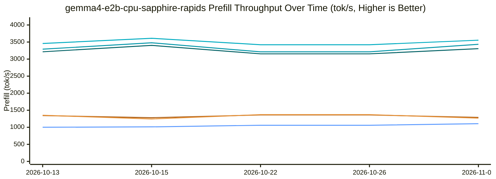
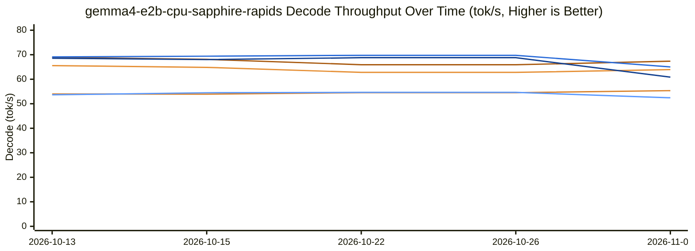
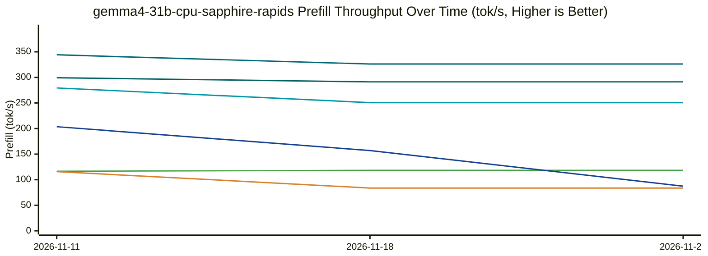
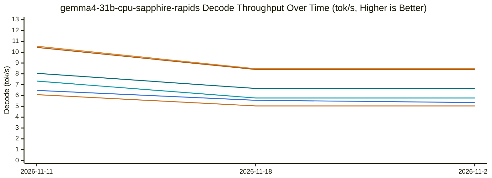

# Level 3 Model Benchmark Suite Dashboard

- **Interactive HTML Dashboard**: [`model/dashboards/index.html`](index.html)
- **Raw Time-Series JSON**: [`model/dashboards/data.json`](data.json)
- **Last Updated**: `2026-11-26 10:26:57 UTC`

## Tracked Model Benchmark Suites

| Suite | Machine | Workload (`prompt -> decode`, `ctx`) | Configs | Snapshots | Latest Report |
| :--- | :--- | :--- | ---: | ---: | :--- |
| [`gemma4-e2b-cpu-sapphire-rapids`](#gemma4-e2b-cpu-sapphire-rapids-sapphire-rapids) | `sapphire-rapids` | `1024 -> 128` (`ctx=4096`) | 16 | 5 | [`2026-11-03`](../reports/2026-11-03-gemma4-e2b-cpu-sapphire-rapids-sapphire-rapids/README.md) |
| [`gemma4-31b-cpu-sapphire-rapids`](#gemma4-31b-cpu-sapphire-rapids-sapphire-rapids) | `sapphire-rapids` | `1024 -> 128` (`ctx=4096`) | 13 | 3 | [`2026-11-23`](../reports/2026-11-23-gemma4-31b-cpu-sapphire-rapids-sapphire-rapids/README.md) |
| [`gemma4-31b-cpu-apple-m5-max`](#gemma4-31b-cpu-apple-m5-max-apple-m5-max) | `apple-m5-max` | `1024 -> 128` (`ctx=4096`) | 7 | 1 | [`2026-11-26`](../reports/2026-11-26-gemma4-31b-cpu-apple-m5-max-apple-m5-max/README.md) |
| [`gemma4-26b-a4b-gpu`](#gemma4-26b-a4b-gpu-apple-m5-max) | `apple-m5-max` | `1024 -> 256` (`ctx=4096`) | 4 | 1 | [`2026-10-22`](../reports/2026-10-22-gemma4-26b-a4b-gpu-apple-m5-max/README.md) |
| [`gemma4-e2b-cpu-arm-runtimes`](#gemma4-e2b-cpu-arm-runtimes-apple-m5-max) | `apple-m5-max` | `1024 -> 256` (`ctx=4096`) | 3 | 1 | [`2026-10-02`](../reports/2026-10-02-gemma4-e2b-cpu-arm-runtimes-apple-m5-max/README.md) |
| [`gemma4-e2b-cpu`](#gemma4-e2b-cpu-apple-m5-max) | `apple-m5-max` | `1024 -> 256` (`ctx=4096`) | 5 | 1 | [`2026-10-01`](../reports/2026-10-01-gemma4-e2b-cpu-apple-m5-max/README.md) |

---

## gemma4-e2b-cpu-sapphire-rapids (sapphire-rapids)

Gemma 4 E2B on x86 Intel Xeon AMX CPU (NUMA node 0 physical cores) across FP32, BF16, INT8, and INT4/INT2 model precisions:

- **OpenXLA** (with YNNPACK)
- **LiteRT-LM** (with XNNPACK and YNNPACK)
- **llama.cpp** (AVX-512 + AMX)
- **OpenVINO GenAI**
- **ONNX Runtime GenAI**

Frameworks are only benchmarked on data types where pre-built model artifacts exist (e.g., `llama.cpp` is omitted from FP32 because no pre-built F32 GGUF is published in `ggml-org/gemma-4-E2B-it-GGUF`).

- **Hardware / OS**: `Intel(R) Xeon(R) Sapphire Rapids (2x 56C) pinned to NUMA node 0 (56 physical cores)`
- **Headline Workload**: `1024` prompt -> `128` decode tokens (`ctx=4096`)
- **Reports**: [`2026-10-13`](../reports/2026-10-13-gemma4-e2b-cpu-sapphire-rapids-sapphire-rapids/README.md), [`2026-10-15`](../reports/2026-10-15-gemma4-e2b-cpu-sapphire-rapids-sapphire-rapids/README.md), [`2026-10-22`](../reports/2026-10-22-gemma4-e2b-cpu-sapphire-rapids-sapphire-rapids/README.md), [`2026-10-26`](../reports/2026-10-26-gemma4-e2b-cpu-sapphire-rapids-sapphire-rapids/README.md), [`2026-11-03`](../reports/2026-11-03-gemma4-e2b-cpu-sapphire-rapids-sapphire-rapids/README.md)

| Framework / Config | Track | Checkpoint | Weights / Acts / KV | Threads | Prefill [2026-10-13](../reports/2026-10-13-gemma4-e2b-cpu-sapphire-rapids-sapphire-rapids/README.md) (tok/s) ↑ | Prefill [2026-10-15](../reports/2026-10-15-gemma4-e2b-cpu-sapphire-rapids-sapphire-rapids/README.md) (tok/s) ↑ | Prefill [2026-10-22](../reports/2026-10-22-gemma4-e2b-cpu-sapphire-rapids-sapphire-rapids/README.md) (tok/s) ↑ | Prefill [2026-10-26](../reports/2026-10-26-gemma4-e2b-cpu-sapphire-rapids-sapphire-rapids/README.md) (tok/s) ↑ | Prefill [2026-11-03](../reports/2026-11-03-gemma4-e2b-cpu-sapphire-rapids-sapphire-rapids/README.md) (tok/s) ↑ | Δ Prefill | Decode [2026-10-13](../reports/2026-10-13-gemma4-e2b-cpu-sapphire-rapids-sapphire-rapids/README.md) (tok/s) ↑ | Decode [2026-10-15](../reports/2026-10-15-gemma4-e2b-cpu-sapphire-rapids-sapphire-rapids/README.md) (tok/s) ↑ | Decode [2026-10-22](../reports/2026-10-22-gemma4-e2b-cpu-sapphire-rapids-sapphire-rapids/README.md) (tok/s) ↑ | Decode [2026-10-26](../reports/2026-10-26-gemma4-e2b-cpu-sapphire-rapids-sapphire-rapids/README.md) (tok/s) ↑ | Decode [2026-11-03](../reports/2026-11-03-gemma4-e2b-cpu-sapphire-rapids-sapphire-rapids/README.md) (tok/s) ↑ | Δ Decode | Latest TTFT (ms) ↓ | Warm TTFT (ms) ↓ | Latest E2E (ms) ↓ | Peak RSS (MB) ↓ | MMLU / GSM8K ↑ |
| :--- | :--- | :--- | :--- | ---: | ---: | ---: | ---: | ---: | ---: | ---: | ---: | ---: | ---: | ---: | ---: | ---: | ---: | ---: | ---: | ---: | ---: |
| **FP32 Track** | | | | | | | | | | | | | | | | | | | | | |
| 🏆 **`openvino/fp32`** | `reference` | `it (OV)` | `fp32 / fp32 / fp16` | 40 | 889.1 | 913.8 | 880.7 | 880.7 | 901.7 | +21.0 (+2.4%) | 30.29 | 30.55 | 28.90 | 28.90 | 28.63 | -0.27 (-0.9%) | 1,136 | — | 5,567 | 9,947 | 60.60% / — |
| `xla/fp32-ynnpack` | `reference` | `it (HF)` | `fp32 / fp32 / fp32` | 16 | 722.1 | 638.8 | 644.0 | 644.0 | 421.0 | -223.0 (-34.6%) | 9.03 | 4.80 | 4.68 | 4.68 | 3.85 | -0.83 (-17.7%) | 2,432 | — | 35,569 | 24,513 | 60.55% / — |
| **BF16 Track** | | | | | | | | | | | | | | | | | | | | | |
| 🏆 **`llama.cpp/bf16`** | `reference` | `it (GGUF)` | `bf16 / fp32 / fp16` | 32 | 519.5 | 519.2 | 552.8 | 552.8 | 517.8 | -35.0 (-6.3%) | 35.28 | 35.23 | 33.53 | 33.53 | 33.43 | -0.10 (-0.3%) | 1,978 | — | 5,781 | 4,643 | 60.35% / — |
| `openvino/bf16` | `reference` | `it (OV)` | `bf16 / bf16 / bf16` | 40 | 3456.7 | 3610.1 | 3420.6 | 3420.6 | 3553.9 | +133.3 (+3.9%) | 34.47 | 34.18 | 32.08 | 32.08 | 31.42 | -0.66 (-2.1%) | 288 | — | 4,332 | 9,584 | 60.35% / — |
| `xla/bf16-ynnpack` | `reference` | `it (HF)` | `bf16 / bf16 / bf16` | 16 | 1045.1 | 972.9 | 980.9 | 980.9 | 908.9 | -71.9 (-7.3%) | 11.54 | 3.27 | 3.02 | 3.02 | 3.00 | -0.02 (-0.7%) | 1,127 | — | 43,512 | 22,152 | 60.50% / — |
| **INT8 Track** | | | | | | | | | | | | | | | | | | | | | |
| 🏆 **`llama.cpp/int8`** | `reference` | `it (GGUF)` | `q8_0 / q8_0 / fp16` | 32 | 1036.8 | 1062.5 | 1058.0 | 1058.0 | 1069.9 | +11.9 (+1.1%) | 49.07 | 49.21 | 46.97 | 46.97 | 47.53 | +0.56 (+1.2%) | 957 | — | 3,627 | 7,598 | 60.90% / — |
| `openvino/int8` | `reference` | `it (OV)` | `int8_asym / bf16 / int8` | 40 | 3213.6 | 3402.4 | 3153.6 | 3153.6 | 3305.6 | +152.0 (+4.8%) | 39.84 | 39.70 | 39.00 | 39.00 | 38.13 | -0.87 (-2.2%) | 310 | — | 3,640 | 5,305 | 60.50% / — |
| **INT4 / Mixed Track** | | | | | | | | | | | | | | | | | | | | | |
| 🏆 **`llama.cpp/fastest`** | `fastest` | `qat-mobile` | `q4_0_q8_0 / q8_0 / fp16` | 32 | 1343.5 | 1281.8 | 1361.8 | 1361.8 | 1289.9 | -71.9 (-5.3%) | 68.92 | 68.12 | 65.92 | 65.92 | 67.35 | +1.43 (+2.2%) | 794 | 280 (2.83×) | 2,679 | 4,377 | 51.15% / 50.00% |
| `litert-lm/matched` | `matched` | `qat-mobile` | `int2_int4_int8 / int8 / int8` | 16 | 1024.0 | 1013.2 | 949.6 | 949.6 | 921.5 | -28.1 (-3.0%) | 69.10 | 69.41 | 69.76 | 69.76 | 65.02 | -4.74 (-6.8%) | 1,112 | 194 (5.73×) | 3,065 | 1,767 | 57.55% / 74.40% |
| `llama.cpp/stock-q4_0` | `reference` | `it (GGUF)` | `q4_0 / q8_0 / fp16` | 32 | 1351.8 | 1244.5 | 1371.0 | 1371.0 | 1268.3 | -102.8 (-7.5%) | 65.57 | 64.85 | 62.79 | 62.79 | 63.93 | +1.14 (+1.8%) | 809 | 286 (2.82×) | 2,795 | 4,560 | 60.40% / 76.40% |
| `litert-lm/fastest` | `fastest` | `qat-mobile` | `int2_int4_int8 / int8 / int8` | 32 | 1018.2 | 1011.5 | 933.2 | 933.2 | 1048.0 | +114.8 (+12.3%) | 68.59 | 68.01 | 68.79 | 68.79 | 60.86 | -7.93 (-11.5%) | 977 | 129 (7.59×) | 3,071 | 1,767 | 57.55% / 74.40% |
| `llama.cpp/matched` | `matched` | `qat-mobile` | `q2_k_q4_0_q8_0 / q8_0 / q8_0` | 16 | 422.2 | 418.6 | 418.1 | 418.1 | 442.6 | +24.5 (+5.9%) | 53.98 | 53.91 | 54.52 | 54.52 | 55.35 | +0.83 (+1.5%) | 2,314 | 363 (6.37×) | 4,605 | 3,459 | — / — |
| `litert-lm/ynnpack` | `reference` | `qat-mobile` | `int2_int4_int8 / int8 / int8` | 16 | 1001.7 | 1012.2 | 1059.8 | 1059.8 | 1105.0 | +45.2 (+4.3%) | 53.65 | 54.49 | 54.64 | 54.64 | 52.44 | -2.20 (-4.0%) | 927 | — | 3,350 | 2,610 | — / — |
| `openvino/int4` | `fastest` | `it (OV)` | `int4_asym / bf16 / int8` | 40 | 3290.2 | 3478.3 | 3212.8 | 3212.8 | 3434.3 | +221.4 (+6.9%) | 46.68 | 46.50 | 46.46 | 46.46 | 45.52 | -0.94 (-2.0%) | 298 | 112 (2.66×) | 3,090 | 3,680 | 56.70% / 73.20% |
| `onnxruntime/q4_k_m` | `reference` | `it (ONNX)` | `q4_k_m / fp32 / fp32` | 16 | 270.1 | 276.0 | 271.1 | 271.1 | 266.7 | -4.3 (-1.6%) | 24.74 | 25.56 | 25.49 | 25.49 | 24.83 | -0.66 (-2.6%) | 3,839 | 542 (7.09×) | 8,955 | 19,119 | 60.00% / 77.20% |
| `xla/matched-ynnpack` | `matched` | `qat-mobile` | `int2_int4_int8 / int8 / bf16` | 16 | 556.7 | 551.2 | 777.9 | 777.9 | 571.7 | -206.2 (-26.5%) | 3.87 | 3.87 | 3.53 | 3.53 | 3.12 | -0.41 (-11.6%) | 1,791 | 455 (3.94×) | 42,579 | 15,052 | 57.35% / — |

---

## gemma4-31b-cpu-sapphire-rapids (sapphire-rapids)

Gemma 4 31B (dense 60-layer, 50 sliding-window + 10 global attention layers) on Intel(R) Xeon(R) Sapphire Rapids (AVX-512 + AMX) across CPU runtimes (LiteRT-LM XNNPACK & YNNPACK, llama.cpp, OpenVINO, XLA/PJRT CPU) grouped by precision track (INT4, INT8, BF16).

- **Hardware / OS**: `x86_64 server pinned to Socket 0 physical cores`
- **Headline Workload**: `1024` prompt -> `128` decode tokens (`ctx=4096`)
- **Reports**: [`2026-11-11`](../reports/2026-11-11-gemma4-31b-cpu-sapphire-rapids-sapphire-rapids/README.md), [`2026-11-18`](../reports/2026-11-18-gemma4-31b-cpu-sapphire-rapids-sapphire-rapids/README.md), [`2026-11-23`](../reports/2026-11-23-gemma4-31b-cpu-sapphire-rapids-sapphire-rapids/README.md)

| Framework / Config | Track | Checkpoint | Weights / Acts / KV | Threads | Prefill [2026-11-11](../reports/2026-11-11-gemma4-31b-cpu-sapphire-rapids-sapphire-rapids/README.md) (tok/s) ↑ | Prefill [2026-11-18](../reports/2026-11-18-gemma4-31b-cpu-sapphire-rapids-sapphire-rapids/README.md) (tok/s) ↑ | Prefill [2026-11-23](../reports/2026-11-23-gemma4-31b-cpu-sapphire-rapids-sapphire-rapids/README.md) (tok/s) ↑ | Δ Prefill | Decode [2026-11-11](../reports/2026-11-11-gemma4-31b-cpu-sapphire-rapids-sapphire-rapids/README.md) (tok/s) ↑ | Decode [2026-11-18](../reports/2026-11-18-gemma4-31b-cpu-sapphire-rapids-sapphire-rapids/README.md) (tok/s) ↑ | Decode [2026-11-23](../reports/2026-11-23-gemma4-31b-cpu-sapphire-rapids-sapphire-rapids/README.md) (tok/s) ↑ | Δ Decode | Latest TTFT (ms) ↓ | Warm TTFT (ms) ↓ | Latest E2E (ms) ↓ | Peak RSS (MB) ↓ | MMLU / GSM8K ↑ |
| :--- | :--- | :--- | :--- | ---: | ---: | ---: | ---: | ---: | ---: | ---: | ---: | ---: | ---: | ---: | ---: | ---: | ---: |
| **BF16 Track** | | | | | | | | | | | | | | | | | |
| 🏆 **`llama.cpp/bf16`** | `reference` | `it (GGUF)` | `bf16 / fp32 / fp16` | 32 | 41.2 | 42.2 | 42.2 | 0.0 (0.0%) | 2.84 | 3.19 | 3.19 | 0.00 (0.0%) | 24,277 | — | 64,647 | 60,366 | 86.50% / — |
| `xla/bf16-ynnpack` | `reference` | `it (HF)` | `bf16 / bf16 / bf16` | 56 | 116.5 | 118.3 | 118.3 | 0.0 (0.0%) | 0.33 | 0.29 | 0.29 | 0.00 (0.0%) | 8,655 | — | 440,027 | 182,500 | 86.50% / — |
| **INT8 Track** | | | | | | | | | | | | | | | | | |
| 🏆 **`llama.cpp/q8_0`** | `reference` | `it (GGUF)` | `q8_0 / q8_0 / fp16` | 32 | 108.3 | 78.3 | 78.3 | 0.0 (0.0%) | 6.08 | 5.04 | 5.04 | 0.00 (0.0%) | 13,069 | — | 38,238 | 52,403 | 85.00% / — |
| `openvino/int8` | `reference` | `it (OV)` | `int8_asym / bf16 / int8` | 56 | 299.3 | 291.3 | 291.3 | 0.0 (0.0%) | 5.72 | 4.78 | 4.78 | 0.00 (0.0%) | 3,515 | — | 30,259 | 54,321 | 86.00% / — |
| **INT4 / Mixed Track** | | | | | | | | | | | | | | | | | |
| 🏆 **`llama.cpp/matched`** | `matched` | `qat-q4_0` | `q4_0 / q8_0 / fp16` | 32 | 115.8 | 83.7 | 83.7 | 0.0 (0.0%) | 10.55 | 8.47 | 8.47 | 0.00 (0.0%) | 12,230 | 2,035 (6.01×) | 27,216 | 35,443 | 85.50% / 100.00% |
| `llama.cpp/fastest` | `fastest` | `it (GGUF)` | `q4_0 / q8_0 / fp16` | 32 | 114.4 | 78.9 | 78.9 | 0.0 (0.0%) | 10.44 | 8.40 | 8.40 | 0.00 (0.0%) | 12,977 | 2,004 (6.47×) | 28,097 | 36,266 | 85.50% / 100.00% |
| `litert-lm/ynnpack-sdpa` | `reference` | `qat-q4_0` | `int4_int8 / fp32 / fp32` | 56 | — | — | 93.6 | n/a | — | — | 7.29 | n/a | 10,942 | 1,728 (6.33×) | 28,387 | 26,895 | 83.50% / 100.00% |
| `openvino/fastest` | `fastest` | `it (OV)` | `int4_asym / bf16 / int8` | 56 | 344.2 | 326.2 | 326.2 | 0.0 (0.0%) | 8.05 | 6.65 | 6.65 | 0.00 (0.0%) | 3,139 | 603 (5.21×) | 22,299 | 35,179 | 86.00% / 100.00% |
| `openvino/matched` | `matched` | `it (OV)` | `int4_asym / bf16 / int8` | 32 | 279.4 | 250.7 | 250.7 | 0.0 (0.0%) | 7.33 | 5.77 | 5.77 | 0.00 (0.0%) | 4,084 | 1,161 (3.52×) | 26,334 | 35,096 | 86.00% / 100.00% |
| `litert-lm/matched` | `matched` | `qat-q4_0` | `int4_int8 / fp32 / fp32` | 32 | 179.4 | 125.2 | 61.5 | -63.7 (-50.9%) | 6.47 | 5.56 | 5.35 | -0.21 (-3.8%) | 16,656 | 2,690 (6.19×) | 40,470 | 27,277 | 81.00% / 100.00% |
| `litert-lm/fastest` | `fastest` | `qat-q4_0` | `int4_int8 / fp32 / fp32` | 56 | 203.6 | 157.0 | 87.3 | -69.7 (-44.4%) | 6.17 | 5.35 | 4.70 | -0.65 (-12.2%) | 11,726 | 2,102 (5.58×) | 38,609 | 27,278 | 81.00% / 100.00% |
| `litert-lm/ynnpack` | `reference` | `qat-q4_0` | `int4_int8 / fp32 / fp32` | 32 | 102.8 | 76.9 | 54.4 | -22.6 (-29.3%) | 4.75 | 3.71 | 4.36 | +0.65 (+17.5%) | 18,828 | 3,029 (6.22×) | 47,857 | 27,260 | 83.00% / 100.00% |
| `litert-lm/ynnpack-fastest` | `reference` | `qat-q4_0` | `int4_int8 / fp32 / fp32` | 56 | 120.2 | 106.2 | 75.5 | -30.6 (-28.9%) | 4.44 | 3.97 | 4.15 | +0.18 (+4.5%) | 13,558 | 2,304 (5.88×) | 44,242 | 27,804 | 83.00% / 100.00% |

---

## gemma4-31b-cpu-apple-m5-max (apple-m5-max)

Gemma 4 31B (dense 60-layer, 50 sliding-window + 10 global attention layers) on Apple M5 Max CPU (18 physical cores: 6 Super + 12 Performance, 36 GB unified memory), run natively on macOS ARM64 across LiteRT-LM (XNNPACK, YNNPACK, YNNPACK-SDPA) and llama.cpp (CPU-only with KleidiAI + Accelerate) on the INT4 track.

- **Hardware / OS**: `Apple M5 Max (18-core CPU: 6 Super + 12 Performance, 36 GB unified memory), native macOS ARM64 CPU (no container)`
- **Headline Workload**: `1024` prompt -> `128` decode tokens (`ctx=4096`)
- **Reports**: [`2026-11-26`](../reports/2026-11-26-gemma4-31b-cpu-apple-m5-max-apple-m5-max/README.md)

| Framework / Config | Track | Checkpoint | Weights / Acts / KV | Threads | Prefill [2026-11-26](../reports/2026-11-26-gemma4-31b-cpu-apple-m5-max-apple-m5-max/README.md) (tok/s) ↑ | Decode [2026-11-26](../reports/2026-11-26-gemma4-31b-cpu-apple-m5-max-apple-m5-max/README.md) (tok/s) ↑ | Latest TTFT (ms) ↓ | Warm TTFT (ms) ↓ | Latest E2E (ms) ↓ | Peak RSS (MB) ↓ | MMLU / GSM8K ↑ |
| :--- | :--- | :--- | :--- | ---: | ---: | ---: | ---: | ---: | ---: | ---: | ---: |
| **INT4 / Mixed Track** | | | | | | | | | | | |
| 🏆 **`llama.cpp/fastest`** | `fastest` | `it (GGUF)` | `q4_0 / q8_0 / fp16` | 18 | 61.7 | 10.45 | 16,598 | 2,725 (6.09×) | 28,790 | 20,936 | 85.50% / 100.00% |
| `llama.cpp/matched` | `matched` | `qat-q4_0` | `q4_0 / q8_0 / fp16` | 12 | 44.9 | 9.29 | 22,821 | 3,587 (6.36×) | 36,509 | 20,673 | 85.50% / 100.00% |
| `litert-lm/ynnpack-sdpa` | `reference` | `qat-q4_0` | `int4_int8 / fp32 / fp32` | 18 | 60.5 | 7.60 | 16,929 | 2,853 (5.93×) | 33,640 | 27,087 | 85.00% / 100.00% |
| `litert-lm/ynnpack-fastest` | `reference` | `qat-q4_0` | `int4_int8 / fp32 / fp32` | 18 | 48.0 | 5.28 | 21,310 | 3,503 (6.08×) | 45,364 | 27,236 | — / — |
| `litert-lm/matched` | `matched` | `qat-q4_0` | `int4_int8 / fp32 / fp32` | 12 | 39.2 | 4.72 | 26,110 | 3,848 (6.79×) | 53,011 | 28,362 | — / — |
| `litert-lm/fastest` | `fastest` | `qat-q4_0` | `int4_int8 / fp32 / fp32` | 18 | 49.6 | 4.58 | 20,645 | 3,562 (5.80×) | 48,316 | 28,362 | — / — |
| `litert-lm/ynnpack` | `reference` | `qat-q4_0` | `int4_int8 / fp32 / fp32` | 12 | 36.5 | 4.44 | 28,087 | 3,998 (7.03×) | 56,665 | 27,292 | — / — |

---

## gemma4-26b-a4b-gpu (apple-m5-max)

Gemma 4 26B A4B (MoE, 3.8B active) on the Apple M5 Max GPU, run natively on macOS with Metal: LiteRT-LM (ML Drift GPU backend), llama.cpp (Metal), MLX (mlx-lm) and BaseRT. Every configuration is a reference (open) comparison: each framework runs its own published ~4-bit artifact of the model with framework defaults, so weights and quantization are NOT matched and speed must be read together with the accuracy gate. Native macOS numbers are not comparable with the Linux-VM CPU suites.

- **Hardware / OS**: `Apple M5 Max (40-core GPU, 64 GB), native macOS with Metal; GPU suite, not comparable with the Linux-VM CPU suites`
- **Headline Workload**: `1024` prompt -> `256` decode tokens (`ctx=4096`)
- **Reports**: [`2026-10-22`](../reports/2026-10-22-gemma4-26b-a4b-gpu-apple-m5-max/README.md)

| Framework / Config | Track | Checkpoint | Weights / Acts / KV | Threads | Prefill [2026-10-22](../reports/2026-10-22-gemma4-26b-a4b-gpu-apple-m5-max/README.md) (tok/s) ↑ | Decode [2026-10-22](../reports/2026-10-22-gemma4-26b-a4b-gpu-apple-m5-max/README.md) (tok/s) ↑ | Latest TTFT (ms) ↓ | Latest E2E (ms) ↓ | Peak RSS (MB) ↓ | MMLU / GSM8K ↑ |
| :--- | :--- | :--- | :--- | ---: | ---: | ---: | ---: | ---: | ---: | ---: |
| **INT4 / Mixed Track** | | | | | | | | | | |
| 🏆 **`mlx/metal`** | `reference` | `QAT (MLX)` | `4/8-bit affine g64 / bf16 / not exposed` | 6 (recorded only) | 4001.9 | 118.55 | 256 | 2,408 | 14,260 | 79.50% / 94.00% |
| `llama.cpp/metal` | `reference` | `QAT (GGUF)` | `q4_0 / not exposed / fp16` | 6 (host) | 3413.2 | 110.33 | 300 | 2,610 | 14,169 | 78.40% / 93.60% |
| `litert-lm/gpu` | `reference` | `it (LiteRT-LM GPU)` | `~4-bit / not exposed / not exposed` | 6 (host) | 2752.3 | 103.72 | 372 | 2,830 | 5,131 | 79.05% / 93.60% |
| `basert/metal` | `reference` | `it (BaseRT)` | `Q4 / not exposed / not exposed` | 6 (recorded only) | 3368.8 | 77.55 | 304 | 3,593 | 2,063 | 78.80% / 93.60% |

---

## gemma4-e2b-cpu-arm-runtimes (apple-m5-max)

Exploratory Gemma 4 E2B CPU comparison on the Apple M5 Max Linux/ARM VM. All configurations use independently published artifacts and are open/reference comparisons, NOT matched weights or quantization. Validate each model with the accuracy gate before interpreting speed; consult docs/harness.md for staging and limitations.

- **Hardware / OS**: `Apple M5 Max under a linux/arm64 VM; CPU only, no Metal/ANE`
- **Headline Workload**: `1024` prompt -> `256` decode tokens (`ctx=4096`)
- **Reports**: [`2026-10-02`](../reports/2026-10-02-gemma4-e2b-cpu-arm-runtimes-apple-m5-max/README.md)

| Framework / Config | Track | Checkpoint | Weights / Acts / KV | Threads | Prefill [2026-10-02](../reports/2026-10-02-gemma4-e2b-cpu-arm-runtimes-apple-m5-max/README.md) (tok/s) ↑ | Decode [2026-10-02](../reports/2026-10-02-gemma4-e2b-cpu-arm-runtimes-apple-m5-max/README.md) (tok/s) ↑ | Latest TTFT (ms) ↓ | Latest E2E (ms) ↓ | Peak RSS (MB) ↓ | MMLU / GSM8K ↑ |
| :--- | :--- | :--- | :--- | ---: | ---: | ---: | ---: | ---: | ---: | ---: |
| **INT4 / Mixed Track** | | | | | | | | | | |
| 🏆 **`llama.cpp/stock-q4_0`** | `reference` | `it (GGUF)` | `q4_0 / q8_0 / fp16` | 12 | 357.7 | 77.75 | 2,863 | 6,150 | 4,365 | 60.65% / 78.40% |
| `litert-lm/ynnpack` | `reference` | `qat-mobile` | `int2_int4_int8 / int8 / int8` | 8 | 1092.9 | 76.29 | 937 | 4,284 | 2,839 | 57.20% / 76.00% |
| `onnxruntime/q4_k_m` | `reference` | `it (ONNX)` | `q4_k_m / fp32 / fp32` | 12 | 155.9 | 21.66 | 6,569 | 18,334 | 6,658 | 60.25% / 77.60% |

---

## gemma4-e2b-cpu (apple-m5-max)

Gemma 4 E2B on CPU: llama.cpp vs LiteRT-LM. 'matched' = same weights (bit-identical integers), prompt, greedy decode, context, threads and closest KV-cache precision; 'fastest' = each framework's best configuration found by the documented sweep, accuracy-gated; 'reference' = llama.cpp out-of-the-box with the stock ggml-org Q4_0 GGUF.

- **Hardware / OS**: `Apple M5 Max under a linux/arm64 VM; CPU only, no Metal/ANE`
- **Headline Workload**: `1024` prompt -> `256` decode tokens (`ctx=4096`)
- **Reports**: [`2026-10-01`](../reports/2026-10-01-gemma4-e2b-cpu-apple-m5-max/README.md)

| Framework / Config | Track | Checkpoint | Weights / Acts / KV | Threads | Prefill [2026-10-01](../reports/2026-10-01-gemma4-e2b-cpu-apple-m5-max/README.md) (tok/s) ↑ | Decode [2026-10-01](../reports/2026-10-01-gemma4-e2b-cpu-apple-m5-max/README.md) (tok/s) ↑ | Latest TTFT (ms) ↓ | Latest E2E (ms) ↓ | Peak RSS (MB) ↓ | MMLU / GSM8K ↑ |
| :--- | :--- | :--- | :--- | ---: | ---: | ---: | ---: | ---: | ---: | ---: |
| **INT4 / Mixed Track** | | | | | | | | | | |
| 🏆 **`llama.cpp/fastest`** | `fastest` | `qat-mobile` | `q4_0_q8_0 / q8_0 / fp16` | 12 | 506.2 | 81.50 | 2,023 | 5,160 | 4,345 | 50.95% / — |
| `llama.cpp/stock-q4_0` | `reference` | `it (GGUF)` | `q4_0 / q8_0 / fp16` | 12 | 354.1 | 74.69 | 2,892 | 6,274 | 4,365 | 60.65% / — |
| `litert-lm/fastest` | `fastest` | `qat-mobile` | `int2_int4_int8 / int8 / int8` | 8 | 1003.5 | 74.49 | 1,020 | 4,433 | 2,850 | 57.20% / 77.20% |
| `llama.cpp/matched` | `matched` | `qat-mobile` | `q2_k_q4_0_q8_0 / q8_0 / q8_0` | 12 | 240.5 | 70.18 | 4,257 | 7,889 | 2,957 | 50.09% / 46.80% |
| `litert-lm/matched` | `matched` | `qat-mobile` | `int2_int4_int8 / int8 / int8` | 12 | 1014.0 | 37.23 | 1,010 | 7,855 | 2,772 | 56.92% / 77.20% |
