# gemma4-e2b-cpu-sapphire-rapids on sapphire-rapids — 2026-11-03

> Generated by `python3 -m aeb.report` from 32 headline benchmark processes plus 52 input-length sweep processes and 8 prefix-cache processes. Raw per-request data: [data.json](data.json). Methodology: [benchmark_methodology.md](../../docs/benchmark_methodology.md).

Gemma 4 E2B on x86 Intel Xeon AMX CPU (NUMA node 0 physical cores) across FP32, BF16, INT8, and INT4/INT2 model precisions:

- **OpenXLA** (with YNNPACK)
- **LiteRT-LM** (with XNNPACK and YNNPACK)
- **llama.cpp** (AVX-512 + AMX)
- **OpenVINO GenAI**
- **ONNX Runtime GenAI**

Frameworks are only benchmarked on data types where pre-built model artifacts exist (e.g., `llama.cpp` is omitted from FP32 because no pre-built F32 GGUF is published in `ggml-org/gemma-4-E2B-it-GGUF`).

## Summary

Headline medians (`1024` prompt → `128` generated tokens, stateless cold KV cache) and accuracy grouped by data type. Within each data type, rows are ordered from fastest to slowest end-to-end latency, with the best-performing row highlighted (**🏆**) and best per-column metrics bolded. The highlighted row is the lowest measured latency, not a claim of statistically significant superiority.

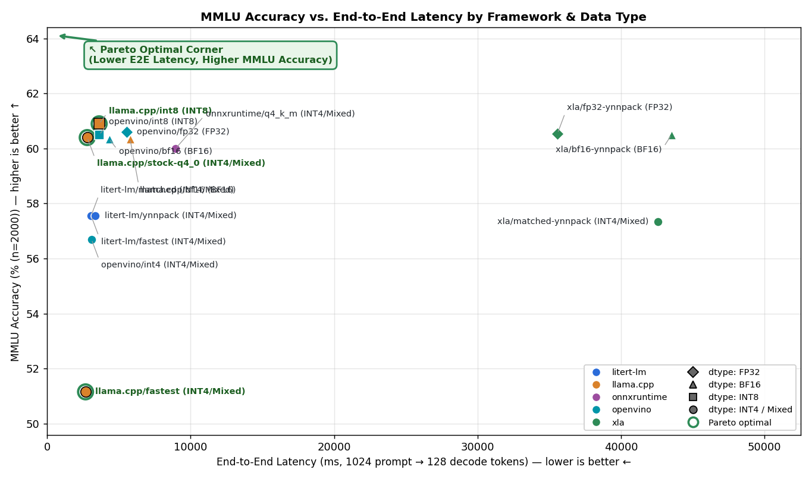

| Framework / Config | Checkpoint | Weights / Acts / KV | Threads | TTFT (ms) ↓ | Prefill (tok/s) ↑ | Decode (tok/s) ↑ | E2E (ms) ↓ | Peak RSS (MB) ↓ | MMLU (n=2000) ↑ | GSM8K (n=250) ↑ |
| --- | --- | --- | ---: | ---: | ---: | ---: | ---: | ---: | ---: | ---: |
| **FP32 Track** | | | | | | | | | | |
| 🏆 **`openvino/fp32`** | **`it` (OV)** | **`fp32 / fp32 / fp16`** | **40** | **1,136** | **901.7** | **28.63** | **5,567** | **9,947** | **60.60%** | — |
| `xla/fp32-ynnpack` | `it` (HF) | `fp32 / fp32 / fp32` | 16 | 2,432 | 421.0 | 3.85 | 35,569 | 24,513 | 60.55% | — |
| **BF16 Track** | | | | | | | | | | |
| 🏆 **`openvino/bf16`** | **`it` (OV)** | **`bf16 / bf16 / bf16`** | **40** | **288** | **3,553.9** | 31.42 | **4,332** | 9,584 | 60.35% | — |
| `llama.cpp/bf16` | `it` (GGUF) | `bf16 / fp32 / fp16` | 32 | 1,978 | 517.8 | **33.43** | 5,781 | **4,643** | 60.35% | — |
| `xla/bf16-ynnpack` | `it` (HF) | `bf16 / bf16 / bf16` | 16 | 1,127 | 908.9 | 3.00 | 43,512 | 22,152 | **60.50%** | — |
| **INT8 Track** | | | | | | | | | | |
| 🏆 **`llama.cpp/int8`** | **`it` (GGUF)** | **`q8_0 / q8_0 / fp16`** | **32** | 957 | 1,069.9 | **47.53** | **3,627** | 7,598 | **60.90%** | — |
| `openvino/int8` | `it` (OV) | `int8_asym / bf16 / int8` | 40 | **310** | **3,305.6** | 38.13 | 3,640 | **5,305** | 60.50% | — |
| **INT4 / Mixed Track** | | | | | | | | | | |
| 🏆 **`llama.cpp/fastest`** | **`qat-mobile`** | **`q4_0_q8_0 / q8_0 / fp16`** | **32** | 794 | 1,289.9 | **67.35** | **2,679** | 4,377 | 51.15% | 50.00% |
| `llama.cpp/stock-q4_0` | `it` (GGUF) | `q4_0 / q8_0 / fp16` | 32 | 809 | 1,268.3 | 63.93 | 2,795 | 4,560 | **60.40%** | 76.40% |
| `litert-lm/matched` | `qat-mobile` | `int2_int4_int8 / int8 / int8` | 16 | 1,112 | 921.5 | 65.02 | 3,065 | **1,767** | 57.55% | 74.40% |
| `litert-lm/fastest` | `qat-mobile` | `int2_int4_int8 / int8 / int8` | 32 | 977 | 1,048.1 | 60.86 | 3,071 | 1,767 | 57.55% | 74.40% |
| `openvino/int4` | `it` (OV) | `int4_asym / bf16 / int8` | 40 | **298** | **3,434.3** | 45.52 | 3,090 | 3,680 | 56.70% | 73.20% |
| `litert-lm/ynnpack` | `qat-mobile` | `int2_int4_int8 / int8 / int8` | 16 | 927 | 1,105.0 | 52.44 | 3,350 | 2,610 | 57.55% | 74.40% |
| `llama.cpp/matched` | `qat-mobile` | `q2_k_q4_0_q8_0 / q8_0 / q8_0` | 16 | 2,313 | 442.6 | 55.35 | 4,605 | 3,459 | — | — |
| `onnxruntime/q4_k_m` | `it` (ONNX) | `q4_k_m / fp32 / fp32` | 16 | 3,839 | 266.7 | 24.83 | 8,955 | 19,119 | 60.00% | **77.20%** |
| `xla/matched-ynnpack` | `qat-mobile` | `int2_int4_int8 / int8 / bf16` | 16 | 1,791 | 571.7 | 3.12 | 42,579 | 15,052 | 57.35% | — |

**Legend:**

- **`matched`**: Same pre-quantized integer weights, prompt tokens, decoding and thread counts, with the closest supported KV-cache precision. See Quantization equivalence for representation and activation differences.

- **`fastest`**: Empirically selected configuration from the suite's thread and kernel sweep; read performance together with the accuracy gate.

- **`reference`**: Published framework-specific artifacts and defaults; weights and quantization are not matched. Read speed together with accuracy.

## Results

### Throughput

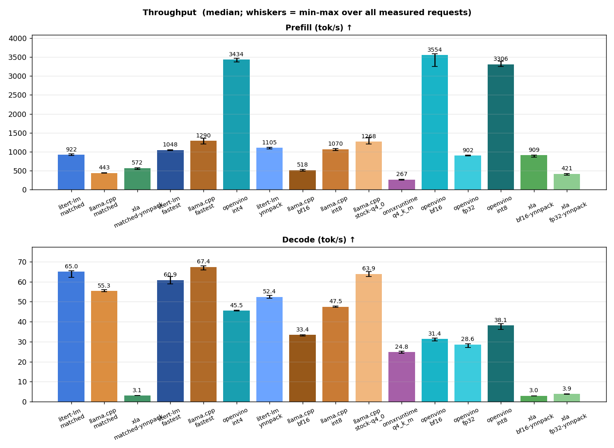

#### Input-length throughput sweep

Sweep measurement dates (UTC): 2026-11-04.

Fixed **128 generated tokens**, greedy with stop tokens ignored; common context capacity **8,192**. Model artifacts and thread counts are unchanged from the configurations above. These are reference configurations, not matched weights. The original headline workload remains unchanged.

Swept configurations are the empirically fastest configuration for each `(framework, dtype)` pair that cleared the minimum accuracy gate (gsm8k ≥ 40%, mmlu ≥ 40%).

Each point uses 1 interleaved processes per configuration, 1 warm-ups and 2 measured requests per process. Long inputs repeat the same public-domain passage deterministically. N includes BOS and chat-template tokens. Each request starts with an empty KV cache.

Prefill tokens/s = N / time to first token (includes tokenization and first-token generation). Decode tokens/s = 127 / time from the first to the last generated token. Rates are medians; brackets show min-max. Failed, truncated or wrong-length processes are excluded, never replaced by estimated rates.

##### Prefill (tokens/s)

| N | `litert-lm/matched` | `xla/matched-ynnpack` | `llama.cpp/fastest` | `openvino/int4` | `openvino/int8` | `llama.cpp/int8` | `llama.cpp/stock-q4_0` | `onnxruntime/q4_k_m` | `xla/bf16-ynnpack` | `openvino/bf16` | `llama.cpp/bf16` | `xla/fp32-ynnpack` | `openvino/fp32` |
| --- | --- | --- | --- | --- | --- | --- | --- | --- | --- | --- | --- | --- | --- |
| 64 | 309.83 [306.67-313.00] | 207.88 [207.77-207.99] | 857.37 [841.41-873.33] | 1106.59 [1043.50-1169.69] | 1141.66 [1128.58-1154.74] | 830.17 [797.47-862.88] | 853.97 [843.67-864.27] | 239.09 [234.14-244.03] | 278.53 [269.57-287.50] | 1176.64 [1161.28-1191.99] | 413.84 [395.63-432.06] | 165.23 [164.62-165.84] | 408.99 [406.27-411.71] |
| 256 | 702.59 [694.47-710.70] | 472.39 [454.41-490.37] | 1172.83 [1164.32-1181.33] | 2477.67 [2452.75-2502.58] | 2474.84 [2467.00-2482.69] | 1099.90 [1065.61-1134.18] | 1116.22 [1096.83-1135.60] | 284.22 [268.11-300.34] | 710.77 [695.91-725.62] | 2522.66 [2204.58-2840.75] | 531.78 [528.16-535.39] | 345.61 [345.09-346.14] | 768.54 [758.84-778.25] |
| 1,024 | 569.77 [559.79-579.75] | 577.73 [575.98-579.47] | 1374.62 [1356.12-1393.12] | 3398.78 [3372.83-3424.73] | 3372.83 [3368.18-3377.49] | 1107.80 [1102.24-1113.36] | 1392.87 [1391.38-1394.37] | 258.83 [243.02-274.65] | 1045.84 [1041.27-1050.41] | 3543.76 [3528.34-3559.18] | 531.62 [516.70-546.53] | 429.86 [428.96-430.76] | 902.79 [892.92-912.67] |
| 4,096 | 590.37 [588.16-592.57] | 461.79 [461.72-461.87] | 1164.55 [1162.88-1166.22] | 3224.87 [3197.63-3252.11] | 3245.14 [3241.32-3248.95] | 849.64 [845.86-853.43] | 1061.53 [1005.47-1117.59] | 152.29 [148.32-156.26] | 782.68 [779.51-785.85] | 3358.06 [3334.27-3381.84] | 450.92 [443.38-458.46] | 295.72 [290.04-301.40] | 868.50 [861.70-875.30] |

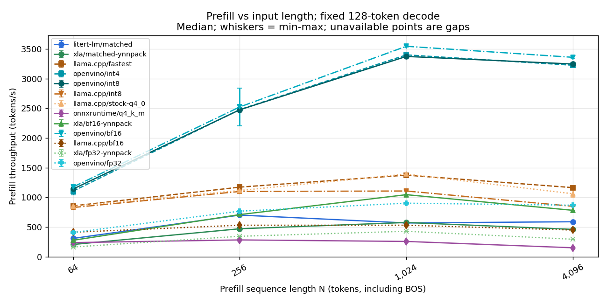

##### Decode (tokens/s)

| N | `litert-lm/matched` | `xla/matched-ynnpack` | `llama.cpp/fastest` | `openvino/int4` | `openvino/int8` | `llama.cpp/int8` | `llama.cpp/stock-q4_0` | `onnxruntime/q4_k_m` | `xla/bf16-ynnpack` | `openvino/bf16` | `llama.cpp/bf16` | `xla/fp32-ynnpack` | `openvino/fp32` |
| --- | --- | --- | --- | --- | --- | --- | --- | --- | --- | --- | --- | --- | --- |
| 64 | 55.35 [54.78-55.93] | 3.07 [3.07-3.08] | 70.78 [70.74-70.81] | 46.12 [46.09-46.14] | 39.90 [39.88-39.92] | 48.98 [48.14-49.82] | 67.32 [67.07-67.58] | 36.56 [36.56-36.56] | 3.04 [3.03-3.04] | 31.62 [31.51-31.74] | 34.34 [34.30-34.38] | 3.73 [3.70-3.77] | 28.89 [28.73-29.05] |
| 256 | 55.47 [55.37-55.56] | 3.09 [3.09-3.09] | 70.70 [70.68-70.72] | 46.22 [45.55-46.89] | 38.97 [38.91-39.03] | 48.59 [48.30-48.89] | 66.44 [66.40-66.47] | 33.13 [32.46-33.80] | 3.00 [3.00-3.01] | 31.74 [31.51-31.97] | 34.30 [34.27-34.32] | 3.74 [3.70-3.78] | 28.70 [28.66-28.74] |
| 1,024 | 56.41 [56.13-56.70] | 3.08 [3.07-3.09] | 69.18 [68.98-69.38] | 44.52 [44.21-44.82] | 38.95 [38.94-38.97] | 47.80 [47.76-47.84] | 64.97 [64.75-65.18] | 25.20 [24.71-25.68] | 3.03 [3.02-3.03] | 30.49 [29.21-31.77] | 33.28 [32.92-33.64] | 3.74 [3.70-3.78] | 28.64 [28.45-28.83] |
| 4,096 | 55.58 [55.34-55.81] | 3.07 [3.07-3.07] | 66.57 [66.55-66.60] | 38.54 [37.86-39.22] | 33.66 [32.95-34.37] | 46.98 [46.81-47.15] | 59.78 [59.21-60.36] | 11.01 [10.94-11.07] | 3.01 [3.00-3.02] | 28.59 [28.46-28.72] | 32.73 [32.45-33.01] | 3.76 [3.74-3.77] | 26.67 [26.39-26.95] |

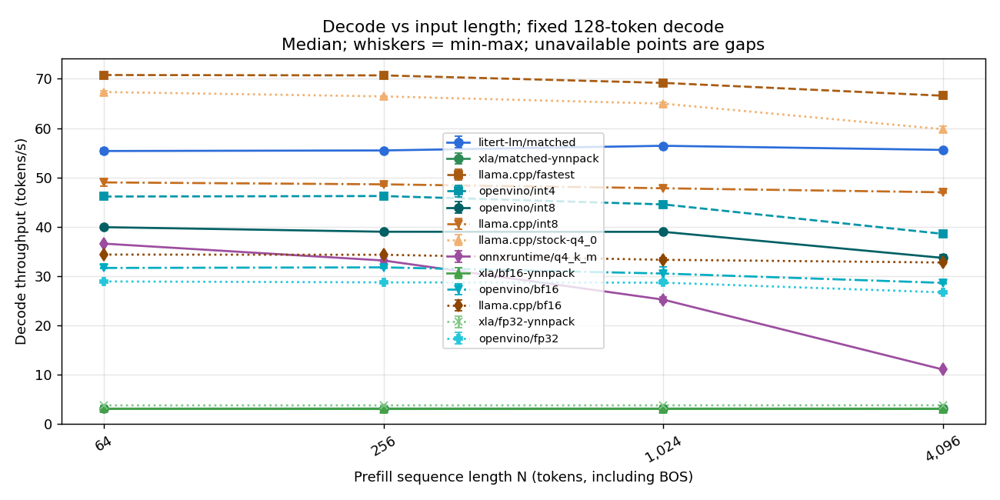


### Latency

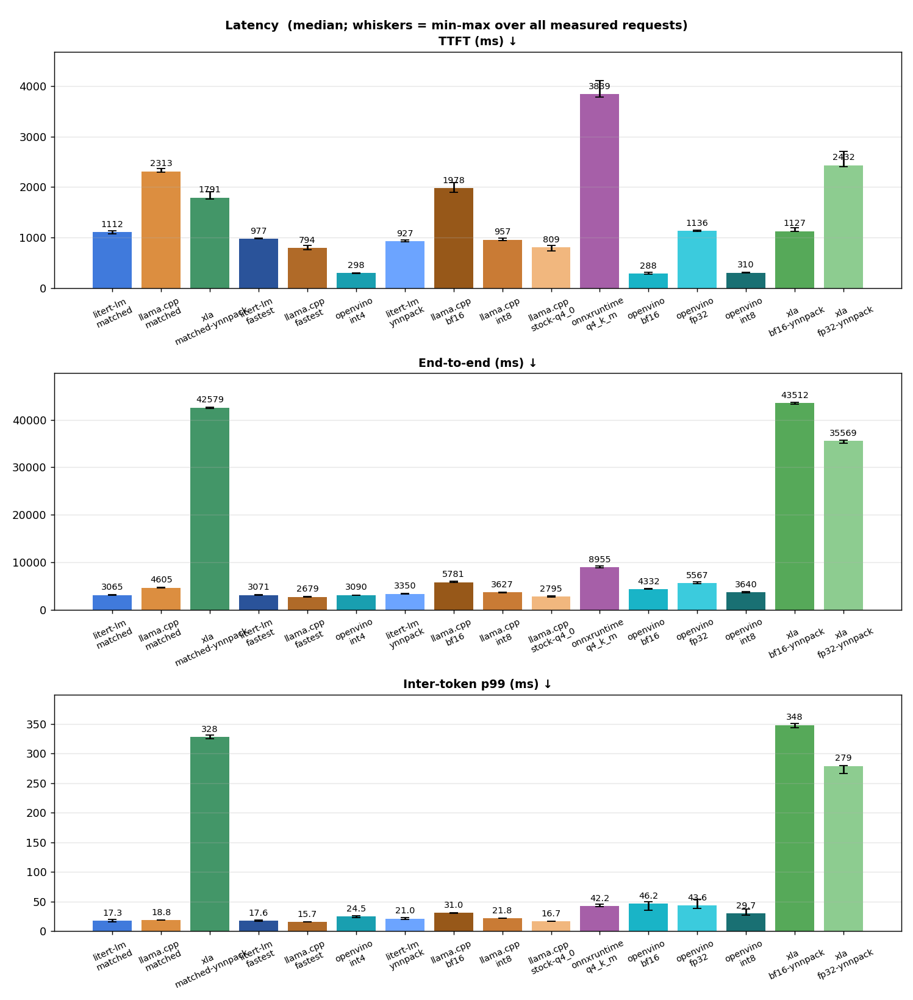

### Prefix caching (warm vs. cold KV cache)

Measures multi-turn / shared-system-prompt inference where **896 prefix tokens** of a **1,024-token prompt** are already present in the KV cache, and each request appends a distinct **128-token suffix** before generating **128 tokens** (greedy, stop tokens ignored). The headline suite above remains strictly stateless (fresh KV cache per request).

- **Cold TTFT / Cold prefill tok/s**: full 1,024-token prompt evaluated from an empty KV cache.
- **Warm TTFT**: latency to first generated token when reusing the 896-token prefix KV cache and prefilling only the 128-token suffix.
- **Effective prefill tok/s**: `1024 / warm_ttft_s` (effective prompt processing rate seen by the caller).
- **Incremental suffix tok/s**: `128 / warm_ttft_s` (actual compute throughput on the 128 uncached suffix tokens at KV position 896..1024).

| Config | Cold TTFT (ms) ↓ | Warm TTFT (ms) ↓ | TTFT speedup ↑ | Cold prefill (tok/s) ↑ | Warm effective prefill (tok/s) ↑ | Warm suffix prefill (tok/s) ↑ | Cold E2E (ms) ↓ | Warm E2E (ms) ↓ | E2E speedup ↑ |
| --- | --- | --- | --- | --- | --- | --- | --- | --- | --- |
| `llama.cpp/matched` | 2313 [2290–2366] | 363 [362–371] | **6.37×** [6.20, 6.51] | 442.6 [432.9–447.1] | 2818.1 [2762.2–2827.3] | 352.3 [345.3–353.4] | 4605 [4572–4666] | 2665 [2665–2681] | **1.73×** [1.71, 1.75] |
| `litert-lm/matched` | 1112 [1082–1138] | 194 [173–302] | **5.73×** [3.59, 6.56] | 921.5 [899.9–946.5] | 5279.1 [3385.7–5923.4] | 659.9 [423.2–740.4] | 3065 [3025–3175] | 2383 [2332–2478] | **1.29×** [1.22, 1.34] |
| `xla/matched-ynnpack` | 1791 [1769–1915] | 455 [454–456] | **3.94×** [3.91, 4.08] | 571.7 [534.9–578.9] | 2251.3 [2247.3–2256.4] | 281.4 [280.9–282.1] | 42579 [42400–42688] | 42146 [42050–42192] | **1.01×** [1.01, 1.01] |
| `llama.cpp/fastest` | 794 [758–848] | 280 [277–290] | **2.83×** [2.70, 2.96] | 1289.9 [1207.8–1351.7] | 3656.8 [3531.3–3693.8] | 457.1 [441.4–461.7] | 2679 [2642–2774] | 2160 [2138–2213] | **1.24×** [1.20, 1.27] |
| `litert-lm/fastest` | 977 [974–994] | 129 [129–131] | **7.59×** [7.46, 7.72] | 1048.1 [1030.7–1051.3] | 7953.4 [7833.3–7958.8] | 994.2 [979.2–994.9] | 3071 [3004–3144] | 2220 [2210–2227] | **1.38×** [1.35, 1.42] |
| `openvino/int4` | 298 [295–304] | 112 [110–114] | **2.66×** [2.60, 2.75] | 3434.3 [3366.0–3471.2] | 9148.6 [9001.4–9307.4] | 1143.6 [1125.2–1163.4] | 3090 [3079–3097] | 3015 [2969–3152] | **1.02×** [0.98, 1.04] |
| `llama.cpp/stock-q4_0` | 809 [743–849] | 286 [282–295] | **2.82×** [2.61, 3.01] | 1268.3 [1206.1–1377.4] | 3574.3 [3471.4–3636.9] | 446.8 [433.9–454.6] | 2795 [2707–2876] | 2289 [2274–2293] | **1.22×** [1.19, 1.26] |
| `onnxruntime/q4_k_m` | 3839 [3781–4100] | 542 [530–548] | **7.09×** [6.97, 7.40] | 266.7 [249.8–270.8] | 1889.9 [1869.5–1930.9] | 236.2 [233.7–241.4] | 8955 [8898–9178] | 5759 [5721–5846] | **1.55×** [1.53, 1.60] |

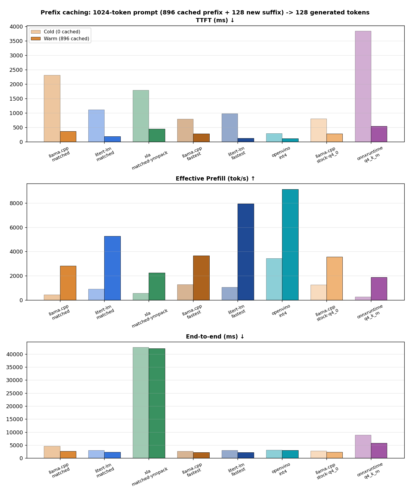


### CPU

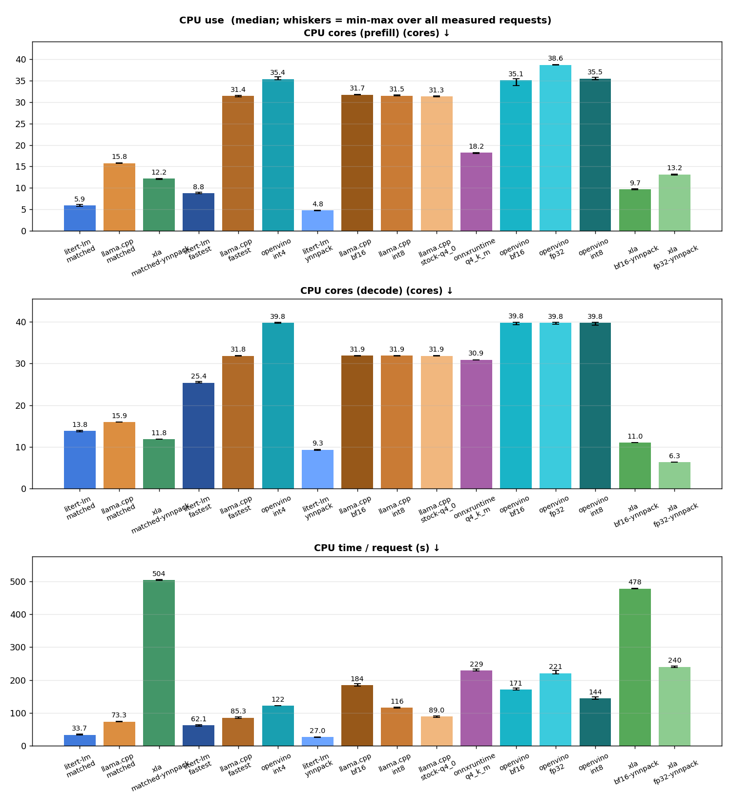

### Memory

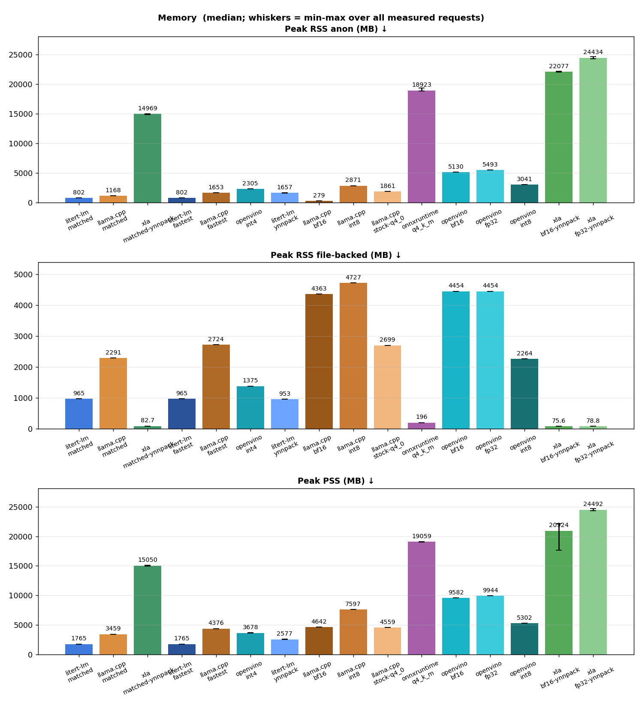

### Memory and CPU over time

Combined timeline (round-0 process per configuration: model load, warm-up and measured requests) showing total RSS and active CPU cores. File-backed RSS is mmap'd model pages (shared, reclaimable); anonymous RSS is private memory (KV cache, activations, repacked or converted weights).

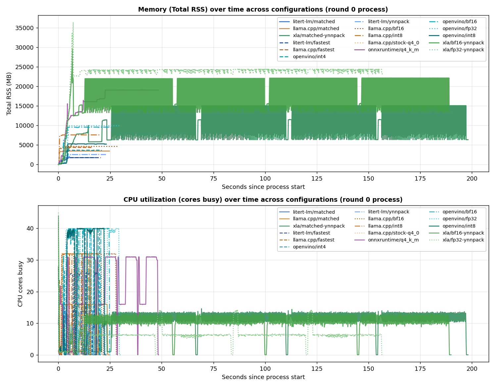

### Thread scaling

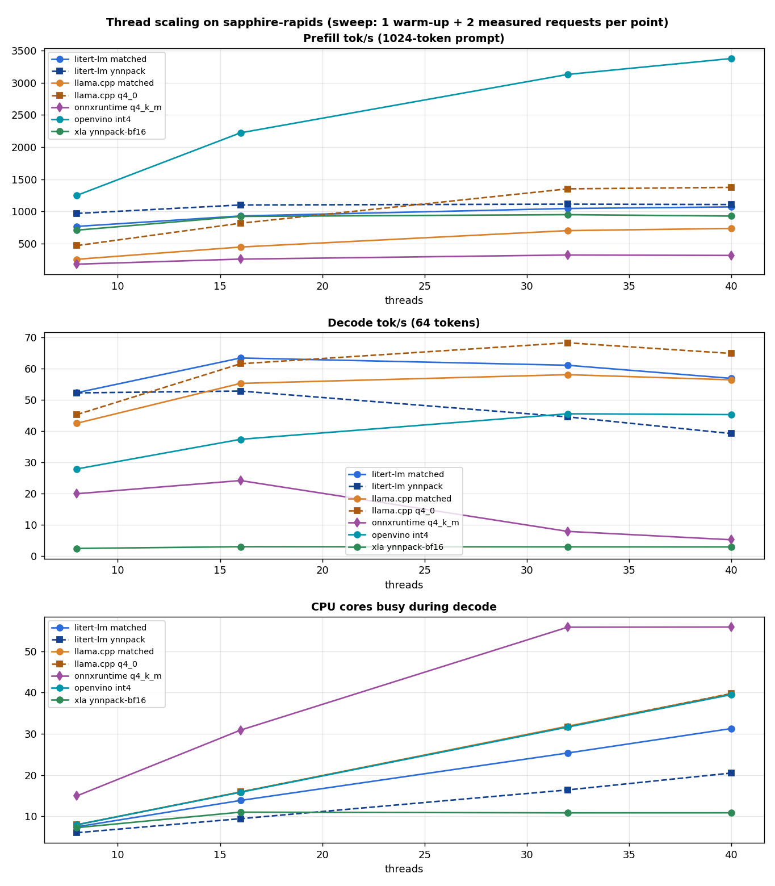

### Detailed metrics

Medians over all measured requests (n per cell in the last row); [min – max] in brackets.

| Metric | `litert-lm/matched` | `llama.cpp/matched` | `xla/matched-ynnpack` | `litert-lm/fastest` | `llama.cpp/fastest` | `openvino/int4` | `litert-lm/ynnpack` | `llama.cpp/bf16` | `llama.cpp/int8` | `llama.cpp/stock-q4_0` | `onnxruntime/q4_k_m` | `openvino/bf16` | `openvino/fp32` | `openvino/int8` | `xla/bf16-ynnpack` | `xla/fp32-ynnpack` |
| --- | --- | --- | --- | --- | --- | --- | --- | --- | --- | --- | --- | --- | --- | --- | --- | --- |
| TTFT (ms) ↓ | 1112 [1082–1138] | 2313 [2290–2366] | 1791 [1769–1915] | 977 [974–994] | 794 [758–848] | 298 [295–304] | 927 [918–951] | 1978 [1901–2092] | 957 [945–991] | 809 [743–849] | 3839 [3781–4100] | 288 [286–315] | 1136 [1125–1154] | 310 [302–316] | 1127 [1121–1196] | 2432 [2410–2703] |
| Prefill (tok/s) ↑ | 921.5 [899.9–946.5] | 442.6 [432.9–447.1] | 571.7 [534.9–578.9] | 1048.1 [1030.7–1051.3] | 1289.9 [1207.8–1351.7] | 3434.3 [3366.0–3471.2] | 1105.0 [1077.2–1115.6] | 517.8 [489.5–538.6] | 1069.9 [1032.9–1083.8] | 1268.3 [1206.1–1377.4] | 266.7 [249.8–270.8] | 3553.9 [3255.2–3582.5] | 901.7 [887.5–910.3] | 3305.6 [3245.4–3386.7] | 908.9 [856.2–913.1] | 421.0 [378.9–425.0] |
| Decode (tok/s) ↑ | 65.02 [62.25–65.56] | 55.35 [55.00–55.99] | 3.12 [3.11–3.13] | 60.86 [58.96–62.61] | 67.35 [65.93–67.94] | 45.52 [45.37–45.76] | 52.44 [51.82–53.28] | 33.43 [32.93–33.57] | 47.53 [47.24–47.82] | 63.93 [62.63–64.99] | 24.83 [24.15–25.20] | 31.42 [30.46–31.90] | 28.63 [27.04–28.98] | 38.13 [36.11–38.93] | 3.00 [2.99–3.01] | 3.85 [3.82–3.89] |
| End-to-end (ms) ↓ | 3065 [3025–3175] | 4605 [4572–4666] | 42579 [42400–42688] | 3071 [3004–3144] | 2679 [2642–2774] | 3090 [3079–3097] | 3350 [3302–3395] | 5781 [5697–5948] | 3627 [3607–3680] | 2795 [2707–2876] | 8955 [8898–9178] | 4332 [4270–4486] | 5567 [5518–5834] | 3640 [3567–3832] | 43512 [43341–43692] | 35569 [35124–35685] |
| Inter-token p99 (ms) ↓ | 17.3 [15.9–19.6] | 18.8 [18.6–19.0] | 327.9 [325.2–331.1] | 17.6 [17.1–18.4] | 15.7 [15.4–16.0] | 24.5 [22.8–25.9] | 21.0 [20.2–22.8] | 31.0 [30.5–31.3] | 21.8 [21.8–22.1] | 16.7 [16.2–17.0] | 42.2 [41.9–45.1] | 46.2 [34.8–49.8] | 43.6 [37.9–53.7] | 29.7 [26.5–36.8] | 347.7 [343.8–350.0] | 278.6 [266.2–279.9] |
| CPU cores (prefill) (cores) ↓ | 5.92 [5.73–6.12] | 15.79 [15.77–15.84] | 12.17 [11.94–12.19] | 8.77 [8.68–8.97] | 31.41 [31.22–31.52] | 35.36 [35.19–35.89] | 4.75 [4.70–4.80] | 31.71 [31.68–31.82] | 31.48 [31.41–31.66] | 31.33 [31.20–31.48] | 18.25 [17.98–18.26] | 35.10 [33.90–35.42] | 38.65 [38.61–38.68] | 35.46 [35.22–35.74] | 9.71 [9.63–9.78] | 13.17 [13.06–13.25] |
| CPU cores (decode) (cores) ↓ | 13.81 [13.65–13.96] | 15.92 [15.90–15.98] | 11.83 [11.81–11.84] | 25.41 [25.39–25.68] | 31.83 [31.77–31.93] | 39.81 [39.73–39.90] | 9.26 [9.13–9.34] | 31.88 [31.84–31.91] | 31.89 [31.84–31.96] | 31.87 [31.79–31.94] | 30.91 [30.90–30.93] | 39.83 [39.37–39.87] | 39.75 [39.45–39.93] | 39.80 [39.20–39.90] | 11.02 [10.99–11.06] | 6.28 [6.25–6.32] |
| CPU time / request (s) ↓ | 33.7 [32.9–35.4] | 73.3 [72.7–74.2] | 504.1 [502.3–504.9] | 62.1 [60.1–64.4] | 85.3 [84.1–88.2] | 122.1 [121.6–122.4] | 27.0 [26.2–27.5] | 184.5 [181.8–189.6] | 115.6 [115.0–117.3] | 89.0 [86.2–91.4] | 228.6 [227.4–233.5] | 171.3 [169.3–175.4] | 221.0 [219.1–229.3] | 144.0 [141.2–149.6] | 478.0 [477.9–478.9] | 240.0 [238.7–242.8] |
| Peak RSS (request) (MB) ↓ | 1767 [1767–1767] | 3459 [3459–3460] | 15052 [14959–15090] | 1767 [1767–1767] | 4377 [4377–4377] | 3680 [3680–3681] | 2610 [2587–2612] | 4643 [4643–4643] | 7598 [7598–7598] | 4560 [4560–4560] | 19119 [19053–19508] | 9584 [9582–9585] | 9947 [9946–9947] | 5305 [5305–5305] | 22152 [22071–22207] | 24513 [24330–24668] |
| Peak RSS anon (MB) ↓ | 802 [802–802] | 1168 [1168–1169] | 14969 [14877–15006] | 802 [802–802] | 1653 [1653–1653] | 2305 [2304–2305] | 1657 [1633–1659] | 279 [279–279] | 2871 [2871–2871] | 1861 [1861–1861] | 18923 [18858–19312] | 5130 [5128–5131] | 5493 [5493–5493] | 3041 [3041–3042] | 22077 [21995–22131] | 24434 [24249–24591] |
| Peak RSS file-backed (MB) ↓ | 965 [965–965] | 2291 [2291–2291] | 83 [82–83] | 965 [965–965] | 2724 [2724–2724] | 1375 [1375–1375] | 953 [953–953] | 4363 [4363–4363] | 4727 [4727–4727] | 2699 [2699–2699] | 196 [196–196] | 4454 [4454–4454] | 4454 [4454–4454] | 2264 [2264–2264] | 76 [76–76] | 79 [76–82] |
| Peak PSS (MB) ↓ | 1765 [1765–1765] | 3459 [3459–3459] | 15050 [14956–15087] | 1765 [1765–1765] | 4376 [4376–4376] | 3678 [3677–3678] | 2577 [2566–2591] | 4642 [4642–4642] | 7597 [7597–7597] | 4559 [4559–4559] | 19059 [19042–19090] | 9582 [9580–9583] | 9944 [9944–9944] | 5302 [5302–5303] | 20924 [17647–22138] | 24492 [24327–24645] |
| Model load, warm cache (ms) | 231 | 697 | 14891 | 229 | 462 | 2759 | 4214 | 291 | 579 | 488 | 6973 | 2428 | 2080 | 2491 | 7329 | 7526 |
| Peak RSS, process lifetime (VmHWM, MB) | 1767 | 3459 | 15064 | 1767 | 4377 | 3680 | 2611 | 4643 | 7598 | 4560 | 19570 | 9584 | 9947 | 5305 | 29660 | 36561 |
| RSS after load, before 1st request (MB) | 428 | 3320 | 5779 | 428 | 4111 | 499 | 1996 | 138 | 7447 | 4294 | 12590 | 6536 | 352 | 331 | 12542 | 22792 |
|   …of which anonymous (MB) | 262 | 1030 | 5698 | 262 | 1387 | 412 | 1089 | 134 | 2721 | 1596 | 12438 | 3339 | 260 | 251 | 12470 | 22719 |
| Container memory.peak incl. page cache (MB) | n/a | n/a | n/a | n/a | n/a | n/a | n/a | n/a | n/a | n/a | n/a | n/a | n/a | n/a | n/a | n/a |
| Measured requests (n) | 6 | 6 | 6 | 6 | 6 | 6 | 6 | 6 | 6 | 6 | 6 | 6 | 6 | 6 | 6 | 6 |
| Decode CV across requests | 2.3% | 0.6% | 0.3% | 3.0% | 1.1% | 0.3% | 1.3% | 0.7% | 0.4% | 1.7% | 1.5% | 1.6% | 2.5% | 2.5% | 0.2% | 0.7% |

#### llama.cpp ÷ LiteRT-LM

Ratio of medians with a 95% bootstrap interval over requests. >1 means llama.cpp has the larger value (better for throughput, worse for latency/CPU/memory).

| Track | Prefill tok/s | Decode tok/s | TTFT | End-to-end | CPU s / request | Peak RSS |
| --- | --- | --- | --- | --- | --- | --- |
| matched | 0.48× [0.46, 0.49] | 0.85× [0.84, 0.89] | 2.08× [2.02, 2.17] | 1.50× [1.45, 1.54] | 2.18× [2.07, 2.23] | 1.96× [1.96, 1.96] |
| fastest | 1.23× [1.19, 1.27] | 1.11× [1.07, 1.14] | 0.81× [0.79, 0.84] | 0.87× [0.85, 0.90] | 1.37× [1.33, 1.43] | 2.48× [2.48, 2.48] |

### Generated text on the timing prompt

Greedy decoding should be deterministic within a configuration. Different configurations may legitimately diverge (different activation/KV quantization and kernels change near-tie logits); the accuracy gate below is the validity check.

| Config | Identical across all measured requests | First 140 characters |
| --- | --- | --- |
| `litert-lm/matched` | yes | ## Chapter II. The World Below ⏎  ⏎ The descent continued, a dizzying, silent plunge into an abyss that seemed to swallow the very notion of lig |
| `llama.cpp/matched` | yes | This is a fascinating excerpt, rich in atmosphere and a sense of whimsical, slightly surreal adventure. The style is reminiscent of early 20 |
| `xla/matched-ynnpack` | yes | Here is a continuation of the story, maintaining the style of the original passage: ⏎  ⏎ “And what an ignorant little girl she!” Alice thought,  |
| `litert-lm/fastest` | yes | ## Chapter II. The World Below ⏎  ⏎ The descent continued, a dizzying, silent plunge into an abyss that seemed to swallow the very notion of lig |
| `llama.cpp/fastest` | yes | This is a fascinating excerpt, rich in atmosphere and a sense of whimsical, slightly surreal adventure. The style is reminiscent of early 20 |
| `openvino/int4` | yes | CHAPTER II. ⏎ The Great Descent ⏎  ⏎ Alice was not so much concerned with the precise measurement of her descent as she was with the sheer, dizzyi |
| `litert-lm/ynnpack` | yes | ## CHAPTER II. ⏎ The Bottom of the Well ⏎  ⏎ The descent continued, a dizzying, silent plunge into an abyss that seemed to swallow all light and s |
| `llama.cpp/bf16` | yes | CHAPTER II. ⏎ The Landscape Below ⏎  ⏎ The fall continued, a dizzying, silent plunge into an abyss of shadow and echoing stillness. Alice found he |
| `llama.cpp/int8` | yes | CHAPTER II. ⏎ The Landscape Below ⏎  ⏎ The descent continued, a dizzying, silent plunge into an abyss of shadow and echoing stillness. Alice found |
| `llama.cpp/stock-q4_0` | yes | CHAPTER II. ⏎ The Descent into the Unknown ⏎  ⏎ “And what an ignorant little girl she,” Alice continued, her voice echoing strangely in the vast,  |
| `onnxruntime/q4_k_m` | yes | CHAPTER II. ⏎ The Descent into Wonder ⏎  ⏎ And what an ignorant little girl she was! Alice felt a dizzying sense of both terror and exhilaration.  |
| `openvino/bf16` | yes | CHAPTER II. ⏎ The Landscape Below ⏎  ⏎ The fall continued, a dizzying, silent plunge into an abyss of shadow and echoing stillness. Alice found he |
| `openvino/fp32` | yes | CHAPTER II. ⏎ The Landscape Below ⏎  ⏎ The fall continued, a dizzying, silent plunge into an abyss of shadow and echoing stillness. Alice found he |
| `openvino/int8` | yes | CHAPTER II. ⏎ The Landscape Below ⏎  ⏎ The fall continued, a dizzying, silent plunge into an abyss of shadow and echoing stillness. Alice found he |
| `xla/bf16-ynnpack` | yes | CHAPTER II. ⏎ The Landscape Below ⏎  ⏎ The fall continued, a dizzying, silent plunge into an abyss of shadow and echoing stillness. Alice found he |
| `xla/fp32-ynnpack` | yes | CHAPTER II. ⏎ The Landscape Below ⏎  ⏎ The fall continued, a dizzying, silent plunge into an abyss of shadow and echoing stillness. Alice found he |

## Accuracy (validity gate)

Same prompts, greedy decoding, through the same in-process drivers as the timing runs. Use these to confirm each configuration produces correct tokens, and to compare frameworks on identical items; they are not leaderboard numbers.

| Config | Task | Items | Accuracy | 95% CI | Macro (MMLU) | Parse failures | Mean generated tokens | Hit token limit |
| --- | --- | --- | --- | --- | --- | --- | --- | --- |
| `litert-lm/matched` | mmlu | 2000 (stratified subset) | 57.55% | ±2.17% | 57.56% | 8 | 5.7 | n/a (letter only) |
| `llama.cpp/bf16` | mmlu | 2000 (stratified subset) | 60.35% | ±2.14% | 60.36% | 40 | 7.0 | n/a (letter only) |
| `llama.cpp/fastest` | mmlu | 2000 (stratified subset) | 51.15% | ±2.19% | 51.16% | 6 | 8.0 | n/a (letter only) |
| `llama.cpp/int8` | mmlu | 2000 (stratified subset) | 60.90% | ±2.14% | 60.91% | 43 | 7.0 | n/a (letter only) |
| `llama.cpp/stock-q4_0` | mmlu | 2000 (stratified subset) | 60.40% | ±2.14% | 60.42% | 33 | 6.7 | n/a (letter only) |
| `onnxruntime/q4_k_m` | mmlu | 2000 (stratified subset) | 60.00% | ±2.15% | 60.01% | 42 | 7.5 | n/a (letter only) |
| `openvino/bf16` | mmlu | 2000 (stratified subset) | 60.35% | ±2.14% | 60.36% | 40 | 6.9 | n/a (letter only) |
| `openvino/fp32` | mmlu | 2000 (stratified subset) | 60.60% | ±2.14% | 60.61% | 40 | 6.9 | n/a (letter only) |
| `openvino/int4` | mmlu | 2000 (stratified subset) | 56.70% | ±2.17% | 56.71% | 5 | 7.4 | n/a (letter only) |
| `openvino/int8` | mmlu | 2000 (stratified subset) | 60.50% | ±2.14% | 60.51% | 37 | 6.5 | n/a (letter only) |
| `xla/bf16-ynnpack` | mmlu | 2000 (stratified subset) | 60.50% | ±2.14% | 60.51% | 41 | 7.0 | n/a (letter only) |
| `xla/fp32-ynnpack` | mmlu | 2000 (stratified subset) | 60.55% | ±2.14% | 60.56% | 40 | 6.9 | n/a (letter only) |
| `xla/matched-ynnpack` | mmlu | 2000 (stratified subset) | 57.35% | ±2.17% | 57.36% | 9 | 5.3 | n/a (letter only) |
| `litert-lm/matched` | gsm8k | 250 (evenly spaced subset) | 74.40% | ±5.41% | n/a | 0 | 376.7 | 56 (cap 512) |
| `llama.cpp/fastest` | gsm8k | 250 (evenly spaced subset) | 50.00% | ±6.20% | n/a | 0 | 380.3 | 84 (cap 512) |
| `llama.cpp/stock-q4_0` | gsm8k | 250 (evenly spaced subset) | 76.40% | ±5.26% | n/a | 0 | 368.7 | 55 (cap 512) |
| `onnxruntime/q4_k_m` | gsm8k | 250 (evenly spaced subset) | 77.20% | ±5.20% | n/a | 0 | 365.3 | 54 (cap 512) |
| `openvino/int4` | gsm8k | 250 (evenly spaced subset) | 73.20% | ±5.49% | n/a | 0 | 370.4 | 58 (cap 512) |

**Paired comparison on identical items.** Same prediction = both configs chose the same answer; McNemar's exact test on items only one config got right (p < 0.05 means a real accuracy difference).

| Task | A | B | Items | Same prediction | Acc A | Acc B | Only A right | Only B right | McNemar p |
| --- | --- | --- | --- | --- | --- | --- | --- | --- | --- |
| mmlu | `llama.cpp/bf16` | `llama.cpp/fastest` | 2000 | 64.5% | 60.35% | 51.15% | 335 | 151 | 4.35e-17 |
| mmlu | `llama.cpp/bf16` | `llama.cpp/int8` | 2000 | 97.5% | 60.35% | 60.90% | 13 | 24 | 0.0989 |
| mmlu | `llama.cpp/bf16` | `llama.cpp/stock-q4_0` | 2000 | 83.2% | 60.35% | 60.40% | 112 | 113 | 1 |
| mmlu | `llama.cpp/bf16` | `openvino/bf16` | 2000 | 98.7% | 60.35% | 60.35% | 10 | 10 | 1 |
| mmlu | `llama.cpp/fastest` | `llama.cpp/int8` | 2000 | 64.9% | 51.15% | 60.90% | 142 | 337 | 2.44e-19 |
| mmlu | `llama.cpp/fastest` | `llama.cpp/stock-q4_0` | 2000 | 63.7% | 51.15% | 60.40% | 156 | 341 | 6.75e-17 |
| mmlu | `llama.cpp/int8` | `llama.cpp/stock-q4_0` | 2000 | 84.0% | 60.90% | 60.40% | 112 | 102 | 0.539 |
| mmlu | `llama.cpp/int8` | `openvino/int8` | 2000 | 95.9% | 60.90% | 60.50% | 33 | 25 | 0.358 |
| mmlu | `openvino/bf16` | `openvino/fp32` | 2000 | 98.8% | 60.35% | 60.60% | 6 | 11 | 0.332 |
| mmlu | `openvino/bf16` | `openvino/int4` | 2000 | 74.6% | 60.35% | 56.70% | 207 | 134 | 9.12e-05 |
| mmlu | `openvino/bf16` | `openvino/int8` | 2000 | 96.9% | 60.35% | 60.50% | 21 | 24 | 0.766 |
| mmlu | `openvino/fp32` | `openvino/int4` | 2000 | 74.5% | 60.60% | 56.70% | 209 | 131 | 2.75e-05 |
| mmlu | `openvino/fp32` | `openvino/int8` | 2000 | 97.0% | 60.60% | 60.50% | 23 | 21 | 0.88 |
| mmlu | `openvino/int4` | `openvino/int8` | 2000 | 74.9% | 56.70% | 60.50% | 130 | 206 | 3.99e-05 |
| mmlu | `xla/bf16-ynnpack` | `xla/fp32-ynnpack` | 2000 | 99.0% | 60.50% | 60.55% | 7 | 8 | 1 |
| mmlu | `xla/bf16-ynnpack` | `xla/matched-ynnpack` | 2000 | 78.4% | 60.50% | 57.35% | 171 | 108 | 0.000194 |
| mmlu | `xla/fp32-ynnpack` | `xla/matched-ynnpack` | 2000 | 78.5% | 60.55% | 57.35% | 171 | 107 | 0.000148 |
| gsm8k | `llama.cpp/fastest` | `llama.cpp/stock-q4_0` | 250 | 49.6% | 50.00% | 76.40% | 7 | 73 | 5.8e-15 |

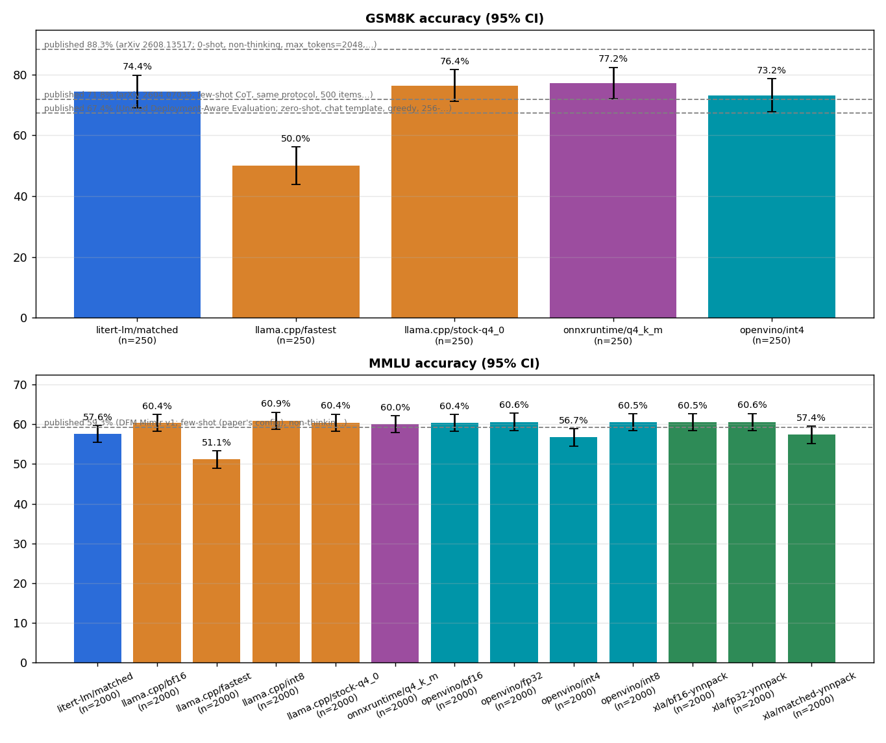

### Publicly reported accuracy

Google publishes no original-MMLU or GSM8K score for Gemma 4 E2B (model card, QAT cards and tech report checked); its static benchmarks are reported in thinking mode on bf16 weights, and the QAT cards only claim quality similar to bf16. The MMLU and GSM8K references below are third-party bf16 evaluations with their own prompts. None of these setups matches this harness (zero-shot, non-thinking, greedy, quantized weights, answer-prefilled MMLU), so use them as an order-of-magnitude sanity check, not as a pass/fail threshold; the frameworks are judged against each other on identical items.

| Benchmark | Published | Model variant | Setup | Source | Measured here (non-thinking, greedy) |
| --- | --- | --- | --- | --- | --- |
| MMLU | 59.3% | E2B, bf16 | few-shot (paper's config), non-thinking, MCQ with max_tokens=1, temperature 0 | [DFM Mimir v1, arXiv 2608.13517, Table 7](https://arxiv.org/abs/2608.13517) | — |
| MMLU | 72.0% | E2B, bf16 | same, thinking on | [arXiv 2608.13517, Table 7](https://arxiv.org/abs/2608.13517) | — |
| GSM8K | 88.3% | E2B, bf16 | 0-shot, non-thinking, max_tokens=2048, temperature 0, full test set | [arXiv 2608.13517, Table 8](https://arxiv.org/abs/2608.13517) | `litert-lm/matched` 74.4% (n=250); `llama.cpp/fastest` 50.0% (n=250); `llama.cpp/stock-q4_0` 76.4% (n=250); `onnxruntime/q4_k_m` 77.2% (n=250); `openvino/int4` 73.2% (n=250) |
| GSM8K | 90.3% | E2B, bf16 | same, thinking on | [arXiv 2608.13517, Table 8](https://arxiv.org/abs/2608.13517) | — |
| GSM8K | 67.4% | gemma-4-E2B-it, bf16 | zero-shot, chat template, greedy, 256-token cap, 500-item subset (95% CI 63.2-71.4) | [Unified Deployment-Aware Evaluation, arXiv 2604.07035](https://arxiv.org/abs/2604.07035) | — |
| GSM8K | 71.8% | gemma-4-E2B-it, bf16 | few-shot CoT, same protocol, 500 items (95% CI 67.7-75.6) | [arXiv 2604.07035](https://arxiv.org/abs/2604.07035) | — |
| MMLU-Pro | 60.0% | gemma-4-E2B-it, bf16 | thinking mode (Google) | [Gemma 4 model card / tech report Table 5](https://huggingface.co/google/gemma-4-E2B-it) | — |
| MMMLU | 67.4% | gemma-4-E2B-it, bf16 | thinking mode (Google) | [Gemma 4 model card / tech report Table 5](https://huggingface.co/google/gemma-4-E2B-it) | — |
| IFEval | 94.6% | gemma-4-E2B-it, bf16 | thinking mode (Google) | [Gemma 4 tech report, arXiv 2607.02770, Table 5](https://arxiv.org/abs/2607.02770) | — |
| GPQA Diamond | 43.4% | gemma-4-E2B-it, bf16 | thinking mode (Google) | [Gemma 4 model card](https://huggingface.co/google/gemma-4-E2B-it) | — |
| BigBench Extra Hard | 21.9% | gemma-4-E2B-it, bf16 | thinking mode (Google) | [Gemma 4 model card](https://huggingface.co/google/gemma-4-E2B-it) | — |
| AIME 2026 (no tools) | 37.5% | gemma-4-E2B-it, bf16 | thinking mode (Google) | [Gemma 4 model card](https://huggingface.co/google/gemma-4-E2B-it) | — |
| LiveCodeBench v6 | 44.0% | gemma-4-E2B-it, bf16 | thinking mode (Google) | [Gemma 4 model card](https://huggingface.co/google/gemma-4-E2B-it) | — |
| MMLU (predecessor Gemma 3n E2B-it) | 60.1% | gemma-3n-E2B-it | 0-shot (Google) | [Gemma 3n E2B model card](https://huggingface.co/google/gemma-3n-E2B-it) | — |

- Published Gemma 4 scores use bf16 weights; no source reports accuracy for the mobile-QAT (.litertlm) or Q4_0 checkpoints themselves.
- The two third-party GSM8K numbers differ by ~20 points (88.3 vs 67.4) because of the token cap (2048 vs 256) and prompt; this harness uses a 512-token cap, so it should land between them if the quantized model is healthy.
- Google's Table 5 states all models are in thinking mode unless noted; this harness runs with thinking disabled, which costs several points on reasoning-heavy sets (e.g. MMLU 59.3 -> 72.0 with thinking in arXiv 2608.13517).

## Output reproducibility

Same model file, build, prompt and settings, repeated: 12 prompts × 3 repeats per process, fresh KV cache per request, stop tokens honoured, ≤128 tokens. *Within process* = repeats vs. the first repeat; *across processes* = a second fresh process with the same request sequence; *across threads* = a process with half the threads. Seeded = temperature 1.0, top-k 64, top-p 0.95, fixed seed; the *seed control* reruns with seed+1 and must change outputs, otherwise seeded reproducibility would be vacuous. Method: [benchmark_methodology.md](../../docs/benchmark_methodology.md#output-reproducibility).

| Config | Mode | Verdict | Within process | Across processes | Across threads | Seed control |
| --- | --- | --- | --- | --- | --- | --- |
| `litert-lm/matched` | greedy | **reproducible per request** | 24/24 identical | 24/24 identical | n/a | — |
| `litert-lm/matched` | seeded | **reproducible per process only** (state carries across requests) | 4/24 identical; first divergence at token 2 (median) | 24/24 identical | n/a | 20/24 outputs changed |
| `llama.cpp/matched` | greedy | **reproducible per request** | 24/24 identical | 24/24 identical | n/a | — |
| `llama.cpp/matched` | seeded | **reproducible per request** | 24/24 identical | 24/24 identical | n/a | 22/24 outputs changed |
| `xla/matched-ynnpack` | greedy | **reproducible per request** | 24/24 identical | 24/24 identical | n/a | — |
| `xla/matched-ynnpack` | seeded | **reproducible per request** | 24/24 identical | 24/24 identical | n/a | 20/24 outputs changed |
| `litert-lm/fastest` | greedy | **reproducible per request** | 24/24 identical | 24/24 identical | n/a | — |
| `litert-lm/fastest` | seeded | **reproducible per process only** (state carries across requests) | 4/24 identical; first divergence at token 2 (median) | 24/24 identical | n/a | 20/24 outputs changed |
| `llama.cpp/fastest` | greedy | **reproducible per request** | 24/24 identical | 24/24 identical | n/a | — |
| `llama.cpp/fastest` | seeded | **reproducible per request** | 24/24 identical | 24/24 identical | n/a | 22/24 outputs changed |
| `openvino/int4` | greedy | **reproducible per request** | 24/24 identical | 24/24 identical | n/a | — |
| `openvino/int4` | seeded | **reproducible per request** | 24/24 identical | 24/24 identical | n/a | 18/24 outputs changed |
| `llama.cpp/stock-q4_0` | greedy | **reproducible per request** | 24/24 identical | 24/24 identical | n/a | — |
| `llama.cpp/stock-q4_0` | seeded | **reproducible per request** | 24/24 identical | 24/24 identical | n/a | 20/24 outputs changed |
| `onnxruntime/q4_k_m` | greedy | **reproducible per request** | 24/24 identical | 24/24 identical | n/a | — |
| `onnxruntime/q4_k_m` | seeded | **reproducible per request** | 24/24 identical | 24/24 identical | n/a | 18/24 outputs changed |

Cross-framework (informational, greedy): `llama.cpp/matched` and `litert-lm/matched` produce identical text for 4/24 prompt-repeats, median first divergence at token 4. Identical weights do not imply identical outputs when activation/KV quantization and kernels differ.

## Key architecture & methodology notes (x86 Sapphire Rapids — FP32, BF16, INT8, and INT4/INT2)

1. **Precision Matrix (`FP32`, `BF16`, `INT8`, plus `INT4`/`INT2` where pre-built artifacts exist).**
   - Every framework is evaluated across `FP32`, `BF16`, `INT8`, and `INT4`/`INT2`
     **only where pre-existing model artifacts and runtime support are available**:
     - **OpenXLA (`jax==0.12.0.1` / `jaxlib==0.12.0.1`, official Google `tunix.models.gemma4` + `qwix.QArray` on YNNPACK)**:
       - **YNNPACK backend (`__ynn_fusion`)**: `xla/fp32-ynnpack` (`FP32` on `google/gemma-4-E2B-it`), `xla/bf16-ynnpack` (`BF16` on `google/gemma-4-E2B-it`), and
         `xla/matched-ynnpack` (loads the pre-quantized mixed `INT2`/`INT4`/`INT8` weights, per-channel weight scales, and static activation scales directly from `google/gemma-4-E2B-it-qat-mobile-transformers`; no dynamic activation quantization or on-the-fly channel-wise PTQ is run on unquantized checkpoints).
       - **Intel oneDNN backend (`--onednn`) disabled:** Disabled on Sapphire Rapids because XLA:CPU's experimental oneDNN integration (`--xla_cpu_experimental_onednn_custom_call=true`) segfaults (`SIGSEGV`) or corrupts attention outputs on Intel AMX.
       - **Omitted from `INT8`:** No pre-quantized `INT8` safetensors checkpoint is published for Gemma 4 E2B, and `xla_driver.py` does not apply on-the-fly dynamic/channel-wise quantization to unquantized checkpoints.
     - **LiteRT-LM (`v0.19.0`)**:
       - `litert-lm/matched` (XNNPACK, 16 threads), `litert-lm/fastest` (XNNPACK, sweep-selected threads),
         and `litert-lm/ynnpack` (**YNNPACK**, `--ynnpack`, sweep-selected threads) executing
         `litert-community/gemma-4-E2B-it-litert-lm/gemma-4-E2B-it.litertlm`
         (mixed `INT2`/`INT4`/`INT8` mobile QAT weights). Omitted from `FP32`, `BF16`, and
         pure `INT8` because `.litertlm` only ships as the pre-compiled mobile QAT bundle.
     - **`llama.cpp` (`b12070`, Sapphire Rapids AVX-512 + AMX backend)**:
       - `llama.cpp/bf16` (`BF16`), `llama.cpp/int8` (`Q8_0`),
         `llama.cpp/stock-q4_0` (official `ggml-org` `Q4_0` INT4 QAT checkpoint, tracked
         under `dtype: "q4_0"` with `--ubatch 1024`),
         `llama.cpp/matched` (bit-identical mobile QAT mixed `INT2`/`INT4`/`INT8` in
         `Q2_K`/`Q4_0`/`Q8_0`), and `llama.cpp/fastest` (mobile QAT weights with `INT2`
         tensors stored in `Q4_0` blocks).
       - **Omitted from `FP32`:** `ggml-org/gemma-4-E2B-it-GGUF` publishes pre-built
         `BF16`, `Q8_0`, and `Q4_0` GGUFs, but **no `F32` GGUF**. Because the benchmark
         protocol only includes `llama.cpp` data types with pre-existing GGUF artifacts
         (and avoids synthesizing an un-published ~17.4 GB `F32` GGUF from `BF16` weights),
         `llama.cpp` is not included in the `FP32` row.
     - **OpenVINO GenAI (`2026.4.1.0`)**:
       - `openvino/fp32` (`INFERENCE_PRECISION_HINT=f32`), `openvino/bf16`
         (`INFERENCE_PRECISION_HINT=bf16` on Intel AMX), `openvino/int8`
         (`OpenVINO/gemma-4-E2B-it-int8-ov`), and `openvino/int4`
         (`OpenVINO/gemma-4-E2B-it-int4-ov`), configured with `SchedulerConfig(enable_prefix_caching=False)`
         so `VLMPipeline` executes a full prefill from an empty KV cache on every request.
     - **ONNX Runtime GenAI (`0.19.0`)**:
       - `onnxruntime/q4_k_m` (`Q4_K_M` 4-bit block quantization from
         `justinchuby/gemma-4-e2b-it-onnx`, configured with `execution_mode: "sequential"`
         and context bounded to `--ctx`).

2. **Caveats: Missing Data-Type Cells & Differences Between INT8, INT4, and INT2 Variants.**
   - **Why certain (framework, data-type) pairs are omitted:**
     - If a pre-built GGUF or framework artifact is not already available for a given
       data type, that framework is excluded from that data type in the benchmark:
       - `llama.cpp` has no published `F32` GGUF in `ggml-org/gemma-4-E2B-it-GGUF` (the
         base checkpoint `google/gemma-4-E2B-it` is natively `bfloat16`, so `BF16.gguf`
         is already lossless).
       - `OpenXLA` has no published pre-quantized `INT8` safetensors checkpoint for Gemma 4 E2B,
         and `xla_driver.py` only runs quantization when the checkpoint itself provides
         pre-quantized weights and scales.
       - `LiteRT-LM` only publishes the mobile QAT `.litertlm` artifact (`INT2`/`INT4`/`INT8`).
       - `ONNX Runtime GenAI` is evaluated on its staged `Q4_K_M` package.
   - **Weight quantization schemes are not identical across checkpoints:**
     - **Mobile QAT (`litert-lm/*`, `xla/matched-ynnpack`, `llama.cpp/matched`, `llama.cpp/fastest`)**:
       Share the **exact same 278 quantized text tensors** (proven bit-identical
       in `models/aeb/litert-parity.json`) from `google/gemma-4-E2B-it-qat-mobile-transformers`:
       per-channel symmetric **INT2** on token embeddings, `lm_head`, and the double-wide
       MLPs of layers 15–34; **INT4** on attention projections, MLPs of layers 0–14, and
       per-layer embeddings (PLE); and **INT8** on per-layer input gates/projections.
     - **Stock `ggml-org` `Q4_0` and `Q8_0` (`llama.cpp/stock-q4_0`, `llama.cpp/int8`)**:
       Use 32-element block quantization (1 `fp16` scale per 32 weights) exported from
       Google's separate `Q4_0` QAT and `BF16` checkpoints (`ggml-org/gemma-4-E2B-it-GGUF`).
       Unlike the mobile QAT checkpoint, layers 15–34 MLPs are 4-bit (`Q4_0`) or 8-bit
       (`Q8_0`), not 2-bit.
     - **OpenVINO `int4` and `int8` (`openvino/int4`, `openvino/int8`)**:
       Use OpenVINO NNCF group-wise asymmetric/symmetric INT4 and INT8 weight compression
       (`OpenVINO/gemma-4-E2B-it-{int4,int8}-ov`) derived from the BF16 base checkpoint.
     - **OpenXLA `qat-mobile` (`xla/matched-ynnpack`)**:
       Unpacks the pre-quantized `INT2`/`INT4`/`INT8` weights (`weight`, `embedding_quantized`)
       and per-channel scales (`weight_scale`, `embedding_scale`) from
       `google/gemma-4-E2B-it-qat-mobile-transformers` into `qwix.QArray` (`int8` values +
       `bfloat16` per-channel scales) inside the official Tunix `tunix.models.gemma4` Flax NNX
       model, applying the checkpoint's static `input_activation_scale` and
       `output_activation_scale` where present.
     - **ONNX Runtime `q4_k_m` (`onnxruntime/q4_k_m`)**:
       Uses `MatMulNBits` 4-bit block quantization (`justinchuby/gemma-4-e2b-it-onnx`).
   - **Activation & KV-cache quantization differences (impact on accuracy and speed):**
     - **Static INT8 Activation Rounding (SRQ):** The mobile QAT checkpoint was trained
       with static per-tensor INT8 activation rounding (SRQ) and fixed-scale INT8 KV cache.
       `LiteRT-LM` and `OpenXLA` (`xla/matched-ynnpack`) execute the checkpoint's static activation
       scales; `llama.cpp` does not apply SRQ.
       Because the mobile QAT weights were co-adapted to SRQ rounding, running those
       same weights without SRQ (`llama.cpp/matched`, `llama.cpp/fastest`) lowers MMLU/GSM8K
       accuracy compared to `LiteRT-LM`, `xla/matched-ynnpack`, or non-SRQ checkpoints (`llama.cpp/stock-q4_0`,
       `openvino/int4`).
     - **`Q2_K` vs. `Q4_0` kernel coverage in `llama.cpp`:** `llama.cpp` lacks an
       AVX-512 VNNI / AMX repacked kernel path for `Q2_K` super-blocks. Storing the exact
       same mobile QAT INT2 integer weights in `Q4_0` blocks (`llama.cpp/fastest`) enables
       repacked AVX-512/AMX kernels at the cost of +0.4 GB of storage (`2.7 GB` vs `2.3 GB`).

3. **Hardware & NUMA pinning (`Sapphire Rapids`).**
   - Dual-socket **4th Gen Intel Xeon Scalable (Sapphire Rapids)** server (2× 56 physical cores, ~1,008 GiB DDR5 RAM across 2 NUMA nodes).
   - ISA extensions present: `avx512f`, `avx512bw`, `avx512dq`, `avx512vl`, `avx512_vnni`, `avx512_bf16`, `avx512_fp16`, `amx_tile`, `amx_int8`, `amx_bf16`.
   - All single-stream performance and reproducibility runs are strictly pinned to **NUMA node 0 physical cores** via `numactl`, avoiding cross-socket UPI traffic and SMT sibling contention.
   - During the 2-shard parallel accuracy runs (`--parallel 2 --shards 2`), shard 0 is pinned to Socket 0 physical cores and shard 1 is pinned to Socket 1 physical cores.

4. **OpenXLA CPU: Official Tunix + Pre-Quantized QArray on YNNPACK (`__ynn_fusion`).**
   - `xla_driver.py` uses the official Google Tunix Gemma 4 implementation (`tunix.models.gemma4`) and `qwix.QArray` on Flax NNX/JAX (`jaxlib==0.12.0.1`).
   - By default (`xla/*-ynnpack`), XLA:CPU lowers matrix multiplications and elementwise fusions into `__ynn_fusion` custom calls backed by **YNNPACK**.
   - XLA's experimental Intel oneDNN backend (`--onednn`) is disabled on Sapphire Rapids due to upstream XLA:CPU oneDNN crashes (`SIGSEGV`) and `BF16` `__onednn$softmax` corruption on Intel AMX.

5. **Data-Type-Aware Phase Selection, Cached-Prefix Mode & Apples-to-Apples Accuracy Protocol.**
   - **Phase 3 (`perf`):** Evaluates all 11 active configurations in stateless mode (fresh KV cache per request, 2 interleaved rounds × 3 measured requests after 1 warm-up at 1,024 prompt → 128 generated tokens).
   - **Phase 4 (`prefix-cache`):** Evaluates warm KV prefix caching (`896` cached prefix tokens + `128` new suffix tokens → `128` generated tokens) across all 5 frameworks (`--cache-prefix`), measuring TTFT speedup, effective prefill throughput, and incremental suffix prefill throughput relative to the stateless baseline.
   - **Phase 5 (`accuracy`):** With `accuracy_select_fastest_by_dtype: true`, the runner groups active configurations by `(framework, dtype)` pair and selects the empirically fastest configuration (lowest median `e2e_ms` in Phase 3) for each `(framework, dtype)` cell on the **identical 2,000-item stratified MMLU subset (`mmlu_limit: 2000`)** and 250-item GSM8K subset (`gsm8k_limit: 250`).
   - **Phase 6 (`sequence`):** With `sequence_sweep.select_fastest_by_dtype: true` and `min_accuracy: {"mmlu": 0.40, "gsm8k": 0.40}`, the input-length sweep (`64, 256, 1024, 4096` prompt tokens → `128` generated tokens) runs on the fastest configuration per `(framework, dtype)` cell that passes the accuracy gate.

## Environment

| Item | Value |
| --- | --- |
| Machine | sapphire-rapids — Intel(R) Xeon(R) Sapphire Rapids (2x 56C) pinned to NUMA node 0 (56 physical cores) |
| Container view | Ubuntu 24.04.5 LTS, kernel Linux 6.18.35, 56 vCPUs, 503.1 GiB RAM |
| litert-lm | `v0.19.0`, commit `83ce6067f2e2`, built 2026-11-03T12:31:34Z |
| llama.cpp | `b12070`, commit `00f113eceb27`, built 2026-11-03T11:52:59Z |
| onnxruntime | `onnxruntime-genai==0.19.0`, built 2026-11-03T12:34:10Z |
| openvino | `openvino-genai==2026.4.1.0`, `openvino==2026.4.1`, built 2026-11-03T12:33:33Z |
| xla | `jax==0.12.0.1`, `google-tunix==0.1.7`, built 2026-11-03T12:32:54Z |
| Harness | digest `4cb84eefba4d`, repo rev `unknown` |
| Workload | 1024-token real-text chat prompt → 128 greedy tokens (fixed length), context 4096, 1 warm-up + 3 measured requests per process, 2 processes per config interleaved A-B-…/…-B-A |
| Prompt identity | identical token ids in every config (sha256 `ee559b78b98652bf…`) |

## Configurations

| Config | Track | Model file | Driver arguments |
| --- | --- | --- | --- |
| `litert-lm/matched` | matched | `gemma-4-E2B-it.litertlm` (sha256 `181938105e0e`) | `--model <model> --threads 16 --ctx 4096 --cache-dir /results/_cache/litert-lm-xnnpack --fixed-decode-tokens 128` |
| `llama.cpp/matched` | matched | `gemma-4-E2B-it-qat-mobile-matched.gguf` (sha256 `39ba17e470c0`) | `--model <model> --threads 16 --ctx 4096 --flash-attn on --cache-type-k q8_0 --cache-type-v q8_0` |
| `xla/matched-ynnpack` | matched | `gemma-4-E2B-it-qat-mobile-transformers` (sha256 `05588362566e`) | `--model <model> --threads 16 --ctx 4096 --dtype qat-mobile --cache-dir /results/_cache/xla-qat-mobile-ynnpack` |
| `litert-lm/fastest` | fastest | `gemma-4-E2B-it.litertlm` (sha256 `181938105e0e`) | `--model <model> --threads 32 --ctx 4096 --cache-dir /results/_cache/litert-lm-xnnpack-fastest --fixed-decode-tokens 128` |
| `llama.cpp/fastest` | fastest | `gemma-4-E2B-it-qat-mobile-matched-q4.gguf` (sha256 `ed8fda86a91a`) | `--model <model> --threads 32 --ctx 4096 --flash-attn on --ubatch 1024` |
| `openvino/int4` | fastest | `gemma-4-E2B-it-int4-ov` (sha256 `3428fb6bed88`) | `--model <model> --threads 40 --ctx 4096 --dtype int4` |
| `litert-lm/ynnpack` | reference | `gemma-4-E2B-it.litertlm` (sha256 `181938105e0e`) | `--model <model> --threads 16 --ctx 4096 --ynnpack --cache-dir /results/_cache/litert-lm-ynnpack --fixed-decode-tokens 128` |
| `llama.cpp/bf16` | reference | `gemma-4-E2B-it-BF16.gguf` (sha256 `246c5fb19e64`) | `--model <model> --threads 32 --ctx 4096 --flash-attn on` |
| `llama.cpp/int8` | reference | `gemma-4-E2B-it-Q8_0.gguf` (sha256 `996d08777aad`) | `--model <model> --threads 32 --ctx 4096 --flash-attn on` |
| `llama.cpp/stock-q4_0` | reference | `gemma-4-E2B-it-Q4_0.gguf` (sha256 `8e30dff3ac4c`) | `--model <model> --threads 32 --ctx 4096 --flash-attn on --ubatch 1024` |
| `onnxruntime/q4_k_m` | reference | `default` (sha256 `79666818bbf8`) | `--model <model> --threads 16 --ctx 4096` |
| `openvino/bf16` | reference | `gemma-4-E2B-it-fp16-ov` (sha256 `aa8248e647d0`) | `--model <model> --threads 40 --ctx 4096 --dtype bf16` |
| `openvino/fp32` | reference | `gemma-4-E2B-it-fp16-ov` (sha256 `aa8248e647d0`) | `--model <model> --threads 40 --ctx 4096 --dtype fp32` |
| `openvino/int8` | reference | `gemma-4-E2B-it-int8-ov` (sha256 `1d17cb7f73a7`) | `--model <model> --threads 40 --ctx 4096 --dtype int8` |
| `xla/bf16-ynnpack` | reference | `gemma-4-E2B-it` (sha256 `e1efaee9d9a3`) | `--model <model> --threads 16 --ctx 4096 --dtype bf16 --cache-dir /results/_cache/xla-bf16-ynnpack` |
| `xla/fp32-ynnpack` | reference | `gemma-4-E2B-it` (sha256 `e1efaee9d9a3`) | `--model <model> --threads 16 --ctx 4096 --dtype fp32 --cache-dir /results/_cache/xla-fp32-ynnpack` |

## Quantization equivalence

- `.litertlm` vs `google/gemma-4-E2B-it-qat-mobile-transformers`: **278 quantized tensors compared element by element, all integers and per-channel scales identical** (attention, MLP, per-layer gate/projection for every layer, lm_head, token and per-layer embedding tables).
- `gemma-4-E2B-it-qat-mobile-matched-q4.gguf`: 279 quantized tensors (62× int2→Q4_0, 146× int4→Q4_0, 71× int8→Q8_0); integer round-trip exact for every tensor; per-row scales stored as fp16 (LiteRT: fp32), worst relative scale error 0.26% (only 4 tensors exceed fp16 rounding, from subnormal scales: per_layer_model_proj.weight, blk.0.inp_gate.weight, blk.3.proj.weight, blk.14.inp_gate.weight).
- `gemma-4-E2B-it-qat-mobile-matched.gguf`: 279 quantized tensors (62× int2→Q2_K, 146× int4→Q4_0, 71× int8→Q8_0); integer round-trip exact for every tensor; per-row scales stored as fp16 (LiteRT: fp32), worst relative scale error 0.26% (only 4 tensors exceed fp16 rounding, from subnormal scales: per_layer_model_proj.weight, blk.0.inp_gate.weight, blk.3.proj.weight, blk.14.inp_gate.weight).

| Tensor group | Checkpoint / LiteRT-LM | Matched GGUF | `-q4` GGUF | Stock ggml-org Q4_0 |
| --- | --- | --- | --- | --- |
| Token embedding, lm_head | INT2 per-row (separate lm_head) | Q2_K, d = dmin = s | Q4_0, d = s | Q8_0 (tied) |
| Attention q/k/v/o | INT4 per-channel | Q4_0, d = s | Q4_0, d = s | Q4_0 (block-32 scales) |
| MLP layers 0-14 | INT4 per-channel | Q4_0, d = s | Q4_0, d = s | Q4_0 |
| MLP layers 15-34 (double-wide) | INT2 per-channel | Q2_K | Q4_0 | Q4_0 |
| Per-layer embeddings | INT4 per (token, layer) | Q4_0 | Q4_0 | Q4_0 |
| Per-layer gate / projection | INT8 per-channel | Q8_0 | Q8_0 | Q4_0 |
| Per-layer model projection | INT8 per-channel (LiteRT PTQ) | Q8_0 (same ints) | Q8_0 | BF16 |
| Norms, layer scalars | BF16 values (fp32 tensors in LiteRT) | F32, same values | F32, same values | F32 (different QAT checkpoint) |
| Activations | static per-tensor INT8 (QAT scales) | dynamic Q8_0/Q8_K per block | same | same |
| KV cache | INT8, static per-tensor scale | Q8_0 (matched track) | F16 (fastest) | F16 |

## Data-quality checks

- `llama.cpp/matched` run `20261103T165425Z-ca10b0`: end-to-end outlier request indices [2] (MAD rule) — kept, not discarded.
- `litert-lm/fastest`: per-process decode medians spread 59.1–62.6 tok/s (>5%); between-process variance dominates.
- `llama.cpp/fastest` run `20261103T162908Z-1a757f`: end-to-end outlier request indices [2] (MAD rule) — kept, not discarded.
- `llama.cpp/bf16` run `20261103T163616Z-581e68`: end-to-end outlier request indices [2] (MAD rule) — kept, not discarded.
- `llama.cpp/bf16` run `20261103T164313Z-af0686`: end-to-end outlier request indices [1] (MAD rule) — kept, not discarded.
- `llama.cpp/int8` run `20261103T163103Z-b9d3cb`: end-to-end outlier request indices [2] (MAD rule) — kept, not discarded.
- `llama.cpp/stock-q4_0` run `20261103T163126Z-0d4f74`: end-to-end outlier request indices [0] (MAD rule) — kept, not discarded.
- `openvino/int8` run `20261103T164856Z-cb3e16`: end-to-end outlier request indices [1] (MAD rule) — kept, not discarded.
- `xla/fp32-ynnpack` run `20261103T163648Z-b5696c`: end-to-end outlier request indices [1] (MAD rule) — kept, not discarded.

## Caveats

_none recorded_

## Reproducing these results

### 1. Exact framework & repository versions used in this report

| Framework | Upstream Repository | Ref / Tag | Exact Commit / Package Versions | Built At |
| --- | --- | --- | --- | --- |
| `litert-lm` | [`google-ai-edge/LiteRT-LM`](https://github.com/google-ai-edge/LiteRT-LM) | `v0.19.0` | `83ce6067f2e2a3fb697556928f93936693ded971` (`--define=litert_enable_ynnpack=true`) | `2026-11-03T12:31:34Z` |
| `llama.cpp` | [`ggml-org/llama.cpp`](https://github.com/ggml-org/llama.cpp) | `b12070` | `00f113eceb2758158582d56f98bf476b2fe3ed32` | `2026-11-03T11:52:59Z` |
| `onnxruntime` | [`microsoft/onnxruntime-genai`](https://github.com/microsoft/onnxruntime-genai) | `onnxruntime-genai==0.19.0` | `onnxruntime==1.31.1`, `onnxruntime-genai==0.19.0` | `2026-11-03T12:34:10Z` |
| `openvino` | [`openvinotoolkit/openvino.genai`](https://github.com/openvinotoolkit/openvino.genai) | `openvino-genai==2026.4.1.0` | `openvino==2026.4.1`, `openvino-genai==2026.4.1.0` | `2026-11-03T12:33:33Z` |
| `xla` | [`openxla/xla`](https://github.com/openxla/xla) / [`jax-ml/jax`](https://github.com/jax-ml/jax) / [`google/tunix`](https://github.com/google/tunix) / [`google/qwix`](https://github.com/google/qwix) | `jax==0.12.0.1` | `jaxlib==0.12.0.1`, `google-tunix==0.1.7`, `qwix==0.1.8`, `flax==0.12.12`, `tokenizers==0.23.3` | `2026-11-03T12:32:54Z` |
| `ai-edge-bench` (harness) | [`mariecwhite/ai-edge-bench`](https://github.com/mariecwhite/ai-edge-bench) | `unknown` | harness sha256 `4cb84eefba4d33e137bd89a981a5eb572da1db0ebcf44f4718421ec7d36dd85b` | — |

### 2. Building framework container images (pinned vs. latest upstream)

**Option A — Rebuild with the exact pinned versions used in this report:**

```bash
COMPOSE="docker compose -f compose.yaml -f compose/machines/sapphire-rapids.yaml"
export AEB_LLAMA_CPP_REF="b12070"
export AEB_LITERTLM_REF="v0.19.0"
${COMPOSE} --profile base build base
${COMPOSE} --profile tools build tools
${COMPOSE} --profile cpu build llama-cpp litert-lm-xnnpack
${COMPOSE} --profile x86-sota build \
  --build-arg JAX_VERSION="0.12.0.1" --build-arg FLAX_VERSION="0.12.12" \
  --build-arg QWIX_VERSION="0.1.8" --build-arg TUNIX_VERSION="0.1.7" xla
${COMPOSE} --profile x86-sota build \
  --build-arg OPENVINO_VERSION="2026.4.1" --build-arg OPENVINO_GENAI_VERSION="2026.4.1.0" openvino
${COMPOSE} --profile x86-sota build \
  --build-arg ONNXRUNTIME_VERSION="1.31.1" --build-arg ONNXRUNTIME_GENAI_VERSION="0.19.0" onnxruntime
```

**Option B — Pull & build with the latest upstream versions of every framework:**

```bash
# One-command helper script (resolves latest git tags & PyPI releases and builds all images):
./scripts/build_latest.sh sapphire-rapids
```

Or run the underlying version resolution and build commands directly:

```bash
# Query latest upstream git tags for llama.cpp and LiteRT-LM:
export AEB_LLAMA_CPP_REF="$(git ls-remote --tags --refs https://github.com/ggml-org/llama.cpp.git 'b[0-9]*' | sed 's|.*refs/tags/||' | grep -E '^b[0-9]+$' | sort -V | tail -n1)"
export AEB_LITERTLM_REF="$(git ls-remote --tags --refs https://github.com/google-ai-edge/LiteRT-LM.git 'v[0-9]*' | sed 's|.*refs/tags/||' | grep -E '^v[0-9]+\.[0-9]+\.[0-9]+$' | sort -V | tail -n1)"

# Query latest PyPI versions for OpenXLA (jax/flax/qwix/tunix), OpenVINO, and ONNX Runtime:
read -r JAX_VER FLAX_VER QWIX_VER TUNIX_VER OV_VER OV_GENAI_VER ORT_VER ORT_GENAI_VER < <(python3 - << 'PY'
import json, urllib.request
def latest(pkg):
  with urllib.request.urlopen(f"https://pypi.org/pypi/{pkg}/json") as r:
    return json.load(r)["info"]["version"]
print(
    latest("jax"), latest("flax"), latest("qwix"), latest("google-tunix"),
    latest("openvino"), latest("openvino-genai"),
    latest("onnxruntime"), latest("onnxruntime-genai")
)
PY
)

COMPOSE="docker compose -f compose.yaml -f compose/machines/sapphire-rapids.yaml"
${COMPOSE} --profile base build --pull base
${COMPOSE} --profile tools build --no-cache tools
${COMPOSE} --profile cpu build --no-cache llama-cpp litert-lm-xnnpack
${COMPOSE} --profile x86-sota build --no-cache \
  --build-arg JAX_VERSION="${JAX_VER}" --build-arg FLAX_VERSION="${FLAX_VER}" \
  --build-arg QWIX_VERSION="${QWIX_VER}" --build-arg TUNIX_VERSION="${TUNIX_VER}" xla
${COMPOSE} --profile x86-sota build --no-cache \
  --build-arg OPENVINO_VERSION="${OV_VER}" --build-arg OPENVINO_GENAI_VERSION="${OV_GENAI_VER}" openvino
${COMPOSE} --profile x86-sota build --no-cache \
  --build-arg ONNXRUNTIME_VERSION="${ORT_VER}" --build-arg ONNXRUNTIME_GENAI_VERSION="${ORT_GENAI_VER}" onnxruntime
```

### 3. Machine setup & running the full benchmark suite

```bash
# Step 1 (from workstation): bootstrap /data/aeb and sync repo, container rootfs bundles,
# datasets, and SHA-256 verified models to the target x86 AMX machine:
./scripts/setup_amx_machine.sh <user@hostname> --bundles

# Step 2 (on the target machine): archive any previous results/caches (so --skip-existing
# does not skip runs) and launch all benchmark phases:
ssh <user@hostname> '
  set -e
  if [[ -d /data/aeb/results/sapphire-rapids ]]; then
    mv /data/aeb/results/sapphire-rapids "/data/aeb/results/sapphire-rapids.bak-$(date -u +%Y%m%dT%H%M%SZ)"
  fi
  rm -rf /data/aeb/results/_cache
  nohup /data/aeb/repo/scripts/run_amx_benchmarks.sh > /data/aeb/bench.log 2>&1 &
  echo "Started PID $! — tail -f /data/aeb/bench.log"
'

# Step 3 (from workstation): fetch results and generated report back to workstation:
./scripts/fetch_results.sh <user@hostname>
```

```bash
# Step-by-step suite phases on sapphire-rapids:
python3 scripts/suite.py perf         --machine sapphire-rapids --suite suites/gemma4-e2b-cpu-sapphire-rapids.json
python3 scripts/suite.py prefix-cache --machine sapphire-rapids --suite suites/gemma4-e2b-cpu-sapphire-rapids.json
python3 scripts/suite.py accuracy     --machine sapphire-rapids --suite suites/gemma4-e2b-cpu-sapphire-rapids.json --parallel 2 --shards 2 --threads half
python3 scripts/suite.py sequence     --machine sapphire-rapids --suite suites/gemma4-e2b-cpu-sapphire-rapids.json
python3 scripts/suite.py repro        --machine sapphire-rapids --suite suites/gemma4-e2b-cpu-sapphire-rapids.json
make MACHINE=sapphire-rapids SUITE=suites/gemma4-e2b-cpu-sapphire-rapids.json report
```

### 4. Single-configuration performance commands

```bash
# litert-lm/matched
docker compose -f compose.yaml -f compose/machines/sapphire-rapids.yaml --profile harness run --rm -T \
  harness-litert-lm aeb.perf --framework litert-lm --label matched --track matched \
  --prompt-tokens 1024 --gen-tokens 128 --warmup 1 --repetitions 3 -- \
  --model /models/litert-community/gemma-4-E2B-it-litert-lm/gemma-4-E2B-it.litertlm --threads 16 --ctx 4096 --cache-dir /results/_cache/litert-lm-xnnpack --fixed-decode-tokens 128
# llama.cpp/matched
docker compose -f compose.yaml -f compose/machines/sapphire-rapids.yaml --profile harness run --rm -T \
  harness-llama-cpp aeb.perf --framework llama.cpp --label matched --track matched \
  --prompt-tokens 1024 --gen-tokens 128 --warmup 1 --repetitions 3 -- \
  --model /models/aeb/gemma-4-E2B-it-qat-mobile-matched.gguf --threads 16 --ctx 4096 --flash-attn on --cache-type-k q8_0 --cache-type-v q8_0
# xla/matched-ynnpack
docker compose -f compose.yaml -f compose/machines/sapphire-rapids.yaml --profile harness run --rm -T \
  harness-xla aeb.perf --framework xla --label matched-ynnpack --track matched \
  --prompt-tokens 1024 --gen-tokens 128 --warmup 1 --repetitions 3 -- \
  --model /models/google/gemma-4-E2B-it-qat-mobile-transformers --threads 16 --ctx 4096 --dtype qat-mobile --cache-dir /results/_cache/xla-qat-mobile-ynnpack
# litert-lm/fastest
docker compose -f compose.yaml -f compose/machines/sapphire-rapids.yaml --profile harness run --rm -T \
  harness-litert-lm aeb.perf --framework litert-lm --label fastest --track fastest \
  --prompt-tokens 1024 --gen-tokens 128 --warmup 1 --repetitions 3 -- \
  --model /models/litert-community/gemma-4-E2B-it-litert-lm/gemma-4-E2B-it.litertlm --threads 32 --ctx 4096 --cache-dir /results/_cache/litert-lm-xnnpack-fastest --fixed-decode-tokens 128
# llama.cpp/fastest
docker compose -f compose.yaml -f compose/machines/sapphire-rapids.yaml --profile harness run --rm -T \
  harness-llama-cpp aeb.perf --framework llama.cpp --label fastest --track fastest \
  --prompt-tokens 1024 --gen-tokens 128 --warmup 1 --repetitions 3 -- \
  --model /models/aeb/gemma-4-E2B-it-qat-mobile-matched-q4.gguf --threads 32 --ctx 4096 --flash-attn on --ubatch 1024
# openvino/int4
docker compose -f compose.yaml -f compose/machines/sapphire-rapids.yaml --profile harness run --rm -T \
  harness-openvino aeb.perf --framework openvino --label int4 --track fastest \
  --prompt-tokens 1024 --gen-tokens 128 --warmup 1 --repetitions 3 -- \
  --model /models/OpenVINO/gemma-4-E2B-it-int4-ov --threads 40 --ctx 4096 --dtype int4
# litert-lm/ynnpack
docker compose -f compose.yaml -f compose/machines/sapphire-rapids.yaml --profile harness run --rm -T \
  harness-litert-lm aeb.perf --framework litert-lm --label ynnpack --track reference \
  --prompt-tokens 1024 --gen-tokens 128 --warmup 1 --repetitions 3 -- \
  --model /models/litert-community/gemma-4-E2B-it-litert-lm/gemma-4-E2B-it.litertlm --threads 16 --ctx 4096 --ynnpack --cache-dir /results/_cache/litert-lm-ynnpack --fixed-decode-tokens 128
# llama.cpp/bf16
docker compose -f compose.yaml -f compose/machines/sapphire-rapids.yaml --profile harness run --rm -T \
  harness-llama-cpp aeb.perf --framework llama.cpp --label bf16 --track reference \
  --prompt-tokens 1024 --gen-tokens 128 --warmup 1 --repetitions 3 -- \
  --model /models/ggml-org/gemma-4-E2B-it-GGUF/gemma-4-E2B-it-BF16.gguf --threads 32 --ctx 4096 --flash-attn on
# llama.cpp/int8
docker compose -f compose.yaml -f compose/machines/sapphire-rapids.yaml --profile harness run --rm -T \
  harness-llama-cpp aeb.perf --framework llama.cpp --label int8 --track reference \
  --prompt-tokens 1024 --gen-tokens 128 --warmup 1 --repetitions 3 -- \
  --model /models/ggml-org/gemma-4-E2B-it-GGUF/gemma-4-E2B-it-Q8_0.gguf --threads 32 --ctx 4096 --flash-attn on
# llama.cpp/stock-q4_0
docker compose -f compose.yaml -f compose/machines/sapphire-rapids.yaml --profile harness run --rm -T \
  harness-llama-cpp aeb.perf --framework llama.cpp --label stock-q4_0 --track reference \
  --prompt-tokens 1024 --gen-tokens 128 --warmup 1 --repetitions 3 -- \
  --model /models/ggml-org/gemma-4-E2B-it-GGUF/gemma-4-E2B-it-Q4_0.gguf --threads 32 --ctx 4096 --flash-attn on --ubatch 1024
# onnxruntime/q4_k_m
docker compose -f compose.yaml -f compose/machines/sapphire-rapids.yaml --profile harness run --rm -T \
  harness-onnxruntime aeb.perf --framework onnxruntime --label q4_k_m --track reference \
  --prompt-tokens 1024 --gen-tokens 128 --warmup 1 --repetitions 3 -- \
  --model /models/aeb/gemma-4-e2b-onnx/Q4_K_M/default --threads 16 --ctx 4096
# openvino/bf16
docker compose -f compose.yaml -f compose/machines/sapphire-rapids.yaml --profile harness run --rm -T \
  harness-openvino aeb.perf --framework openvino --label bf16 --track reference \
  --prompt-tokens 1024 --gen-tokens 128 --warmup 1 --repetitions 3 -- \
  --model /models/OpenVINO/gemma-4-E2B-it-fp16-ov --threads 40 --ctx 4096 --dtype bf16
# openvino/fp32
docker compose -f compose.yaml -f compose/machines/sapphire-rapids.yaml --profile harness run --rm -T \
  harness-openvino aeb.perf --framework openvino --label fp32 --track reference \
  --prompt-tokens 1024 --gen-tokens 128 --warmup 1 --repetitions 3 -- \
  --model /models/OpenVINO/gemma-4-E2B-it-fp16-ov --threads 40 --ctx 4096 --dtype fp32
# openvino/int8
docker compose -f compose.yaml -f compose/machines/sapphire-rapids.yaml --profile harness run --rm -T \
  harness-openvino aeb.perf --framework openvino --label int8 --track reference \
  --prompt-tokens 1024 --gen-tokens 128 --warmup 1 --repetitions 3 -- \
  --model /models/OpenVINO/gemma-4-E2B-it-int8-ov --threads 40 --ctx 4096 --dtype int8
# xla/bf16-ynnpack
docker compose -f compose.yaml -f compose/machines/sapphire-rapids.yaml --profile harness run --rm -T \
  harness-xla aeb.perf --framework xla --label bf16-ynnpack --track reference \
  --prompt-tokens 1024 --gen-tokens 128 --warmup 1 --repetitions 3 -- \
  --model /models/google/gemma-4-E2B-it --threads 16 --ctx 4096 --dtype bf16 --cache-dir /results/_cache/xla-bf16-ynnpack
# xla/fp32-ynnpack
docker compose -f compose.yaml -f compose/machines/sapphire-rapids.yaml --profile harness run --rm -T \
  harness-xla aeb.perf --framework xla --label fp32-ynnpack --track reference \
  --prompt-tokens 1024 --gen-tokens 128 --warmup 1 --repetitions 3 -- \
  --model /models/google/gemma-4-E2B-it --threads 16 --ctx 4096 --dtype fp32 --cache-dir /results/_cache/xla-fp32-ynnpack
```
