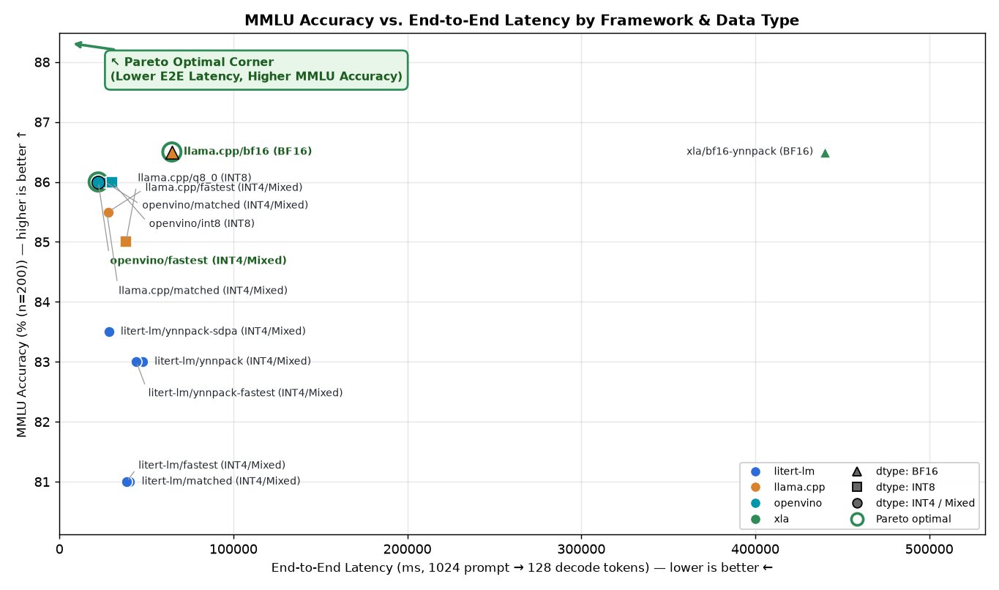
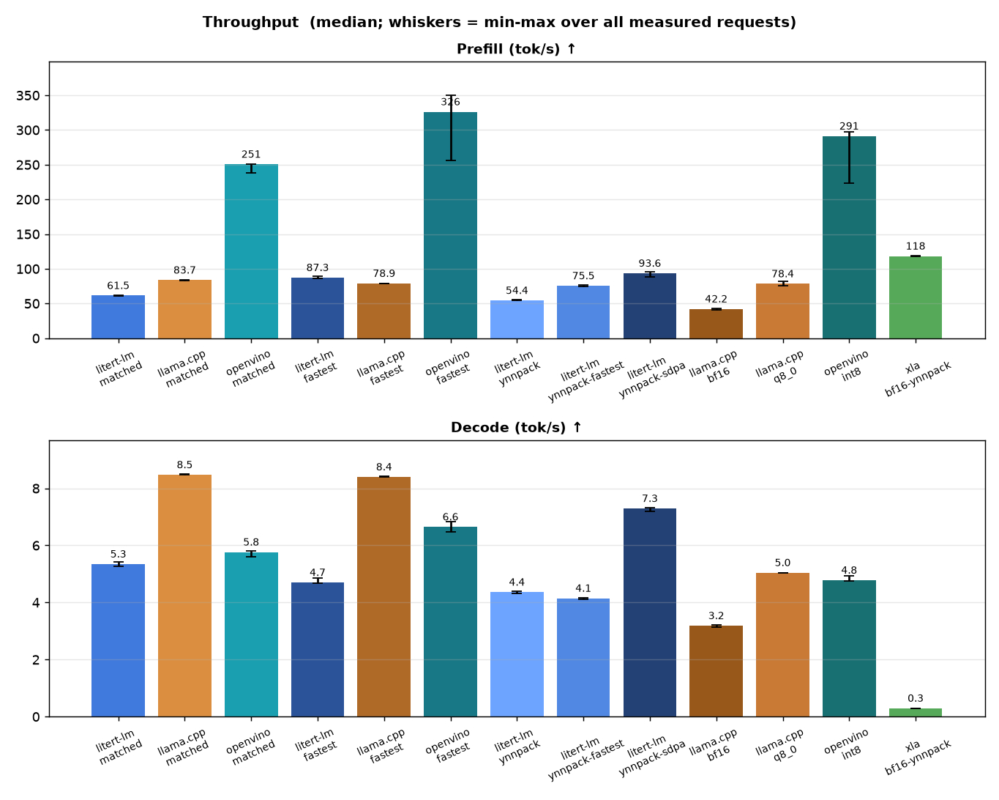
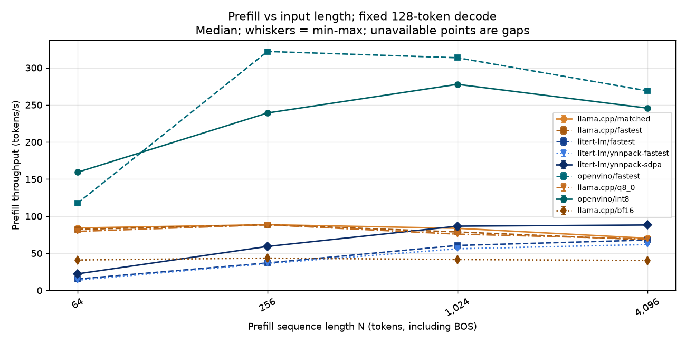
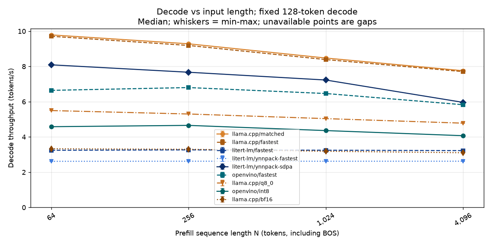
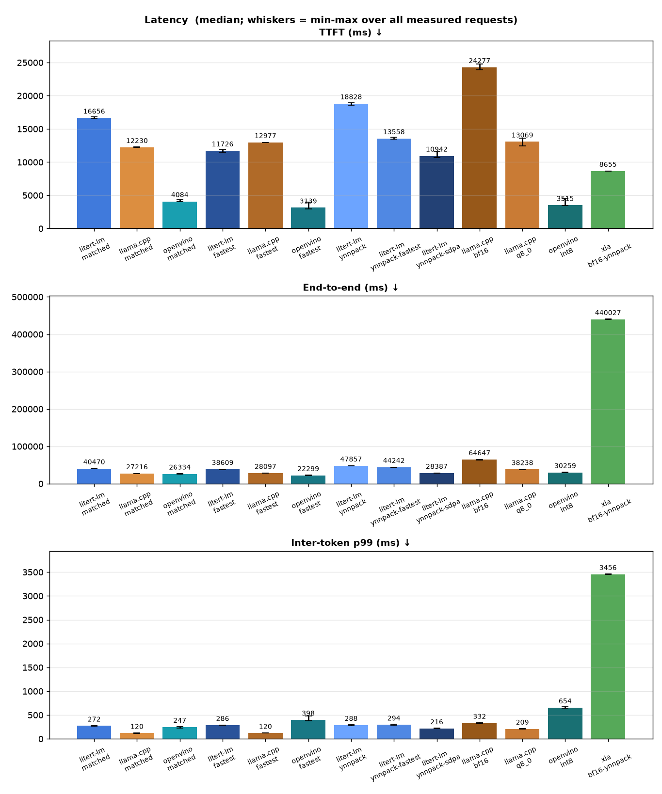
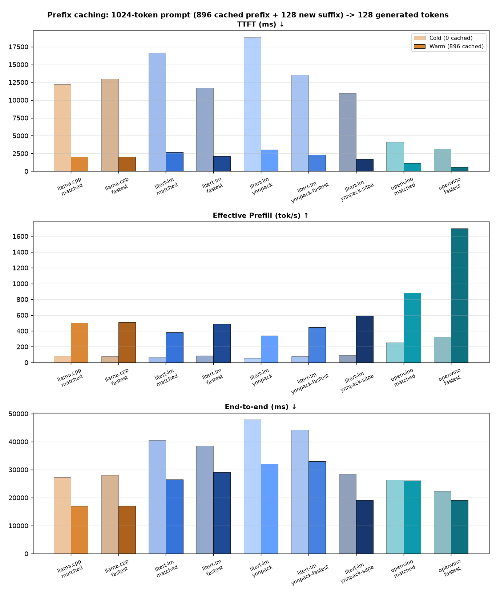
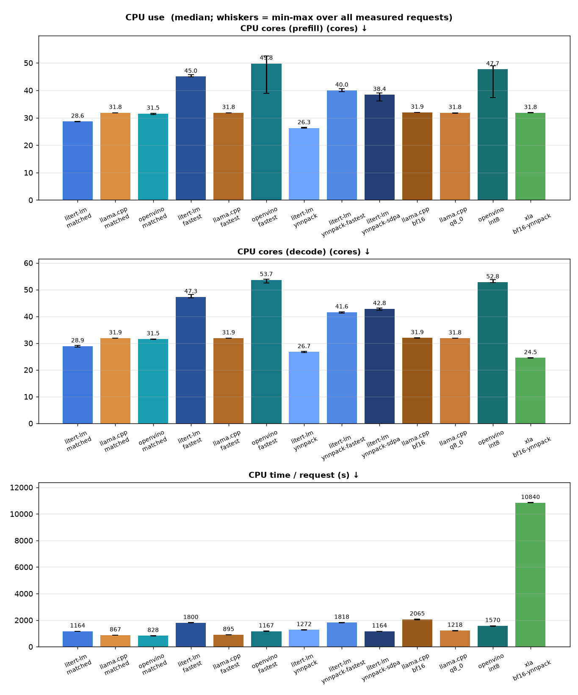
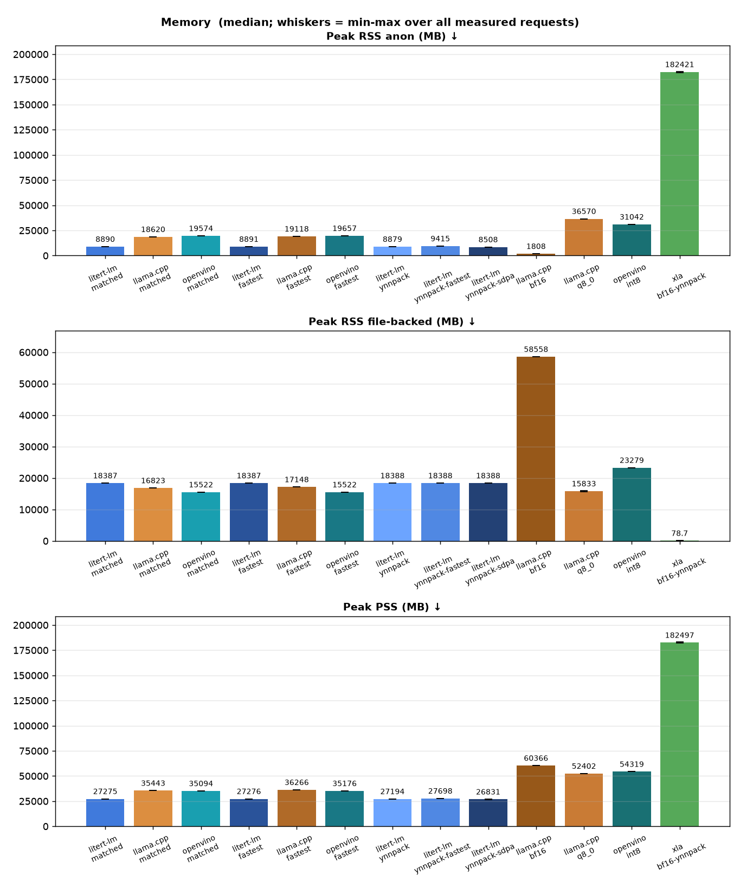
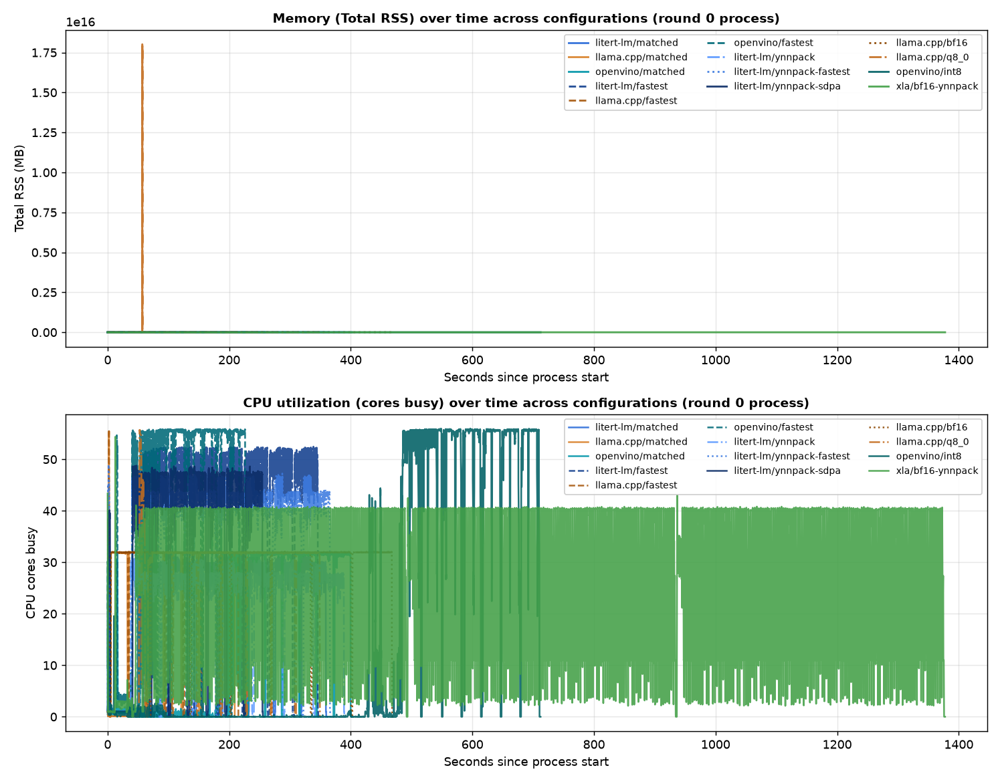
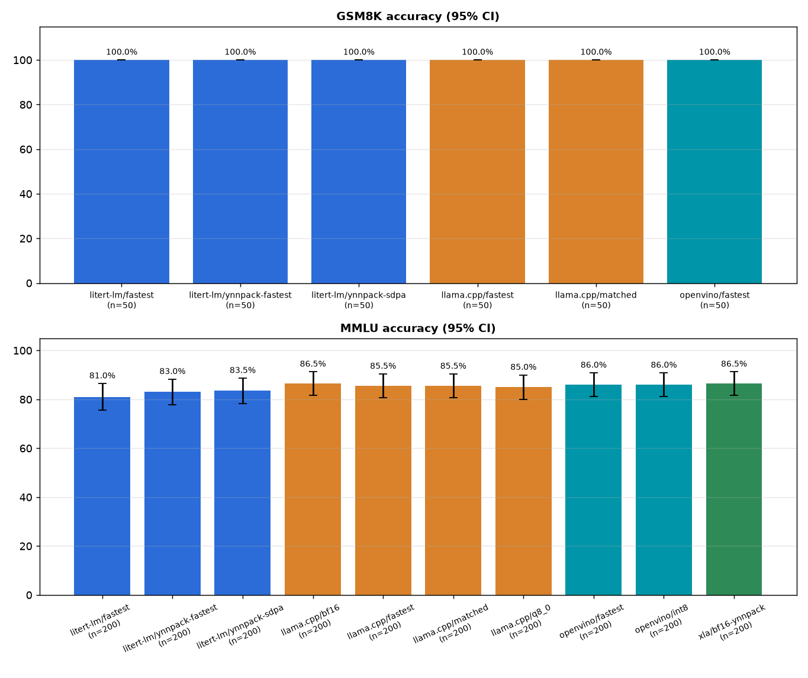

# gemma4-31b-cpu-sapphire-rapids on sapphire-rapids — 2026-11-23

> Generated by `python3 -m aeb.report` from 23 headline benchmark processes plus 36 input-length sweep processes and 19 prefix-cache processes. Raw per-request data: [data.json](data.json). Methodology: [benchmark_methodology.md](../../docs/benchmark_methodology.md).

Gemma 4 31B (dense 60-layer, 50 sliding-window + 10 global attention layers) on Intel(R) Xeon(R) Sapphire Rapids (AVX-512 + AMX) across CPU runtimes (LiteRT-LM XNNPACK & YNNPACK, llama.cpp, OpenVINO, XLA/PJRT CPU) grouped by precision track (INT4, INT8, BF16).

## Summary

Headline medians (`1024` prompt → `128` generated tokens, stateless cold KV cache) and accuracy grouped by data type. Within each data type, rows are ordered from fastest to slowest end-to-end latency, with the best-performing row highlighted (**🏆**) and best per-column metrics bolded. The highlighted row is the lowest measured latency, not a claim of statistically significant superiority.



| Framework / Config | Checkpoint | Weights / Acts / KV | Threads | TTFT (ms) ↓ | Prefill (tok/s) ↑ | Decode (tok/s) ↑ | E2E (ms) ↓ | Peak RSS (MB) ↓ | MMLU (n=200) ↑ | GSM8K (n=50) ↑ |
| --- | --- | --- | ---: | ---: | ---: | ---: | ---: | ---: | ---: | ---: |
| **BF16 Track** | | | | | | | | | | |
| 🏆 **`llama.cpp/bf16`** | **`it` (GGUF)** | **`bf16 / fp32 / fp16`** | **32** | 24,277 | 42.2 | **3.19** | **64,647** | **60,366** | **86.50%** | — |
| `xla/bf16-ynnpack` | `it` (HF) | `bf16 / bf16 / bf16` | 56 | **8,655** | **118.3** | 0.29 | 440,027 | 182,500 | **86.50%** | — |
| **INT8 Track** | | | | | | | | | | |
| 🏆 **`openvino/int8`** | **`it` (OV)** | **`int8_asym / bf16 / int8`** | **56** | **3,515** | **291.3** | 4.78 | **30,259** | 54,321 | **86.00%** | — |
| `llama.cpp/q8_0` | `it` (GGUF) | `q8_0 / q8_0 / fp16` | 32 | 13,069 | 78.4 | **5.04** | 38,238 | **52,403** | 85.00% | — |
| **INT4 / Mixed Track** | | | | | | | | | | |
| 🏆 **`openvino/fastest`** | **`it` (OV)** | **`int4_asym / bf16 / int8`** | **56** | **3,139** | **326.2** | 6.65 | **22,299** | 35,179 | **86.00%** | **100.00%** |
| `openvino/matched` | `it` (OV) | `int4_asym / bf16 / int8` | 32 | 4,084 | 250.7 | 5.77 | 26,334 | 35,096 | **86.00%** | **100.00%** |
| `llama.cpp/matched` | `qat-q4_0` | `q4_0 / q8_0 / fp16` | 32 | 12,230 | 83.7 | **8.47** | 27,216 | 35,443 | 85.50% | **100.00%** |
| `llama.cpp/fastest` | `it` (GGUF) | `q4_0 / q8_0 / fp16` | 32 | 12,977 | 78.9 | 8.40 | 28,097 | 36,266 | 85.50% | **100.00%** |
| `litert-lm/ynnpack-sdpa` | `qat-q4_0` | `int4_int8 / fp32 / fp32` | 56 | 10,942 | 93.6 | 7.29 | 28,387 | **26,895** | 83.50% | **100.00%** |
| `litert-lm/fastest` | `qat-q4_0` | `int4_int8 / fp32 / fp32` | 56 | 11,726 | 87.3 | 4.70 | 38,609 | 27,278 | 81.00% | **100.00%** |
| `litert-lm/matched` | `qat-q4_0` | `int4_int8 / fp32 / fp32` | 32 | 16,656 | 61.5 | 5.35 | 40,470 | 27,277 | 81.00% | **100.00%** |
| `litert-lm/ynnpack-fastest` | `qat-q4_0` | `int4_int8 / fp32 / fp32` | 56 | 13,558 | 75.5 | 4.15 | 44,242 | 27,804 | 83.00% | **100.00%** |
| `litert-lm/ynnpack` | `qat-q4_0` | `int4_int8 / fp32 / fp32` | 32 | 18,828 | 54.4 | 4.36 | 47,857 | 27,260 | 83.00% | **100.00%** |

**Legend:**

- **`matched`**: Same pre-quantized integer weights, prompt tokens, decoding and thread counts, with the closest supported KV-cache precision. See Quantization equivalence for representation and activation differences.

- **`fastest`**: Empirically selected configuration from the suite's thread and kernel sweep; read performance together with the accuracy gate.

- **`reference`**: Published framework-specific artifacts and defaults; weights and quantization are not matched. Read speed together with accuracy.

## Results

### Throughput



#### Input-length throughput sweep

Sweep measurement dates (UTC): 2026-11-17, 2026-11-18, 2026-11-23.

Fixed **128 generated tokens**, greedy with stop tokens ignored; common context capacity **8,192**. Model artifacts and thread counts are unchanged from the configurations above. These are reference configurations, not matched weights. The original headline workload remains unchanged.

Swept configurations are the empirically fastest configuration for each `(framework, dtype)` pair that cleared the minimum accuracy gate (gsm8k ≥ 40%, mmlu ≥ 40%).

Each point uses 1 interleaved processes per configuration, 1 warm-ups and 1 measured requests per process. Long inputs repeat the same public-domain passage deterministically. N includes BOS and chat-template tokens. Each request starts with an empty KV cache.

Prefill tokens/s = N / time to first token (includes tokenization and first-token generation). Decode tokens/s = 127 / time from the first to the last generated token. Rates are medians; brackets show min-max. Failed, truncated or wrong-length processes are excluded, never replaced by estimated rates.

##### Prefill (tokens/s)

| N | `llama.cpp/matched` | `llama.cpp/fastest` | `litert-lm/fastest` | `litert-lm/ynnpack-fastest` | `litert-lm/ynnpack-sdpa` | `openvino/fastest` | `llama.cpp/q8_0` | `openvino/int8` | `llama.cpp/bf16` |
| --- | --- | --- | --- | --- | --- | --- | --- | --- | --- |
| 64 | 84.18 [84.18-84.18] | 82.31 [82.31-82.31] | 15.38 [15.38-15.38] | 13.84 [13.84-13.84] | 22.34 [22.34-22.34] | 117.57 [117.57-117.57] | 79.57 [79.57-79.57] | 159.27 [159.27-159.27] | 41.03 [41.03-41.03] |
| 256 | 88.65 [88.65-88.65] | 88.48 [88.48-88.48] | 37.03 [37.03-37.03] | 36.31 [36.31-36.31] | 59.30 [59.30-59.30] | 322.04 [322.04-322.04] | 88.43 [88.43-88.43] | 239.13 [239.13-239.13] | 43.53 [43.53-43.53] |
| 1,024 | 83.73 [83.73-83.73] | 78.80 [78.80-78.80] | 60.61 [60.61-60.61] | 56.10 [56.10-56.10] | 86.62 [86.62-86.62] | 313.57 [313.57-313.57] | 75.87 [75.87-75.87] | 277.75 [277.75-277.75] | 41.64 [41.64-41.64] |
| 4,096 | 70.37 [70.37-70.37] | 68.21 [68.21-68.21] | 67.91 [67.91-67.91] | 61.88 [61.88-61.88] | 88.20 [88.20-88.20] | 269.01 [269.01-269.01] | 69.40 [69.40-69.40] | 245.69 [245.69-245.69] | 40.30 [40.30-40.30] |



##### Decode (tokens/s)

| N | `llama.cpp/matched` | `llama.cpp/fastest` | `litert-lm/fastest` | `litert-lm/ynnpack-fastest` | `litert-lm/ynnpack-sdpa` | `openvino/fastest` | `llama.cpp/q8_0` | `openvino/int8` | `llama.cpp/bf16` |
| --- | --- | --- | --- | --- | --- | --- | --- | --- | --- |
| 64 | 9.79 [9.79-9.79] | 9.71 [9.71-9.71] | 3.24 [3.24-3.24] | 2.62 [2.62-2.62] | 8.09 [8.09-8.09] | 6.64 [6.64-6.64] | 5.50 [5.50-5.50] | 4.58 [4.58-4.58] | 3.33 [3.33-3.33] |
| 256 | 9.29 [9.29-9.29] | 9.19 [9.19-9.19] | 3.27 [3.27-3.27] | 2.62 [2.62-2.62] | 7.67 [7.67-7.67] | 6.80 [6.80-6.80] | 5.30 [5.30-5.30] | 4.66 [4.66-4.66] | 3.30 [3.30-3.30] |
| 1,024 | 8.48 [8.48-8.48] | 8.39 [8.39-8.39] | 3.25 [3.25-3.25] | 2.62 [2.62-2.62] | 7.23 [7.23-7.23] | 6.46 [6.46-6.46] | 5.04 [5.04-5.04] | 4.36 [4.36-4.36] | 3.19 [3.19-3.19] |
| 4,096 | 7.76 [7.76-7.76] | 7.71 [7.71-7.71] | 3.23 [3.23-3.23] | 2.62 [2.62-2.62] | 5.96 [5.96-5.96] | 5.83 [5.83-5.83] | 4.78 [4.78-4.78] | 4.07 [4.07-4.07] | 3.10 [3.10-3.10] |




### Latency



### Prefix caching (warm vs. cold KV cache)

Measures multi-turn / shared-system-prompt inference where **896 prefix tokens** of a **1,024-token prompt** are already present in the KV cache, and each request appends a distinct **128-token suffix** before generating **128 tokens** (greedy, stop tokens ignored). The headline suite above remains strictly stateless (fresh KV cache per request).

- **Cold TTFT / Cold prefill tok/s**: full 1,024-token prompt evaluated from an empty KV cache.
- **Warm TTFT**: latency to first generated token when reusing the 896-token prefix KV cache and prefilling only the 128-token suffix.
- **Effective prefill tok/s**: `1024 / warm_ttft_s` (effective prompt processing rate seen by the caller).
- **Incremental suffix tok/s**: `128 / warm_ttft_s` (actual compute throughput on the 128 uncached suffix tokens at KV position 896..1024).

| Config | Cold TTFT (ms) ↓ | Warm TTFT (ms) ↓ | TTFT speedup ↑ | Cold prefill (tok/s) ↑ | Warm effective prefill (tok/s) ↑ | Warm suffix prefill (tok/s) ↑ | Cold E2E (ms) ↓ | Warm E2E (ms) ↓ | E2E speedup ↑ |
| --- | --- | --- | --- | --- | --- | --- | --- | --- | --- |
| `llama.cpp/matched` | 12230 [12222–12267] | 2035 [2031–2064] | **6.01×** [5.93, 6.03] | 83.7 [83.5–83.8] | 503.1 [496.1–504.3] | 62.9 [62.0–63.0] | 27216 [27160–27258] | 17012 [16967–17085] | **1.60×** [1.59, 1.60] |
| `llama.cpp/fastest` | 12977 [12964–12987] | 2004 [1983–2008] | **6.47×** [6.46, 6.54] | 78.9 [78.8–79.0] | 510.9 [510.1–516.5] | 63.9 [63.8–64.6] | 28097 [28065–28102] | 17083 [17044–17090] | **1.64×** [1.64, 1.65] |
| `litert-lm/matched` | 16656 [16513–16791] | 2690 [2657–2720] | **6.19×** [6.15, 6.24] | 61.5 [61.0–62.0] | 380.6 [376.5–385.4] | 47.6 [47.1–48.2] | 40470 [40076–40954] | 26458 [25962–26874] | **1.53×** [1.52, 1.54] |
| `litert-lm/fastest` | 11726 [11461–11912] | 2102 [2067–2164] | **5.58×** [5.52, 5.64] | 87.3 [86.0–89.3] | 487.1 [473.2–495.3] | 60.9 [59.1–61.9] | 38609 [37666–39099] | 29071 [28510–29312] | **1.33×** [1.31, 1.34] |
| `litert-lm/ynnpack` | 18828 [18582–18918] | 3029 [2987–3086] | **6.22×** [6.16, 6.23] | 54.4 [54.1–55.1] | 338.1 [331.9–342.9] | 42.3 [41.5–42.9] | 47857 [47569–48230] | 32041 [31679–32350] | **1.49×** [1.48, 1.50] |
| `litert-lm/ynnpack-fastest` | 13558 [13432–13737] | 2304 [2256–2345] | **5.88×** [5.85, 5.94] | 75.5 [74.5–76.2] | 444.5 [436.6–454.0] | 55.6 [54.6–56.7] | 44242 [44010–44486] | 33012 [32765–33246] | **1.34×** [1.34, 1.35] |
| `litert-lm/ynnpack-sdpa` | 10942 [10676–11550] | 1728 [1678–1792] | **6.33×** [6.17, 6.54] | 93.6 [88.7–95.9] | 592.5 [571.4–610.1] | 74.1 [71.4–76.3] | 28387 [28087–28923] | 19151 [19021–19313] | **1.48×** [1.47, 1.50] |
| `openvino/matched` | 4084 [4075–4307] | 1161 [730–1684] | **3.52×** [2.43, 5.59] | 250.7 [237.7–251.3] | 881.7 [608.0–1401.9] | 110.2 [76.0–175.2] | 26334 [25945–26699] | 26163 [22805–28071] | **1.01×** [0.94, 1.15] |
| `openvino/fastest` | 3139 [2929–4001] | 603 [514–697] | **5.21×** [4.51, 6.64] | 326.2 [255.9–349.6] | 1698.9 [1469.9–1993.7] | 212.4 [183.7–249.2] | 22299 [21798–22572] | 19130 [19017–20224] | **1.17×** [1.10, 1.18] |




### CPU



### Memory



### Memory and CPU over time

Combined timeline (round-0 process per configuration: model load, warm-up and measured requests) showing total RSS and active CPU cores. File-backed RSS is mmap'd model pages (shared, reclaimable); anonymous RSS is private memory (KV cache, activations, repacked or converted weights).



### Detailed metrics

Medians over all measured requests (n per cell in the last row); [min – max] in brackets.

| Metric | `litert-lm/matched` | `llama.cpp/matched` | `openvino/matched` | `litert-lm/fastest` | `llama.cpp/fastest` | `openvino/fastest` | `litert-lm/ynnpack` | `litert-lm/ynnpack-fastest` | `litert-lm/ynnpack-sdpa` | `llama.cpp/bf16` | `llama.cpp/q8_0` | `openvino/int8` | `xla/bf16-ynnpack` |
| --- | --- | --- | --- | --- | --- | --- | --- | --- | --- | --- | --- | --- | --- |
| TTFT (ms) ↓ | 16656 [16513–16791] | 12230 [12222–12267] | 4084 [4075–4307] | 11726 [11461–11912] | 12977 [12964–12987] | 3139 [2929–4001] | 18828 [18582–18918] | 13558 [13432–13737] | 10942 [10676–11550] | 24277 [23912–24805] | 13069 [12473–13608] | 3515 [3444–4573] | 8655 [8639–8671] |
| Prefill (tok/s) ↑ | 61.5 [61.0–62.0] | 83.7 [83.5–83.8] | 250.7 [237.7–251.3] | 87.3 [86.0–89.3] | 78.9 [78.8–79.0] | 326.2 [255.9–349.6] | 54.4 [54.1–55.1] | 75.5 [74.5–76.2] | 93.6 [88.7–95.9] | 42.2 [41.3–42.8] | 78.4 [75.3–82.1] | 291.3 [223.9–297.4] | 118.3 [118.1–118.5] |
| Decode (tok/s) ↑ | 5.35 [5.26–5.42] | 8.47 [8.47–8.50] | 5.77 [5.61–5.81] | 4.70 [4.67–4.87] | 8.40 [8.39–8.42] | 6.65 [6.48–6.84] | 4.36 [4.32–4.41] | 4.15 [4.10–4.16] | 7.29 [7.20–7.33] | 3.19 [3.14–3.21] | 5.04 [5.02–5.05] | 4.78 [4.75–4.93] | 0.29 [0.29–0.29] |
| End-to-end (ms) ↓ | 40470 [40076–40954] | 27216 [27160–27258] | 26334 [25945–26699] | 38609 [37666–39099] | 28097 [28065–28102] | 22299 [21798–22572] | 47857 [47569–48230] | 44242 [44010–44486] | 28387 [28087–28923] | 64647 [63475–64867] | 38238 [37648–38758] | 30259 [30016–30320] | 440027 [439173–440881] |
| Inter-token p99 (ms) ↓ | 272.3 [265.7–278.5] | 120.0 [118.7–121.0] | 247.3 [231.1–253.7] | 285.9 [282.6–290.2] | 120.3 [120.0–121.2] | 398.3 [378.8–482.7] | 287.8 [279.9–295.5] | 294.2 [286.9–311.7] | 216.2 [211.3–225.4] | 332.0 [314.7–347.6] | 208.7 [206.6–215.1] | 654.2 [644.7–686.0] | 3455.8 [3454.1–3457.5] |
| CPU cores (prefill) (cores) ↓ | 28.63 [28.48–28.74] | 31.84 [31.82–31.85] | 31.54 [31.11–31.69] | 45.03 [44.88–45.71] | 31.83 [31.81–31.86] | 49.78 [38.86–52.57] | 26.28 [26.19–26.47] | 39.98 [39.51–40.64] | 38.40 [36.15–39.01] | 31.93 [31.90–31.94] | 31.83 [31.71–31.84] | 47.69 [37.35–48.99] | 31.82 [31.78–31.87] |
| CPU cores (decode) (cores) ↓ | 28.88 [28.54–29.19] | 31.86 [31.83–31.86] | 31.51 [31.39–31.60] | 47.26 [46.87–48.28] | 31.86 [31.86–31.87] | 53.67 [52.49–53.90] | 26.73 [26.53–26.93] | 41.57 [41.18–41.76] | 42.83 [42.26–43.07] | 31.95 [31.89–31.95] | 31.83 [31.82–31.86] | 52.78 [52.58–53.81] | 24.49 [24.40–24.58] |
| CPU time / request (s) ↓ | 1164.4 [1160.7–1171.2] | 867.5 [865.8–868.4] | 827.7 [820.6–839.0] | 1799.9 [1783.1–1818.5] | 895.5 [894.1–895.6] | 1167.3 [1157.2–1183.6] | 1272.2 [1267.8–1278.3] | 1818.4 [1809.8–1825.5] | 1163.8 [1160.2–1168.8] | 2065.1 [2027.7–2072.1] | 1218.4 [1199.3–1235.0] | 1569.6 [1555.5–1579.7] | 10840.0 [10823.7–10856.4] |
| Peak RSS (request) (MB) ↓ | 27277 [27263–27279] | 35443 [35440–35443] | 35096 [35096–35096] | 27278 [27278–27278] | 36266 [36266–36266] | 35179 [35179–35179] | 27260 [27245–27269] | 27804 [27668–27856] | 26895 [26825–26927] | 60366 [60366–60366] | 52403 [52297–52522] | 54321 [54312–54332] | 182500 [181951–183049] |
| Peak RSS anon (MB) ↓ | 8890 [8890–8892] | 18620 [18620–18620] | 19574 [19574–19574] | 8891 [8891–8891] | 19118 [19118–19118] | 19657 [19657–19657] | 8879 [8857–8881] | 9415 [9279–9468] | 8508 [8438–8540] | 1808 [1808–1808] | 36570 [36570–36570] | 31042 [31042–31042] | 182421 [181872–182970] |
| Peak RSS file-backed (MB) ↓ | 18387 [18370–18387] | 16823 [16820–16823] | 15522 [15522–15522] | 18387 [18387–18387] | 17148 [17148–17148] | 15522 [15522–15522] | 18388 [18380–18388] | 18388 [18388–18388] | 18388 [18388–18388] | 58558 [58558–58558] | 15833 [15727–15952] | 23279 [23271–23291] | 79 [79–79] |
| Peak PSS (MB) ↓ | 27275 [27261–27277] | 35443 [35439–35443] | 35094 [35093–35094] | 27276 [27276–27276] | 36266 [36266–36266] | 35176 [35176–35176] | 27194 [27159–27259] | 27698 [27602–27855] | 26831 [26767–26906] | 60366 [60366–60366] | 52402 [52297–52522] | 54319 [54311–54331] | 182497 [181948–183046] |
| Model load, warm cache (ms) | 45361 | 2768 | 166431 | 45283 | 2751 | 37582 | 35181 | 36829 | 38024 | 2711 | 63504 | 426720 | 40080 |
| Peak RSS, process lifetime (VmHWM, MB) | 27277 | 35443 | 35096 | 27278 | 36266 | 35179 | 27267 | 27852 | 26927 | 60366 | 52522 | 54332 | 183049 |
| RSS after load, before 1st request (MB) | 9442 | 35256 | 18483 | 9443 | 36075 | 18484 | 9454 | 9464 | 9495 | 60178 | 52568 | 29765 | 59982 |
|   …of which anonymous (MB) | 7569 | 18433 | 2968 | 7569 | 18927 | 2969 | 7579 | 7589 | 7620 | 1621 | 36387 | 391 | 59913 |
| Container memory.peak incl. page cache (MB) | n/a | n/a | n/a | n/a | n/a | n/a | n/a | n/a | n/a | n/a | n/a | n/a | n/a |
| Measured requests (n) | 15 | 5 | 5 | 15 | 5 | 5 | 15 | 15 | 15 | 5 | 5 | 5 | 2 |
| Decode CV across requests | 1.0% | 0.2% | 1.5% | 1.5% | 0.1% | 2.2% | 0.6% | 0.4% | 0.5% | 1.0% | 0.2% | 1.8% | 0.2% |

#### llama.cpp ÷ LiteRT-LM

Ratio of medians with a 95% bootstrap interval over requests. >1 means llama.cpp has the larger value (better for throughput, worse for latency/CPU/memory).

| Track | Prefill tok/s | Decode tok/s | TTFT | End-to-end | CPU s / request | Peak RSS |
| --- | --- | --- | --- | --- | --- | --- |
| matched | 1.36× [1.35, 1.37] | 1.58× [1.58, 1.60] | 0.73× [0.73, 0.74] | 0.67× [0.67, 0.68] | 0.74× [0.74, 0.75] | 1.30× [1.30, 1.30] |
| fastest | 0.90× [0.89, 0.91] | 1.79× [1.75, 1.79] | 1.11× [1.10, 1.12] | 0.73× [0.72, 0.73] | 0.50× [0.50, 0.50] | 1.33× [1.33, 1.33] |

### Generated text on the timing prompt

Greedy decoding should be deterministic within a configuration. Different configurations may legitimately diverge (different activation/KV quantization and kernels change near-tie logits); the accuracy gate below is the validity check.

| Config | Identical across all measured requests | First 140 characters |
| --- | --- | --- |
| `litert-lm/matched` | yes | <\|channel>thought ⏎ <channel\|>“—she’ll think me!” Alice continued, “for I can’t remember the name of the capital of New Zealand. I’m sure I’ve |
| `llama.cpp/matched` | yes | <\|channel>thought ⏎ <channel\|>“—and what an ignorant little girl she’ll seem to be,” Alice continued, “to talk of Antipathies when she can’t e |
| `openvino/matched` | yes | thought ⏎ “—will be,” thought Alice, “to ask *where* it is here! I shall think better of it, before I say anything.” ⏎  ⏎ She was just wondering w |
| `litert-lm/fastest` | yes | <\|channel>thought ⏎ <channel\|>“—she’ll think me!” Alice continued, “for I can’t remember the name of the capital of New Zealand. I’m sure I’ve |
| `llama.cpp/fastest` | yes | <\|channel>thought ⏎ <channel\|>“—and what an ignorant little girl she’ll seem to be,” Alice continued, “to ask if they live in New Zealand!” (S |
| `openvino/fastest` | yes | thought ⏎ “—will be,” thought Alice, “to ask *where* it is here! I shall think better of it, before I say anything.” ⏎  ⏎ She was just wondering w |
| `litert-lm/ynnpack` | yes | <\|channel>thought ⏎ <channel\|>“—she’ll think me!” Alice continued, “for I can’t remember the name of the capital of France!” (She paused a mom |
| `litert-lm/ynnpack-fastest` | yes | <\|channel>thought ⏎ <channel\|>“—she’ll think me!” Alice continued, “for I can’t remember the name of the capital of France!” (She paused a mom |
| `litert-lm/ynnpack-sdpa` | yes | <\|channel>thought ⏎ <channel\|>“—she’ll think me!” Alice continued, “for I can’t remember the name of the King of England!” (Now, this was a ve |
| `llama.cpp/bf16` | yes | <\|channel>thought ⏎ <channel\|>“—and what an ignorant little girl she’ll think me,” continued Alice, “for I can’t remember the capital of Franc |
| `llama.cpp/q8_0` | yes | <\|channel>thought ⏎ <channel\|>“—and what an ignorant little girl she’ll think me,” continued Alice, “for I can’t remember the capital of eithe |
| `openvino/int8` | yes | thought ⏎ “—and what an ignorant little girl she’ll think me,” continued Alice, “for I can’t remember the capital of France! Oh, I wish I had  |
| `xla/bf16-ynnpack` | yes | thought ⏎ “—and what an ignorant little girl she’ll think me,” continued Alice, “for I can’t remember the capital of either! I shall have to s |

## Accuracy (validity gate)

Same prompts, greedy decoding, through the same in-process drivers as the timing runs. Use these to confirm each configuration produces correct tokens, and to compare frameworks on identical items; they are not leaderboard numbers.

| Config | Task | Items | Accuracy | 95% CI | Macro (MMLU) | Parse failures | Mean generated tokens | Hit token limit |
| --- | --- | --- | --- | --- | --- | --- | --- | --- |
| `litert-lm/fastest` | mmlu | 200 (stratified subset) | 81.00% | ±5.44% | 80.99% | 18 | 4.3 | n/a (letter only) |
| `litert-lm/ynnpack-fastest` | mmlu | 200 (stratified subset) | 83.00% | ±5.21% | 83.19% | 12 | 4.3 | n/a (letter only) |
| `litert-lm/ynnpack-sdpa` | mmlu | 200 (stratified subset) | 83.50% | ±5.14% | 83.77% | 12 | 4.2 | n/a (letter only) |
| `llama.cpp/bf16` | mmlu | 200 (stratified subset) | 86.50% | ±4.74% | 86.70% | 8 | 3.1 | n/a (letter only) |
| `llama.cpp/fastest` | mmlu | 200 (stratified subset) | 85.50% | ±4.88% | 85.53% | 13 | 3.4 | n/a (letter only) |
| `llama.cpp/matched` | mmlu | 200 (stratified subset) | 85.50% | ±4.88% | 85.53% | 13 | 3.4 | n/a (letter only) |
| `llama.cpp/q8_0` | mmlu | 200 (stratified subset) | 85.00% | ±4.95% | 85.09% | 11 | 3.2 | n/a (letter only) |
| `openvino/fastest` | mmlu | 200 (stratified subset) | 86.00% | ±4.81% | 86.26% | 8 | 3.4 | n/a (letter only) |
| `openvino/int8` | mmlu | 200 (stratified subset) | 86.00% | ±4.81% | 86.26% | 7 | 3.1 | n/a (letter only) |
| `xla/bf16-ynnpack` | mmlu | 200 (stratified subset) | 86.50% | ±4.74% | 86.40% | 9 | 3.2 | n/a (letter only) |
| `litert-lm/fastest` | gsm8k | 50 (evenly spaced subset) | 100.00% | ±0.00% | n/a | 0 | 279.1 | 0 (cap 512) |
| `litert-lm/ynnpack-fastest` | gsm8k | 50 (evenly spaced subset) | 100.00% | ±0.00% | n/a | 0 | 278.3 | 0 (cap 512) |
| `litert-lm/ynnpack-sdpa` | gsm8k | 50 (evenly spaced subset) | 100.00% | ±0.00% | n/a | 0 | 278.3 | 0 (cap 512) |
| `llama.cpp/fastest` | gsm8k | 50 (evenly spaced subset) | 100.00% | ±0.00% | n/a | 0 | 277.6 | 0 (cap 512) |
| `llama.cpp/matched` | gsm8k | 50 (evenly spaced subset) | 100.00% | ±0.00% | n/a | 0 | 277.4 | 0 (cap 512) |
| `openvino/fastest` | gsm8k | 50 (evenly spaced subset) | 100.00% | ±0.00% | n/a | 0 | 284.1 | 0 (cap 512) |

**Paired comparison on identical items.** Same prediction = both configs chose the same answer; McNemar's exact test on items only one config got right (p < 0.05 means a real accuracy difference).

| Task | A | B | Items | Same prediction | Acc A | Acc B | Only A right | Only B right | McNemar p |
| --- | --- | --- | --- | --- | --- | --- | --- | --- | --- |
| mmlu | `litert-lm/fastest` | `litert-lm/ynnpack-fastest` | 200 | 89.0% | 81.00% | 83.00% | 7 | 11 | 0.481 |
| mmlu | `litert-lm/fastest` | `litert-lm/ynnpack-sdpa` | 200 | 89.0% | 81.00% | 83.50% | 6 | 11 | 0.332 |
| mmlu | `litert-lm/fastest` | `llama.cpp/fastest` | 200 | 90.0% | 81.00% | 85.50% | 3 | 12 | 0.0352 |
| mmlu | `litert-lm/fastest` | `openvino/fastest` | 200 | 87.0% | 81.00% | 86.00% | 6 | 16 | 0.0525 |
| mmlu | `litert-lm/ynnpack-fastest` | `litert-lm/ynnpack-sdpa` | 200 | 96.0% | 83.00% | 83.50% | 3 | 4 | 1 |
| mmlu | `llama.cpp/bf16` | `llama.cpp/fastest` | 200 | 91.5% | 86.50% | 85.50% | 9 | 7 | 0.804 |
| mmlu | `llama.cpp/bf16` | `llama.cpp/matched` | 200 | 91.5% | 86.50% | 85.50% | 9 | 7 | 0.804 |
| mmlu | `llama.cpp/bf16` | `llama.cpp/q8_0` | 200 | 97.5% | 86.50% | 85.00% | 3 | 0 | 0.25 |
| mmlu | `llama.cpp/fastest` | `llama.cpp/matched` | 200 | 100.0% | 85.50% | 85.50% | 0 | 0 | 1 |
| mmlu | `llama.cpp/fastest` | `llama.cpp/q8_0` | 200 | 93.0% | 85.50% | 85.00% | 7 | 6 | 1 |
| mmlu | `llama.cpp/fastest` | `openvino/fastest` | 200 | 89.0% | 85.50% | 86.00% | 9 | 10 | 1 |
| mmlu | `llama.cpp/matched` | `llama.cpp/q8_0` | 200 | 93.0% | 85.50% | 85.00% | 7 | 6 | 1 |
| mmlu | `openvino/fastest` | `openvino/int8` | 200 | 91.5% | 86.00% | 86.00% | 8 | 8 | 1 |
| gsm8k | `litert-lm/fastest` | `litert-lm/ynnpack-fastest` | 50 | 100.0% | 100.00% | 100.00% | 0 | 0 | 1 |
| gsm8k | `litert-lm/fastest` | `litert-lm/ynnpack-sdpa` | 50 | 100.0% | 100.00% | 100.00% | 0 | 0 | 1 |
| gsm8k | `litert-lm/fastest` | `llama.cpp/fastest` | 50 | 100.0% | 100.00% | 100.00% | 0 | 0 | 1 |
| gsm8k | `litert-lm/fastest` | `openvino/fastest` | 50 | 100.0% | 100.00% | 100.00% | 0 | 0 | 1 |
| gsm8k | `litert-lm/ynnpack-fastest` | `litert-lm/ynnpack-sdpa` | 50 | 100.0% | 100.00% | 100.00% | 0 | 0 | 1 |
| gsm8k | `llama.cpp/fastest` | `llama.cpp/matched` | 50 | 100.0% | 100.00% | 100.00% | 0 | 0 | 1 |
| gsm8k | `llama.cpp/fastest` | `openvino/fastest` | 50 | 100.0% | 100.00% | 100.00% | 0 | 0 | 1 |



### Publicly reported accuracy

Google's Gemma 4 model card and technical report (arXiv 2607.02770, Table 5) report static benchmarks for Gemma 4 31B in thinking mode on bf16 weights; original 5-shot MMLU and GSM8K are not reported. The QAT model cards (google/gemma-4-31B-it-qat-q4_0-unquantized, google/gemma-4-31B-it-qat-q4_0-gguf) state that QAT preserves quality similar to bf16. None of the published setups matches this harness (zero-shot, non-thinking, greedy, answer-prefilled MMLU), so use these figures as an order-of-magnitude sanity check rather than a pass/fail threshold; the frameworks are judged against each other on identical items.

| Benchmark | Published | Model variant | Setup | Source | Measured here (non-thinking, greedy) |
| --- | --- | --- | --- | --- | --- |
| MMLU-Pro | 85.2% | gemma-4-31B-it, bf16 | thinking mode (Google) | [Gemma 4 model card / tech report Table 5](https://huggingface.co/google/gemma-4-31B-it) | — |
| MMLU-Pro (Gemma 3 27B-it baseline) | 67.6% | gemma-3-27b-it, bf16 | non-thinking mode (Google) | [Gemma 4 model card / tech report Table 5](https://huggingface.co/google/gemma-4-31B-it) | — |
| MMMLU | 88.4% | gemma-4-31B-it, bf16 | thinking mode (Google) | [Gemma 4 model card / tech report Table 5](https://huggingface.co/google/gemma-4-31B-it) | — |
| GPQA Diamond | 84.3% | gemma-4-31B-it, bf16 | thinking mode (Google) | [Gemma 4 model card / tech report Table 5](https://huggingface.co/google/gemma-4-31B-it) | — |
| LiveCodeBench v6 | 80.0% | gemma-4-31B-it, bf16 | thinking mode (Google) | [Gemma 4 model card / tech report Table 5](https://huggingface.co/google/gemma-4-31B-it) | — |
| BigBench Extra Hard | 74.4% | gemma-4-31B-it, bf16 | thinking mode (Google) | [Gemma 4 model card / tech report Table 5](https://huggingface.co/google/gemma-4-31B-it) | — |
| AIME 2026 (no tools) | 89.2% | gemma-4-31B-it, bf16 | thinking mode (Google) | [Gemma 4 model card / tech report Table 5](https://huggingface.co/google/gemma-4-31B-it) | — |
| Tau2 (average over 3) | 76.9% | gemma-4-31B-it, bf16 | thinking mode (Google) | [Gemma 4 model card / tech report Table 5](https://huggingface.co/google/gemma-4-31B-it) | — |
| MRCR v2 (8 needle 128k) | 66.4% | gemma-4-31B-it, bf16 | 128k context average (Google) | [Gemma 4 model card / tech report Table 5](https://huggingface.co/google/gemma-4-31B-it) | — |

- Google's Table 5 reports all Gemma 4 31B numbers with thinking mode enabled on bf16 weights; this harness evaluates with thinking disabled (`enable_thinking=False`) for deterministic zero-shot comparison across CPU runtimes.
- Original 5-shot MMLU is not in the Gemma 4 31B model card; MMLU-Pro (10 choices, reasoning-heavy) is 85.2% with thinking on, so zero-shot 4-choice MMLU on non-thinking 31B should comfortably exceed 75% on healthy checkpoints.
- Unlike E2B and E4B, Gemma 4 31B has no Per-Layer Embeddings (`hidden_size_per_layer_input = 0`) and uses uniform 4-bit blockwise quantization (`dynamic_wi4b32_afp32` blockwise-32 in LiteRT-LM, `Q4_0` blockwise-32 in GGUF, `int4-ov` in OpenVINO) rather than mixed 2-bit/4-bit mobile QAT.

## Output reproducibility

Same model file, build, prompt and settings, repeated: 12 prompts × 3 repeats per process, fresh KV cache per request, stop tokens honoured, ≤128 tokens. *Within process* = repeats vs. the first repeat; *across processes* = a second fresh process with the same request sequence; *across threads* = a process with half the threads. Seeded = temperature 1.0, top-k 64, top-p 0.95, fixed seed; the *seed control* reruns with seed+1 and must change outputs, otherwise seeded reproducibility would be vacuous. Method: [benchmark_methodology.md](../../docs/benchmark_methodology.md#output-reproducibility).

| Config | Mode | Verdict | Within process | Across processes | Across threads | Seed control |
| --- | --- | --- | --- | --- | --- | --- |
| `litert-lm/matched` | greedy | **reproducible per request** | 24/24 identical | 24/24 identical | n/a | — |
| `litert-lm/matched` | seeded | **reproducible per request** | 24/24 identical | 24/24 identical | n/a | 20/24 outputs changed |
| `llama.cpp/matched` | greedy | **reproducible per request** | 24/24 identical | 24/24 identical | n/a | — |
| `llama.cpp/matched` | seeded | **reproducible per request** | 24/24 identical | 24/24 identical | n/a | 20/24 outputs changed |
| `openvino/matched` | greedy | **reproducible per request** | 24/24 identical | 24/24 identical | n/a | — |
| `openvino/matched` | seeded | **reproducible per request** | 24/24 identical | 24/24 identical | n/a | 20/24 outputs changed |
| `litert-lm/fastest` | greedy | **reproducible per request** | 24/24 identical | 24/24 identical | n/a | — |
| `litert-lm/fastest` | seeded | **reproducible per request** | 24/24 identical | 24/24 identical | n/a | 20/24 outputs changed |
| `llama.cpp/fastest` | greedy | **reproducible per request** | 24/24 identical | 24/24 identical | n/a | — |
| `llama.cpp/fastest` | seeded | **reproducible per request** | 24/24 identical | 24/24 identical | n/a | 20/24 outputs changed |
| `openvino/fastest` | greedy | **reproducible per request** | 24/24 identical | 24/24 identical | n/a | — |
| `openvino/fastest` | seeded | **reproducible per request** | 24/24 identical | 24/24 identical | n/a | 20/24 outputs changed |
| `litert-lm/ynnpack` | greedy | **reproducible per request** | 24/24 identical | 24/24 identical | n/a | — |
| `litert-lm/ynnpack` | seeded | **reproducible per request** | 24/24 identical | 24/24 identical | n/a | 20/24 outputs changed |
| `litert-lm/ynnpack-fastest` | greedy | **reproducible per request** | 24/24 identical | 24/24 identical | n/a | — |
| `litert-lm/ynnpack-fastest` | seeded | **reproducible per request** | 24/24 identical | 24/24 identical | n/a | 20/24 outputs changed |
| `litert-lm/ynnpack-sdpa` | greedy | **reproducible per request** | 24/24 identical | 24/24 identical | n/a | — |
| `litert-lm/ynnpack-sdpa` | seeded | **reproducible per request** | 24/24 identical | 24/24 identical | n/a | 20/24 outputs changed |

Cross-framework (informational, greedy): `llama.cpp/matched` and `litert-lm/matched` produce identical text for 6/24 prompt-repeats, median first divergence at token 12. Identical weights do not imply identical outputs when activation/KV quantization and kernels differ.

## Key architecture & methodology notes (Gemma 4 31B on x86 Sapphire Rapids — BF16, INT8, and INT4)

1. **Model Architecture (`google/gemma-4-31B-it`).**
   - Dense **60-layer** transformer (`hidden_size = 5376`, `intermediate_size = 21504`, `num_attention_heads = 32`, `vocab_size = 262144`, `hidden_size_per_layer_input = 0`, no Per-Layer Embeddings).
   - **Hybrid attention schedule (50 sliding-window + 10 full global layers):** Every 6th layer (5, 11, 17, 23, 29, 35, 41, 47, 53, 59) uses full global causal attention (`head_dim = 512`, `num_key_value_heads = 4`, `k_eq_v = True` where $K$ and $V$ share a single projection), while the remaining 50 layers use local sliding-window attention (`sliding_window = 1024`, `head_dim = 256`, `num_key_value_heads = 16`, separate $K$ and $V$ projections).

2. **Precision Matrix & Framework Versions (`BF16`, `INT8`, and `INT4`).**
   - **LiteRT-LM (`main`, commit `b5391c5ceec4`, built from source with `--define=litert_enable_ynnpack=true`)**:
     - `litert-lm/matched` (XNNPACK delegate, 32 threads), `litert-lm/fastest` (XNNPACK delegate, 56 physical cores), `litert-lm/ynnpack` (YNNPACK delegate via `--ynnpack` / `litert_lm_engine_settings_set_enable_ynnpack`, 32 threads), `litert-lm/ynnpack-fastest` (YNNPACK delegate, 56 physical cores), and `litert-lm/ynnpack-sdpa` (YNNPACK delegate, 56 physical cores, using the fused `odml.sdpa_transposed` composite export).
     - `litert-lm/matched`, `litert-lm/fastest`, `litert-lm/ynnpack`, and `litert-lm/ynnpack-fastest` execute `litert-community/gemma-4-31B-it-litert-lm/gemma-4-31B-it.litertlm` (`17.4 GB`, exported with blockwise-32 INT4 `dynamic_wi4b32_afp32` from `google/gemma-4-31B-it-qat-q4_0-unquantized` with decomposed static-context attention).
     - `litert-lm/ynnpack-sdpa` executes `litert-community/gemma-4-31B-it-litert-lm/gemma-4-31B-it-sdpa.litertlm` (`17.4 GB`, exported with blockwise-32 INT4 `dynamic_wi4b32_afp32`, `use_sdpa_composite=True`, `use_bool_mask=True`, `prefill_logits=False`). On YNNPACK, `odml.sdpa_transposed` dynamically slices $K$, $V$, mask, and softmax to `active_tokens` via `param_tensor` and activates the `is_small_q` transpose-free path on all 60 decode layers (eliminating static `ctx` KV transposes). XNNPACK remains on `gemma-4-31B-it.litertlm` because `TfLiteXNNPackDelegate` does not support `odml.sdpa_transposed`.
     - **YNNPACK falls back to XNNPACK for blockwise-quantized `FullyConnected` ops:** Because `TfLiteYNNPackDelegateOptions::enable_blockwise_quantization` defaults to `false` in LiteRT's YNNPACK delegate and is not yet wired through LiteRT's `YnnpackAccelerator`, all blockwise-32 `FullyConnected` ops in the `dynamic_wi4b32_afp32` `.litertlm` artifacts fall back from YNNPACK to XNNPACK. Under `--ynnpack`, XNNPACK executes the blockwise-32 FC projections (producing an XNNPACK weight cache and lowering `--ynnpack` peak RSS to `26.9–27.8 GB`), while YNNPACK executes the remaining supported ops — including `odml.sdpa_transposed` on `litert-lm/ynnpack-sdpa`.
     - Updating LiteRT-LM from `v0.19.1` (`7a03724cece4`) to `main` (`b5391c5ceec4`, which updates `LITERT_REF` to `bf49eb62406d` and `TENSORFLOW_REF` to `faa06da43657`) resolves the Slinky `copy_remover` duplicate-input concatenate bug that previously caused `0.0%` MMLU/GSM8K accuracy on Gemma 4 31B with `--ynnpack`.
   - **`llama.cpp` (`b12469`, commit `e0a9118fe9ed`, compiled with AVX-512 + VNNI + BF16 + AMX)**:
     - `llama.cpp/matched` (`google/gemma-4-31B-it-qat-q4_0-gguf/gemma-4-31B_q4_0-it.gguf`, 32 threads), `llama.cpp/fastest` (`ggml-org/gemma-4-31B-it-GGUF/gemma-4-31B-it-Q4_0.gguf`, 32 threads, `--batch 2048 --ubatch 512 --flash-attn on`), `llama.cpp/q8_0` (`gemma-4-31B-it-Q8_0.gguf`, 32 threads), and `llama.cpp/bf16` (`gemma-4-31B-it-BF16.gguf`, 32 threads).
   - **OpenVINO GenAI (`2026.4.1.0` / `openvino==2026.4.1`)**:
     - `openvino/matched` (`OpenVINO/gemma-4-31B-it-int4-ov`, 32 threads), `openvino/fastest` (`OpenVINO/gemma-4-31B-it-int4-ov`, 56 physical cores), and `openvino/int8` (`OpenVINO/gemma-4-31B-it-int8-ov`, 56 physical cores) using oneDNN AMX/AVX-512 kernels.
     - Stateless runs disable internal prefix caching (`SchedulerConfig(enable_prefix_caching=False)`); `--cache-prefix` runs pre-populate the 896-token shared prefix and evaluate incremental 128-token suffixes.
   - **OpenXLA (`main` nightly `jax==0.12.1.dev20261116` / `jaxlib==0.12.1.dev20261116`, `flax==0.12.12`, `qwix==0.1.10`, `google-tunix==0.1.7`)**:
     - `xla/bf16-ynnpack` (YNNPACK `__ynn_fusion` backend via `--xla_cpu_use_ynn=true`, 56 threads) on `google/gemma-4-31B-it` (`60.4 GB` BF16 safetensors), achieving **118.3 tok/s prefill** (`8,655 ms` TTFT on 1,024 tokens, **2.80× faster prefill** than `llama.cpp/bf16`'s `42.2 tok/s`).
     - In `openxla/xla` `main` (commit `b4e4d765ba6f`), `IsDotSupportedByYnn` enables `M = 1` dot contractions in YNNPACK, reducing `xla/bf16-ynnpack` post-load + prefill-compiled idle RSS from `181.5 GB` (`jax==0.12.0.1`) to **`85.8 GB`** by keeping `down_proj` (`K=21504, N=5376`) and `o_proj` (`K=8192, N=5376`) in BF16.
     - However, `GetNonBatchDotImplementationStrategy` (`xla/service/cpu/dot_op_emitter.cc:242`) still restricts `M = 1` YNNPACK dots to `K >= N` (`if (m != 1 || n <= 3 || k <= 128 || k < n || ...)`). Consequently, single-token decode contractions with `K < N` (`gate_proj` and `up_proj` with `K=5376, N=21504`, `q_proj` with `K=5376, N=8192`, and `lm_head` with `K=5376, N=262144`) still fall back to `OperandUpcaster` (BF16 $\to$ FP32) + Eigen GEMV during `_decode_jit` (`0.29 tok/s` decode, `182.5 GB` peak decode RSS).
     - **Intel oneDNN backend (`--onednn`) disabled:** `xla/bf16-onednn` (`--xla_cpu_use_onednn=true`) segfaults (`SIGSEGV`, exit code `-11`) inside `ThunkExecutor::Execute` when executing 1,024-token batched 4D attention contractions (`BTKGH,BSKH->BTKGS`) across 56 IntraOp threads on Intel AMX.

3. **Accuracy & Validity Gate Findings.**
   - **BF16 Reference Equivalence (`llama.cpp/bf16` vs. `xla/bf16-ynnpack`):** Both `llama.cpp/bf16` and `xla/bf16-ynnpack` achieve **86.5% (`173/200`)** on MMLU, confirming numerical consistency between `llama.cpp` (`b12469`) and Tunix/XLA:CPU YNNPACK (`jax==0.12.1.dev20261116`) on the 60-layer Gemma 4 31B BF16 weights.
   - **LiteRT-LM `main` (`b5391c5ceec4`) Blockwise-32 (`dynamic_wi4b32_afp32`) Accuracy Recovery & `odml.sdpa_transposed` Speedup:**
     - Re-exporting from `google/gemma-4-31B-it-qat-q4_0-unquantized` with blockwise-32 INT4 (`dynamic_wi4b32_afp32`, matching the checkpoint's `Q4_0` QAT group size) instead of channelwise `dynamic_wi4_afp32` eliminates the 10–14 percentage point MMLU drop seen with per-channel scales: all three evaluated LiteRT-LM configs reach **100.0% (`50/50`, 0 parse failures) on GSM8K**, while MMLU rises to **81.0% (`162/200`)** on `litert-lm/fastest` (XNNPACK), **83.0% (`166/200`, 12 parse failures)** on `litert-lm/ynnpack-fastest`, and **83.5% (`167/200`, 12 parse failures)** on `litert-lm/ynnpack-sdpa` (up from `69.5%–71.5%` MMLU and `92.0%–96.0%` GSM8K on channelwise `dynamic_wi4_afp32`).
     - Enabling `odml.sdpa_transposed` on `litert-lm/ynnpack-sdpa` (with YNNPACK executing SDPA/non-FC ops and falling back to XNNPACK for blockwise-quantized FC ops) lifts 56-core performance from `4.15` to **`7.29 tok/s` decode (+75.7%)** and `75.5` to **`93.6 tok/s` prefill (+24.0%)** at `1024 → 128` (`ctx = 4096`), cutting E2E latency from `44.2 s` to **`28.4 s` (-35.8%)** — outperforming XNNPACK (`litert-lm/fastest`: `4.70 tok/s` decode, `38.6 s` E2E) by **+55.1%** on decode and OpenVINO (`openvino/fastest`: `6.65 tok/s`) on decode, while matching `llama.cpp/fastest` on E2E (`28.4 s` vs. `28.1 s`) and `openvino/fastest` on warm prefix-cache E2E (`19.2 s` vs. `19.1 s`) at the lowest peak RSS in the INT4 track (**`26.9 GB`**).
     - On the `ctx = 8192` sequence sweep, dynamic KV slicing accelerates `litert-lm/ynnpack-sdpa` decode by **2.27×–3.09×** over decomposed `litert-lm/ynnpack-fastest` (**`8.09 tok/s`** at `N = 64` down to **`5.96 tok/s`** at `N = 4096`, vs. flat `2.62 tok/s` without SDPA and `3.23–3.27 tok/s` on XNNPACK), exceeding `openvino/fastest` (`6.64 / 6.80 / 6.46 / 5.83 tok/s`) at every sequence length. All five `litert-lm` configs achieve `24/24` bit-exact reproducibility within and across processes on both greedy and seeded modes.
   - **No stock `Q4_0` degradation on Gemma 4 31B (unlike E2B):** Because Gemma 4 31B has no Per-Layer Embeddings (`hidden_size_per_layer_input = 0`), `ggml-org`'s stock `Q4_0` GGUF (`llama.cpp/fastest`) achieves identical accuracy to Google's QAT `Q4_0` GGUF (`llama.cpp/matched`): **100.0% (`50/50`) on GSM8K** and **85.5% (`171/200`) on MMLU**.
   - **OpenVINO GenAI (`2026.4.1.0`):** `openvino/fastest` (INT4) achieves **100.0% (`50/50`) on GSM8K** and **86.0% (`172/200`) on MMLU**, matching `openvino/int8` (**86.0%** MMLU) and within 0.5 percentage points of BF16 (**86.5%** MMLU).

4. **Hardware & NUMA Pinning (`Sapphire Rapids`).**
   - Dual-socket **4th Gen Intel Xeon Scalable (Sapphire Rapids)** server (2× 56 physical cores, DDR5 RAM across 2 NUMA sockets).
   - ISA extensions present: `avx512f`, `avx512bw`, `avx512dq`, `avx512vl`, `avx512_vnni`, `avx512_bf16`, `avx512_fp16`, `amx_tile`, `amx_int8`, `amx_bf16`.
   - All single-stream performance (`perf`, `prefix-cache`, `sequence`) processes are strictly pinned to **Socket 0 physical cores** via `numactl --physcpubind=... --localalloc`, avoiding cross-socket UPI traffic and SMT sibling contention.

## Environment

| Item | Value |
| --- | --- |
| Machine | sapphire-rapids — Intel(R) Xeon(R) Sapphire Rapids (2x 56C) pinned to NUMA node 0 (56 physical cores) |
| Container view | Ubuntu 24.04.5 LTS, kernel Linux 6.18.39, 56 vCPUs, 60.6 GiB RAM |
| litert-lm | `main`, commit `b5391c5ceec4`, built 2026-11-17T10:23:55Z |
| llama.cpp | `b12469`, commit `e0a9118fe9ed`, built 2026-11-17T10:23:53Z |
| openvino | `openvino-genai==2026.4.1.0`, `openvino==2026.4.1`, built 2026-11-17T10:23:51Z |
| xla | `jax==0.12.1.dev20261116`, `jaxlib==0.12.1.dev20261116`, built 2026-11-17T10:30:51Z |
| Harness | digest `1ae88f398d73`, repo rev `unknown` |
| Workload | 1024-token real-text chat prompt → 128 greedy tokens (fixed length), context 4096, 2 warm-up + 5 measured requests per process, 3 processes per config interleaved A-B-…/…-B-A |
| Prompt identity | identical token ids in every config (sha256 `ee559b78b98652bf…`) |

## Configurations

| Config | Track | Model file | Driver arguments |
| --- | --- | --- | --- |
| `litert-lm/matched` | matched | `gemma-4-31B-it.litertlm` (sha256 `83ef70911028`) | `--model <model> --threads 32 --ctx 4096 --cache-dir /results/.cache/litert-lm-31b --fixed-decode-tokens 128` |
| `llama.cpp/matched` | matched | `gemma-4-31B_q4_0-it.gguf` (sha256 `179cfb992127`) | `--model <model> --threads 32 --ctx 4096` |
| `openvino/matched` | matched | `gemma-4-31B-it-int4-ov` (sha256 `2f3fd852d36b`) | `--model <model> --threads 32 --ctx 4096 --dtype int4 --cache-dir /results/.cache/openvino-31b` |
| `litert-lm/fastest` | fastest | `gemma-4-31B-it.litertlm` (sha256 `83ef70911028`) | `--model <model> --threads 56 --ctx 4096 --cache-dir /results/.cache/litert-lm-31b --fixed-decode-tokens 128` |
| `llama.cpp/fastest` | fastest | `gemma-4-31B-it-Q4_0.gguf` (sha256 `031dc1c5fa9c`) | `--model <model> --threads 32 --ctx 4096 --batch 2048 --ubatch 512 --flash-attn on` |
| `openvino/fastest` | fastest | `gemma-4-31B-it-int4-ov` (sha256 `2f3fd852d36b`) | `--model <model> --threads 56 --ctx 4096 --dtype int4 --cache-dir /results/.cache/openvino-31b` |
| `litert-lm/ynnpack` | reference | `gemma-4-31B-it.litertlm` (sha256 `83ef70911028`) | `--model <model> --threads 32 --ctx 4096 --ynnpack --cache-dir /results/.cache/litert-lm-31b-ynn --fixed-decode-tokens 128` |
| `litert-lm/ynnpack-fastest` | reference | `gemma-4-31B-it.litertlm` (sha256 `83ef70911028`) | `--model <model> --threads 56 --ctx 4096 --ynnpack --cache-dir /results/.cache/litert-lm-31b-ynn --fixed-decode-tokens 128` |
| `litert-lm/ynnpack-sdpa` | reference | `gemma-4-31B-it-sdpa.litertlm` (sha256 `0c1ddfcb62ea`) | `--model <model> --threads 56 --ctx 4096 --ynnpack --cache-dir /results/.cache/litert-lm-31b-ynn-sdpa --fixed-decode-tokens 128` |
| `llama.cpp/bf16` | reference | `gemma-4-31B-it-BF16.gguf` (sha256 `5b2c106a691f`) | `--model <model> --threads 32 --ctx 4096 --batch 2048 --ubatch 512 --flash-attn on` |
| `llama.cpp/q8_0` | reference | `gemma-4-31B-it-Q8_0.gguf` (sha256 `fcd52cebacb1`) | `--model <model> --threads 32 --ctx 4096 --batch 2048 --ubatch 512 --flash-attn on` |
| `openvino/int8` | reference | `gemma-4-31B-it-int8-ov` (sha256 `961039382827`) | `--model <model> --threads 56 --ctx 4096 --dtype int8 --cache-dir /results/.cache/openvino-31b` |
| `xla/bf16-ynnpack` | reference | `gemma-4-31B-it` (sha256 `9bd8be35d601`) | `--model <model> --threads 56 --ctx 4096 --dtype bf16 --cache-dir /results/.cache/xla-31b-bf16-ynnpack` |

## Data-quality checks

- All runs completed; no outliers; decode CV ≤ 5% everywhere.

## Caveats

- **YNNPACK falls back to XNNPACK for blockwise-quantized `FullyConnected` ops (`dynamic_wi4b32_afp32`):** Because `TfLiteYNNPackDelegateOptions::enable_blockwise_quantization` defaults to `false` in LiteRT's YNNPACK delegate (`tflite/delegates/ynnpack/dot.cc`) and is not yet exposed by LiteRT's `YnnpackAccelerator`, all blockwise-32 INT4 `FullyConnected` ops in `gemma-4-31B-it.litertlm` and `gemma-4-31B-it-sdpa.litertlm` fall back from YNNPACK to XNNPACK. Accordingly, `litert-lm/ynnpack`, `litert-lm/ynnpack-fastest`, and `litert-lm/ynnpack-sdpa` represent hybrid execution where XNNPACK runs the blockwise-32 FC projections while YNNPACK runs the remaining supported ops (including `odml.sdpa_transposed` on `litert-lm/ynnpack-sdpa`). Compared to earlier channelwise `dynamic_wi4_afp32` exports, blockwise-32 trades prefill throughput (`157.0 → 87.3 tok/s` on `litert-lm/fastest`, `146.7 → 93.6 tok/s` on `litert-lm/ynnpack-sdpa`) for +10–14 percentage points of MMLU accuracy (`69.5%–71.5% → 81.0%–83.5%`), `100.0%` GSM8K, higher `ynnpack-sdpa` decode speed (`7.04 → 7.29 tok/s`), and `-12.1 GB` lower `ynnpack-sdpa` peak RSS (`39.0 → 26.9 GB`).
- **LiteRT-LM YNNPACK without vs. with `odml.sdpa_transposed`:** On the standard decomposed `.litertlm` graph (`gemma-4-31B-it.litertlm`), `--ynnpack` (`litert-lm/ynnpack`, `litert-lm/ynnpack-fastest`) is ~1.13–1.23× slower than pure XNNPACK (`75.5` vs. `87.3 tok/s` prefill, `4.15` vs. `4.70 tok/s` decode at 56 threads) because it executes static full-`ctx` attention and transposes full KV buffers on every decode step in addition to delegate partition transitions between XNNPACK (blockwise FC) and YNNPACK (non-FC ops). Switching to the `odml.sdpa_transposed` composite export (`litert-lm/ynnpack-sdpa`, `gemma-4-31B-it-sdpa.litertlm`) reverses that gap (`7.29 tok/s` decode, `28.4 s` E2E at `ctx = 4096`; up to `8.09 tok/s` at `ctx = 8192`), with `24/24` bit-exact reproducibility across greedy and seeded slots, `100.0%` GSM8K, and `83.5%` MMLU.
- **`xla/bf16-ynnpack` (`jax==0.12.1.dev20261116`) partial `M = 1` YNNPACK coverage:** In `openxla/xla` `main` (commit `b4e4d765ba6f`), `IsDotSupportedByYnn` enables `M = 1` dots (reducing post-load + prefill-compiled idle RSS from `181.5 GB` to `85.8 GB` because `down_proj` and `o_proj` have `K >= N`), while `xla/service/cpu/dot_op_emitter.cc:242` still excludes `M = 1` dots with `K < N` (`gate_proj`, `up_proj`, `q_proj`, `lm_head`). Those `K < N` projections fall back to `OperandUpcaster` (BF16 $\to$ FP32) + Eigen GEMV during single-token decode (`0.29 tok/s` decode, `182.5 GB` peak decode RSS).
- **`xla/bf16-onednn` disabled:** XLA:CPU's experimental oneDNN contraction rewriter (`--xla_cpu_use_onednn=true`) segfaults (`SIGSEGV`, exit code `-11`) on 1,024-token batched 4D attention contractions on Intel AMX.

## Reproducing these results

### 1. Exact framework & repository versions used in this report

| Framework | Upstream Repository | Ref / Tag | Exact Commit / Package Versions | Built At |
| --- | --- | --- | --- | --- |
| `litert-lm` | [`google-ai-edge/LiteRT-LM`](https://github.com/google-ai-edge/LiteRT-LM) | `main` | `b5391c5ceec447c78bd8f1d78460a4b1239f442d` (`--define=litert_enable_ynnpack=true`) | `2026-11-17T10:23:55Z` |
| `llama.cpp` | [`ggml-org/llama.cpp`](https://github.com/ggml-org/llama.cpp) | `b12469` | `e0a9118fe9ed9229b715f4bd83fd9767963659c6` | `2026-11-17T10:23:53Z` |
| `openvino` | [`openvinotoolkit/openvino.genai`](https://github.com/openvinotoolkit/openvino.genai) | `openvino-genai==2026.4.1.0` | `openvino==2026.4.1`, `openvino-genai==2026.4.1.0` | `2026-11-17T10:23:51Z` |
| `xla` | [`openxla/xla`](https://github.com/openxla/xla) / [`jax-ml/jax`](https://github.com/jax-ml/jax) / [`google/tunix`](https://github.com/google/tunix) / [`google/qwix`](https://github.com/google/qwix) | `jax==0.12.1.dev20261116` | `jaxlib==0.12.1.dev20261116`, `google-tunix==0.1.7`, `qwix==0.1.10`, `flax==0.12.12`, `tokenizers==0.23.3` | `2026-11-17T10:30:51Z` |
| `ai-edge-bench` (harness) | [`mariecwhite/ai-edge-bench`](https://github.com/mariecwhite/ai-edge-bench) | `unknown` | harness sha256 `1ae88f398d73defcafa33287add857e4e2da8873d1621d0c49461aad40c2bb31` | — |

### 2. Building framework container images (pinned vs. latest upstream)

**Option A — Rebuild with the exact pinned versions used in this report:**

```bash
COMPOSE="docker compose -f compose.yaml -f compose/machines/sapphire-rapids.yaml"
export AEB_LLAMA_CPP_REF="b12469"
export AEB_LITERTLM_REF="main"
${COMPOSE} --profile base build base
${COMPOSE} --profile tools build tools
${COMPOSE} --profile cpu build llama-cpp litert-lm-xnnpack
${COMPOSE} --profile x86-sota build \
  --build-arg JAX_VERSION="0.12.1.dev20261116" --build-arg FLAX_VERSION="0.12.12" \
  --build-arg QWIX_VERSION="0.1.10" --build-arg TUNIX_VERSION="0.1.7" xla
${COMPOSE} --profile x86-sota build \
  --build-arg OPENVINO_VERSION="2026.4.1" --build-arg OPENVINO_GENAI_VERSION="2026.4.1.0" openvino
```

**Option B — Pull & build with the latest upstream versions of every framework:**

```bash
# One-command helper script (resolves latest git tags & PyPI releases and builds all images):
./scripts/build_latest.sh sapphire-rapids
```

Or run the underlying version resolution and build commands directly:

```bash
# Query latest upstream git tags for llama.cpp and LiteRT-LM:
export AEB_LLAMA_CPP_REF="$(git ls-remote --tags --refs https://github.com/ggml-org/llama.cpp.git 'b[0-9]*' | sed 's|.*refs/tags/||' | grep -E '^b[0-9]+$' | sort -V | tail -n1)"
export AEB_LITERTLM_REF="$(git ls-remote --tags --refs https://github.com/google-ai-edge/LiteRT-LM.git 'v[0-9]*' | sed 's|.*refs/tags/||' | grep -E '^v[0-9]+\.[0-9]+\.[0-9]+$' | sort -V | tail -n1)"

# Query latest PyPI versions for OpenXLA (jax/flax/qwix/tunix), OpenVINO, and ONNX Runtime:
read -r JAX_VER FLAX_VER QWIX_VER TUNIX_VER OV_VER OV_GENAI_VER ORT_VER ORT_GENAI_VER < <(python3 - << 'PY'
import json, urllib.request
def latest(pkg):
  with urllib.request.urlopen(f"https://pypi.org/pypi/{pkg}/json") as r:
    return json.load(r)["info"]["version"]
print(
    latest("jax"), latest("flax"), latest("qwix"), latest("google-tunix"),
    latest("openvino"), latest("openvino-genai"),
    latest("onnxruntime"), latest("onnxruntime-genai")
)
PY
)

COMPOSE="docker compose -f compose.yaml -f compose/machines/sapphire-rapids.yaml"
${COMPOSE} --profile base build --pull base
${COMPOSE} --profile tools build --no-cache tools
${COMPOSE} --profile cpu build --no-cache llama-cpp litert-lm-xnnpack
${COMPOSE} --profile x86-sota build --no-cache \
  --build-arg JAX_VERSION="${JAX_VER}" --build-arg FLAX_VERSION="${FLAX_VER}" \
  --build-arg QWIX_VERSION="${QWIX_VER}" --build-arg TUNIX_VERSION="${TUNIX_VER}" xla
${COMPOSE} --profile x86-sota build --no-cache \
  --build-arg OPENVINO_VERSION="${OV_VER}" --build-arg OPENVINO_GENAI_VERSION="${OV_GENAI_VER}" openvino
${COMPOSE} --profile x86-sota build --no-cache \
  --build-arg ONNXRUNTIME_VERSION="${ORT_VER}" --build-arg ONNXRUNTIME_GENAI_VERSION="${ORT_GENAI_VER}" onnxruntime
```

### 3. Machine setup & running the full benchmark suite

```bash
# Step 1 (from workstation): bootstrap /data/aeb and sync repo, container rootfs bundles,
# datasets, and SHA-256 verified models to the target x86 AMX machine:
./scripts/setup_amx_machine.sh <user@hostname> --bundles

# Step 2 (on the target machine): archive any previous results/caches (so --skip-existing
# does not skip runs) and launch all benchmark phases:
ssh <user@hostname> '
  set -e
  if [[ -d /data/aeb/results/sapphire-rapids ]]; then
    mv /data/aeb/results/sapphire-rapids "/data/aeb/results/sapphire-rapids.bak-$(date -u +%Y%m%dT%H%M%SZ)"
  fi
  rm -rf /data/aeb/results/_cache
  nohup /data/aeb/repo/scripts/run_amx_benchmarks.sh > /data/aeb/bench.log 2>&1 &
  echo "Started PID $! — tail -f /data/aeb/bench.log"
'

# Step 3 (from workstation): fetch results and generated report back to workstation:
./scripts/fetch_results.sh <user@hostname>
```

```bash
# Step-by-step suite phases on sapphire-rapids:
python3 scripts/suite.py perf         --machine sapphire-rapids --suite suites/gemma4-31b-cpu-sapphire-rapids.json
python3 scripts/suite.py prefix-cache --machine sapphire-rapids --suite suites/gemma4-31b-cpu-sapphire-rapids.json
python3 scripts/suite.py accuracy     --machine sapphire-rapids --suite suites/gemma4-31b-cpu-sapphire-rapids.json --parallel 2 --shards 2 --threads half
python3 scripts/suite.py sequence     --machine sapphire-rapids --suite suites/gemma4-31b-cpu-sapphire-rapids.json
python3 scripts/suite.py repro        --machine sapphire-rapids --suite suites/gemma4-31b-cpu-sapphire-rapids.json
make MACHINE=sapphire-rapids SUITE=suites/gemma4-31b-cpu-sapphire-rapids.json report
```

### 4. Single-configuration performance commands

```bash
# litert-lm/matched
docker compose -f compose.yaml -f compose/machines/sapphire-rapids.yaml --profile harness run --rm -T \
  harness-litert-lm aeb.perf --framework litert-lm --label matched --track matched \
  --prompt-tokens 1024 --gen-tokens 128 --warmup 2 --repetitions 5 -- \
  --model /models/litert-community/gemma-4-31B-it-litert-lm/gemma-4-31B-it.litertlm --threads 32 --ctx 4096 --cache-dir /results/.cache/litert-lm-31b --fixed-decode-tokens 128
# llama.cpp/matched
docker compose -f compose.yaml -f compose/machines/sapphire-rapids.yaml --profile harness run --rm -T \
  harness-llama-cpp aeb.perf --framework llama.cpp --label matched --track matched \
  --prompt-tokens 1024 --gen-tokens 128 --warmup 2 --repetitions 5 -- \
  --model /models/google/gemma-4-31B-it-qat-q4_0-gguf/gemma-4-31B_q4_0-it.gguf --threads 32 --ctx 4096
# openvino/matched
docker compose -f compose.yaml -f compose/machines/sapphire-rapids.yaml --profile harness run --rm -T \
  harness-openvino aeb.perf --framework openvino --label matched --track matched \
  --prompt-tokens 1024 --gen-tokens 128 --warmup 2 --repetitions 5 -- \
  --model /models/OpenVINO/gemma-4-31B-it-int4-ov --threads 32 --ctx 4096 --dtype int4 --cache-dir /results/.cache/openvino-31b
# litert-lm/fastest
docker compose -f compose.yaml -f compose/machines/sapphire-rapids.yaml --profile harness run --rm -T \
  harness-litert-lm aeb.perf --framework litert-lm --label fastest --track fastest \
  --prompt-tokens 1024 --gen-tokens 128 --warmup 2 --repetitions 5 -- \
  --model /models/litert-community/gemma-4-31B-it-litert-lm/gemma-4-31B-it.litertlm --threads 56 --ctx 4096 --cache-dir /results/.cache/litert-lm-31b --fixed-decode-tokens 128
# llama.cpp/fastest
docker compose -f compose.yaml -f compose/machines/sapphire-rapids.yaml --profile harness run --rm -T \
  harness-llama-cpp aeb.perf --framework llama.cpp --label fastest --track fastest \
  --prompt-tokens 1024 --gen-tokens 128 --warmup 2 --repetitions 5 -- \
  --model /models/ggml-org/gemma-4-31B-it-GGUF/gemma-4-31B-it-Q4_0.gguf --threads 32 --ctx 4096 --batch 2048 --ubatch 512 --flash-attn on
# openvino/fastest
docker compose -f compose.yaml -f compose/machines/sapphire-rapids.yaml --profile harness run --rm -T \
  harness-openvino aeb.perf --framework openvino --label fastest --track fastest \
  --prompt-tokens 1024 --gen-tokens 128 --warmup 2 --repetitions 5 -- \
  --model /models/OpenVINO/gemma-4-31B-it-int4-ov --threads 56 --ctx 4096 --dtype int4 --cache-dir /results/.cache/openvino-31b
# litert-lm/ynnpack
docker compose -f compose.yaml -f compose/machines/sapphire-rapids.yaml --profile harness run --rm -T \
  harness-litert-lm aeb.perf --framework litert-lm --label ynnpack --track reference \
  --prompt-tokens 1024 --gen-tokens 128 --warmup 2 --repetitions 5 -- \
  --model /models/litert-community/gemma-4-31B-it-litert-lm/gemma-4-31B-it.litertlm --threads 32 --ctx 4096 --ynnpack --cache-dir /results/.cache/litert-lm-31b-ynn --fixed-decode-tokens 128
# litert-lm/ynnpack-fastest
docker compose -f compose.yaml -f compose/machines/sapphire-rapids.yaml --profile harness run --rm -T \
  harness-litert-lm aeb.perf --framework litert-lm --label ynnpack-fastest --track reference \
  --prompt-tokens 1024 --gen-tokens 128 --warmup 2 --repetitions 5 -- \
  --model /models/litert-community/gemma-4-31B-it-litert-lm/gemma-4-31B-it.litertlm --threads 56 --ctx 4096 --ynnpack --cache-dir /results/.cache/litert-lm-31b-ynn --fixed-decode-tokens 128
# litert-lm/ynnpack-sdpa
docker compose -f compose.yaml -f compose/machines/sapphire-rapids.yaml --profile harness run --rm -T \
  harness-litert-lm aeb.perf --framework litert-lm --label ynnpack-sdpa --track reference \
  --prompt-tokens 1024 --gen-tokens 128 --warmup 2 --repetitions 5 -- \
  --model /models/litert-community/gemma-4-31B-it-litert-lm/gemma-4-31B-it-sdpa.litertlm --threads 56 --ctx 4096 --ynnpack --cache-dir /results/.cache/litert-lm-31b-ynn-sdpa --fixed-decode-tokens 128
# llama.cpp/bf16
docker compose -f compose.yaml -f compose/machines/sapphire-rapids.yaml --profile harness run --rm -T \
  harness-llama-cpp aeb.perf --framework llama.cpp --label bf16 --track reference \
  --prompt-tokens 1024 --gen-tokens 128 --warmup 2 --repetitions 5 -- \
  --model /models/ggml-org/gemma-4-31B-it-GGUF/gemma-4-31B-it-BF16.gguf --threads 32 --ctx 4096 --batch 2048 --ubatch 512 --flash-attn on
# llama.cpp/q8_0
docker compose -f compose.yaml -f compose/machines/sapphire-rapids.yaml --profile harness run --rm -T \
  harness-llama-cpp aeb.perf --framework llama.cpp --label q8_0 --track reference \
  --prompt-tokens 1024 --gen-tokens 128 --warmup 2 --repetitions 5 -- \
  --model /models/ggml-org/gemma-4-31B-it-GGUF/gemma-4-31B-it-Q8_0.gguf --threads 32 --ctx 4096 --batch 2048 --ubatch 512 --flash-attn on
# openvino/int8
docker compose -f compose.yaml -f compose/machines/sapphire-rapids.yaml --profile harness run --rm -T \
  harness-openvino aeb.perf --framework openvino --label int8 --track reference \
  --prompt-tokens 1024 --gen-tokens 128 --warmup 2 --repetitions 5 -- \
  --model /models/OpenVINO/gemma-4-31B-it-int8-ov --threads 56 --ctx 4096 --dtype int8 --cache-dir /results/.cache/openvino-31b
# xla/bf16-ynnpack
docker compose -f compose.yaml -f compose/machines/sapphire-rapids.yaml --profile harness run --rm -T \
  harness-xla aeb.perf --framework xla --label bf16-ynnpack --track reference \
  --prompt-tokens 1024 --gen-tokens 128 --warmup 2 --repetitions 5 -- \
  --model /models/google/gemma-4-31B-it --threads 56 --ctx 4096 --dtype bf16 --cache-dir /results/.cache/xla-31b-bf16-ynnpack
```
