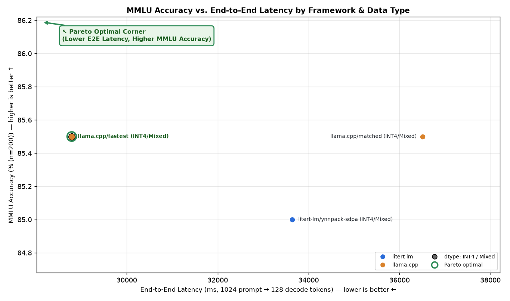
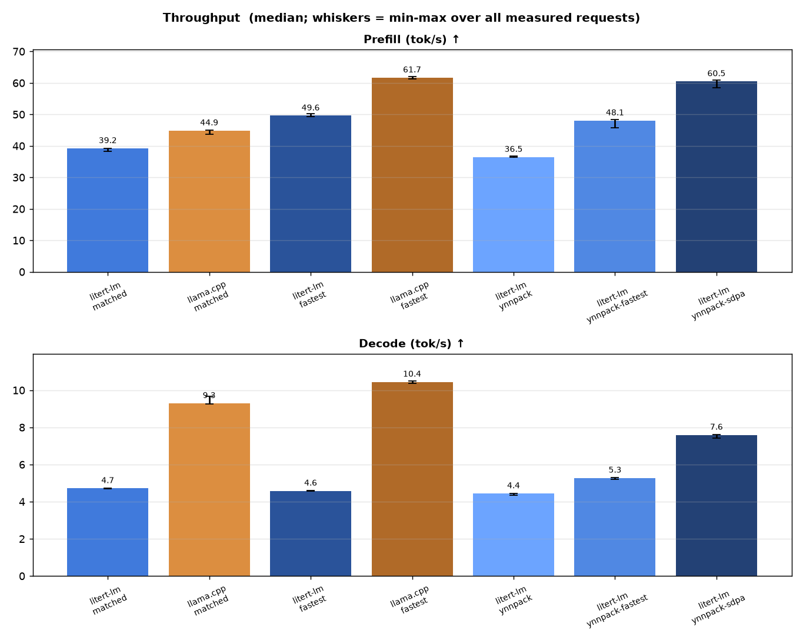
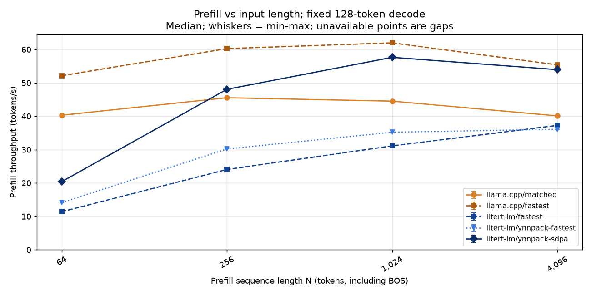
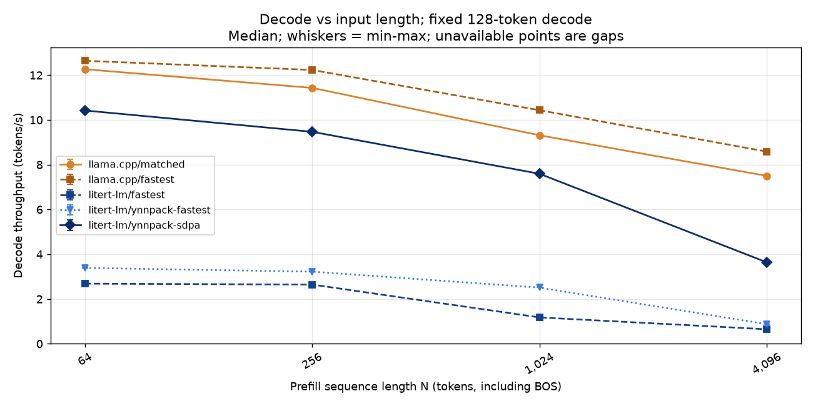
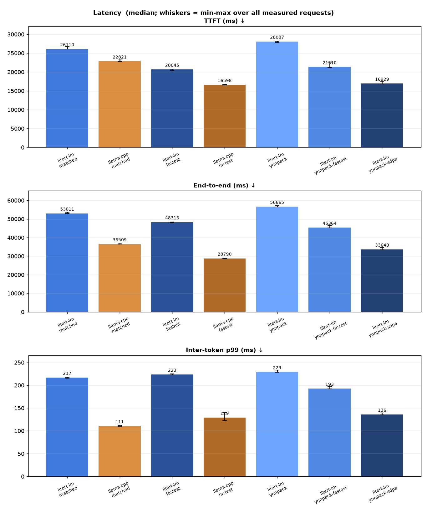
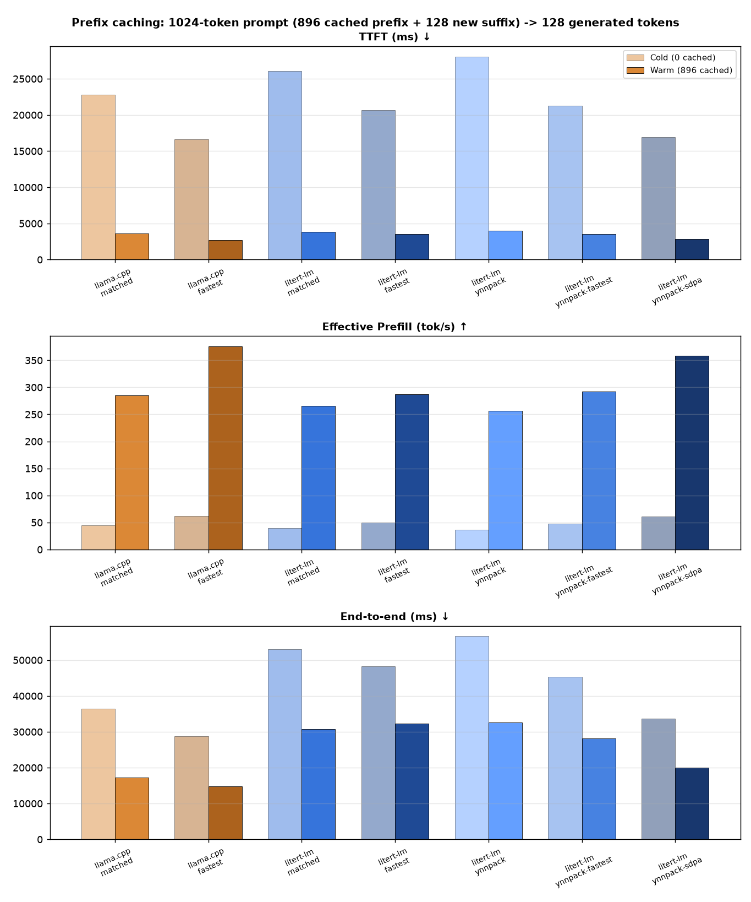
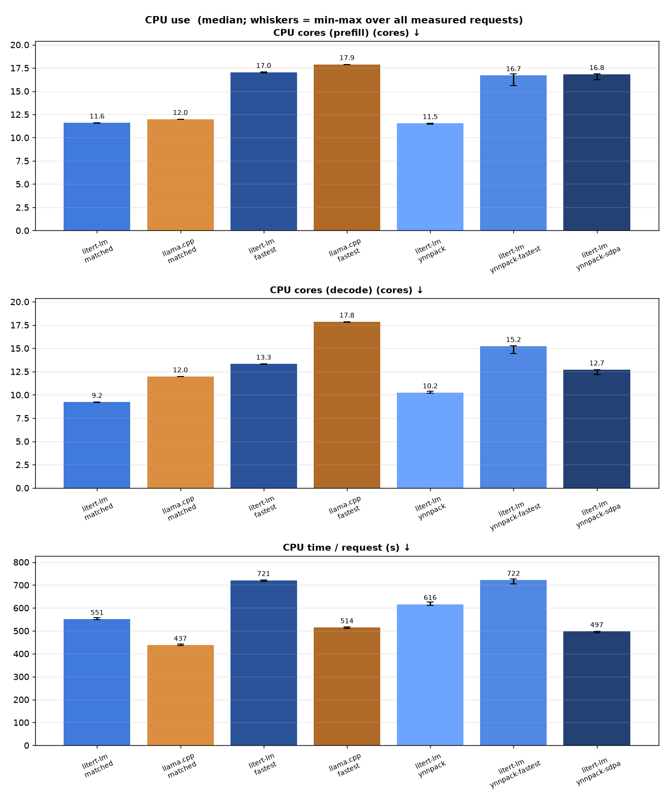
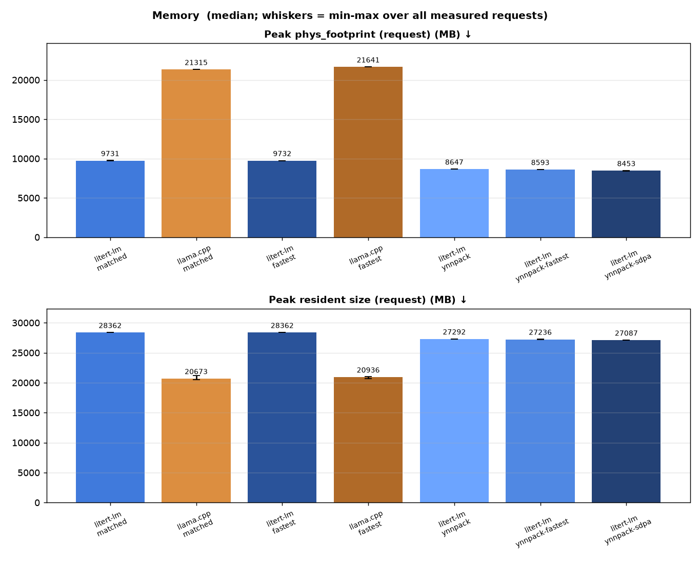
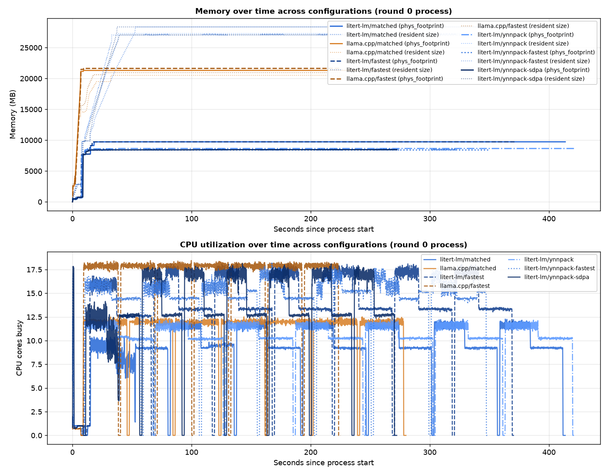
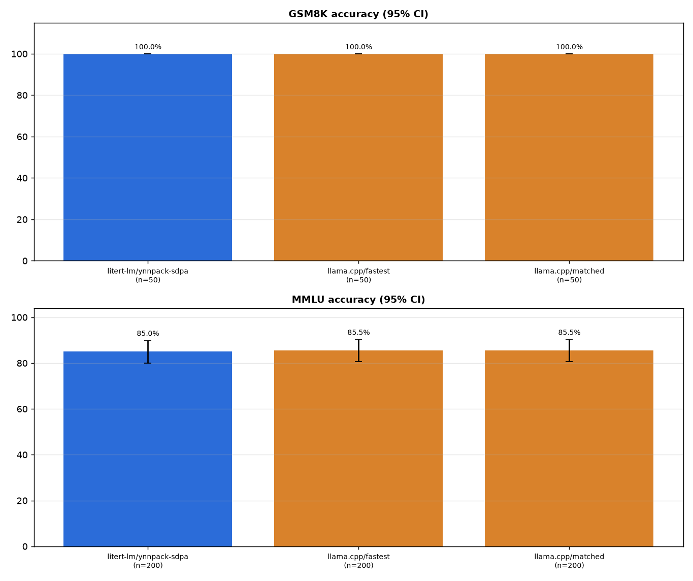

# gemma4-31b-cpu-apple-m5-max on apple-m5-max — 2026-11-26

> Generated by `python3 -m aeb.report` from 21 headline benchmark processes plus 20 input-length sweep processes and 21 prefix-cache processes. Raw per-request data: [data.json](data.json). Methodology: [benchmark_methodology.md](../../docs/benchmark_methodology.md).

Gemma 4 31B (dense 60-layer, 50 sliding-window + 10 global attention layers) on Apple M5 Max CPU (18 physical cores: 6 Super + 12 Performance, 36 GB unified memory), run natively on macOS ARM64 across LiteRT-LM (XNNPACK, YNNPACK, YNNPACK-SDPA) and llama.cpp (CPU-only with KleidiAI + Accelerate) on the INT4 track.

## Summary

Headline medians (`1024` prompt → `128` generated tokens, stateless cold KV cache) and accuracy grouped by data type. Within each data type, rows are ordered from fastest to slowest end-to-end latency, with the best-performing row highlighted (**🏆**) and best per-column metrics bolded. The highlighted row is the lowest measured latency, not a claim of statistically significant superiority.



| Framework / Config | Checkpoint | Weights / Acts / KV | Threads | TTFT (ms) ↓ | Prefill (tok/s) ↑ | Decode (tok/s) ↑ | E2E (ms) ↓ | Peak RSS (MB) ↓ | MMLU (n=200) ↑ | GSM8K (n=50) ↑ |
| --- | --- | --- | ---: | ---: | ---: | ---: | ---: | ---: | ---: | ---: |
| **INT4 / Mixed Track** | | | | | | | | | | |
| 🏆 **`llama.cpp/fastest`** | **`it (GGUF)`** | **`q4_0 / q8_0 / fp16`** | **18** | **16,598** | **61.7** | **10.45** | **28,790** | 20,936 | **85.50%** | **100.00%** |
| `litert-lm/ynnpack-sdpa` | `qat-q4_0` | `int4_int8 / fp32 / fp32` | 18 | 16,929 | 60.5 | 7.60 | 33,640 | 27,087 | 85.00% | **100.00%** |
| `llama.cpp/matched` | `qat-q4_0` | `q4_0 / q8_0 / fp16` | 12 | 22,821 | 44.9 | 9.29 | 36,509 | **20,673** | **85.50%** | **100.00%** |
| `litert-lm/ynnpack-fastest` | `qat-q4_0` | `int4_int8 / fp32 / fp32` | 18 | 21,310 | 48.1 | 5.28 | 45,364 | 27,236 | — | — |
| `litert-lm/fastest` | `qat-q4_0` | `int4_int8 / fp32 / fp32` | 18 | 20,645 | 49.6 | 4.58 | 48,316 | 28,362 | — | — |
| `litert-lm/matched` | `qat-q4_0` | `int4_int8 / fp32 / fp32` | 12 | 26,110 | 39.2 | 4.72 | 53,011 | 28,362 | — | — |
| `litert-lm/ynnpack` | `qat-q4_0` | `int4_int8 / fp32 / fp32` | 12 | 28,087 | 36.5 | 4.44 | 56,665 | 27,292 | — | — |

**Legend:**

- **`matched`**: Same pre-quantized integer weights, prompt tokens, decoding and thread counts, with the closest supported KV-cache precision. See Quantization equivalence for representation and activation differences.

- **`fastest`**: Empirically selected configuration from the suite's thread and kernel sweep; read performance together with the accuracy gate.

- **`reference`**: Published framework-specific artifacts and defaults; weights and quantization are not matched. Read speed together with accuracy.

- **Memory**: Native macOS runs report `Peak RSS (MB)` (process resident size) in the summary table and both `phys_footprint` (private physical memory) and resident size in the detailed metrics and memory charts.

## Results

### Throughput



#### Input-length throughput sweep

Sweep measurement dates (UTC): 2026-11-25, 2026-11-26.

Fixed **128 generated tokens**, greedy with stop tokens ignored; common context capacity **8,192**. Model artifacts and thread counts are unchanged from the configurations above. These are reference configurations, not matched weights. The original headline workload remains unchanged.

Swept configurations are the empirically fastest configuration for each `(framework, dtype)` pair that cleared the minimum accuracy gate (gsm8k ≥ 40%, mmlu ≥ 40%).

Each point uses 1 interleaved processes per configuration, 1 warm-ups and 1 measured requests per process. Long inputs repeat the same public-domain passage deterministically. N includes BOS and chat-template tokens. Each request starts with an empty KV cache.

Prefill tokens/s = N / time to first token (includes tokenization and first-token generation). Decode tokens/s = 127 / time from the first to the last generated token. Rates are medians; brackets show min-max. Failed, truncated or wrong-length processes are excluded, never replaced by estimated rates.

##### Prefill (tokens/s)

| N | `llama.cpp/matched` | `llama.cpp/fastest` | `litert-lm/fastest` | `litert-lm/ynnpack-fastest` | `litert-lm/ynnpack-sdpa` |
| --- | --- | --- | --- | --- | --- |
| 64 | 40.30 [40.30-40.30] | 52.14 [52.14-52.14] | 11.40 [11.40-11.40] | 14.14 [14.14-14.14] | 20.41 [20.41-20.41] |
| 256 | 45.54 [45.54-45.54] | 60.25 [60.25-60.25] | 24.05 [24.05-24.05] | 30.20 [30.20-30.20] | 48.06 [48.06-48.06] |
| 1,024 | 44.52 [44.52-44.52] | 61.97 [61.97-61.97] | 31.11 [31.11-31.11] | 35.20 [35.20-35.20] | 57.63 [57.63-57.63] |
| 4,096 | 40.10 [40.10-40.10] | 55.38 [55.38-55.38] | 37.25 [37.25-37.25] | 36.09 [36.09-36.09] | 53.95 [53.95-53.95] |



##### Decode (tokens/s)

| N | `llama.cpp/matched` | `llama.cpp/fastest` | `litert-lm/fastest` | `litert-lm/ynnpack-fastest` | `litert-lm/ynnpack-sdpa` |
| --- | --- | --- | --- | --- | --- |
| 64 | 12.27 [12.27-12.27] | 12.64 [12.64-12.64] | 2.69 [2.69-2.69] | 3.39 [3.39-3.39] | 10.42 [10.42-10.42] |
| 256 | 11.43 [11.43-11.43] | 12.23 [12.23-12.23] | 2.64 [2.64-2.64] | 3.22 [3.22-3.22] | 9.47 [9.47-9.47] |
| 1,024 | 9.32 [9.32-9.32] | 10.43 [10.43-10.43] | 1.18 [1.18-1.18] | 2.51 [2.51-2.51] | 7.60 [7.60-7.60] |
| 4,096 | 7.50 [7.50-7.50] | 8.59 [8.59-8.59] | 0.65 [0.65-0.65] | 0.88 [0.88-0.88] | 3.64 [3.64-3.64] |




### Latency



### Prefix caching (warm vs. cold KV cache)

Measures multi-turn / shared-system-prompt inference where **896 prefix tokens** of a **1,024-token prompt** are already present in the KV cache, and each request appends a distinct **128-token suffix** before generating **128 tokens** (greedy, stop tokens ignored). The headline suite above remains strictly stateless (fresh KV cache per request).

- **Cold TTFT / Cold prefill tok/s**: full 1,024-token prompt evaluated from an empty KV cache.
- **Warm TTFT**: latency to first generated token when reusing the 896-token prefix KV cache and prefilling only the 128-token suffix.
- **Effective prefill tok/s**: `1024 / warm_ttft_s` (effective prompt processing rate seen by the caller).
- **Incremental suffix tok/s**: `128 / warm_ttft_s` (actual compute throughput on the 128 uncached suffix tokens at KV position 896..1024).

| Config | Cold TTFT (ms) ↓ | Warm TTFT (ms) ↓ | TTFT speedup ↑ | Cold prefill (tok/s) ↑ | Warm effective prefill (tok/s) ↑ | Warm suffix prefill (tok/s) ↑ | Cold E2E (ms) ↓ | Warm E2E (ms) ↓ | E2E speedup ↑ |
| --- | --- | --- | --- | --- | --- | --- | --- | --- | --- |
| `llama.cpp/matched` | 22821 [22764–23440] | 3587 [3568–3599] | **6.36×** [6.35, 6.43] | 44.9 [43.7–45.0] | 285.5 [284.6–287.0] | 35.7 [35.6–35.9] | 36509 [36411–36992] | 17269 [17222–17315] | **2.11×** [2.11, 2.12] |
| `llama.cpp/fastest` | 16598 [16532–16713] | 2725 [2713–2748] | **6.09×** [6.07, 6.11] | 61.7 [61.3–61.9] | 375.8 [372.6–377.4] | 47.0 [46.6–47.2] | 28790 [28641–28902] | 14848 [14775–14999] | **1.94×** [1.93, 1.94] |
| `litert-lm/matched` | 26110 [26056–26711] | 3848 [3830–3879] | **6.79×** [6.74, 6.81] | 39.2 [38.3–39.3] | 266.1 [264.0–267.4] | 33.3 [33.0–33.4] | 53011 [52958–53628] | 30784 [30754–30809] | **1.72×** [1.72, 1.72] |
| `litert-lm/fastest` | 20645 [20391–20727] | 3562 [3458–3593] | **5.80×** [5.77, 5.91] | 49.6 [49.4–50.2] | 287.5 [285.0–296.1] | 35.9 [35.6–37.0] | 48316 [48093–48451] | 32272 [32006–32356] | **1.50×** [1.49, 1.50] |
| `litert-lm/ynnpack` | 28087 [27813–28172] | 3998 [3799–4021] | **7.03×** [7.00, 7.38] | 36.5 [36.3–36.8] | 256.1 [254.7–269.5] | 32.0 [31.8–33.7] | 56665 [56413–57154] | 32584 [28481–32780] | **1.74×** [1.74, 1.99] |
| `litert-lm/ynnpack-fastest` | 21310 [21168–22411] | 3503 [3418–3571] | **6.08×** [6.02, 6.16] | 48.1 [45.7–48.4] | 292.3 [286.8–299.6] | 36.5 [35.8–37.4] | 45364 [45179–46633] | 28157 [27853–28245] | **1.61×** [1.61, 1.63] |
| `litert-lm/ynnpack-sdpa` | 16929 [16794–17530] | 2853 [2794–2889] | **5.93×** [5.88, 6.00] | 60.5 [58.4–61.0] | 358.9 [354.5–366.5] | 44.9 [44.3–45.8] | 33640 [33518–34619] | 19997 [19933–20086] | **1.68×** [1.68, 1.69] |




### CPU



### Memory



### Memory and CPU over time

Combined timelines (one round-0 process per configuration: model load, warm-up and measured requests) showing process `phys_footprint` (private physical memory), resident size (dotted, includes clean mmap'd pages), and active CPU cores.



### Detailed metrics

Medians over all measured requests (n per cell in the last row); [min – max] in brackets.

| Metric | `litert-lm/matched` | `llama.cpp/matched` | `litert-lm/fastest` | `llama.cpp/fastest` | `litert-lm/ynnpack` | `litert-lm/ynnpack-fastest` | `litert-lm/ynnpack-sdpa` |
| --- | --- | --- | --- | --- | --- | --- | --- |
| TTFT (ms) ↓ | 26110 [26056–26711] | 22821 [22764–23440] | 20645 [20391–20727] | 16598 [16532–16713] | 28087 [27813–28172] | 21310 [21168–22411] | 16929 [16794–17530] |
| Prefill (tok/s) ↑ | 39.2 [38.3–39.3] | 44.9 [43.7–45.0] | 49.6 [49.4–50.2] | 61.7 [61.3–61.9] | 36.5 [36.3–36.8] | 48.1 [45.7–48.4] | 60.5 [58.4–61.0] |
| Decode (tok/s) ↑ | 4.72 [4.71–4.73] | 9.29 [9.25–9.69] | 4.58 [4.58–4.59] | 10.45 [10.36–10.49] | 4.44 [4.36–4.45] | 5.28 [5.19–5.29] | 7.60 [7.43–7.60] |
| End-to-end (ms) ↓ | 53011 [52958–53628] | 36509 [36411–36992] | 48316 [48093–48451] | 28790 [28641–28902] | 56665 [56413–57154] | 45364 [45179–46633] | 33640 [33518–34619] |
| Inter-token p99 (ms) ↓ | 216.7 [215.1–217.6] | 110.6 [109.4–112.2] | 223.5 [222.8–224.8] | 128.8 [122.7–140.0] | 229.1 [228.3–233.0] | 192.6 [191.8–197.8] | 135.9 [135.4–139.1] |
| CPU cores (prefill) (cores) ↓ | 11.59 [11.56–11.61] | 11.98 [11.98–11.99] | 17.04 [16.99–17.08] | 17.88 [17.87–17.89] | 11.53 [11.43–11.57] | 16.69 [15.62–16.87] | 16.82 [16.21–16.89] |
| CPU cores (decode) (cores) ↓ | 9.21 [9.20–9.22] | 11.95 [11.95–11.96] | 13.31 [13.29–13.33] | 17.83 [17.81–17.85] | 10.24 [10.20–10.38] | 15.21 [14.45–15.28] | 12.69 [12.20–12.71] |
| CPU time / request (s) ↓ | 550.7 [549.4–557.9] | 437.3 [436.1–443.0] | 720.7 [716.6–722.6] | 514.4 [511.8–516.4] | 616.5 [610.7–626.7] | 721.9 [706.2–725.6] | 497.1 [492.3–498.2] |
| CPU energy / request (J) ↓ | 1916.0 [1911.4–1929.4] | 2097.5 [2055.1–2106.7] | 2088.0 [2082.7–2120.3] | 2087.6 [2068.9–2104.8] | 2267.1 [2262.6–2370.5] | 2295.7 [2258.9–2300.6] | 1845.5 [1839.8–1865.3] |
| Peak phys_footprint (request) (MB) ↓ | 9731 [9724–9763] | 21315 [21315–21316] | 9732 [9731–9733] | 21641 [21641–21641] | 8647 [8641–8649] | 8593 [8589–8600] | 8453 [8437–8461] |
| Peak resident size (request) (MB) ↓ | 28362 [28352–28391] | 20673 [20519–21198] | 28362 [28359–28363] | 20936 [20691–21023] | 27292 [27279–27292] | 27236 [27231–27244] | 27087 [27076–27096] |
| Model load, warm cache (ms) | 10641 | 6863 | 9947 | 7086 | 7859 | 8061 | 8802 |
| Peak phys_footprint, process lifetime (MB) | 9731 | 21316 | 9732 | 21641 | 8647 | 8602 | 8460 |
| phys_footprint after load, before 1st request (MB) | 7726 | 21150 | 7729 | 21475 | 7690 | 7692 | 7715 |
| Resident size after load, before 1st request (MB) | 9844 | 14607 | 9845 | 15631 | 9824 | 9824 | 9843 |
| Measured requests (n) | 15 | 15 | 15 | 15 | 15 | 15 | 15 |
| Decode CV across requests | 0.1% | 1.1% | 0.1% | 0.4% | 0.6% | 0.6% | 0.9% |

#### llama.cpp ÷ LiteRT-LM

Ratio of medians with a 95% bootstrap interval over requests. >1 means llama.cpp has the larger value (better for throughput, worse for latency/CPU/memory).

| Track | Prefill tok/s | Decode tok/s | TTFT | End-to-end | CPU s / request | Peak RSS |
| --- | --- | --- | --- | --- | --- | --- |
| matched | 1.14× [1.13, 1.15] | 1.97× [1.96, 1.97] | 0.87× [0.87, 0.88] | 0.69× [0.69, 0.69] | 0.79× [0.79, 0.80] | 0.73× [0.72, 0.75] |
| fastest | 1.24× [1.24, 1.25] | 2.28× [2.27, 2.29] | 0.80× [0.80, 0.81] | 0.60× [0.59, 0.60] | 0.71× [0.71, 0.72] | 0.74× [0.73, 0.74] |

### Generated text on the timing prompt

Greedy decoding should be deterministic within a configuration. Different configurations may legitimately diverge (different activation/KV quantization and kernels change near-tie logits); the accuracy gate below is the validity check.

| Config | Identical across all measured requests | First 140 characters |
| --- | --- | --- |
| `litert-lm/matched` | no (15 variants) | <\|channel>thought ⏎ <channel\|>“—she’ll think me!” continued Alice, “for I can’t possibly remember the name of the Antipathies with any certain |
| `llama.cpp/matched` | yes | <\|channel>thought ⏎ <channel\|>“—and what an ignorant little girl she’ll seem to be,” Alice continued, “to ask if they live in New Zealand!” (S |
| `litert-lm/fastest` | no (15 variants) | <\|channel>thought ⏎ <channel\|>“—she’ll think me!” Alice continued, “for I can’t possibly remember the name of the Antipathies—or is it the Ant |
| `llama.cpp/fastest` | yes | <\|channel>thought ⏎ <channel\|>“—and what an ignorant little girl she’ll seem to be,” Alice continued, “to ask if they live in New Zealand!” (S |
| `litert-lm/ynnpack` | yes | <\|channel>thought ⏎ <channel\|>“—she’ll think me,” continued Alice, “if I don’t know my geography!” ⏎  ⏎ She had just finished saying this, and was |
| `litert-lm/ynnpack-fastest` | yes | <\|channel>thought ⏎ <channel\|>“—she’ll think me,” continued Alice, “if I don’t know my geography!” ⏎  ⏎ She had just finished saying this, and was |
| `litert-lm/ynnpack-sdpa` | yes | <\|channel>thought ⏎ <channel\|>“—she’ll think me!” continued Alice, “for I can’t possibly remember the name of the Queen of England!” (Now, thi |

## Accuracy (validity gate)

Same prompts, greedy decoding, through the same in-process drivers as the timing runs. Use these to confirm each configuration produces correct tokens, and to compare frameworks on identical items; they are not leaderboard numbers.

| Config | Task | Items | Accuracy | 95% CI | Macro (MMLU) | Parse failures | Mean generated tokens | Hit token limit |
| --- | --- | --- | --- | --- | --- | --- | --- | --- |
| `litert-lm/ynnpack-sdpa` | mmlu | 200 (stratified subset) | 85.00% | ±4.95% | 84.94% | 10 | 4.1 | n/a (letter only) |
| `llama.cpp/fastest` | mmlu | 200 (stratified subset) | 85.50% | ±4.88% | 85.53% | 13 | 3.5 | n/a (letter only) |
| `llama.cpp/matched` | mmlu | 200 (stratified subset) | 85.50% | ±4.88% | 85.53% | 13 | 3.5 | n/a (letter only) |
| `litert-lm/ynnpack-sdpa` | gsm8k | 50 (evenly spaced subset) | 100.00% | ±0.00% | n/a | 0 | 279.2 | 0 (cap 512) |
| `llama.cpp/fastest` | gsm8k | 50 (evenly spaced subset) | 100.00% | ±0.00% | n/a | 0 | 278.2 | 0 (cap 512) |
| `llama.cpp/matched` | gsm8k | 50 (evenly spaced subset) | 100.00% | ±0.00% | n/a | 0 | 276.7 | 0 (cap 512) |

**Paired comparison on identical items.** Same prediction = both configs chose the same answer; McNemar's exact test on items only one config got right (p < 0.05 means a real accuracy difference).

| Task | A | B | Items | Same prediction | Acc A | Acc B | Only A right | Only B right | McNemar p |
| --- | --- | --- | --- | --- | --- | --- | --- | --- | --- |
| mmlu | `llama.cpp/fastest` | `llama.cpp/matched` | 200 | 99.5% | 85.50% | 85.50% | 0 | 0 | 1 |
| gsm8k | `llama.cpp/fastest` | `llama.cpp/matched` | 50 | 100.0% | 100.00% | 100.00% | 0 | 0 | 1 |



### Publicly reported accuracy

Google's Gemma 4 model card and technical report (arXiv 2607.02770, Table 5) report static benchmarks for Gemma 4 31B in thinking mode on bf16 weights; original 5-shot MMLU and GSM8K are not reported. The QAT model cards (google/gemma-4-31B-it-qat-q4_0-unquantized, google/gemma-4-31B-it-qat-q4_0-gguf) state that QAT preserves quality similar to bf16. None of the published setups matches this harness (zero-shot, non-thinking, greedy, answer-prefilled MMLU), so use these figures as an order-of-magnitude sanity check rather than a pass/fail threshold; the frameworks are judged against each other on identical items.

| Benchmark | Published | Model variant | Setup | Source | Measured here (non-thinking, greedy) |
| --- | --- | --- | --- | --- | --- |
| MMLU-Pro | 85.2% | gemma-4-31B-it, bf16 | thinking mode (Google) | [Gemma 4 model card / tech report Table 5](https://huggingface.co/google/gemma-4-31B-it) | — |
| MMLU-Pro (Gemma 3 27B-it baseline) | 67.6% | gemma-3-27b-it, bf16 | non-thinking mode (Google) | [Gemma 4 model card / tech report Table 5](https://huggingface.co/google/gemma-4-31B-it) | — |
| MMMLU | 88.4% | gemma-4-31B-it, bf16 | thinking mode (Google) | [Gemma 4 model card / tech report Table 5](https://huggingface.co/google/gemma-4-31B-it) | — |
| GPQA Diamond | 84.3% | gemma-4-31B-it, bf16 | thinking mode (Google) | [Gemma 4 model card / tech report Table 5](https://huggingface.co/google/gemma-4-31B-it) | — |
| LiveCodeBench v6 | 80.0% | gemma-4-31B-it, bf16 | thinking mode (Google) | [Gemma 4 model card / tech report Table 5](https://huggingface.co/google/gemma-4-31B-it) | — |
| BigBench Extra Hard | 74.4% | gemma-4-31B-it, bf16 | thinking mode (Google) | [Gemma 4 model card / tech report Table 5](https://huggingface.co/google/gemma-4-31B-it) | — |
| AIME 2026 (no tools) | 89.2% | gemma-4-31B-it, bf16 | thinking mode (Google) | [Gemma 4 model card / tech report Table 5](https://huggingface.co/google/gemma-4-31B-it) | — |
| Tau2 (average over 3) | 76.9% | gemma-4-31B-it, bf16 | thinking mode (Google) | [Gemma 4 model card / tech report Table 5](https://huggingface.co/google/gemma-4-31B-it) | — |
| MRCR v2 (8 needle 128k) | 66.4% | gemma-4-31B-it, bf16 | 128k context average (Google) | [Gemma 4 model card / tech report Table 5](https://huggingface.co/google/gemma-4-31B-it) | — |

- Google's Table 5 reports all Gemma 4 31B numbers with thinking mode enabled on bf16 weights; this harness evaluates with thinking disabled (`enable_thinking=False`) for deterministic zero-shot comparison across CPU runtimes.
- Original 5-shot MMLU is not in the Gemma 4 31B model card; MMLU-Pro (10 choices, reasoning-heavy) is 85.2% with thinking on, so zero-shot 4-choice MMLU on non-thinking 31B should comfortably exceed 75% on healthy checkpoints.
- Unlike E2B and E4B, Gemma 4 31B has no Per-Layer Embeddings (`hidden_size_per_layer_input = 0`) and uses uniform 4-bit blockwise quantization (`dynamic_wi4b32_afp32` blockwise-32 in LiteRT-LM, `Q4_0` blockwise-32 in GGUF, `int4-ov` in OpenVINO) rather than mixed 2-bit/4-bit mobile QAT.

## Output reproducibility

Same model file, build, prompt and settings, repeated: 12 prompts × 3 repeats per process, fresh KV cache per request, stop tokens honoured, ≤128 tokens. *Within process* = repeats vs. the first repeat; *across processes* = a second fresh process with the same request sequence; *across threads* = a process with half the threads. Seeded = temperature 1.0, top-k 64, top-p 0.95, fixed seed; the *seed control* reruns with seed+1 and must change outputs, otherwise seeded reproducibility would be vacuous. Method: [benchmark_methodology.md](../../docs/benchmark_methodology.md#output-reproducibility).

| Config | Mode | Verdict | Within process | Across processes | Across threads | Seed control |
| --- | --- | --- | --- | --- | --- | --- |
| `litert-lm/matched` | greedy | **not reproducible** | 30/36 identical; first divergence at token 30 (median) | 13/24 identical; first divergence at token 28 (median) | 13/24 identical; first divergence at token 25 (median) (12→6 threads) | — |
| `litert-lm/matched` | seeded | **not reproducible** | 13/24 identical; first divergence at token 25 (median) | 11/24 identical; first divergence at token 35 (median) | n/a | 20/24 outputs changed |
| `llama.cpp/matched` | greedy | **reproducible per request** | 36/36 identical | 24/24 identical | 24/24 identical (12→6 threads) | — |
| `llama.cpp/matched` | seeded | **reproducible per request** | 24/24 identical | 24/24 identical | n/a | 18/24 outputs changed |
| `litert-lm/fastest` | greedy | **not reproducible** | 17/36 identical; first divergence at token 28 (median) | 10/24 identical; first divergence at token 25 (median) | 14/24 identical; first divergence at token 28 (median) (18→9 threads) | — |
| `litert-lm/fastest` | seeded | **not reproducible** | 8/24 identical; first divergence at token 18 (median) | 8/24 identical; first divergence at token 22 (median) | n/a | 20/24 outputs changed |
| `llama.cpp/fastest` | greedy | **reproducible per request** | 36/36 identical | 24/24 identical | 24/24 identical (18→9 threads) | — |
| `llama.cpp/fastest` | seeded | **reproducible per request** | 24/24 identical | 24/24 identical | n/a | 20/24 outputs changed |
| `litert-lm/ynnpack` | greedy | **reproducible per request** | 36/36 identical | 24/24 identical | 24/24 identical (12→6 threads) | — |
| `litert-lm/ynnpack` | seeded | **reproducible per request** | 24/24 identical | 24/24 identical | n/a | 20/24 outputs changed |
| `litert-lm/ynnpack-fastest` | greedy | **reproducible per request** | 36/36 identical | 24/24 identical | 24/24 identical (18→9 threads) | — |
| `litert-lm/ynnpack-fastest` | seeded | **reproducible per request** | 24/24 identical | 24/24 identical | n/a | 20/24 outputs changed |
| `litert-lm/ynnpack-sdpa` | greedy | **reproducible per request** | 36/36 identical | 24/24 identical | 24/24 identical (18→9 threads) | — |
| `litert-lm/ynnpack-sdpa` | seeded | **reproducible per request** | 24/24 identical | 24/24 identical | n/a | 20/24 outputs changed |

Cross-framework (informational, greedy): `llama.cpp/matched` and `litert-lm/matched` produce identical text for 8/24 prompt-repeats, median first divergence at token 13. Identical weights do not imply identical outputs when activation/KV quantization and kernels differ.

## Key findings & methodology notes (Gemma 4 31B on Apple M5 Max CPU — INT4)

1. **Headline & Memory Scope (36 GB Unified Memory, Native macOS ARM64 CPU).**
   - Only **INT4** artifacts fit comfortably inside the Apple M5 Max's **36 GB LPDDR5X Unified Memory** without swapping (`BF16` weights are `60.4 GB`, and `Q8_0` weights are `~33 GB` before KV cache and activations).
   - Across the 7 evaluated INT4 configurations (`1024 → 128`, stateless cold KV cache, `ctx = 4096`, `n = 15` pooled across 3 interleaved rounds):
     - **`llama.cpp/fastest`** (`18T`, `ggml-org` `Q4_0`, `GGML_KLEIDIAI_SME=0`, `--flash-attn on --no-mmap --batch 2048 --ubatch 512`) achieves the lowest end-to-end latency (**`28.79 s`**), fastest prefill (**`61.7 tok/s`**, `16,598 ms` TTFT), and fastest decode (**`10.45 tok/s`**, saturating `17.83 / 18` CPU cores) at **`20,936 MB`** peak RSS.
     - **`litert-lm/ynnpack-sdpa`** (`18T`, blockwise-32 `dynamic_wi4b32_afp32`, fused `odml.sdpa_transposed`) ranks second overall (**`33.64 s`** E2E — faster than `llama.cpp/matched`'s `36.51 s`), matching `llama.cpp/fastest` within **2.0%** on prefill (**`60.5 tok/s`**, `16,929 ms` TTFT), reaching **`7.60 tok/s`** decode (`12.69 / 18` active cores), and recording the **lowest CPU energy per request across all 7 configs (`1,845.5 J`, `-11.6%` vs. `llama.cpp/fastest`'s `2,087.6 J`)** at **`27,087 MB`** peak RSS (`8,453 MB` private `phys_footprint`).
     - **`llama.cpp/matched`** (`12T`, Google QAT `Q4_0`, `GGML_KLEIDIAI_SME=0`, `--no-mmap`) achieves the **lowest peak RSS (`20,673 MB`)** with `44.9 tok/s` prefill, `9.29 tok/s` decode, and `36.51 s` E2E.

2. **`odml.sdpa_transposed` Speedup in LiteRT-LM (vs. XNNPACK & Decomposed YNNPACK).**
   - On the headline `1024 → 128` (`ctx = 4096`) workload at 18 threads:
     - vs. pure XNNPACK (`litert-lm/fastest`: `49.6 tok/s` pp, `4.58 tok/s` tg, `48.32 s` E2E, `28,362 MB` RSS, `2,088.0 J`): `litert-lm/ynnpack-sdpa` delivers **+65.9% decode**, **+22.0% prefill**, **-30.4% E2E latency**, **-1,275 MB peak RSS**, and **-11.6% CPU energy**.
     - vs. decomposed YNNPACK (`litert-lm/ynnpack-fastest`: `48.1 tok/s` pp, `5.28 tok/s` tg, `45.36 s` E2E, `27,236 MB` RSS, `2,295.7 J`): `litert-lm/ynnpack-sdpa` delivers **+43.9% decode**, **+25.8% prefill**, **-25.8% E2E latency**, and **-19.6% CPU energy**.
   - On the `ctx = 8192` input-length sweep (`64 / 256 / 1024 / 4096 → 128`), dynamic KV slicing via `odml.sdpa_transposed` accelerates decode by **3.03×–4.14×** over decomposed `litert-lm/ynnpack-fastest` (**`10.42 / 9.47 / 7.60 / 3.64 tok/s`** vs. `3.39 / 3.22 / 2.51 / 0.88 tok/s`) and **3.59×–6.44×** over XNNPACK `litert-lm/fastest` (`2.69 / 2.64 / 1.18 / 0.65 tok/s`). At `N = 4096`, `litert-lm/ynnpack-sdpa` reduces E2E latency from `305.8 s` (XNNPACK) and `258.2 s` (decomposed YNNPACK) to **`110.8 s`** (**2.76×** / **2.33×** faster), with `53.95 tok/s` prefill closely tracking `llama.cpp/fastest` (`55.38 tok/s`).
   - `llama.cpp/fastest` retains higher decode speed at long context (`12.64 → 8.59 tok/s`, `-32%` from `N = 64` to `4096`, vs. `-65%` for `litert-lm/ynnpack-sdpa`'s `10.42 → 3.64 tok/s`) due to its `fp16` KV cache (half the memory traffic of LiteRT-LM's `fp32` KV cache) and higher decode core utilization (`17.84` vs. `15.22` cores at `N = 4096`, `17.83` vs. `12.69` at `N = 1024`).

3. **Prefix Caching (`896` cached prefix + `128` suffix → `128` gen, `ctx = 4096`).**
   - Warm prefix reuse yields **`5.80×–7.03×` TTFT speedup** and **`1.50×–2.11×` E2E speedup** across all 7 configs:
     - `llama.cpp/fastest`: `16,598 ms → 2,725 ms` TTFT (**`6.09×`**, `375.8 tok/s` effective prefill), `28.79 s → 14.85 s` E2E (**`1.94×`**).
     - `litert-lm/ynnpack-sdpa`: `16,929 ms → 2,853 ms` TTFT (**`5.93×`**, `358.9 tok/s` effective prefill), `33.64 s → 20.00 s` E2E (**`1.68×`**).

4. **`llama.cpp` Memory Behavior on 36 GB Apple M5 Max (`GGML_KLEIDIAI_SME=0` + `--no-mmap`).**
   - `llama.cpp` `b12469` (`e0a9118fe9ed`) was compiled CPU-only with `-DGGML_METAL=OFF -DGGML_NATIVE=ON -DGGML_CPU_KLEIDIAI=ON -DBUILD_SHARED_LIBS=ON`.
   - With default KleidiAI SME2 weight packing (`GGML_KLEIDIAI_SME=1`), repacking the `~16 GiB` `Q4_0` model expands private `phys_footprint` to **`~36.0 GiB`**, exhausting the 36 GB Unified Memory host (`~15.7 GiB` swap usage) and collapsing decode to `2.0–2.8 tok/s`.
   - With default `mmap` enabled under `GGML_KLEIDIAI_SME=0`, macOS keeps both the `~16 GB` file-backed GGUF mapping and the `~16–20 GB` anonymous KleidiAI-repacked copy resident simultaneously (`~30.9 GB` RSS), causing memory-pressure jitter (`2.3–6.5 tok/s` decode, `~53 tok/s` prefill).
   - Combining **`GGML_KLEIDIAI_SME=0`** (KleidiAI NEON/`i8mm` + Accelerate) with **`--no-mmap`** reads weights directly into repacked CPU buffers without retaining the file mapping, holding `phys_footprint` to `21.3–21.6 GB` (`20.7–20.9 GB` RSS, zero swap) and unlocking **`61.7 tok/s` prefill / `10.45 tok/s` decode**.
   - This aligns with our companion Level 1 Apple M5 Max microkernel study ([`kernel_report_gemma4_31b_apple_m5_max.md`](../../../kernel/reports/2026-11-25-gemma4-31b-apple-m5-max/kernel_report_gemma4_31b_apple_m5_max.md)), where per-core 18-thread NEON (`DotProd`/`I8MM`) saturates **`99.3%–100.0%` of the `301.1 GB/s` LPDDR5X Unified Memory read ceiling** on cold `M = 1` 4-bit GEMV (outperforming KleidiAI SME2's `246.0–253.5 GB/s`, and beating SME2 by `1.89×` on warm L2).

5. **Output Reproducibility — Upstream XNNPACK `pf32` SME2 Non-Determinism ([`google/XNNPACK#11789`](https://github.com/google/XNNPACK/issues/11789)) vs. YNNPACK & `llama.cpp` Determinism.**
   - All five **`llama.cpp` and YNNPACK** configurations (`llama.cpp/matched`, `llama.cpp/fastest`, `litert-lm/ynnpack`, `litert-lm/ynnpack-fastest`, `litert-lm/ynnpack-sdpa`) are **100% bit-exact reproducible**: `36/36` identical within-process greedy, `24/24` across processes, `24/24` across thread counts (`12→6` and `18→9`), `24/24` seeded (`18–20/24` changed on `seed+1` control), and `15/15` identical outputs on the headline timing prompt.
   - Both pure-**XNNPACK** configurations (`litert-lm/matched` at 12T and `litert-lm/fastest` at 18T) are **non-deterministic** on Apple M5 Max, producing **15 distinct text variants across the 15 greedy headline requests**. In `aeb.repro`:
     - `litert-lm/matched` (`12T`): `30/36` within-process greedy (`8/12` p0 and `10/12` p1 at `12T`; `12/12` self-consistent at `6T`, though `6T` still diverged from `12T` on `6/12` prompts), `13/24` across processes, `13/24` seeded.
     - `litert-lm/fastest` (`18T`): `17/36` within-process greedy (`5/12` p0 and `6/12` p1 at `18T`, `6/12` p2 at `9T`), `10/24` across processes, `8/24` seeded.
   - **Confirmed upstream root cause ([`google/XNNPACK#11789`](https://github.com/google/XNNPACK/issues/11789) / [`google-ai-edge/LiteRT-LM#4145`](https://github.com/google-ai-edge/LiteRT-LM/issues/4145)):** XNNPACK's KleidiAI `pf32` SME2 GEMM microkernel (`kai_matmul_clamp_f32_f32p4vsx1_f32p4vsx1bf32_8vsx8vs_sme2_mopa`, wrapped by `xnn_pf32_gemm_minmax_ukernel_32x32__neonsme2`, introduced in XNNPACK PR `#10992` / commit `70a9c5e8ac`) changes its floating-point `K`-reduction tree on bottom-edge rows (`M <= 16` / `M % 32` in `1..16` for `SVL = 64 B`, `acc_vl = 16`) depending on the `N` tile width: `4vsx16vs_sme2_mopa` (**1-way sequential** FP32 `K`-sum for `N > 48`) vs. `4vsx8vs_sme2_mopa` (**2-way split** FP32 `K`-sum for `17 <= N <= 48`). Because `pthreadpool` schedules FP32 `BatchMatMul` via dynamic work stealing (`xnn_parallelization_type_3d_tile_2d_dynamic`), adjacent `nr = 32` column tiles are coalesced into varying chunk widths (`32` vs. `64` vs. `96` columns) depending on thread timing across runs, altering FP32 rounding order and flipping near-tie greedy argmax tokens. (This is not a hard `> 6` thread cutoff in code — upstream reproduces it at 2–4 threads depending on `(M, K, N)` — but `6T` stays inside the 6 homogeneous Super cores with larger, more uniform `N` chunks, whereas `9T / 12T / 18T` subdivides `N` closer to the `32` vs. `64+` boundary and adds Super/Performance timing skew.)
   - **Why `--ynnpack` and earlier reports were unaffected:** Under `--ynnpack`, only blockwise-32 INT4 `FullyConnected` ops (`qb4w`) fall back to XNNPACK, while FP32 `BatchMatMul` / attention executes on YNNPACK (bypassing XNNPACK's `pf32` SME2 path completely). Similarly, the `2026-10-01` E2B Apple M5 Max report ran inside a Linux Docker VM (no SME2 exposed) on LiteRT-LM `v0.17.1` (prior to PR `#10992`), and Sapphire Rapids is `x86_64` (`24/24` deterministic). Upstream is replacing the KleidiAI `pf32` SME2 GEMM path with native SME ACLE microkernels using a consistent 1-way `K` accumulation across `N` tiles.

6. **Accuracy Gate Equivalence (`MMLU n=200`, `GSM8K n=50`).**
   - All three evaluated configurations clear the accuracy gate with equivalent scores:
     - `llama.cpp/matched` (QAT `Q4_0`): **85.50% ± 4.88%** MMLU (13 parse failures), **100.00%** (`50/50`) GSM8K.
     - `llama.cpp/fastest` (`ggml-org` stock `Q4_0`): **85.50% ± 4.88%** MMLU (13 parse failures, `99.5%` same prediction as `matched`, McNemar `p = 1.0`), **100.00%** (`50/50`) GSM8K.
     - `litert-lm/ynnpack-sdpa` (blockwise-32 `dynamic_wi4b32_afp32`): **85.00% ± 4.95%** MMLU (10 parse failures), **100.00%** (`50/50`) GSM8K.
   - Because Gemma 4 31B has no Per-Layer Embeddings (`hidden_size_per_layer_input = 0`), stock `Q4_0` matches QAT `Q4_0` identically on both MMLU and GSM8K.

## Environment

| Item | Value |
| --- | --- |
| Machine | apple-m5-max — Apple M5 Max (18-core CPU: 6 Super + 12 Performance, 36 GB unified memory), native macOS ARM64 CPU (no container) |
| Host (native, no container) | macOS 27.0.1 (26A434), Darwin 27.0.0; Apple M5 Max: 18 CPU cores (6 + 12), 36 GiB unified memory; power: Now drawing from 'AC Power', low-power mode off |
| litert-lm | `main`, commit `b5391c5ceec4`, built 2026-11-25T09:50:00Z |
| llama.cpp | `b12469`, commit `e0a9118fe9ed`, built 2026-11-25T09:44:05Z |
| Harness | digest `d4f01e44320b`, repo rev `5337ba32f900` |
| Workload | 1024-token real-text chat prompt → 128 greedy tokens (fixed length), context 4096, 2 warm-up + 5 measured requests per process, 3 processes per config interleaved A-B-…/…-B-A |
| Prompt identity | identical token ids in every config (sha256 `ee559b78b98652bf…`) |

## Configurations

| Config | Track | Model file | Driver arguments |
| --- | --- | --- | --- |
| `litert-lm/matched` | matched | `gemma-4-31B-it.litertlm` (sha256 `83ef70911028`) | `--model <model> --threads 12 --ctx 4096 --cache-dir /results/.cache/litert-lm-31b --fixed-decode-tokens 128` |
| `llama.cpp/matched` | matched | `gemma-4-31B_q4_0-it.gguf` (sha256 `179cfb992127`) | `--model <model> --threads 12 --ctx 4096 --no-mmap` |
| `litert-lm/fastest` | fastest | `gemma-4-31B-it.litertlm` (sha256 `83ef70911028`) | `--model <model> --threads 18 --ctx 4096 --cache-dir /results/.cache/litert-lm-31b --fixed-decode-tokens 128` |
| `llama.cpp/fastest` | fastest | `gemma-4-31B-it-Q4_0.gguf` (sha256 `031dc1c5fa9c`) | `--model <model> --threads 18 --ctx 4096 --batch 2048 --ubatch 512 --flash-attn on --no-mmap` |
| `litert-lm/ynnpack` | reference | `gemma-4-31B-it.litertlm` (sha256 `83ef70911028`) | `--model <model> --threads 12 --ctx 4096 --ynnpack --cache-dir /results/.cache/litert-lm-31b --fixed-decode-tokens 128` |
| `litert-lm/ynnpack-fastest` | reference | `gemma-4-31B-it.litertlm` (sha256 `83ef70911028`) | `--model <model> --threads 18 --ctx 4096 --ynnpack --cache-dir /results/.cache/litert-lm-31b --fixed-decode-tokens 128` |
| `litert-lm/ynnpack-sdpa` | reference | `gemma-4-31B-it-sdpa.litertlm` (sha256 `0c1ddfcb62ea`) | `--model <model> --threads 18 --ctx 4096 --ynnpack --cache-dir /results/.cache/litert-lm-31b-ynn-sdpa --fixed-decode-tokens 128` |

## Data-quality checks

- `litert-lm/matched` run `20261125T104328Z-b224fb`: end-to-end outlier request indices [0] (MAD rule) — kept, not discarded.

## Caveats

- **YNNPACK falls back to XNNPACK for blockwise-quantized `FullyConnected` ops (`dynamic_wi4b32_afp32`):** Because `TfLiteYNNPackDelegateOptions::enable_blockwise_quantization` defaults to `false` in LiteRT's YNNPACK delegate (`tflite/delegates/ynnpack/dot.cc`) and is not yet wired through LiteRT's `YnnpackAccelerator`, all blockwise-32 INT4 `FullyConnected` projections in `gemma-4-31B-it.litertlm` and `gemma-4-31B-it-sdpa.litertlm` fall back from YNNPACK to XNNPACK. Thus `litert-lm/ynnpack`, `litert-lm/ynnpack-fastest`, and `litert-lm/ynnpack-sdpa` represent hybrid execution where XNNPACK runs the blockwise-32 FC layers (sharing a single `16 GiB` `.xnnpack_cache` for identical `gemma-4-31B-it.litertlm` artifacts) while YNNPACK runs the remaining supported ops — including `odml.sdpa_transposed` on `litert-lm/ynnpack-sdpa`.
- **Scoped accuracy evaluation:** To focus runtime on the representative configurations, `accuracy` (MMLU 200 + GSM8K 50) was executed on `llama.cpp/matched`, `llama.cpp/fastest`, and `litert-lm/ynnpack-sdpa`; the four non-SDPA LiteRT-LM variants (`matched`, `fastest`, `ynnpack`, `ynnpack-fastest`, which share the same `qat-q4_0` blockwise-32 weights already validated on Sapphire Rapids) were omitted from the accuracy gate (`—` in the summary table).
- **`repro` suite parameters:** Output reproducibility ran with `repeats = 2` and `max_tokens = 64` across 6 process slots per config (greedy `p0`, `p1`, half-threads `p2`; seeded `1234` `p0`, `p1`; seeded `1235` control `p3`).
- **Two-host execution across identical hardware:** Headline `perf`, `prefix-cache`, Group 1 `sequence`/`accuracy`/`repro` ran on `2026-11-25`, and the `llama.cpp/fastest` and `litert-lm/ynnpack-sdpa` `sequence` (`ctx = 8192`), `accuracy`, and `repro` runs completed on `2026-11-26` on a second idle Apple M5 Max Mac Studio with identical hardware and OS build (`18` cores = `6` Super + `12` Performance, `36 GiB` unified memory, macOS `27.0.1` `26A434`, AC power, low-power mode off, zero swap growth). An earlier `sequence` attempt for `llama.cpp/fastest` and `litert-lm/ynnpack-sdpa` encountered external background memory contention after the first host's reservation expired; all 8 sequence points for both configs were discarded and re-measured cleanly on the idle second host.
- **Native macOS timing & memory accounting:** `llama.cpp` uses `CLOCK_UPTIME_RAW` (matching Python `time.monotonic_ns`) and routes `--cache-prefix` directly through the native C++ `aeb-llama-driver`. Under macOS Unified Memory, `phys_footprint` counts private anonymous allocations (excluding clean file-backed `mmap` pages such as LiteRT-LM's `.xnnpack_cache`), while `rss_max_mb` captures total resident footprint including mapped weight caches.

## Reproducing these results

### 1. Exact framework & repository versions used in this report

| Framework | Upstream Repository | Ref / Tag | Exact Commit / Package Versions | Built At |
| --- | --- | --- | --- | --- |
| `litert-lm` | [`google-ai-edge/LiteRT-LM`](https://github.com/google-ai-edge/LiteRT-LM) | `main` | `b5391c5ceec447c78bd8f1d78460a4b1239f442d` (`--config=macos_arm64 --define=litert_enable_ynnpack=true`) | `2026-11-25T09:50:00Z` |
| `llama.cpp` | [`ggml-org/llama.cpp`](https://github.com/ggml-org/llama.cpp) | `b12469` | `e0a9118fe9ed9229b715f4bd83fd9767963659c6` (`-DGGML_METAL=OFF -DGGML_NATIVE=ON -DGGML_CPU_KLEIDIAI=ON -DBUILD_SHARED_LIBS=ON`) | `2026-11-25T09:44:05Z` |
| `ai-edge-bench` (harness) | [`mariecwhite/ai-edge-bench`](https://github.com/mariecwhite/ai-edge-bench) | `5337ba32f900` | harness sha256 `d4f01e44320bc632ccfbeeb18fe11ed9e27a7f27a07ecb78ca1fa1c5fff691a1` | — |

### 2. Building the native framework stack (pinned)

This suite runs natively on macOS ARM64 CPU (no Docker VM overhead, full SME2 / AMX / Accelerate / KleidiAI access). Build CPU-only `llama.cpp` with KleidiAI and `LiteRT-LM` (`//c:litert-lm`) with `--define=litert_enable_ynnpack=true` into `build/native/`:

```bash
# llama.cpp (b12469) CPU-only with KleidiAI + Accelerate + native SME2
git clone --depth 1 --branch b12469 https://github.com/ggml-org/llama.cpp.git
cmake -B build -G Ninja -DCMAKE_BUILD_TYPE=Release \
  -DGGML_METAL=OFF -DGGML_NATIVE=ON -DGGML_CPU_KLEIDIAI=ON -DBUILD_SHARED_LIBS=ON
cmake --build build --target llama llama-bench llama-common -j 16

# LiteRT-LM (b5391c5ceec4) macOS arm64 C library with XNNPACK + YNNPACK
bazel build --config=macos_arm64 --define=litert_enable_ynnpack=true //c:litert-lm
```

### 3. Machine setup & running the full benchmark suite

Use AC power with low-power mode off and no background CPU workloads. The suite prevents sleep via `caffeinate` and runs one benchmark process at a time.

```bash
make MACHINE=apple-m5-max SUITE=suites/gemma4-31b-cpu-apple-m5-max.json suite-perf
make MACHINE=apple-m5-max SUITE=suites/gemma4-31b-cpu-apple-m5-max.json suite-prefix-cache
make MACHINE=apple-m5-max SUITE=suites/gemma4-31b-cpu-apple-m5-max.json suite-sequence
make MACHINE=apple-m5-max SUITE=suites/gemma4-31b-cpu-apple-m5-max.json suite-accuracy
make MACHINE=apple-m5-max SUITE=suites/gemma4-31b-cpu-apple-m5-max.json suite-repro
make MACHINE=apple-m5-max SUITE=suites/gemma4-31b-cpu-apple-m5-max.json native-report DATE=2026-11-26
```

### 4. Single-configuration performance commands

Each command uses the suite's workload, warm-ups, repetitions and interleaved round count for the selected configuration.

```bash
build/native/venv/bin/python scripts/suite.py perf --machine apple-m5-max --suite suites/gemma4-31b-cpu-apple-m5-max.json --only litert-lm/matched
build/native/venv/bin/python scripts/suite.py perf --machine apple-m5-max --suite suites/gemma4-31b-cpu-apple-m5-max.json --only llama.cpp/matched
build/native/venv/bin/python scripts/suite.py perf --machine apple-m5-max --suite suites/gemma4-31b-cpu-apple-m5-max.json --only litert-lm/fastest
build/native/venv/bin/python scripts/suite.py perf --machine apple-m5-max --suite suites/gemma4-31b-cpu-apple-m5-max.json --only llama.cpp/fastest
build/native/venv/bin/python scripts/suite.py perf --machine apple-m5-max --suite suites/gemma4-31b-cpu-apple-m5-max.json --only litert-lm/ynnpack
build/native/venv/bin/python scripts/suite.py perf --machine apple-m5-max --suite suites/gemma4-31b-cpu-apple-m5-max.json --only litert-lm/ynnpack-fastest
build/native/venv/bin/python scripts/suite.py perf --machine apple-m5-max --suite suites/gemma4-31b-cpu-apple-m5-max.json --only litert-lm/ynnpack-sdpa
```
