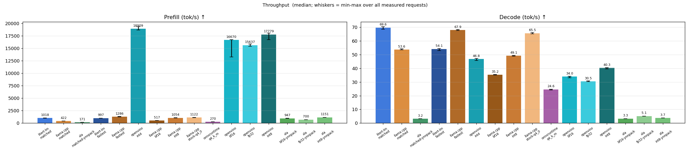
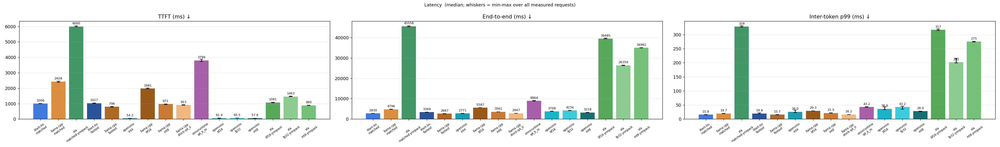
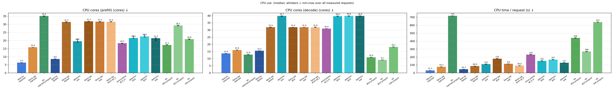
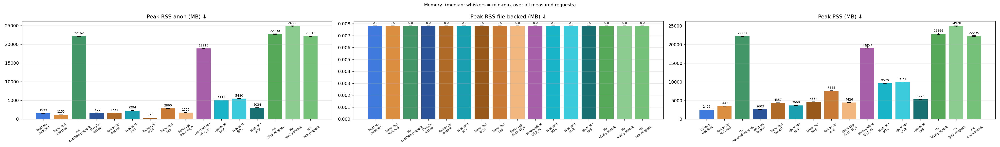
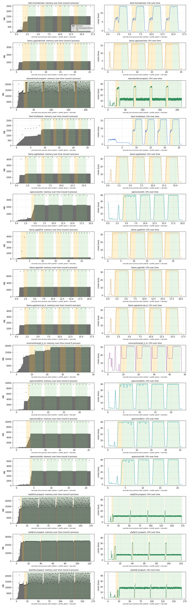
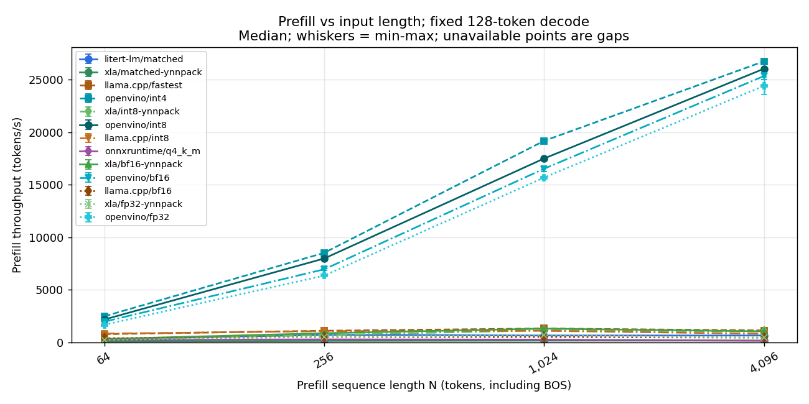
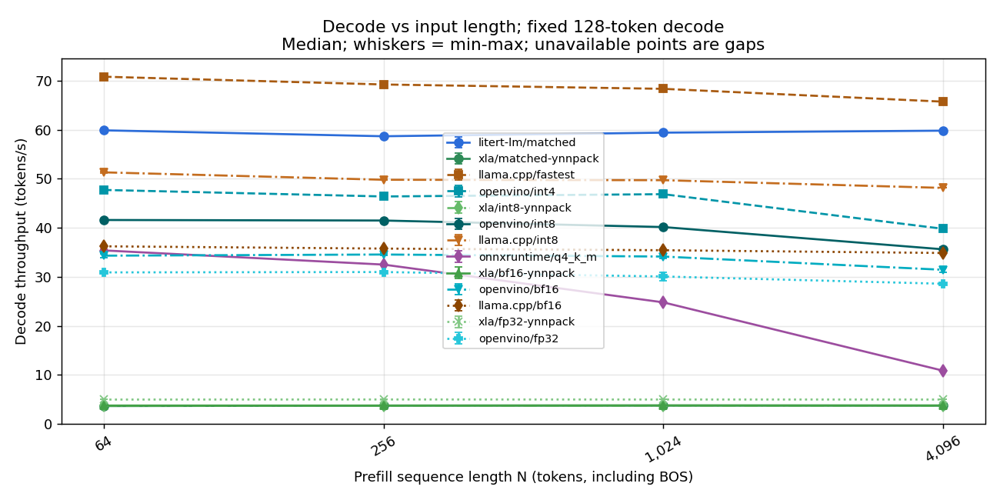
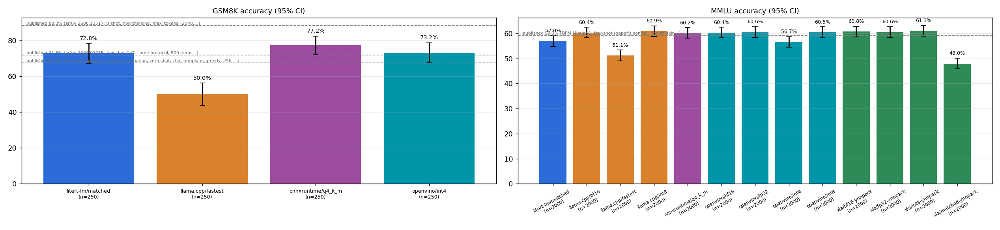
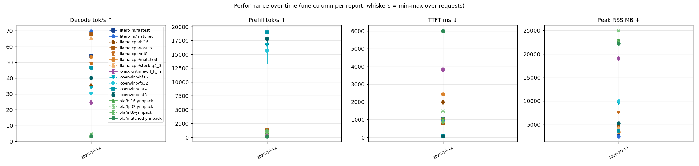

# gemma4-e2b-cpu-sapphire-rapids on sapphire-rapids — 2026-10-12

> Generated by `python3 -m aeb.report` from 32 headline benchmark processes plus 52 input-length sweep processes. Raw per-request data: [data.json](data.json). Methodology: [benchmark_methodology.md](../../docs/benchmark_methodology.md).

Gemma 4 E2B on x86 Sapphire Rapids CPU (Intel Xeon Platinum 8481C, Socket 0): OpenXLA (YNNPACK), LiteRT-LM (with YNNPACK and XNNPACK), llama.cpp (AVX-512 + AMX), OpenVINO GenAI, and ONNX Runtime GenAI across FP32, BF16, INT8, and INT4/INT2 model precisions. Frameworks are only benchmarked on data types where pre-built model artifacts exist (e.g., llama.cpp is omitted from FP32 because no pre-built F32 GGUF is published in ggml-org/gemma-4-E2B-it-GGUF).

## Key architecture & methodology notes (x86 Sapphire Rapids — FP32, BF16, INT8, and INT4/INT2)

1. **Precision Matrix (`FP32`, `BF16`, `INT8`, plus `INT4`/`INT2` where pre-built artifacts exist).**
   - Every framework is evaluated across `FP32`, `BF16`, `INT8`, and `INT4`/`INT2`
     **only where pre-existing model artifacts and runtime support are available**:
     - **OpenXLA (`jax==0.11.2` / `jaxlib==0.11.2`, official Google `tunix.models.gemma4` + `qwix` on YNNPACK)**:
       - `xla/fp32-ynnpack` (`FP32`), `xla/bf16-ynnpack` (`BF16`), `xla/int8-ynnpack`
         (`qwix` `int8` RTN weight-only PTQ on `google/gemma-4-E2B-it`), and
         `xla/matched-ynnpack` (`qwix` `int4` RTN weight-only PTQ on `google/gemma-4-E2B-it`).
     - **OpenXLA with Intel oneDNN** (`xla/*-onednn`, currently disabled):
       - `xla/fp32-onednn`, `xla/bf16-onednn`, `xla/int8-onednn`, and `xla/matched-onednn`
         are marked `"disabled": true` in the suite because XLA's experimental oneDNN
         custom-call rewriter (`--xla_cpu_experimental_onednn_custom_call=true`) crashes
         during compilation on Tunix Gemma 4's multi-axis Einsum contractions (`dot_general`
         with rank > 3) and does not support `int4` weight tensors.
     - **LiteRT-LM (`v0.17.1`)**:
       - `litert-lm/matched` (XNNPACK) and `litert-lm/fastest` (**YNNPACK**, `--ynnpack`)
         executing `litert-community/gemma-4-E2B-it-litert-lm/gemma-4-E2B-it.litertlm`
         (mixed `INT2`/`INT4`/`INT8` mobile QAT weights). Omitted from `FP32`, `BF16`, and
         pure `INT8` because `.litertlm` only ships as the pre-compiled mobile QAT bundle.
     - **`llama.cpp` (`b11259`, Sapphire Rapids AVX-512 + AMX backend)**:
       - `llama.cpp/bf16` (`BF16`), `llama.cpp/int8` (`Q8_0`),
         `llama.cpp/stock-q4_0` (official `ggml-org` `Q4_0` INT4 QAT checkpoint),
         `llama.cpp/matched` (bit-identical mobile QAT mixed `INT2`/`INT4`/`INT8` in
         `Q2_K`/`Q4_0`/`Q8_0`), and `llama.cpp/fastest` (mobile QAT weights with `INT2`
         tensors stored in `Q4_0` blocks).
       - **Omitted from `FP32`:** `ggml-org/gemma-4-E2B-it-GGUF` publishes pre-built
         `BF16`, `Q8_0`, and `Q4_0` GGUFs, but **no `F32` GGUF**. Because the benchmark
         protocol only includes `llama.cpp` data types with pre-existing GGUF artifacts
         (and avoids synthesizing an un-published ~17.4 GB `F32` GGUF from `BF16` weights),
         `llama.cpp` is not included in the `FP32` row.
     - **OpenVINO GenAI (`2026.4.1.0`)**:
       - `openvino/fp32` (`INFERENCE_PRECISION_HINT=f32`), `openvino/bf16`
         (`INFERENCE_PRECISION_HINT=bf16` on Intel AMX), `openvino/int8`
         (`OpenVINO/gemma-4-E2B-it-int8-ov`), and `openvino/int4`
         (`OpenVINO/gemma-4-E2B-it-int4-ov`).
     - **ONNX Runtime GenAI (`0.17.1`)**:
       - `onnxruntime/q4_k_m` (`Q4_K_M` 4-bit block quantization from
         `onnx-community/gemma-4-E2B-it-ONNX`).

2. **Caveats: Missing Data-Type Cells & Differences Between INT8, INT4, and INT2 Variants.**
   - **Why certain (framework, data-type) pairs are omitted:**
     - If a pre-built GGUF or framework artifact is not already available for a given
       data type, that framework is excluded from that data type in the benchmark:
       - `llama.cpp` has no published `F32` GGUF in `ggml-org/gemma-4-E2B-it-GGUF` (the
         base checkpoint `google/gemma-4-E2B-it` is natively `bfloat16`, so `BF16.gguf`
         is already lossless).
       - `LiteRT-LM` only publishes the mobile QAT `.litertlm` artifact (`INT2`/`INT4`/`INT8`).
       - `ONNX Runtime GenAI` is evaluated on its staged `Q4_K_M` package.
   - **Weight quantization schemes are not identical across checkpoints:**
     - **Mobile QAT (`litert-lm/*`, `llama.cpp/matched`, `llama.cpp/fastest`)**:
       Share the **exact same 278 quantized text tensors** (proven bit-identical
       in `models/aeb/litert-parity.json`) from `google/gemma-4-E2B-it-qat-mobile-transformers`:
       per-channel symmetric **INT2** on token embeddings, `lm_head`, and the double-wide
       MLPs of layers 15–34; **INT4** on attention projections, MLPs of layers 0–14, and
       per-layer embeddings (PLE); and **INT8** on per-layer input gates/projections.
     - **Stock `ggml-org` `Q4_0` and `Q8_0` (`llama.cpp/stock-q4_0`, `llama.cpp/int8`)**:
       Use 32-element block quantization (1 `fp16` scale per 32 weights) exported from
       Google's separate `Q4_0` QAT and `BF16` checkpoints (`ggml-org/gemma-4-E2B-it-GGUF`).
       Unlike the mobile QAT checkpoint, layers 15–34 MLPs are 4-bit (`Q4_0`) or 8-bit
       (`Q8_0`), not 2-bit.
     - **OpenVINO `int4` and `int8` (`openvino/int4`, `openvino/int8`)**:
       Use OpenVINO NNCF group-wise asymmetric/symmetric INT4 and INT8 weight compression
       (`OpenVINO/gemma-4-E2B-it-{int4,int8}-ov`) derived from the BF16 base checkpoint.
     - **OpenXLA `int8` and `int4` (`xla/int8-ynnpack`, `xla/matched-ynnpack`)**:
       Use official `qwix` (`qwix.quantize_model` with `QwixQuantizationProvider`)
       round-to-nearest (`int8` or `int4`) weight-only quantization applied to the official
       Tunix `tunix.models.gemma4` Flax NNX model loaded from `google/gemma-4-E2B-it`.
     - **ONNX Runtime `q4_k_m` (`onnxruntime/q4_k_m`)**:
       Uses `MatMulNBits` 4-bit block quantization (`onnx-community/gemma-4-E2B-it-ONNX`).
   - **Activation & KV-cache quantization differences (impact on accuracy and speed):**
     - **Static INT8 Activation Rounding (SRQ):** The mobile QAT checkpoint was trained
       with static per-tensor INT8 activation rounding (SRQ) and fixed-scale INT8 KV cache.
       `LiteRT-LM` executes SRQ natively; `llama.cpp` does not apply SRQ.
       Because the mobile QAT weights were co-adapted to SRQ rounding, running those
       same weights without SRQ (`llama.cpp/matched`, `llama.cpp/fastest`) lowers MMLU/GSM8K
       accuracy compared to `LiteRT-LM` or non-SRQ checkpoints (`llama.cpp/stock-q4_0`,
       `openvino/int4`, `xla/matched-ynnpack`).
     - **`Q2_K` vs. `Q4_0` kernel coverage in `llama.cpp`:** `llama.cpp` lacks an
       AVX-512 VNNI / AMX repacked kernel path for `Q2_K` super-blocks. Storing the exact
       same mobile QAT INT2 integer weights in `Q4_0` blocks (`llama.cpp/fastest`) enables
       repacked AVX-512/AMX kernels at the cost of +0.4 GB of storage (`2.7 GB` vs `2.3 GB`).

3. **Hardware & NUMA pinning (`Sapphire Rapids`).**
   - Dual-socket **Intel Xeon 6985P-C (Sapphire Rapids)** server (`cpuid` family 6, model 173, 40 physical cores / 80 threads per socket, 160 logical CPUs total, ~772 GB DDR5 across 2 NUMA nodes).
   - ISA extensions present: `avx512f`, `avx512bw`, `avx512dq`, `avx512vl`, `avx512_vnni`, `avx512_bf16`, `avx512_fp16`, `amx_tile`, `amx_int8`, `amx_bf16`.
   - All single-stream performance and reproducibility runs are strictly pinned to **NUMA node 0 physical cores (`0–39`, memory node `0`)** via `numactl --physcpubind=0-39 --localalloc` inside `scripts/dock_shim.py`, avoiding cross-socket UPI traffic and SMT sibling contention.
   - During the 2-shard parallel accuracy runs (`--parallel 2 --shards 2`), shard 0 is pinned to Socket 0 physical cores and shard 1 is pinned to Socket 1 physical cores.

4. **OpenXLA CPU: Official Tunix + Qwix on YNNPACK (`__ynn_fusion`) vs. Intel oneDNN.**
   - `xla_driver.py` uses the official Google Tunix Gemma 4 implementation (`tunix.models.gemma4`) and official `qwix` quantization (`qwix.quantize_model`) on Flax NNX/JAX (`jaxlib==0.11.2`), lowering matrix multiplications and elementwise fusions into `__ynn_fusion` custom calls backed by **YNNPACK**.
   - Enabling XLA's experimental Intel oneDNN custom-call rewriter (`--xla_cpu_experimental_onednn_custom_call=true --xla_cpu_experimental_ynn_fusion_type=invalid`) currently fails during XLA compilation on Tunix Gemma 4's multi-axis Einsum contractions (`dot_general` with rank > 3) and does not support `int4` weight quantization; the `xla/*-onednn` configurations are therefore disabled until upstream XLA oneDNN custom-call support handles higher-rank contractions and sub-byte weights.

5. **Data-Type-Aware Phase Selection & Apples-to-Apples Accuracy Protocol.**
   - **Phase 3 (`perf`):** Evaluates all 15 active configurations (2 interleaved rounds × 3 measured requests after 1 warm-up at 1,024 prompt → 256 generated tokens).
   - **Phase 4 (`accuracy`):** With `accuracy_select_fastest_by_dtype: true`, the runner groups active configurations by `(framework, dtype)` pair and selects the empirically fastest configuration (lowest median `e2e_ms` in Phase 3) for each of the 12 `(framework, dtype)` cells. All 12 `(framework, dtype)` winners are evaluated on the **identical 2,000-item stratified MMLU subset (`mmlu_limit: 2000`)** so accuracy and paired McNemar agreement tests are strictly apples-to-apples across every framework and data type, plus a 250-item GSM8K subset (`gsm8k_limit: 250`) on the fast `int4` configurations.
   - **Phase 5 (`sequence`):** With `sequence_sweep.select_fastest_by_dtype: true` and `min_accuracy: {"mmlu": 0.40, "gsm8k": 0.40}`, the input-length sweep (`64, 256, 1024, 4096` prompt tokens → `128` generated tokens) runs on the fastest configuration per `(framework, dtype)` cell that passes the accuracy gate.

## Environment

| Item | Value |
| --- | --- |
| Machine | sapphire-rapids — Intel Xeon 6985P-C (Sapphire Rapids; 2x 40C/80T; DDR5) pinned to NUMA node 0 (40 physical cores) |
| Container view | Ubuntu 24.04.5 LTS, kernel Linux 6.18.20-smp-1500.61.0.0, 56 vCPUs, 1007.7 GiB RAM |
| litert-lm | `v0.17.1`, commit `5e58e9a0aef7`, built 2026-10-04T11:20:00Z |
| llama.cpp | `b11259`, commit `d280808f5d82`, built 2026-10-04T11:20:00Z |
| onnxruntime | `onnxruntime-genai==0.17.1`, built 2026-10-04T11:21:00Z |
| openvino | `openvino-genai==2026.4.1.0`, commit `openvino==20`, built 2026-10-04T11:20:20Z |
| xla | `jax==0.11.2`, commit `google-tunix`, built 2026-10-06T06:40:29Z |
| Harness | digest `9a5c1b53934a`, repo rev `unknown` |
| Workload | 1024-token real-text chat prompt → 128 greedy tokens (fixed length), context 4096, 1 warm-up + 3 measured requests per process, 2 processes per config interleaved A-B-…/…-B-A |
| Prompt identity | identical token ids in every config (sha256 `ee559b78b98652bf…`) |

## Configurations

| Config | Track | Model file | Driver arguments |
| --- | --- | --- | --- |
| `litert-lm/matched` | matched | `gemma-4-E2B-it.litertlm` (sha256 `181938105e0e`) | `--model <model> --threads 16 --ctx 4096 --cache-dir /results/_cache/litert-lm-xnnpack --fixed-decode-tokens 128` |
| `llama.cpp/matched` | matched | `gemma-4-E2B-it-qat-mobile-matched.gguf` (sha256 `39ba17e470c0`) | `--model <model> --threads 16 --ctx 4096 --flash-attn on --cache-type-k q8_0 --cache-type-v q8_0` |
| `xla/matched-ynnpack` | matched | `gemma-4-E2B-it` (sha256 `e1efaee9d9a3`) | `--model <model> --threads 40 --ctx 4096 --dtype int4 --cache-dir /results/_cache/xla-int4-ynnpack` |
| `litert-lm/fastest` | fastest | `gemma-4-E2B-it.litertlm` (sha256 `181938105e0e`) | `--model <model> --threads 16 --ctx 4096 --ynnpack --cache-dir /results/_cache/litert-lm-ynnpack --fixed-decode-tokens 128` |
| `llama.cpp/fastest` | fastest | `gemma-4-E2B-it-qat-mobile-matched-q4.gguf` (sha256 `ed8fda86a91a`) | `--model <model> --threads 32 --ctx 4096 --flash-attn on --ubatch 1024` |
| `openvino/int4` | fastest | `gemma-4-E2B-it-int4-ov` (sha256 `3428fb6bed88`) | `--model <model> --threads 40 --ctx 4096 --dtype int4` |
| `llama.cpp/bf16` | reference | `gemma-4-E2B-it-BF16.gguf` (sha256 `246c5fb19e64`) | `--model <model> --threads 32 --ctx 4096 --flash-attn on` |
| `llama.cpp/int8` | reference | `gemma-4-E2B-it-Q8_0.gguf` (sha256 `996d08777aad`) | `--model <model> --threads 32 --ctx 4096 --flash-attn on` |
| `llama.cpp/stock-q4_0` | reference | `gemma-4-E2B-it-Q4_0.gguf` (sha256 `8e30dff3ac4c`) | `--model <model> --threads 32 --ctx 4096 --flash-attn on` |
| `onnxruntime/q4_k_m` | reference | `default` (sha256 `79666818bbf8`) | `--model <model> --threads 16 --ctx 4096` |
| `openvino/bf16` | reference | `gemma-4-E2B-it-fp16-ov` (sha256 `aa8248e647d0`) | `--model <model> --threads 40 --ctx 4096 --dtype bf16` |
| `openvino/fp32` | reference | `gemma-4-E2B-it-fp16-ov` (sha256 `aa8248e647d0`) | `--model <model> --threads 40 --ctx 4096 --dtype fp32` |
| `openvino/int8` | reference | `gemma-4-E2B-it-int8-ov` (sha256 `1d17cb7f73a7`) | `--model <model> --threads 40 --ctx 4096 --dtype int8` |
| `xla/bf16-ynnpack` | reference | `gemma-4-E2B-it` (sha256 `e1efaee9d9a3`) | `--model <model> --threads 40 --ctx 4096 --dtype bf16 --cache-dir /results/_cache/xla-bf16-ynnpack` |
| `xla/fp32-ynnpack` | reference | `gemma-4-E2B-it` (sha256 `e1efaee9d9a3`) | `--model <model> --threads 40 --ctx 4096 --dtype fp32 --cache-dir /results/_cache/xla-fp32-ynnpack` |
| `xla/int8-ynnpack` | reference | `gemma-4-E2B-it` (sha256 `e1efaee9d9a3`) | `--model <model> --threads 40 --ctx 4096 --dtype int8 --cache-dir /results/_cache/xla-int8-ynnpack` |

## Quantization equivalence

- `.litertlm` vs `google/gemma-4-E2B-it-qat-mobile-transformers`: **278 quantized tensors compared element by element, all integers and per-channel scales identical** (attention, MLP, per-layer gate/projection for every layer, lm_head, token and per-layer embedding tables).
- `gemma-4-E2B-it-qat-mobile-matched-q4.gguf`: 279 quantized tensors (62× int2→Q4_0, 146× int4→Q4_0, 71× int8→Q8_0); integer round-trip exact for every tensor; per-row scales stored as fp16 (LiteRT: fp32), worst relative scale error 0.26% (only 4 tensors exceed fp16 rounding, from subnormal scales: per_layer_model_proj.weight, blk.0.inp_gate.weight, blk.3.proj.weight, blk.14.inp_gate.weight).
- `gemma-4-E2B-it-qat-mobile-matched.gguf`: 279 quantized tensors (62× int2→Q2_K, 146× int4→Q4_0, 71× int8→Q8_0); integer round-trip exact for every tensor; per-row scales stored as fp16 (LiteRT: fp32), worst relative scale error 0.26% (only 4 tensors exceed fp16 rounding, from subnormal scales: per_layer_model_proj.weight, blk.0.inp_gate.weight, blk.3.proj.weight, blk.14.inp_gate.weight).

| Tensor group | Checkpoint / LiteRT-LM | Matched GGUF | `-q4` GGUF | Stock ggml-org Q4_0 |
| --- | --- | --- | --- | --- |
| Token embedding, lm_head | INT2 per-row (separate lm_head) | Q2_K, d = dmin = s | Q4_0, d = s | Q8_0 (tied) |
| Attention q/k/v/o | INT4 per-channel | Q4_0, d = s | Q4_0, d = s | Q4_0 (block-32 scales) |
| MLP layers 0-14 | INT4 per-channel | Q4_0, d = s | Q4_0, d = s | Q4_0 |
| MLP layers 15-34 (double-wide) | INT2 per-channel | Q2_K | Q4_0 | Q4_0 |
| Per-layer embeddings | INT4 per (token, layer) | Q4_0 | Q4_0 | Q4_0 |
| Per-layer gate / projection | INT8 per-channel | Q8_0 | Q8_0 | Q4_0 |
| Per-layer model projection | INT8 per-channel (LiteRT PTQ) | Q8_0 (same ints) | Q8_0 | BF16 |
| Norms, layer scalars | BF16 values (fp32 tensors in LiteRT) | F32, same values | F32, same values | F32 (different QAT checkpoint) |
| Activations | static per-tensor INT8 (QAT scales) | dynamic Q8_0/Q8_K per block | same | same |
| KV cache | INT8, static per-tensor scale | Q8_0 (matched track) | F16 (fastest) | F16 |

## Results

Medians over all measured requests (n per cell in the last row); [min – max] in brackets.

| Metric | `litert-lm/matched` | `llama.cpp/matched` | `xla/matched-ynnpack` | `litert-lm/fastest` | `llama.cpp/fastest` | `openvino/int4` | `llama.cpp/bf16` | `llama.cpp/int8` | `llama.cpp/stock-q4_0` | `onnxruntime/q4_k_m` | `openvino/bf16` | `openvino/fp32` | `openvino/int8` | `xla/bf16-ynnpack` | `xla/fp32-ynnpack` | `xla/int8-ynnpack` |
| --- | --- | --- | --- | --- | --- | --- | --- | --- | --- | --- | --- | --- | --- | --- | --- | --- |
| TTFT (ms) ↓ | 1006 [992–1015] | 2428 [2378–2456] | 6000 [5973–6038] | 1027 [1013–1044] | 796 [767–827] | 54 [53–55] | 1981 [1963–2009] | 971 [941–983] | 913 [902–925] | 3799 [3735–3870] | 61 [61–77] | 65 [65–66] | 58 [57–61] | 1081 [1055–1095] | 1463 [1458–1481] | 890 [877–901] |
| Prefill (tok/s) ↑ | 1018.3 [1009.0–1031.8] | 421.7 [416.9–430.5] | 170.7 [169.6–171.4] | 996.6 [980.6–1010.8] | 1286.1 [1238.5–1334.3] | 18908.7 [18669.3–19331.3] | 517.0 [509.6–521.6] | 1054.3 [1042.0–1088.5] | 1121.9 [1107.6–1135.1] | 269.5 [264.6–274.2] | 16669.5 [13267.3–16752.7] | 15636.9 [15402.6–15860.6] | 17779.0 [16740.9–18048.1] | 947.1 [935.0–970.5] | 699.7 [691.6–702.1] | 1151.1 [1136.4–1168.2] |
| Decode (tok/s) ↑ | 69.64 [68.54–70.30] | 53.60 [53.45–54.17] | 3.21 [3.20–3.23] | 54.10 [52.86–54.39] | 67.89 [67.60–68.24] | 46.77 [45.69–47.21] | 35.21 [35.05–35.48] | 49.11 [48.77–49.43] | 65.54 [65.12–66.04] | 24.64 [24.10–24.78] | 33.99 [33.08–34.14] | 30.49 [30.31–30.89] | 40.25 [39.64–40.46] | 3.31 [3.29–3.31] | 5.10 [5.08–5.14] | 3.73 [3.71–3.74] |
| End-to-end (ms) ↓ | 2830 [2799–2861] | 4796 [4737–4826] | 45558 [45322–45722] | 3369 [3354–3447] | 2667 [2630–2702] | 2771 [2747–2836] | 5587 [5543–5622] | 3561 [3510–3576] | 2847 [2827–2875] | 8964 [8861–9097] | 3799 [3783–3918] | 4234 [4178–4257] | 3218 [3199–3263] | 39485 [39392–39684] | 26359 [26178–26486] | 34982 [34875–35066] |
| Inter-token p99 (ms) ↓ | 15.8 [15.0–16.0] | 19.7 [19.4–20.0] | 328.6 [326.6–331.1] | 19.8 [19.0–22.0] | 15.7 [15.4–15.8] | 26.0 [23.1–32.1] | 29.3 [28.9–29.6] | 21.5 [21.1–21.8] | 16.2 [15.8–16.5] | 43.2 [42.6–43.8] | 36.6 [33.4–43.0] | 43.2 [35.0–45.8] | 28.0 [26.9–28.7] | 317.4 [314.8–320.2] | 201.7 [199.6–216.2] | 275.1 [274.0–276.4] |
| CPU cores (prefill) (cores) ↓ | 6.32 [6.29–6.37] | 15.79 [15.78–15.84] | 35.05 [34.80–35.15] | 8.59 [8.53–8.65] | 31.33 [31.21–31.55] | 19.52 [18.83–20.84] | 31.73 [31.71–31.84] | 31.51 [31.41–31.63] | 31.44 [31.37–31.64] | 18.28 [18.04–18.30] | 21.42 [21.22–22.74] | 22.48 [22.07–23.51] | 21.33 [19.99–21.67] | 17.19 [17.07–17.58] | 29.24 [28.93–29.44] | 20.79 [20.49–21.02] |
| CPU cores (decode) (cores) ↓ | 13.57 [13.49–13.64] | 15.94 [15.91–15.97] | 12.79 [12.70–12.87] | 15.48 [15.44–15.53] | 31.87 [31.77–31.96] | 39.74 [39.44–39.83] | 31.90 [31.88–31.94] | 31.86 [31.84–31.92] | 31.82 [31.79–31.97] | 30.92 [30.90–30.94] | 39.60 [39.45–39.79] | 39.83 [39.56–39.84] | 39.76 [39.64–39.86] | 10.91 [10.90–10.95] | 9.06 [8.98–9.11] | 18.14 [18.08–18.19] |
| CPU time / request (s) ↓ | 31.3 [30.9–31.6] | 76.3 [75.4–76.8] | 716.1 [714.7–716.2] | 45.3 [45.0–46.4] | 84.9 [83.8–86.0] | 109.6 [108.6–111.5] | 178.3 [176.9–179.5] | 113.6 [112.0–114.0] | 90.8 [90.1–91.6] | 228.8 [227.0–232.4] | 150.3 [149.1–153.9] | 167.4 [165.8–168.6] | 127.4 [126.8–128.8] | 438.3 [436.2–440.2] | 268.3 [266.0–270.7] | 636.9 [636.4–638.5] |
| Peak RSS (request) (MB) ↓ | 2499 [2499–2500] | 3443 [3443–3444] | 22247 [22189–22291] | 2633 [2628–2637] | 4358 [4358–4358] | 3670 [3669–3671] | 4634 [4634–4634] | 7586 [7585–7587] | 4426 [4425–4427] | 19110 [19044–19206] | 9572 [9572–9573] | 9934 [9933–9934] | 5298 [5298–5299] | 22868 [22664–23087] | 24948 [24781–25038] | 22298 [22178–22383] |
| Peak RSS anon (MB) ↓ | 1533 [1532–1533] | 1153 [1152–1153] | 22162 [22103–22205] | 1677 [1673–1681] | 1634 [1634–1634] | 2294 [2294–2295] | 271 [271–271] | 2860 [2859–2861] | 1727 [1726–1728] | 18913 [18847–19009] | 5118 [5118–5119] | 5480 [5479–5480] | 3034 [3034–3035] | 22790 [22585–23008] | 24869 [24702–24954] | 22212 [22092–22297] |
| Peak RSS file-backed (MB) ↓ | 0 [0–0] | 0 [0–0] | 0 [0–0] | 0 [0–0] | 0 [0–0] | 0 [0–0] | 0 [0–0] | 0 [0–0] | 0 [0–0] | 0 [0–0] | 0 [0–0] | 0 [0–0] | 0 [0–0] | 0 [0–0] | 0 [0–0] | 0 [0–0] |
| Peak PSS (MB) ↓ | 2497 [2497–2498] | 3443 [3442–3443] | 22237 [22178–22282] | 2603 [2595–2627] | 4357 [4357–4357] | 3668 [3667–3668] | 4634 [4634–4634] | 7585 [7584–7586] | 4426 [4425–4427] | 19059 [19041–19551] | 9570 [9570–9570] | 9931 [9931–9931] | 5296 [5295–5297] | 22866 [22661–23084] | 24920 [24779–25016] | 22295 [22175–22381] |
| Model load, warm cache (ms) | 236 | 861 | 19323 | 7459 | 679 | 2753 | 500 | 798 | 702 | 7126 | 2280 | 2073 | 2488 | 7287 | 7540 | 16268 |
| Peak RSS, process lifetime (VmHWM, MB) | 2499 | 3443 | 29899 | 2635 | 4358 | 3670 | 4634 | 7586 | 4426 | 19575 | 9573 | 9934 | 5299 | 29621 | 36091 | 29623 |
| RSS after load, before 1st request (MB) | 400 | 3315 | 12634 | 2010 | 4112 | 499 | 139 | 7449 | 4290 | 12591 | 6536 | 352 | 331 | 12615 | 22829 | 12217 |
|   …of which anonymous (MB) | 232 | 1025 | 12549 | 1101 | 1389 | 412 | 135 | 2723 | 1591 | 12437 | 3339 | 260 | 251 | 12539 | 22752 | 12133 |
| Container memory.peak incl. page cache (MB) | 0 | 0 | 0 | 0 | 0 | 0 | 0 | 0 | 0 | 0 | 0 | 0 | 0 | 0 | 0 | 0 |
| Measured requests (n) | 6 | 6 | 6 | 6 | 6 | 6 | 6 | 6 | 6 | 6 | 6 | 6 | 6 | 6 | 6 | 6 |
| Decode CV across requests | 1.1% | 0.6% | 0.3% | 1.3% | 0.3% | 1.3% | 0.5% | 0.6% | 0.5% | 1.0% | 1.2% | 0.7% | 0.7% | 0.3% | 0.5% | 0.2% |

### llama.cpp ÷ LiteRT-LM

Ratio of medians with a 95% bootstrap interval over requests. >1 means llama.cpp has the larger value (better for throughput, worse for latency/CPU/memory).

| Track | Prefill tok/s | Decode tok/s | TTFT | End-to-end | CPU s / request | Peak RSS |
| --- | --- | --- | --- | --- | --- | --- |
| matched | 0.41× [0.41, 0.42] | 0.77× [0.76, 0.78] | 2.41× [2.37, 2.45] | 1.70× [1.67, 1.71] | 2.44× [2.40, 2.47] | 1.38× [1.38, 1.38] |
| fastest | 1.29× [1.26, 1.34] | 1.25× [1.25, 1.28] | 0.77× [0.75, 0.79] | 0.79× [0.77, 0.80] | 1.87× [1.83, 1.89] | 1.66× [1.65, 1.66] |

### Memory and CPU over time

One process per configuration (round 0): load, warm-up and measured requests. Yellow = prefill, green = decode. File-backed RSS is mmap'd model pages (shared, reclaimable); anonymous RSS is private memory (KV cache, activations, repacked or converted weights).

## Input-length throughput sweep

Sweep measurement dates (UTC): 2026-10-12.

Fixed **128 generated tokens**, greedy with stop tokens ignored; common context capacity **8,192**. Model artifacts and thread counts are unchanged from the configurations above. These are reference configurations, not matched weights. The original headline workload remains unchanged.

Swept configurations are the empirically fastest configuration for each `(framework, dtype)` pair that cleared the minimum accuracy gate (gsm8k ≥ 40%, mmlu ≥ 40%).

Each point uses 1 interleaved processes per configuration, 1 warm-ups and 2 measured requests per process. Long inputs repeat the same public-domain passage deterministically. N includes BOS and chat-template tokens. Each request starts with an empty KV cache.

Prefill tokens/s = N / time to first token (includes tokenization and first-token generation). Decode tokens/s = 127 / time from the first to the last generated token. Rates are medians; brackets show min-max. Failed, truncated or wrong-length processes are excluded, never replaced by estimated rates.

### Prefill (tokens/s)

| N | `litert-lm/matched` | `xla/matched-ynnpack` | `llama.cpp/fastest` | `openvino/int4` | `xla/int8-ynnpack` | `openvino/int8` | `llama.cpp/int8` | `onnxruntime/q4_k_m` | `xla/bf16-ynnpack` | `openvino/bf16` | `llama.cpp/bf16` | `xla/fp32-ynnpack` | `openvino/fp32` |
| --- | --- | --- | --- | --- | --- | --- | --- | --- | --- | --- | --- | --- | --- |
| 64 | 324.09 [321.52-326.65] | 95.65 [95.39-95.90] | 788.03 [775.15-800.91] | 2485.41 [2460.26-2510.57] | 283.95 [283.00-284.89] | 2179.41 [2103.01-2255.81] | 835.94 [834.59-837.30] | 237.82 [237.42-238.22] | 331.28 [324.61-337.95] | 1973.89 [1969.10-1978.69] | 393.79 [376.37-411.22] | 244.67 [243.84-245.51] | 1680.96 [1626.35-1735.57] |
| 256 | 718.35 [706.68-730.03] | 148.81 [147.60-150.01] | 1112.69 [1104.63-1120.75] | 8525.84 [8465.92-8585.75] | 703.59 [690.13-717.05] | 7988.60 [7836.40-8140.81] | 1076.29 [1069.00-1083.58] | 291.76 [288.31-295.22] | 877.10 [854.09-900.10] | 6958.86 [6875.43-7042.29] | 518.60 [515.84-521.36] | 530.14 [528.14-532.15] | 6361.99 [6270.97-6453.02] |
| 1,024 | 657.92 [653.84-662.00] | 171.07 [170.76-171.38] | 1327.59 [1319.03-1336.14] | 19183.38 [19057.31-19309.45] | 1151.22 [1148.50-1153.95] | 17505.09 [17418.98-17591.20] | 1105.66 [1103.68-1107.64] | 268.51 [266.66-270.37] | 1312.77 [1304.39-1321.14] | 16531.43 [16255.58-16807.28] | 515.46 [513.71-517.21] | 701.32 [697.92-704.72] | 15690.01 [15673.38-15706.64] |
| 4,096 | 658.20 [658.07-658.33] | 176.60 [176.50-176.70] | 1140.69 [1139.41-1141.96] | 26757.51 [26724.36-26790.67] | 1048.36 [1037.47-1059.25] | 26049.46 [25981.49-26117.43] | 820.31 [818.07-822.54] | 159.01 [158.21-159.81] | 1054.59 [1053.62-1055.56] | 25353.17 [25003.67-25702.67] | 455.42 [451.89-458.94] | 445.63 [444.87-446.38] | 24417.29 [23588.82-25245.77] |

### Decode (tokens/s)

| N | `litert-lm/matched` | `xla/matched-ynnpack` | `llama.cpp/fastest` | `openvino/int4` | `xla/int8-ynnpack` | `openvino/int8` | `llama.cpp/int8` | `onnxruntime/q4_k_m` | `xla/bf16-ynnpack` | `openvino/bf16` | `llama.cpp/bf16` | `xla/fp32-ynnpack` | `openvino/fp32` |
| --- | --- | --- | --- | --- | --- | --- | --- | --- | --- | --- | --- | --- | --- |
| 64 | 59.90 [59.63-60.16] | 3.62 [3.61-3.63] | 70.84 [70.43-71.25] | 47.73 [47.64-47.82] | 3.68 [3.68-3.68] | 41.59 [41.31-41.88] | 51.32 [51.18-51.46] | 35.39 [35.18-35.60] | 3.72 [3.72-3.72] | 34.31 [33.93-34.70] | 36.23 [36.09-36.36] | 4.94 [4.94-4.95] | 30.90 [30.67-31.13] |
| 256 | 58.69 [58.60-58.77] | 3.71 [3.70-3.72] | 69.25 [69.10-69.40] | 46.40 [45.82-46.98] | 3.68 [3.68-3.69] | 41.49 [41.36-41.62] | 49.81 [49.72-49.89] | 32.49 [32.28-32.71] | 3.72 [3.71-3.73] | 34.55 [34.32-34.78] | 35.76 [35.71-35.81] | 4.96 [4.95-4.97] | 30.97 [30.79-31.15] |
| 1,024 | 59.42 [59.15-59.70] | 3.71 [3.71-3.72] | 68.37 [67.81-68.92] | 46.87 [46.79-46.95] | 3.69 [3.69-3.69] | 40.16 [40.01-40.30] | 49.72 [49.68-49.76] | 24.78 [24.63-24.94] | 3.76 [3.75-3.77] | 34.13 [33.71-34.56] | 35.42 [35.42-35.42] | 4.95 [4.95-4.96] | 30.06 [29.14-30.99] |
| 4,096 | 59.83 [59.62-60.03] | 3.71 [3.71-3.71] | 65.75 [65.71-65.79] | 39.80 [39.39-40.21] | 3.69 [3.68-3.69] | 35.61 [35.12-36.11] | 48.14 [48.12-48.17] | 10.84 [10.81-10.86] | 3.74 [3.74-3.74] | 31.43 [30.96-31.90] | 34.86 [34.83-34.89] | 4.95 [4.95-4.95] | 28.58 [28.37-28.79] |

### Sweep validation

| N | Token-ID identity | Measured requests by configuration |
| --- | --- | --- |
| 64 | identical | `litert-lm/matched`: 2; `xla/matched-ynnpack`: 2; `llama.cpp/fastest`: 2; `openvino/int4`: 2; `xla/int8-ynnpack`: 2; `openvino/int8`: 2; `llama.cpp/int8`: 2; `onnxruntime/q4_k_m`: 2; `xla/bf16-ynnpack`: 2; `openvino/bf16`: 2; `llama.cpp/bf16`: 2; `xla/fp32-ynnpack`: 2; `openvino/fp32`: 2 |
| 256 | identical | `litert-lm/matched`: 2; `xla/matched-ynnpack`: 2; `llama.cpp/fastest`: 2; `openvino/int4`: 2; `xla/int8-ynnpack`: 2; `openvino/int8`: 2; `llama.cpp/int8`: 2; `onnxruntime/q4_k_m`: 2; `xla/bf16-ynnpack`: 2; `openvino/bf16`: 2; `llama.cpp/bf16`: 2; `xla/fp32-ynnpack`: 2; `openvino/fp32`: 2 |
| 1,024 | identical | `litert-lm/matched`: 2; `xla/matched-ynnpack`: 2; `llama.cpp/fastest`: 2; `openvino/int4`: 2; `xla/int8-ynnpack`: 2; `openvino/int8`: 2; `llama.cpp/int8`: 2; `onnxruntime/q4_k_m`: 2; `xla/bf16-ynnpack`: 2; `openvino/bf16`: 2; `llama.cpp/bf16`: 2; `xla/fp32-ynnpack`: 2; `openvino/fp32`: 2 |
| 4,096 | identical | `litert-lm/matched`: 2; `xla/matched-ynnpack`: 2; `llama.cpp/fastest`: 2; `openvino/int4`: 2; `xla/int8-ynnpack`: 2; `openvino/int8`: 2; `llama.cpp/int8`: 2; `onnxruntime/q4_k_m`: 2; `xla/bf16-ynnpack`: 2; `openvino/bf16`: 2; `llama.cpp/bf16`: 2; `xla/fp32-ynnpack`: 2; `openvino/fp32`: 2 |

### Generated text on the timing prompt

Greedy decoding should be deterministic within a configuration. Different configurations may legitimately diverge (different activation/KV quantization and kernels change near-tie logits); the accuracy gate below is the validity check.

| Config | Identical across all measured requests | First 140 characters |
| --- | --- | --- |
| `litert-lm/matched` | yes | ## Chapter II. The Bottom of the Well ⏎  ⏎ The descent continued, a strange, dizzying ballet of shadow and muffled sounds. The initial shock of  |
| `llama.cpp/matched` | yes | This is a fascinating excerpt, rich in atmosphere and a sense of whimsical, slightly surreal adventure. The style is reminiscent of early 20 |
| `xla/matched-ynnpack` | yes | The descent was a dizzying kaleidoscope of colour and shadow. Alice clung to the rough, splintered wood of the well’s edge, her breath catch |
| `litert-lm/fastest` | yes | ## Chapter II. The Curious World Below ⏎  ⏎ The descent continued, a dizzying, silent plunge into an unknown darkness. The initial shock of the  |
| `llama.cpp/fastest` | yes | This is a fascinating excerpt, rich in atmosphere and a sense of whimsical, slightly surreal adventure. The style is reminiscent of early 20 |
| `openvino/int4` | no (3 variants) | CHAPTER II. ⏎ The Great Descent ⏎  ⏎ Alice was not so much concerned with the precise measurement of her descent as she was with the sheer, dizzyi |
| `llama.cpp/bf16` | yes | CHAPTER II. ⏎ The Landscape Below ⏎  ⏎ The fall continued, a dizzying, silent plunge into an abyss of shadow and echoing stillness. Alice found he |
| `llama.cpp/int8` | yes | CHAPTER II. ⏎ The Landscape Below ⏎  ⏎ The descent continued, a dizzying, silent plunge into an abyss of shadow and echoing stillness. Alice found |
| `llama.cpp/stock-q4_0` | yes | CHAPTER II. ⏎ The Descent into the Unknown ⏎  ⏎ “And what an ignorant little girl she,” Alice continued, her voice echoing strangely in the vast,  |
| `onnxruntime/q4_k_m` | yes | CHAPTER II. ⏎ The Descent into Wonder ⏎  ⏎ And what an ignorant little girl she was! Alice felt a dizzying sense of both terror and exhilaration.  |
| `openvino/bf16` | yes | CHAPTER II. ⏎ The Landscape Below ⏎  ⏎ The fall continued, a dizzying, silent plunge into an abyss of shadow and echoing stillness. Alice found he |
| `openvino/fp32` | yes | CHAPTER II. ⏎ The Landscape Below ⏎  ⏎ The fall continued, a dizzying, silent plunge into an abyss of shadow and echoing stillness. Alice found he |
| `openvino/int8` | no (3 variants) | CHAPTER II. ⏎ The Landscape Below ⏎  ⏎ The fall continued, a dizzying, silent plunge into an abyss of shadow and echoing stillness. Alice found he |
| `xla/bf16-ynnpack` | yes | CHAPTER II. ⏎ The Landscape Below ⏎  ⏎ The fall continued, a dizzying, silent plunge into an abyss of shadow and echoing stillness. Alice found he |
| `xla/fp32-ynnpack` | yes | CHAPTER II. ⏎ The Landscape Below ⏎  ⏎ The fall continued, a dizzying, silent plunge into an abyss of shadow and echoing stillness. Alice found he |
| `xla/int8-ynnpack` | yes | CHAPTER II. ⏎ The Well's Bottom ⏎  ⏎ Alice continued her descent, the darkness growing absolute, punctuated only by the occasional, unsettling sou |

## Accuracy (validity gate)

Same prompts, greedy decoding, through the same in-process drivers as the timing runs. Use these to confirm each configuration produces correct tokens, and to compare frameworks on identical items; they are not leaderboard numbers.

| Config | Task | Items | Accuracy | 95% CI | Macro (MMLU) | Parse failures | Mean generated tokens | Hit token limit |
| --- | --- | --- | --- | --- | --- | --- | --- | --- |
| `litert-lm/matched` | mmlu | 2000 (stratified subset) | 57.00% | ±2.17% | 57.01% | 8 | 5.8 | n/a (letter only) |
| `llama.cpp/bf16` | mmlu | 2000 (stratified subset) | 60.35% | ±2.14% | 60.36% | 40 | 7.0 | n/a (letter only) |
| `llama.cpp/fastest` | mmlu | 2000 (stratified subset) | 51.15% | ±2.19% | 51.16% | 6 | 8.0 | n/a (letter only) |
| `llama.cpp/int8` | mmlu | 2000 (stratified subset) | 60.90% | ±2.14% | 60.91% | 43 | 7.0 | n/a (letter only) |
| `onnxruntime/q4_k_m` | mmlu | 2000 (stratified subset) | 60.20% | ±2.15% | 60.20% | 41 | 7.5 | n/a (letter only) |
| `openvino/bf16` | mmlu | 2000 (stratified subset) | 60.35% | ±2.14% | 60.36% | 40 | 6.9 | n/a (letter only) |
| `openvino/fp32` | mmlu | 2000 (stratified subset) | 60.60% | ±2.14% | 60.61% | 40 | 6.9 | n/a (letter only) |
| `openvino/int4` | mmlu | 2000 (stratified subset) | 56.70% | ±2.17% | 56.71% | 5 | 7.4 | n/a (letter only) |
| `openvino/int8` | mmlu | 2000 (stratified subset) | 60.50% | ±2.14% | 60.51% | 37 | 6.5 | n/a (letter only) |
| `xla/bf16-ynnpack` | mmlu | 2000 (stratified subset) | 60.75% | ±2.14% | 60.76% | 39 | 7.0 | n/a (letter only) |
| `xla/fp32-ynnpack` | mmlu | 2000 (stratified subset) | 60.55% | ±2.14% | 60.56% | 40 | 6.9 | n/a (letter only) |
| `xla/int8-ynnpack` | mmlu | 2000 (stratified subset) | 61.05% | ±2.14% | 61.06% | 42 | 7.7 | n/a (letter only) |
| `xla/matched-ynnpack` | mmlu | 2000 (stratified subset) | 48.00% | ±2.19% | 48.01% | 2 | 7.8 | n/a (letter only) |
| `litert-lm/matched` | gsm8k | 250 (evenly spaced subset) | 72.80% | ±5.52% | n/a | 0 | 380.6 | 58 (cap 512) |
| `llama.cpp/fastest` | gsm8k | 250 (evenly spaced subset) | 50.00% | ±6.20% | n/a | 0 | 380.3 | 84 (cap 512) |
| `onnxruntime/q4_k_m` | gsm8k | 250 (evenly spaced subset) | 77.20% | ±5.20% | n/a | 0 | 365.1 | 53 (cap 512) |
| `openvino/int4` | gsm8k | 250 (evenly spaced subset) | 73.20% | ±5.49% | n/a | 0 | 370.4 | 58 (cap 512) |

**Paired comparison on identical items.** Same prediction = both configs chose the same answer; McNemar's exact test on items only one config got right (p < 0.05 means a real accuracy difference).

| Task | A | B | Items | Same prediction | Acc A | Acc B | Only A right | Only B right | McNemar p |
| --- | --- | --- | --- | --- | --- | --- | --- | --- | --- |
| mmlu | `llama.cpp/bf16` | `llama.cpp/fastest` | 2000 | 64.5% | 60.35% | 51.15% | 335 | 151 | 4.35e-17 |
| mmlu | `llama.cpp/bf16` | `llama.cpp/int8` | 2000 | 97.5% | 60.35% | 60.90% | 13 | 24 | 0.0989 |
| mmlu | `llama.cpp/bf16` | `openvino/bf16` | 2000 | 98.7% | 60.35% | 60.35% | 10 | 10 | 1 |
| mmlu | `llama.cpp/fastest` | `llama.cpp/int8` | 2000 | 64.9% | 51.15% | 60.90% | 142 | 337 | 2.44e-19 |
| mmlu | `llama.cpp/int8` | `openvino/int8` | 2000 | 95.9% | 60.90% | 60.50% | 33 | 25 | 0.358 |
| mmlu | `openvino/bf16` | `openvino/fp32` | 2000 | 98.8% | 60.35% | 60.60% | 6 | 11 | 0.332 |
| mmlu | `openvino/bf16` | `openvino/int4` | 2000 | 74.6% | 60.35% | 56.70% | 207 | 134 | 9.12e-05 |
| mmlu | `openvino/bf16` | `openvino/int8` | 2000 | 96.9% | 60.35% | 60.50% | 21 | 24 | 0.766 |
| mmlu | `openvino/fp32` | `openvino/int4` | 2000 | 74.5% | 60.60% | 56.70% | 209 | 131 | 2.75e-05 |
| mmlu | `openvino/fp32` | `openvino/int8` | 2000 | 97.0% | 60.60% | 60.50% | 23 | 21 | 0.88 |
| mmlu | `openvino/int4` | `openvino/int8` | 2000 | 74.9% | 56.70% | 60.50% | 130 | 206 | 3.99e-05 |
| mmlu | `xla/bf16-ynnpack` | `xla/fp32-ynnpack` | 2000 | 98.5% | 60.75% | 60.55% | 14 | 10 | 0.541 |
| mmlu | `xla/bf16-ynnpack` | `xla/int8-ynnpack` | 2000 | 89.5% | 60.75% | 61.05% | 63 | 69 | 0.664 |
| mmlu | `xla/bf16-ynnpack` | `xla/matched-ynnpack` | 2000 | 57.6% | 60.75% | 48.00% | 421 | 166 | 1.6e-26 |
| mmlu | `xla/fp32-ynnpack` | `xla/int8-ynnpack` | 2000 | 89.4% | 60.55% | 61.05% | 62 | 72 | 0.437 |
| mmlu | `xla/fp32-ynnpack` | `xla/matched-ynnpack` | 2000 | 57.4% | 60.55% | 48.00% | 420 | 169 | 1.25e-25 |
| mmlu | `xla/int8-ynnpack` | `xla/matched-ynnpack` | 2000 | 56.2% | 61.05% | 48.00% | 436 | 175 | 1.17e-26 |

### Publicly reported accuracy

Google publishes no original-MMLU or GSM8K score for Gemma 4 E2B (model card, QAT cards and tech report checked); its static benchmarks are reported in thinking mode on bf16 weights, and the QAT cards only claim quality similar to bf16. The MMLU and GSM8K references below are third-party bf16 evaluations with their own prompts. None of these setups matches this harness (zero-shot, non-thinking, greedy, quantized weights, answer-prefilled MMLU), so use them as an order-of-magnitude sanity check, not as a pass/fail threshold; the frameworks are judged against each other on identical items.

| Benchmark | Published | Model variant | Setup | Source | Measured here (non-thinking, greedy) |
| --- | --- | --- | --- | --- | --- |
| MMLU | 59.3% | E2B, bf16 | few-shot (paper's config), non-thinking, MCQ with max_tokens=1, temperature 0 | [DFM Mimir v1, arXiv 2608.13517, Table 7](https://arxiv.org/abs/2608.13517) | — |
| MMLU | 72.0% | E2B, bf16 | same, thinking on | [arXiv 2608.13517, Table 7](https://arxiv.org/abs/2608.13517) | — |
| GSM8K | 88.3% | E2B, bf16 | 0-shot, non-thinking, max_tokens=2048, temperature 0, full test set | [arXiv 2608.13517, Table 8](https://arxiv.org/abs/2608.13517) | `litert-lm/matched` 72.8% (n=250); `llama.cpp/fastest` 50.0% (n=250); `onnxruntime/q4_k_m` 77.2% (n=250); `openvino/int4` 73.2% (n=250) |
| GSM8K | 90.3% | E2B, bf16 | same, thinking on | [arXiv 2608.13517, Table 8](https://arxiv.org/abs/2608.13517) | — |
| GSM8K | 67.4% | gemma-4-E2B-it, bf16 | zero-shot, chat template, greedy, 256-token cap, 500-item subset (95% CI 63.2-71.4) | [Unified Deployment-Aware Evaluation, arXiv 2604.07035](https://arxiv.org/abs/2604.07035) | — |
| GSM8K | 71.8% | gemma-4-E2B-it, bf16 | few-shot CoT, same protocol, 500 items (95% CI 67.7-75.6) | [arXiv 2604.07035](https://arxiv.org/abs/2604.07035) | — |
| MMLU-Pro | 60.0% | gemma-4-E2B-it, bf16 | thinking mode (Google) | [Gemma 4 model card / tech report Table 5](https://huggingface.co/google/gemma-4-E2B-it) | — |
| MMMLU | 67.4% | gemma-4-E2B-it, bf16 | thinking mode (Google) | [Gemma 4 model card / tech report Table 5](https://huggingface.co/google/gemma-4-E2B-it) | — |
| IFEval | 94.6% | gemma-4-E2B-it, bf16 | thinking mode (Google) | [Gemma 4 tech report, arXiv 2607.02770, Table 5](https://arxiv.org/abs/2607.02770) | — |
| GPQA Diamond | 43.4% | gemma-4-E2B-it, bf16 | thinking mode (Google) | [Gemma 4 model card](https://huggingface.co/google/gemma-4-E2B-it) | — |
| BigBench Extra Hard | 21.9% | gemma-4-E2B-it, bf16 | thinking mode (Google) | [Gemma 4 model card](https://huggingface.co/google/gemma-4-E2B-it) | — |
| AIME 2026 (no tools) | 37.5% | gemma-4-E2B-it, bf16 | thinking mode (Google) | [Gemma 4 model card](https://huggingface.co/google/gemma-4-E2B-it) | — |
| LiveCodeBench v6 | 44.0% | gemma-4-E2B-it, bf16 | thinking mode (Google) | [Gemma 4 model card](https://huggingface.co/google/gemma-4-E2B-it) | — |
| MMLU (predecessor Gemma 3n E2B-it) | 60.1% | gemma-3n-E2B-it | 0-shot (Google) | [Gemma 3n E2B model card](https://huggingface.co/google/gemma-3n-E2B-it) | — |

- Published Gemma 4 scores use bf16 weights; no source reports accuracy for the mobile-QAT (.litertlm) or Q4_0 checkpoints themselves.
- The two third-party GSM8K numbers differ by ~20 points (88.3 vs 67.4) because of the token cap (2048 vs 256) and prompt; this harness uses a 512-token cap, so it should land between them if the quantized model is healthy.
- Google's Table 5 states all models are in thinking mode unless noted; this harness runs with thinking disabled, which costs several points on reasoning-heavy sets (e.g. MMLU 59.3 -> 72.0 with thinking in arXiv 2608.13517).

## Output reproducibility

Same model file, build, prompt and settings, repeated: 12 prompts × 3 repeats per process, fresh KV cache per request, stop tokens honoured, ≤128 tokens. *Within process* = repeats vs. the first repeat; *across processes* = a second fresh process with the same request sequence; *across threads* = a process with half the threads. Seeded = temperature 1.0, top-k 64, top-p 0.95, fixed seed; the *seed control* reruns with seed+1 and must change outputs, otherwise seeded reproducibility would be vacuous. Method: [benchmark_methodology.md](../../docs/benchmark_methodology.md#output-reproducibility).

| Config | Mode | Verdict | Within process | Across processes | Across threads | Seed control |
| --- | --- | --- | --- | --- | --- | --- |
| `litert-lm/matched` | greedy | **reproducible per request** | 24/24 identical | 24/24 identical | n/a | — |
| `litert-lm/matched` | seeded | **reproducible per process only** (state carries across requests) | 4/24 identical; first divergence at token 2 (median) | 24/24 identical | n/a | 19/24 outputs changed |
| `llama.cpp/matched` | greedy | **reproducible per request** | 24/24 identical | 24/24 identical | n/a | — |
| `llama.cpp/matched` | seeded | **reproducible per request** | 24/24 identical | 24/24 identical | n/a | 22/24 outputs changed |
| `xla/matched-ynnpack` | greedy | **reproducible per request** | 24/24 identical | 24/24 identical | n/a | — |
| `xla/matched-ynnpack` | seeded | **reproducible per request** | 24/24 identical | 24/24 identical | n/a | 20/24 outputs changed |
| `litert-lm/fastest` | greedy | **reproducible per request** | 24/24 identical | 24/24 identical | n/a | — |
| `litert-lm/fastest` | seeded | **reproducible per process only** (state carries across requests) | 4/24 identical; first divergence at token 2 (median) | 24/24 identical | n/a | 20/24 outputs changed |
| `llama.cpp/fastest` | greedy | **reproducible per request** | 24/24 identical | 24/24 identical | n/a | — |
| `llama.cpp/fastest` | seeded | **reproducible per request** | 24/24 identical | 24/24 identical | n/a | 22/24 outputs changed |
| `openvino/int4` | greedy | **reproducible per request** | 24/24 identical | 24/24 identical | n/a | — |
| `openvino/int4` | seeded | **reproducible per request** | 24/24 identical | 24/24 identical | n/a | 18/24 outputs changed |
| `onnxruntime/q4_k_m` | greedy | **reproducible per request** | 24/24 identical | 24/24 identical | n/a | — |
| `onnxruntime/q4_k_m` | seeded | **reproducible per request** | 24/24 identical | 24/24 identical | n/a | 18/24 outputs changed |

Cross-framework (informational, greedy): `llama.cpp/matched` and `litert-lm/matched` produce identical text for 4/24 prompt-repeats, median first divergence at token 4. Identical weights do not imply identical outputs when activation/KV quantization and kernels differ.

## Performance over time

Every report appends one line per configuration to [`history/gemma4-e2b-cpu-sapphire-rapids/sapphire-rapids.jsonl`](../history/gemma4-e2b-cpu-sapphire-rapids/sapphire-rapids.jsonl) (medians, ranges, framework commits, harness digest, model hashes). A change is flagged when the median moves by more than max(3%, 3 × the larger coefficient of variation) between consecutive reports of the same config.

| Date | Config | Framework commit | Decode tok/s | Prefill tok/s | TTFT ms | Peak RSS MB | MMLU |
| --- | --- | --- | --- | --- | --- | --- | --- |
| 2026-10-12 | `litert-lm/fastest` | `5e58e9a0ae` | 54.10 | 996.6 | 1027 | 2633 | n/a |
| 2026-10-12 | `litert-lm/matched` | `5e58e9a0ae` | 69.64 | 1018.3 | 1006 | 2499 | 57.00% |
| 2026-10-12 | `llama.cpp/bf16` | `d280808f5d` | 35.21 | 517.0 | 1981 | 4634 | 60.35% |
| 2026-10-12 | `llama.cpp/fastest` | `d280808f5d` | 67.89 | 1286.1 | 796 | 4358 | 51.15% |
| 2026-10-12 | `llama.cpp/int8` | `d280808f5d` | 49.11 | 1054.3 | 971 | 7586 | 60.90% |
| 2026-10-12 | `llama.cpp/matched` | `d280808f5d` | 53.60 | 421.7 | 2428 | 3443 | n/a |
| 2026-10-12 | `llama.cpp/stock-q4_0` | `d280808f5d` | 65.54 | 1121.9 | 913 | 4426 | n/a |
| 2026-10-12 | `onnxruntime/q4_k_m` | `None` | 24.64 | 269.5 | 3799 | 19110 | 60.20% |
| 2026-10-12 | `openvino/bf16` | `openvino==` | 33.99 | 16669.5 | 61 | 9572 | 60.35% |
| 2026-10-12 | `openvino/fp32` | `openvino==` | 30.49 | 15636.9 | 65 | 9934 | 60.60% |
| 2026-10-12 | `openvino/int4` | `openvino==` | 46.77 | 18908.7 | 54 | 3670 | 56.70% |
| 2026-10-12 | `openvino/int8` | `openvino==` | 40.25 | 17779.0 | 58 | 5298 | 60.50% |
| 2026-10-12 | `xla/bf16-ynnpack` | `google-tun` | 3.31 | 947.1 | 1081 | 22868 | 60.75% |
| 2026-10-12 | `xla/fp32-ynnpack` | `google-tun` | 5.10 | 699.7 | 1463 | 24948 | 60.55% |
| 2026-10-12 | `xla/int8-ynnpack` | `google-tun` | 3.73 | 1151.1 | 890 | 22298 | 61.05% |
| 2026-10-12 | `xla/matched-ynnpack` | `google-tun` | 3.21 | 170.7 | 6000 | 22247 | 48.00% |

**Flagged changes vs. previous report:** none (first report, or all within noise).

## Data-quality checks

- `openvino/bf16` run `20261011T162821Z-57f77b`: end-to-end outlier request indices [2] (MAD rule) — kept, not discarded.
- `xla/fp32-ynnpack` run `20261011T162246Z-310c36`: end-to-end outlier request indices [0] (MAD rule) — kept, not discarded.
- `xla/int8-ynnpack` run `20261011T161405Z-58be28`: end-to-end outlier request indices [1] (MAD rule) — kept, not discarded.

## Caveats

_none recorded_
