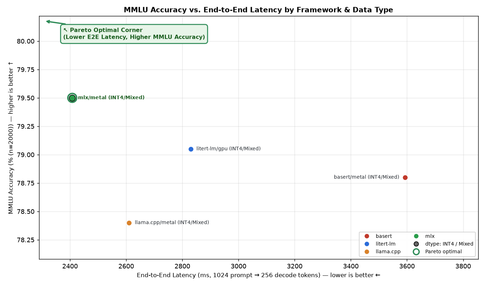
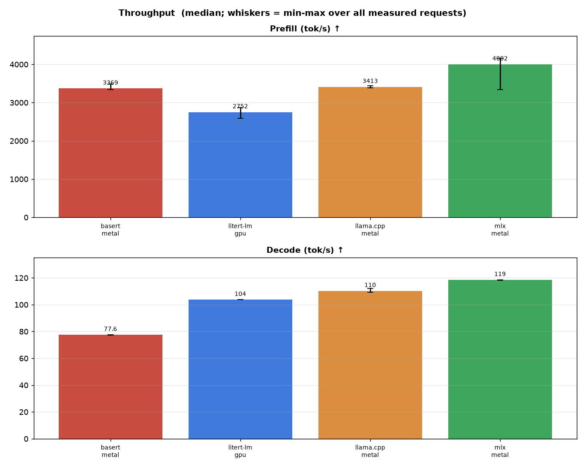
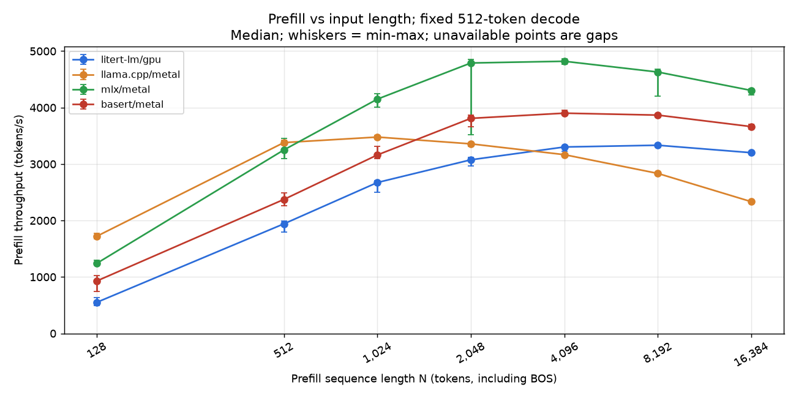
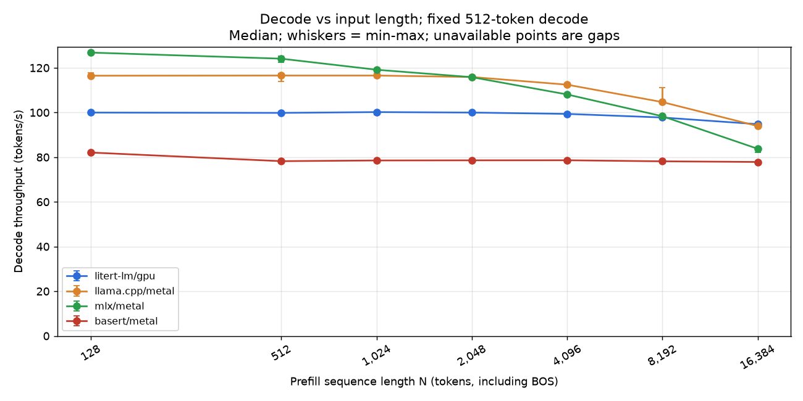
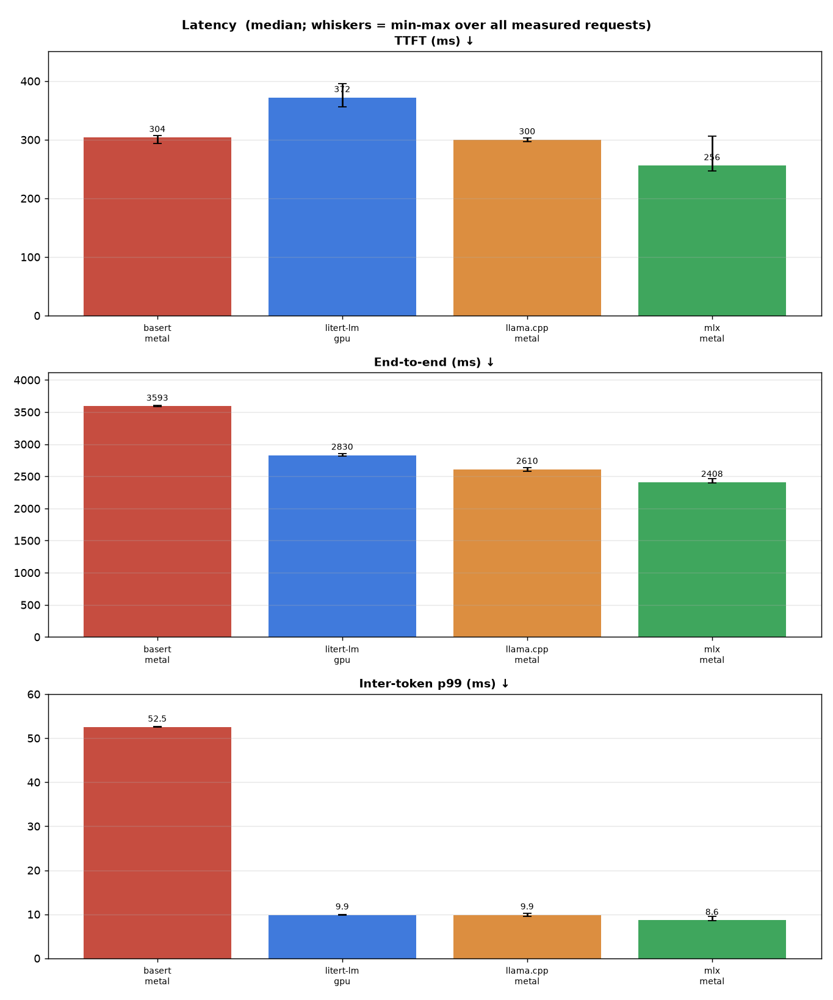
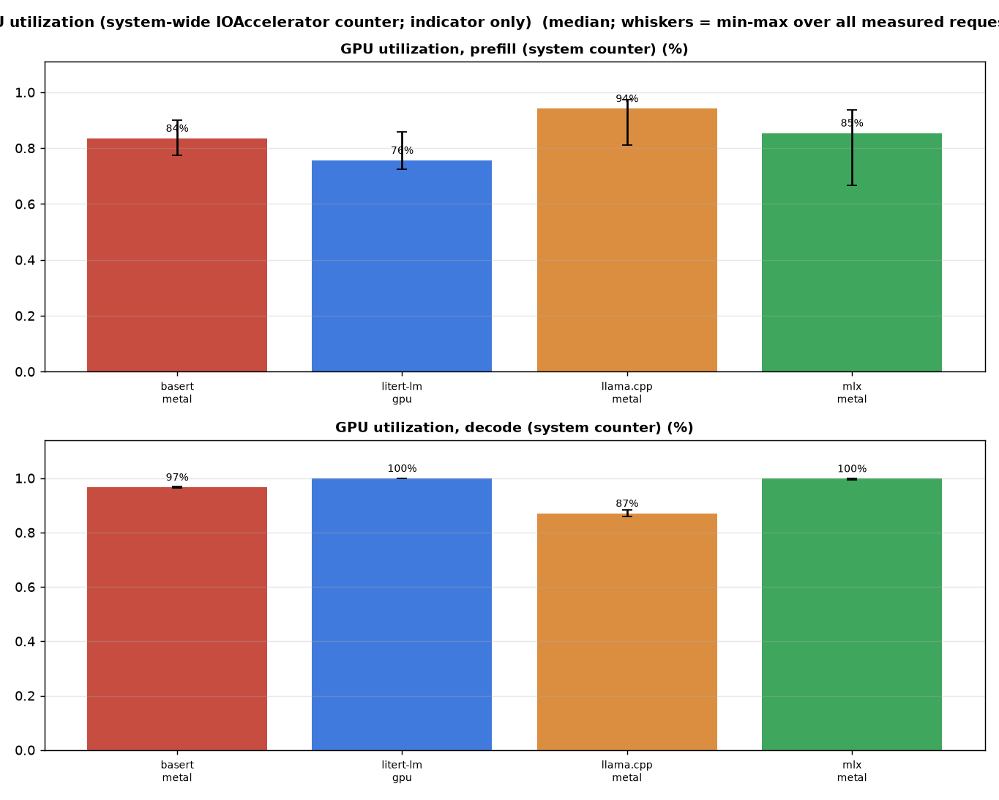
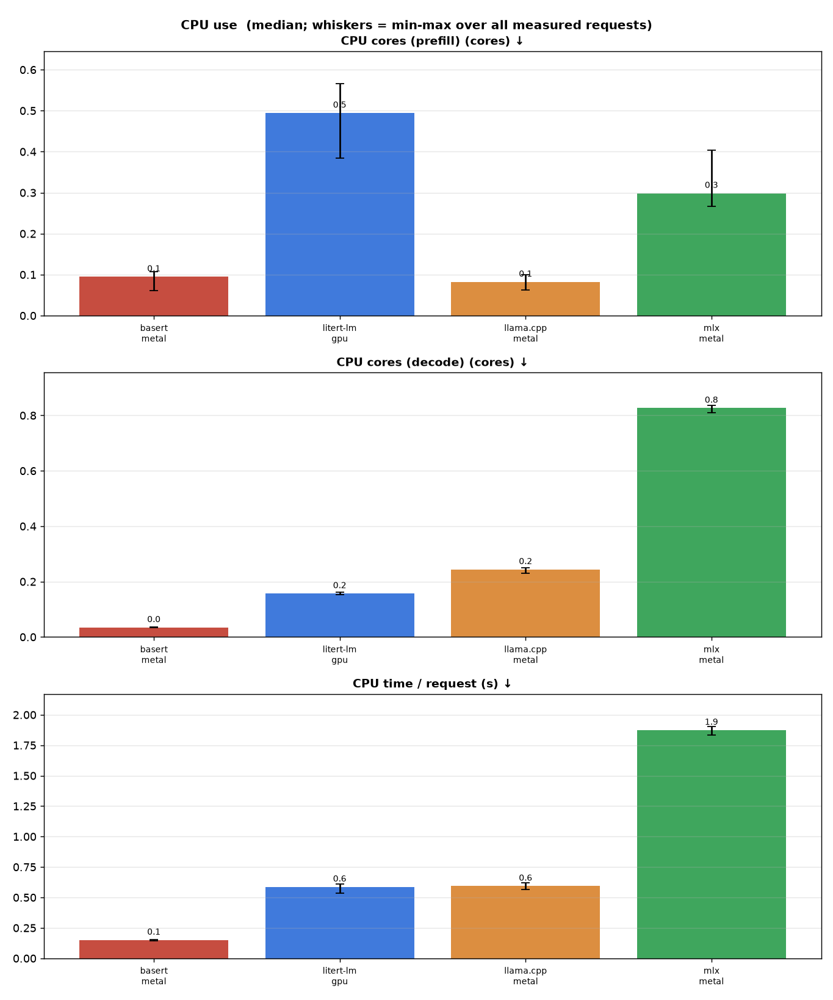
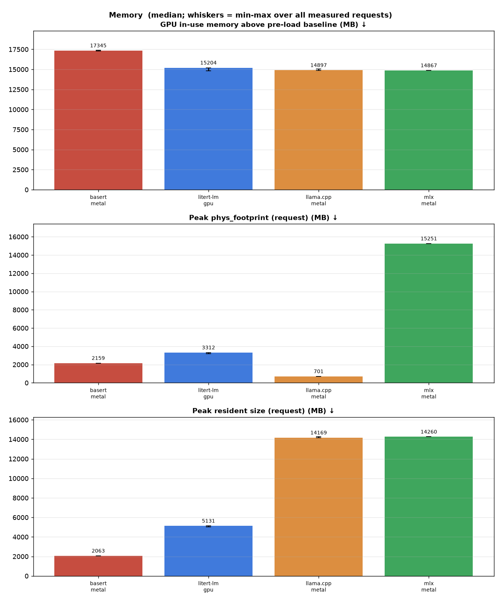
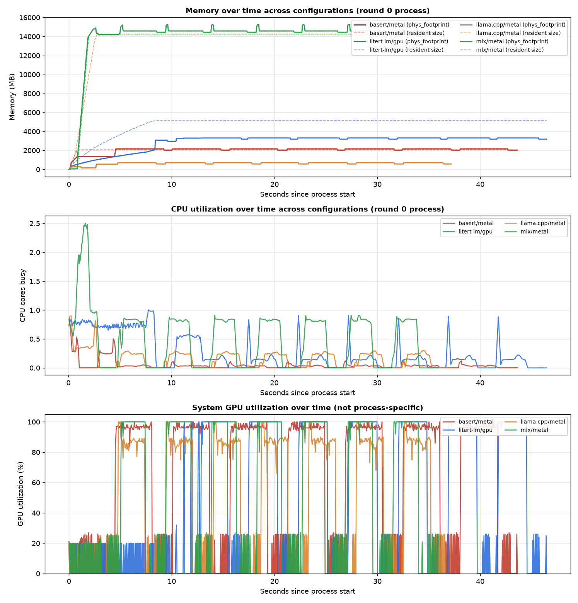
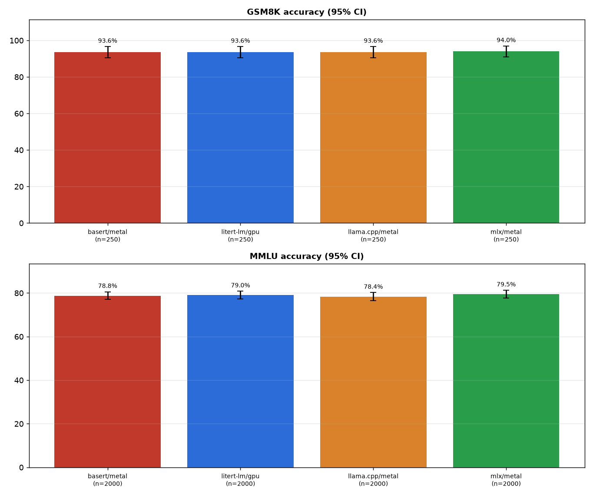

# gemma4-26b-a4b-gpu on apple-m5-max — 2026-10-22

> Generated by `python3 -m aeb.report` from 12 headline benchmark processes plus 84 input-length sweep processes. Raw per-request data: [data.json](data.json). Methodology: [benchmark_methodology.md](../../docs/benchmark_methodology.md).

Gemma 4 26B A4B (MoE, 3.8B active) on the Apple M5 Max GPU, run natively on macOS with Metal: LiteRT-LM (ML Drift GPU backend), llama.cpp (Metal), MLX (mlx-lm) and BaseRT. Every configuration is a reference (open) comparison: each framework runs its own published ~4-bit artifact of the model with framework defaults, so weights and quantization are NOT matched and speed must be read together with the accuracy gate. Native macOS numbers are not comparable with the Linux-VM CPU suites.

## Summary

Headline medians (`1024` prompt → `256` generated tokens, stateless cold KV cache) and accuracy grouped by data type. Within each data type, rows are ordered from fastest to slowest end-to-end latency, with the best-performing row highlighted (**🏆**) and best per-column metrics bolded. The highlighted row is the lowest measured latency, not a claim of statistically significant superiority.



| Framework / Config | Checkpoint | Weights / Acts / KV | Threads | TTFT (ms) ↓ | Prefill (tok/s) ↑ | Decode (tok/s) ↑ | E2E (ms) ↓ | GPU memory Δ (MB) ↓ | MMLU (n=2000) ↑ | GSM8K (n=250) ↑ |
| --- | --- | --- | ---: | ---: | ---: | ---: | ---: | ---: | ---: | ---: |
| **INT4 / Mixed Track** | | | | | | | | | | |
| 🏆 **`mlx/metal`** | **`QAT (MLX)`** | **`4/8-bit affine g64 / bf16 / not exposed`** | **6 (recorded only)** | **256** | **4,001.9** | **118.55** | **2,408** | **14,867** | **79.50%** | **94.00%** |
| `llama.cpp/metal` | `QAT (GGUF)` | `q4_0 / not exposed / fp16` | 6 (host) | 300 | 3,413.2 | 110.33 | 2,610 | 14,897 | 78.40% | 93.60% |
| `litert-lm/gpu` | `it (LiteRT-LM GPU)` | `~4-bit / not exposed / not exposed` | 6 (host) | 372 | 2,752.3 | 103.72 | 2,830 | 15,204 | 79.05% | 93.60% |
| `basert/metal` | `it (BaseRT)` | `Q4 / not exposed / not exposed` | 6 (recorded only) | 304 | 3,368.8 | 77.55 | 3,593 | 17,345 | 78.80% | 93.60% |

**Legend:**

- **`reference`**: Published framework-specific artifacts and defaults; weights and quantization are not matched. Read speed together with accuracy.

- **GPU memory Δ**: Peak system GPU in-use memory over each process lifetime minus its pre-load baseline; includes other GPU clients. Process RSS and phys_footprint do not consistently include Metal weights across runtimes.
- **Precision**: Suite-declared artifact metadata; `not exposed` means the runtime/artifact does not establish that precision. Thread counts describe host work or are recorded only, not GPU parallelism.

## Results

### Throughput



#### Input-length throughput sweep

Sweep measurement dates (UTC): 2026-10-22.

Fixed **512 generated tokens**, greedy with stop tokens ignored; common context capacity **16,896**. Model artifacts and thread counts are unchanged from the configurations above. These are reference configurations, not matched weights. The original headline workload remains unchanged.

Each point uses 3 interleaved processes per configuration, 2 warm-ups and 5 measured requests per process. Long inputs repeat the same public-domain passage deterministically. N includes BOS and chat-template tokens. Each request starts with an empty KV cache.

Prefill tokens/s = N / time to first token (includes tokenization and first-token generation). Decode tokens/s = 511 / time from the first to the last generated token. Rates are medians; brackets show min-max. Failed, truncated or wrong-length processes are excluded, never replaced by estimated rates.

##### Prefill (tokens/s)

| N | `litert-lm/gpu` | `llama.cpp/metal` | `mlx/metal` | `basert/metal` |
| --- | --- | --- | --- | --- |
| 128 | 551.16 [495.02-631.88] | 1721.78 [1678.84-1772.24] | 1242.18 [1207.65-1301.21] | 929.67 [747.25-1020.35] |
| 512 | 1940.63 [1793.32-1992.53] | 3379.86 [3337.45-3419.74] | 3249.99 [3093.82-3453.06] | 2372.92 [2263.41-2487.31] |
| 1,024 | 2672.62 [2504.08-2704.55] | 3477.89 [3445.03-3508.75] | 4149.65 [4004.61-4245.94] | 3161.10 [3095.21-3316.49] |
| 2,048 | 3075.23 [2964.90-3118.33] | 3357.49 [3316.51-3382.95] | 4789.93 [3520.81-4857.86] | 3809.25 [3660.47-3864.42] |
| 4,096 | 3302.08 [3229.89-3322.75] | 3166.15 [3156.25-3168.74] | 4820.28 [4762.19-4864.40] | 3901.13 [3876.20-3955.94] |
| 8,192 | 3332.95 [3324.95-3343.63] | 2833.73 [2817.73-2857.46] | 4629.70 [4201.72-4680.82] | 3866.59 [3832.73-3883.21] |
| 16,384 | 3200.73 [3185.84-3218.74] (partial, n=10) | 2333.03 [2327.14-2348.26] | 4303.21 [4222.89-4331.60] | 3663.05 [3617.18-3702.68] |



##### Decode (tokens/s)

| N | `litert-lm/gpu` | `llama.cpp/metal` | `mlx/metal` | `basert/metal` |
| --- | --- | --- | --- | --- |
| 128 | 99.97 [99.86-100.14] | 116.47 [115.58-117.71] | 126.82 [126.28-126.92] | 82.08 [81.77-82.32] |
| 512 | 99.82 [99.73-99.91] | 116.55 [113.92-117.42] | 124.08 [122.43-125.25] | 78.22 [77.38-78.63] |
| 1,024 | 100.19 [99.13-100.38] | 116.54 [116.23-117.41] | 119.14 [118.92-119.39] | 78.53 [78.47-78.65] |
| 2,048 | 99.97 [99.76-100.16] | 115.88 [115.11-116.44] | 115.81 [115.49-115.90] | 78.59 [78.51-78.82] |
| 4,096 | 99.37 [99.16-99.39] | 112.45 [111.89-112.99] | 108.08 [107.75-108.19] | 78.62 [78.51-78.75] |
| 8,192 | 97.76 [97.56-98.13] | 104.66 [104.33-111.17] | 98.34 [98.26-98.42] | 78.15 [78.06-78.40] |
| 16,384 | 94.78 [94.68-95.02] (partial, n=10) | 93.93 [93.06-95.66] | 83.77 [82.23-84.29] | 77.86 [77.20-78.32] |




### Latency



### GPU



### CPU



### Memory



### Memory, CPU and GPU over time

Combined timelines (one round-0 process per configuration): load, warm-up and measured requests. Solid = phys_footprint, dashed = resident size. phys_footprint is the process's private memory as macOS accounts it; it includes some Metal allocations (MLX's buffers) but not others (llama.cpp's no-copy mmap'd weights, LiteRT-LM's and BaseRT's GPU weights), so compare memory with the GPU in-use memory above the pre-load baseline. GPU utilization is the system-wide IOAccelerator counter.



### Detailed metrics

Medians over all measured requests (n per cell in the last row); [min – max] in brackets.

| Metric | `basert/metal` | `litert-lm/gpu` | `llama.cpp/metal` | `mlx/metal` |
| --- | --- | --- | --- | --- |
| TTFT (ms) ↓ | 304 [294–307] | 372 [356–395] | 300 [297–303] | 256 [246–306] |
| Prefill (tok/s) ↑ | 3368.8 [3335.8–3481.4] | 2752.3 [2589.7–2873.7] | 3413.2 [3381.2–3446.1] | 4001.9 [3341.2–4158.0] |
| Decode (tok/s) ↑ | 77.55 [77.22–77.69] | 103.72 [103.65–103.79] | 110.33 [109.35–112.04] | 118.55 [118.17–118.63] |
| End-to-end (ms) ↓ | 3593 [3582–3608] | 2830 [2814–2854] | 2610 [2579–2632] | 2408 [2401–2462] |
| Inter-token p99 (ms) ↓ | 52.5 [52.5–52.7] | 9.9 [9.8–10.0] | 9.9 [9.6–10.2] | 8.6 [8.6–9.5] |
| GPU utilization, prefill (system counter) (%) | 84% [77%–90%] | 76% [72%–86%] | 94% [81%–97%] | 85% [67%–94%] |
| GPU utilization, decode (system counter) (%) | 97% [96%–97%] | 100% [100%–100%] | 87% [86%–88%] | 100% [99%–100%] |
| CPU cores (prefill) (cores) ↓ | 0.09 [0.06–0.11] | 0.49 [0.38–0.57] | 0.08 [0.06–0.10] | 0.30 [0.27–0.40] |
| CPU cores (decode) (cores) ↓ | 0.03 [0.03–0.04] | 0.16 [0.15–0.16] | 0.24 [0.23–0.25] | 0.83 [0.81–0.84] |
| CPU time / request (s) ↓ | 0.1 [0.1–0.2] | 0.6 [0.5–0.6] | 0.6 [0.6–0.6] | 1.9 [1.8–1.9] |
| CPU energy / request (excl. GPU) (J) ↓ | 0.1 [0.1–0.1] | 0.8 [0.7–1.0] | 0.7 [0.6–0.8] | 8.0 [7.9–8.2] |
| Peak phys_footprint (request) (MB) ↓ | 2159 [2158–2159] | 3312 [3205–3313] | 701 [701–702] | 15251 [15250–15263] |
| Peak resident size (request) (MB) ↓ | 2063 [2062–2064] | 5131 [5026–5132] | 14169 [14162–14277] | 14260 [14259–14260] |
| GPU in-use memory, system (request) (MB) ↓ | 18108 [18106–18185] | 15626 [15622–16019] | 15629 [15626–15829] | 15667 [15662–15683] |
| Model load, warm cache (ms) | 776 | 8299 | 2575 | 2052 |
| GPU in-use memory above pre-load baseline, process lifetime (system, MB) | 17345 | 15204 | 14897 | 14867 |
| Peak phys_footprint, process lifetime (MB) | 2159 | 3312 | 701 | 15263 |
| phys_footprint after load, before 1st request (MB) | 1368 | 2720 | 546 | 14210 |
| Resident size after load, before 1st request (MB) | 2055 | 5129 | 14143 | 14249 |
| GPU utilization between requests (background) | 8% | 7% | 8% | 8% |
| Measured requests (n) | 15 | 15 | 15 | 15 |
| Decode CV across requests | 0.2% | 0.0% | 0.7% | 0.1% |

#### Ratio to `litert-lm/gpu`

Ratio of medians with a 95% bootstrap interval over measured requests. >1 means the configuration has the larger value (better for throughput, worse for latency and memory). Reference configurations use different model artifacts; read with the accuracy gate.

| Config | Prefill tok/s | Decode tok/s | TTFT | End-to-end | Peak phys_footprint |
| --- | --- | --- | --- | --- | --- |
| `basert/metal` | 1.22× [1.21, 1.27] | 0.75× [0.75, 0.75] | 0.82× [0.79, 0.83] | 1.27× [1.26, 1.27] | 0.65× [0.65, 0.67] |
| `llama.cpp/metal` | 1.24× [1.23, 1.29] | 1.06× [1.06, 1.07] | 0.81× [0.78, 0.82] | 0.92× [0.92, 0.93] | 0.21× [0.21, 0.22] |
| `mlx/metal` | 1.45× [1.44, 1.52] | 1.14× [1.14, 1.14] | 0.69× [0.66, 0.70] | 0.85× [0.85, 0.85] | 4.60× [4.60, 4.76] |

### Generated text on the timing prompt

Greedy decoding should be deterministic within a configuration. Different configurations may legitimately diverge (different activation/KV quantization and kernels change near-tie logits); the accuracy gate below is the validity check.

| Config | Identical across all measured requests | First 140 characters |
| --- | --- | --- |
| `basert/metal` | yes | n interesting question, too! But it doesn't matter for all that—I shall have to ask them anyway.” ⏎  ⏎ Just then, she had a sudden wish that she |
| `litert-lm/gpu` | yes | n interesting question, too! But I suppose I shall have to ask them when I arrive, if I arrive at all.” ⏎  ⏎ She was getting quite sleepy, and b |
| `llama.cpp/metal` | yes | n interesting thing to do, too! It would be very queer, I think, to have to curtsey to a lady when one is falling down a well; and if she we |
| `mlx/metal` | yes | nteresting thing it would be to have a conversation with a person who walks on their hands! I wonder if they eat breakfast upside down? Or p |

## Accuracy (validity gate)

Same prompts, greedy decoding, through the same in-process drivers as the timing runs. Use these to confirm each configuration produces correct tokens, and to compare frameworks on identical items; they are not leaderboard numbers.

| Config | Task | Items | Accuracy | 95% CI | Macro (MMLU) | Parse failures | Mean generated tokens | Hit token limit |
| --- | --- | --- | --- | --- | --- | --- | --- | --- |
| `basert/metal` | mmlu | 2000 (stratified subset) | 78.80% | ±1.79% | 78.80% | 105 | 2.7 | n/a (letter only) |
| `litert-lm/gpu` | mmlu | 2000 (stratified subset) | 79.05% | ±1.78% | 79.04% | 87 | 3.6 | n/a (letter only) |
| `llama.cpp/metal` | mmlu | 2000 (stratified subset) | 78.40% | ±1.80% | 78.39% | 110 | 2.5 | n/a (letter only) |
| `mlx/metal` | mmlu | 2000 (stratified subset) | 79.50% | ±1.77% | 79.49% | 56 | 2.3 | n/a (letter only) |
| `basert/metal` | gsm8k | 250 (evenly spaced subset) | 93.60% | ±3.03% | n/a | 0 | 304.2 | 12 (cap 512) |
| `litert-lm/gpu` | gsm8k | 250 (evenly spaced subset) | 93.60% | ±3.03% | n/a | 0 | 308.9 | 14 (cap 512) |
| `llama.cpp/metal` | gsm8k | 250 (evenly spaced subset) | 93.60% | ±3.03% | n/a | 0 | 314.2 | 10 (cap 512) |
| `mlx/metal` | gsm8k | 250 (evenly spaced subset) | 94.00% | ±2.94% | n/a | 0 | 304.6 | 11 (cap 512) |

**Paired comparison on identical items.** Same prediction = both configs chose the same answer; McNemar's exact test on items only one config got right (p < 0.05 means a real accuracy difference).

| Task | A | B | Items | Same prediction | Acc A | Acc B | Only A right | Only B right | McNemar p |
| --- | --- | --- | --- | --- | --- | --- | --- | --- | --- |
| mmlu | `basert/metal` | `litert-lm/gpu` | 2000 | 86.3% | 78.80% | 79.05% | 105 | 110 | 0.785 |
| mmlu | `basert/metal` | `llama.cpp/metal` | 2000 | 86.4% | 78.80% | 78.40% | 111 | 103 | 0.632 |
| mmlu | `basert/metal` | `mlx/metal` | 2000 | 86.6% | 78.80% | 79.50% | 96 | 110 | 0.365 |
| mmlu | `litert-lm/gpu` | `llama.cpp/metal` | 2000 | 91.3% | 79.05% | 78.40% | 77 | 64 | 0.312 |
| mmlu | `litert-lm/gpu` | `mlx/metal` | 2000 | 91.1% | 79.05% | 79.50% | 64 | 73 | 0.494 |
| mmlu | `llama.cpp/metal` | `mlx/metal` | 2000 | 91.7% | 78.40% | 79.50% | 53 | 75 | 0.063 |
| gsm8k | `basert/metal` | `litert-lm/gpu` | 250 | 90.4% | 93.60% | 93.60% | 5 | 5 | 1 |
| gsm8k | `basert/metal` | `llama.cpp/metal` | 250 | 92.8% | 93.60% | 93.60% | 1 | 1 | 1 |
| gsm8k | `basert/metal` | `mlx/metal` | 250 | 92.4% | 93.60% | 94.00% | 2 | 3 | 1 |
| gsm8k | `litert-lm/gpu` | `llama.cpp/metal` | 250 | 93.2% | 93.60% | 93.60% | 5 | 5 | 1 |
| gsm8k | `litert-lm/gpu` | `mlx/metal` | 250 | 91.6% | 93.60% | 94.00% | 6 | 7 | 1 |
| gsm8k | `llama.cpp/metal` | `mlx/metal` | 250 | 95.2% | 93.60% | 94.00% | 2 | 3 | 1 |



### Publicly reported accuracy

Google publishes no original-MMLU or GSM8K score for Gemma 4 26B A4B; the model card (revision 4d7ae4984b7d) reports MMLU-Pro, MMMLU, GPQA Diamond, AIME 2026, LiveCodeBench v6 and BigBench Extra Hard for the instruction-tuned bf16 model, and labels only the Gemma 3 27B comparison column 'no think'. None of these setups matches this harness (zero-shot, thinking disabled, greedy, ~4-bit weights, answer-prefilled MMLU, 512-token GSM8K cap), so they are context, not a pass/fail threshold; the frameworks are judged against each other on identical items.

| Benchmark | Published | Model variant | Setup | Source | Measured here (non-thinking, greedy) |
| --- | --- | --- | --- | --- | --- |
| MMLU Pro | 82.6% | gemma-4-26B-A4B-it, bf16 | Google model card (Gemma 3 27B column marked 'no think'; Gemma 4 columns not) | [Gemma 4 26B A4B model card](https://huggingface.co/google/gemma-4-26B-A4B-it) | — |
| MMMLU | 86.3% | gemma-4-26B-A4B-it, bf16 | same | [Gemma 4 26B A4B model card](https://huggingface.co/google/gemma-4-26B-A4B-it) | — |
| GPQA Diamond | 82.3% | gemma-4-26B-A4B-it, bf16 | same | [Gemma 4 26B A4B model card](https://huggingface.co/google/gemma-4-26B-A4B-it) | — |
| AIME 2026 (no tools) | 88.3% | gemma-4-26B-A4B-it, bf16 | same | [Gemma 4 26B A4B model card](https://huggingface.co/google/gemma-4-26B-A4B-it) | — |
| LiveCodeBench v6 | 77.1% | gemma-4-26B-A4B-it, bf16 | same | [Gemma 4 26B A4B model card](https://huggingface.co/google/gemma-4-26B-A4B-it) | — |
| BigBench Extra Hard | 64.8% | gemma-4-26B-A4B-it, bf16 | same | [Gemma 4 26B A4B model card](https://huggingface.co/google/gemma-4-26B-A4B-it) | — |
| MMLU Pro (E2B, for scale) | 60.0% | gemma-4-E2B-it, bf16 | same table | [Gemma 4 26B A4B model card](https://huggingface.co/google/gemma-4-26B-A4B-it) | — |

- Order-of-magnitude check: the same table puts 26B A4B 22.6 points above E2B on MMLU Pro. This harness measured 57-61% MMLU and 76-78% GSM8K for E2B on the identical subsets (2026-10-02 CPU report), so a healthy 26B A4B configuration should score clearly higher on both.
- The 26B A4B chat template closes a non-thinking model turn with an empty thought channel ('<|channel>thought\n<channel|>'); the model card states that all Gemma 4 models except E2B/E4B emit this empty block when thinking is disabled. This suite's prompts include it (workload.chat_template = gemma4-empty-thought).
- Published scores use bf16 weights; no source reports accuracy for the QAT Q4_0 GGUF, the LiteRT-LM GPU package, the MLX 4-bit conversion or the BaseRT Q4 bundle themselves.

## Output reproducibility

Same model file, build, prompt and settings, repeated: 12 prompts × 3 repeats per process, fresh KV cache per request, stop tokens honoured, ≤128 tokens. *Within process* = repeats vs. the first repeat; *across processes* = a second fresh process with the same request sequence; *across threads* = a process with half the threads. Seeded = temperature 1.0, top-k 64, top-p 0.95, fixed seed; the *seed control* reruns with seed+1 and must change outputs, otherwise seeded reproducibility would be vacuous. Method: [benchmark_methodology.md](../../docs/benchmark_methodology.md#output-reproducibility).

| Config | Mode | Verdict | Within process | Across processes | Across threads | Seed control |
| --- | --- | --- | --- | --- | --- | --- |
| `basert/metal` | greedy | **reproducible per request** | 72/72 identical | 36/36 identical | 36/36 identical (6→3 threads) | — |
| `basert/metal` | seeded | **reproducible per request** | 72/72 identical | 36/36 identical | 36/36 identical (6→3 threads) | 27/36 outputs changed |
| `litert-lm/gpu` | greedy | **reproducible per request** | 72/72 identical | 36/36 identical | 36/36 identical (6→3 threads) | — |
| `litert-lm/gpu` | seeded | **reproducible per request** | 72/72 identical | 36/36 identical | 36/36 identical (6→3 threads) | 30/36 outputs changed |
| `llama.cpp/metal` | greedy | **reproducible per request** | 72/72 identical | 36/36 identical | 36/36 identical (6→3 threads) | — |
| `llama.cpp/metal` | seeded | **reproducible per request** | 72/72 identical | 36/36 identical | 36/36 identical (6→3 threads) | 30/36 outputs changed |
| `mlx/metal` | greedy | **reproducible per request** | 72/72 identical | 36/36 identical | 36/36 identical (6→3 threads) | — |
| `mlx/metal` | seeded | **reproducible per request** | 72/72 identical | 36/36 identical | 36/36 identical (6→3 threads) | 30/36 outputs changed |

## Key findings

1. **MLX has the lowest end-to-end latency on the headline workload**
   (1,024 -> 256 tokens): 2.41 s, against 2.61 s for llama.cpp (Metal), 2.83 s
   for LiteRT-LM (ML Drift GPU) and 3.59 s for BaseRT. Relative to LiteRT-LM,
   decode throughput is 1.14x for MLX (118.5 vs 103.7 tok/s), 1.06x for
   llama.cpp (110.3) and 0.75x for BaseRT (77.6), all with tight 95% bootstrap
   intervals. These are reference configurations with different ~4-bit
   artifacts, not a matched-weight or tuned comparison.
2. **Prefill depends on input length, and the order of the frameworks changes
   with it.** At 1,024 tokens (2 s idle before each request), MLX prefills at
   4,002 tok/s, llama.cpp 3,413, BaseRT 3,369 and LiteRT-LM 2,752. LiteRT-LM is
   slowest on short prompts (551 tok/s at N = 128) but scales best. It passes
   llama.cpp from N = 4,096 and reaches 3,201 tok/s at N = 16,384, against
   2,333 for llama.cpp. MLX prefills fastest from N = 1,024 upwards (4,303 tok/s
   at 16,384); llama.cpp is fastest at N <= 512.
3. **LiteRT-LM and BaseRT hold decode speed best as context grows.** From
   N = 128 to 16,384 with 512-token decode, LiteRT-LM drops 5% (100.0 -> 94.8
   tok/s) and BaseRT 5% (82.1 -> 77.9), against 19% for llama.cpp
   (116.5 -> 93.9) and 34% for MLX (126.8 -> 83.8). At 16,384 tokens, LiteRT-LM
   and llama.cpp decode fastest.
4. **Accuracy is equivalent across all four frameworks**, so the speed
   comparison is valid. MMLU (2,000 items) is 78.4–79.5% and GSM8K (250 items)
   93.6–94.0%. No paired difference is significant (McNemar p >= 0.06 for
   all 12 pairs). All four are reproducible per request, greedy and seeded,
   within and across processes and thread counts, and all use identical
   prompt token ids.
5. **Resource use differs more than speed.** Host CPU time per request is
   0.15 s for BaseRT, 0.59 s for LiteRT-LM, 0.59 s for llama.cpp and 1.87 s for
   MLX, which keeps 0.83 cores busy during decode. GPU memory above the
   pre-load baseline is 14.9 GB for llama.cpp and MLX, 15.2 GB for LiteRT-LM
   and 17.3 GB for BaseRT. Warm-cache load time is 0.8 s for BaseRT, 2.1 s for
   MLX, 2.6 s for llama.cpp and 8.3 s for LiteRT-LM.
6. **One LiteRT-LM process hit a GPU hang and silently returned invalid
   output.** At N = 16,384 (sweep round 3), a LiteRT-LM command buffer caused a
   GPU hang (`kIOGPUCommandBufferCallbackErrorHang`). macOS restarted the GPU
   and ignored the process's further command buffers, but LiteRT-LM raised no
   error. It kept returning stale, slightly corrupted text with impossible
   timings (a 16,384-token prefill "in 12 ms" by its own counter). The harness
   now checks the macOS unified log after every native run. The process is
   excluded (that point has n = 10 instead of 15), not replaced. This was 1 of
   30 LiteRT-LM GPU timing processes (its 9 accuracy and reproducibility
   processes were clean) and did not recur in 3 immediate reruns of the same
   point. No other process in the session, of any framework, logged a GPU
   error.
7. **TTFT depends on how long the GPU has been idle** (see Caveats). After
   0.5 s idle, LiteRT-LM prefills ~22% faster than in the headline. After
   5 s, MLX prefill halves. Decode is unaffected.

## Environment

| Item | Value |
| --- | --- |
| Machine | apple-m5-max — Apple M5 Max (40-core GPU, 64 GB), native macOS with Metal; GPU suite, not comparable with the Linux-VM CPU suites |
| Host (native, no container) | macOS 27.0.1 (26A434), Darwin 27.0.0; Apple M5 Max: 18 CPU cores (6 + 12), 40-core GPU (spdisplays_metal4), 64 GiB unified memory; power: Now drawing from 'AC Power', low-power mode off |
| basert | `v0.4.0`, commit `24badc8dd173`, built 2026-10-22T14:22:14Z |
| litert-lm | `litert-lm-api==0.18.1`, built 2026-10-22T14:22:12Z |
| llama.cpp | `b11259`, commit `d280808f5d82`, built 2026-10-22T14:22:13Z |
| mlx | `mlx-lm==0.32.2`, built 2026-10-22T14:22:12Z |
| Harness | digest `c5ec815f48c4`, repo rev `64200101db72-dirty` |
| Workload | 1024-token real-text chat prompt → 256 greedy tokens (fixed length), context 4096, 2 warm-up + 5 measured requests per process, 3 processes per config interleaved A-B-…/…-B-A |
| Prompt identity | identical token ids in every config (sha256 `e92f421c1d465027…`) |

## Configurations

| Config | Track | Model file | Driver arguments |
| --- | --- | --- | --- |
| `basert/metal` | reference | `gemma-4-26B-A4B-it-Q4.base` (sha256 `efabbac27832`) | `--model <model> --threads 6 --ctx 4096` |
| `litert-lm/gpu` | reference | `gemma-4-26B-A4B-it-gpu.litertlm` (sha256 `94bbde2453dd`) | `--model <model> --backend gpu --threads 6 --ctx 4096 --cache-dir /results/_cache/litert-lm-gpu-26b-a4b --fixed-decode-tokens 256` |
| `llama.cpp/metal` | reference | `gemma-4-26B_q4_0-it.gguf` (sha256 `3eca3b8f6d7b`) | `--model <model> --n-gpu-layers 999 --threads 6 --ctx 4096` |
| `mlx/metal` | reference | `gemma-4-26B-A4B-it-QAT-MLX-4bit` (sha256 `3259ff351c83`) | `--model <model> --threads 6 --ctx 4096` |

## Data-quality checks

- `basert/metal` run `20261022T172544Z-a1536d`: end-to-end outlier request indices [3] (MAD rule) — kept, not discarded.
- `litert-lm/gpu` run `20261022T172235Z-f94354`: end-to-end outlier request indices [0, 2] (MAD rule) — kept, not discarded.
- Sweep N=16384, `litert-lm/gpu`: process excluded — GPU error during the run (5308 aborted Metal command buffers, first at 2026-10-22T19:22:33.903609Z; kIOGPUCommandBufferCallbackErrorHang: Execution of the command buffer was aborted due to an error during execution. Caused GPU Hang Error (00000003:kIOGPUCommandBufferCallbackErrorHang))

## Caveats

**Scope and model equivalence**
- This is an open/reference comparison: each framework runs its own published
  ~4-bit artifact of Gemma 4 26B A4B with framework defaults. Quantization
  differs (LiteRT-LM GPU package: QAT, blockwise int4 weights, float
  activations; Google QAT Q4_0 GGUF; LM Studio QAT MLX: 4-bit g64 experts,
  8-bit dense MLP and router; BaseRT catalog `default-q4`). No weight
  equivalence was established, so speed must be read together with the
  accuracy gate. The four configurations are not tuned "fastest" settings.
- Prompt token ids are identical in every configuration (the hash in the
  Environment table). The prompt uses the 26B A4B chat template's non-thinking
  generation prompt, which ends with an empty thought channel
  (`<|channel>thought\n<channel|>`). The E2B suites don't use it, because the
  E2B template has no such block.

**Environment and measurement**
- Native macOS 27.0.1 on the Apple M5 Max (40-core GPU, 64 GB unified memory,
  AC power, low-power mode off), not a VM. These results are not comparable
  with the Linux-VM CPU reports.
- The machine and display were kept awake for the whole session
  (`caffeinate -dims`, plus the runner's own assertion), and `pmset -g log`
  shows no sleep or wake events in the run window. VS Code (which hosted the
  session) and the window server stayed open; mean system GPU utilization
  between requests was 6–10%, and GPU in-use memory before each model load was
  a stable ~0.81 GB.
- **GPU utilization is the system-wide IOAccelerator counter**, used as an
  indicator only. It reads 99–100% at saturation and ~0% at idle, but
  overstates idle gaps shorter than ~1 s (a 25% duty cycle at 100 ms periods
  read as 51%). It is not per process, and there is no GPU power or energy
  figure: `powermetrics` needs root. *CPU energy* is the kernel's per-process
  CPU estimate and excludes GPU work.
- **Memory:** compare frameworks on *GPU in-use memory above the pre-load
  baseline* (system-wide). `phys_footprint` includes MLX's Metal buffers but
  not llama.cpp's no-copy mmap'd weights, nor LiteRT-LM's or BaseRT's GPU
  weights, so footprint alone understates their memory use.
- llama.cpp's driver timestamps tokens with `CLOCK_UPTIME_RAW` on macOS, the
  clock the monitor (Python 3.12 `time.monotonic_ns`) uses; libc++'s
  `steady_clock` there also counts sleep. Every request passed the
  clock-domain check.

**Workload and framework behaviour**
- Headline: 1,024-token real-text prompt -> 256 greedy tokens (stop tokens
  ignored), context 4,096, 2 warm-up + 5 measured requests per process, 3
  interleaved processes per configuration, 2 s idle between requests and 10 s
  between processes.
- **TTFT depends on how long the GPU idled before the request.** In a separate
  idle-gap experiment (4 measured requests per point; runs labelled `idlegap-*`,
  not part of the headline), median prefill throughput in tok/s was:

  | Idle before request | `litert-lm/gpu` | `llama.cpp/metal` | `mlx/metal` | `basert/metal` |
  | --- | --- | --- | --- | --- |
  | 0.5 s | 3,348 | 3,445 | 4,202 | 3,549 |
  | 2 s (headline) | 2,662 | 3,420 | 3,971 | 3,405 |
  | 5 s | 2,644 | 3,410 | 1,965 | 3,374 |

  Decode throughput did not change. The headline uses 2 s, so it is neither
  the back-to-back best case nor the cold-GPU case.
- **Fixed-length decoding differs in mechanism, not work.** llama.cpp and MLX
  feed a sampled stop token back, and LiteRT-LM uses its engine's
  `num_decode_tokens`. BaseRT stops on stop tokens internally and has no
  ignore-EOS option, so its driver counts the stop token and resumes with
  `baseRT_generate_continue` (`eos_resumed` in the raw data). A logit bias on
  the stop ids was rejected because it moved BaseRT off its fast decode path
  (77.6 -> 42–58 tok/s).
- **BaseRT streams in bursts.** Tokens reach the caller in groups of about
  four (inter-token p50 ≈ 0.006 ms, p99 ≈ 52.5 ms). Decode throughput is
  unaffected, but TTFT is measured when the first token is available to the
  caller, which can be part of a burst. With the release's standard layout, the
  v0.4.0 engine logs `get_pipeline: no function named
  'moe_simd_gelu_gate_up_q4_sbf16'`. Neither the standalone nor the embedded
  kernel library contains that kernel, and loading only the embedded copy
  gave the same speed and output.
- **Load times depend on the page cache.** The four artifacts total ~62 GB on
  a 64 GB machine, so a model may have been partly evicted when its process
  started (e.g. one LiteRT-LM load took 48 s against ~8.2 s otherwise).
  LiteRT-LM GPU wrote no program cache to its `--cache-dir`.
- MLX grows its KV cache on demand; the other engines allocate for the
  configured context (4,096 headline; 16,896 sweep).

**Native-tool cross-check (same 1,024 / 256 shape)**

Each framework's own benchmark tool, on the same model files (raw output
under `results/apple-m5-max/native-tools/`). The harness rows are the headline
medians.

| Config | Native tool | Tool prefill / decode (tok/s) | Harness prefill / decode (tok/s) | Explanation |
| --- | --- | --- | --- | --- |
| `litert-lm/gpu` | `litert-lm benchmark --backend gpu -p 1024 -d 256` | 1,219 / 107.4 | 2,752 / 103.7 | The tool creates a fresh engine per iteration, so each timed prefill is an engine's first prefill (~0.85 s; the harness's unmeasured first warm-up is ~0.88–0.94 s). Decode within 4%. |
| `llama.cpp/metal` | `llama-bench -ngl 999 -p 1024`; `-n 256 -d 1024` | 3,592 / 121.5 | 3,413 / 110.3 | Random token ids; excludes tokenization, and llama-bench does not copy the full 262k-entry logits to the host for an arg-max every token, which the driver does. |
| `mlx/metal` | `mlx_lm.benchmark -p 1024 -g 256` | 4,585 / 119.5 | 4,002 / 118.5 | Back-to-back trials with no idle gap (cf. 4,202 tok/s at 0.5 s idle); random prompt tokens. |
| `basert/metal` | `basert-bench -p 1024 -n 256 --tg-at 1024 --fill corpus:<harness passage>` | 3,879 / 80.4 (92.1 from an empty context) | 3,369 / 77.6 | Back-to-back repetitions (cf. 3,549 tok/s at 0.5 s idle); decode is best-of-5, against the harness median; excludes tokenization. |

**Accuracy and output reproducibility**
- Accuracy uses the same deterministic 2,000-item MMLU subset and 250-item
  GSM8K subset as the earlier reports. Prompts are zero-shot, greedy and
  non-thinking, with MMLU answer-prefilled. Neither score is comparable with
  Google's published (thinking-mode, bf16) scores, which are for other
  benchmarks.
- On ~3–5% of MMLU items, 26B A4B hedges ("not explicitly provided in the
  options …") within the 8-token answer budget. These are scored as wrong
  parse failures, not dropped, on identical items for every framework.
- Accuracy and reproducibility runs overlapped with model downloads (network
  and disk only), as the methodology allows; timing runs did not. The
  recorded harness digest varies across runs because of report-rendering
  changes and driver fixes made during the session. Each framework's driver
  was unchanged across all of that framework's accuracy, reproducibility and
  timing processes: the MLX BOS fix and the BaseRT EOS-resume and config fixes
  came before any of those frameworks' recorded runs.

## Reproducing these results

### 1. Exact framework & repository versions used in this report

| Framework | Upstream Repository | Ref / Tag | Exact Commit / Package Versions | Built At |
| --- | --- | --- | --- | --- |
| `basert` | [`basecompute/BaseRT`](https://github.com/basecompute/BaseRT) | `v0.4.0` | `24badc8dd173e4111b64996a718d0e056405ea62` | `2026-10-22T14:22:14Z` |
| `litert-lm` | [`google-ai-edge/LiteRT-LM`](https://github.com/google-ai-edge/LiteRT-LM) | `litert-lm-api==0.18.1` | `litert-lm-api==0.18.1` | `2026-10-22T14:22:12Z` |
| `llama.cpp` | [`ggml-org/llama.cpp`](https://github.com/ggml-org/llama.cpp) | `b11259` | `d280808f5d82fcc3142b53f94ea5f594250cd765` (`-DGGML_METAL=ON -DGGML_METAL_EMBED_LIBRARY=ON -DGGML_NATIVE=ON -DBUILD_SHARED_LIBS=ON -DLLAMA_CURL=OFF -DLLAMA_BUILD_TESTS=OFF -DLLAMA_BUILD_SERVER=OFF`) | `2026-10-22T14:22:13Z` |
| `mlx` | [`ml-explore/mlx-lm`](https://github.com/ml-explore/mlx-lm) / [`ml-explore/mlx`](https://github.com/ml-explore/mlx) | `mlx-lm==0.32.2` | `mlx-lm==0.32.2`, `mlx==0.32.4`, `mlx-metal==0.32.4` | `2026-10-22T14:22:12Z` |
| `ai-edge-bench` (harness) | [`mariecwhite/ai-edge-bench`](https://github.com/mariecwhite/ai-edge-bench) | `64200101db72-dirty` | harness sha256 `c5ec815f48c4982e638dba367928fe2d41b86d62b33fd480ecbdaffd5c3638b1` | — |

### 2. Building the native framework stack (pinned)

Metal runs on the macOS host, not in Docker. The setup script pins framework versions and verifies downloaded artifacts; BaseRT uses a prebuilt engine.

```bash
make native
make gpu-models
```

### 3. Machine setup & running the full benchmark suite

Use AC power with low-power mode off; keep other GPU clients idle. The suite prevents sleep and runs one benchmark process at a time.

```bash
make MACHINE=apple-m5-max SUITE=suites/gemma4-26b-a4b-gpu.json suite-perf
make MACHINE=apple-m5-max SUITE=suites/gemma4-26b-a4b-gpu.json suite-sequence
make MACHINE=apple-m5-max SUITE=suites/gemma4-26b-a4b-gpu.json suite-accuracy
make MACHINE=apple-m5-max SUITE=suites/gemma4-26b-a4b-gpu.json suite-repro
make MACHINE=apple-m5-max SUITE=suites/gemma4-26b-a4b-gpu.json native-report DATE=2026-10-22
```

### 4. Single-configuration performance commands

Each command uses the suite's workload, warm-ups, repetitions and interleaved round count for the selected configuration.

```bash
build/native/venv/bin/python scripts/suite.py perf --machine apple-m5-max --suite suites/gemma4-26b-a4b-gpu.json --only basert/metal
build/native/venv/bin/python scripts/suite.py perf --machine apple-m5-max --suite suites/gemma4-26b-a4b-gpu.json --only litert-lm/gpu
build/native/venv/bin/python scripts/suite.py perf --machine apple-m5-max --suite suites/gemma4-26b-a4b-gpu.json --only llama.cpp/metal
build/native/venv/bin/python scripts/suite.py perf --machine apple-m5-max --suite suites/gemma4-26b-a4b-gpu.json --only mlx/metal
```
